## Prima di cominciare {#apertura}

Sul pianeta di questa unità la squadra misura molte volte la stessa lunghezza e spera che cento letture cancellino ogni errore. Prima di fare la media conviene chiedersi che cosa sia davvero una misura. Il risultato comprende un valore, un'unità e un'incertezza; letture ripetute e indipendenti riducono la dispersione casuale della media, mentre uno strumento tarato male sposta tutte le letture nello stesso verso e la media eredita lo stesso scarto.

Il capitolo presenta la matematica come linguaggio operativo della fisica: ordini di grandezza, unità e cifre significative, analisi dimensionale, algebra delle grandezze, potenze e logaritmi, poi il trattamento statistico delle misure e il passaggio dai dati al modello. Le stesse idee tornano in tutto il volume, a partire dai [vettori](unit:physics-02) e dalla [cinematica](unit:physics-03).

## La matematica come linguaggio operativo della fisica {#s-0-1}

La fisica nasce dall'incontro fra osservazioni, misure e modelli. La matematica permette di rendere questo incontro controllabile: specifica quali grandezze vengono confrontate, conserva le unità, distingue un'ipotesi da una conseguenza e rende possibile verificare se una previsione è compatibile con i dati. Una formula non è quindi una frase abbreviata da ricordare isolatamente. È una relazione fra quantità, valida entro condizioni precise.

Quando si scrive

$$s=vt,$$

si afferma che, in un moto rettilineo uniforme, la distanza percorsa è proporzionale al tempo e che la costante di proporzionalità è la rapidità. La stessa uguaglianza contiene un controllo sulle unità:

$$[\mathrm{m/s}][\mathrm{s}]=[\mathrm{m}].$$

Se le unità non coincidono, l'equazione non può essere corretta. Se coincidono, l'equazione è soltanto dimensionalmente possibile: occorre ancora verificare il modello fisico.

::: storia Una storia fatta di problemi, non di una marcia lineare
Geometria, algebra e metodi di calcolo nacquero in epoche e contesti diversi. Le tradizioni geometriche antiche studiarono figure, proporzioni e aree; l'algebra simbolica si sviluppò attraverso contributi provenienti dal mondo greco, indiano, islamico ed europeo. Nel Seicento Descartes e Fermat elaborarono, con impostazioni differenti e in larga misura indipendenti, metodi che collegavano equazioni e luoghi geometrici.

Newton e Leibniz costruirono due formulazioni del calcolo infinitesimale a partire da problemi su tangenti, aree, serie e movimento; la notazione oggi più comune deriva soprattutto dalla tradizione leibniziana. Nei secoli successivi probabilità, equazioni differenziali, numeri complessi, matrici e serie di Fourier si svilupparono come risposte a problemi concreti e a dibattiti sui loro fondamenti. La matematica della fisica non crebbe per sostituzione lineare di idee “primitive” con idee “moderne”: nuovi linguaggi riordinarono e generalizzarono tecniche precedenti.  [1, 2](#fonti)
:::


## Numeri, scale, unità e cifre significative {#s-0-2}

Le grandezze fisiche coprono intervalli enormi. Il raggio di un nucleo atomico è dell'ordine di $10^{-15}\,\mathrm{m}$; la distanza fra la Terra e il Sole è dell'ordine di $10^{11}\,\mathrm{m}$. La notazione scientifica scrive un numero nella forma

$$a\times10^n,
\qquad 1\leq |a|<10,$$

separando l'ordine di grandezza dalla parte numerica. Prodotti e rapporti assumono allora una forma immediata:

$$(3\times10^5)(2\times10^{-3})=6\times10^2.$$

I prefissi del Sistema Internazionale condensano potenze di dieci: $1\,\mathrm{nm}=10^{-9}\,\mathrm{m}$, $1\,\mathrm{\mu s}=10^{-6}\,\mathrm{s}$, $1\,\mathrm{MW}=10^6\,\mathrm{W}$. Una conversione affidabile tratta il fattore di conversione come una frazione uguale a uno. Per esempio,

$$72\,\frac{\mathrm{km}}{\mathrm{h}}
\left(\frac{1000\,\mathrm{m}}{1\,\mathrm{km}}\right)
\left(\frac{1\,\mathrm{h}}{3600\,\mathrm{s}}\right)
=20\,\mathrm{m/s}.$$

Le unità che compaiono sia al numeratore sia al denominatore si semplificano come fattori algebrici.

Una misura non possiede infinite cifre affidabili. Scrivere $L=1{,}234567\un{m}$ dopo una misura eseguita con un metro graduato al millimetro suggerisce una precisione inesistente. Le **cifre significative** esprimono la risoluzione del dato. Nei calcoli intermedi conviene conservare qualche cifra in più; il risultato finale viene arrotondato in modo coerente con l'incertezza dei dati.

::: nota Ordine di grandezza e precisione sono idee diverse
Dire che una lunghezza è dell'ordine di $10^3\,\mathrm{m}$ significa collocarla sulla scala dei chilometri. Dire che vale $(1{,}203\pm0{,}005)\,\mathrm{km}$ significa invece descrivere una misura con una precisione specifica. L'ordine di grandezza orienta il ragionamento; l'incertezza quantifica quanto il valore sia affidabile.
:::

## Dimensioni fisiche e controllo delle equazioni {#s-0-3}

Le unità dipendono dal sistema scelto; le **dimensioni fisiche** descrivono il tipo di grandezza. In meccanica si usano come dimensioni fondamentali massa $[M]$, lunghezza $[L]$ e tempo $[T]$. Per esempio,

$$[v]=LT^{-1},\qquad [a]=LT^{-2},\qquad [F]=MLT^{-2}.$$

Ogni termine che viene sommato in un'equazione deve avere la stessa dimensione. Nell'espressione

$$x=x_0+v_0t+\frac12at^2$$

ciascun termine ha dimensione $L$. Questa regola permette di scoprire molti errori prima di inserire i numeri.

L'analisi dimensionale può anche suggerire la forma di una legge. Se il periodo $T$ di un pendolo semplice dipende soltanto dalla lunghezza $\ell$ e dall'accelerazione di gravità $g$, si cerca una combinazione $\ell^a g^b$ con dimensione temporale:

$$[T]=L^{a+b}T^{-2b}.$$

Imponendo $a+b=0$ e $-2b=1$, si ottiene $a=1/2$, $b=-1/2$, quindi

$$T\propto\sqrt{\frac{\ell}{g}}.$$

L'analisi dimensionale non determina il fattore numerico $2\pi$, ma restringe drasticamente le forme possibili.

## Algebra delle grandezze: formule, proporzioni ed equazioni {#s-0-4}

::: storia Dall'algebra retorica al simbolismo
Per lungo tempo i procedimenti algebrici furono espressi a parole. Le tradizioni babilonese, greca, indiana e islamica svilupparono tecniche per equazioni e proporzioni senza usare l'insieme compatto di simboli oggi familiare. Il termine “algebra” richiama l'*al-jabr* del trattato di al-Khwarizmi del IX secolo, ma la notazione simbolica moderna fu il risultato di una lunga trasformazione europea fra Rinascimento ed età moderna. Le lettere per incognite e parametri permisero di trattare intere famiglie di problemi, non un singolo caso numerico. La fisica eredita questa capacità: isolare una grandezza significa conservare la struttura della legge mentre cambiano i dati.  [2, 1](#fonti)
:::

Una legge fisica va trattata algebricamente prima di assegnare valori numerici. La dipendenza fra le grandezze resta così esplicita e gli arrotondamenti intervengono soltanto alla fine. Se

$$F=ma,$$

allora

$$a=\frac{F}{m},\qquad m=\frac{F}{a}.$$

Isolare un'incognita significa eseguire la stessa operazione su entrambi i membri dell'equazione, rispettando parentesi, segni e unità.

Le proporzioni compaiono quando una grandezza varia in modo diretto o inverso. Se $E\propto v^2$, raddoppiare $v$ moltiplica $E$ per quattro. Se $I\propto r^{-2}$, raddoppiare $r$ divide $I$ per quattro. Il simbolo $\propto$ non è un'uguaglianza completa: indica che esiste una costante di proporzionalità.

Un sistema di equazioni descrive più vincoli applicati alle stesse incognite. In equilibrio nel piano, per esempio, le due condizioni

$$\sum F_x=0,\qquad \sum F_y=0$$

formano un sistema. In un circuito elettrico, tensioni e correnti sono legate simultaneamente da più relazioni. Il metodo di sostituzione, quello di eliminazione e la forma matriciale sono tre modi equivalenti di organizzare lo stesso problema.

Le equazioni di secondo grado

$$ax^2+bx+c=0,\qquad a\ne0,$$

hanno soluzioni

$$x=\frac{-b\pm\sqrt{b^2-4ac}}{2a}.$$

Nel campo reale occorre inoltre che il discriminante soddisfi $b^2-4ac\ge0$; se è negativo, le soluzioni appartengono ai numeri complessi.
In fisica le due radici non sono sempre entrambe accettabili. Un tempo negativo, una lunghezza negativa o una velocità incompatibile con il verso scelto possono essere radici matematiche ma non soluzioni del problema formulato.

::: metodo Prima simboli, poi numeri
1. Scrivere la legge con simboli e unità implicite.
2. Isolare l'incognita senza sostituire i dati.
3. Controllare le dimensioni della formula ottenuta.
4. Inserire i numeri con unità coerenti.
5. Interpretare il segno e scartare eventuali radici non fisiche motivandolo.
:::

## Potenze, radici, esponenziali e logaritmi {#s-0-5}

Le potenze sintetizzano ripetizioni e leggi di scala. Per una base positiva $a$,

$$a^m a^n=a^{m+n},\qquad \frac{a^m}{a^n}=a^{m-n},\qquad (a^m)^n=a^{mn}.$$

Gli esponenti frazionari rappresentano radici: $a^{1/2}=\sqrt a$, $a^{1/3}=\sqrt[3]a$. Gli esponenti negativi rappresentano reciproci: $a^{-n}=1/a^n$.

Una legge di potenza ha forma $y=Cx^n$. Essa compare nella superficie di una sfera $A=4\pi r^2$, nel volume $V=\tfrac43\pi r^3$, nell'energia cinetica $K\propto v^2$ e in molte leggi di campo. Il rapporto fra due situazioni è spesso più informativo dei valori assoluti:

$$\frac{y_2}{y_1}=\left(\frac{x_2}{x_1}\right)^n.$$

La funzione esponenziale

$$y(t)=y_0e^{kt}$$

descrive processi il cui tasso di variazione è proporzionale alla quantità presente. Se $k<0$, si ha un decadimento; se $k>0$, una crescita. Il logaritmo naturale $\ln x$ è l'operazione inversa di $e^x$:

$$\ln(e^x)=x,
\qquad
e^{\ln x}=x,
\qquad x>0.$$

Per isolare il tempo in un decadimento si usa

$$y=y_0e^{-\lambda t}
\quad\Rightarrow\quad
t=-\frac1\lambda\ln\frac{y}{y_0},
\qquad \lambda\ne0,\quad \frac{y}{y_0}>0.$$

Le scale logaritmiche sono utili quando i valori coprono molti ordini di grandezza. Il livello sonoro in decibel, per esempio, è

$$L=10\log_{10}\frac{I}{I_0}.$$

Un aumento di $10\,\mathrm{dB}$ corrisponde a un'intensità dieci volte maggiore, non a un aumento additivo della stessa quantità fisica.

## Probabilità, statistica e incertezza di misura {#s-0-36}

::: storia Dal gioco d'azzardo alla misura scientifica
La teoria matematica della probabilità prese forma nel Seicento anche attraverso la corrispondenza fra Pascal e Fermat su problemi di giochi e ripartizione delle poste. Nei secoli successivi Bernoulli, Bayes, Laplace e Gauss contribuirono a collegare probabilità, inferenza e teoria degli errori. In laboratorio la probabilità organizza la variabilità delle misure, distingue dispersione casuale ed errore sistematico e permette di confrontare un modello con i dati.  [3, 4](#fonti)
:::

La probabilità quantifica l'incertezza associata a esiti possibili. Per eventi elementari equiprobabili,

$$P(A)=\frac{\text{casi favorevoli}}{\text{casi possibili}}.$$

In generale, $0\le P(A)\le1$, $P(\Omega)=1$, e per eventi incompatibili $P(A\cup B)=P(A)+P(B)$. Se gli eventi sono indipendenti,

$$P(A\cap B)=P(A)P(B).$$

Una variabile casuale discreta $X$ con valori $x_i$ e probabilità $p_i$ ha valore atteso

$$\langle X\rangle=\sum_i p_ix_i$$

e varianza

$$\sigma_X^2=\sum_i p_i(x_i-\langle X\rangle)^2
=\langle X^2\rangle-\langle X\rangle^2.$$

La deviazione standard $\sigma_X$ ha la stessa unità della grandezza misurata.

Per misure ripetute $x_1,\ldots,x_N$, la media campionaria è

$$\bar x=\frac1N\sum_{i=1}^Nx_i.$$

La deviazione standard campionaria è

$$s=\sqrt{\frac{1}{N-1}\sum_{i=1}^N(x_i-\bar x)^2}.$$

L'incertezza della media, in condizioni ideali di indipendenza, scala come $s/\sqrt N$. Ripetere le misure riduce l'incertezza casuale della media, ma non elimina un errore sistematico di calibrazione.

Per una grandezza $q=q(x,y,\ldots)$ con incertezze indipendenti piccole,

$$u_q^2\simeq
\left(\frac{\partial q}{\partial x}u_x\right)^2+
\left(\frac{\partial q}{\partial y}u_y\right)^2+\cdots.$$

La formula è una linearizzazione. Va modificata quando le variabili sono correlate o le incertezze non sono piccole.

La distribuzione normale è descritta dalla **densità di probabilità**

$$p(x)=\frac1{\sqrt{2\pi}\sigma}
\exp\left[-\frac{(x-\mu)^2}{2\sigma^2}\right].$$

Per una variabile continua, $p(x)$ non è la probabilità del singolo valore $x$: tale probabilità è nulla. La probabilità di trovare $X$ in un intervallo è l'area $\int_a^bp(x)\,\dd x$. La densità normale modella molti errori casuali risultanti dalla somma di piccoli contributi. La distribuzione di Poisson descrive conteggi indipendenti in un intervallo, come decadimenti o fotoni rivelati, quando il tasso medio è costante.

## Relazioni tra gli strumenti matematici {#s-0-39}

::: storia Nuovi linguaggi per relatività e quantistica
All'inizio del Novecento la fisica moderna non adottò un unico “nuovo metodo matematico”. La relatività speciale rese centrale la struttura geometrica dello spazio-tempo; la formulazione di Minkowski chiarì il ruolo di trasformazioni e invarianti. La meccanica quantistica nacque attraverso formulazioni diverse ma equivalenti: la meccanica delle matrici di Heisenberg, Born e Jordan e la meccanica ondulatoria di Schrödinger. Dirac e von Neumann contribuirono poi a organizzare stati, osservabili e probabilità nel linguaggio degli spazi vettoriali complessi e degli operatori. Numeri complessi, autovalori e probabilità sono parte della struttura matematica di queste teorie, non semplici tecniche di calcolo.  [5, 6, 7](#fonti)
:::

Gli strumenti introdotti assumono ruoli diversi nei principali modelli fisici:

- algebra, trigonometria e vettori sostengono meccanica, statica e ottica geometrica;
- derivate e integrali descrivono moto, lavoro, campi e distribuzioni continue;
- equazioni differenziali descrivono oscillazioni, circuiti, diffusione, onde e decadimenti;
- gradiente, divergenza, rotore e integrali multipli organizzano elettromagnetismo e fluidi;
- numeri complessi e strumenti di Fourier descrivono onde, segnali, ottica e ampiezze quantistiche;
- matrici e autovalori descrivono rotazioni, modi normali, polarizzazione, spin e osservabili quantistiche;
- probabilità e statistica permettono di interpretare misure, rumore, termodinamica statistica e risultati quantistici;
- serie e approssimazioni collegano modelli semplici a teorie più generali, come il limite newtoniano della relatività.

L'uso completo di questi strumenti richiede risultati ulteriori di analisi matematica, algebra lineare e probabilità; qui sono raccolte soltanto le proprietà direttamente impiegate nei modelli fisici trattati.

::: sintesi Controlli preliminari
Prima di impostare il calcolo occorre chiarire:

1. Quali sono le variabili e quali unità possiedono?
2. La relazione è esatta, approssimata o empirica?
3. Il problema è discreto o continuo?
4. Serve un valore, una direzione, una distribuzione o un tasso di variazione?
5. Quali condizioni iniziali, al contorno o di normalizzazione completano il modello?
6. Il risultato è compatibile con limiti, segni, simmetrie e ordine di grandezza?
:::

## Dai dati al modello: incertezza, sensibilità e linearizzazione {#s-0-40}

Una misura non coincide mai con un numero isolato. Il valore riportato deve indicare la scala dello strumento, la dispersione delle ripetizioni e le ipotesi con cui il dato viene trasformato in una grandezza derivata. Questa distinzione è essenziale: un calcolo può essere algebricamente corretto e, nello stesso tempo, suggerire una precisione che i dati non possiedono.

::: approfondimento Dimostrazione: Propagazione lineare delle incertezze indipendenti
**Ipotesi.** La grandezza cercata è $q=q(x_1,\ldots,x_n)$; le incertezze $\sigma_{x_i}$ sono piccole rispetto alle scale su cui $q$ cambia sensibilmente e non sono correlate fra loro.

**Passaggi.** Sviluppando $q$ al primo ordine attorno ai valori misurati,

$$\delta q\simeq\sum_i\frac{\partial q}{\partial x_i}\,\delta x_i.$$

Elevando al quadrato e mediando, i termini incrociati si annullano per variabili indipendenti. Si ottiene

$$\sigma_q^2\simeq\sum_i\left(\frac{\partial q}{\partial x_i}\right)^2\sigma_{x_i}^2.$$

**Significato fisico.** Le derivate parziali misurano la sensibilità del risultato a ciascun dato. Una grande derivata indica che una piccola incertezza in ingresso può dominare l'incertezza finale.

**Limiti di validità.** Se le incertezze sono grandi, la funzione è fortemente non lineare o i dati sono correlati, occorre includere termini di ordine superiore o la matrice di covarianza.
:::

Per un'area circolare $A=\pi r^2$ la formula precedente dà

$$\sigma_A\simeq2\pi r\,\sigma_r,
\qquad
\frac{\sigma_A}{A}\simeq2\frac{\sigma_r}{r}.$$

L'incertezza relativa sul raggio viene quindi amplificata di un fattore due. La relazione è più informativa del solo valore numerico: mostra dove conviene migliorare la misura.

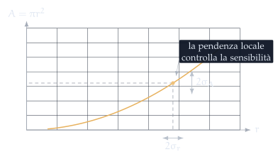

Molte leggi di scala diventano lineari dopo una trasformazione. Se $y=Cx^n$, allora

$$\ln y=\ln C+n\ln x.$$

In un grafico log–log la pendenza fornisce l'esponente $n$ e l'intercetta determina $C$. La linearizzazione facilita il confronto fra modelli, ma modifica anche la distribuzione degli errori: i punti non devono essere pesati tutti allo stesso modo se le incertezze trasformate sono differenti.

::: metodo Controllo di un modello a partire dai dati
1. Identificare grandezze misurate, grandezze derivate e parametri adattati.
2. Riportare unità, risoluzione e incertezza prima di eseguire trasformazioni.
3. Confrontare più rappresentazioni: tabella, grafico lineare, grafico logaritmico e residui.
4. Verificare se gli scarti sono casuali o mostrano una struttura sistematica.
5. Dichiarare l'intervallo in cui il modello è stato verificato; un buon adattamento locale non autorizza un'estrapolazione illimitata.
:::

## Sintesi e autoverifica {#sintesi}

Le unità controllano il significato delle operazioni; i vettori rappresentano direzioni e proiezioni; derivate e integrali collegano variazioni e accumuli. Le equazioni differenziali richiedono dati iniziali o al contorno. Matrici, numeri complessi e Fourier descrivono trasformazioni, fasi e spettri; probabilità e incertezze collegano i modelli ai dati. Per usare una formula occorre riconoscere quale di queste operazioni rappresenta e quali informazioni richiede.

::: sintesi Verifica breve: strumenti e rappresentazioni
Rispondere prima di consultare le soluzioni. I primi due quesiti appartengono al percorso fondamentale; gli altri richiedono calcolo o probabilità.

1. Una velocità ha dimensione $L/T$ e un'accelerazione $L/T^2$. Quale dimensione ha $v^2/a$? Potrebbe rappresentare un tempo?
2. Un vettore ha componenti $(3,4)\,\mathrm{m}$. Calcolarne il modulo e spiegare se cambia ruotando soltanto gli assi cartesiani.
3. La posizione è $x(t)=(3\,\mathrm{m/s^2})t^2$. Ricavare la velocità istantanea a $t=2\un{s}$ e confrontarla con quella media fra 0 e $2\un{s}$.
4. Quattro misure indipendenti danno un'incertezza della media $s/2$. A parità di dispersione $s$, quante misure servono per dimezzarla? Un errore di calibrazione costante viene eliminato?
:::

::: approfondimento Risposte essenziali: strumenti matematici
1. $[v^2/a]=L$: è una lunghezza. Rivedere *Dimensioni fisiche e controllo delle equazioni*.
2. Il modulo è $5\un{m}$ e resta invariato; cambiano le componenti. Rivedere *Rotazione degli assi e grandezze invarianti*.
3. $v(t)=(6\,\mathrm{m/s^2})t$, quindi $v(2\,\mathrm{s})=12\un{m/s}$; la media è $12\,\mathrm{m}/2\,\mathrm{s}=6\un{m/s}$. Rivedere *Differenze finite e derivate*.
4. Servono 16 misure, perché l'incertezza casuale della media scala come $1/\sqrt N$. Il difetto di calibrazione resta. Rivedere *Probabilità, statistica e incertezza di misura*.
:::

## Formulario ragionato {#formulario}

Le relazioni raccolte qui servono come orientamento rapido. Prima di usarle occorre identificare variabili, unità, dominio di validità e approssimazioni. Una formula dimensionalmente corretta può comunque essere fisicamente inadeguata; il controllo delle unità è necessario, non sufficiente.

::: legge Notazione scientifica, ordini di grandezza e conversioni
$$a\times10^m\cdot b\times10^n=(ab)\times10^{m+n},
\qquad
\frac{a\times10^m}{b\times10^n}=\frac ab\times10^{m-n}.$$

Prefissi frequenti:

$$\mathrm{p}=10^{-12},\quad \mathrm{n}=10^{-9},\quad
\mathrm{\mu}=10^{-6},\quad \mathrm{m}=10^{-3},$$

$$\mathrm{k}=10^3,\quad \mathrm{M}=10^6,\quad \mathrm{G}=10^9.$$

I fattori di conversione si trattano come rapporti uguali a uno. Il risultato finale deve avere cifre significative coerenti con l'incertezza dei dati.
:::

::: legge Dimensioni fondamentali e controllo di omogeneità
In meccanica:

$$[x]=L,\quad [t]=T,\quad [m]=M,$$

$$[v]=LT^{-1},\quad [a]=LT^{-2},\quad [F]=MLT^{-2},$$

$$[E]=ML^2T^{-2},\quad [P]=ML^2T^{-3}.$$

Termini sommati o uguagliati devono avere la stessa dimensione. Le funzioni trascendenti $\sin x$, $e^x$, $\ln x$ richiedono argomenti adimensionali.
:::

::: legge Algebra, proporzioni ed equazioni
$$ax+b=c\quad\Rightarrow\quad x=\frac{c-b}{a},\qquad a\ne0.$$

$$ax^2+bx+c=0
\quad\Rightarrow\quad
x=\frac{-b\pm\sqrt{b^2-4ac}}{2a},\qquad a\ne0.$$

Se $y=Cx^n$, allora

$$\frac{y_2}{y_1}=\left(\frac{x_2}{x_1}\right)^n.$$

Per radici reali occorre inoltre $b^2-4ac\ge0$. Una soluzione matematica va accettata soltanto se appartiene al dominio fisico del problema.
:::

::: legge Potenze, esponenziali e logaritmi
$$a^ma^n=a^{m+n},\qquad \frac{a^m}{a^n}=a^{m-n},
\qquad (a^m)^n=a^{mn}.$$

$$\begin{aligned}
\ln(ab)&=\ln a+\ln b, & a&>0,\ b>0,\\
\ln\frac ab&=\ln a-\ln b, & \ln(a^n)&=n\ln a.
\end{aligned}$$

$$y=y_0e^{kt}
\quad\Rightarrow\quad
t=\frac1k\ln\frac{y}{y_0}.$$

Per un decadimento $e^{-\lambda t}$, il tempo di dimezzamento è

$$t_{1/2}=\frac{\ln2}{\lambda}.$$
:::

::: legge Geometria analitica
$$d(A,B)=\sqrt{(x_2-x_1)^2+(y_2-y_1)^2},$$

$$M=\left(\frac{x_1+x_2}{2},\frac{y_1+y_2}{2}\right),
\qquad
m=\frac{y_2-y_1}{x_2-x_1},\qquad x_2\ne x_1.$$

Retta: $y=mx+q$. Circonferenza:

$$(x-x_c)^2+(y-y_c)^2=R^2.$$

Vertice della parabola $y=ax^2+bx+c$:

$$x_V=-\frac{b}{2a},\qquad y_V=f(x_V).$$

Aree e volumi scalano rispettivamente come il quadrato e il cubo del fattore lineare.
:::

::: legge Trigonometria e radianti
$$\sin\theta=\frac{\text{opposto}}{\text{ipotenusa}},
\quad
\cos\theta=\frac{\text{adiacente}}{\text{ipotenusa}},
\quad
\tan\theta=\frac{\sin\theta}{\cos\theta}.$$

$$\sin^2\theta+\cos^2\theta=1,
\qquad
\theta_{rad}=\theta_{deg}\frac{\pi}{180}.$$

Legge dei seni e del coseno:

$$\frac a{\sin\alpha}=\frac b{\sin\beta}=\frac c{\sin\gamma},$$

$$c^2=a^2+b^2-2ab\cos\gamma.$$

Per $|\theta|\ll1$ rad:

$$\sin\theta\simeq\theta,
\quad
\tan\theta\simeq\theta,
\quad
\cos\theta\simeq1-\frac{\theta^2}{2}.$$
:::

::: legge Funzioni, differenze finite e derivate
Pendenza media:

$$\frac{\Delta f}{\Delta x}
=\frac{f(x+\Delta x)-f(x)}{\Delta x}.$$

Derivata:

$$f'(x)=\lim_{\Delta x\to0}\frac{f(x+\Delta x)-f(x)}{\Delta x}.$$

Differenza centrale:

$$f'(x_i)\simeq\frac{f_{i+1}-f_{i-1}}{2\Delta x}.$$

Regole principali:

$$(x^n)'=nx^{n-1},\quad (fg)'=f'g+fg',$$

$$\left(\frac fg\right)'=\frac{f'g-fg'}{g^2},
\quad
(f\circ g)'=f'(g)g'.$$

$$(e^x)'=e^x,\quad (\ln x)'=\frac1x\quad(x>0),
\quad (\sin x)'=\cos x,
\quad (\cos x)'=-\sin x.$$
:::

::: legge Integrali e somme
$$\int_a^bf(x)\dd x
=\lim_{N\to\infty}\sum_{i=1}^Nf(x_i)\Delta x.$$

Regola dei trapezi:

$$\int_a^bf(x)\dd x\simeq
\sum_i\frac{f_i+f_{i+1}}2\Delta x.$$

Teorema fondamentale:

$$F'=f\quad\Rightarrow\quad
\int_a^bf(x)\dd x=F(b)-F(a).$$

Primitive frequenti:

$$\int x^n\dd x=\frac{x^{n+1}}{n+1}+C\quad(n\ne-1),$$

$$\int\frac{\dd x}{x}=\ln|x|+C,
\quad
\int e^x\dd x=e^x+C,$$

$$\int\cos x\dd x=\sin x+C,
\quad
\int\sin x\dd x=-\cos x+C.$$
:::

::: legge Più variabili e campi
$$\nabla f=
\frac{\partial f}{\partial x}\vers i+
\frac{\partial f}{\partial y}\vers j+
\frac{\partial f}{\partial z}\vers k.$$

Derivata direzionale:

$$D_{\vers u}f=\nabla f\cdot\vers u.$$

Divergenza:

$$\nabla\cdot\vect F=
\frac{\partial F_x}{\partial x}+
\frac{\partial F_y}{\partial y}+
\frac{\partial F_z}{\partial z}.$$

Rotore:

$$\nabla\times\vect F=
\begin{vmatrix}
\vers i&\vers j&\vers k\\
\partial_x&\partial_y&\partial_z\\
F_x&F_y&F_z
\end{vmatrix}.$$
:::

::: legge Integrali di linea, flussi e teoremi integrali
Lavoro o circolazione lungo una curva:

$$\int_C\vect F\cdot\dd\vect r.$$

Flusso attraverso una superficie orientata:

$$\Phi=\iint_S\vect F\cdot\vers n\,\dd S.$$

Teorema della divergenza:

$$\oiint_{\partial V}\vect F\cdot\vers n\,\dd S
=\iiint_V\nabla\cdot\vect F\,\dd V.$$

Teorema di Stokes, per una superficie orientabile regolare e un campo sufficientemente regolare:

$$\oint_{\partial S}\vect F\cdot\dd\vect r
=\iint_S(\nabla\times\vect F)\cdot\vers n\,\dd S.$$

L'orientazione positiva del bordo deve essere compatibile con la normale secondo la regola della mano destra. Il teorema della divergenza richiede un volume regolare a tratti e un campo sufficientemente regolare.
:::

::: legge Equazioni differenziali elementari
Crescita o decadimento:

$$\frac{\dd y}{\dd t}=ky
\quad\Rightarrow\quad
y(t)=y_0e^{kt}.$$

Oscillatore armonico:

$$x”+\omega^2x=0
\quad\Rightarrow\quad
x=A\cos\omega t+B\sin\omega t.$$

Metodo di Eulero:

$$y_{n+1}=y_n+f(t_n,y_n)\Delta t.$$

Le condizioni iniziali determinano le costanti della soluzione. Un metodo numerico richiede controllo del passo e della stabilità.
:::

::: legge Laplaciano ed equazioni alle derivate parziali
$$\nabla^2u=\partial_x^2u+\partial_y^2u+\partial_z^2u.$$

Diffusione:

$$\partial_tu=D\nabla^2u.$$

Equazione delle onde:

$$\partial_t^2u=c^2\nabla^2u.$$

Equazione di Schrödinger dipendente dal tempo:

$$i\hbar\partial_t\psi=-\frac{\hbar^2}{2m}\nabla^2\psi+V\psi\quad\text{(particella non relativistica, potenziale scalare)}.$$

Seconda differenza in una dimensione:

$$\partial_x^2u(x_i)\simeq
\frac{u_{i+1}-2u_i+u_{i-1}}{(\Delta x)^2}.$$

Equazione, condizioni iniziali e condizioni al contorno formano insieme il problema fisico.
:::

::: legge Serie e approssimazioni
$$f(x)=\sum_{k=0}^{n}\frac{f^{(k)}(a)}{k!}(x-a)^k+R_n(x).$$

Per $|x|\ll1$, rispettando anche il dominio delle funzioni:

$$e^x\simeq1+x+\frac{x^2}{2},
\quad
\ln(1+x)\simeq x-\frac{x^2}{2}\quad(x>-1),$$

$$(1+x)^\alpha\simeq1+\alpha x,
\quad
\frac1{1-x}\simeq1+x+x^2\quad(|x|<1).$$

$$\sinh x=\frac{e^x-e^{-x}}2,
\qquad
\cosh x=\frac{e^x+e^{-x}}2,
\qquad
\cosh^2x-\sinh^2x=1.$$

La precisione dipende dal resto $R_n$. La serie infinita coincide con la funzione soltanto se la funzione è analitica e il punto appartiene all'intervallo di convergenza.
:::

::: legge Numeri complessi
$$z=a+ib=re^{i\phi},
\qquad
r=|z|=\sqrt{a^2+b^2},$$

$$\phi=\operatorname{atan2}(b,a),
\qquad
z^*=a-ib,
\qquad
zz^*=|z|^2.$$

Formula di Eulero:

$$e^{i\phi}=\cos\phi+i\sin\phi.$$

Prodotti in forma polare:

$$(r_1e^{i\phi_1})(r_2e^{i\phi_2})
=r_1r_2e^{i(\phi_1+\phi_2)}.$$

In meccanica quantistica, $|\psi(x,t)|^2$ è una densità di probabilità in rappresentazione di posizione; la probabilità su una regione si ottiene integrandola.
:::

::: legge Matrici e autovalori
$$A\vect x=
\begin{pmatrix}a&b\\c&d\end{pmatrix}
\begin{pmatrix}x\\y\end{pmatrix}
=
\begin{pmatrix}ax+by\\cx+dy\end{pmatrix}.$$

$$\det A=ad-bc.$$

Rotazione nel piano:

$$R(\theta)=
\begin{pmatrix}
\cos\theta&-\sin\theta\\
\sin\theta&\cos\theta
\end{pmatrix}.$$

Autovalori e autovettori:

$$A\vect v=\lambda\vect v,
\qquad
\det(A-\lambda I)=0.$$
:::

::: legge Probabilità e incertezza
$$\langle X\rangle=\sum_ip_ix_i,
\qquad
\sigma_X^2=\sum_ip_i(x_i-\langle X\rangle)^2.$$

Per dati $x_1,\ldots,x_N$:

$$\bar x=\frac1N\sum_ix_i,
\qquad
s=\sqrt{\frac1{N-1}\sum_i(x_i-\bar x)^2},$$

$$u_{\bar x}=\frac{s}{\sqrt N}.$$

Questa espressione stima soltanto la componente casuale e presuppone misure indipendenti e identicamente distribuite.
Propagazione linearizzata per variabili indipendenti, incertezze piccole e derivate valutate ai valori centrali:

$$u_q^2\simeq\sum_i
\left(\frac{\partial q}{\partial x_i}u_{x_i}\right)^2.$$
:::

::: legge Onde, frequenze e campionamento
$$y(t)=A\cos(\omega t+\phi),
\qquad
T=\frac{2\pi}{\omega},
\qquad
f=\frac1T=\frac{\omega}{2\pi}.$$

Battimenti:

$$f_b=|f_2-f_1|,
\qquad
f_c=\frac{f_1+f_2}{2}.$$

Campionamento:

$$f_s=\frac1{\Delta t},
\qquad
f_N=\frac{f_s}{2}.$$

In condizioni ideali, per evitare aliasing il segnale deve essere limitato a frequenze inferiori a $f_N$.
:::

::: legge Coordinate polari, cilindriche e sferiche
Piano polare:

$$x=r\cos\theta,
\qquad y=r\sin\theta,
\qquad \dd A=r\dd r\dd\theta.$$

Coordinate sferiche:

$$x=r\sin\theta\cos\phi,
\quad y=r\sin\theta\sin\phi,
\quad z=r\cos\theta,$$

$$\dd V=r^2\sin\theta\dd r\dd\theta\dd\phi.$$

La convenzione sugli angoli deve essere dichiarata, poiché testi diversi possono scambiare i simboli $\theta$ e $\phi$.
:::

## Glossario {#glossario}

- **Probabilità**: Numero fra zero e uno che quantifica il peso di un esito o di un insieme di esiti in un modello aleatorio.

## Esercizi {#esercizi}

Gli esercizi riprendono quelli della dispensa. Ogni soluzione è nascosta finché non la apri: prova prima a impostare il problema da solo.

### Numeri, scale, unità e cifre significative

::: esercizio Dalla scala atomica alla scala astronomica [base]
Un atomo ha diametro approssimativo $1{,}0\times10^{-10}\,\mathrm{m}$. La distanza media Terra–Sole è $1{,}50\times10^{11}\,\mathrm{m}$. Quanti diametri atomici entrerebbero, in linea ideale, in tale distanza? Esprimere il risultato in notazione scientifica e indicarne l'ordine di grandezza.

>>> soluzione
**Impostazione del rapporto.**  Il numero cercato è una lunghezza divisa per una lunghezza:

$$N=\frac{1{,}50\times10^{11}\,\mathrm{m}}{1{,}0\times10^{-10}\,\mathrm{m}}.$$

**Potenze di dieci.**  Nel rapporto si sottraggono gli esponenti:

$$N=\frac{1{,}50}{1{,}0}\times10^{11-(-10)}=1{,}5\times10^{21}.$$

**Interpretazione.**  Il risultato è adimensionale, come deve essere un conteggio. L'ordine di grandezza è $10^{21}$: circa $1{,}5\times10^{21}$ diametri atomici lungo la distanza media Terra–Sole.
:::

::: esercizio Conversione e controllo delle cifre [medio]
Un segnale percorre $3{,}60\,\mathrm{mm}$ in $12{,}0\,\mathrm{\mu s}$. Calcolare la rapidità in $\mathrm{m/s}$ e in $\mathrm{km/h}$, mantenendo un numero di cifre significative coerente con i dati.

>>> soluzione
**Conversione in unità SI.**

$$3{,}60\,\mathrm{mm}=3{,}60\times10^{-3}\,\mathrm{m},
\qquad
12{,}0\,\mathrm{\mu s}=12{,}0\times10^{-6}\,\mathrm{s}.$$

**Rapporto.**

$$v=\frac{3{,}60\times10^{-3}}{12{,}0\times10^{-6}}
=3{,}00\times10^2\,\mathrm{m/s}.$$

**Conversione in chilometri orari.**

$$300\,\mathrm{m/s}\times3{,}6
=1{,}08\times10^3\,\mathrm{km/h}.$$

**Cifre significative.**  Entrambi i dati hanno tre cifre significative; i risultati sono quindi $3{,}00\times10^2\,\mathrm{m/s}$ e $1{,}08\times10^3\,\mathrm{km/h}$.
:::

### Dimensioni fisiche e controllo delle equazioni

::: esercizio Una formula dimensionalmente sospetta [avanzato]
Per la distanza di arresto di un veicolo vengono proposte le relazioni

$$(A)\quad d=\frac{v^2}{2a},
\qquad
(B)\quad d=\frac{v}{2a},
\qquad
(C)\quad d=\frac{2a}{v^2}.$$

Senza usare dati numerici, stabilire quali formule possono avere dimensione di lunghezza.

>>> soluzione
**Dimensioni disponibili.**

$$[v]=LT^{-1},\qquad [a]=LT^{-2}.$$

**Formula A.**

$$\left[\frac{v^2}{a}\right]
=\frac{L^2T^{-2}}{LT^{-2}}=L.$$

La formula A è dimensionalmente compatibile con una distanza.

**Formula B.**

$$\left[\frac{v}{a}\right]=\frac{LT^{-1}}{LT^{-2}}=T.$$

Produce un tempo, non una lunghezza.

**Formula C.**

$$\left[\frac{a}{v^2}\right]=L^{-1}.$$

Produce l'inverso di una lunghezza. Soltanto A supera il controllo dimensionale; ciò non dimostra ancora che sia fisicamente corretta in ogni situazione.
:::

::: esercizio Ricavare una legge dalla scala delle grandezze [avanzato]
La velocità caratteristica $v$ di un'onda su una corda dipende dalla tensione $T$, con dimensione di forza, e dalla densità lineare $\mu$, con dimensione massa per lunghezza. Cercare una relazione del tipo $v=C T^a\mu^b$, dove $C$ è adimensionale.

>>> soluzione
**Dimensioni dei fattori.**

$$[v]=LT^{-1},\qquad [T]=MLT^{-2},\qquad [\mu]=ML^{-1}.$$

**Combinazione generale.**

$$[T^a\mu^b]=M^{a+b}L^{a-b}T^{-2a}.$$

**Confronto degli esponenti.**  Per ottenere $M^0L^1T^{-1}$:

$$a+b=0,\qquad a-b=1,\qquad -2a=-1.$$

Dalla terza equazione $a=1/2$; dalla prima $b=-1/2$. La seconda è allora verificata.

**Risultato.**

$$v=C\sqrt{\frac{T}{\mu}}.$$

Nel modello ideale della corda il fattore adimensionale vale $C=1$, informazione che l'analisi dimensionale da sola non può fornire.
:::

### Algebra delle grandezze: formule, proporzioni ed equazioni

::: esercizio Il tempo di caduta da un balcone [medio]
Nel modello di caduta libera da fermo, l'altezza percorsa è $h=\tfrac12gt^2$. Ricavare simbolicamente $t$, quindi calcolare il tempo necessario per cadere da $h=19{,}6\un{m}$ usando $g=9{,}81\un{m/s^2}$. Spiegare perché si sceglie una sola delle due radici.

>>> soluzione
**Isolamento del quadrato.**

$$h=\frac12gt^2\quad\Rightarrow\quad t^2=\frac{2h}{g}.$$

**Radice quadrata.**

$$t=\pm\sqrt{\frac{2h}{g}}.$$

**Sostituzione.**

$$t=\pm\sqrt{\frac{2(19{,}6)}{9{,}81}}\,\mathrm{s}
=\pm2{,}00\un{s}.$$

**Scelta fisica.**  L'origine dei tempi è fissata all'istante del rilascio. Il valore $-2{,}00\un{s}$ descriverebbe un istante precedente a tale origine e non appartiene all'intervallo studiato. Il tempo di caduta è quindi $2{,}00\un{s}$.
:::

::: esercizio Calibrazione lineare di un sensore [medio]
Un sensore produce una tensione $V=aT+b$, dove $T$ è la temperatura in gradi Celsius. Durante la calibrazione si osservano $V=0{,}80\un{V}$ a $T=10\,{}^\circ\mathrm{C}$ e $V=2{,}30\un{V}$ a $T=40\,{}^\circ\mathrm{C}$. Determinare $a$ e $b$, poi ricavare la temperatura corrispondente a $V=1{,}55\un{V}$.

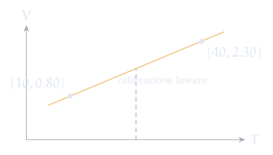
>>> soluzione
**Sistema di calibrazione.**

$$0{,}80=10a+b,\qquad 2{,}30=40a+b.$$

**Eliminazione di $b$.**  Sottraendo la prima equazione dalla seconda:

$$1{,}50=30a\quad\Rightarrow\quad a=0{,}050\,\mathrm{V/°C}.$$

**Intercetta.**

$$b=0{,}80-10(0{,}050)=0{,}30\un{V}.$$

**Inversione della relazione.**

$$T=\frac{V-b}{a}=\frac{1{,}55-0{,}30}{0{,}050}=25{,}0\,{}^\circ\mathrm{C}.$$

Il coefficiente $a$ è la sensibilità del sensore; $b$ è la tensione letta quando la temperatura convenzionale vale zero.
:::

### Potenze, radici, esponenziali e logaritmi

::: esercizio Decadimento e tempo di dimezzamento [medio]
Una quantità radioattiva segue $N(t)=N_0e^{-\lambda t}$ con $\lambda=0{,}173\,\mathrm{h^{-1}}$. Determinare il tempo di dimezzamento e la frazione rimasta dopo $12{,}0\,\mathrm{h}$.

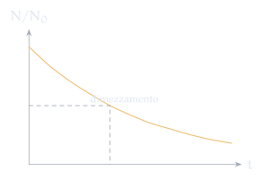
>>> soluzione
**Condizione di dimezzamento.**

$$\frac{N}{N_0}=\frac12=e^{-\lambda t_{1/2}}.$$

**Logaritmo.**

$$\ln\frac12=-\lambda t_{1/2}
\quad\Rightarrow\quad
t_{1/2}=\frac{\ln2}{\lambda}.$$

**Calcolo.**

$$t_{1/2}=\frac{0{,}693}{0{,}173}=4{,}01\un{h}.$$

**Frazione dopo dodici ore.**

$$\frac{N(12)}{N_0}=e^{-0{,}173(12)}=e^{-2{,}076}=0{,}125.$$

Rimane circa il $12{,}5\%$, coerente con tre tempi di dimezzamento: $(1/2)^3=1/8$.
:::

::: esercizio Una legge dell'inverso del quadrato [medio]
L'intensità di una sorgente puntiforme isotropa ideale varia come $I=C/r^2$. A $r_1=2{,}0\un{m}$ si misura $I_1=18\un{W/m^2}$. Calcolare l'intensità a $r_2=5{,}0\un{m}$ senza determinare prima $C$, quindi ricavare $C$ e verificarne l'unità. Per una potenza totale $P$ distribuita uniformemente su sfere concentriche vale $I=P/(4\pi r^2)$, quindi $C=P/(4\pi)$: le dimensioni di $C$ sono quelle di una potenza, ma $C$ non coincide in generale con la potenza totale.

>>> soluzione
**Rapporto fra le intensità.**

$$\frac{I_2}{I_1}=\left(\frac{r_1}{r_2}\right)^2.$$

**Calcolo diretto.**

$$I_2=18\left(\frac{2{,}0}{5{,}0}\right)^2
=18(0{,}16)=2{,}88\un{W/m^2}.$$

**Costante di proporzionalità.**

$$C=I_1r_1^2=18(2{,}0)^2=72\,\mathrm{W}.$$

L'unità è $(\mathrm{W/m^2})(\mathrm{m^2})=\mathrm{W}$. Questa uguaglianza dimensionale non identifica da sola $C$ con la potenza totale: nell'ipotesi isotropa $P=4\pi C$. La stessa costante restituisce $I_2=72/25=2{,}88\un{W/m^2}$.
:::

### Probabilità, statistica e incertezza di misura

::: esercizio Media, dispersione e incertezza della media [avanzato]
Cinque misure di un periodo, in secondi, sono

$$1{,}98,\quad2{,}03,\quad2{,}01,\quad1{,}99,\quad2{,}04.$$

Calcolare media, deviazione standard campionaria e incertezza standard della media.

>>> soluzione
**Media.**

$$\bar T=\frac{1{,}98+2{,}03+2{,}01+1{,}99+2{,}04}{5}
=2{,}010\un{s}.$$

**Scarti quadratici.**

$$\sum(T_i-\bar T)^2
=(-.03)^2+.02^2+0^2+(-.02)^2+.03^2
=0{,}0026\,\mathrm{s^2}.$$

**Deviazione standard campionaria.**

$$s=\sqrt{\frac{0{,}0026}{4}}=0{,}0255\un{s}.$$

**Incertezza della media.**

$$u_{\bar T}=\frac{s}{\sqrt5}=0{,}0114\un{s}.$$

Una presentazione coerente è $\bar T=(2{,}010\pm0{,}011)\,\mathrm{s}$, riferita alla sola componente casuale stimata dal campione.
:::

::: esercizio Propagazione dell'incertezza in una densità [avanzato]
La massa di un cilindro è $m=(250{,}0\pm0{,}5)\,\mathrm{g}$, il raggio $r=(2{,}00\pm0{,}02)\,\mathrm{cm}$ e l'altezza $h=(10{,}00\pm0{,}05)\,\mathrm{cm}$. Calcolare la densità $\rho=m/(\pi r^2h)$ e la sua incertezza relativa assumendo misure indipendenti.

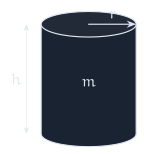
>>> soluzione
**Valore centrale.**

$$V=\pi(2{,}00)^2(10{,}00)=125{,}66\,\mathrm{cm^3},$$

$$\rho=\frac{250{,}0}{125{,}66}=1{,}989\,\mathrm{g/cm^3}.$$

**Incertezza relativa.**  Per prodotti e potenze, dalla propagazione lineare quadratica:

$$\left(\frac{u_\rho}{\rho}\right)^2
\simeq
\left(\frac{u_m}{m}\right)^2+
\left(2\frac{u_r}{r}\right)^2+
\left(\frac{u_h}{h}\right)^2.$$

**Calcolo.**

$$\frac{u_m}{m}=0{,}0020,
\qquad
2\frac{u_r}{r}=0{,}0200,
\qquad
\frac{u_h}{h}=0{,}0050.$$

$$\frac{u_\rho}{\rho}=\sqrt{0{,}0020^2+0{,}0200^2+0{,}0050^2}=0{,}0207.$$

**Incertezza assoluta.**

$$u_\rho=1{,}989(0{,}0207)=0{,}041\,\mathrm{g/cm^3}.$$

Il risultato è $\rho=(1{,}99\pm0{,}04)\,\mathrm{g/cm^3}$. L'incertezza sul raggio domina perché il raggio compare al quadrato.
:::

### Problemi trasversali: Modellizzazione e controllo dei dati

::: esercizio Controllo di coerenza dei dati [avanzato]
Una scheda riporta $A_x=7$, $A_y=-24$, $|\vect A|=26$ e direzione nel quarto quadrante. Stabilire quali informazioni sono coerenti e correggere quella errata.

>>> soluzione
**Quadrante.**  $A_x>0$ e $A_y<0$, quindi la direzione è effettivamente nel quarto quadrante.

**Modulo ricavato dalle componenti.**

$$A=\sqrt{7^2+(-24)^2}=\sqrt{49+576}=\sqrt{625}=25.$$

**Confronto.**  Il valore riportato $26$ non è compatibile con le componenti.

**Correzione.**  Le informazioni coerenti sono $A_x=7$, $A_y=-24$ e il quarto quadrante; il modulo corretto è $25$.
:::

### Problemi di sintesi: strumenti matematici e vettori

::: esercizio Densità e conversione concatenata [medio]
Un campione ha massa $245\un{g}$ e volume $32{,}0\un{cm^3}$. Esprimere la densità in $\mathrm{kg/m^3}$ usando fattori di conversione.
>>> soluzione
**Conversioni.**  $m=0{,}245\,\mathrm{kg}$ e $V=32{,}0\times10^{-6}\,\mathrm{m^3}$.

**Rapporto.**

$$\rho=\frac{m}{V}=\frac{0{,}245}{32{,}0\times10^{-6}}=7656\un{kg/m^3}.$$

**Controllo.**  Il valore è plausibile per un metallo leggero e le unità finali sono quelle richieste.
:::

::: esercizio Test dimensionale su una legge del moto [base]
Per un moto uniformemente accelerato viene proposta la formula $x=v_0t+at$. Stabilire se può essere corretta e proporre una forma dimensionalmente omogenea che rispetti $x(0)=0$.
>>> soluzione
**Dimensioni.**  Il termine $v_0t$ ha dimensione di lunghezza, mentre $at$ ha dimensione di velocità: i due termini non possono essere sommati.

**Correzione.**  Un termine costruito con $a$ e $t$ che abbia dimensione di lunghezza è $at^2$. La legge corretta per accelerazione costante è

$$x=v_0t+\frac12at^2.$$

Il coefficiente $1/2$ non è determinabile con l'analisi dimensionale, ma dall'integrazione della velocità.
:::

::: esercizio Area e propagazione dell'incertezza [base]
Il raggio di un disco è $r=(12{,}5\un{cm}\pm0{,}1\un{cm})$. Calcolare area e incertezza standard linearizzata.
>>> soluzione
**Area.**  Con $r=0{,}125\un{m}$,

$$A=\pi r^2=0{,}0491\un{m^2}.$$

**Propagazione.**  $\sigma_A=|dA/dr|\sigma_r=2\pi r\sigma_r$, dunque

$$\sigma_A=7{,}9\times10^{-4}\un{m^2}.$$

Il risultato può essere scritto $A=(0{,}0491\pm 7{,}9\times10^{-4})\,\mathrm{m^2}$.
:::

::: esercizio Esponente da una legge di potenza [base]
Una grandezza segue $y=Cx^n$. Passando da $x=2$ a $x=6$, $y$ passa da 3 a 81. Determinare $n$.
>>> soluzione
**Rapporto.**  $81/3=(6/2)^n$, cioè $27=3^n$.

**Esponente.**  $n=3$. Il coefficiente sarebbe $C=3/2^3=0{,}375$.
:::

::: esercizio Valore medio e dispersione discreta [base]
Una variabile assume i valori $0,1,3$ con probabilità $0{,}2,0{,}5,0{,}3$. Calcolare valore medio e deviazione standard.
>>> soluzione
**Media.**  $\langle X\rangle=0(0{,}2)+1(0{,}5)+3(0{,}3)=1{,}40$.

**Secondo momento.**  $\langle X^2\rangle=0+1(0{,}5)+9(0{,}3)=3{,}20$.

**Varianza.**  $\sigma^2=\langle X^2\rangle-\langle X\rangle^2=1{,}24$, quindi $\sigma=1{,}11$.
:::

::: esercizio Legge di scala geometrica [base]
Due oggetti geometricamente simili hanno rapporto fra lunghezze lineari pari a 3. Determinare i rapporti fra aree e volumi e discutere il rapporto superficie/volume.
>>> soluzione
**Potenze della scala.**  Le aree crescono come $L^2$, quindi il rapporto è $9$; i volumi come $L^3$, quindi il rapporto è $27$.

**Superficie su volume.**  $A/V\propto1/L$: l'oggetto più grande ha un rapporto superficie/volume tre volte più piccolo. Questa scala è importante per scambi termici e resistenza dei materiali.
:::

## Fonti {#fonti}

Il testo, le formule, i diagrammi e gli esercizi di questo capitolo provengono dalla *Dispensa di fisica* del corso (sezioni 0.1-0.5, 0.36, 0.39-0.40 e materiali delle sezioni 0.22, 0.41, 0.42), consultabile nel lettore della galassia. Per la lettura sul sito sono cambiati l'impaginazione, i colori delle figure, la numerazione e la posizione di alcuni riquadri ed esercizi; la sezione iniziale è scritta per il pianeta di questa unità.

Opere citate nel testo:

1. C. B. Boyer e U. C. Merzbach, *A History of Mathematics*, 3a edizione, Wiley, Hoboken, 2011.
2. V. J. Katz, *A History of Mathematics: An Introduction*, 3a edizione, Addison-Wesley, Boston, 2009.
3. I. Hacking, *The Emergence of Probability*, Cambridge University Press, Cambridge, 1975.
4. S. M. Stigler, *The History of Statistics: The Measurement of Uncertainty before 1900*, Harvard University Press, Cambridge (MA), 1986.
5. H. Minkowski, “Raum und Zeit”, *Physikalische Zeitschrift*, vol. 10, 1909, pp. 104–111.
6. P. A. M. Dirac, *The Principles of Quantum Mechanics*, Clarendon Press, Oxford, 1930.
7. J. von Neumann, *Mathematische Grundlagen der Quantenmechanik*, Springer, Berlino, 1932.
