## Prima di cominciare {#apertura}

Un rover avanza verso est mentre il terreno trascina lateralmente un sensore. Le due componenti della velocità sono note, eppure la loro somma numerica dà un valore sbagliato della rapidità del sensore. Per descrivere spostamenti, velocità e forze occorre una grandezza che porti con sé direzione e verso oltre al modulo.

Il capitolo costruisce il linguaggio vettoriale partendo dalla geometria e dalla trigonometria: sistemi di riferimento e coordinate, somma e differenza, componenti, versori, prodotto scalare e prodotto vettoriale, vettori relativi e cambio di assi. Chiudono il percorso una strategia generale per tradurre una situazione fisica in vettori, molti casi di studio ed esercizi. Il capitolo presuppone le idee sulle [misure e le incertezze](unit:physics-01) e prepara la [cinematica](unit:physics-03).

## Geometria euclidea e geometria analitica {#s-0-6}

::: storia Coordinate, curve ed equazioni
La geometria analitica non nacque semplicemente quando qualcuno disegnò due assi perpendicolari. Nel Seicento Descartes e Fermat svilupparono indipendentemente metodi per mettere in corrispondenza relazioni algebriche e luoghi geometrici, partendo però da prospettive diverse. Fermat tendeva a partire da un'equazione per studiarne il luogo; Descartes affrontava costruzioni geometriche traducendole in relazioni algebriche. Il moderno piano cartesiano è una sistemazione successiva di quelle idee, non una copia letterale delle figure di Descartes.  [1, 2](#fonti)
:::

La geometria analitica fornisce il primo modello quantitativo dello spazio. Nel piano cartesiano, la distanza fra $A=(x_1,y_1)$ e $B=(x_2,y_2)$ deriva dal teorema di Pitagora:

$$d(A,B)=\sqrt{(x_2-x_1)^2+(y_2-y_1)^2}.$$

Il punto medio è

$$M=\left(\frac{x_1+x_2}{2},\frac{y_1+y_2}{2}\right).$$

Una retta non verticale può essere scritta come $y=mx+q$, dove $m$ è la pendenza. Fra due punti,

$$m=\frac{y_2-y_1}{x_2-x_1}.$$

Una circonferenza di centro $(x_c,y_c)$ e raggio $R$ soddisfa

$$(x-x_c)^2+(y-y_c)^2=R^2.$$

La parabola $y=ax^2+bx+c$ compare nelle traiettorie ideali dei proiettili e negli specchi parabolici. L'ellisse compare nelle orbite kepleriane. La geometria analitica permette di passare da una figura a una relazione algebrica e viceversa.

Le similitudini sono altrettanto importanti. Se due triangoli hanno gli stessi angoli, i lati corrispondenti sono proporzionali. Questo principio è alla base della triangolazione, della misura di distanze non direttamente accessibili e dell'uso delle ombre per stimare altezze.

Le formule di area e volume devono essere lette come leggi di scala. Se tutte le lunghezze di un oggetto vengono moltiplicate per $k$, le aree vengono moltiplicate per $k^2$ e i volumi per $k^3$. Per questo un animale geometricamente simile ma due volte più lungo ha massa circa otto volte maggiore, mentre la sezione delle ossa cresce soltanto di un fattore quattro.

## Trigonometria, angoli e radianti {#s-0-7}

Nel triangolo rettangolo, seno, coseno e tangente collegano un angolo ai rapporti fra i lati:

$$\sin\theta=\frac{\text{cateto opposto}}{\text{ipotenusa}},
\quad
\cos\theta=\frac{\text{cateto adiacente}}{\text{ipotenusa}},
\quad
\tan\theta=\frac{\sin\theta}{\cos\theta}.$$

La circonferenza unitaria estende queste funzioni a qualunque angolo. Il punto di coordinate $(\cos\theta,\sin\theta)$ ruota sulla circonferenza e rende visibili i segni nei quattro quadranti.

L'unità naturale dell'angolo è il **radiante**. Un angolo $\theta$ in radianti è definito dal rapporto fra lunghezza dell'arco $s$ e raggio $r$:

$$\theta=\frac{s}{r}.$$

Poiché una circonferenza ha lunghezza $2\pi r$, un giro completo vale $2\pi\,\mathrm{rad}=360^\circ$. Le formule del calcolo differenziale per seno e coseno hanno forma semplice soltanto se l'angolo è espresso in radianti.

Fra le identità più usate:

$$\sin^2\theta+\cos^2\theta=1,$$

$$\sin(\alpha\pm\beta)=\sin\alpha\cos\beta\pm\cos\alpha\sin\beta,$$

$$\cos(\alpha\pm\beta)=\cos\alpha\cos\beta\mp\sin\alpha\sin\beta.$$

Le funzioni inverse $\arcsin$, $\arccos$, $\arctan$ restituiscono un angolo, ma occorre controllare il quadrante con il disegno o con la funzione $\operatorname{atan2}$.

Per angoli piccoli espressi in radianti,

$$\sin\theta\simeq\theta,
\qquad
\tan\theta\simeq\theta,
\qquad
\cos\theta\simeq1-\frac{\theta^2}{2}.$$

Queste approssimazioni sono alla base del pendolo armonico, dell'ottica parassiale e di molte linearizzazioni.

::: nota Nucleo II – Direzioni, componenti e vettori
Quando l'orientamento conta, un solo numero non basta. I vettori permettono di conservare insieme modulo, direzione e verso; la distinzione fra vettore, componenti, origine e osservatore evita molti errori che riappaiono in cinematica e dinamica.
:::

## Perché un numero, da solo, a volte non basta {#s-0-8}

Molte grandezze fisiche sono descritte completamente da un valore numerico e da un'unità di misura. Dire che una bottiglia contiene $1{,}5\un{L}$, che una lezione dura $90\un{min}$ o che una stanza si trova a $22\,{}^\circ\mathrm{C}$ è sufficiente per comunicare la quantità rilevante. Queste grandezze sono dette **scalari**.

Altre grandezze perdono il proprio significato se si omette l'orientamento. Uno spostamento di $2\un{km}$ può portare verso la stazione oppure allontanarsene; una forza di $20\un{N}$ può sollevare un oggetto, comprimerlo contro un tavolo o trascinarlo lateralmente. In questi casi occorre una grandezza **vettoriale**, caratterizzata da modulo, direzione e verso.

La distinzione riguarda l'informazione necessaria, non soltanto la notazione. Il tachimetro di un'automobile misura il modulo della velocità; un sistema di navigazione deve conoscerne anche la direzione. Due automobili con la stessa lettura sul tachimetro possono quindi avere velocità vettoriali opposte.

::: quotidiano Una passeggiata che torna al punto di partenza
Una persona percorre $500\un{m}$ verso nord e poi $500\un{m}$ verso sud. La distanza totale è $1\un{km}$; lo spostamento finale è nullo. La distanza somma la lunghezza dei tratti percorsi, mentre lo spostamento confronta soltanto la posizione finale con quella iniziale. La prima è uno scalare non negativo, il secondo è un vettore.
:::


## Come si è formato il linguaggio vettoriale {#s-0-9}

::: storia Dalla geometria antica al calcolo vettoriale
La geometria antica sapeva confrontare lunghezze, angoli e direzioni molto prima che esistesse la parola “vettore”. Negli *Elementi* di Euclide le grandezze geometriche erano trattate attraverso costruzioni e proporzioni, senza identificarle con coppie o terne di numeri  [3](#fonti). Nel Seicento Descartes e Fermat svilupparono, con metodi differenti e in larga misura indipendenti, modi di collegare equazioni e luoghi geometrici; il moderno piano cartesiano è una sistemazione successiva di quelle idee  [1, 2](#fonti).

La nozione moderna di vettore maturò soprattutto nell'Ottocento. Hamilton introdusse i quaternioni per rappresentare orientamenti e rotazioni nello spazio; Grassmann sviluppò un'algebra delle estensioni molto più generale  [4, 5](#fonti). Alla fine del secolo Gibbs e Heaviside contribuirono, attraverso percorsi in parte indipendenti, alla selezione e alla diffusione del formalismo tridimensionale oggi comune in fisica. Gibbs fu influenzato sia dai quaternioni sia dall'algebra di Grassmann; Heaviside riformulò il calcolo elettromagnetico eliminando la parte scalare dei quaternioni. Somma vettoriale, prodotto scalare e prodotto vettoriale non nacquero quindi da una semplice estrazione lineare da un unico sistema, ma da un confronto fra programmi matematici concorrenti e da esigenze concrete della fisica  [6, 7](#fonti).
:::

La notazione moderna non fu un esito inevitabile. I quaternioni di Hamilton descrivevano efficacemente le rotazioni, ma richiedevano una struttura algebrica più ampia delle sole frecce tridimensionali. Grassmann propose un linguaggio generale per grandezze estensive, rimasto a lungo poco letto. Il calcolo vettoriale di Gibbs e Heaviside si diffuse perché isolava operazioni utili alla fisica matematica del tempo e si adattava bene alle equazioni di Maxwell. Fu una scelta pratica e teorica, non la semplice sostituzione del “vecchio” con il “nuovo”.

Il prodotto vettoriale è particolarmente naturale nello spazio tridimensionale, ma non è l'unico modo di rappresentare aree orientate e rotazioni. Forme differenziali, tensori e algebra geometrica forniscono generalizzazioni più ampie. Qui basta il calcolo vettoriale ordinario, adatto a componenti, proiezioni e risultanti nella meccanica del punto materiale.

I vettori non sono semplici frecce da esercizio: rispondono al problema generale di rappresentare e combinare grandezze orientate senza perdere informazione.

## Riferimenti, assi e coordinate {#s-0-10}

Un vettore geometrico non cambia quando ruotiamo soltanto gli assi usati per descriverlo: in un *cambio di base passivo* cambiano le componenti, non la freccia geometrica. Questo fatto non va confuso con lo spostamento dell'origine né con il passaggio a un osservatore fisico in moto. La posizione di un punto dipende dall'origine; la velocità dipende anche dall'osservatore; le componenti di qualunque vettore dipendono dalla base. Distinguere queste tre operazioni evita di attribuire al fenomeno un cambiamento che appartiene soltanto alla descrizione.

Nel piano si scelgono in genere due assi perpendicolari, $x$ e $y$, e i versori $\vers i$ e $\vers j$. Un versore è un vettore di modulo unitario che fissa una direzione positiva. Ogni vettore del piano può essere scritto come

$$\vect A=A_x\vers i+A_y\vers j.$$

Le quantità $A_x$ e $A_y$ sono numeri con segno. Il segno non indica una “lunghezza negativa”: segnala il verso rispetto all'asse scelto.

::: nota Il sistema di riferimento è una scelta, non un fatto naturale
In una strada rettilinea possiamo scegliere positivo il verso rivolto verso il centro oppure quello verso la periferia. Entrambe le scelte sono corrette. Cambieranno i segni delle componenti, non il fenomeno. Una soluzione fisica deve essere coerente con la scelta iniziale; non deve cercare di indovinare un verso “assolutamente positivo”.
:::

### Dalla forma geometrica alle componenti

Se un vettore di modulo $A$ forma un angolo $\theta$ con l'asse $x$ positivo, la sua freccia è l'ipotenusa di un triangolo rettangolo. Le componenti sono i cateti orientati:

::: legge Da modulo e direzione alle componenti
$$A_x=A\cos\theta,\qquad A_y=A\sin\theta.
\tag{1}$$
:::

L'equazione (1) è una proiezione sui due assi, non una regola da applicare senza controllare il quadrante.

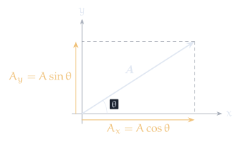

Il risultato va letto prima di essere calcolato. Se il vettore è nel secondo quadrante, $A_x$ deve essere negativo e $A_y$ positivo. Se una calcolatrice restituisce due componenti positive, l'errore è quasi certamente nell'angolo o nell'unità angolare impostata.

Il passaggio inverso utilizza il teorema di Pitagora e una funzione che riconosce il quadrante:

::: legge Da componenti a modulo e direzione
$$A=\sqrt{A_x^2+A_y^2},\qquad
\theta=\operatorname{atan2}(A_y,A_x).$$
:::

La funzione $\operatorname{atan2}$ è preferibile alla sola $\arctan(A_y/A_x)$, perché due vettori opposti possono avere lo stesso rapporto $A_y/A_x$ ma direzioni differenti di $180^\circ$.

::: quotidiano Coordinate sullo schermo e coordinate nel mondo
Lo schermo di uno smartphone usa spesso un asse verticale orientato verso il basso, mentre nei grafici matematici l'asse $y$ è di solito orientato verso l'alto. Lo stesso spostamento del dito può quindi avere componenti di segno diverso nei due sistemi. I software di grafica, i videogiochi, la robotica e i sistemi GIS devono dichiarare con precisione la convenzione adottata.
:::

### Rotazione degli assi e grandezze invarianti

Le componenti di un vettore dipendono dalla base scelta, mentre il vettore geometrico non cambia. Se gli assi vengono ruotati in senso antiorario di un angolo $\theta$, le nuove componenti sono

$$\begin{pmatrix}v_{x'}\\v_{y'}\end{pmatrix}
=
\begin{pmatrix}
\cos\theta&\sin\theta\\
-\sin\theta&\cos\theta
\end{pmatrix}
\begin{pmatrix}v_x\\v_y\end{pmatrix}.$$

Questa è una rotazione *passiva*: cambia la descrizione, non la freccia nello spazio.

::: approfondimento Dimostrazione: Conservazione del modulo sotto una rotazione
**Ipotesi.** La matrice $R$ è la matrice di rotazione piana scritta sopra e $\vect v'=R\vect v$.

**Passaggi.** Poiché $R^{\mathsf T}R=I$,

$$|\vect v'|^2=(R\vect v)^{\mathsf T}(R\vect v)
=\vect v^{\mathsf T}R^{\mathsf T}R\vect v
=\vect v^{\mathsf T}\vect v=|\vect v|^2.$$

**Significato fisico.** Il numero ottenuto da $v_x^2+v_y^2$ non dipende dall'orientamento arbitrario degli assi. La stessa idea anticipa il ruolo degli invarianti nelle teorie fisiche.

**Limiti di validità.** Una trasformazione generica non conserva il modulo. La proprietà dipende dall'ortogonalità della matrice e dalla metrica euclidea usata.
:::

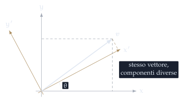

## Somma e differenza: comporre spostamenti, velocità e forze {#s-0-11}

La somma vettoriale traduce una successione di cambiamenti. Se una persona percorre prima $\vect s_1$ e poi $\vect s_2$, lo spostamento complessivo è

$$\vect s=\vect s_1+\vect s_2.$$

Geometricamente si porta la coda del secondo vettore sulla punta del primo. Il vettore risultante congiunge il punto iniziale con quello finale. In componenti, la stessa costruzione diventa

$$\vect A+\vect B=(A_x+B_x)\vers i+(A_y+B_y)\vers j.$$


La differenza $\vect A-\vect B$ si interpreta come somma con il vettore opposto, $\vect A+(-\vect B)$. È la forma naturale con cui si calcolano errori, variazioni e grandezze relative. La variazione di velocità, per esempio, è $\Delta\vect v=\vect v_f-\vect v_i$.

Moltiplicare un vettore per uno scalare $\lambda$ significa cambiarne il modulo di un fattore $|\lambda|$. Se $\lambda<0$, il verso si inverte. Questa operazione compare continuamente nelle leggi fisiche: la quantità di moto è $m\vect v$, il peso è $m\vect g$, la forza elastica è $-k\vect x$.

::: nota Guida alla lettura
Quando più vettori sono espressi nello stesso sistema di riferimento, la somma per componenti è una contabilità separata delle direzioni. Ciò che accade lungo $x$ non viene confuso con ciò che accade lungo $y$. Il metodo non sostituisce il disegno: il disegno previene errori di verso, il calcolo produce il valore preciso.
:::

## Versori, proiezioni e componenti lungo direzioni oblique {#s-0-12}

Il versore associato a un vettore non nullo è

$$\vers u_A=\frac{\vect A}{|\vect A|}.$$

Esso conserva direzione e verso, ma ha modulo unitario. È utile quando si vuole separare la geometria dalla grandezza fisica. Possiamo scrivere, per esempio, $\vect v=v\vers u_v$: il numero $v$ dice quanto rapidamente ci si muove, il versore dice dove.

Una **proiezione** misura quanta parte di un vettore agisce lungo una direzione scelta. Se $\vers u$ è un versore, la componente scalare di $\vect A$ lungo $\vers u$ è

$$A_{\parallel}=\vect A\cdot\vers u,$$

mentre la proiezione vettoriale è

$$\operatorname{proj}_{\vers u}\vect A=(\vect A\cdot\vers u)\vers u.$$

::: quotidiano Una salita non usa tutta la velocità del ciclista
Un ciclista può avere velocità di modulo $8\un{m/s}$, ma soltanto la componente lungo la pendenza contribuisce all'aumento di quota. La componente orizzontale descrive l'avanzamento sulla carta; quella verticale descrive quanto rapidamente cresce l'altitudine. Le applicazioni sportive ricavano questi valori combinando GPS, barometro e sensori inerziali.
:::

## Prodotto scalare: misurare l'allineamento {#s-0-13}

Per due vettori del piano o dello spazio,

::: legge Prodotto scalare
$$\vect A\cdot\vect B=A_xB_x+A_yB_y+A_zB_z=AB\cos\varphi,$$
:::

dove $\varphi$ è l'angolo minore tra i due vettori. Il prodotto scalare è positivo quando i vettori puntano prevalentemente nello stesso verso, nullo quando sono perpendicolari, negativo quando puntano prevalentemente in versi opposti.

Questa operazione può essere letta come “modulo di un vettore per componente dell'altro nella sua direzione”. Non crea un nuovo vettore: restituisce uno scalare. In meccanica il lavoro di una forza costante è $W=\vect F\cdot\vect s$. Una forza perpendicolare allo spostamento non compie lavoro su quel tratto; una forza opposta allo spostamento compie lavoro negativo.

::: quotidiano Spingere un carrello
Se si spinge il manico di un carrello inclinato verso il basso, la componente orizzontale della forza accelera il carrello; la componente verticale aumenta la pressione sul pavimento. Due persone possono applicare la stessa forza totale ma ottenere effetti diversi scegliendo angoli diversi. La proiezione permette di separare questi effetti.
:::

## Prodotto vettoriale: orientazione, area e rotazione {#s-0-14}

Il prodotto vettoriale $\vect A\times\vect B$ è un vettore perpendicolare al piano individuato da $\vect A$ e $\vect B$. Il suo modulo è

$$|\vect A\times\vect B|=AB\sin\varphi.$$

Il verso si determina con la regola della mano destra. In componenti,

$$\vect A\times\vect B=
\begin{vmatrix}
\vers i&\vers j&\vers k\\
A_x&A_y&A_z\\
B_x&B_y&B_z
\end{vmatrix}.$$

Il modulo coincide con l'area del parallelogramma costruito sui due vettori. In dinamica la stessa struttura descrive il momento torcente $\vect\tau=\vect r\times\vect F$: conta la parte della forza perpendicolare al braccio.

::: quotidiano Perché la maniglia è lontana dai cardini
Spingere una porta vicino ai cardini richiede molta più forza che spingerla dalla maniglia. Il motivo non è che la porta “pesi di più” vicino ai cardini. Cambia il braccio $r$ e quindi il momento $\tau=rF\sin\varphi$. Anche la direzione conta: una spinta quasi parallela alla porta produce poco momento.
:::

## Vettori relativi: ciò che si osserva dipende da chi osserva {#s-0-15}

Quando una grandezza è misurata rispetto a un sistema mobile, gli indici devono chiarire il riferimento. La velocità di $A$ rispetto a $C$ si ottiene da

::: legge Composizione galileiana delle velocità
$$\vect v_{A/C}=\vect v_{A/B}+\vect v_{B/C}.$$
:::

Una persona che cammina nel corridoio di un treno possiede una velocità rispetto al vagone e una diversa velocità rispetto al suolo. Un nuotatore possiede una velocità rispetto all'acqua e una diversa velocità rispetto alla riva. La relazione è galileiana: vicino alla velocità della luce deve essere sostituita dalla composizione relativistica delle velocità. La relazione vettoriale impedisce di sommare grandezze riferite a sistemi diversi senza dichiararlo.

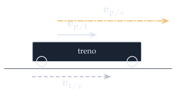

## Vettori liberi, vettori applicati e posizione del punto di applicazione {#s-0-16}

Nel linguaggio elementare un vettore viene spesso rappresentato come una freccia che può essere traslata parallelamente senza cambiare significato. Questa rappresentazione descrive un **vettore libero**: contano modulo, direzione e verso, mentre non conta il punto in cui la freccia viene disegnata. Uno spostamento di $3\un{m}$ verso est, per esempio, può essere riportato in qualunque zona del foglio purché la lunghezza e l'orientamento restino gli stessi.

Non tutte le grandezze vettoriali possono però essere trattate in questo modo. Una forza applicata a un corpo rigido produce effetti che dipendono anche dal punto di applicazione. Spingere una porta presso la maniglia e spingerla vicino ai cardini non sono operazioni equivalenti, benché la forza possa avere lo stesso modulo e la stessa direzione. In questo caso si parla di **vettore applicato**: alla freccia deve essere associata una linea d'azione e, quando si studia la rotazione, anche la posizione rispetto a un polo.

La posizione di un punto viene invece rappresentata mediante un **vettore posizione**

$$\vect r= x\vers i+y\vers j+z\vers k,$$

che parte dall'origine scelta e termina nel punto. Cambiando origine, cambiano le componenti di $\vect r$, ma non cambia il punto fisico. La differenza tra due vettori posizione,

$$\Delta\vect r=\vect r_B-\vect r_A,$$

è lo spostamento da $A$ a $B$. Questa differenza non dipende dalla scelta dell'origine: se la stessa traslazione viene aggiunta a entrambe le posizioni, essa si elimina nella sottrazione.

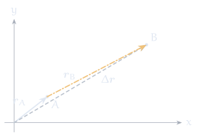

::: nota Tre domande prima di usare una freccia
Quando compare una grandezza vettoriale, conviene chiedersi: la freccia può essere traslata senza cambiare il problema? Il punto di applicazione produce effetti rotatori? La freccia rappresenta una posizione rispetto a un'origine oppure una differenza tra due posizioni? Queste domande evitano di trattare nello stesso modo oggetti geometrici che hanno ruoli fisici differenti.
:::

## Cambio di assi: il vettore resta, le componenti cambiano {#s-0-17}

Le componenti non sono proprietà assolute del vettore. Esse sono i coefficienti che descrivono il vettore dopo avere scelto una base e i relativi assi. Se gli assi vengono ruotati, la freccia fisica resta la stessa, mentre cambiano i numeri con cui viene descritta. Questo fatto è essenziale nei piani inclinati, nella navigazione, nella robotica e in qualunque problema in cui una direzione naturale non coincida con gli assi orizzontale e verticale.

Consideriamo due sistemi di assi con la stessa origine. Il sistema $(x',y')$ è ruotato di un angolo $\alpha$ in senso antiorario rispetto a $(x,y)$. I nuovi versori sono

$$\vers i'=\cos\alpha\,\vers i+\sin\alpha\,\vers j,
\qquad
\vers j'=-\sin\alpha\,\vers i+\cos\alpha\,\vers j.$$

Le componenti del vettore lungo i nuovi assi si ottengono mediante proiezioni:

::: legge Componenti dopo una rotazione degli assi
$$A_{x'}=A_x\cos\alpha+A_y\sin\alpha,
\qquad
A_{y'}=-A_x\sin\alpha+A_y\cos\alpha.$$
:::

Queste equazioni non ruotano il vettore: ruotano il modo con cui lo si misura. Per controllare il risultato, il modulo deve rimanere invariato:

$$A_x^2+A_y^2=A_{x'}^2+A_{y'}^2.$$

Se il modulo cambia, il calcolo contiene un errore.

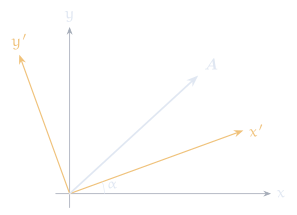

::: esempio La stessa forza in due sistemi di assi
Una forza ha componenti $\vect F=(30,40)\,\mathrm{N}$ negli assi orizzontale e verticale. Si scelgono nuovi assi ruotati di $30^\circ$. Le componenti diventano

$$F_{x'}=30\cos30^\circ+40\sin30^\circ=45{,}98\un{N},$$

$$F_{y'}=-30\sin30^\circ+40\cos30^\circ=19{,}64\un{N}.$$

Il modulo nei vecchi assi è $\sqrt{30^2+40^2}=50\un{N}$. Nei nuovi assi,

$$\sqrt{45{,}98^2+19{,}64^2}=50{,}0\un{N},$$

salvo gli arrotondamenti. La forza non è cambiata; è cambiata la descrizione.
:::

## Equazioni vettoriali e vincoli geometrici {#s-0-18}

Un'equazione vettoriale rappresenta simultaneamente più equazioni scalari. Nel piano,

$$\vect A+\vect B=\vect C$$

equivale a

$$A_x+B_x=C_x,
\qquad
A_y+B_y=C_y.$$

Questa equivalenza spiega perché la scelta degli assi sia così potente: un problema geometrico viene trasformato in un sistema di equazioni ordinarie. Il passaggio non deve però nascondere la geometria. Prima di scrivere le componenti occorre stabilire quali direzioni siano note e quali moduli siano incogniti.

Un caso tipico è l'equilibrio di un nodo sostenuto da cavi. Ogni tensione agisce lungo il proprio cavo. Se il nodo è fermo,

$$\vect T_1+\vect T_2+\vect P=\vect0.$$

Le componenti orizzontali delle tensioni devono annullarsi, mentre le componenti verticali devono sostenere il peso. Il sistema di equazioni non nasce da una formula da ricordare: nasce dal disegno delle tre interazioni e dalla condizione geometrica di risultante nulla.

::: metodo Come risolvere un'equazione vettoriale con incognite
1. Disegnare tutti i vettori con versi plausibili.
2. Scegliere assi che rendano semplici il maggior numero possibile di vettori.
3. Scrivere ogni vettore in componenti mantenendo le incognite simboliche.
4. Uguagliare separatamente le componenti lungo ciascun asse.
5. Risolvere il sistema scalare e controllare il segno delle soluzioni.
6. Tornare al disegno: una soluzione negativa può indicare che il verso ipotizzato era opposto, non necessariamente che il calcolo sia errato.
:::

## Misure vettoriali, risoluzione e incertezza {#s-0-19}

Nel modello matematico una componente può essere un numero esatto. In laboratorio o in un'applicazione tecnica, invece, ogni componente deriva da una misura. Una bussola ha una risoluzione angolare; un ricevitore satellitare fornisce coordinate con un'incertezza; un sensore inerziale presenta rumore e deriva. Di conseguenza anche modulo e direzione del vettore ricostruito sono incerti.

Supponiamo di misurare $A_x$ e $A_y$ con incertezze $u_x$ e $u_y$. Per capire l'effetto sul modulo senza usare il calcolo differenziale, si possono costruire casi estremi plausibili:

$$A_{\min}\approx
\sqrt{\max(|A_x|-u_x,0)^2+\max(|A_y|-u_y,0)^2},$$

$$A_{\max}\approx
\sqrt{(|A_x|+u_x)^2+(|A_y|+u_y)^2}.$$

Questi limiti sono una stima di caso peggiore ottenuta trattando le componenti come intervalli indipendenti; non costituiscono un intervallo di confidenza statistico. L'uso di $\max(\cdot,0)$ è necessario quando l'intervallo di una componente attraversa lo zero: il minimo modulo compatibile di quella componente è allora zero.

L'intervallo è prudente e spesso sovrastima l'incertezza, ma rende visibile l'effetto degli errori nelle componenti. Se gli errori sono indipendenti e piccoli, una stima statistica più precisa può essere ottenuta con metodi di propagazione. In ogni caso, il numero finale non possiede più cifre affidabili dei dati da cui proviene.

Anche l'angolo diventa instabile quando il modulo è molto piccolo. Se $A_x$ e $A_y$ sono entrambi vicini alla risoluzione dello strumento, una piccola variazione può cambiare molto la direzione calcolata. In tali condizioni ha poco senso riportare l'angolo con decimi di grado.

::: approfondimento Caso di studio: Direzione del vento stimata da due componenti
Una stazione meteorologica ricostruisce una velocità del vento con componenti

$$v_x=(4{,}0\pm0{,}3)\,\un{m/s},
\qquad
v_y=(3{,}0\pm0{,}3)\,\un{m/s}.$$

Il valore centrale del modulo è $5{,}0\,\un{m/s}$. Usando gli estremi simultanei si ottiene un intervallo prudente compreso circa tra

$$\sqrt{3{,}7^2+2{,}7^2}=4{,}58\un{m/s}$$

e

$$\sqrt{4{,}3^2+3{,}3^2}=5{,}42\un{m/s}.$$

La direzione centrale è $\arctan(3/4)=36{,}9^\circ$. Il dato ragionevole è quindi un vento di circa $5{,}0\,\un{m/s}$ diretto a circa $37^\circ$, accompagnato dall'incertezza; scrivere $5{,}000\,\un{m/s}$ e $36{,}87^\circ$ darebbe una precisione inesistente.
:::

## Una strategia generale per tradurre una situazione in vettori {#s-0-20}

La difficoltà principale non è quasi mai eseguire una somma, ma decidere che cosa sommare. Un testo può descrivere spostamenti successivi, velocità relative, forze concorrenti o proiezioni lungo una direzione. Le parole “verso”, “rispetto a”, “lungo”, “perpendicolare” e “risultante” contengono informazioni geometriche che devono essere tradotte nel diagramma e nelle componenti.

Una traduzione affidabile procede dal fenomeno al diagramma, dal diagramma alle componenti e solo alla fine ai numeri. L'ordine inverso produce spesso risultati formalmente corretti ma riferiti alla grandezza sbagliata. In navigazione, per esempio, la velocità rispetto all'acqua non può essere divisa direttamente per la larghezza del fiume se la barca non punta perpendicolarmente alla riva; occorre prima estrarre la componente trasversale. In statica, il peso non può essere sommato ai moduli delle tensioni senza considerarne i versi. In geometria, l'angolo ottenuto con una tangente inversa deve essere collocato nel quadrante corretto.

::: sintesi Controlli che precedono la calcolatrice
- Ogni vettore ha un riferimento e un'unità di misura dichiarati.
- Il disegno permette di prevedere il segno delle componenti.
- Vettori sommati o sottratti appartengono allo stesso spazio fisico e allo stesso sistema di riferimento.
- Il risultato possiede unità, quadrante e ordine di grandezza plausibili.
- Le cifre riportate sono compatibili con la precisione dei dati.
:::

## Dal mondo reale al modello vettoriale {#s-0-21}

Nei problemi scolastici la direzione di una strada, la velocità del vento o l'inclinazione di una fune sono dati esattamente. Nelle applicazioni reali queste quantità sono misurate e quindi possiedono incertezza. Un ricevitore GPS stima la posizione a intervalli di tempo; una bussola digitale è influenzata da campi magnetici locali; un accelerometro registra anche vibrazioni e rumore. Il modello vettoriale rimane valido, ma i dati non sono perfetti.

Un buon procedimento mantiene separate tre fasi:

1. **idealizzazione**: si decide quali aspetti della situazione contano;
2. **rappresentazione**: si scelgono assi, versi e vettori;
3. **calcolo e controllo**: si operano le componenti e si verifica se il risultato è compatibile con il disegno, le unità e l'ordine di grandezza.

::: metodo Una procedura affidabile
1. Disegnare gli assi e scrivere i versi positivi.
2. Tradurre ogni dato in un vettore, con unità e riferimento espliciti.
3. Passare alle componenti soltanto dopo aver compreso il quadrante.
4. Eseguire somme, differenze o proiezioni sulle componenti.
5. Ricostruire modulo e direzione alla fine.
6. Controllare il risultato con il disegno: segni, quadrante, unità e ordine di grandezza devono essere plausibili.
:::

## Coordinate curvilinee e trasformazioni utili {#s-0-38}

Le coordinate cartesiane non sono sempre la scelta più naturale. In un problema con simmetria circolare si usano coordinate polari nel piano:

$$x=r\cos\theta,
\qquad
y=r\sin\theta,$$

$$r=\sqrt{x^2+y^2},
\qquad
\theta=\operatorname{atan2}(y,x).$$

L'elemento di area non è semplicemente $\dd r\dd\theta$, perché una piccola variazione angolare copre un arco lungo $r\dd\theta$:

$$\dd A=r\dd r\dd\theta.$$

In tre dimensioni, le coordinate cilindriche $(r,\theta,z)$ sono adatte a fili, tubi e simmetrie assiali. Le coordinate sferiche $(r,\theta,\phi)$ sono adatte a campi centrali, onde sferiche e atomi. Con la convenzione $\theta$ angolo polare e $\phi$ azimut,

$$x=r\sin\theta\cos\phi,
\quad
y=r\sin\theta\sin\phi,
\quad
z=r\cos\theta.$$

L'elemento di volume è

$$\dd V=r^2\sin\theta\dd r\dd\theta\dd\phi.$$

Il fattore $r^2\sin\theta$ è il Jacobiano della trasformazione e descrive come piccoli intervalli di coordinate si trasformano in volume fisico.

## Casi di studio e attività sperimentali {#casi}

### Caso di studio: Una traccia GPS con incertezza

Consideriamo due posizioni locali, espresse rispetto a un'origine scelta sulla mappa:

$$\vect r_A=(0,0)\ \mathrm{m},\qquad
\vect r_B=(36,48)\ \mathrm{m}.$$

Tra i due campioni trascorrono $10\un{s}$. Lo spostamento stimato è

$$\Delta\vect r=(36,48)\ \mathrm{m},
\qquad |\Delta\vect r|=\sqrt{36^2+48^2}=60\un{m},$$

e la velocità media vettoriale è

$$\vect v_m=\frac{\Delta\vect r}{\Delta t}=(3{,}6,4{,}8)\ \un{m/s},
\qquad |\vect v_m|=6{,}0\un{m/s}.$$

Supponiamo ora che ciascuna coordinata abbia un'incertezza standard di circa $3\un{m}$ e che gli errori dei due campioni siano indipendenti. L'incertezza di ciascuna componente dello spostamento è allora circa

$$u_{\Delta x}=u_{\Delta y}\simeq\sqrt{3^2+3^2}=4{,}2\un{m}.$$

Propagando questa incertezza sul modulo si ottiene, in prima approssimazione, $u_{|\Delta r|}\simeq4{,}2\un{m}$ e quindi $u_{v_m}\simeq0{,}42\un{m/s}$. Il risultato sensato non è dunque “$6{,}000\un{m/s}$”, ma circa $6{,}0\un{m/s}$ con un'incertezza dell'ordine di $0{,}4\un{m/s}$.


La figura 9 mostra anche un limite del modello: il segmento tra $A$ e $B$ fornisce lo spostamento, ma non ricostruisce il percorso seguito fra i campioni. Per stimare la distanza occorrono campioni più fitti e un criterio di filtraggio; campionare troppo spesso, tuttavia, può far sommare il rumore come se fosse movimento reale.

### Caso di studio: Rotta di un drone con vento laterale

Un drone mantiene una velocità rispetto all'aria di $12\un{m/s}$ verso nord. Il vento soffia a $5\un{m/s}$ verso est. Rispetto al suolo,

$$\vect v_{d/s}=5\vers i+12\vers j,$$

quindi

$$|\vect v_{d/s}|=\sqrt{5^2+12^2}=13\un{m/s},
\qquad
\alpha=\arctan\frac{5}{12}=22{,}6^\circ$$

a est del nord. Se il pilota vuole invece procedere esattamente verso nord, la componente est-ovest della velocità rispetto all'aria deve annullare il vento. La prua va orientata controvento con

$$12\sin\beta=5\quad\Rightarrow\quad \beta=24{,}6^\circ,$$

e la velocità effettiva verso nord diventa $12\cos\beta=10{,}9\un{m/s}$.

Il calcolo distingue tre grandezze: velocità del drone rispetto all'aria, dell'aria rispetto al suolo e del drone rispetto al suolo. Confonderle porta a una rotta errata anche se ogni numero, preso da solo, è corretto. Nella pratica il vento varia nello spazio e nel tempo; il modello a vento costante è una prima previsione da aggiornare con nuove misure.

### Attività sperimentale: Distanza e spostamento con una mappa o un cortile

**Obiettivo.**  distinguere operativamente la lunghezza del percorso dallo spostamento vettoriale e valutare l'effetto dell'incertezza di misura.

**Materiali o dati.**  metro a nastro oppure mappa in scala, foglio quadrettato e calcolatrice; facoltativo, GPS dello smartphone.

**Procedura.**

1. Scegliere un'origine e due assi riconoscibili.
2. Registrare almeno sei posizioni successive durante un percorso chiuso o quasi chiuso.
3. Calcolare i vettori spostamento tra campioni e sommarli.
4. Confrontare il modulo dello spostamento totale con la somma dei moduli dei singoli tratti.
5. Ripetere il calcolo usando dati GPS e confrontare i risultati.

**Controllo e discussione.**  verificare se la distanza stimata cambia aumentando il numero di campioni e se un percorso chiuso restituisce, entro l'incertezza, uno spostamento nullo. Separare le differenze dovute al percorso reale da quelle introdotte dallo strumento e dalla discretizzazione.

## Esempi svolti {#esempi}

::: esempio Componenti in un quadrante non immediato
Un vettore di modulo $14\un{m}$ forma un angolo di $130^\circ$ con l'asse $x$ positivo. Determinare componenti e versore.

Poiché il vettore si trova nel secondo quadrante, la componente $x$ deve essere negativa e la componente $y$ positiva:

$$A_x=14\cos130^\circ\simeq -9{,}00\un{m},\qquad
A_y=14\sin130^\circ\simeq 10{,}72\un{m}.$$

Quindi

$$\vect A=(-9{,}00\vers i+10{,}72\vers j)\,\mathrm{m}.$$

Il versore si ottiene dividendo per il modulo:

$$\vers u_A=(-0{,}643\vers i+0{,}766\vers j).$$

Il controllo $\sqrt{(-9{,}00)^2+(10{,}72)^2}\simeq14$ conferma il risultato.
:::

::: esempio Rotta risultante e rotta di ritorno
Un escursionista percorre $4\un{km}$ verso est, poi $6\un{km}$ verso nord e infine $3\un{km}$ a $210^\circ$ rispetto all'est. Trovare lo spostamento totale e la rotta diretta di ritorno.

Le tre tappe sono

$$\vect s_1=(4,0),\qquad \vect s_2=(0,6),\qquad
\vect s_3=(3\cos210^\circ,3\sin210^\circ)=(-2{,}598,-1{,}500)$$

in chilometri. La risultante vale

$$\vect R=(1{,}402,4{,}500)\,\mathrm{km}.$$

Il modulo e la direzione sono

$$R=\sqrt{1{,}402^2+4{,}500^2}=4{,}71\un{km},\qquad
\theta=\operatorname{atan2}(4{,}500,1{,}402)=72{,}7^\circ.$$

La rotta di ritorno è il vettore opposto $-\vect R$, con lo stesso modulo e direzione $252{,}7^\circ$.
:::

::: esempio Proiezione lungo un piano inclinato
Una forza $\vect F=(40\vers i-10\vers j)\,\mathrm{N}$ agisce vicino a un piano inclinato di $30^\circ$. Determinare le componenti tangenziale e normale al piano.

Scegliamo i versori

$$\vers t=(\cos30^\circ,\sin30^\circ),\qquad
\vers n=(-\sin30^\circ,\cos30^\circ).$$

Le componenti scalari sono

$$F_t=\vect F\cdot\vers t=40\cos30^\circ-10\sin30^\circ=29{,}64\un{N},$$

$$F_n=\vect F\cdot\vers n=-40\sin30^\circ-10\cos30^\circ=-28{,}66\un{N}.$$

Il segno negativo di $F_n$ indica che la forza è diretta in parte verso il piano, cioè nel verso opposto a $\vers n$.
:::

::: esempio Attraversamento senza deriva
Un fiume scorre verso est a $1{,}5\un{m/s}$. Una barca può muoversi rispetto all'acqua a $3{,}0\un{m/s}$. Quale direzione deve mantenere per raggiungere il punto esattamente opposto?

Poniamo $x$ verso est e $y$ verso la sponda opposta. Per annullare la deriva occorre

$$v_{b/a,x}+v_{a/r,x}=0,$$

quindi la componente verso ovest della barca deve valere $1{,}5\un{m/s}$. Se $\alpha$ è l'angolo a ovest della perpendicolare alla riva,

$$3\sin\alpha=1{,}5\quad\Rightarrow\quad \alpha=30^\circ.$$

La velocità effettiva di attraversamento è

$$v_y=3\cos30^\circ=2{,}60\un{m/s}.$$

La barca deve dunque puntare $30^\circ$ controcorrente rispetto alla direzione perpendicolare alle rive.
:::

## Sintesi e autoverifica {#sintesi}

I vettori sono il vocabolario della meccanica. La posizione, la velocità e l'accelerazione descriveranno il moto; le forze spiegheranno come il moto cambia. In tutti questi casi la stessa regola resterà centrale: prima si sceglie il riferimento, poi si separano le direzioni, infine si ricompone il risultato fisico.

::: sintesi Sintesi del nucleo vettoriale
- Uno scalare contiene valore e unità; un vettore contiene anche orientamento.
- Le componenti dipendono dagli assi, il vettore fisico no.
- Sommare vettori significa comporre cambiamenti orientati.
- Il prodotto scalare misura una proiezione e restituisce uno scalare.
- Il prodotto vettoriale misura un'area orientata e prepara lo studio delle rotazioni.
- Le grandezze relative richiedono sempre l'indicazione del riferimento.
:::

::: sintesi Autoverifica del nucleo vettoriale
Senza consultare il formulario, verificare di saper:

1. spiegare perché distanza e spostamento possono differire;
2. prevedere il segno delle componenti senza affidarsi al risultato numerico;
3. scegliere tra somma, differenza, proiezione e prodotto vettoriale in una situazione descritta a parole;
4. dichiarare il riferimento di una velocità relativa;
5. stimare come un'incertezza nelle componenti si rifletta sul modulo.
:::

::: nota Anteprima delle applicazioni fisiche
Alcuni esercizi usano parole come forza, lavoro o equilibrio per applicare la geometria dei vettori. Le leggi che stabiliscono quando un corpo è in equilibrio e come una forza modifica il moto saranno introdotte in Dinamica. Lo strumento matematico resta distinto dalla legge fisica che lo utilizza.
:::

::: nota Nucleo III – Funzioni, approssimazioni e calcolo
Una legge fisica descrive spesso come una grandezza cambia. I grafici rendono visibile questa variazione; differenze finite e somme permettono di lavorare con dati campionati; limiti, derivate e integrali formulano la stessa idea nel continuo.
:::

## Formulario ragionato {#formulario}

Le relazioni seguenti riuniscono il nucleo operativo del capitolo. Il formulario non sostituisce il disegno: prima di scegliere una formula occorre fissare assi, versi, unità e significato fisico dei vettori. Gli angoli sono misurati in senso antiorario dall'asse $x$ positivo, salvo indicazione diversa.

::: legge Componenti, modulo e direzione
Per $\vect A=A_x\vers i+A_y\vers j$:

$$A=|\vect A|=\sqrt{A_x^2+A_y^2},
\qquad
\theta=\operatorname{atan2}(A_y,A_x).$$

Se sono noti modulo e direzione:

$$A_x=A\cos\theta,
\qquad
A_y=A\sin\theta.$$

In tre dimensioni:

$$\vect A=A_x\vers i+A_y\vers j+A_z\vers k,
\qquad
A=\sqrt{A_x^2+A_y^2+A_z^2}.$$

**Condizione d'uso.** componenti e angoli devono riferirsi agli stessi assi. La funzione $\operatorname{atan2}$ è preferibile a $\arctan(A_y/A_x)$ perché identifica correttamente il quadrante.
:::

::: legge Somma, differenza e moltiplicazione per uno scalare
$$\vect R=\vect A+\vect B
=(A_x+B_x)\vers i+(A_y+B_y)\vers j,$$

$$\vect A-\vect B
=(A_x-B_x)\vers i+(A_y-B_y)\vers j,
\qquad
\lambda\vect A=(\lambda A_x,\lambda A_y).$$

Se $\lambda<0$, il verso si inverte; il modulo diventa $|\lambda|A$.
:::

::: legge Versore e proiezione
Il versore nella direzione di $\vect A\ne\vect0$ è

$$\vers u_A=\frac{\vect A}{|\vect A|}.$$

Se $\vers u$ è unitario, la componente scalare di $\vect A$ lungo $\vers u$ e la corrispondente proiezione vettoriale sono

$$A_u=\vect A\cdot\vers u,
\qquad
\operatorname{proj}_{\vers u}\vect A=(\vect A\cdot\vers u)\vers u.$$

**Attenzione:** se il vettore di direzione $\vect b$ non è unitario,

$$\operatorname{proj}_{\vect b}\vect A=
\frac{\vect A\cdot\vect b}{|\vect b|^2}\vect b.$$
:::

::: legge Prodotto scalare
$$\vect A\cdot\vect B=A_xB_x+A_yB_y+A_zB_z=AB\cos\varphi.$$

Da cui, per vettori non nulli,

$$\cos\varphi=\frac{\vect A\cdot\vect B}{AB}.$$

$\vect A\cdot\vect B>0$ indica un angolo acuto, $=0$ perpendicolarità, $<0$ un angolo ottuso. Per una forza costante e uno spostamento:

$$W=\vect F\cdot\Delta\vect r.$$
:::

::: legge Prodotto vettoriale e area
$$\vect A\times\vect B=
\begin{vmatrix}
\vers i&\vers j&\vers k\\
A_x&A_y&A_z\\
B_x&B_y&B_z
\end{vmatrix},
\qquad
|\vect A\times\vect B|=AB\sin\varphi.$$

Area del parallelogramma: $|\vect A\times\vect B|$; area del triangolo: $\tfrac12|\vect A\times\vect B|$. Il verso si determina con la regola della mano destra e cambia invertendo l'ordine dei fattori.
:::

::: legge Vettori posizione e velocità relative
$$\Delta\vect r_{A\to B}=\vect r_B-\vect r_A.$$

Per tre riferimenti o corpi $A$, $B$, $C$:

$$\vect v_{A/C}=\vect v_{A/B}+\vect v_{B/C}.$$

La notazione “primo rispetto al secondo” deve essere mantenuta in tutta l'equazione. Invertendo l'ordine:

$$\vect v_{B/A}=-\vect v_{A/B}.$$
:::

::: legge Rotazione degli assi nel piano
Se gli assi $x',y'$ sono ruotati di $\alpha$ in senso antiorario rispetto a $x,y$ e il vettore fisico non viene ruotato:

$$A_{x'}=A_x\cos\alpha+A_y\sin\alpha,$$

$$A_{y'}=-A_x\sin\alpha+A_y\cos\alpha.$$

Controllo invariabile:

$$A_x^2+A_y^2=A_{x'}^2+A_{y'}^2.$$
:::

::: metodo Controlli rapidi prima di chiudere un calcolo
1. Le grandezze sommate hanno la stessa unità e appartengono allo stesso riferimento?
2. I segni delle componenti concordano con il quadrante del disegno?
3. Il modulo è non negativo e non può essere minore del valore assoluto di una sua componente?
4. Un prodotto scalare ha l'unità del prodotto dei due fattori; un prodotto vettoriale pure.
5. Il risultato ricostruito conserva il modulo quando si cambia soltanto sistema di assi?
:::

## Glossario {#glossario}

- **Componente**: Numero con segno che rappresenta la proiezione di un vettore lungo un asse scelto.
- **Jacobiano**: Fattore che descrive come aree o volumi cambiano in una trasformazione di coordinate.
- **Scalare**: Grandezza descritta da valore e unità, senza orientamento nello spazio.
- **Sistema di coordinate**: Insieme di assi, origine e regole numeriche usato per assegnare componenti o coordinate; può cambiare senza cambiare il fenomeno fisico.
- **Spostamento**: Vettore dalla posizione iniziale a quella finale; non coincide in generale con la distanza percorsa.
- **Vettore**: Grandezza con modulo, direzione e verso, rappresentabile mediante componenti rispetto a una base.

## Esercizi {#esercizi}

Gli esercizi riprendono quelli della dispensa. Ogni soluzione è nascosta finché non la apri: prova prima a impostare il problema da solo.

### Geometria euclidea e geometria analitica

::: esercizio Traiettoria parabolica e punto di massima quota [avanzato]
La traiettoria ideale di un oggetto è descritta, in forma numerica SI, da

$$\frac{y}{\mathrm{m}}=-0{,}050\left(\frac{x}{\mathrm{m}}\right)^2
+1{,}20\left(\frac{x}{\mathrm{m}}\right)+1{,}50.$$

Le variabili $x$ e $y$ rappresentano lunghezze; la scrittura con i rapporti adimensionali evita di attribuire implicitamente unità scorrette ai coefficienti. Determinare il vertice della parabola e il punto in cui la traiettoria incontra il suolo per $x>0$.

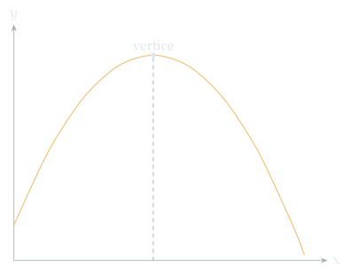
>>> soluzione
**Ascissa del vertice.**  Per $y=ax^2+bx+c$,

$$x_V=-\frac{b}{2a}=-\frac{1{,}20}{2(-0{,}050)}=12{,}0\un{m}.$$

**Quota massima.**

$$y_V=-0{,}050(12)^2+1{,}20(12)+1{,}50=8{,}70\un{m}.$$

**Intersezione col suolo.**  Si pone $y=0$:

$$-0{,}050x^2+1{,}20x+1{,}50=0.$$

Moltiplicando per $-20$:

$$x^2-24x-30=0.$$

**Radici.**

$$x=\frac{24\pm\sqrt{24^2+120}}2
=\frac{24\pm\sqrt{696}}2.$$

Le radici sono circa $-1{,}19\un{m}$ e $25{,}2\un{m}$. Il punto fisicamente successivo al lancio è $x=25{,}2\un{m}$.
:::

::: esercizio Scala geometrica e rapporto superficie-volume [avanzato]
Due sfere omogenee dello stesso materiale hanno raggi $R$ e $3R$. Confrontare area, volume e rapporto area/volume. Spiegare quale sfera disperde più rapidamente calore per unità di volume, a parità delle altre condizioni.

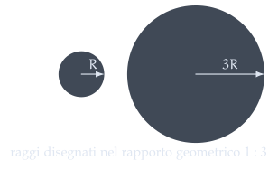
>>> soluzione
**Aree.**

$$A_1=4\pi R^2,
\qquad
A_2=4\pi(3R)^2=9A_1.$$

**Volumi.**

$$V_1=\frac43\pi R^3,
\qquad
V_2=\frac43\pi(3R)^3=27V_1.$$

**Rapporto area-volume.**

$$\frac{A}{V}=\frac{4\pi R^2}{(4/3)\pi R^3}=\frac3R.$$

Per la sfera grande, $A_2/V_2=1/R$, cioè un terzo del valore della sfera piccola.

**Interpretazione.**  La sfera piccola possiede più superficie per unità di volume e, in condizioni comparabili, scambia calore più rapidamente rispetto alla propria quantità di materia.
:::

### Trigonometria, angoli e radianti

::: esercizio Quanto è buona l'approssimazione dei piccoli angoli? [medio]
Confrontare $\sin\theta$ con $\theta$ per $\theta=5^\circ$, $15^\circ$ e $30^\circ$. Convertire prima gli angoli in radianti e calcolare l'errore relativo $|\theta-\sin\theta|/\sin\theta$.

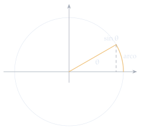
>>> soluzione
**Conversione.**

$$5^\circ=0{,}08727\,\mathrm{rad},\quad
15^\circ=0{,}2618\,\mathrm{rad},\quad
30^\circ=0{,}5236\,\mathrm{rad}.$$

**Confronti.**

$$\sin5^\circ=0{,}08716,\qquad
\varepsilon_r\simeq0{,}13\%.$$

$$\sin15^\circ=0{,}2588,\qquad
\varepsilon_r\simeq1{,}15\%.$$

$$\sin30^\circ=0{,}5000,\qquad
\varepsilon_r\simeq4{,}72\%.$$

**Interpretazione.**  L'approssimazione è eccellente a $5^\circ$, ancora utile a $15^\circ$ se si accetta un errore dell'ordine dell'uno per cento, e molto meno accurata a $30^\circ$.
:::

::: esercizio Triangolazione di una distanza inaccessibile [avanzato]
Due punti di osservazione $A$ e $B$ sono separati da una base di $120\un{m}$. Un faro $C$ è visto con angoli interni $\widehat A=48^\circ$ e $\widehat B=67^\circ$. Determinare le distanze $AC$ e $BC$ usando la legge dei seni.

>>> soluzione
**Terzo angolo.**

$$\widehat C=180^\circ-48^\circ-67^\circ=65^\circ.$$

**Legge dei seni.**

$$\frac{BC}{\sin48^\circ}=\frac{AC}{\sin67^\circ}=\frac{AB}{\sin65^\circ}.$$

**Distanza $BC$.**

$$BC=120\frac{\sin48^\circ}{\sin65^\circ}=98{,}4\un{m}.$$

**Distanza $AC$.**

$$AC=120\frac{\sin67^\circ}{\sin65^\circ}=121{,}9\un{m}.$$

Il disegno permette di controllare la plausibilità: l'angolo più grande, $67^\circ$, è opposto al lato più lungo, $AC$.
:::

### Componenti, basi e rappresentazioni

::: esercizio Componenti da modulo e angolo [medio]
Uno spostamento ha modulo $15\un{m}$ e direzione $40^\circ$ rispetto all'asse $x$ positivo. Determinare le componenti cartesiane.

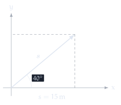
>>> soluzione
**Riferimento.**  L'angolo è misurato dall'asse $x$ positivo in senso antiorario. Il vettore è nel primo quadrante, quindi entrambe le componenti devono risultare positive.

**Relazioni.**  Per un vettore di modulo $s$ e angolo $\theta$:

$$s_x=s\cos\theta,\qquad s_y=s\sin\theta.$$

**Sostituzione.**

$$s_x=15\cos40^\circ=11{,}49\un{m},\qquad
s_y=15\sin40^\circ=9{,}64\un{m}.$$

**Conclusione.**  Lo spostamento è $\vect s=(11{,}49\vers i+9{,}64\vers j)\,\mathrm{m}$. Il controllo $\sqrt{s_x^2+s_y^2}=15\un{m}$ restituisce il modulo iniziale.
:::

::: esercizio Modulo e direzione con quadrante [medio]
Il vettore $\vect B=(-6\vers i+8\vers j)\,\mathrm{N}$. Calcolare modulo e angolo orientato rispetto a $x$ positivo.

>>> soluzione
**Quadrante.**  La componente $x$ è negativa e la componente $y$ positiva: il vettore appartiene al secondo quadrante.

**Modulo.**

$$B=\sqrt{B_x^2+B_y^2}=\sqrt{(-6)^2+8^2}=\sqrt{100}=10\un{N}.$$

**Direzione.**  L'angolo di riferimento è $\arctan(8/6)=53{,}1^\circ$. Nel secondo quadrante l'angolo orientato è

$$\theta=180^\circ-53{,}1^\circ=126{,}9^\circ.$$

**Conclusione.**  $B=10\un{N}$ e $\theta=126{,}9^\circ$ rispetto a $x$ positivo.
:::

::: esercizio Versore associato [base]
Determinare il versore nella direzione di $\vect B=(-5,12)$.

>>> soluzione
**Modulo del vettore.**

$$B=\sqrt{(-5)^2+12^2}=\sqrt{169}=13.$$

**Normalizzazione.**  Un versore si ottiene dividendo ogni componente per il modulo:

$$\vers u_B=\frac{\vect B}{B}=\left(-\frac5{13},\frac{12}{13}\right).$$

**Controllo.**

$$|\vers u_B|=\sqrt{\frac{25}{169}+\frac{144}{169}}=1.$$

Il risultato ha la stessa direzione e lo stesso verso di $\vect B$, ma modulo unitario.
:::

::: esercizio Base non ortogonale [medio]
Siano $\vers e_1=(1,0)$ e $\vers e_2=(\cos60^\circ,\sin60^\circ)$. Scrivere $\vect V=(4,2\sqrt3)$ nella forma $a\vers e_1+b\vers e_2$.

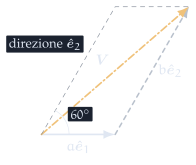
>>> soluzione
**Scrittura delle basi.**

$$\vers e_1=(1,0),\qquad \vers e_2=\left(\frac12,\frac{\sqrt3}{2}\right).$$

**Combinazione lineare.**

$$a\vers e_1+b\vers e_2=\left(a+\frac b2,\frac{\sqrt3}{2}b\right).$$

**Confronto delle componenti.**  Impostiamo

$$a+\frac b2=4,\qquad \frac{\sqrt3}{2}b=2\sqrt3.$$

Dalla seconda equazione $b=4$; nella prima $a+2=4$, quindi $a=2$.

**Conclusione.**  $\vect V=2\vers e_1+4\vers e_2$.
:::

::: esercizio Diagnosi di un errore di segno [medio]
Uno studente scompone un vettore di modulo $20$ diretto a $210^\circ$ e ottiene $(17{,}3,10{,}0)$. Individuare l'errore e correggere il risultato.

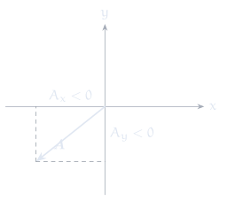
>>> soluzione
**Quadrante.**  L'angolo $210^\circ=180^\circ+30^\circ$ cade nel terzo quadrante. In questo quadrante sia coseno sia seno sono negativi.

**Componenti corrette.**

$$A_x=20\cos210^\circ=20\left(-\frac{\sqrt3}{2}\right)=-17{,}3,$$

$$A_y=20\sin210^\circ=20\left(-\frac12\right)=-10{,}0.$$

**Diagnosi.**  Lo studente ha usato i valori assoluti delle funzioni trigonometriche, perdendo l'informazione sul quadrante.

**Risultato.**  $\vect A=(-17{,}3,-10{,}0)$.
:::

::: esercizio Vettori nello spazio [medio]
Dati $\vect A=(2,-1,2)$ e $\vect B=(-1,3,0)$, calcolare somma, modulo della somma e prodotto scalare.

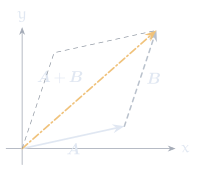
>>> soluzione
**Somma componente per componente.**

$$\vect A+\vect B=(2-1,-1+3,2+0)=(1,2,2).$$

**Modulo della somma.**

$$|\vect A+\vect B|=\sqrt{1^2+2^2+2^2}=\sqrt9=3.$$

**Prodotto scalare.**

$$\vect A\cdot\vect B=2(-1)+(-1)3+2\cdot0=-2-3=-5.$$

**Interpretazione.**  Il prodotto scalare negativo indica che l'angolo fra i vettori è ottuso.
:::

::: esercizio Spostamento tridimensionale di un drone [avanzato]
In un sistema di coordinate locali un drone passa da $A=(20,-15,30)$ m a $B=(-40,25,90)$ m. Calcolare il vettore spostamento, il suo modulo e il versore che ne indica la direzione.

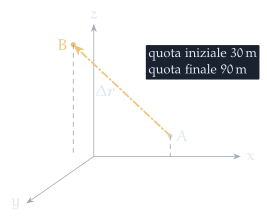
>>> soluzione
**Differenza tra posizione finale e iniziale.**

$$\Delta\vect r=\vect r_B-\vect r_A=(-40-20,25-(-15),90-30)=(-60,40,60)\,\mathrm{m}.$$

**Modulo.**

$$|\Delta\vect r|=\sqrt{(-60)^2+40^2+60^2}=\sqrt{8800}=93{,}8\un{m}.$$

**Versore.**

$$\vers u=\frac{\Delta\vect r}{|\Delta\vect r|}
=(-0{,}640,0{,}426,0{,}640).$$

**Controllo.**  La somma dei quadrati delle componenti del versore è, a meno degli arrotondamenti, uguale a $1$. La componente verticale positiva conferma che il drone è salito di $60$ m.
:::

::: esercizio Lo stesso vettore in assi ruotati [medio]
Il vettore $\vect A=(6,8)$ m è espresso negli assi $x,y$. Un secondo sistema $x',y'$ è ottenuto ruotando gli assi di $30^\circ$ in senso antiorario. Determinare le componenti $A_{x'}$ e $A_{y'}$ e verificare che il modulo non cambi.

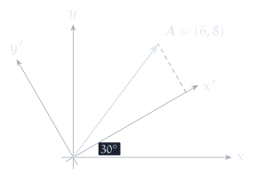
>>> soluzione
**Versori della base ruotata.**

$$\vers e_{x'}=(\cos30^\circ,\sin30^\circ),\qquad
\vers e_{y'}=(-\sin30^\circ,\cos30^\circ).$$

**Proiezioni.**

$$A_{x'}=\vect A\cdot\vers e_{x'}=6\cos30^\circ+8\sin30^\circ=9{,}20\,\mathrm{m},$$

$$A_{y'}=\vect A\cdot\vers e_{y'}=-6\sin30^\circ+8\cos30^\circ=3{,}93\,\mathrm{m}.$$

**Controllo del modulo.**

$$\sqrt{6^2+8^2}=10\un{m},\qquad
\sqrt{9{,}20^2+3{,}93^2}\simeq10{,}0\un{m}.$$

Il vettore fisico è lo stesso; la rotazione degli assi modifica soltanto i numeri con cui lo descriviamo.
:::

### Composizione e risultanti

::: esercizio Somma per componenti [medio]
Dati $\vect A=(4,-1)\,\mathrm{m}$ e $\vect B=(-2,5)\,\mathrm{m}$, trovare $\vect R=\vect A+\vect B$, modulo e direzione.

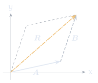
>>> soluzione
**Somma delle componenti.**

$$R_x=A_x+B_x=4+(-2)=2,\qquad R_y=A_y+B_y=-1+5=4.$$

Quindi $\vect R=(2,4)\,\mathrm{m}$.

**Modulo.**

$$R=\sqrt{2^2+4^2}=\sqrt{20}=4{,}47\un{m}.$$

**Direzione.**  Poiché entrambe le componenti sono positive, il vettore è nel primo quadrante:

$$\theta=\arctan\frac{4}{2}=63{,}4^\circ.$$

**Conclusione.**  $\vect R=(2\vers i+4\vers j)\,\mathrm{m}$, con modulo $4{,}47\un{m}$ e direzione $63{,}4^\circ$.
:::

::: esercizio Distanza e spostamento [avanzato]
Un robot percorre $6\un{m}$ a est, $8\un{m}$ a nord e $3\un{m}$ a ovest. Calcolare distanza e modulo dello spostamento e spiegare perché differiscono.

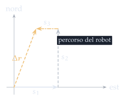
>>> soluzione
**Distanza.**  La distanza somma le lunghezze di tutti i tratti, senza segno:

$$d=6+8+3=17\un{m}.$$

**Spostamento.**  Ponendo est lungo $+x$ e nord lungo $+y$:

$$\Delta x=6-3=3\un{m},\qquad \Delta y=8=8\un{m}.$$

Pertanto $\Delta\vect r=(3,8)\,\mathrm{m}$.

**Modulo.**

$$|\Delta\vect r|=\sqrt{3^2+8^2}=\sqrt{73}=8{,}54\un{m}.$$

**Interpretazione.**  La distanza dipende dall'intero cammino; lo spostamento collega soltanto il punto iniziale al punto finale. Per questo $17\ne8{,}54$.
:::

::: esercizio Scalare negativo [medio]
Per $\vect A=(-3,4)\,\mathrm{m}$ calcolare $-2{,}5\vect A$ e confrontarne il modulo con quello di $\vect A$.

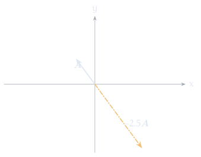
>>> soluzione
**Moltiplicazione componente per componente.**

$$-2{,}5\vect A=-2{,}5(-3,4)=(7{,}5,-10)\,\mathrm{m}.$$

**Modulo iniziale.**

$$|\vect A|=\sqrt{(-3)^2+4^2}=5\un{m}.$$

**Modulo finale.**

$$|-2{,}5\vect A|=|-2{,}5|\,|\vect A|=2{,}5\cdot5=12{,}5\un{m}.$$

**Interpretazione.**  Il segno meno inverte il verso; il fattore $2{,}5$ moltiplica il modulo per $2{,}5$.
:::

::: esercizio Forza equilibrante [avanzato]
Agiscono $\vect F_1=(10,0)\,\mathrm{N}$ e $\vect F_2=(-4,6)\,\mathrm{N}$. Determinare la terza forza che produce equilibrio.

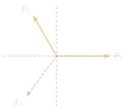
>>> soluzione
**Condizione di equilibrio.**  La risultante deve essere nulla:

$$\vect F_1+\vect F_2+\vect F_3=\vect0.$$

**Somma delle forze note.**

$$\vect F_1+\vect F_2=(10,0)+(-4,6)=(6,6)\,\mathrm{N}.$$

**Forza equilibrante.**

$$\vect F_3=-(6,6)=(-6,-6)\,\mathrm{N}.$$

**Modulo.**

$$F_3=\sqrt{(-6)^2+(-6)^2}=6\sqrt2=8{,}49\un{N}.$$

La terza forza è opposta alla risultante delle prime due.
:::

::: esercizio Navigazione geografica [medio]
Un'imbarcazione percorre $12\un{km}$ verso nord e poi $5\un{km}$ in una direzione con componenti $3$ km verso est e $4$ km verso sud. Trovare spostamento totale, modulo e direzione.

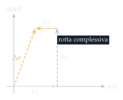
>>> soluzione
**Traduzione dei tratti.**  Il primo tratto è $(0,12)$ km. Il secondo ha già componenti $(3,-4)$ km.

**Somma.**

$$\vect R=(0,12)+(3,-4)=(3,8)\,\mathrm{km}.$$

**Modulo.**

$$R=\sqrt{3^2+8^2}=\sqrt{73}=8{,}54\un{km}.$$

**Direzione geografica.**  L'angolo a est del nord soddisfa

$$\alpha=\arctan\frac{R_x}{R_y}=\arctan\frac38=20{,}6^\circ.$$

La rotta finale è $20{,}6^\circ$ a est del nord.
:::

::: esercizio Somma in forma polare [avanzato]
Sommare un vettore di modulo $10$ a $20^\circ$ e uno di modulo $8$ a $140^\circ$.

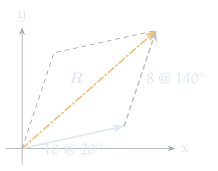
>>> soluzione
**Conversione del primo vettore.**

$$\vect A=(10\cos20^\circ,10\sin20^\circ)=(9{,}397,3{,}420).$$

**Conversione del secondo vettore.**

$$\vect B=(8\cos140^\circ,8\sin140^\circ)=(-6{,}128,5{,}142).$$

**Somma.**

$$\vect R=(3{,}269,8{,}562).$$

**Modulo e direzione.**

$$R=\sqrt{3{,}269^2+8{,}562^2}=9{,}17,
\qquad \theta=\operatorname{atan2}(8{,}562,3{,}269)=69{,}1^\circ.$$

Il vettore risultante è nel primo quadrante.
:::

::: esercizio Risultante assegnata [medio]
$\vect A=(6,8)$ e $\vect B=(b,-8)$. Determinare $b$ sapendo che $\vect A+\vect B$ è diretto lungo $x$ positivo e ha modulo $10$.

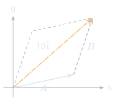
>>> soluzione
**Somma simbolica.**

$$\vect A+\vect B=(6+b,8-8)=(6+b,0).$$

La componente verticale è già nulla, quindi la risultante è orizzontale.

**Condizione sul verso e sul modulo.**  Essendo diretta lungo $x$ positivo e avendo modulo $10$:

$$6+b=10.$$

**Soluzione.**

$$b=4.$$

**Controllo.**  Con $b=4$, la somma vale $(10,0)$, esattamente la risultante richiesta.
:::

::: esercizio Rotta diretta di ritorno [medio]
Dopo $5\un{km}$ a est, $7\un{km}$ a nord e $2\un{km}$ a ovest, determinare il vettore necessario per tornare direttamente al punto di partenza.

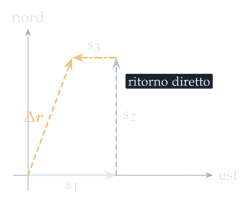
>>> soluzione
**Posizione finale.**  Con est $+x$ e nord $+y$:

$$\vect R=(5,0)+(0,7)+(-2,0)=(3,7)\,\mathrm{km}.$$

**Vettore di ritorno.**  Per tornare all'origine serve l'opposto:

$$\vect s_{rit}=-\vect R=(-3,-7)\,\mathrm{km}.$$

**Modulo.**

$$|\vect s_{rit}|=\sqrt{3^2+7^2}=7{,}62\un{km}.$$

**Direzione.**  L'angolo a sud dell'ovest è $\arctan(7/3)=66{,}8^\circ$.
:::

::: esercizio Confronto senza calcolo esteso [medio]
Due vettori hanno entrambi modulo $A$. Confrontare il modulo della somma quando l'angolo compreso è $60^\circ$ e quando è $120^\circ$.

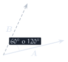
>>> soluzione
**Formula generale.**  Per due vettori di modulo $A$ con angolo $\theta$:

$$R^2=A^2+A^2+2A^2\cos\theta=2A^2(1+\cos\theta).$$

**Angolo di $60^\circ$.**

$$R_{60}^2=2A^2\left(1+\frac12\right)=3A^2
\Rightarrow R_{60}=\sqrt3A.$$

**Angolo di $120^\circ$.**

$$R_{120}^2=2A^2\left(1-\frac12\right)=A^2
\Rightarrow R_{120}=A.$$

**Confronto.**  La somma è maggiore quando i vettori formano l'angolo minore.
:::

::: esercizio Risultante da una costruzione in scala [avanzato]
Due forze agiscono sullo stesso punto. La prima vale $80\un{N}$ lungo $+x$; la seconda vale $60\un{N}$ e forma $120^\circ$ con $+x$. Costruire la somma con la scala $1\un{cm}=20\un{N}$, quindi calcolare analiticamente modulo e direzione della risultante. Indicare quale precisione è ragionevole attendersi da una misura grafica al millimetro.

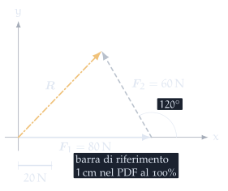
>>> soluzione
**Costruzione grafica.**  La prima freccia deve essere lunga $4{,}0$ cm. La seconda, lunga $3{,}0$ cm, viene applicata alla punta della prima e orientata a $120^\circ$ rispetto a $+x$. La risultante congiunge la coda della prima freccia con la punta della seconda.

**Componenti.**

$$\vect F_1=(80,0)\,\mathrm{N},\qquad
\vect F_2=(60\cos120^\circ,60\sin120^\circ)=(-30,51{,}96)\,\mathrm{N}.$$

Quindi

$$\vect R=(50,51{,}96)\,\mathrm{N}.$$

**Modulo e direzione.**

$$R=\sqrt{50^2+51{,}96^2}=72{,}1\un{N},
\qquad
\theta=\operatorname{atan2}(51{,}96,50)=46{,}1^\circ.$$

**Precisione grafica.**  Un millimetro sulla carta corrisponde a $2\un{N}$. Una lettura grafica come $R\simeq72\un{N}$ è quindi adeguata; riportare decimi di newton dalla sola figura sarebbe una falsa precisione.
:::

::: esercizio Errore di chiusura di un percorso GPS [medio]
Un drone effettua tre spostamenti orizzontali, espressi in metri rispetto agli assi est-nord:

$$\vect s_1=(120,40),\qquad \vect s_2=(-30,90),\qquad \vect s_3=(-100,-110).$$

Determinare l'errore di chiusura e il vettore di correzione necessario per tornare esattamente alla base.

>>> soluzione
**Somma degli spostamenti.**

$$\Delta\vect r=\vect s_1+\vect s_2+\vect s_3
=(120-30-100,40+90-110)=(-10,20)\,\mathrm{m}.$$

La posizione stimata è dunque $10$ m a ovest e $20$ m a nord della base.

**Modulo dell'errore.**

$$|\Delta\vect r|=\sqrt{(-10)^2+20^2}=22{,}4\un{m}.$$

**Correzione.**  Per chiudere il percorso serve il vettore opposto:

$$\vect c=-\Delta\vect r=(10,-20)\,\mathrm{m}.$$

La direzione è $63{,}4^\circ$ a sud dell'est. La distinzione tra errore di chiusura e correzione evita un frequente errore di segno: hanno lo stesso modulo ma versi opposti.
:::

::: esercizio Posizione media pesata di tre carichi [avanzato]
Tre carichi puntiformi sono collocati in $(0,0)$, $(4,0)$ e $(0,3)$ m e valgono rispettivamente $2$, $3$ e $5$ kg. Calcolare la posizione media pesata

$$\vect r_c=\frac{\sum_i m_i\vect r_i}{\sum_i m_i}$$

e interpretarne la collocazione nel triangolo.

>>> soluzione
**Massa totale.**

$$M=2+3+5=10\un{kg}.$$

**Componente orizzontale.**

$$x_c=\frac{2\cdot0+3\cdot4+5\cdot0}{10}=1{,}2\un{m}.$$

**Componente verticale.**

$$y_c=\frac{2\cdot0+3\cdot0+5\cdot3}{10}=1{,}5\un{m}.$$

Quindi $\vect r_c=(1{,}2,1{,}5)$ m.

**Interpretazione.**  Il punto è interno al triangolo ed è spostato verso il carico da $5$ kg, che pesa di più nella media. La stessa costruzione diventerà, in dinamica, la definizione di centro di massa.
:::

::: esercizio Rotta magnetica e nord vero [medio]
In una zona il nord magnetico è $7^\circ$ a ovest del nord vero. Un escursionista percorre $5{,}0\un{km}$ mantenendo una rotta di $20^\circ$ a est del nord magnetico. Determinare l'angolo rispetto al nord vero e le componenti est e nord dello spostamento.

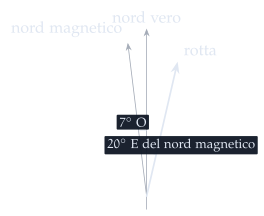
>>> soluzione
**Conversione dell'angolo.**  Il nord magnetico è già ruotato di $7^\circ$ verso ovest. Muoversi di $20^\circ$ verso est rispetto a esso porta a

$$20^\circ-7^\circ=13^\circ$$

a est del nord vero.

**Componenti.**  Misurando l'angolo dalla direzione nord:

$$s_E=s\sin13^\circ=5{,}0\sin13^\circ=1{,}12\un{km},$$

$$s_N=s\cos13^\circ=5{,}0\cos13^\circ=4{,}87\un{km}.$$

**Controllo.**

$$\sqrt{s_E^2+s_N^2}\simeq5{,}0\un{km}.$$

La sottrazione iniziale degli angoli è essenziale: sommarli avrebbe collocato la rotta dalla parte sbagliata rispetto al nord vero.
:::

### Proiezioni e prodotto scalare

::: esercizio Angolo dal prodotto scalare [medio]
Per $\vect A=(4,1)$ e $\vect B=(2,5)$ calcolare $\vect A\cdot\vect B$ e l'angolo compreso.

>>> soluzione
**Prodotto scalare per componenti.**

$$\vect A\cdot\vect B=4\cdot2+1\cdot5=13.$$

**Moduli.**

$$A=\sqrt{4^2+1^2}=\sqrt{17},\qquad B=\sqrt{2^2+5^2}=\sqrt{29}.$$

**Angolo.**  Dalla relazione $\vect A\cdot\vect B=AB\cos\varphi$:

$$\cos\varphi=\frac{13}{\sqrt{17}\sqrt{29}}=0{,}586,
\qquad \varphi=\arccos(0{,}586)=54{,}1^\circ.$$

**Controllo.**  Il prodotto scalare è positivo, quindi l'angolo deve essere acuto; $54{,}1^\circ$ è coerente.
:::

::: esercizio Proiezione su una direzione [medio]
Siano $\vect A=(8,6)$ e $\vers u=(3/5,4/5)$. Determinare componente scalare e proiezione vettoriale di $\vect A$ lungo $\vers u$.

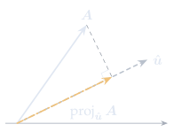
>>> soluzione
**Controllo del versore.**

$$|\vers u|=\sqrt{(3/5)^2+(4/5)^2}=1.$$

**Componente scalare.**

$$A_{\parallel}=\vect A\cdot\vers u=8\frac35+6\frac45=\frac{48}{5}=9{,}6.$$

**Proiezione vettoriale.**

$$\operatorname{proj}_{\vers u}\vect A=A_{\parallel}\vers u
=9{,}6\left(\frac35,\frac45\right)=(5{,}76,7{,}68).$$

**Controllo.**  Il modulo della proiezione è $9{,}6$, come la componente scalare positiva.
:::

::: esercizio Perpendicolarità con parametro [base]
Per quale valore di $k$ i vettori $\vect A=(3,k)$ e $\vect B=(2,-1)$ sono perpendicolari?

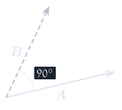
>>> soluzione
**Condizione geometrica.**  Due vettori non nulli sono perpendicolari quando il loro prodotto scalare è zero.

**Equazione.**

$$(3,k)\cdot(2,-1)=3\cdot2+k(-1)=6-k=0.$$

**Soluzione.**

$$k=6.$$

**Controllo.**  Con $k=6$, $(3,6)\cdot(2,-1)=6-6=0$, quindi l'angolo è retto.
:::

::: esercizio Lavoro lungo un percorso spezzato [avanzato]
Una forza costante $\vect F=(12,5)$ N agisce durante tre spostamenti successivi:

$$\vect s_1=(3,0)\,\mathrm{m},\quad
\vect s_2=(0,4)\,\mathrm{m},\quad
\vect s_3=(-1,-2)\,\mathrm{m}.$$

Calcolare il lavoro su ciascun tratto e confrontare la somma con $\vect F\cdot\Delta\vect r$.

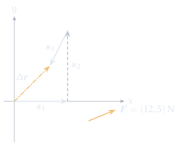
>>> soluzione
**Lavori sui tre tratti.**

$$W_1=\vect F\cdot\vect s_1=12\cdot3+5\cdot0=36\un{J},$$

$$W_2=12\cdot0+5\cdot4=20\un{J},$$

$$W_3=12(-1)+5(-2)=-22\un{J}.$$

Il terzo lavoro è negativo perché lo spostamento ha componenti opposte alla forza.

**Somma.**

$$W_{tot}=36+20-22=34\un{J}.$$

**Controllo con lo spostamento totale.**

$$\Delta\vect r=(3,0)+(0,4)+(-1,-2)=(2,2)\,\mathrm{m},$$

$$\vect F\cdot\Delta\vect r=12\cdot2+5\cdot2=34\un{J}.$$

Per una forza costante i due calcoli coincidono; la lunghezza del cammino, da sola, non basta a determinare il lavoro.
:::

::: esercizio Un vettore definito da due proiezioni [medio]
Trovare $\vect X=(x,y)$ sapendo che

$$\vect X\cdot(1,1)=8,
\qquad
\vect X\cdot(2,-1)=1.$$

Verificare il risultato sostituendolo in entrambe le condizioni.

>>> soluzione
**Traduzione in equazioni scalari.**

$$x+y=8,
\qquad
2x-y=1.$$

**Risoluzione.**  Sommando membro a membro:

$$3x=9\Rightarrow x=3.$$

Dalla prima equazione:

$$y=8-3=5.$$

Quindi $\vect X=(3,5)$.

**Verifica.**

$$(3,5)\cdot(1,1)=3+5=8,
\qquad
(3,5)\cdot(2,-1)=6-5=1.$$

Le due condizioni non assegnano il modulo e l'angolo direttamente: assegnano due proiezioni indipendenti, sufficienti a determinare le due componenti.
:::

### Aree orientate e normali

::: esercizio Prodotto vettoriale e area [base]
Calcolare $\vect A\times\vect B$ e l'area del parallelogramma generato dai vettori posizione $\vect A=(3,0,0)\,\mathrm{m}$ e $\vect B=(0,4,0)\,\mathrm{m}$.

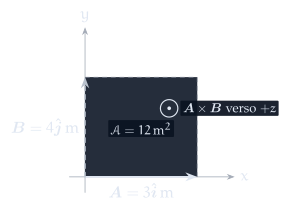
>>> soluzione
**Prodotto vettoriale.**  I vettori sono lungo $x$ e $y$:

$$\vect A\times\vect B=
\begin{vmatrix}
\vers i&\vers j&\vers k\\
3&0&0\\
0&4&0
\end{vmatrix}\mathrm{m^2}
=(0,0,12)\,\mathrm{m^2}.$$

**Area.**  L'area del parallelogramma è il modulo del prodotto vettoriale:

$$\mathcal A=|\vect A\times\vect B|=12\un{m^2}.$$

**Verso.**  La regola della mano destra da $x$ verso $y$ fornisce il verso $+z$.
:::

::: esercizio Area orientata di un pannello triangolare [base]
Due lati di un pannello triangolare sono rappresentati da $\vect u=(3,1,0)$ m e $\vect v=(1,4,0)$ m, con la stessa origine. Calcolare area del triangolo e verso della normale associata all'ordine $\vect u\times\vect v$.

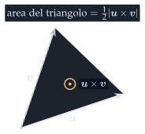
>>> soluzione
**Prodotto vettoriale.**

$$\vect u\times\vect v=
\begin{vmatrix}
\vers i&\vers j&\vers k\\
3&1&0\\
1&4&0
\end{vmatrix}
=(0,0,12-1)=(0,0,11)\,\mathrm{m^2}.$$

**Area.**  Il modulo del prodotto vettoriale è l'area del parallelogramma. Il triangolo ne occupa metà:

$$A_\triangle=\frac12|\vect u\times\vect v|=5{,}5\un{m^2}.$$

**Orientazione.**  La componente $z$ è positiva, quindi la normale associata a $\vect u\times\vect v$ punta nel verso $+z$. Invertendo l'ordine dei vettori, il modulo resterebbe uguale ma il verso cambierebbe.
:::

::: esercizio Normale unitaria a una falda [base]
Una falda di tetto contiene le direzioni $\vect u=(4,0,1)$ e $\vect v=(0,3,1)$. Determinare una normale unitaria rivolta verso l'alto e l'angolo tra tale normale e la verticale $\vers k$.

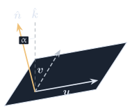
>>> soluzione
**Vettore normale.**

$$\vect n=\vect u\times\vect v=(-3,-4,12).$$

La componente verticale è positiva, quindi il verso è già quello richiesto.

**Modulo e normalizzazione.**

$$|\vect n|=\sqrt{9+16+144}=13,
\qquad
\vers n=\left(-\frac3{13},-\frac4{13},\frac{12}{13}\right).$$

**Angolo con la verticale.**

$$\cos\alpha=\vers n\cdot\vers k=\frac{12}{13},
\qquad
\alpha=\arccos\frac{12}{13}=22{,}6^\circ.$$

L'angolo trovato descrive l'inclinazione della normale; la falda forma lo stesso angolo con il piano orizzontale.
:::

### Grandezze relative

::: esercizio Fiume con deriva [avanzato]
Un fiume largo $120\un{m}$ ha corrente $1{,}2\un{m/s}$. Una barca punta perpendicolarmente alle rive con velocità $3{,}0\un{m/s}$ rispetto all'acqua. Calcolare tempo, deriva e velocità rispetto alla riva.

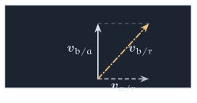
>>> soluzione
**Assi.**  Poniamo $y$ perpendicolare alle rive e $x$ lungo la corrente. La barca ha $v_y=3{,}0\un{m/s}$ e la corrente $v_x=1{,}2\un{m/s}$.

**Tempo di attraversamento.**  La corrente non modifica la componente trasversale:

$$t=\frac{120}{3{,}0}=40\un{s}.$$

**Deriva.**

$$\Delta x=v_x t=1{,}2\cdot40=48\un{m}.$$

**Velocità rispetto alla riva.**

$$v=\sqrt{3{,}0^2+1{,}2^2}=3{,}23\un{m/s}.$$

La traiettoria rispetto alla riva è obliqua verso valle.
:::

::: esercizio Pioggia vista da un ciclista [avanzato]
La pioggia cade verticalmente a $12\un{m/s}$ rispetto al suolo. Un ciclista procede orizzontalmente a $5\un{m/s}$. Determinare la velocità della pioggia rispetto al ciclista e l'inclinazione apparente rispetto alla verticale.

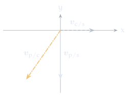
>>> soluzione
**Relazione di velocità relativa.**

$$\vect v_{p/c}=\vect v_{p/s}-\vect v_{c/s}.$$

Con $x$ nel verso del ciclista e $y$ verso l'alto:

$$\vect v_{p/s}=(0,-12),\qquad \vect v_{c/s}=(5,0).$$

**Sottrazione.**

$$\vect v_{p/c}=(-5,-12)\,\mathrm{m/s}.$$

**Modulo.**

$$|\vect v_{p/c}|=\sqrt{5^2+12^2}=13\un{m/s}.$$

**Inclinazione dalla verticale.**

$$\tan\alpha=\frac{5}{12}\Rightarrow \alpha=22{,}6^\circ.$$

La pioggia appare inclinata verso la parte anteriore del ciclista.
:::

::: esercizio Distanza minima tra due imbarcazioni [avanzato]
Nel piano, al tempo $t=0$, l'imbarcazione A si trova nell'origine e viaggia con $\vect v_A=(4,0)$ m/s. L'imbarcazione B si trova in $(30,20)$ m e viaggia con $\vect v_B=(1,-1)$ m/s. Determinare l'istante di massimo avvicinamento, la distanza minima e se viene violata una distanza di sicurezza di $12\un{m}$.

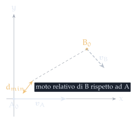
>>> soluzione
**Posizione e velocità relative.**

$$\vect r_0=\vect r_{B0}-\vect r_{A0}=(30,20)\,\mathrm{m},
\qquad
\vect v_{rel}=\vect v_B-\vect v_A=(-3,-1)\,\un{m/s}.$$

**Condizione di massimo avvicinamento.**  Al punto più vicino, il vettore separazione è perpendicolare alla velocità relativa:

$$(\vect r_0+\vect v_{rel}t_*)\cdot\vect v_{rel}=0.$$

Pertanto

$$t_*=-\frac{\vect r_0\cdot\vect v_{rel}}{|\vect v_{rel}|^2}
=-\frac{30(-3)+20(-1)}{(-3)^2+(-1)^2}=11\un{s}.$$

**Distanza minima.**

$$\vect r(11)=(30,20)+11(-3,-1)=(-3,9)\,\mathrm{m},$$

$$d_{min}=\sqrt{(-3)^2+9^2}=9{,}49\un{m}.$$

Poiché $9{,}49<12$, la zona di sicurezza viene violata, anche se le imbarcazioni non collidono.
:::

### Coordinate curvilinee e trasformazioni utili

::: esercizio Area di un settore mediante coordinate polari [base]
Calcolare l'area del settore anulare compreso fra $r=2\un{m}$ e $r=5\un{m}$, per $0\le\theta\le\pi/3$, usando

$$A=\int\int r\dd r\dd\theta.$$

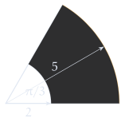
>>> soluzione
**Impostazione.**

$$A=\int_0^{\pi/3}\int_2^5 r\dd r\dd\theta.$$

**Integrazione radiale.**

$$\int_2^5r\dd r=\left[\frac{r^2}{2}\right]_2^5
=\frac{25-4}{2}=\frac{21}{2}\,\mathrm{m^2}.$$

**Integrazione angolare.**

$$A=\frac{21}{2}\int_0^{\pi/3}\dd\theta
=\frac{21}{2}\frac{\pi}{3}
=\frac{7\pi}{2}\,\mathrm{m^2}
\simeq11{,}0\un{m^2}.$$

Il risultato coincide con la frazione $(\pi/3)/(2\pi)=1/6$ dell'area dell'anello completo $\pi(5^2-2^2)=21\pi$.
:::

::: esercizio Volume di una sfera dal Jacobiano sferico [avanzato]
Usare

$$\dd V=r^2\sin\theta\dd r\dd\theta\dd\phi$$

per ricavare il volume di una sfera di raggio $R$, integrando $0\le r\le R$, $0\le\theta\le\pi$, $0\le\phi\le2\pi$.

>>> soluzione
**Integrale triplo.**

$$V=\int_0^{2\pi}\int_0^\pi\int_0^R
r^2\sin\theta\dd r\dd\theta\dd\phi.$$

**Separazione dei fattori.**

$$V=\left(\int_0^Rr^2\dd r\right)
\left(\int_0^\pi\sin\theta\dd\theta\right)
\left(\int_0^{2\pi}\dd\phi\right).$$

**Tre integrali.**

$$\int_0^Rr^2\dd r=\frac{R^3}{3},
\quad
\int_0^\pi\sin\theta\dd\theta=2,
\quad
\int_0^{2\pi}\dd\phi=2\pi.$$

**Risultato.**

$$V=\frac{R^3}{3}\cdot2\cdot2\pi
=\frac43\pi R^3.$$

Il fattore $r^2\sin\theta$ è essenziale: senza di esso si integrerebbero intervalli di coordinate, non volumi fisici.
:::

### Problemi trasversali: Modellizzazione e controllo dei dati

::: esercizio Allineamento di due tracce cartografiche [avanzato]
Una prima traccia su una carta è descritta dallo spostamento $\vect A=(2,4)$ km. Una seconda traccia va dal punto $P=(-1,3)$ km al punto $Q=(k,11)$ km. Determinare $k$ affinché le due tracce siano parallele e percorse nello stesso verso.

>>> soluzione
**Vettore della seconda traccia.**  Lo spostamento da $P$ a $Q$ è

$$\overrightarrow{PQ}=Q-P=(k+1,8)\,\mathrm{km}.$$

**Condizione di parallelismo.**  Per essere parallelo ad $\vect A=(2,4)$ deve esistere uno scalare $\lambda$ tale che

$$(k+1,8)=\lambda(2,4).$$

**Componente verticale.**  Da $8=4\lambda$ segue $\lambda=2$.

**Componente orizzontale.**

$$k+1=2\cdot2=4\Rightarrow k=3.$$

**Verso.**  Il fattore $\lambda=2$ è positivo, quindi le tracce sono non soltanto parallele ma anche concordi. Con $k=3$, infatti, $\overrightarrow{PQ}=(4,8)=2\vect A$.
:::

::: esercizio Due cavi asimmetrici [avanzato]
Un'insegna di peso $500\un{N}$ è sostenuta da due cavi che formano rispettivamente $30^\circ$ e $50^\circ$ con l'orizzontale. Determinare le tensioni imponendo l'equilibrio del nodo.

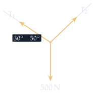
>>> soluzione
**Equilibrio orizzontale.**  Indichiamo con $T_{30}$ e $T_{50}$ le tensioni. Le componenti orizzontali devono annullarsi:

$$T_{30}\cos30^\circ=T_{50}\cos50^\circ.$$

Da cui $T_{30}=T_{50}\cos50^\circ/\cos30^\circ$.

**Equilibrio verticale.**

$$T_{30}\sin30^\circ+T_{50}\sin50^\circ=500.$$

**Sostituzione.**

$$T_{50}\left(\frac{\cos50^\circ}{\cos30^\circ}\sin30^\circ+\sin50^\circ\right)=500.$$

Si ottiene $T_{50}=440\un{N}$.

**Seconda tensione.**

$$T_{30}=440\frac{\cos50^\circ}{\cos30^\circ}=326\un{N}.$$

Entrambe le componenti verticali sommano a $500\un{N}$.
:::

::: esercizio Risultante con componenti incerte [avanzato]
Le componenti di una risultante sono misurate come

$$R_x=(10{,}0\pm0{,}2)\,\mathrm{N},\qquad
R_y=(6{,}0\pm0{,}1)\,\mathrm{N}.$$

Calcolare il modulo nominale e un intervallo prudente ottenuto combinando i valori estremi compatibili con le misure.

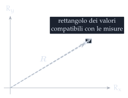
>>> soluzione
**Valore nominale.**

$$R=\sqrt{10{,}0^2+6{,}0^2}=11{,}66\un{N}.$$

**Estremo inferiore.**  Poiché entrambe le componenti sono positive, il modulo minimo nell'intervallo rettangolare si ottiene con i due valori minimi:

$$R_{min}=\sqrt{9{,}8^2+5{,}9^2}=11{,}44\un{N}.$$

**Estremo superiore.**

$$R_{max}=\sqrt{10{,}2^2+6{,}1^2}=11{,}88\un{N}.$$

**Presentazione.**  Un modo trasparente di riportare il risultato è

$$11{,}44\,\mathrm{N}\le R\le11{,}88\,\mathrm{N}.$$

L'intervallo è prudente: non assume una distribuzione statistica degli errori e non va confuso con una deviazione standard.
:::

### Problemi di sintesi: strumenti matematici e vettori

::: esercizio Componenti di una forza obliqua [base]
Una forza di $18\un{N}$ forma un angolo di $37^\circ$ con l'asse $x$ positivo. Calcolare le componenti cartesiane.
>>> soluzione
**Scomposizione.**

$$F_x=F\cos\theta=14{,}4\un{N},\qquad
F_y=F\sin\theta=10{,}8\un{N}.$$

**Controllo.**  $\sqrt{F_x^2+F_y^2}=18\un{N}$ e le due componenti sono positive perché il vettore è nel primo quadrante.
:::

::: esercizio Risultante di tre spostamenti [base]
Tre spostamenti nel piano sono $\vect s_1=(4,2)\,\mathrm{m}$, $\vect s_2=(-3,5)\,\mathrm{m}$ e $\vect s_3=(1,-4)\,\mathrm{m}$. Determinare risultante, modulo e direzione.
>>> soluzione
**Somma per componenti.**  $\vect R=(4-3+1,2+5-4)=(2,3)\,\mathrm{m}$.

**Modulo e angolo.**

$$R=\sqrt{2^2+3^2}=3{,}61\un{m},\qquad
\theta=\arctan(3/2)=56{,}3^\circ.$$
:::

::: esercizio Versore fra due punti [base]
Dati $A=(1,2,-1)$ e $B=(4,-2,11)$, trovare il versore diretto da $A$ a $B$.
>>> soluzione
**Vettore spostamento.**  $\vect d=B-A=(3,-4,12)$.

**Normalizzazione.**  $|\vect d|=13{,}0$, quindi

$$\hat{\vect d}=\frac1{13}(3,-4,12).$$

La verifica $|\hat{\vect d}|=1$ segue da $3^2+(-4)^2+12^2=13^2$.
:::

::: esercizio Angolo da un prodotto scalare [base]
Per $\vect a=(2,-1,3)$ e $\vect b=(4,2,-2)$ calcolare il prodotto scalare e l'angolo minore fra i vettori.
>>> soluzione
**Prodotto.**  $\vect a\cdot\vect b=8-2-6=0$.

**Angolo.**  Poiché entrambi i vettori sono non nulli e il prodotto scalare è zero, essi sono ortogonali: $\theta=90^\circ$.
:::

::: esercizio Proiezione lungo una rampa [base]
Una forza nel piano ha componenti $\vect F=(80,-20)\,\mathrm{N}$. Una rampa sale di $25^\circ$ rispetto all'orizzontale. Calcolare la componente di $\vect F$ lungo la direzione ascendente della rampa.
>>> soluzione
**Versore.**  $\hat{\vect u}=(\cos25^\circ,\sin25^\circ)$.

**Proiezione scalare.**

$$F_\parallel=\vect F\cdot\hat{\vect u}=80\cos25^\circ-20\sin25^\circ=64{,}1\un{N}.$$

Il segno positivo indica il verso ascendente.
:::

::: esercizio Lavoro come prodotto scalare [base]
Una forza costante $\vect F=(30,40)\,\mathrm{N}$ agisce durante lo spostamento $\Delta\vect r=(5,-2)\,\mathrm{m}$. Calcolare il lavoro.
>>> soluzione
**Prodotto scalare.**

$$W=\vect F\cdot\Delta\vect r=30(5)+40(-2)=70\un{J}.$$

Il lavoro è positivo perché la componente della forza lungo lo spostamento prevale su quella opposta.
:::

::: esercizio Area da un prodotto vettoriale [base]
Due lati di un triangolo misurano $4{,}0\un{m}$ e $6{,}0\un{m}$ e comprendono un angolo di $50^\circ$. Calcolare l'area usando il prodotto vettoriale.
>>> soluzione
**Modulo del prodotto.**  $|\vect a\times\vect b|=ab\sin\theta$ è l'area del parallelogramma.

**Triangolo.**

$$A=\frac12ab\sin\theta=\frac12(4{,}0)(6{,}0)\sin50^\circ=9{,}19\un{m^2}.$$
:::

::: esercizio Momento di una chiave inglese [base]
Una forza di $120\un{N}$ è applicata a $0{,}35\un{m}$ dal perno di una chiave e forma $70^\circ$ con il braccio. Calcolare il momento torcente.
>>> soluzione
**Prodotto vettoriale.**

$$\tau=rF\sin\theta=(0{,}35)(120)\sin70^\circ=39{,}5\un{N\,m}.$$

La direzione è perpendicolare al piano secondo la regola della mano destra.
:::

::: esercizio Componenti in assi ruotati [base]
Un vettore ha componenti $(3,4)$ in un sistema cartesiano. Gli assi vengono ruotati in senso antiorario di $30^\circ$. Calcolare le nuove componenti.
>>> soluzione
**Matrice di rotazione passiva.**

$$v_{x'}=3\cos30^\circ+4\sin30^\circ=4{,}60,$$

$$v_{y'}=-3\sin30^\circ+4\cos30^\circ=1{,}96.$$

**Invariante.**  $\sqrt{v_{x'}^2+v_{y'}^2}=5$, come nel sistema originale.
:::

::: esercizio Vento apparente per un ciclista [base]
L'aria si muove verso ovest a $8{,}0\un{m/s}$; un ciclista viaggia verso est a $5{,}0\un{m/s}$. Determinare la velocità dell'aria rispetto al ciclista.
>>> soluzione
**Velocità relativa.**  Scegliendo est positivo, $v_{aria/suolo}=-8{,}0$ e $v_{ciclista/suolo}=+5{,}0$.

$$v_{aria/ciclista}=-8{,}0-5{,}0=-13{,}0\un{m/s}.$$

Il ciclista percepisce quindi un vento di $13{,}0\un{m/s}$ diretto verso ovest.
:::

::: esercizio Barca che punta perpendicolarmente alla riva [base]
Una barca ha velocità di $4\un{m/s}$ rispetto all'acqua e punta perpendicolarmente alle rive di un fiume largo $180\un{m}$. La corrente vale $2{,}5\un{m/s}$. Trovare tempo di attraversamento e deriva.
>>> soluzione
**Componente trasversale.**  La corrente non modifica la componente perpendicolare: $t=L/v_b=180/4=45{,}0\un{s}$.

**Deriva.**  $d=v_rt=(2{,}5)(45{,}0)=112\un{m}$.
:::

::: esercizio Trasformazione lineare di coordinate [base]
La trasformazione $X=2x+y$, $Y=-x+3y$ agisce sul punto $(x,y)=(2,-1)$. Calcolare l'immagine e il determinante della matrice associata.
>>> soluzione
**Immagine.**  $(X,Y)=(3,-5)$.

**Determinante.**  La matrice è $\begin{pmatrix}2&1\\-1&3\end{pmatrix}$ e

$$\det=2\cdot3-1(-1)=7.$$

Il determinante non nullo indica una trasformazione invertibile; le aree orientate sono moltiplicate per 7.
:::

## Fonti {#fonti}

Il testo, le formule, i diagrammi e gli esercizi di questo capitolo provengono dalla *Dispensa di fisica* del corso (sezioni 0.6-0.21, 0.38 e materiali delle sezioni 0.22, 0.23, 0.24, 0.43), consultabile nel lettore della galassia. Per la lettura sul sito sono cambiati l'impaginazione, i colori delle figure, la numerazione e la posizione di alcuni riquadri ed esercizi; la sezione iniziale è scritta per il pianeta di questa unità.

Opere citate nel testo:

1. R. Descartes, *The Geometry of René Descartes*, traduzione di D. E. Smith e M. L. Latham, Dover Publications, New York, 1954; edizione originale francese, Leida, 1637.
2. M. S. Mahoney, *The Mathematical Career of Pierre de Fermat, 1601–1665*, 2a edizione, Princeton University Press, Princeton, 1994.
3. Euclide, *The Thirteen Books of Euclid's Elements*, traduzione e commento di T. L. Heath, 2a edizione riveduta, 3 voll., Dover Publications, New York, 1956.
4. W. R. Hamilton, *Lectures on Quaternions*, Hodges and Smith, Dublino, 1853.
5. H. Grassmann, *Die lineale Ausdehnungslehre: ein neuer Zweig der Mathematik*, Otto Wigand, Lipsia, 1844.
6. J. W. Gibbs ed E. B. Wilson, *Vector Analysis*, Yale University Press, New Haven, 1901.
7. M. J. Crowe, *A History of Vector Analysis: The Evolution of the Idea of a Vectorial System*, University of Notre Dame Press, Notre Dame, 1967; ristampa corretta, Dover Publications, New York, 1994.
