## Prima di cominciare {#apertura}

Una navetta percorre un corridoio della stazione senza cambiare velocità, e il controllo deve prevedere l'istante in cui passerà davanti a un portello. Per farlo serve distinguere la posizione iniziale dallo spostamento e leggere la velocità come pendenza del grafico posizione-tempo.

Il capitolo apre la cinematica: sistema di riferimento, posizione e traiettoria, il passaggio da un filmato a una tabella di dati, la legge oraria intesa come modello, velocità e accelerazione, il moto rettilineo uniforme. Le ultime sezioni riprendono dalla parte matematica della dispensa funzioni e grafici, successioni e limiti, differenze finite e derivate, che servono a dare un senso preciso alla velocità istantanea. Il capitolo successivo tratta il [moto uniformemente accelerato](unit:physics-04).

## Descrivere il moto prima di spiegarlo {#s-1-1}

Guardando un autobus da un marciapiede possiamo dire che si muove. Per un passeggero seduto, invece, il vicino di posto è fermo. Le due affermazioni non si contraddicono: usano riferimenti diversi. Il moto non è una proprietà assoluta del corpo; è una relazione tra il corpo, un sistema di riferimento e un orologio.

La cinematica nasce da tre domande elementari:

1. dove si trova l'oggetto in un certo istante?
2. come cambia la sua posizione nel tempo?
3. come cambia la rapidità e la direzione del moto?

Le risposte vengono codificate con posizione $\vect r(t)$, velocità $\vect v(t)$ e accelerazione $\vect a(t)$.

::: quotidiano Un'app di navigazione svolge già un problema di cinematica
Il telefono stima la posizione in istanti successivi, confronta le coordinate, calcola una velocità media su brevi intervalli e corregge il risultato con altri sensori. La freccia che appare sulla mappa non è una fotografia istantanea perfetta: è una stima costruita da dati discreti, rumore di misura e un modello del moto.
:::

## Come si è imparato a misurare il moto {#s-1-2}

::: storia Dalla velocità media ai dati digitali
La descrizione quantitativa del moto non è nata tutta in una volta. Nel Medioevo i calcolatori di Merton e Nicole Oresme studiarono variazioni uniformi di velocità e formularono risultati equivalenti al teorema della velocità media. Oresme rappresentò qualità variabili con figure geometriche, anticipando l'idea di leggere una distanza come area sotto un grafico velocità-tempo  [1](#fonti).

Galileo trasformò questi ragionamenti in un programma sperimentale. La caduta verticale era troppo rapida per gli strumenti dell'epoca; il piano inclinato permetteva di rallentare il fenomeno e misurare tempi e distanze. Nei *Discorsi* del 1638 la relazione tra spazio percorso e quadrato del tempo divenne parte di una teoria matematica del moto uniformemente accelerato  [2](#fonti). La cinematica moderna conserva questa impostazione: scegliere grandezze misurabili, costruire una legge, confrontarla con i dati.

Nell'Ottocento la cronofotografia di Muybridge e Marey rese visibili fasi del moto troppo rapide per l'occhio. Oggi videocamere ad alta frequenza, radar, GPS, encoder e sensori inerziali producono sequenze di dati. Il problema di fondo è rimasto lo stesso: ricostruire un moto continuo a partire da osservazioni effettuate in istanti separati.
:::

Il teorema medievale della velocità media e la legge galileiana non vanno però identificati senza cautela. I primi autori lavoravano spesso su “intensioni” di qualità e dimostrazioni geometriche; Galileo inserì tali relazioni in una nuova pratica di misura, idealizzazione e confronto con il moto dei corpi. La formulazione moderna con funzioni $x(t)$, derivate e grafici è una ricostruzione posteriore: è utile per comprendere i risultati, ma non coincide parola per parola con il linguaggio storico.

Anche la cronofotografia modificò il concetto di evidenza. Le sequenze di immagini di Muybridge e Marey non si limitarono a illustrare un moto già noto: permisero di discutere appoggi, traiettorie e intervalli temporali invisibili all'occhio. I sensori contemporanei proseguono questa storia, ma introducono nuovi problemi: sincronizzazione, campionamento, filtraggio, calibrazione e ricostruzione software. Ogni “traccia” è il risultato congiunto di fenomeno, strumento e algoritmo.


## Sistema di riferimento, posizione e traiettoria {#s-1-3}

Per descrivere un punto materiale occorrono un'origine, assi orientati e un orologio. Nel piano la posizione è

$$\vect r(t)=x(t)\vers i+y(t)\vers j.$$

La funzione $\vect r(t)$ è la **legge oraria**. Non indica soltanto il percorso geometrico, ma specifica in quale istante il corpo occupa ogni posizione.

La **traiettoria** è l'insieme dei punti attraversati. Due moti possono avere la stessa traiettoria e leggi orarie diverse: due ciclisti percorrono la stessa strada, ma uno parte più tardi o varia maggiormente la velocità. Il grafico della traiettoria vive nello spazio; il grafico $x(t)$ o $y(t)$ mette una coordinata in relazione con il tempo.

Lo spostamento tra $t_1$ e $t_2$ è

::: legge Spostamento
$$\Delta\vect r=\vect r(t_2)-\vect r(t_1).$$
:::

Lo spostamento non coincide con la lunghezza della traiettoria. In un giro completo di pista la distanza percorsa è la lunghezza della pista, mentre lo spostamento è nullo.

::: nota Il punto materiale
Un'automobile ha dimensioni, ruote e orientamento. Se interessa il viaggio tra due città, può essere rappresentata da un punto localizzato vicino al centro del veicolo. Se interessa il parcheggio in uno spazio stretto, la stessa approssimazione non è sufficiente. Un modello non è vero o falso in assoluto: è adeguato o inadeguato rispetto alla domanda.
:::

### Misure discrete e moto continuo

Una videocamera registra fotogrammi separati da un intervallo $\Delta t$. Le posizioni osservate sono quindi

$$\vect r_0,\vect r_1,\vect r_2,\ldots$$

associate agli istanti $t_0,t_1,t_2,\ldots$. La curva continua disegnata tra i punti è una ricostruzione. Se l'intervallo è grande, dettagli rapidi del moto possono andare perduti; se è piccolo, il rumore di misura può diventare importante.


## Dal filmato ai dati: campionamento, differenze finite e rumore {#s-1-4}

La cinematica reale comincia quasi sempre da una sequenza di misure, non da una funzione già pronta. Una videocamera registra fotogrammi separati da un intervallo $\Delta t$; un GPS fornisce posizioni a una certa frequenza; un sensore di distanza restituisce campioni numerici. La legge oraria continua $x(t)$ è quindi un modello costruito a partire da dati discreti.

Se sono note le posizioni $x_k=x(t_k)$ a istanti equidistanti, una prima stima della velocità nell'intervallo $[t_k,t_{k+1}]$ è

$$v_{k+1/2}\approx\frac{x_{k+1}-x_k}{\Delta t}.$$

Questa quantità appartiene naturalmente al centro dell'intervallo, non esattamente all'estremo iniziale. Per stimare la velocità all'istante $t_k$ si può usare una differenza centrale:

::: legge Velocità da tre campioni consecutivi
$$v_k\approx\frac{x_{k+1}-x_{k-1}}{2\Delta t}.$$
:::

La differenza centrale confronta un campione precedente e uno successivo; per moti regolari è in genere più accurata della differenza in avanti con lo stesso passo temporale.

L'accelerazione può essere stimata dalle velocità,

$$a_k\approx\frac{v_{k+1}-v_{k-1}}{2\Delta t},$$

oppure direttamente dalle posizioni:

La combinazione $x_{k+1}-2x_k+x_{k-1}$ misura quanto la sequenza delle posizioni si discosta da una crescita lineare. Se il moto ha velocità costante, essa vale zero; se la velocità aumenta, tende ad avere il segno dell'accelerazione.

::: approfondimento Perché diminuire il passo non risolve ogni problema
Un passo temporale più piccolo segue meglio le variazioni rapide del moto, ma rende le differenze più sensibili al rumore. Se ogni posizione possiede un errore di pochi millimetri, dividere una differenza tra posizioni per un intervallo molto piccolo può produrre oscillazioni artificiali nella velocità; calcolare una seconda differenza amplifica ulteriormente questo effetto. La scelta di $\Delta t$ deve quindi bilanciare risoluzione temporale e stabilità numerica.
:::

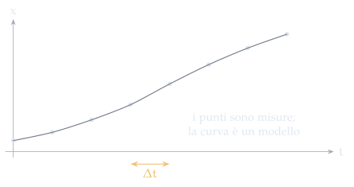

::: esempio Velocità e accelerazione da una tabella
Una videocamera registra, ogni $0{,}20\,\mathrm{s}$, le posizioni

$$0{,}00,\quad0{,}04,\quad0{,}16,\quad0{,}36,\quad0{,}64\ \mathrm{m}.$$

La velocità al tempo centrale $t_2=0{,}40\,\mathrm{s}$ si stima con

$$v_2\approx\frac{x_3-x_1}{2\Delta t}
=\frac{0{,}36-0{,}04}{0{,}40}
=0{,}80\un{m/s}.$$

L'accelerazione allo stesso istante vale

$$a_2\approx\frac{x_3-2x_2+x_1}{(0{,}20)^2}
=\frac{0{,}36-2(0{,}16)+0{,}04}{0{,}04}
=2{,}0\un{m/s^2}.$$

La sequenza coincide con $x=t^2$, per cui il valore esatto dell'accelerazione è proprio $2\,\mathrm{m/s^2}$. L'esempio mostra come una grandezza istantanea possa essere ricostruita da misure vicine.
:::

## Leggi orarie come modelli, non come formule isolate {#s-1-5}

Una legge oraria assegna una posizione a ogni istante del dominio considerato. I parametri presenti nella formula hanno un significato fisico e devono essere letti insieme alle unità. Nella relazione

$$x(t)=x_0+v_0t+\frac12at^2,$$

$x_0$ è la posizione all'istante scelto come zero, $v_0$ è la velocità in quell'istante e $a$ è l'accelerazione costante. La formula non descrive qualunque moto: vale soltanto nell'intervallo in cui l'accelerazione può essere trattata come costante.

Il dominio temporale fa parte del modello. Una legge come $x=2+5t-1{,}5t^2$ può rappresentare bene il moto di un carrello per pochi secondi, ma non può essere prolungata indefinitamente senza chiedersi che cosa accada fuori dall'intervallo osservato. A tempi grandi prevederebbe posizioni sempre più negative e velocità di modulo crescente; la situazione reale potrebbe invece includere un urto, un arresto o il termine della pista.

Anche l'origine del tempo è una scelta. Se si introduce $\tau=t-t_0$, la stessa traiettoria può essere riscritta usando un nuovo istante iniziale. Cambiano i coefficienti della legge oraria, non il moto. Questa flessibilità permette di scegliere $t=0$ nel momento più conveniente: partenza, lancio, ingresso in una curva o inizio della registrazione.

::: nota Come leggere una legge oraria prima di calcolare
1. Controllare le unità di ogni termine: tutti devono avere dimensione di lunghezza.
2. Calcolare $x(0)$ per riconoscere la posizione iniziale.
3. Studiare il segno della velocità per capire il verso del moto.
4. Cercare gli istanti in cui $v=0$, che possono indicare arresti o inversioni.
5. Verificare l'intervallo fisico di validità: una formula matematica può continuare anche quando il fenomeno descritto è terminato.
:::

## Velocità: quanto rapidamente cambia la posizione {#s-1-6}

La velocità media nell'intervallo $[t_1,t_2]$ è

::: legge Velocità media
$$\vect v_m=\frac{\Delta\vect r}{\Delta t}
=\frac{\vect r(t_2)-\vect r(t_1)}{t_2-t_1}.$$
:::

È un vettore orientato come lo spostamento, non come l'intera traiettoria. Se un atleta completa un giro e torna al punto di partenza, la velocità media sull'intero giro è nulla anche se la sua rapidità non è mai stata nulla.

La velocità istantanea descrive il moto in un singolo istante. Nel linguaggio del calcolo differenziale e integrale è il limite delle velocità medie su intervalli sempre più piccoli:

::: legge Velocità istantanea
$$\vect v(t)=\frac{\dd\vect r}{\dd t}.
\tag{1}$$
:::

L'equazione (1) è un limite; una differenza finita ne fornisce una stima su un intervallo misurabile.
Geometricamente è tangente alla traiettoria. Nel moto rettilineo il segno della componente $v_x$ indica il verso: $v_x>0$ significa che $x$ cresce, $v_x<0$ che diminuisce.

::: approfondimento Percorso discreto e numerico
Senza usare la derivata, si stima la velocità vicino all'istante $t_k$ con posizioni misurate:

$$\vect v_k\approx\frac{\vect r_{k+1}-\vect r_k}{\Delta t}.$$

Una stima spesso migliore usa un punto precedente e uno successivo:

$$\vect v_k\approx\frac{\vect r_{k+1}-\vect r_{k-1}}{2\Delta t}.$$

La seconda formula bilancia l'informazione ai due lati dell'istante. È una differenza finita centrata, ampiamente usata nell'analisi di video e nelle simulazioni numeriche.
:::

::: quotidiano Velocità media del viaggio e velocità istantanea
Un tragitto di $120\un{km}$ compiuto in due ore ha rapidità media $60\un{km/h}$. Questo non implica che il tachimetro abbia indicato sempre 60: possono esserci stati semafori, tratti autostradali e soste. La media riassume l'intero intervallo; il tachimetro approssima il valore istantaneo.
:::

## Accelerazione: come cambia la velocità {#s-1-7}

L'accelerazione media è

$$\vect a_m=\frac{\Delta\vect v}{\Delta t}.$$

L'accelerazione istantanea è

::: legge Accelerazione istantanea
$$\vect a(t)=\frac{\dd\vect v}{\dd t}
=\frac{\dd^2\vect r}{\dd t^2}.$$
:::

Dire che un corpo accelera non significa necessariamente che aumenta il modulo della velocità. L'accelerazione misura qualunque variazione del vettore velocità: aumento del modulo, diminuzione, cambio di direzione o combinazione di questi effetti.

Un'automobile che frena mentre procede verso $x>0$ ha $v_x>0$ e $a_x<0$. Un'automobile che procede verso $x<0$ e rallenta ha $v_x<0$ e $a_x>0$. La parola “decelerazione” può essere intuitiva, ma i segni diventano chiari soltanto dopo aver scelto l'asse.

::: approfondimento Percorso discreto e numerico
Da una sequenza di velocità si stima

$$\vect a_k\approx\frac{\vect v_{k+1}-\vect v_k}{\Delta t}.$$

Se sono note soltanto le posizioni equidistanziate nel tempo, si può combinare due volte la differenza finita:

$$\vect a_k\approx\frac{\vect r_{k+1}-2\vect r_k+\vect r_{k-1}}{(\Delta t)^2}.$$

Questa formula confronta quanto lo spostamento successivo differisce da quello precedente. Se gli spostamenti in intervalli uguali sono identici, l'accelerazione è circa nulla.
:::

::: quotidiano Il corpo percepisce soprattutto l'accelerazione
In un treno che viaggia a velocità costante, un passeggero può leggere senza avvertire il moto. La partenza, la frenata e una curva sono invece percepite perché cambia la velocità. Anche il sensore usato per ruotare lo schermo di uno smartphone sfrutta un accelerometro: quando il telefono è sostenuto, il dispositivo misura l'accelerazione propria prodotta dalla forza di sostegno e il software usa questa informazione per stimare la verticale. In caduta libera ideale, invece, la lettura tende a zero.
:::

::: storia Dalla velocità geometrica alla derivata
Galileo descrive il moto uniformemente accelerato confrontando spazi e tempi nella *Terza giornata* delle *Due nuove scienze*  [2](#fonti). Nel Seicento la velocità istantanea non disponeva ancora della notazione moderna: il passaggio da un rapporto medio a un valore in un istante fu uno dei problemi che alimentarono la nascita del calcolo. Newton parlò di “flussioni” per le velocità di variazione  [3](#fonti); la notazione $\dd x/\dd t$, oggi più comune in fisica, proviene invece dalla tradizione leibniziana. La formula moderna non va quindi letta come una definizione comparsa tutta insieme, ma come la sintesi di problemi su tangenti, tempi e variazioni.
:::

## Moto rettilineo uniforme {#s-1-8}

Quando la velocità è costante, l'accelerazione è nulla e la legge oraria lungo un asse è

::: legge Moto rettilineo uniforme
$$x(t)=x_0+v(t-t_0).$$
:::

Il grafico $x$–$t$ è una retta. La pendenza è la velocità: una retta più inclinata corrisponde a un modulo maggiore. Una retta orizzontale rappresenta una posizione costante, dunque un corpo fermo nel riferimento scelto.

La formula non afferma che il corpo sia privo di interazioni: stabilisce soltanto che la velocità non cambia. In un riferimento inerziale, la dinamica collegherà questa condizione a una risultante delle forze esterne nulla.

::: quotidiano Nastro trasportatore e tapis roulant
Un punto del nastro si muove quasi uniformemente nel tratto rettilineo. Una persona che cammina sul nastro combina la propria velocità rispetto al nastro con quella del nastro rispetto al pavimento. Il problema è contemporaneamente un moto uniforme e un problema di velocità relativa.
:::

## Funzioni e grafici: vedere una legge prima di calcolarla {#s-0-25}

Una funzione associa a ogni valore ammesso della variabile indipendente un solo valore della variabile dipendente. La scrittura $y=f(x)$ non specifica soltanto una formula: dichiara che $y$ dipende da $x$. Il **dominio** è l'insieme dei valori ammessi di $x$; l'immagine è l'insieme dei valori ottenuti per $y$.

In fisica ricorrono alcune famiglie fondamentali:

- funzione lineare o affine, $y=mx+q$: pendenza costante;
- funzione quadratica, $y=ax^2+bx+c$: derivata seconda costante $y”=2a$; la curvatura geometrica della parabola, invece, varia lungo la curva;
- legge di potenza, $y=Cx^n$: comportamento di scala;
- esponenziale, $y=y_0e^{kx}$: variazione relativa costante;
- logaritmo, $y=\ln x$: crescita lenta e inversione dell'esponenziale;
- funzione sinusoidale, $y=A\cos(\omega t+\phi)$: oscillazioni e onde.

Il grafico permette di riconoscere segno, zeri, massimi, minimi, intervalli di crescita e concavità. Gli assi devono riportare quantità e unità. Un grafico senza scala può comunicare una tendenza, ma non consente una lettura quantitativa.

Le trasformazioni aiutano a costruire grafici complessi da grafici noti. Se $y=f(x)$, allora $f(x-a)$ trasla il grafico verso destra di $a$, $f(x)+b$ lo trasla verso l'alto, $Af(x)$ modifica l'ampiezza, $f(bx)$ modifica la scala orizzontale.

Una funzione può essere definita a tratti. Un termostato, una forza di contatto o un segnale digitale cambiano legge in regioni diverse. La continuità non va data per scontata: in alcuni modelli una grandezza può avere un salto ideale, anche se il processo reale avviene in un intervallo molto breve.

::: quotidiano Perché si linearizzano i dati
Una relazione di potenza $y=Cx^n$ diventa

$$\log y=\log C+n\log x.$$

Su un grafico log-log appare quindi come una retta di pendenza $n$. Un'esponenziale $y=y_0e^{kx}$ diventa $\ln y=\ln y_0+kx$: su un grafico semilogaritmico appare come una retta. Queste trasformazioni permettono di riconoscere la forma di una legge sperimentale.
:::

## Successioni, somme e idea di limite {#s-0-26}

Una successione è una lista ordinata di numeri $a_1,a_2,a_3,\ldots$. Può rappresentare misure ripetute, posizioni campionate a tempi regolari o approssimazioni sempre più accurate. La somma

$$\sum_{k=1}^{N}a_k=a_1+a_2+\cdots+a_N$$

permette di scrivere in forma compatta contributi discreti.

La progressione geometrica

$$1+r+r^2+\cdots+r^N$$

ha somma

$$\sum_{k=0}^{N}r^k=\frac{1-r^{N+1}}{1-r},\qquad r\ne1.$$

Se $|r|<1$, al crescere di $N$ il termine $r^{N+1}$ tende a zero e la somma infinita vale

$$\sum_{k=0}^{\infty}r^k=\frac1{1-r}.$$

La parola “infinita” non significa che si completino materialmente infinite operazioni. Indica il limite verso cui tendono le somme parziali.

Un limite descrive il comportamento di una funzione o di una successione quando la variabile si avvicina a un valore. La scrittura

$$\lim_{x\to a}f(x)=L$$

afferma che $f(x)$ può essere resa arbitrariamente vicina a $L$ scegliendo $x$ abbastanza vicino ad $a$, anche se $f(a)$ non fosse definita. La continuità in $a$ richiede che il limite esista e coincida con $f(a)$.

::: approfondimento Avvicinarsi senza “mettere uguale a zero”
Nel rapporto $(f(x+h)-f(x))/h$, il denominatore non viene mai posto uguale a zero. Si studia ciò che accade per valori di $h$ non nulli sempre più piccoli. Il limite è una proprietà della tendenza dei rapporti, non una divisione per zero.
:::

## Differenze finite e derivate {#s-0-27}

::: storia Tangenti, aree e nascita del calcolo
Il calcolo differenziale e integrale condensò problemi studiati per secoli: velocità istantanee, tangenti, massimi, aree e somme infinite. Newton e Leibniz elaborarono nel tardo Seicento formulazioni sostanzialmente indipendenti. Newton collegò le “flussioni” al moto e alle grandezze variabili nel tempo; Leibniz costruì un linguaggio di differenziali e introdusse una notazione che si diffuse sul continente e rimane alla base di simboli come $\dd x$ e $\int$. Entrambi dipendevano da risultati precedenti su indivisibili, serie, tangenti e quadrature. La formulazione rigorosa mediante limiti fu sviluppata pienamente soltanto nei secoli successivi.  [3, 4, 5](#fonti)
:::

La pendenza media di una funzione fra $x$ e $x+\Delta x$ è

$$\frac{\Delta f}{\Delta x}
=\frac{f(x+\Delta x)-f(x)}{\Delta x}.$$

Nel grafico è la pendenza della retta secante. Riducendo l'intervallo, la secante tende alla tangente. La derivata è il limite

$$f'(x)=\frac{\dd f}{\dd x}
=\lim_{\Delta x\to0}\frac{f(x+\Delta x)-f(x)}{\Delta x}.$$

In fisica la derivata rappresenta un tasso istantaneo: velocità $\dd x/\dd t$, accelerazione $\dd v/\dd t$, potenza $\dd W/\dd t$, corrente $\dd Q/\dd t$.

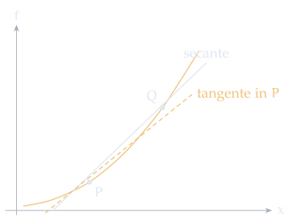

Le regole fondamentali sono

$$\frac{\dd}{\dd x}(c)=0,
\qquad
\frac{\dd}{\dd x}(x^n)=nx^{n-1},$$

$$(af+bg)'=af'+bg',
\qquad
(fg)'=f'g+fg',$$

$$\left(\frac fg\right)'=\frac{f'g-fg'}{g^2},
\qquad
\frac{\dd}{\dd x}f(g(x))=f'(g(x))g'(x).$$

Per le funzioni più comuni,

$$\frac{\dd}{\dd x}e^x=e^x,
\quad
\frac{\dd}{\dd x}\ln x=\frac1x,
\quad
\frac{\dd}{\dd x}\sin x=\cos x,
\quad
\frac{\dd}{\dd x}\cos x=-\sin x,$$

con gli angoli espressi in radianti.

::: approfondimento Derivate da dati campionati
Se sono disponibili valori a intervalli $\Delta t$, si usano differenze finite. La differenza in avanti è

$$f'(t_i)\simeq\frac{f_{i+1}-f_i}{\Delta t};$$

la differenza centrale è

$$f'(t_i)\simeq\frac{f_{i+1}-f_{i-1}}{2\Delta t}.$$

La seconda è in genere più accurata per dati regolari, ma entrambe amplificano il rumore quando $\Delta t$ è troppo piccolo. Non esiste quindi un passo universalmente migliore.
:::

## Casi di studio e attività sperimentali {#casi}

### Caso di studio: Ricavare velocità e accelerazione da un video

Una videocamera registra una pallina ogni $0{,}10\un{s}$. Dopo la calibrazione spaziale si ottengono, in metri,

$$\begin{array}{c|ccccc}
t\ (\mathrm{s}) & 0{,}00&0{,}10&0{,}20&0{,}30&0{,}40\\\hline
x\ (\mathrm{m}) &0{,}000&0{,}055&0{,}205&0{,}455&0{,}805
\end{array}$$

Una stima centrale della velocità a $t=0{,}20\un{s}$ è

$$v(0{,}20)\approx\frac{x(0{,}30)-x(0{,}10)}{0{,}20}
=\frac{0{,}455-0{,}055}{0{,}20}=2{,}00\un{m/s}.$$

Una stima centrale dell'accelerazione è

$$a(0{,}20)\approx\frac{x(0{,}30)-2x(0{,}20)+x(0{,}10)}{(0{,}10)^2}
=10{,}0\un{m/s^2}.$$

Se ciascuna posizione varia di appena $2\un{mm}$, la seconda differenza può cambiare sensibilmente perché combina tre misure e divide per $\Delta t^2$. Ridurre il passo aumenta la risoluzione temporale, ma può amplificare il rumore. Per questo l'analisi sperimentale usa spesso adattamenti su più punti, filtri dichiarati e barre d'errore, invece di derivare ciecamente ogni coppia di campioni.

### Attività sperimentale: Analisi video di un moto rettilineo

**Obiettivo.**  ricavare posizione, velocità e accelerazione da una sequenza di immagini e confrontare due metodi di elaborazione numerica.

**Materiali o dati.**  smartphone fissato, riferimento metrico visibile, pallina o carrello e software per la lettura dei fotogrammi.

**Procedura.**

1. Riprendere lateralmente il moto, evitando prospettiva obliqua e spostamenti della videocamera.
2. Calibrare la scala con una lunghezza nota e registrare almeno dieci coppie $(t,x)$.
3. Calcolare la velocità con differenze in avanti e centrali, quindi confrontare i risultati.
4. Stimare l'accelerazione mediante seconde differenze oppure adattando una parabola ai dati di posizione.
5. Ripetere l'analisi con un passo temporale doppio.

**Controllo e discussione.**  confrontare i risultati ottenuti con i diversi passi temporali e distinguere risoluzione, rumore e possibili errori sistematici di calibrazione o prospettiva.

**Sicurezza.**  mantenere lo smartphone fermo e protetto; usare oggetti leggeri e lasciare libera la traiettoria.

### Attività sperimentale: Dal video al modello: posizione e residui

**Obiettivo.**  distinguere variazione fisica del moto e variabilità introdotta dall'elaborazione numerica, confrontando un modello lineare con uno ad accelerazione costante.

**Dati per lavorare senza apparato.**  La tabella contiene **dati sintetici**, costruiti aggiungendo piccoli scarti a una legge parabolica. Non proviene da un esperimento. I tempi sono assunti esatti; le posizioni sono arrotondate al millimetro. Per il confronto si assuma un'incertezza tipo sulla posizione di $0{,}002\un{m}$, scelta didatticamente e non ricavata da misure ripetute.

| $t$ (s) | $x$ (m) | $t$ (s) | $x$ (m) |
|–|–|–|–|
| $0{,}00$ | $0{,}100$ | $0{,}60$ | $0{,}365$ |
| $0{,}10$ | $0{,}125$ | $0{,}70$ | $0{,}435$ |
| $0{,}20$ | $0{,}155$ | $0{,}80$ | $0{,}518$ |
| $0{,}30$ | $0{,}198$ | $0{,}90$ | $0{,}602$ |
| $0{,}40$ | $0{,}242$ | $1{,}00$ | $0{,}700$ |
| $0{,}50$ | $0{,}300$ |  |  |

**Elaborazione.**

1. Rappresentare $x$ in funzione di $t$, indicando unità e barre di incertezza. Descrivere come cambia la pendenza prima di adattare un modello.
2. Con un foglio di calcolo, adattare ai minimi quadrati prima una retta $x_{\mathrm{lin}}=b_0+b_1t$, poi una parabola $x_{\mathrm{quad}}=c_0+c_1t+c_2t^2$. Associare unità e significato fisico ai coefficienti; per la parabola ricavare $a=2c_2$.
3. Calcolare i residui $r_i=x_i-x_{\mathrm{modello}}(t_i)$ per entrambi gli adattamenti. Disegnarli contro il tempo in due pannelli con la stessa scala verticale e una linea a $r=0$. Un modello adeguato non deve lasciare una curvatura sistematica nei residui.
4. Stimare $a$ mediante seconde differenze sui punti interni. Ripetere usando soltanto i campioni a $t=0$, $0{,}20$, $0{,}40$, $0{,}60$, $0{,}80$, $1{,}00\,\mathrm{s}$. Confrontare la dispersione delle stime con l'accelerazione dell'adattamento parabolico.

**Consegna e criterio di riuscita.**  Consegnare il grafico posizione–tempo, i due grafici dei residui, i coefficienti con unità e un commento di cinque righe. Il lavoro è completo se confronta i modelli attraverso l'andamento e la scala dei residui, spiega perché le seconde differenze amplificano gli scarti e distingue un accordo con dati sintetici da una validazione sperimentale. Un confronto quantitativo deve indicare il criterio adottato, per esempio lo scarto quadratico medio, senza giudicare soltanto l'aspetto della curva.

## Glossario {#glossario}

- **Derivata**: Limite del rapporto tra variazioni quando l'intervallo tende a zero; descrive un tasso di cambiamento istantaneo.
- **Differenza finita**: Rapporto o variazione calcolati su un intervallo non nullo; approssima una derivata con un errore che dipende dal passo e dai dati.
- **Limite**: Valore verso cui tende una funzione o una successione quando la variabile si avvicina a un punto o cresce senza limite.
- **Sistema di riferimento**: Insieme formato da osservatore, orologio e procedura per assegnare posizioni e tempi agli eventi; non coincide con il solo disegno degli assi.

## Esercizi {#esercizi}

Gli esercizi riprendono quelli della dispensa. Ogni soluzione è nascosta finché non la apri: prova prima a impostare il problema da solo.

### Funzioni e grafici: vedere una legge prima di calcolarla

::: esercizio Calibrazione a tratti di un rivelatore [medio]
La risposta di un rivelatore è descritta da

$$S(E)=
\begin{cases}
0\un{V}, & E<2\un{MeV},\\
\left(1{,}5\un{V/MeV}\right)
\left(E-2\un{MeV}\right),
& 2\un{MeV}\le E\le6\un{MeV},\\
6\un{V}, & E>6\un{MeV}.
\end{cases}$$

dove $E$ è un'energia e $S$ è una tensione elettrica. Il coefficiente del tratto lineare ha quindi unità $\mathrm{V/MeV}$. Calcolare $S$ per $E=1{,}0$, $4{,}0$ e $8{,}0\,\mathrm{MeV}$, quindi interpretare soglia e saturazione.

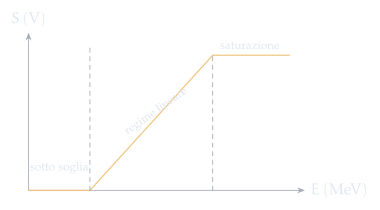
>>> soluzione
**Valore sotto soglia.**  Per $E=1{,}0<2$,

$$S=0.$$

**Regime lineare.**  Per $E=4{,}0$,

$$S=\left(1{,}5\un{V/MeV}\right)\left(4{,}0\un{MeV}-2{,}0\un{MeV}\right)=3{,}0\un{V}.$$

**Regime saturo.**  Per $E=8{,}0>6$,

$$S=6\un{V}.$$

**Interpretazione.**  La soglia indica che energie inferiori a $2\,\mathrm{MeV}$ non producono un segnale registrato nel modello. Oltre $6\,\mathrm{MeV}$ il rivelatore non distingue più energie maggiori perché l'uscita è limitata a $6\,\mathrm{V}$.
:::

::: esercizio Riconoscere una legge di potenza dai dati [medio]
Una grandezza $Y$ assume i valori seguenti:

$$\begin{array}{c|cccc}
X&1&2&4&8\\ \hline
Y&3&12&48&192
\end{array}$$

Verificare che i dati seguano una legge $Y=CX^n$ e determinare $C$ e $n$.

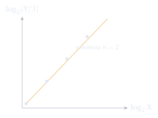
>>> soluzione
**Rapporti successivi.**  Quando $X$ raddoppia, $Y$ viene moltiplicata per quattro:

$$\frac{12}{3}=\frac{48}{12}=\frac{192}{48}=4.$$

**Esponente.**  Se $Y\propto X^n$, il raddoppio di $X$ produce un fattore $2^n$. Dunque

$$2^n=4=2^2\quad\Rightarrow\quad n=2.$$

**Costante.**  Con $X=1$ e $Y=3$,

$$C=3.$$

**Legge.**

$$Y=3X^2.$$

Il controllo con $X=8$ fornisce $3\cdot64=192$, in accordo con la tabella.
:::

### Successioni, somme e idea di limite

::: esercizio La distanza totale di una pallina che rimbalza [medio]
Una pallina viene lasciata da $h_0=2{,}0\un{m}$. Dopo ogni urto risale al $60\%$ dell'altezza precedente. Calcolare la distanza totale percorsa fino a quando i rimbalzi diventano idealmente infiniti.

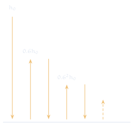
>>> soluzione
**Prima caduta.**  La pallina percorre una sola volta $h_0$ verso il basso.

**Rimbalzi successivi.**  Ogni altezza di rimbalzo viene percorsa due volte, una in salita e una in discesa:

$$D=h_0+2h_0(0{,}6+0{,}6^2+0{,}6^3+\cdots).$$

**Somma geometrica.**

$$0{,}6+0{,}6^2+\cdots=\frac{0{,}6}{1-0{,}6}=1{,}5.$$

**Distanza totale.**

$$D=2{,}0+2(2{,}0)(1{,}5)=8{,}0\un{m}.$$

Il modello idealizza urti sempre più ravvicinati; nella realtà dissipazione, deformazioni e dimensioni finite interrompono il processo.
:::

::: esercizio Un limite da una tabella di rapporti incrementali [base]
Per $f(x)=x^2$, calcolare

$$Q(h)=\frac{f(3+h)-f(3)}{h}$$

per $h=1$, $0{,}1$, $0{,}01$, $-0{,}1$ e $-0{,}01$. Deducere il valore verso cui tende $Q(h)$ quando $h\to0$.

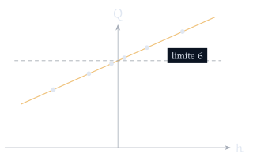
>>> soluzione
**Semplificazione algebrica.**

$$Q(h)=\frac{(3+h)^2-9}{h}
=\frac{6h+h^2}{h}=6+h,
\qquad h\ne0.$$

**Valori.**

$$Q(1)=7,\quad Q(0{,}1)=6{,}1,\quad Q(0{,}01)=6{,}01,$$

$$Q(-0{,}1)=5{,}9,\quad Q(-0{,}01)=5{,}99.$$

**Limite.**  I valori si avvicinano a $6$ da entrambi i lati:

$$\lim_{h\to0}Q(h)=6.$$

Il rapporto non è definito per $h=0$, ma il suo limite esiste.
:::

### Differenze finite e derivate

::: esercizio Velocità e accelerazione da dati campionati [medio]
La posizione di un carrello è misurata ogni secondo:

$$\begin{array}{c|ccccc}
t\,(\mathrm{s})&0&1&2&3&4\\ \hline
x\,(\mathrm{m})&0{,}0&1{,}1&4{,}0&9{,}2&16{,}1
\end{array}$$

Usare differenze centrali per stimare la velocità a $t=2\,\mathrm{s}$ e la seconda differenza per stimare l'accelerazione nello stesso istante.

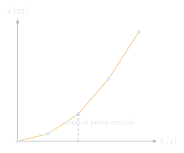
>>> soluzione
**Velocità centrale.**  Con $\Delta t=1\un{s}$,

$$v(2)\simeq\frac{x(3)-x(1)}{2\Delta t}
=\frac{9{,}2-1{,}1}{2}=4{,}05\un{m/s}.$$

**Seconda differenza.**

$$a(2)\simeq\frac{x(3)-2x(2)+x(1)}{(\Delta t)^2}.$$

**Calcolo.**

$$a(2)\simeq9{,}2-2(4{,}0)+1{,}1
=2{,}30\un{m/s^2}.$$

**Interpretazione.**  I dati sono vicini a una legge quadratica, ma non perfettamente esatti. Le differenze finite forniscono stime locali, non valori privi di incertezza.
:::

::: esercizio Forza da un'energia potenziale [medio]
Un sistema unidimensionale ha energia potenziale

$$U(x)=\alpha x^2-\beta x^3,
\qquad
\alpha=4\un{J/m^2},
\quad
\beta=2\un{J/m^3}.$$

La coordinata $x$ è espressa in metri. La forza è $F(x)=-\dd U/\dd x$. Determinare $F(x)$, i punti di equilibrio e la stabilità locale.

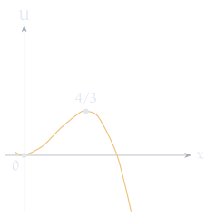
>>> soluzione
**Derivata.**

$$\frac{\dd U}{\dd x}=2\alpha x-3\beta x^2.$$

**Forza.**

$$F(x)=-(2\alpha x-3\beta x^2)=3\beta x^2-2\alpha x.$$

**Equilibri.**  I punti di equilibrio soddisfano $F=0$:

$$x(3\beta x-2\alpha)=0
\quad\Rightarrow\quad
x=0,\qquad x=\frac{2\alpha}{3\beta}=\frac43\,\mathrm{m}.$$

**Stabilità.**  Un minimo di $U$ è stabile, un massimo è instabile. La seconda derivata è

$$U”(x)=2\alpha-6\beta x.$$

In $x=0$, $U”=2\alpha>0$: equilibrio stabile. In $x=4/3\,\mathrm{m}$, $U”=2\alpha-4\alpha=-2\alpha<0$: equilibrio instabile.
:::

### Problemi di sintesi: strumenti matematici e vettori

::: esercizio Pendenza e intercetta da dati [base]
Una relazione lineare passa per i punti sperimentali $(1{,}0,2{,}6)$ e $(5{,}0,8{,}2)$. Determinare pendenza, intercetta e valore previsto a $x=3{,}0$.
>>> soluzione
**Pendenza.**  $m=(8{,}2-2{,}6)/(5{,}0-1{,}0)=1{,}40$.

**Intercetta.**  $q=2{,}6-m(1{,}0)=1{,}20$.

**Previsione.**  $y(3)=m(3)+q=5{,}40$. Una vera analisi sperimentale richiederebbe più punti e incertezze.
:::

::: esercizio Derivata centrale da dati campionati [base]
Le posizioni ai tempi $0$, $0{,}5$ e $1{,}0\,\mathrm{s}$ sono rispettivamente $0$, $1{,}2$ e $4{,}8\,\mathrm{m}$. Stimare la velocità a $0{,}5\,\mathrm{s}$ con una differenza centrale.
>>> soluzione
**Formula.**

$$v(0{,}5)\simeq\frac{x(1{,}0)-x(0)}{2(0{,}5)}=\frac{4{,}8}{1{,}0}=4{,}80\un{m/s}.$$

La stima media informazioni prima e dopo l'istante centrale.
:::

### Moti a tratti, dati e problemi inversi

::: esercizio Inseguimento con partenza ritardata [avanzato]
L'auto A passa da un punto a $15\un{m/s}$. Cinque secondi dopo, dallo stesso punto parte B da ferma con $a=3\un{m/s^2}$. Quando e dove B raggiunge A?

>>> soluzione
**Orologio.**  Poniamo $\tau=0$ quando parte B. In quell'istante A ha già un vantaggio

$$x_{A0}=15\cdot5=75\un{m}.$$

**Leggi orarie.**

$$x_A(\tau)=75+15\tau,\qquad x_B(\tau)=\frac12(3)\tau^2=1{,}5\tau^2.$$

**Uguaglianza delle posizioni.**

$$1{,}5\tau^2=75+15\tau\Rightarrow \tau^2-10\tau-50=0.$$

La radice positiva è

$$\tau=5+5\sqrt3=13{,}66\un{s}.$$

**Posizione.**

$$x=1{,}5(13{,}66)^2\simeq280\un{m}.$$

Rispetto alla partenza di A, l'incontro avviene dopo $18{,}66$ s.
:::

::: esercizio Velocità media su distanze uguali [avanzato]
Un percorso è diviso in due tratti di uguale lunghezza, percorsi a $60\un{km/h}$ e $90\un{km/h}$. Calcolare la rapidità media.

>>> soluzione
**Scelta di una distanza simbolica.**  Sia $L$ la lunghezza di ciascun tratto. La distanza totale è $2L$.

**Tempi.**

$$t_1=\frac{L}{60},\qquad t_2=\frac{L}{90}$$

con ore e chilometri coerenti.

**Media.**

$$v_m=\frac{2L}{L/60+L/90}=\frac{2}{1/60+1/90}=72\un{km/h}.$$

**Osservazione.**  Non si usa la media aritmetica $75$ km/h, perché i tempi trascorsi alle due velocità non sono uguali.
:::

### Problemi trasversali e di modellizzazione

::: esercizio Fotogrammi a intervalli regolari [avanzato]
Una videocamera registra la posizione di un carrello ogni $0{,}5\un{s}$:

$$\begin{array}{c|ccccc}
t\,(\mathrm{s})&0&0{,}5&1{,}0&1{,}5&2{,}0\\
\hline
x\,(\mathrm{m})&0&0{,}6&2{,}4&5{,}4&9{,}6
\end{array}$$

Calcolare le velocità medie nei quattro intervalli, riconoscere il tipo di moto e stimare la velocità all'istante $t=1{,}0\un{s}$ con una differenza centrale.

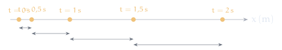
>>> soluzione
**Velocità sui singoli intervalli.**

$$\bar v_{0-0{,}5}=\frac{0{,}6-0}{0{,}5}=1{,}2\un{m/s},$$

$$\bar v_{0{,}5-1{,}0}=\frac{2{,}4-0{,}6}{0{,}5}=3{,}6\un{m/s},$$

$$\bar v_{1{,}0-1{,}5}=\frac{5{,}4-2{,}4}{0{,}5}=6{,}0\un{m/s},
\qquad
\bar v_{1{,}5-2{,}0}=\frac{9{,}6-5{,}4}{0{,}5}=8{,}4\un{m/s}.$$

**Accelerazione.**  Le velocità aumentano ogni volta di $2{,}4\un{m/s}$ in $0{,}5\un{s}$:

$$a=\frac{2{,}4}{0{,}5}=4{,}8\un{m/s^2}.$$

Il moto è compatibile con un'accelerazione costante e partenza da fermo.

**Differenza centrale a $t=1$ s.**

$$v(1)\simeq\frac{x(1{,}5)-x(0{,}5)}{1{,}5-0{,}5}
=\frac{5{,}4-0{,}6}{1{,}0}=4{,}8\un{m/s}.$$

La differenza centrale usa dati ai due lati dell'istante e fornisce una stima più equilibrata di una differenza solo in avanti.
:::

::: esercizio Sorpasso con veicoli di lunghezza finita [avanzato]
Un'automobile lunga $4{,}5\un{m}$ viaggia a $27\un{m/s}$ e si trova con il muso a $12\un{m}$ dal retro di un autocarro lungo $18\un{m}$ che viaggia a $20\un{m/s}$. Quanto tempo serve perché il retro dell'auto si trovi $15\un{m}$ oltre il muso dell'autocarro? Quanto spazio percorre l'auto?

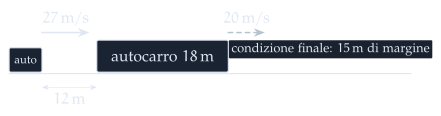
>>> soluzione
**Distanza relativa da recuperare.**  Per completare il sorpasso l'auto deve compensare

$$12+18+4{,}5+15=49{,}5\un{m}.$$

I termini rappresentano, nell'ordine, il distacco iniziale, la lunghezza del camion, la lunghezza dell'auto e il margine finale.

**Velocità relativa.**

$$v_{rel}=27-20=7\un{m/s}.$$

**Tempo.**

$$t=\frac{49{,}5}{7}=7{,}07\un{s}.$$

**Spazio dell'auto.**

$$s_{auto}=27\cdot7{,}07=191\un{m}.$$

Trascurare le lunghezze dei veicoli avrebbe sottostimato in modo rilevante sia il tempo sia lo spazio necessario.
:::

::: esercizio Velocità necessaria per rispettare l'orario [avanzato]
Un autobus deve percorrere $12\un{km}$ in $20\un{min}$. I primi $4\un{km}$ vengono percorsi a $30\un{km/h}$; segue una sosta di $4\un{min}$. Quale velocità media deve mantenere negli ultimi $8\un{km}$?

>>> soluzione
**Tempo del primo tratto.**

$$t_1=\frac{4\,\mathrm{km}}{30\,\mathrm{km/h}}
=\frac{2}{15}\,\mathrm{h}=8\un{min}.$$

**Tempo residuo.**

$$t_2=20-8-4=8\un{min}=\frac{2}{15}\,\mathrm{h}.$$

**Velocità richiesta.**

$$v_2=\frac{8\,\mathrm{km}}{2/15\,\mathrm{h}}
=60\un{km/h}.$$

**Interpretazione.**  La velocità media sull'intero viaggio non si ottiene facendo la media aritmetica di $30$ e $60$ km/h, perché i tempi e le distanze dei tratti non sono uguali e compare una sosta.
:::

### Problemi di sintesi: cinematica

::: esercizio Recupero dopo una partenza ritardata [base]
Un ciclista passa da un punto a $12\un{m/s}$. Dopo $20\un{s}$ parte dallo stesso punto un motociclista a $18\un{m/s}$. Quando e dove lo raggiunge?
>>> soluzione
**Origine dei tempi.**  Misuriamo $t$ dalla partenza del motociclista. Il ciclista ha vantaggio $v_1\Delta t=240\,\mathrm{m}$.

**Uguaglianza delle posizioni.**  $18t=12(t+20)$, quindi $t=40{,}0\un{s}$ e $x=18t=720\un{m}$.
:::

::: esercizio Velocità media su due tratti [base]
Un veicolo percorre $120\un{m}$ a $15\un{m/s}$ e poi $80\un{m}$ a $8{,}0\un{m/s}$. Calcolare la rapidità media.
>>> soluzione
**Tempi.**  $t_1=120/15=8{,}0\,\mathrm{s}$, $t_2=80/8=10{,}0\,\mathrm{s}$.

**Media corretta.**

$$\bar v=\frac{200}{18{,}0}=11{,}1\un{m/s}.$$

Non è la media aritmetica delle due rapidità perché i tempi nei tratti sono diversi.
:::

::: esercizio Scelta del passo nella derivazione numerica [base]
Due stime della velocità da dati rumorosi sono ottenute con passi $0{,}10\un{s}$ e $0{,}01\un{s}$. Spiegare perché il passo più piccolo non garantisce sempre una stima migliore e proporre un controllo operativo.
>>> soluzione
**Errore di discretizzazione.**  Un passo minore approssima meglio il limite differenziale per dati regolari.

**Rumore.**  La differenza fra due posizioni rumorose viene divisa per $\Delta t$; ridurre il passo amplifica quindi il contributo relativo del rumore.

**Controllo.**  Ripetere il calcolo con più passi, confrontare la stabilità del risultato e, se necessario, applicare una regressione locale invece di una differenza fra soli due punti.
:::

## Fonti {#fonti}

Il testo, le formule, i diagrammi e gli esercizi di questo capitolo provengono dalla *Dispensa di fisica* del corso (sezioni 0.25-0.27, 1.1-1.8 e materiali delle sezioni 0.22, 1.21, 1.22), consultabile nel lettore della galassia. Per la lettura sul sito sono cambiati l'impaginazione, i colori delle figure, la numerazione e la posizione di alcuni riquadri ed esercizi; la sezione iniziale è scritta per il pianeta di questa unità.

Opere citate nel testo:

1. M. Clagett, *The Science of Mechanics in the Middle Ages*, University of Wisconsin Press, Madison, 1959.
2. G. Galilei, *Discorsi e dimostrazioni matematiche intorno a due nuove scienze*, Elsevier, Leida, 1638; traduzione inglese di S. Drake, *Two New Sciences*, University of Wisconsin Press, Madison, 1974.
3. I. Newton, *The Method of Fluxions and Infinite Series; with Its Application to the Geometry of Curve-Lines*, traduzione e commento di J. Colson, Henry Woodfall per John Nourse, Londra, 1736.
4. G. W. Leibniz, “Nova methodus pro maximis et minimis, itemque tangentibus”, *Acta Eruditorum*, ottobre 1684, pp. 467–473.
5. C. B. Boyer e U. C. Merzbach, *A History of Mathematics*, 3a edizione, Wiley, Hoboken, 2011.
