## Prima di cominciare {#apertura}

Un carrello accelerato lungo una guida percorre distanze sempre maggiori in intervalli di tempo uguali. Una previsione basata soltanto sulla velocità iniziale sottostima lo spostamento, perché la velocità cresce durante il moto e lo spostamento accumula tutta la sua storia.

Il capitolo tratta il moto con accelerazione costante, la lettura dei grafici attraverso pendenze e aree, la caduta libera e il moto verticale, il caso dell'accelerazione variabile ricostruita passo dopo passo, i moti a tratti e la sicurezza stradale con tempi di reazione e spazi di frenata. La sezione sugli integrali mostra perché l'area sotto il grafico velocità-tempo fornisce lo spostamento. Il percorso continua con [traiettorie e lanci](unit:physics-05).

## Moto uniformemente accelerato {#s-1-9}

Se l'accelerazione è costante, in una dimensione valgono

::: legge Leggi del moto ad accelerazione costante
$$v(t)=v_0+a\Delta t,$$

$$x(t)=x_0+v_0\Delta t+\frac12a(\Delta t)^2,$$

$$v^2=v_0^2+2a(x-x_0),$$

con $\Delta t=t-t_0$.
:::

### Derivazione con il calcolo differenziale e integrale

Da $a=\dd v/\dd t$ costante,

$$\int_{v_0}^{v}\dd v=\int_{t_0}^{t}a\,\dd t
\quad\Rightarrow\quad
v=v_0+a\Delta t.$$

Integrando la velocità,

$$x-x_0=\int_{t_0}^{t}[v_0+a(\tau-t_0)]\,\dd\tau
=v_0\Delta t+\frac12a(\Delta t)^2.$$

::: approfondimento Derivazione con differenze finite e somme
Dividiamo l'intervallo totale $T$ in $N$ passi uguali di durata $\Delta t=T/N$. Con accelerazione costante,

$$v_{k+1}=v_k+a\Delta t,$$

quindi, dopo $N$ passi,

$$v_N=v_0+Na\Delta t=v_0+aT.$$

Lo spostamento del passo $k$ è approssimativamente la velocità media del passo moltiplicata per $\Delta t$:

$$\Delta x_k\approx\frac{v_k+v_{k+1}}{2}\Delta t.$$

Sommando tutti i trapezi,

$$x_N-x_0\approx\sum_{k=0}^{N-1}\frac{v_k+v_{k+1}}{2}\Delta t.$$

Poiché le velocità formano una progressione aritmetica, la loro media sull'intero intervallo è $(v_0+v_N)/2$. Dunque

$$x_N-x_0=\frac{v_0+v_N}{2}T
=v_0T+\frac12aT^2.$$

La formula continua emerge dalla somma di molti piccoli contributi; per accelerazione costante il risultato con i trapezi è esatto.
:::

::: nota Guida alla lettura
Il termine $v_0\Delta t$ è lo spazio che il corpo percorrerebbe mantenendo la velocità iniziale. Il termine $\tfrac12a(\Delta t)^2$ è la correzione dovuta al cambiamento progressivo della velocità. Il fattore $1/2$ nasce dal fatto che l'incremento di velocità cresce linearmente da zero al valore finale.
:::

## Grafici del moto: pendenze e aree {#s-1-10}

I grafici non sono illustrazioni decorative. Sono un altro modo di rappresentare le stesse relazioni.

Nel grafico posizione-tempo, la pendenza media tra due punti è la velocità media. La tangente in un punto fornisce la velocità istantanea. Nel grafico velocità-tempo, la pendenza fornisce l'accelerazione, mentre l'area algebrica tra la curva e l'asse dei tempi fornisce lo spostamento.

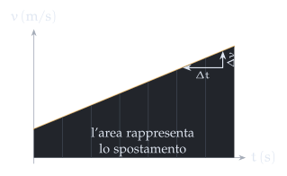

::: approfondimento Area senza integrali
Se il grafico è noto a intervalli, lo spostamento si stima con rettangoli

$$\Delta x\approx\sum_k v_k\Delta t$$

o con trapezi

$$\Delta x\approx\sum_k\frac{v_k+v_{k+1}}{2}\Delta t.$$

Le aree sopra l'asse dei tempi sono positive, quelle sotto sono negative. La somma fornisce lo spostamento; la somma dei valori assoluti fornisce invece una stima della distanza percorsa.
:::

Un grafico può rivelare errori che una formula nasconde. Se la posizione presenta un salto istantaneo, il modello implicherebbe una velocità infinita. Se la velocità cambia bruscamente, il modello implica un'accelerazione molto grande concentrata in un intervallo breve. In molti problemi tali idealizzazioni sono utili, ma vanno riconosciute.

## Moto verticale e caduta libera {#s-1-11}

Vicino alla superficie terrestre, trascurando la resistenza dell'aria e variazioni apprezzabili di quota, tutti i corpi hanno accelerazione gravitazionale di modulo

$$g\simeq9{,}81\un{m/s^2}$$

diretta verso il basso. Se l'asse $y$ è positivo verso l'alto, $a_y=-g$:

$$v_y=v_{0y}-g\Delta t,
\qquad
y=y_0+v_{0y}\Delta t-\frac12g(\Delta t)^2.$$

Nel punto più alto di un lancio verticale la velocità istantanea è zero, ma l'accelerazione resta $-g$. Il corpo non rimane sospeso: in quell'istante sta passando dal moto verso l'alto al moto verso il basso.

::: quotidiano Perché un foglio e una moneta cadono diversamente
Nel modello di caduta libera si trascura l'aria. Un foglio aperto offre una grande superficie e subisce una resistenza significativa; accartocciandolo, la resistenza diminuisce rispetto al peso e il moto si avvicina maggiormente al modello con accelerazione $g$. La differenza osservata non smentisce la legge: segnala che una forza trascurata nel modello è importante.
:::

::: storia Il piano inclinato come rallentatore della gravità
Galileo non disponeva di cronometri moderni. Facendo rotolare una sfera lungo un piano inclinato, riduceva la componente dell'accelerazione lungo il moto e rendeva misurabili intervalli più lunghi. Il valore di questa scelta è metodologico: quando un fenomeno è troppo rapido, si progetta un esperimento analogo ma più controllabile, poi si verifica quali proprietà restano invarianti  [1](#fonti).
:::

## Accelerazione variabile: ricostruire il moto passo dopo passo {#s-1-14}

Quando l'accelerazione non è costante, le formule del moto uniformemente accelerato non possono essere applicate sostituendo un valore medio senza una giustificazione. Il procedimento generale consiste nel ricostruire prima la velocità e poi la posizione.

Con il calcolo differenziale e integrale,

$$v(t)=v(t_0)+\int_{t_0}^{t}a(\tau)\,\dd\tau,
\qquad
x(t)=x(t_0)+\int_{t_0}^{t}v(\tau)\,\dd\tau.$$

Gli integrali esprimono un'accumulazione: la variazione di velocità è la somma degli effetti dell'accelerazione nel tempo; lo spostamento è la somma dei piccoli tratti percorsi.

::: approfondimento La stessa ricostruzione con una tabella
Dividiamo il tempo in intervalli di ampiezza $\Delta t$. Se l'accelerazione è nota all'inizio di ogni intervallo, il metodo più semplice aggiorna

$$v_{k+1}=v_k+a_k\Delta t,$$

$$x_{k+1}=x_k+v_k\Delta t.$$

Questo schema, detto metodo di Eulero, approssima velocità e posizione mediante piccoli passi. Una stima migliore dello spostamento usa la velocità media dell'intervallo:

$$x_{k+1}\approx x_k+\frac{v_k+v_{k+1}}{2}\Delta t.$$

Riducendo il passo e controllando che i risultati si stabilizzino, si ottiene una ricostruzione numerica senza richiedere primitive analitiche.
:::

::: esempio Un'accelerazione che cresce nel tempo
Un corpo parte da fermo in $x_0=0$ con accelerazione $a(t)=\gamma t$, dove $\gamma=0{,}5\,\mathrm{m/s^3}$. Il prodotto $\gamma t$ ha quindi unità di accelerazione. Con il calcolo differenziale e integrale,

$$v(t)=\int_0^t0{,}5\tau\,\dd\tau=0{,}25t^2,$$

$$x(t)=\int_0^t0{,}25\tau^2\,\dd\tau=\frac{t^3}{12}.$$

A $t=4\,\mathrm{s}$,

$$v=4{,}0\un{m/s},
\qquad
x=5{,}33\un{m}.$$

Senza calcolo differenziale e integrale, con passi di $1\,\mathrm{s}$, si costruisce una tabella. Partendo da $v_0=0$, le accelerazioni ai tempi $0,1,2,3$ s sono $0,0{,}5,1{,}0,1{,}5\,\mathrm{m/s^2}$. Gli aggiornamenti di Eulero producono $v_4=3{,}0\,\mathrm{m/s}$, una sottostima perché si usa sempre l'accelerazione all'inizio dell'intervallo. Con passi più piccoli o con valori medi, il risultato si avvicina a $4{,}0\,\mathrm{m/s}$. Il confronto rende visibile l'errore numerico e il motivo per cui il limite di passi sempre più piccoli conduce all'integrale.
:::

## Moti a tratti {#s-1-16}

Un viaggio reale raramente è descritto da una sola legge. Si parte, si procede per un tratto, si frena, si attende. Un moto a tratti assegna una legge diversa a intervalli diversi. Le condizioni alla frontiera devono essere coerenti: la posizione finale di un tratto diventa la posizione iniziale del successivo; di norma anche la velocità è continua, salvo idealizzazioni impulsive.

La strategia è simile alla gestione di un itinerario:

1. risolvere il primo intervallo;
2. conservare posizione e velocità raggiunte;
3. usarle come dati iniziali per il tratto seguente;
4. sommare le durate e distinguere spostamento da distanza.

::: nota Le discontinuità ideali
Dire che un'automobile passa “istantaneamente” da $20\un{m/s}$ a zero è un'abbreviazione matematica. Un veicolo reale impiega un intervallo finito, durante il quale agiscono forze e accelerazioni elevate. Il modello a salti può essere utile per una tabella oraria, ma non per progettare freni o cinture di sicurezza.
:::

## Tempi di reazione, frenata e sicurezza stradale {#s-1-18}

La distanza necessaria per arrestare un veicolo non coincide con il solo spazio di frenata. Prima che il conducente o il sistema automatico applichino i freni trascorre un tempo di percezione e reazione $t_r$. Durante questo intervallo, nel modello più semplice, il veicolo continua a velocità quasi costante:

$$d_r=v_0t_r.$$

Successivamente, se la decelerazione ha modulo costante $a_f$, lo spazio di frenata è

$$d_f=\frac{v_0^2}{2a_f}.$$

La distanza totale è

$$d_{tot}=d_r+d_f.$$

La dipendenza $d_f\propto v_0^2$ è decisiva: raddoppiare la velocità quadruplica lo spazio di frenata nel modello a decelerazione costante, mentre raddoppia soltanto lo spazio di reazione.

::: approfondimento Caso di studio: Da $50\un{km/h}$ a $70\un{km/h}$
Convertiamo le velocità:

$$50\un{km/h}=13{,}9\un{m/s},
\qquad
70\un{km/h}=19{,}4\un{m/s}.$$

Assumendo $t_r=1{,}0\,\mathrm{s}$ e $a_f=7{,}0\,\mathrm{m/s^2}$, a $50\,\mathrm{km/h}$

$$d_r=13{,}9\,\mathrm{m},
\qquad
d_f=\frac{13{,}9^2}{14}=13{,}8\,\mathrm{m},$$

per un totale di circa $27{,}7\,\mathrm{m}$. A $70\,\mathrm{km/h}$

$$d_r=19{,}4\,\mathrm{m},
\qquad
d_f=\frac{19{,}4^2}{14}=26{,}9\,\mathrm{m},$$

per un totale di circa $46{,}3\,\mathrm{m}$. Un aumento della velocità del $40\%$ produce in questo esempio un aumento della distanza totale di circa il $67\%$.

Il calcolo non è una previsione normativa: aderenza, pendenza, pneumatici, temperatura, stato del conducente e intervento dei sistemi elettronici modificano i valori. Mostra però la struttura cinematica del problema e spiega perché differenze moderate di velocità abbiano effetti rilevanti.
:::

## Integrali: accumulare contributi continui {#s-0-28}

Molte grandezze fisiche sono somme di contributi distribuiti. Il lavoro di una forza variabile, la massa di un oggetto non uniforme, la carica totale di una distribuzione e la distanza ricavata dalla velocità richiedono un procedimento di accumulo.

Su un intervallo $[a,b]$, si dividono i valori di $x$ in piccoli tratti di ampiezza $\Delta x$. La somma

$$\sum_i f(x_i)\Delta x$$

approssima l'area orientata sotto il grafico. Rendendo la suddivisione sempre più fine si definisce l'integrale

$$\int_a^b f(x)\dd x.$$

Il simbolo $\dd x$ ricorda quale variabile viene suddivisa e quale dimensione possiede ogni piccolo intervallo.

Il teorema fondamentale del calcolo collega accumulo e variazione. Se $F'(x)=f(x)$, allora

$$\int_a^b f(x)\dd x=F(b)-F(a).$$

L'integrale definito è un numero; l'integrale indefinito

$$\int f(x)\dd x=F(x)+C$$

è una famiglia di primitive. La costante $C$ compare perché funzioni che differiscono per una costante hanno la stessa derivata.

Alcune primitive fondamentali sono

$$\int x^n\dd x=\frac{x^{n+1}}{n+1}+C,\quad n\ne-1,$$

$$\int \frac{1}{x}\dd x=\ln|x|+C,
\quad
\int e^x\dd x=e^x+C,$$

$$\int\cos x\dd x=\sin x+C,
\quad
\int\sin x\dd x=-\cos x+C.$$

::: approfondimento Somme di rettangoli e trapezi
Con dati tabulati, l'integrale si stima senza conoscere una formula. La regola dei trapezi usa

$$\int_a^b f(x)\dd x\simeq
\sum_i\frac{f_i+f_{i+1}}{2}\Delta x.$$

Ogni contributo è l'area di un trapezio. Raffinare il campionamento riduce in genere l'errore, purché i dati non siano dominati dal rumore.
:::

## Casi di studio e attività sperimentali {#casi}

::: legge Accelerazione da tre posizioni
$$a_k\approx\frac{x_{k+1}-2x_k+x_{k-1}}{(\Delta t)^2}.$$
:::

### Caso di studio: Spazio di arresto su fondo asciutto e bagnato

Consideriamo dati didattici realistici, non una certificazione di uno specifico veicolo: velocità iniziale $50\un{km/h}$, tempo di reazione $0{,}90\un{s}$, decelerazione di modulo $7{,}0\un{m/s^2}$ su fondo asciutto e $4{,}5\un{m/s^2}$ su fondo bagnato. Prima si converte

$$v_0=\frac{50}{3{,}6}=13{,}9\un{m/s}.$$

Durante la reazione,

$$s_r=v_0t_r=13{,}9(0{,}90)=12{,}5\un{m}.$$

La frenata ad accelerazione costante fornisce

$$s_f=\frac{v_0^2}{2|a|}.$$

Si ottengono circa $13{,}8\un{m}$ sull'asciutto e $21{,}4\un{m}$ sul bagnato. Gli spazi totali sono quindi circa $26{,}3\un{m}$ e $33{,}9\un{m}$.

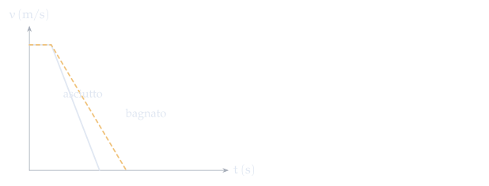

Lo spazio di reazione cresce linearmente con $v_0$; a decelerazione costante, lo spazio di frenata cresce invece come $v_0^2$. La realtà è più complessa: pendenza, pneumatici, temperatura, sistemi di assistenza, stato del conducente e variazione della forza frenante modificano il risultato. La figura 2 è quindi uno strumento di ragionamento, non una distanza di sicurezza universale.

## Esempi svolti {#esempi}

::: esempio Dalla legge oraria alle caratteristiche del moto
Un punto si muove secondo

$$x(t)=2\un{m}
+\left(5\un{m/s}\right)t
-\left(1{,}5\un{m/s^2}\right)t^2.$$

Ogni coefficiente porta le unità necessarie: la somma produce sempre una posizione. Determinare velocità, accelerazione, istante di inversione e posizione massima.

Derivando,

$$v(t)=5\un{m/s}
-\left(3\un{m/s^2}\right)t,
\qquad
a(t)=-3\un{m/s^2}.$$

L'inversione avviene quando $v=0$:

$$5\un{m/s}
-\left(3\un{m/s^2}\right)t=0
\quad\Rightarrow\quad t=1{,}67\un{s}.$$

Sostituendo nella legge oraria,

$$x_{\max}=2\un{m}
+\left(5\un{m/s}\right)(1{,}67\un{s})
-\left(1{,}5\un{m/s^2}\right)(1{,}67\un{s})^2
\simeq6{,}17\un{m}.$$

Prima di tale istante $v>0$; dopo, $v<0$. L'accelerazione è sempre negativa.
:::

::: esempio Area sotto un grafico velocità-tempo
Un corpo parte da fermo, raggiunge linearmente $12\un{m/s}$ in $4\un{s}$, mantiene tale velocità per $6\un{s}$ e frena linearmente fino a fermarsi in altri $3\un{s}$.

Lo spostamento è l'area sotto il grafico $v$-$t$:

$$\Delta x=\frac12(4)(12)+(6)(12)+\frac12(3)(12)
=24+72+18=114\un{m}.$$

Il tempo totale è $13\un{s}$, quindi

$$v_m=\frac{114}{13}=8{,}77\un{m/s}.$$

Le accelerazioni nei tre tratti sono rispettivamente $3\un{m/s^2}$, $0$ e $-4\un{m/s^2}$.
:::

::: esempio Arresto con tempo di reazione
Un'automobile viaggia a $20\un{m/s}$. Il conducente reagisce in $0{,}80\un{s}$; poi l'auto frena con accelerazione costante $-4{,}0\un{m/s^2}$. Calcolare lo spazio totale di arresto.

Durante la reazione la velocità resta costante:

$$s_r=v_0t_r=20(0{,}80)=16\un{m}.$$

Durante la frenata si usa $v^2=v_0^2+2as$ con $v=0$:

$$0=20^2+2(-4)s_f\quad\Rightarrow\quad s_f=50\un{m}.$$

Lo spazio totale è

$$s_{tot}=s_r+s_f=66\un{m}.$$

Raddoppiare la velocità raddoppia lo spazio di reazione, ma quadruplica quello di frenata a parità di decelerazione.
:::

::: esempio Lancio verticale da una quota
Da un balcone alto $18\un{m}$ viene lanciata verso l'alto una palla con $v_0=12\un{m/s}$. Trovare tempo e velocità d'impatto al suolo.

Ponendo $y=0$ al suolo e positivo verso l'alto,

$$y(t)=18+12t-4{,}905t^2.$$

L'impatto soddisfa $y=0$. La radice fisica positiva è

$$t=3{,}50\un{s}.$$

La velocità in quell'istante è

$$v_y=12-9{,}81(3{,}50)=-22{,}3\un{m/s}.$$

Il segno indica il verso rivolto verso il basso; la rapidità d'impatto è $22{,}3\un{m/s}$.
:::

## Glossario {#glossario}

- **Integrale**: Limite di somme di contributi su intervalli sempre più piccoli; geometricamente può rappresentare un'area orientata.

## Esercizi {#esercizi}

Gli esercizi riprendono quelli della dispensa. Ogni soluzione è nascosta finché non la apri: prova prima a impostare il problema da solo.

### Dalla posizione alla legge del moto

::: esercizio Velocità media e rapidità media [medio]
Un atleta percorre $120\un{m}$ verso est in $80\un{s}$ e poi $40\un{m}$ verso ovest in $20\un{s}$. Calcolare velocità media e rapidità media.

>>> soluzione
**Riferimento.**  Scegliamo l'est come verso positivo. Il primo spostamento è $+120\un{m}$; il secondo è $-40\un{m}$.

**Spostamento totale e tempo totale.**

$$\Delta x=120-40=80\un{m},\qquad \Delta t=80+20=100\un{s}.$$

**Velocità media.**

$$v_m=\frac{\Delta x}{\Delta t}=\frac{80}{100}=0{,}80\un{m/s}$$

verso est.

**Rapidità media.**  La distanza è $120+40=160\un{m}$:

$$\bar v_{rap}=\frac{160}{100}=1{,}60\un{m/s}.$$

Le due medie differiscono perché una usa lo spostamento con segno, l'altra la distanza totale.
:::

::: esercizio Incontro di due corpi [medio]
Un corpo parte da $x=0$ con $v=4\un{m/s}$; un secondo parte nello stesso istante da $x=150\un{m}$ con $v=-6\un{m/s}$. Trovare tempo e posizione d'incontro.

>>> soluzione
**Leggi orarie.**  Usiamo lo stesso asse e lo stesso orologio:

$$x_A(t)=4t,\qquad x_B(t)=150-6t.$$

**Condizione d'incontro.**  I corpi si incontrano quando occupano la stessa posizione:

$$4t=150-6t.$$

**Tempo.**

$$10t=150\Rightarrow t=15\un{s}.$$

**Posizione.**  Sostituendo in una delle due leggi:

$$x=4\cdot15=60\un{m}.$$

Controllo: $150-6\cdot15=60$ m, quindi entrambe le leggi danno la stessa posizione.
:::

::: esercizio Ricostruire una velocità costante [medio]
Un punto passa da $x_0=-12\un{m}$ a $x=48\un{m}$ in $10\un{s}$. Determinare la velocità e scrivere la legge oraria assumendo $t_0=0$.

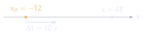
>>> soluzione
**Spostamento.**

$$\Delta x=x-x_0=48-(-12)=60\un{m}.$$

**Velocità costante.**

$$v=\frac{\Delta x}{\Delta t}=\frac{60}{10}=6\un{m/s}.$$

**Legge oraria.**  Per $t_0=0$:

$$x(t)=x_0+vt=-12+6t.$$

**Controllo.**  A $t=10$ s si ottiene $x(10)=-12+60=48\un{m}$, come richiesto.
:::

::: esercizio Accelerazione media con inversione possibile [base]
La velocità cambia in modo continuo e uniforme da $-3\un{m/s}$ a $9\un{m/s}$ in $4\un{s}$. Calcolare l'accelerazione media e l'istante in cui il corpo inverte il verso.

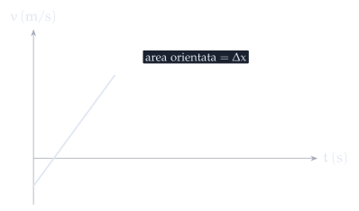
>>> soluzione
**Variazione di velocità.**  La velocità passa da $-3$ a $+9$ m/s:

$$\Delta v=v_f-v_i=9-(-3)=12\un{m/s}.$$

**Accelerazione media.**

$$a_m=\frac{\Delta v}{\Delta t}=\frac{12}{4}=3\un{m/s^2}.$$

**Interpretazione.**  Il segno positivo indica che la velocità cresce nel verso positivo. Poiché la velocità è dichiarata continua, il passaggio da un valore negativo a uno positivo implica che assuma anche il valore zero. Con variazione uniforme, $v(t)=-3+3t$, quindi l'inversione avviene a $t=1{,}0\un{s}$.
:::

::: esercizio Moto cubico e accelerazione variabile [avanzato]
Per $t\ge0$ un punto si muove secondo

$$x(t)=1\un{m}
-\left(2\un{m/s}\right)t
+\left(0{,}5\un{m/s^3}\right)t^3.$$

Ricavare $v(t)$ e $a(t)$, trovare il primo istante in cui il moto si inverte e determinare la posizione corrispondente.

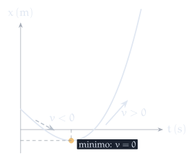
>>> soluzione
**Velocità e accelerazione con il calcolo differenziale e integrale.**

$$v(t)=\frac{\dd x}{\dd t}
=-2\un{m/s}
+\left(1{,}5\un{m/s^3}\right)t^2,
\qquad
a(t)=\frac{\dd v}{\dd t}
=\left(3\un{m/s^3}\right)t.$$

**Lettura discreta.**  Su un intervallo $\Delta t$,

$$\frac{x(t+\Delta t)-x(t)}{\Delta t}
=-2\un{m/s}
+\left(1{,}5\un{m/s^3}\right)t^2
+\left(1{,}5\un{m/s^3}\right)t\Delta t
+\left(0{,}5\un{m/s^3}\right)(\Delta t)^2.$$

Quando $\Delta t$ diminuisce, i termini che contengono esplicitamente il passo si riducono e restano i primi due termini, cioè la velocità istantanea $v(t)$. La procedura è un'approssimazione, non un'identità per passo finito.

**Inversione.**  Poniamo $v=0$:

$$-2\un{m/s}
+\left(1{,}5\un{m/s^3}\right)t^2=0
\Rightarrow t=\sqrt{\frac{4}{3}}\,\mathrm{s}=1{,}15\un{s}.$$

Per $t\ge0$ questa è la prima radice. Poiché $v$ passa da negativa a positiva, il punto inverte il verso.

**Posizione.**

$$x(1{,}15\un{s})
=1\un{m}
-\left(2\un{m/s}\right)(1{,}15\un{s})
+\left(0{,}5\un{m/s^3}\right)(1{,}15\un{s})^3
\simeq-0{,}54\un{m}.$$
:::

### Accelerazione, frenata e grafici

::: esercizio Partenza da fermo [base]
Un carrello parte da fermo con accelerazione $2{,}4\un{m/s^2}$ per $8\un{s}$. Calcolare velocità e spostamento finali.

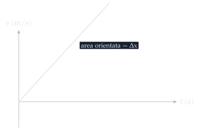
>>> soluzione
**Dati.**  $v_0=0$, $a=2{,}4\un{m/s^2}$, $t=8\un{s}$.

**Velocità finale.**

$$v=v_0+at=0+2{,}4\cdot8=19{,}2\un{m/s}.$$

**Spostamento.**

$$\Delta x=v_0t+\frac12at^2=0+\frac12(2{,}4)(8^2)=76{,}8\un{m}.$$

**Controllo grafico.**  Nel grafico $v$-$t$ lo spostamento è l'area del triangolo: $\tfrac12\cdot8\cdot19{,}2=76{,}8$ m.
:::

::: esercizio Accelerazione da spazio e tempo [medio]
Un corpo ha $v_0=5\un{m/s}$ e percorre $100\un{m}$ in $10\un{s}$ con accelerazione costante. Determinare $a$ e $v_f$.

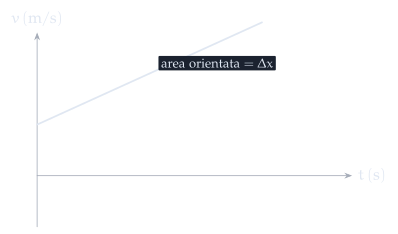
>>> soluzione
**Equazione dello spazio.**

$$\Delta x=v_0t+\frac12at^2.$$

**Sostituzione.**

$$100=5\cdot10+\frac12a(10)^2=50+50a.$$

**Accelerazione.**

$$50a=50\Rightarrow a=1{,}0\un{m/s^2}.$$

**Velocità finale.**

$$v_f=v_0+at=5+1\cdot10=15\un{m/s}.$$

Controllo: la velocità media per accelerazione costante è $(5+15)/2=10$ m/s; in 10 s produce 100 m.
:::

::: esercizio Frenata uniforme [base]
Un veicolo viaggia a $25\un{m/s}$ e frena con $a=-5\un{m/s^2}$. Calcolare tempo e spazio di arresto.

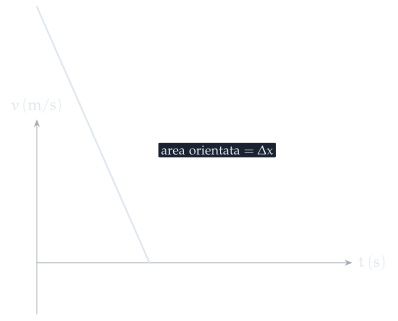
>>> soluzione
**Tempo di arresto.**  Al termine $v_f=0$:

$$0=25-5t\Rightarrow t=5\un{s}.$$

**Spazio con l'equazione senza tempo.**

$$v_f^2=v_0^2+2a\Delta x.$$

$$0=25^2+2(-5)\Delta x\Rightarrow \Delta x=\frac{625}{10}=62{,}5\un{m}.$$

**Controllo grafico.**  L'area del triangolo sotto $v(t)$ è $\tfrac12\cdot5\cdot25=62{,}5$ m.
:::

::: esercizio Frenata su due tratti con aderenza diversa [medio]
Un'automobile viaggia a $18\un{m/s}$. Il conducente reagisce in $0{,}90\un{s}$; poi l'auto frena per $12\un{m}$ con accelerazione $-3{,}0\un{m/s^2}$ e continua su un tratto più aderente con accelerazione $-6{,}0\un{m/s^2}$ fino all'arresto. Calcolare spazio e tempo totali.

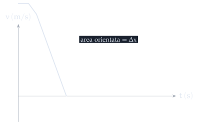
>>> soluzione
**Reazione.**

$$s_r=18(0{,}90)=16{,}2\un{m}.$$

**Velocità dopo i primi dodici metri.**

$$v_1^2=18^2+2(-3)(12)=252,
\qquad v_1=15{,}9\un{m/s}.$$

Il tempo di questo tratto è

$$t_1=\frac{v_1-18}{-3}=0{,}71\un{s}.$$

**Secondo tratto di frenata.**

$$0=v_1^2+2(-6)s_2\Rightarrow s_2=\frac{252}{12}=21{,}0\un{m},$$

$$t_2=\frac{0-v_1}{-6}=2{,}65\un{s}.$$

**Totali.**

$$s_{tot}=16{,}2+12+21{,}0=49{,}2\un{m},
\qquad t_{tot}=0{,}90+0{,}71+2{,}65=4{,}26\un{s}.$$
:::

::: esercizio Profilo di velocità di un ascensore [medio]
Un ascensore parte da fermo, raggiunge $2{,}0\un{m/s}$ verso l'alto in $2{,}0\un{s}$, mantiene la velocità per $5{,}0\un{s}$, si arresta in $1{,}0\un{s}$, resta fermo $2{,}0\un{s}$ e poi scende a velocità costante $1{,}5\un{m/s}$ per $4{,}0\un{s}$. Nel modello idealizzato, il passaggio dalla sosta alla velocità costante di discesa è istantaneo; un ascensore reale introdurrebbe un breve tratto di accelerazione. Calcolare spostamento, distanza e velocità media nell'intero intervallo.

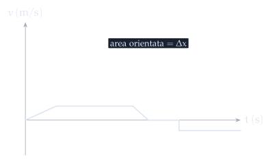
>>> soluzione
**Spostamento verso l'alto.**  Le aree sono un triangolo, un rettangolo e un secondo triangolo:

$$\Delta y_{su}=\tfrac12(2)(2)+(5)(2)+\tfrac12(1)(2)=13\un{m}.$$

**Spostamento verso il basso.**

$$\Delta y_{giu}=(-1{,}5)(4)=-6\un{m}.$$

**Spostamento e distanza.**

$$\Delta y=13-6=7\un{m},
\qquad d=13+6=19\un{m}.$$

**Velocità media.**  Il tempo totale è $14\un{s}$:

$$v_m=\frac{7}{14}=0{,}50\un{m/s}$$

verso l'alto. La sosta contribuisce al tempo, ma non all'area del grafico.
:::

::: esercizio Pendenze di un grafico posizione-tempo [base]
Un grafico $x$-$t$ è prima crescente con pendenza sempre minore, poi orizzontale, infine decrescente con pendenza in valore assoluto crescente. Descrivere segni di velocità e accelerazione nei tre tratti.

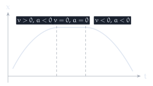
>>> soluzione
**Primo tratto.**  Il grafico cresce, dunque $v>0$. La pendenza diminuisce, quindi la velocità diminuisce: $a<0$.

**Secondo tratto.**  Il grafico è orizzontale, quindi $v=0$. Se il tratto è una retta orizzontale, la pendenza non cambia e $a=0$.

**Terzo tratto.**  Il grafico decresce, dunque $v<0$. La pendenza diventa sempre più negativa, quindi $v$ diminuisce ancora e $a<0$.

**Lettura senza derivate.**  Si può stimare la pendenza con $\Delta x/\Delta t$ su piccoli intervalli consecutivi: il segno e la variazione di questi rapporti danno rispettivamente velocità e accelerazione.
:::

::: esercizio Spostamento e distanza con velocità negativa [medio]
Un corpo ha $v=4\un{m/s}$ per $3\un{s}$ e poi $v=-2\un{m/s}$ per $5\un{s}$. Calcolare spostamento e distanza.

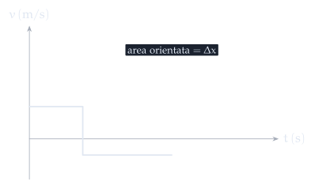
>>> soluzione
**Primo tratto.**

$$\Delta x_1=4\cdot3=12\un{m}.$$

**Secondo tratto.**

$$\Delta x_2=(-2)\cdot5=-10\un{m}.$$

**Spostamento totale.**

$$\Delta x=12-10=2\un{m}.$$

**Distanza.**  Si sommano i moduli dei due spostamenti:

$$d=|12|+|-10|=22\un{m}.$$

Nel grafico $v$-$t$, lo spostamento usa aree con segno; la distanza usa i valori assoluti delle aree.
:::

### Integrali: accumulare contributi continui

::: esercizio Lavoro di una forza crescente [medio]
Una forza lungo $x$ vale $F(x)=F_0+kx$ per $0\le x\le4\,\mathrm{m}$, con $F_0=3\un{N}$ e $k=2\un{N/m}$. Calcolare il lavoro con l'integrale e confrontarlo con una stima a trapezi usando i valori a $x=0,1,2,3,4\,\mathrm{m}$.

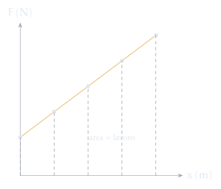
>>> soluzione
**Integrale esatto.**

$$W=\int_0^4(F_0+kx)\dd x
=\left[F_0x+\frac12kx^2\right]_0^4
=12+16=28\un{J}.$$

**Valori tabulati.**

$$F_0=3,\quad F_1=5,\quad F_2=7,\quad F_3=9,\quad F_4=11\,\mathrm{N}.$$

**Regola dei trapezi.**

$$W\simeq\frac{3+5}{2}(1)+\frac{5+7}{2}(1)+\frac{7+9}{2}(1)+\frac{9+11}{2}(1).$$

$$W\simeq4+6+8+10=28\un{J}.$$

La stima coincide con l'integrale perché la forza è lineare e il trapezio rappresenta esattamente l'area sotto ogni tratto rettilineo.
:::

::: esercizio Massa di una sbarra non uniforme [base]
Una sbarra lunga $L=2{,}0\un{m}$ ha densità lineare $\lambda(x)=\lambda_0+\alpha x$, con $\lambda_0=2\un{kg/m}$ e $\alpha=1\un{kg/m^2}$. Calcolare la massa totale e la posizione del centro di massa

$$x_{CM}=\frac{\int_0^L x\lambda(x)\dd x}{\int_0^L\lambda(x)\dd x}.$$

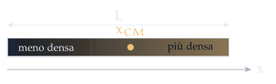
>>> soluzione
**Massa totale.**

$$M=\int_0^2(\lambda_0+\alpha x)\dd x
=\left[2x+\frac{x^2}{2}\right]_0^2
=4+2=6\un{kg}.$$

**Momento primo della massa.**

$$\int_0^2x(\lambda_0+\alpha x)\dd x
=\int_0^2(2x+x^2)\dd x
=\left[x^2+\frac{x^3}{3}\right]_0^2
=4+\frac83=\frac{20}{3}\,\mathrm{kg\,m}.$$

**Centro di massa.**

$$x_{CM}=\frac{20/3}{6}=\frac{10}{9}\,\mathrm{m}
\simeq1{,}11\un{m}.$$

Il centro di massa è spostato verso l'estremità più densa, come suggerisce il diagramma.
:::

### Problemi di sintesi: strumenti matematici e vettori

::: esercizio Integrale numerico con trapezi [base]
Una forza lungo $x$ è misurata ai punti $x=0,1,2,3\,\mathrm{m}$ con valori $0,4,6,2\,\mathrm{N}$. Stimare il lavoro con la regola dei trapezi.
>>> soluzione
**Aree.**

$$W\simeq\frac{0+4}2(1)+\frac{4+6}2(1)+\frac{6+2}2(1)=11{,}0\un{J}.$$

L'approssimazione equivale a interpolare linearmente la forza fra misure successive.
:::

### Moti a tratti, dati e problemi inversi

::: esercizio Accelerazione seguita da crociera [avanzato]
Un veicolo parte da fermo, accelera a $2\un{m/s^2}$ per $6\un{s}$ e poi mantiene la velocità raggiunta per $10\un{s}$. Calcolare spazio totale e velocità media.

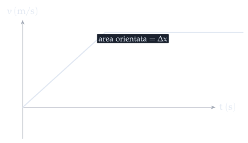
>>> soluzione
**Primo tratto.**  Dopo 6 s:

$$v_1=0+2\cdot6=12\un{m/s},\qquad
s_1=\frac12(2)(6^2)=36\un{m}.$$

**Crociera.**  Per i successivi 10 s:

$$s_2=v_1t_2=12\cdot10=120\un{m}.$$

**Spazio totale.**

$$s=36+120=156\un{m}.$$

**Velocità media.**

$$v_m=\frac{156}{6+10}=9{,}75\un{m/s}.$$

Il risultato coincide con l'area totale sotto il grafico $v$-$t$ divisa per il tempo totale.
:::

::: esercizio Accelerazione a tratti [medio]
Un corpo ha $v_0=3\un{m/s}$. Per $0\le t\le4$ s, $a=2\un{m/s^2}$; per $4<t\le10$ s, $a=-1\un{m/s^2}$. Calcolare velocità finale e spostamento totale.

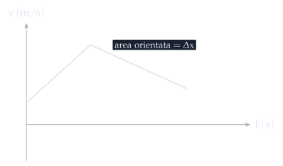
>>> soluzione
**Primo tratto.**  Con $a_1=2$ m/s$^2$ per 4 s:

$$v_4=3+2\cdot4=11\un{m/s},$$

$$s_1=3\cdot4+\frac12(2)(4^2)=28\un{m}.$$

**Secondo tratto.**  Per 6 s con $a_2=-1$ m/s$^2$:

$$v_{10}=11-1\cdot6=5\un{m/s},$$

$$s_2=11\cdot6+\frac12(-1)(6^2)=48\un{m}.$$

**Totale.**

$$s=28+48=76\un{m}.$$

Le condizioni finali del primo tratto diventano quelle iniziali del secondo.
:::

::: esercizio Errore dimensionale [medio]
Uno studente scrive $x=x_0+v_0t+\tfrac12at$. Mostrare perché l'equazione non può essere corretta e indicare la forma giusta.

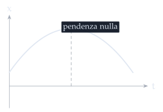
>>> soluzione
**Controllo delle unità.**  Nella formula proposta, $v_0t$ ha unità

$$\frac{\mathrm{m}}{\mathrm{s}}\cdot\mathrm{s}=\mathrm{m},$$

quindi è una lunghezza.

**Termine errato.**  Invece

$$at=\frac{\mathrm{m}}{\mathrm{s\,^2}}\cdot\mathrm{s}=\mathrm{m/s},$$

che è una velocità e non può essere sommata a posizioni.

**Correzione.**  Serve un secondo fattore di tempo:

$$x=x_0+v_0t+\frac12at^2.$$

Ora $at^2$ ha unità di lunghezza e tutti i termini sono omogenei.
:::

::: esercizio Ricostruzione da dati [avanzato]
Le posizioni misurate sono $x=1,4,9,16$ m agli istanti $t=0,1,2,3$ s. Trovare una legge quadratica compatibile e ricavare $v_0$ e $a$.

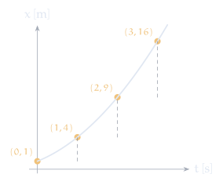
>>> soluzione
**Riconoscimento della sequenza.**  I valori $1,4,9,16$ sono i quadrati di $1,2,3,4$. Per non sommare un tempo a un numero puro, introduciamo le scale $x_*=1\un{m}$ e $t_*=1\un{s}$:

$$\frac{x(t)}{x_*}=\left(\frac{t}{t_*}+1\right)^2.$$

La stessa legge, scritta con coefficienti dimensionalmente espliciti, è

$$x(t)=1\un{m}+(2\un{m/s})t+(1\un{m/s^2})t^2.$$

**Confronto con il moto uniformemente accelerato.**

$$x(t)=x_0+v_0t+\frac12at^2.$$

Confrontando coefficienti che hanno le stesse unità:

$$x_0=1\un{m},\qquad v_0=2\un{m/s},\qquad \frac12a=1\un{m/s^2}.$$

**Accelerazione.**

$$a=2\un{m/s^2}.$$

**Verifica senza derivate.**  Le differenze prime sono $3,5,7$ m; le differenze seconde sono $2,2$ m. Con intervalli di 1 s, una differenza seconda costante di 2 m corrisponde ad accelerazione costante $2$ m/s$^2$.
:::

::: esercizio Sorpasso da fermo [avanzato]
Un camion è $40\un{m}$ avanti e procede a $10\un{m/s}$. Un'auto parte da ferma con $a=2\un{m/s^2}$. Trovare quando e dove avviene il sorpasso.

>>> soluzione
**Leggi orarie.**  Poniamo l'origine alla partenza dell'auto:

$$x_A(t)=\frac12(2)t^2=t^2,\qquad x_C(t)=40+10t.$$

**Condizione di sorpasso.**

$$t^2=40+10t\Rightarrow t^2-10t-40=0.$$

**Tempo.**  La radice positiva è

$$t=\frac{10+\sqrt{100+160}}{2}=13{,}06\un{s}.$$

**Posizione.**

$$x=t^2=(13{,}06)^2\simeq171\un{m}.$$

La radice negativa non ha significato per il moto successivo all'istante iniziale.
:::

::: esercizio Velocità e accelerazione [avanzato]
Fornire un esempio fisico per ciascuna situazione: (a) $v\ne0$, $a=0$; (b) $v=0$, $a\ne0$; (c) $v$ e $a$ concordi; (d) $v$ e $a$ discordi.

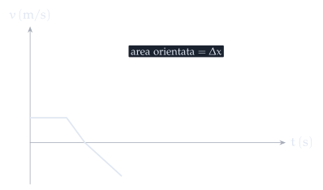
>>> soluzione
**Caso $v\ne0$, $a=0$.**  Un'auto che procede su strada rettilinea a velocità costante: la velocità è non nulla ma non cambia.

**Caso $v=0$, $a\ne0$.**  Al culmine di un lancio verticale la velocità istantanea è zero, mentre l'accelerazione resta $-g$.

**Caso concorde.**  Un corpo che cade scegliendo verso il basso positivo ha $v>0$ e $a>0$: la rapidità aumenta.

**Caso discorde.**  Una palla che sale con asse positivo verso l'alto ha $v>0$ e $a<0$: la rapidità diminuisce.

**Regola in una dimensione.**  Nel moto rettilineo la rapidità aumenta quando velocità e accelerazione hanno lo stesso segno e diminuisce quando hanno segno opposto. Nel moto vettoriale la condizione generale dipende dal prodotto scalare $\vect v\cdot\vect a$.
:::

### Problemi trasversali e di modellizzazione

::: esercizio Accelerazione ricavata da dati leggermente rumorosi [medio]
Un sensore fornisce le posizioni

$$\begin{array}{c|ccccc}
t\,(\mathrm{s})&0&1&2&3&4\\
\hline
x\,(\mathrm{m})&0&2{,}1&8{,}0&18{,}2&31{,}9
\end{array}$$

Usare la seconda differenza centrale per stimare l'accelerazione a $t=2\un{s}$. Confrontare il risultato con il modello $x(t)=2t^2$ e discutere perché i valori non coincidono esattamente.

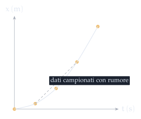
>>> soluzione
**Formula discreta.**  Con passo $\Delta t=1\un{s}$,

$$a(2)\simeq\frac{x(3)-2x(2)+x(1)}{(\Delta t)^2}.$$

**Sostituzione.**

$$a(2)\simeq\frac{18{,}2-2(8{,}0)+2{,}1}{1^2}
=4{,}3\un{m/s^2}.$$

**Confronto con il modello.**  Per $x=2t^2$ si avrebbe $a=4{,}0\un{m/s^2}$. La differenza di $0{,}3\un{m/s^2}$ è compatibile con arrotondamenti e rumore nelle posizioni.

**Interpretazione.**  La derivata del modello ideale è esatta per il modello; la differenza finita applicata a misure reali è una stima. Ridurre il passo non garantisce sempre un miglioramento, perché differenze tra numeri molto vicini possono amplificare il rumore.
:::

::: esercizio Distanza da velocità campionate [avanzato]
La velocità di una bicicletta è registrata ogni $2\un{s}$:

$$\begin{array}{c|ccccc}
t\,(\mathrm{s})&0&2&4&6&8\\
\hline
v\,(\mathrm{m/s})&0&4&7&7&3
\end{array}$$

Stimare lo spostamento con la regola dei trapezi e calcolare la velocità media sull'intervallo.

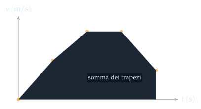
>>> soluzione
**Aree dei trapezi.**  Per ogni intervallo di durata $\Delta t=2\un{s}$,

$$\Delta x_i\simeq\frac{v_i+v_{i+1}}{2}\Delta t.$$

Si ottengono

$$\Delta x_1=\frac{0+4}{2}\cdot2=4\un{m},$$

$$\Delta x_2=\frac{4+7}{2}\cdot2=11\un{m},
\quad
\Delta x_3=\frac{7+7}{2}\cdot2=14\un{m},$$

$$\Delta x_4=\frac{7+3}{2}\cdot2=10\un{m}.$$

**Spostamento totale.**

$$\Delta x\simeq4+11+14+10=39\un{m}.$$

**Velocità media.**

$$\bar v=\frac{39}{8}=4{,}88\un{m/s}.$$

Poiché tutte le velocità sono positive, in questo caso spostamento e distanza coincidono.
:::

::: esercizio Reazione, frenata e ostacolo [avanzato]
Un'automobile viaggia a $15\un{m/s}$. Il conducente impiega $0{,}80\un{s}$ a reagire; poi l'auto frena con accelerazione costante $-6{,}0\un{m/s^2}$. Calcolare lo spazio di arresto. Se l'ostacolo si trova a $29\un{m}$ dal punto in cui viene percepito, determinare la velocità d'urto.

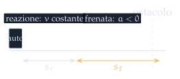
>>> soluzione
**Spazio di reazione.**  Durante la reazione la velocità resta circa costante:

$$s_r=v_0t_r=15\cdot0{,}80=12{,}0\un{m}.$$

**Spazio di frenata.**

$$0=v_0^2+2as_f
\Rightarrow
s_f=\frac{v_0^2}{2|a|}=\frac{225}{12}=18{,}75\un{m}.$$

**Spazio totale.**

$$s_{arresto}=12{,}0+18{,}75=30{,}75\un{m}.$$

L'ostacolo è più vicino, quindi l'auto non si arresta in tempo.

**Velocità d'urto.**  Dopo la reazione restano $29-12=17\un{m}$ di frenata:

$$v^2=15^2+2(-6)(17)=21,
\qquad
v=4{,}58\un{m/s}.$$

Il risultato è circa $16{,}5\un{km/h}$: una velocità non nulla, benché molto inferiore a quella iniziale.
:::

::: esercizio Profilo di accelerazione di un ascensore [avanzato]
Un ascensore parte da fermo. Accelera a $1{,}2\un{m/s^2}$ per $3\un{s}$, procede con accelerazione nulla per $5\un{s}$ e infine accelera a $-1{,}2\un{m/s^2}$ per $3\un{s}$. Determinare velocità massima e altezza percorsa.

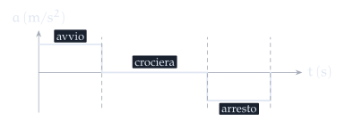
>>> soluzione
**Prima fase.**  La velocità dopo $3$ s è

$$v_1=0+1{,}2\cdot3=3{,}6\un{m/s}.$$

Lo spazio percorso è

$$s_1=\frac12at^2=\frac12(1{,}2)(3^2)=5{,}4\un{m}.$$

**Crociera.**  Per $5$ s la velocità è costante:

$$s_2=3{,}6\cdot5=18{,}0\un{m}.$$

**Arresto.**  La fase finale è simmetrica alla prima: la velocità scende da $3{,}6$ a $0$ m/s e lo spazio è

$$s_3=\frac{3{,}6+0}{2}\cdot3=5{,}4\un{m}.$$

**Risultato.**

$$v_{max}=3{,}6\un{m/s},
\qquad
h=s_1+s_2+s_3=28{,}8\un{m}.$$

Il calcolo degli spazi può essere letto anche come area sotto il grafico velocità-tempo ricostruito dal profilo di accelerazione.
:::

::: esercizio Un grafico con un vertice [avanzato]
Con $t$ espresso in secondi, la posizione di un punto è $x(t)=|t-3|$ m per $0\le t\le6$ s. Descrivere il moto, determinare le velocità per $t<3$ s e $t>3$ s e spiegare perché la velocità istantanea non è definita a $t=3$ s. Calcolare comunque la velocità media tra $2{,}9$ e $3{,}1$ s.

>>> soluzione
**Prima del vertice.**  Per $t<3$,

$$x=3-t,$$

quindi la pendenza è costante e vale $v=-1\un{m/s}$.

**Dopo il vertice.**  Per $t>3$,

$$x=t-3,$$

quindi $v=+1\un{m/s}$.

**Istante $t=3$ s.**  La pendenza da sinistra vale $-1$, quella da destra $+1$. Non esiste un unico limite della pendenza, quindi la derivata e la velocità istantanea non sono definite in quel punto.

**Media simmetrica.**

$$\bar v=\frac{x(3{,}1)-x(2{,}9)}{0{,}2}
=\frac{0{,}1-0{,}1}{0{,}2}=0\un{m/s}.$$

La media nulla non significa che il punto sia rimasto fermo: nei due mezzi intervalli percorre distanze uguali in versi opposti. Il vertice è inoltre un'idealizzazione, perché un'inversione istantanea richiederebbe un'accelerazione non limitata.
:::

::: esercizio Inseguimento con limite di velocità [avanzato]
Un ciclista passa davanti a un posto di controllo a velocità costante $6\un{m/s}$. Quattro secondi dopo parte una pattuglia da ferma, con accelerazione $3\un{m/s^2}$ fino alla velocità massima di $12\un{m/s}$, che poi mantiene. Stabilire in quale fase avviene il raggiungimento, il tempo misurato dal passaggio del ciclista e la posizione.

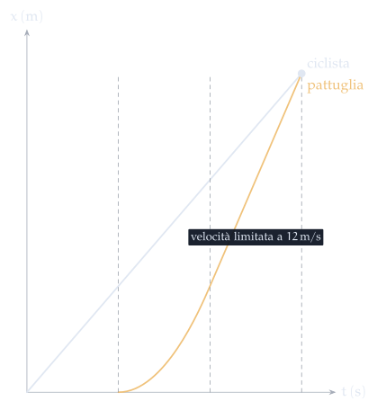
>>> soluzione
**Tempo di accelerazione della pattuglia.**  Per raggiungere $12$ m/s servono

$$\tau_a=\frac{12}{3}=4\un{s}.$$

In questa fase la pattuglia percorre

$$s_a=\frac12(3)(4^2)=24\un{m}.$$

Al tempo globale $t=8$ s, il ciclista si trova a $x_c=6\cdot8=48\un{m}$, quindi non è ancora raggiunto.

**Fase a velocità costante.**  Indichiamo con $\tau=t-4$ il tempo trascorso dalla partenza della pattuglia. Per $\tau\ge4$:

$$x_p=24+12(\tau-4)=12\tau-24.$$

Il ciclista si trova a

$$x_c=6t=6(\tau+4)=6\tau+24.$$

**Condizione d'incontro.**

$$12\tau-24=6\tau+24
\Rightarrow
\tau=8\un{s}.$$

Quindi il tempo globale è

$$t=\tau+4=12\un{s}.$$

**Posizione.**

$$x=6\cdot12=72\un{m}.$$

Il raggiungimento avviene quattro secondi dopo che la pattuglia ha raggiunto la propria velocità massima.
:::

### Problemi di sintesi: cinematica

::: esercizio Accelerazione da tre posizioni [base]
Una particella ha $x(0)=2\,\mathrm{m}$, $x(1\,\mathrm{s})=11\,\mathrm{m}$ e $x(2\,\mathrm{s})=16\,\mathrm{m}$. Assumendo accelerazione costante, determinare $v_0$ e $a$.
>>> soluzione
**Differenza seconda.**  Per intervalli unitari, $a=x_2-2x_1+x_0=-4\,\mathrm{m\,s^{-2}}$.

**Velocità iniziale.**  Da $x(1)=x_0+v_0+\tfrac12a$, $v_0=11{,}0\,\mathrm{m\,s^{-1}}$. Il valore negativo di $a$ indica rallentamento iniziale.
:::

::: esercizio Frenata limitata dall'aderenza [base]
Un'automobile viaggia a $27\un{m/s}$. Assumendo decelerazione massima $a=\mu g$ con $\mu=0{,}65$, calcolare spazio e tempo minimi di arresto.
>>> soluzione
**Decelerazione.**  $a=\mu g=6{,}38\un{m/s^2}$.

**Spazio.**  $0=v^2-2as$, quindi $s=v^2/(2a)=57{,}2\un{m}$.

**Tempo.**  $t=v/a=4{,}23\un{s}$. Il modello trascura reazione del conducente e variazioni dell'aderenza.
:::

::: esercizio Lancio verticale completo [base]
Da terra una palla è lanciata verso l'alto a $16\un{m/s}$. Calcolare quota massima, tempo di salita e tempo di ritorno.
>>> soluzione
**Sommità.**  Con $v=0$, $h=v_0^2/(2g)=13{,}0\un{m}$.

**Tempi.**  $t_\uparrow=v_0/g=1{,}63\un{s}$ e, per simmetria senza resistenza, $t_{tot}=3{,}26\un{s}$.
:::

::: esercizio Spostamento da un grafico velocità-tempo [base]
La velocità cresce linearmente da 0 a $10\un{m/s}$ in $4\un{s}$, resta costante per $3\un{s}$ e scende linearmente a zero in $2\un{s}$. Calcolare lo spostamento totale.
>>> soluzione
**Aree.**  Il grafico contiene due triangoli e un rettangolo:

$$\Delta x=\frac12(4)(10)+(3)(10)+\frac12(2)(10)=60{,}0\un{m}.$$
:::

::: esercizio Inseguimento con accelerazione [base]
Un veicolo bersaglio passa a $10\un{m/s}$. Cinque secondi dopo, dal medesimo punto parte da fermo un inseguitore con accelerazione costante $2{,}0\un{m/s^2}$. Quanto tempo dopo la propria partenza avviene l'intercettazione?
>>> soluzione
**Leggi orarie.**  Per l'inseguitore $x_I=t^2$; per il bersaglio $x_B=10(t+5)$, con $t$ misurato dalla partenza dell'inseguitore.

**Equazione.**  $t^2-10t-50=0$. La radice positiva è $t=13{,}7\un{s}$; la posizione è $x=187\un{m}$.
:::

## Fonti {#fonti}

Il testo, le formule, i diagrammi e gli esercizi di questo capitolo provengono dalla *Dispensa di fisica* del corso (sezioni 0.28, 1.9-1.11, 1.14, 1.16, 1.18 e materiali delle sezioni 0.22, 1.4, 1.21, 1.22), consultabile nel lettore della galassia. Per la lettura sul sito sono cambiati l'impaginazione, i colori delle figure, la numerazione e la posizione di alcuni riquadri ed esercizi; la sezione iniziale è scritta per il pianeta di questa unità.

Opere citate nel testo:

1. G. Galilei, *Discorsi e dimostrazioni matematiche intorno a due nuove scienze*, Elsevier, Leida, 1638; traduzione inglese di S. Drake, *Two New Sciences*, University of Wisconsin Press, Madison, 1974.
