## Prima di cominciare {#apertura}

Un campione deve superare un ostacolo e raggiungere un bersaglio. La stazione sceglie velocità e inclinazione del lancio, e chi pianifica deve stimare la traiettoria dichiarando gli effetti trascurati, a cominciare dalla resistenza dell'aria. Nel modello ideale il moto orizzontale è uniforme, quello verticale ha accelerazione costante, e le due componenti condividono lo stesso tempo.

Il capitolo estende la cinematica al piano: moto parabolico, moto circolare uniforme, componenti tangenziale e normale dell'accelerazione, moto relativo, limiti delle idealizzazioni e validità del modello rispetto alle misure. In chiusura si trovano i casi di studio, gli esempi di sintesi e il formulario ragionato dell'intera cinematica. Il capitolo successivo passa dalla descrizione del moto alle sue cause con le [leggi di Newton](unit:physics-06).

## Moto parabolico: due moti che avvengono insieme {#s-1-12}

Nel lancio obliquo ideale, senza resistenza dell'aria, il moto orizzontale è uniforme e quello verticale è uniformemente accelerato:

$$x(t)=x_0+v_0\cos\theta\,t,$$

$$y(t)=y_0+v_0\sin\theta\,t-\frac12gt^2.$$

La traiettoria è una parabola perché eliminando $t$ si ottiene una funzione quadratica di $x$.

Il principio utile non è la forma da ricordare, ma l'indipendenza delle componenti: la gravità modifica la velocità verticale, non quella orizzontale. Le due evoluzioni condividono lo stesso tempo.

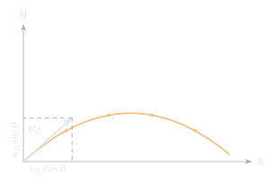

::: quotidiano Sport, getti d'acqua e sicurezza
La traiettoria ideale aiuta a comprendere un tiro a canestro, il getto di un irrigatore o un oggetto che cade da un veicolo. Nello sport reale intervengono rotazione, aerodinamica, dimensioni dell'oggetto e movimento dell'atleta. Il modello parabolico fornisce una base; le deviazioni indicano quali effetti aggiuntivi devono essere inclusi.
:::

## Moto circolare uniforme {#s-1-13}

Nel moto circolare uniforme il modulo della velocità è costante, ma la direzione cambia continuamente. Per questo l'accelerazione non è nulla. La velocità è tangente alla circonferenza; l'accelerazione è diretta verso il centro:

::: legge Accelerazione centripeta
$$a_c=\frac{v^2}{r}=\omega^2r.$$
:::

Le grandezze angolari sono legate da

$$v=\omega r,
\qquad
\omega=\frac{2\pi}{T}=2\pi f.$$

::: approfondimento Perché compare un'accelerazione anche se il tachimetro non cambia
Consideriamo due velocità di uguale modulo $v$, separate da un piccolo angolo $\Delta\theta$. La variazione $\Delta\vect v$ è la differenza tra due vettori quasi uguali e punta circa verso il centro. Per piccoli angoli, il suo modulo è

$$|\Delta\vect v|\approx v\Delta\theta.$$

Durante $\Delta t$, $\Delta\theta\approx(v/r)\Delta t$. Quindi

$$\frac{|\Delta\vect v|}{\Delta t}\approx
v\frac{v}{r}=\frac{v^2}{r}.$$

La formula nasce dal confronto di due vettori velocità in istanti vicini, senza richiedere una derivazione formale.
:::

::: quotidiano Una curva in automobile
Durante una curva a velocità quasi costante, il tachimetro può mostrare lo stesso valore, ma i passeggeri avvertono il cambiamento di direzione. La strada e gli pneumatici devono produrre un'accelerazione verso il centro della curva. A parità di raggio, raddoppiare la velocità quadruplica $v^2/r$.
:::

::: storia Huygens e l'accelerazione verso il centro
Nel *Horologium Oscillatorium* del 1673 Huygens studiò il pendolo e il moto circolare, mostrando che la deviazione continua dalla traiettoria rettilinea richiede un'accelerazione rivolta verso il centro  [1](#fonti). Il risultato precede la forma vettoriale moderna: oggi lo scriviamo $a_c=v^2/r$, ma storicamente nacque da ragionamenti geometrici su archi, corde e deviazioni accumulate in intervalli brevi.
:::

## Moto nel piano: componenti tangenziale e normale {#s-1-15}

Nel moto rettilineo la direzione della velocità è fissa. Nel piano o nello spazio, invece, il vettore velocità può cambiare sia in modulo sia in direzione. L'accelerazione contiene quindi due contributi concettualmente diversi:

::: legge Scomposizione intrinseca dell'accelerazione
$$\vect a=a_t\vers t+a_n\vers n,
\qquad
a_t=\frac{\dd v}{\dd t},
\qquad
a_n=\frac{v^2}{R}.$$
:::

Il versore $\vers t$ è tangente alla traiettoria e punta nel verso del moto; $\vers n$ punta verso il centro locale di curvatura. La componente tangenziale modifica il modulo della velocità. La componente normale ne modifica la direzione.

::: approfondimento Capire la curvatura confrontando due velocità
In due istanti vicini il corpo possiede velocità $\vect v_k$ e $\vect v_{k+1}$. Anche se i moduli sono uguali, la differenza

$$\Delta\vect v=\vect v_{k+1}-\vect v_k$$

non è nulla quando la direzione cambia. Dividendo per $\Delta t$ si ottiene un'accelerazione diretta approssimativamente verso l'interno della curva. Non serve conoscere subito la derivata: basta sottrarre graficamente due vettori velocità.
:::


### Coordinate polari e base mobile

Quando una traiettoria si sviluppa attorno a un punto, distanza radiale $r$ e angolo $\theta$ possono essere più naturali di $x$ e $y$. La posizione è

$$\vect r=r\,\vers e_r,$$

ma i versori $\vers e_r$ e $\vers e_\theta$ cambiano direzione mentre l'angolo varia. Da

$$\frac{\dd\vers e_r}{\dd t}=\dot\theta\,\vers e_\theta,
\qquad
\frac{\dd\vers e_\theta}{\dd t}=-\dot\theta\,\vers e_r$$

seguono

$$\vect v=\dot r\,\vers e_r+r\dot\theta\,\vers e_\theta,$$

$$\vect a=(\ddot r-r\dot\theta^2)\vers e_r
+(r\ddot\theta+2\dot r\dot\theta)\vers e_\theta.$$

::: approfondimento Dimostrazione: Velocità in coordinate polari
**Ipotesi.** Il moto è piano e $r(t)$, $\theta(t)$ sono funzioni derivabili.

**Passaggi.** Derivando il prodotto $\vect r=r\vers e_r$,

$$\frac{\dd\vect r}{\dd t}=\dot r\vers e_r+r\frac{\dd\vers e_r}{\dd t}
=\dot r\vers e_r+r\dot\theta\vers e_\theta.$$

**Significato fisico.** Il primo termine descrive avvicinamento o allontanamento dall'origine; il secondo descrive lo spostamento trasversale dovuto alla rotazione della direzione radiale.

**Limiti di validità.** Le formule non introducono nuove forze. Sono la stessa cinematica cartesiana espressa in una base che ruota con la posizione.
:::

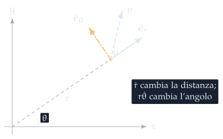

## Moto relativo {#s-1-17}

Per due corpi $A$ e $B$,

$$\vect r_{A/B}=\vect r_A-\vect r_B,
\qquad
\vect v_{A/B}=\vect v_A-\vect v_B.$$

Se le velocità sono costanti, il problema dell'incontro si riduce a studiare la posizione relativa. Due veicoli che procedono nello stesso verso a velocità simili si avvicinano lentamente; in versi opposti la velocità relativa è la somma dei moduli.

::: quotidiano Pioggia sul parabrezza
La pioggia cade con una certa velocità rispetto al suolo. Per chi è in automobile, la velocità osservata è la velocità della pioggia meno quella dell'auto. Aumentando la velocità del veicolo, le gocce sembrano arrivare più inclinate frontalmente. L'orientamento del parabrezza e dei tergicristalli è legato anche a questa cinematica relativa.
:::

### Incontro, inseguimento e intercettazione

Nei problemi con due corpi non basta confrontare le velocità. L'incontro avviene quando le posizioni coincidono nello stesso istante:

$$\vect r_A(t)=\vect r_B(t).$$

Le due leggi orarie devono essere scritte nello stesso riferimento e con la stessa origine dei tempi. In una dimensione l'equazione può avere nessuna, una o più soluzioni; in due dimensioni occorre soddisfare simultaneamente le due componenti.

::: esempio Intercettazione con ritardo di partenza
Un veicolo passa per $x=0$ a velocità costante $v=12\un{m/s}$. Cinque secondi dopo, dallo stesso punto parte un inseguitore da fermo con accelerazione costante $a=2{,}4\un{m/s^2}$. Misuriamo $t$ dalla partenza dell'inseguitore.

**Leggi orarie.**  Le due posizioni usano la stessa origine temporale; il primo veicolo ha già percorso $v\Delta t_0$.

$$x_A(t)=v(t+5),\qquad x_B(t)=\frac12at^2.$$

L'intercettazione richiede

$$1{,}2t^2-12t-60=0.$$

La radice positiva è $t\simeq13{,}7\un{s}$; la radice negativa non appartiene all'intervallo fisico scelto. La posizione d'incontro è circa $x=224\un{m}$.

**Verifica cinematica.**  All'istante trovato l'inseguitore ha velocità $at\simeq32{,}9\un{m/s}$, maggiore di quella del veicolo, condizione compatibile con il recupero del vantaggio iniziale.
:::

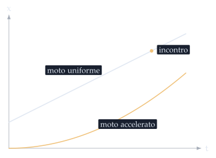

## Limiti delle idealizzazioni cinematiche {#s-1-19}

La cinematica descrive il moto senza ancora spiegare le forze che lo producono, ma non è priva di ipotesi. Trattare un'automobile come punto materiale significa ignorarne dimensioni e rotazione; assumere un piano orizzontale significa trascurare pendenze; usare un'accelerazione costante significa sostituire un comportamento variabile con un valore efficace.

Un modello è adeguato quando risponde alla domanda con la precisione necessaria. Per stimare il tempo di percorrenza di un ascensore può bastare un moto a tre fasi: accelerazione costante, velocità costante, decelerazione costante. Per progettare il controllo del motore servono invece profili di accelerazione più regolari, limiti sul jerk e dati del sistema reale. La stessa situazione può richiedere modelli differenti a seconda dello scopo.

::: metodo Come dichiarare un modello cinematico
Una soluzione completa dovrebbe specificare almeno:

- il corpo o il punto osservato;
- il sistema di riferimento e il verso positivo;
- l'intervallo temporale studiato;
- le grandezze considerate costanti;
- gli effetti trascurati;
- il criterio con cui il risultato viene confrontato con dati o realtà.

Queste dichiarazioni non appesantiscono la soluzione: chiariscono che cosa la formula afferma davvero.
:::

## Misura, incertezza e validità del modello {#s-1-20}

Le formule cinematiche descrivono grandezze ideali; gli strumenti forniscono dati affetti da risoluzione e rumore. Un accelerometro fisico non misura direttamente la “accelerazione dovuta alla gravità” come una forza che agisce internamente sul sensore: misura l'accelerazione propria, cioè la risposta alle interazioni non gravitazionali che sostengono o spingono il dispositivo. Un telefono fermo su un tavolo registra lungo la verticale un valore di modulo vicino a $g$ perché il tavolo lo sostiene; in caduta libera ideale la lettura tende a zero. Le API possono poi combinare accelerometro, giroscopio e modelli software per fornire separatamente un vettore di gravità e una stima di accelerazione lineare  [2](#fonti).

Calcolare una derivata amplifica spesso il rumore, perché sottrae valori vicini e divide per un intervallo piccolo. Per questo un software può mediare più campioni, adattare una curva o usare modelli dinamici.

Tre controlli sono essenziali:

1. **unità**: la velocità ha dimensioni di lunghezza divisa per tempo; l'accelerazione di lunghezza divisa per tempo al quadrato;
2. **segni**: dipendono dagli assi e devono essere coerenti in tutto il calcolo;
3. **regime di validità**: accelerazione costante, assenza di aria, punto materiale e piano terrestre sono ipotesi, non proprietà universali.

::: metodo Dal testo del problema alla previsione
1. Identificare il corpo e il riferimento.
2. Disegnare traiettoria e assi; indicare posizione iniziale e verso positivo.
3. Elencare dati e incognite con unità.
4. Stabilire se il moto è uniforme, uniformemente accelerato, circolare, relativo o a tratti.
5. Scrivere le relazioni simboliche prima dei numeri.
6. Verificare il risultato con grafico, segni, unità e ordine di grandezza.
:::

::: storia Cronometri, fotografie e misura del moto
La cinematica cambiò quando il tempo e la posizione divennero misurabili con intervalli sempre più brevi. Pendoli e cronometri migliorarono la misura del tempo; nell'Ottocento la cronofotografia di Étienne-Jules Marey trasformò successioni di immagini in dati sul movimento  [3](#fonti). Nel Novecento fotocellule, radar e sensori elettronici resero ordinaria la misura automatica. Le differenze finite usate oggi su un video digitale appartengono alla stessa linea di sviluppo: una sequenza di osservazioni discrete viene convertita in velocità e accelerazioni stimate.
:::

## Casi di studio e attività sperimentali {#casi}

::: nota Riscontro numerico per la scheda video
Usando tutti gli undici punti e un adattamento non pesato si ottiene approssimativamente

$$c_0=0{,}10020\un{m},\qquad
c_1=0{,}19992\un{m/s},\qquad
c_2=0{,}39953\un{m/s^2}.$$

Quindi $a\simeq0{,}7991\un{m/s^2}$. Lo scarto quadratico medio dei residui, definito come $\sqrt{\sum_i r_i^2/N}$, è circa $0{,}0353\un{m}$ per la retta e $0{,}00134\un{m}$ per la parabola. Le seconde differenze a passo $0{,}10\un{s}$ variano da circa $0{,}10\un{m/s^2}$ a $1{,}40\un{m/s^2}$: la loro variabilità non dimostra un'accelerazione fisica variabile. I dati sono stati costruiti a partire da $x=0{,}100\,\mathrm{m}+(0{,}200\,\mathrm{m/s})t+(0{,}400\,\mathrm{m/s^2})t^2$. Rivedere *Dal filmato ai dati: campionamento, differenze finite e rumore*.
:::

## Esempi svolti {#esempi}

::: esempio Proiettile e ostacolo
Un proiettile è lanciato da terra con $v_0=25\un{m/s}$ a $40^\circ$. A $30\un{m}$ si trova un muro alto $12\un{m}$. Stabilire se il proiettile lo supera.

Il tempo per raggiungere il muro si ottiene dal moto orizzontale:

$$t=\frac{30}{25\cos40^\circ}=1{,}57\un{s}.$$

La quota a quell'istante è

$$y=25\sin40^\circ(1{,}57)-\frac12(9{,}81)(1{,}57)^2
=13{,}14\un{m}.$$

Il proiettile supera il muro di circa $1{,}14\un{m}$. Il confronto va fatto alla stessa coordinata orizzontale, non all'istante di quota massima.
:::

::: esempio Moto circolare da periodo e raggio
Un punto percorre una circonferenza di raggio $2{,}5\un{m}$ con periodo $4{,}0\un{s}$. Determinare velocità tangenziale e accelerazione centripeta.

$$\omega=\frac{2\pi}{T}=1{,}571\un{rad/s},$$

$$v=\omega r=3{,}93\un{m/s},\qquad
a_c=\frac{v^2}{r}=6{,}17\un{m/s^2}.$$

La velocità è tangente alla circonferenza, mentre l'accelerazione punta verso il centro.
:::

## Sintesi e autoverifica {#sintesi}

La cinematica determina posizione, velocità e accelerazione senza identificare le interazioni che producono il moto. Velocità e accelerazione restano grandezze distinte: un corpo può accelerare anche quando il modulo della velocità non cambia.

::: sintesi Sintesi concettuale
- Posizione e moto hanno significato soltanto rispetto a un riferimento e a un orologio.
- La velocità è il cambiamento della posizione; l'accelerazione è il cambiamento della velocità.
- Le differenze finite approssimano le derivate su intervalli non nulli; la qualità dell'approssimazione dipende dal passo, dalla regolarità del moto e dal rumore dei dati. Le somme discrete approssimano gli integrali quando il partizionamento viene raffinato e le ipotesi di convergenza sono soddisfatte.
- Integrali e somme di aree accumulano piccoli contributi nel tempo.
- Le formule ad accelerazione costante discendono da una variazione uniforme della velocità.
- Ogni modello deve dichiarare quali effetti trascura.
:::

::: sintesi Autoverifica
Senza consultare il formulario, verificare di saper:

1. distinguere traiettoria, distanza e spostamento;
2. ricavare segni di velocità e accelerazione da un grafico;
3. passare tra descrizione discreta e formulazione con derivate, dichiarando l'approssimazione;
4. riconoscere quando le equazioni ad accelerazione costante non sono applicabili;
5. confrontare una previsione con dati misurati e discutere rumore e risoluzione.
:::

::: sintesi Verifica breve: leggere un moto
1. Una pallina lanciata verso l'alto raggiunge la quota massima. Nel modello senza resistenza, velocità e accelerazione sono entrambe nulle? Indicare direzione e verso dell'accelerazione.
2. Un corpo ha $v_x=-3\un{m/s}$ costante per $2\un{s}$. Calcolare spostamento e distanza percorsa.
3. Un grafico $v_x(t)$ vale $4\un{m/s}$ per i primi $3\un{s}$, poi scende linearmente a zero nei successivi $2\un{s}$. Calcolare lo spostamento totale mediante le aree.
4. Ai tempi $0$, $0{,}10$, $0{,}20\,\mathrm{s}$ si misurano posizioni $0$, $0{,}020$, $0{,}080\,\mathrm{m}$. Stimare la velocità centrale a $0{,}10\,\mathrm{s}$ e l'accelerazione con la seconda differenza.
:::

::: approfondimento Risposte essenziali: cinematica
1. Al vertice $v_y=0$, ma $a_y=-g$ se il verso positivo è verso l'alto. Rivedere *Moto verticale e caduta libera*.
2. $\Delta x=-6\un{m}$; la distanza è $6\un{m}$. Rivedere *Sistema di riferimento, posizione e traiettoria*.
3. Rettangolo più triangolo: $\Delta x=4\cdot3+4\cdot2/2=16\un{m}$. Rivedere *Grafici del moto: pendenze e aree*.
4. $v_x\simeq(0{,}080-0)/0{,}20=0{,}40\un{m/s}$; $a_x\simeq(0{,}080-2\cdot0{,}020+0)/0{,}10^2=4{,}0\un{m/s^2}$. Rivedere *Velocità* e *Accelerazione*.
:::

## Formulario ragionato {#formulario}

Le relazioni seguenti descrivono il moto rispetto a un riferimento e a un orologio dichiarati. Le formule ad accelerazione costante non possono essere usate quando l'accelerazione varia in modo significativo nell'intervallo considerato.

::: legge Posizione, spostamento, velocità e accelerazione
$$\Delta\vect r=\vect r(t_2)-\vect r(t_1),
\qquad
\vect v_m=\frac{\Delta\vect r}{\Delta t},
\qquad
\vect a_m=\frac{\Delta\vect v}{\Delta t}.$$

Nel limite continuo:

$$\vect v=\frac{\dd\vect r}{\dd t},
\qquad
\vect a=\frac{\dd\vect v}{\dd t}
=\frac{\dd^2\vect r}{\dd t^2}.$$

La rapidità istantanea è lo scalare $v=|\vect v|$. La rapidità media su un intervallo è invece il rapporto tra distanza percorsa e durata: le due grandezze coincidono soltanto in casi particolari.
:::

::: legge Differenze finite da dati campionati
Con campioni equispaziati di passo $\Delta t$:

$$\vect v_k\approx\frac{\vect r_{k+1}-\vect r_{k-1}}{2\Delta t},$$

$$\vect a_k\approx
\frac{\vect r_{k+1}-2\vect r_k+\vect r_{k-1}}{(\Delta t)^2}.$$

Ai bordi si possono usare differenze in avanti o all'indietro, meno simmetriche. Queste espressioni sono approssimazioni dipendenti dal passo, non identità esatte: ridurre $\Delta t$ diminuisce l'errore di discretizzazione soltanto finché il rumore di misura non diventa dominante.
:::

::: legge Moto rettilineo uniforme
Per velocità costante:

$$x(t)=x_0+v(t-t_0).$$

Nel grafico $x$-$t$, la pendenza è $v$; nel grafico $v$-$t$, l'area con segno è lo spostamento.
:::

::: legge Moto rettilineo ad accelerazione costante
Ponendo $\Delta t=t-t_0$:

$$v=v_0+a\Delta t,$$

$$x=x_0+v_0\Delta t+\frac12a(\Delta t)^2,$$

$$v^2=v_0^2+2a(x-x_0),$$

$$x-x_0=\frac{v_0+v}{2}\,\Delta t.$$

**Condizione d'uso.** la componente $a$ deve essere costante e tutte le quantità devono riferirsi allo stesso asse orientato.
:::

::: legge Grafici e accumulo
$$\Delta x=\int_{t_1}^{t_2}v_x(t)\dd t,
\qquad
\Delta v_x=\int_{t_1}^{t_2}a_x(t)\dd t.$$

Senza integrali:

$$\Delta x\approx\sum_k \bar v_{x,k}\Delta t_k,
\qquad
\Delta v_x\approx\sum_k \bar a_{x,k}\Delta t_k.$$

Le aree sotto i grafici sono algebriche: i tratti sotto l'asse temporale contribuiscono con segno negativo.
:::

::: legge Moto verticale vicino alla superficie terrestre
Con asse $y$ positivo verso l'alto, resistenza dell'aria trascurata e altezza abbastanza piccola da poter considerare $g$ costante:

$$a_y=-g,
\qquad g\simeq9{,}81\un{m/s^2},$$

$$v_y=v_{0y}-g\Delta t,$$

$$y=y_0+v_{0y}\Delta t-\frac12g(\Delta t)^2,$$

$$v_y^2=v_{0y}^2-2g(y-y_0).$$

Al culmine di un lancio verticale $v_y=0$, ma $a_y=-g$ continua a essere non nulla.
:::

::: legge Lancio obliquo senza resistenza dell'aria
Con partenza da $(x_0,y_0)$:

$$v_{0x}=v_0\cos\theta,
\qquad
v_{0y}=v_0\sin\theta,$$

$$x=x_0+v_{0x}t,
\qquad
y=y_0+v_{0y}t-\frac12gt^2,$$

$$v_x=v_{0x},
\qquad
v_y=v_{0y}-gt.$$

Se arrivo e partenza sono alla stessa quota:

$$T=\frac{2v_0\sin\theta}{g},
\qquad
R=\frac{v_0^2\sin2\theta}{g},
\qquad
H=\frac{v_0^2\sin^2\theta}{2g}.$$

Le ultime tre formule non valgono senza modifica quando la quota finale differisce da quella iniziale.
:::

::: legge Moto circolare
Velocità angolare media e istantanea:

$$\omega_m=\frac{\Delta\theta}{\Delta t},
\qquad
\omega=\frac{\dd\theta}{\dd t}.$$

Nel moto circolare uniforme:

$$\omega=\frac{2\pi}{T}=2\pi f,
\qquad
v=\omega r.$$

Moto circolare uniforme:

$$a_n=\frac{v^2}{r}=\omega^2r.$$

Se cambia anche il modulo della velocità:

$$a_t=\frac{\dd v}{\dd t},
\qquad
|\vect a|=\sqrt{a_t^2+a_n^2}.$$

Gli angoli nelle relazioni $s=r\theta$, $v=r\omega$ e $a_t=r\alpha$ devono essere espressi in radianti.
:::

::: legge Moto relativo in riferimenti traslanti
Per riferimenti che traslano senza rotazione:

$$\vect r_{A/C}=\vect r_{A/B}+\vect r_{B/C},$$

$$\vect v_{A/C}=\vect v_{A/B}+\vect v_{B/C}.$$

La composizione è quella classica, valida per velocità molto minori di $c$.

$$\vect a_{A/C}=\vect a_{A/B}+\vect a_{B/C}.$$

In riferimenti rotanti compaiono termini aggiuntivi e queste relazioni non bastano nella stessa forma elementare.
:::

::: legge Spazio di arresto in un modello semplice
Con tempo di reazione $t_r$, velocità iniziale $v_0$ e decelerazione costante di modulo $a_f$:

$$s_{reazione}=v_0t_r,
\qquad
s_{frenata}=\frac{v_0^2}{2a_f},$$

$$s_{tot}=s_{reazione}+s_{frenata}.$$

È un modello didattico: aderenza, pendenza, pneumatici, sistemi di controllo e condizioni del conducente modificano il valore reale.
:::

::: metodo Controlli rapidi
1. Una posizione ha unità di lunghezza, una velocità di lunghezza/tempo, un'accelerazione di lunghezza/tempo$^2$.
2. Il segno di $v$ descrive il verso del moto; il segno di $a$ descrive il verso del cambiamento di velocità.
3. Nel moto unidimensionale, se $v$ e $a$ hanno lo stesso segno la rapidità aumenta; se hanno segno opposto diminuisce. Nel moto vettoriale vale $\dd |\vect v|/\dd t=(\vect v\cdot\vect a)/|\vect v|$ per $|\vect v|\neq0$.
4. Una radice temporale negativa va scartata soltanto se il dominio fisico del problema inizia a $t=0$.
5. La distanza è la somma dei tratti percorsi; lo spostamento è la variazione di posizione con segno o vettoriale.
:::

## Glossario {#glossario}

- **Accelerazione**: Variazione della velocità nel tempo. Può cambiare il modulo della velocità, la sua direzione o entrambi.
- **Velocità**: Variazione della posizione nel tempo; è un vettore tangente alla traiettoria.

## Esercizi {#esercizi}

Gli esercizi riprendono quelli della dispensa. Ogni soluzione è nascosta finché non la apri: prova prima a impostare il problema da solo.

### Caduta e lanci

::: esercizio Caduta libera [base]
Un oggetto è lasciato da fermo da $45\un{m}$. Calcolare tempo di caduta e rapidità d'impatto.

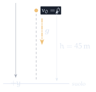
>>> soluzione
**Asse.**  Prendiamo verso il basso come positivo per evitare segni inutili. Allora $s=45$ m, $v_0=0$, $a=g$.

**Tempo.**

$$s=\frac12gt^2\Rightarrow t=\sqrt{\frac{2s}{g}}=\sqrt{\frac{90}{9{,}81}}=3{,}03\un{s}.$$

**Rapidità d'impatto.**

$$v=gt=9{,}81\cdot3{,}03=29{,}7\un{m/s}.$$

**Controllo alternativo.**  $v^2=2gs=2\cdot9{,}81\cdot45$, da cui si ottiene lo stesso valore.
:::

::: esercizio Lancio verticale da terra [medio]
Una palla è lanciata verso l'alto a $20\un{m/s}$. Calcolare tempo di salita, altezza massima e tempo totale di volo.

>>> soluzione
**Asse.**  Scegliamo verso l'alto positivo; quindi $a=-g$.

**Tempo di salita.**  Al culmine $v=0$:

$$0=20-gt_s\Rightarrow t_s=\frac{20}{9{,}81}=2{,}04\un{s}.$$

**Altezza massima.**

$$0=20^2-2gH\Rightarrow H=\frac{20^2}{2g}=20{,}4\un{m}.$$

**Tempo totale.**  Partenza e arrivo sono alla stessa quota, quindi salita e discesa durano uguale:

$$T=2t_s=4{,}08\un{s}.$$
:::

::: esercizio Oggetto lasciato da un ascensore in salita [medio]
Un ascensore sale a velocità costante $3{,}0\un{m/s}$. Quando si trova a $25\un{m}$ dal suolo, un piccolo oggetto si stacca dal soffitto. Trascurando l'aria, trovare tempo e velocità d'impatto rispetto al suolo.

>>> soluzione
**Condizione iniziale.**  Al distacco l'oggetto conserva la velocità dell'ascensore: $v_0=+3{,}0\un{m/s}$ con verso positivo verso l'alto.

**Legge verticale.**

$$y(t)=25+3t-\frac12gt^2.$$

Ponendo $y=0$:

$$4{,}905t^2-3t-25=0.$$

La radice positiva è

$$t=\frac{3+\sqrt{3^2+4(4{,}905)(25)}}{9{,}81}=2{,}59\un{s}.$$

**Velocità d'impatto.**

$$v=3-9{,}81(2{,}59)=-22{,}4\un{m/s}.$$

Il segno negativo indica il verso rivolto verso il basso.
:::

::: esercizio Lancio orizzontale da un ponte [avanzato]
Da un ponte alto $30\un{m}$ una pietra è lanciata orizzontalmente a $8\un{m/s}$. Calcolare tempo di volo, gittata, rapidità e direzione della velocità all'impatto.

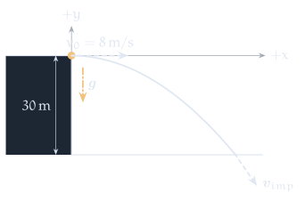
>>> soluzione
**Moto verticale.**  La componente verticale iniziale è nulla:

$$30=\frac12gt^2\Rightarrow t=\sqrt{\frac{60}{9{,}81}}=2{,}47\un{s}.$$

**Moto orizzontale.**

$$x=v_{0x}t=8\cdot2{,}47=19{,}8\un{m}.$$

**Velocità all'impatto.**

$$v_x=8,\qquad v_y=-gt=-24{,}3\ \un{m/s}.$$

$$v=\sqrt{8^2+24{,}3^2}=25{,}5\un{m/s}.$$

**Direzione.**

$$\alpha=\arctan\frac{|v_y|}{v_x}=71{,}8^\circ$$

sotto l'orizzontale.
:::

::: esercizio Lancio obliquo completo [medio]
Un proiettile parte da terra a $18\un{m/s}$ con angolo $35^\circ$. Trovare tempo di volo, gittata e altezza massima.

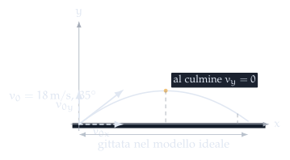
>>> soluzione
**Componenti iniziali.**

$$v_{0x}=18\cos35^\circ=14{,}74\ \un{m/s},\qquad
v_{0y}=18\sin35^\circ=10{,}32\ \un{m/s}.$$

**Tempo di volo.**

$$T=\frac{2v_{0y}}{g}=\frac{2(10{,}32)}{9{,}81}=2{,}10\un{s}.$$

**Gittata.**

$$R=v_{0x}T=14{,}74\cdot2{,}10=31{,}0\un{m}.$$

**Altezza massima.**

$$H=\frac{v_{0y}^2}{2g}=\frac{10{,}32^2}{19{,}62}=5{,}43\un{m}.$$
:::

::: esercizio Velocità necessaria per raggiungere un canestro [avanzato]
Una palla viene lanciata da quota $2{,}00\un{m}$ con angolo $50^\circ$. Il centro del canestro è a $6{,}00\un{m}$ orizzontalmente e a quota $3{,}05\un{m}$. Trascurando l'aria, determinare la velocità iniziale che fa passare la traiettoria per il centro del canestro.

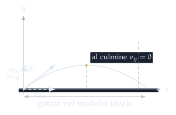
>>> soluzione
**Equazione della traiettoria.**  Eliminando il tempo:

$$y-y_0=x\tan\theta-\frac{gx^2}{2v_0^2\cos^2\theta}.$$

**Isolamento di $v_0$.**

$$v_0^2=\frac{gx^2}{2\cos^2\theta\,[x\tan\theta-(y-y_0)]}.$$

**Sostituzione.**  Con $x=6{,}00$ m, $y-y_0=1{,}05$ m e $\theta=50^\circ$:

$$v_0^2\simeq\frac{9{,}81(6{,}00)^2}{2\cos^250^\circ\,[6{,}00\tan50^\circ-1{,}05]}
\simeq70{,}1.$$

$$v_0\simeq8{,}37\un{m/s}.$$

**Limite del modello.**  Il calcolo fa passare il centro della palla per un punto; non considera raggio della palla, diametro del canestro, rotazione e resistenza dell'aria.
:::

::: esercizio Velocità minima per una gittata assegnata [base]
Quale velocità iniziale consente una gittata di $40\un{m}$ con angolo $45^\circ$, partendo e arrivando alla stessa quota?

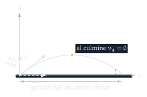
>>> soluzione
**Formula della gittata.**  Per partenza e arrivo alla stessa quota:

$$R=\frac{v_0^2\sin2\theta}{g}.$$

**Angolo di $45^\circ$.**  Poiché $\sin90^\circ=1$:

$$40=\frac{v_0^2}{g}.$$

**Velocità iniziale.**

$$v_0=\sqrt{40g}=\sqrt{40\cdot9{,}81}=19{,}8\un{m/s}.$$

A $45^\circ$ la gittata, a parità di velocità, è massima; per questo la velocità richiesta è minima.
:::

::: esercizio Angoli complementari [medio]
Spiegare perché, a parità di velocità iniziale e con partenza e arrivo alla stessa quota, gli angoli $30^\circ$ e $60^\circ$ producono la stessa gittata ma tempi di volo e altezze diverse. Trascurare la resistenza dell'aria.

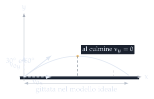
>>> soluzione
**Gittata.**  La formula è $R=v_0^2\sin(2\theta)/g$. Per $30^\circ$ compare $\sin60^\circ$; per $60^\circ$ compare $\sin120^\circ$. I due seni sono uguali, quindi le gittate coincidono.

**Tempo di volo.**

$$T=\frac{2v_0\sin\theta}{g}.$$

Poiché $\sin60^\circ>\sin30^\circ$, il lancio a $60^\circ$ resta in aria più a lungo.

**Altezza.**

$$H=\frac{v_0^2\sin^2\theta}{2g}.$$

Anche l'altezza è maggiore per $60^\circ$.

**Conclusione.**  La stessa gittata nasce da una compensazione: il lancio più ripido ha minore velocità orizzontale ma maggiore tempo di volo.
:::

### Direzione della velocità e moto relativo

::: esercizio Moto circolare non uniforme [medio]
Un ciclista percorre una curva circolare di raggio $15\un{m}$. La rapidità cresce uniformemente da $4\un{m/s}$ a $10\un{m/s}$ in $6\un{s}$. Calcolare al termine accelerazione tangenziale, centripeta e modulo dell'accelerazione totale.

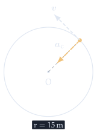
>>> soluzione
**Accelerazione tangenziale.**

$$a_t=\frac{10-4}{6}=1{,}0\un{m/s^2}.$$

**Accelerazione centripeta al termine.**

$$a_c=\frac{v^2}{r}=\frac{10^2}{15}=6{,}67\un{m/s^2}.$$

**Accelerazione totale.**  Le componenti tangenziale e normale sono perpendicolari:

$$a=\sqrt{a_t^2+a_c^2}=\sqrt{1{,}0^2+6{,}67^2}=6{,}74\un{m/s^2}.$$

**Interpretazione.**  L'accelerazione cambia sia il modulo della velocità sia la direzione. Non è corretto usare soltanto $v^2/r$ quando la rapidità varia.
:::

::: esercizio Ruota in giri al minuto [medio]
Una ruota di raggio $0{,}30\un{m}$ compie $120$ giri/min. Trovare frequenza, velocità angolare, velocità periferica e accelerazione centripeta.

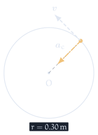
>>> soluzione
**Frequenza.**  $120$ giri/min corrispondono a

$$f=\frac{120}{60}=2\un{Hz}.$$

**Velocità angolare.**

$$\omega=2\pi f=4\pi=12{,}57\un{rad/s}.$$

**Velocità periferica.**

$$v=\omega r=12{,}57\cdot0{,}30=3{,}77\un{m/s}.$$

**Accelerazione centripeta.**

$$a_c=\omega^2r=(12{,}57)^2(0{,}30)=47{,}4\un{m/s^2}.$$
:::

::: esercizio Raggio da velocità e accelerazione [medio]
Un corpo ha rapidità $6\un{m/s}$ e accelerazione centripeta $8\un{m/s^2}$. Determinare raggio e periodo.

>>> soluzione
**Raggio.**  Dalla relazione $a_c=v^2/r$:

$$r=\frac{v^2}{a_c}=\frac{6^2}{8}=4{,}5\un{m}.$$

**Circonferenza.**

$$C=2\pi r=2\pi(4{,}5)=28{,}27\un{m}.$$

**Periodo.**  Il tempo per percorrere una circonferenza a rapidità costante è

$$T=\frac{C}{v}=\frac{28{,}27}{6}=4{,}71\un{s}.$$

**Controllo.**  $2\pi/T=1{,}33$ rad/s e $\omega^2r\simeq8$ m/s$^2$.
:::

::: esercizio Velocità relativa di due treni [base]
Due treni viaggiano a $20\un{m/s}$ e $15\un{m/s}$. Calcolare la velocità del primo rispetto al secondo quando procedono nello stesso verso e quando procedono in versi opposti.

>>> soluzione
**Stesso verso.**  Assegniamo segno positivo al verso comune:

$$v_{1/2}=20-15=5\un{m/s}.$$

Il primo treno vede il secondo arretrare a 5 m/s.

**Versi opposti.**  Se il secondo viaggia nel verso negativo, $v_2=-15$ m/s:

$$v_{1/2}=20-(-15)=35\un{m/s}.$$

**Regola.**  Le velocità relative si sottraggono sempre con i segni; la “somma” nel caso opposto nasce dal doppio segno negativo.
:::

::: esercizio Barca senza deriva [medio]
Un fiume largo $200\un{m}$ scorre a $2\un{m/s}$. La barca ha velocità $5\un{m/s}$ rispetto all'acqua. Trovare angolo controcorrente e tempo di attraversamento senza deriva.

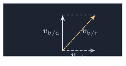
>>> soluzione
**Condizione di assenza di deriva.**  La componente controcorrente della barca deve annullare i $2\un{m/s}$ della corrente:

$$5\sin\alpha=2.$$

**Angolo.**

$$\alpha=\arcsin\frac25=23{,}6^\circ$$

a monte rispetto alla perpendicolare alle rive.

**Velocità trasversale.**

$$v_\perp=5\cos23{,}6^\circ=4{,}58\un{m/s}.$$

**Tempo.**

$$t=\frac{200}{4{,}58}=43{,}6\un{s}.$$

La velocità risultante rispetto alla riva è esattamente perpendicolare alle sponde.
:::

::: esercizio Aereo e vento laterale [medio]
Un aereo vola verso nord a $200\un{km/h}$ rispetto all'aria; il vento soffia verso est a $50\un{km/h}$. Trovare velocità al suolo e deviazione.

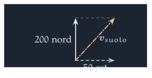
>>> soluzione
**Componenti.**  Poniamo est lungo $x$ e nord lungo $y$:

$$\vect v_{a/s}=(50,200)\,\mathrm{km/h}.$$

**Modulo.**

$$v=\sqrt{50^2+200^2}=206\un{km/h}.$$

**Deviazione a est del nord.**

$$\alpha=\arctan\frac{50}{200}=14{,}0^\circ.$$

**Conclusione.**  La velocità al suolo è circa $206\un{km/h}$, diretta $14{,}0^\circ$ a est del nord.
:::

### Moti a tratti, dati e problemi inversi

::: esercizio Traiettoria da tempo di volo e gittata [avanzato]
Un proiettile torna alla quota iniziale dopo $6\un{s}$ e percorre orizzontalmente $120\un{m}$. Ricavare le componenti iniziali, il modulo, l'angolo e l'altezza massima.

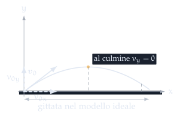
>>> soluzione
**Componente orizzontale.**  La velocità orizzontale è costante:

$$v_{0x}=\frac{R}{T}=\frac{120}{6}=20\un{m/s}.$$

**Componente verticale.**  Per ritorno alla stessa quota:

$$T=\frac{2v_{0y}}{g}\Rightarrow v_{0y}=\frac{gT}{2}=29{,}43\un{m/s}.$$

**Modulo e angolo.**

$$v_0=\sqrt{20^2+29{,}43^2}=35{,}6\un{m/s},$$

$$\theta=\arctan\frac{29{,}43}{20}=55{,}8^\circ.$$

**Altezza massima.**

$$H=\frac{v_{0y}^2}{2g}=44{,}1\un{m}.$$
:::

### Problemi trasversali e di modellizzazione

::: esercizio Raggiungimento su una pista circolare [avanzato]
Due corridori si muovono nello stesso verso su una pista di raggio $50\un{m}$. A corre a $5{,}2\un{m/s}$, B a $4{,}0\un{m/s}$; inizialmente A è $100\un{m}$ dietro B lungo la pista. Determinare quando A raggiunge B e quale distanza percorre A.

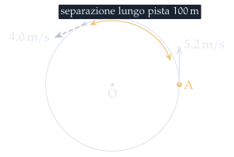
>>> soluzione
**Velocità con cui si chiude il distacco.**

$$v_{rel}=5{,}2-4{,}0=1{,}2\un{m/s}.$$

**Tempo di raggiungimento.**

$$t=\frac{100}{1{,}2}=83{,}3\un{s}.$$

**Distanza percorsa da A.**

$$s_A=5{,}2\cdot83{,}3=433\un{m}.$$

**Lettura sulla pista.**  La circonferenza vale

$$C=2\pi r=314\un{m}.$$

A percorre quindi un giro completo e altri $433-314\simeq119\un{m}$. Il fatto che la pista sia chiusa non cambia il tempo calcolato dalla distanza relativa iniziale, ma cambia il modo in cui si descrive la posizione finale.
:::

::: esercizio Scala mobile e velocità relative [avanzato]
Una scala mobile ha $90$ gradini visibili. Una persona ferma impiega $45\un{s}$ a raggiungere il piano superiore. Con la scala ferma, la stessa persona percorre i $90$ gradini in $30\un{s}$. Quanto tempo impiega camminando con lo stesso ritmo sulla scala in movimento?

>>> soluzione
**Velocità della scala.**  In unità di gradini al secondo:

$$v_s=\frac{90}{45}=2\ \text{gradini/s}.$$

**Velocità della persona rispetto alla scala.**

$$v_{p/s}=\frac{90}{30}=3\ \text{gradini/s}.$$

**Velocità rispetto all'edificio.**  Le due velocità hanno lo stesso verso:

$$v_{p/e}=v_{p/s}+v_s=5\ \text{gradini/s}.$$

**Tempo.**

$$t=\frac{90}{5}=18\un{s}.$$

Il calcolo non richiede conoscere la lunghezza reale di un gradino, perché la stessa unità viene usata in tutti i rapporti.
:::

::: esercizio Robot che risale un nastro trasportatore [avanzato]
Un nastro si muove verso destra a $1{,}5\un{m/s}$. Un robot cammina verso sinistra rispetto al nastro a $2{,}2\un{m/s}$. Determinare la velocità del robot rispetto al suolo e il tempo necessario per avanzare di $12\un{m}$ verso sinistra. Che cosa accadrebbe se il robot camminasse a soli $0{,}8\un{m/s}$ rispetto al nastro?

>>> soluzione
**Scelta del segno.**  Prendiamo positivo verso destra. Allora

$$v_{nastro}=+1{,}5\,\un{m/s},
\qquad
v_{robot/nastro}=-2{,}2\,\un{m/s}.$$

**Velocità rispetto al suolo.**

$$v_{robot/suolo}=1{,}5-2{,}2=-0{,}7\un{m/s}.$$

Il segno negativo indica che il robot riesce a muoversi verso sinistra.

**Tempo.**

$$t=\frac{12}{0{,}7}=17{,}1\un{s}.$$

**Secondo caso.**  Con $v_{robot/nastro}=-0{,}8$ m/s,

$$v_{robot/suolo}=1{,}5-0{,}8=+0{,}7\un{m/s}.$$

Il robot camminerebbe contro il nastro ma verrebbe comunque trasportato verso destra: non potrebbe raggiungere un punto posto a sinistra.
:::

::: esercizio Traiettoria ricostruita da tre fotogrammi [avanzato]
Un oggetto in volo viene fotografato ai tempi $0$, $0{,}20$ e $0{,}40$ s. Le posizioni in metri sono

$$(0,1{,}2),\qquad(3{,}0,4{,}0),\qquad(6{,}0,6{,}4).$$

Assumendo accelerazione orizzontale nulla e accelerazione verticale costante, stimare $v_{0x}$, $v_{0y}$ e $g$ con differenze finite. Calcolare poi modulo e angolo della velocità iniziale.

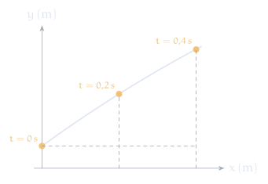
>>> soluzione
**Componente orizzontale.**  Gli incrementi orizzontali sono entrambi $3{,}0\un{m}$ in $0{,}20\un{s}$:

$$v_{0x}=\frac{3{,}0}{0{,}20}=15\un{m/s}.$$

**Accelerazione verticale dalla seconda differenza.**

$$a_y\simeq\frac{y_2-2y_1+y_0}{(0{,}20)^2}
=\frac{6{,}4-2(4{,}0)+1{,}2}{0{,}04}
=-10\un{m/s^2}.$$

Quindi $g\simeq10\un{m/s^2}$.

**Velocità verticale iniziale.**  Dalla legge discreta sul primo intervallo,

$$y_1-y_0=v_{0y}\Delta t+\frac12a_y(\Delta t)^2.$$

Pertanto

$$2{,}8=0{,}20v_{0y}-0{,}20
\Rightarrow
v_{0y}=15\un{m/s}.$$

**Modulo e angolo.**

$$v_0=\sqrt{15^2+15^2}=21{,}2\un{m/s},
\qquad
\theta=45^\circ.$$

I dati sono arrotondati e restituiscono $g=10$ m/s$^2$, non il valore più preciso $9{,}81$ m/s$^2$.
:::

::: esercizio Oggetto lasciato da un treno in moto [avanzato]
Un treno procede orizzontalmente a $20\un{m/s}$. Da un punto alto $45\un{m}$ rispetto al terreno viene lasciato cadere un piccolo oggetto, senza spinta. Trascurando l'aria, determinare tempo di caduta e distanza orizzontale rispetto al terreno. Dove cade rispetto al punto del treno che si trovava inizialmente sotto l'oggetto?

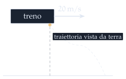
>>> soluzione
**Moto verticale.**  La velocità verticale iniziale è nulla:

$$45=\frac12gt^2
\Rightarrow
t=\sqrt{\frac{2\cdot45}{9{,}81}}=3{,}03\un{s}.$$

**Moto orizzontale.**  L'oggetto conserva la velocità orizzontale del treno:

$$x=20\cdot3{,}03=60{,}6\un{m}.$$

**Confronto dei riferimenti.**  Nello stesso tempo il treno percorre anch'esso $60{,}6\un{m}$. Per un osservatore sul treno l'oggetto cade quindi verticalmente sotto il punto di rilascio; per un osservatore a terra segue una parabola.

**Limite del modello.**  La conclusione richiede velocità costante del treno e resistenza dell'aria trascurabile.
:::

::: esercizio Velocità e accelerazione su una traiettoria curva [avanzato]
La posizione di un punto è

$$\vect r(t)=
\bigl[(2\un{m/s})t\bigr]\vers i+
\bigl[(1\un{m/s^2})t^2\bigr]\vers j.$$

Determinare $\vect v$ e $\vect a$ a $t=2\un{s}$ mediante derivazione componente per componente. Ripetere la stima di $\vect v(2)$ mediante differenza centrale con passo $\Delta t=0{,}1\un{s}$.

>>> soluzione
**Derivazione componente per componente.**

$$\vect v(t)=(2\un{m/s})\vers i+
\bigl[(2\un{m/s^2})t\bigr]\vers j,
\qquad
\vect a(t)=(2\un{m/s^2})\vers j.$$

A $t=2$ s:

$$\vect v(2)=(2,4)\,\un{m/s},
\qquad
\vect a(2)=(0,2)\,\un{m/s^2}.$$

La velocità ha modulo $\sqrt{20}=4{,}47\un{m/s}$.

**Differenza centrale.**

$$\vect v(2)\simeq\frac{\vect r(2{,}1)-\vect r(1{,}9)}{0{,}2}.$$

Poiché

$$\vect r(2{,}1\un{s})=(4{,}2\,\vers i+4{,}41\,\vers j)\,\mathrm{m},\qquad
\vect r(1{,}9\un{s})=(3{,}8\,\vers i+3{,}61\,\vers j)\,\mathrm{m},$$

si ottiene

$$\vect v(2)\simeq\frac{(0{,}4,0{,}8)}{0{,}2}=(2,4)\,\un{m/s}.$$

Per questa legge quadratica la differenza centrale restituisce esattamente la derivata al centro; ciò non accade per qualunque funzione e qualunque passo.
:::

### Problemi di sintesi: cinematica

::: esercizio Proiettile davanti a un balcone [base]
Un oggetto è lanciato da terra a $22\un{m/s}$ con angolo $38^\circ$. Qual è la quota quando la coordinata orizzontale è $25\un{m}$?
>>> soluzione
**Tempo orizzontale.**  $t=x/(v_0\cos\theta)=1{,}44\un{s}$.

**Quota.**

$$y=v_0\sin\theta\,t-\frac12gt^2=9{,}33\un{m}.$$

La radice temporale è unica perché il moto orizzontale è uniforme e diretto in avanti.
:::

::: esercizio Curva stradale a rapidità costante [base]
Un veicolo percorre una curva circolare di raggio $45\un{m}$ a $14\un{m/s}$. Calcolare accelerazione centripeta, velocità angolare e periodo.
>>> soluzione
**Centripeta.**  $a_n=v^2/r=4{,}36\un{m/s^2}$.

**Angolare.**  $\omega=v/r=0{,}311\un{rad/s}$.

**Periodo.**  $T=2\pi/\omega=20{,}2\un{s}$.
:::

::: esercizio Accelerazione su una traiettoria curva [base]
In un punto di una traiettoria la rapidità è $9{,}0\un{m/s}$, cresce a $1{,}5\un{m/s^2}$ e il raggio di curvatura è $12\un{m}$. Calcolare le componenti tangenziale e normale e il modulo totale.
>>> soluzione
**Componenti.**  $a_t=1{,}50\un{m/s^2}$ e $a_n=v^2/R=6{,}75\un{m/s^2}$.

**Modulo.**  Essendo ortogonali,

$$a=\sqrt{a_t^2+a_n^2}=6{,}91\un{m/s^2}.$$
:::

::: esercizio Velocità in coordinate polari [base]
Una particella ha $r=3{,}0\un{m}$, $\dot r=0{,}80\un{m/s}$ e $\dot\theta=0{,}60\un{rad/s}$. Calcolare le componenti polari della velocità e il modulo.
>>> soluzione
**Componenti.**  $v_r=\dot r=0{,}80\,\mathrm{m/s}$ e $v_\theta=r\dot\theta=1{,}80\,\mathrm{m/s}$.

**Modulo.**  $v=\sqrt{0{,}80^2+1{,}80^2}=1{,}97\un{m/s}$.
:::

::: esercizio Aereo che compensa il vento laterale [base]
Un aereo ha velocità rispetto all'aria di $70\un{m/s}$. Un vento di $20\un{m/s}$ soffia verso est. Quale angolo verso ovest deve assumere rispetto al nord per mantenere una rotta al suolo verso nord? Qual è la velocità al suolo?
>>> soluzione
**Compensazione.**  La componente verso ovest deve valere $20\,\mathrm{m/s}$: $70\sin\theta=20$, quindi $\theta=16{,}6^\circ$.

**Componente nord.**  $v_g=\sqrt{70^2-20^2}=67{,}1\un{m/s}$.
:::

::: esercizio Direzione apparente della pioggia [base]
La pioggia cade verticalmente a $12\un{m/s}$. Un'automobile procede orizzontalmente a $8{,}0\un{m/s}$. Determinare rapidità e inclinazione della pioggia rispetto alla verticale osservate dall'auto.
>>> soluzione
**Velocità relativa.**  $\vect v_{p/a}=(-8,-12)\,\mathrm{m/s}$.

**Modulo e angolo.**  $v=14{,}4\un{m/s}$ e $\tan\alpha=8/12$, quindi $\alpha=33{,}7^\circ$ rispetto alla verticale, inclinata verso la parte anteriore dell'auto.
:::

::: esercizio Angolo di gittata massima [base]
Nel modello senza resistenza dell'aria, un proiettile parte e arriva alla stessa quota con rapidità $30\un{m/s}$. Determinare l'angolo di gittata massima e il valore della gittata.
>>> soluzione
**Formula.**  $R=(v_0^2/g)\sin2\theta$.

**Massimo.**  Il seno è massimo quando $2\theta=90^\circ$, dunque $\theta=45^\circ$.

**Gittata.**  $R_{max}=v_0^2/g=91{,}7\un{m}$.
:::

## Fonti {#fonti}

Il testo, le formule, i diagrammi e gli esercizi di questo capitolo provengono dalla *Dispensa di fisica* del corso (sezioni 1.12-1.13, 1.15, 1.17, 1.19-1.20 e materiali delle sezioni 1.21, 1.22, 1.23, 1.24), consultabile nel lettore della galassia. Per la lettura sul sito sono cambiati l'impaginazione, i colori delle figure, la numerazione e la posizione di alcuni riquadri ed esercizi; la sezione iniziale è scritta per il pianeta di questa unità.

Opere citate nel testo:

1. C. Huygens, *Horologium Oscillatorium sive de motu pendulorum*, Parigi, 1673; traduzione inglese e commento di R. J. Blackwell, *Christiaan Huygens' The Pendulum Clock*, Iowa State University Press, Ames, 1986.
2. Android Developers, *Motion sensors*, documentazione ufficiale, [https://developer.android.com/develop/sensors-and-location/sensors/sensors_motion](https://developer.android.com/develop/sensors-and-location/sensors/sensors_motion) (consultato l'11 luglio 2026).
3. E.-J. Marey, *Movement*, traduzione di E. Pritchard, D. Appleton and Company, New York, 1895; edizione originale francese, *Le Mouvement*, Parigi, 1894.
