## Prima di cominciare {#apertura}

Una cassa della stazione resta ferma mentre la spinta aumenta, poi a un certo punto comincia a scivolare. Per prevedere quel momento bisogna capire come l'attrito statico si adatta alla richiesta fino a un valore massimo, e perché quel valore massimo compare soltanto alla soglia dello scorrimento.

Il capitolo riprende le [leggi di Newton](unit:physics-06) e le applica alle forze di contatto: misura delle forze, attrito reale, resistenza del mezzo e velocità limite, molle, equilibrio e stabilità, elasticità dei materiali, piano inclinato, corpi collegati da fili e carrucole, moto circolare e riferimenti accelerati. Le sezioni finali raccolgono i casi di studio, gli esempi di sintesi e il formulario ragionato della dinamica, insieme a una riflessione sui limiti del modello newtoniano.

## Che cosa significa misurare una forza {#s-2-8}

Nel linguaggio quotidiano la parola “forza” può indicare fatica, robustezza o intensità. In meccanica possiede un significato più preciso: una forza rappresenta un'interazione capace di modificare la quantità di moto di un sistema. Non si osserva una forza isolata; si osservano effetti, deformazioni o accelerazioni e si costruisce una misura coerente con il modello dinamico.

Un dinamometro, per esempio, non “vede” direttamente una forza astratta. Misura la deformazione di un elemento elastico calibrato. Se la legge di Hooke è valida nel campo di lavoro, la deformazione permette di risalire alla forza. Una bilancia elettronica misura deformazioni o variazioni elettriche associate alla forza normale. Un accelerometro misura l'accelerazione propria prodotta dalle interazioni non gravitazionali sul proprio elemento sensibile. In tutti questi casi lo strumento converte un effetto fisico in un segnale.

La seconda legge di Newton fornisce anche una definizione operativa della massa inerziale. Se la stessa risultante agisce su due corpi e produce accelerazioni diverse, il corpo con accelerazione minore possiede massa inerziale maggiore. Confrontando i rapporti

$$\frac{m_1}{m_2}=\frac{a_2}{a_1},$$

si possono confrontare masse senza assumere che il peso sia la grandezza fondamentale. Il peso dipende infatti dal campo gravitazionale locale; la massa inerziale descrive la risposta del corpo alla risultante.

::: nota Interazione, forza e diagramma
Una forza nel diagramma di corpo libero deve essere associata a un agente: Terra, piano, fune, molla, aria, magnete o altro corpo. Se non è possibile indicare chi esercita la forza, la freccia è sospetta. Questa regola elimina molte forze inventate, come una “forza del moto” o una “forza centripeta” aggiunta oltre alle interazioni reali.
:::

## Forze di contatto e forze di campo {#s-2-9}

Le interazioni vengono spesso classificate in due gruppi. Le **forze di contatto** richiedono un contatto macroscopico: reazione normale, attrito, tensione trasmessa da una fune, spinta di un fluido. Le **forze di campo** agiscono anche a distanza: gravitazione, interazione elettrica e magnetica. La distinzione è utile per costruire il diagramma, ma non deve essere interpretata in modo troppo letterale. A scala microscopica anche molte forze di contatto derivano da interazioni elettromagnetiche tra atomi.

La reazione normale non è automaticamente uguale a $mg$. Essa assume il valore necessario a impedire la compenetrazione tra superfici, finché il contatto può essere mantenuto. Su un piano orizzontale con accelerazione verticale nulla e senza altre forze verticali, $N=mg$. In un ascensore accelerato, su un piano inclinato o in presenza di una forza obliqua, il valore cambia. Se le equazioni richiedono $N<0$, il contatto non può fornire quella forza: il corpo si stacca e il modello va modificato ponendo $N=0$.

La tensione di una fune ideale ha lo stesso modulo lungo tutta la fune soltanto se la fune è priva di massa e le carrucole sono ideali. Una fune reale deve accelerare la propria massa; una carrucola reale possiede inerzia e attrito. In questi casi le tensioni ai due lati possono essere diverse. L'idealizzazione resta molto utile, ma deve essere dichiarata.

::: esempio La normale non coincide sempre con il peso
Una valigia di massa $20\,\mathrm{kg}$ viene trascinata su un pavimento orizzontale mediante una forza di $80\,\mathrm{N}$ inclinata di $30^\circ$ verso l'alto. L'accelerazione verticale è nulla. Lungo $y$,

$$N+80\sin30^\circ-mg=0.$$

Pertanto

$$N=20(9{,}81)-40=156{,}2\un{N}.$$

Il peso vale $196{,}2\,\mathrm{N}$, ma la forza obliqua sostiene una parte del carico e riduce la normale. Se l'attrito dipende da $N$, anche la forza di attrito diminuisce.
:::

## Attrito statico e dinamico {#s-2-6-5}

L'attrito statico impedisce lo scorrimento relativo e si adatta al valore necessario fino a un massimo:

$$|f_s|\le \mu_sN$$

se $f_s$ indica una componente con segno. Se invece il simbolo $f_s$ indica direttamente il modulo, si può scrivere $0\le f_s\le\mu_sN$. Il verso dell'attrito statico si oppone alla tendenza allo scorrimento relativo nel contatto, non necessariamente al moto del centro di massa.
L'uguaglianza $f_s=\mu_sN$ vale soltanto alla soglia di slittamento. Quando il corpo scivola, il modello più semplice usa

$$f_k=\mu_kN$$

con verso opposto alla velocità relativa delle superfici.

L'attrito non è sempre una forza che “ostacola il moto del corpo”. Durante la camminata o l'accelerazione di un'automobile, l'attrito statico del suolo può essere diretto in avanti.

::: nota I coefficienti d'attrito non sono costanti universali
I valori $\mu_s$ e $\mu_k$ dipendono da materiali, stato delle superfici, temperatura, contaminazione e condizioni operative. Il modello proporzionale alla normale è utile in molti problemi introduttivi, ma non descrive con precisione pneumatici, adesivi, lubrificazione o attrito a velocità molto basse.
:::

## Attrito reale: modello, soglia e limiti {#s-2-10}

Il modello elementare dell'attrito secco distingue attrito statico e dinamico. L'attrito statico si adatta alla richiesta fino a un massimo:

$$|f_s|\leq \mu_sN.$$

Non vale quindi sempre $f_s=\mu_sN$. Se una cassa ferma riceve una spinta di $10\,\mathrm{N}$ e il massimo attrito statico è $40\,\mathrm{N}$, l'attrito vale $10\,\mathrm{N}$ in verso opposto e la cassa resta ferma. Il valore massimo compare soltanto alla soglia di slittamento.

Durante lo scorrimento si usa spesso

$$f_k=\mu_kN,$$

con verso opposto alla velocità relativa delle superfici. Questo modello trascura la dipendenza dalla velocità, la deformazione dei materiali, la temperatura, la contaminazione e la storia del contatto. In applicazioni reali il coefficiente $\mu$ non è una costante universale. Dipende dalla coppia di materiali e dalle condizioni.

L'attrito non è sempre “una forza che frena”. Permette di camminare, accelerare un'automobile, far ruotare senza slittamento una ruota e trasmettere forze mediante una cinghia. Il verso va determinato considerando la tendenza allo scorrimento relativo, non il verso del moto del centro di massa.

::: quotidiano Camminare senza spingere indietro il terreno
Durante il passo il piede spinge il terreno all'indietro. Per il terzo principio il terreno esercita sul piede una forza di attrito in avanti. Questa forza esterna accelera il corpo. Su ghiaccio l'attrito statico massimo può essere troppo piccolo: il piede scivola e non si riesce a ottenere la stessa accelerazione.
:::

## Resistenza del mezzo e velocità limite {#s-2-6-6}

Quando un corpo si muove rispetto a un fluido, il fluido esercita una forza che tende a ridurre la *velocità relativa*. Non esiste una singola legge di resistenza valida in ogni situazione: la forma dipende da dimensioni, geometria, viscosità, densità del fluido e regime di moto. Nel limite viscoso di basso numero di Reynolds la forza è spesso approssimativamente lineare nella velocità relativa; per velocità più alte e corpi macroscopici diventa frequente una dipendenza quadratica. La scelta fra i due modelli deve essere motivata dal regime di moto, non dalla sola disponibilità di una formula.

Per velocità piccole e flusso viscoso regolare si usa spesso

::: legge Resistenza lineare
$$\vect F_D=-b\vect v_{\mathrm{rel}},$$
:::

dove $b$ dipende dal sistema. Per una sfera di raggio $R$ nel regime di Stokes, $b=6\pi\eta R$, con $\eta$ viscosità dinamica.

Per corpi non troppo piccoli e velocità maggiori è frequente il modello quadratico

::: legge Resistenza quadratica
$$\vect F_D=-\frac12 C_D\rho A\,v_{\mathrm{rel}}\vect v_{\mathrm{rel}},
\qquad
F_D=\frac12 C_D\rho A v_{\mathrm{rel}}^2,$$
:::

dove $\rho$ è la densità del fluido, $A$ l'area frontale e $C_D$ un coefficiente adimensionale. Il coefficiente non è universale: può cambiare con il numero di Reynolds, l'orientamento e la rugosità.

Per una caduta verticale, scegliendo positivo verso il basso, l'equazione è

$$m\frac{\dd v}{\dd t}=mg-F_D(v).$$

La **velocità limite** $v_t$ si raggiunge nel modello quando la risultante si annulla:

::: legge Velocità limite nei due modelli, con spinta idrostatica trascurabile
$$v_t=\frac{mg}{b}\qquad\text{(resistenza lineare)},$$

$$v_t=\sqrt{\frac{2mg}{C_D\rho A}}\qquad\text{(resistenza quadratica)}.$$
:::

Nel modello lineare, partendo da fermo,

$$v(t)=v_t\left(1-e^{-t/\tau}\right),
\qquad \tau=\frac{m}{b}.$$

La velocità si avvicina asintoticamente a $v_t$: non deve superarla per poi tornare indietro. Nel modello quadratico la legge temporale è diversa, ma il bilancio finale $F_D=mg$ resta lo stesso.

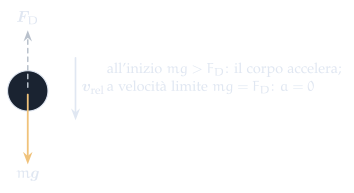

::: esempio Paracadutista e variazione dell'area frontale
Nel modello quadratico $v_t\propto A^{-1/2}$. Se l'apertura del paracadute moltiplica l'area efficace per $25$, mantenendo invariati massa, densità dell'aria e coefficiente di resistenza, la nuova velocità limite è

$$\frac{v_{t,2}}{v_{t,1}}=\sqrt{\frac{A_1}{A_2}}=\frac{1}{5}.$$

Il risultato è una previsione del modello: durante l'apertura il moto è transitorio e $C_D$ può cambiare insieme alla geometria.
:::

::: errore La resistenza dipende dalla velocità rispetto al fluido
Con vento, corrente o nastro trasportatore, la velocità rilevante è $\vect v_{\mathrm{corpo}}-\vect v_{\mathrm{fluido}}$. Un oggetto può essere fermo rispetto al suolo e subire una forza di trascinamento se il fluido scorre.
:::

::: sintesi Controllo concettuale sulla velocità limite
1. Alla velocità limite la forza di gravità è nulla? No: è bilanciata dalla resistenza.
2. Accelerazione nulla implica velocità nulla? No: implica velocità costante.
3. Nel modello quadratico, raddoppiare la massa raddoppia $v_t$? No: $v_t$ cresce di un fattore $\sqrt2$ se gli altri parametri restano invariati.
:::

## Resistenza del mezzo: ripresa e calcolo per passi {#s-2-11}

Un corpo che si muove nell'aria o in un liquido subisce una forza di resistenza opposta alla velocità relativa rispetto al fluido. A velocità basse e per particolari regimi si usa un modello lineare,

$$\vect F_d=-b\vect v,$$

mentre in molti moti ordinari nell'aria si usa un modello quadratico,

$$\vect F_d=-\frac12\rho C_dA\,v\vect v.$$

Nel secondo caso il modulo cresce come $v^2$. $\rho$ è la densità del fluido, $C_d$ un coefficiente di forma e $A$ un'area di riferimento.

Per una caduta verticale con resistenza quadratica, scegliendo positivo verso il basso,

$$ma=mg-kv^2.$$

All'inizio $v$ è piccola e la risultante è quasi $mg$. Aumentando la velocità cresce la resistenza e diminuisce l'accelerazione. Quando

$$mg=kv_t^2,$$

la risultante si annulla e la velocità diventa costante:

$$v_t=\sqrt{\frac{mg}{k}}.$$

Questa è la velocità limite. Non compare perché la gravità smette di agire, ma perché la resistenza equilibra il peso.

::: approfondimento Caduta con resistenza calcolata per passi
Senza risolvere un'equazione differenziale, si può aggiornare il moto a intervalli $\Delta t$:

$$a_k=g-\frac{k}{m}v_k^2,
\qquad
v_{k+1}=v_k+a_k\Delta t.$$

A ogni passo la resistenza viene ricalcolata usando la velocità corrente. Se $v_k$ si avvicina a $v_t$, l'accelerazione calcolata si avvicina a zero. Riducendo $\Delta t$ si controlla la stabilità della previsione.
:::

::: approfondimento Caso di studio: Perché la postura cambia la caduta
Nel modello quadratico, $v_t\propto1/\sqrt{C_dA}$. Aumentare l'area esposta e il coefficiente di resistenza riduce la velocità limite. Un paracadutista modifica la postura per controllare area e stabilità; il paracadute aumenta enormemente l'area efficace. La massa conta, ma non da sola: due corpi con la stessa massa possono avere velocità limite molto diverse se cambiano forma e area.
:::

## Molle, equilibrio e piccole oscillazioni {#s-2-12}

Per una molla ideale lungo il proprio asse,

$$F_e=-kx,$$

dove $x$ è la deformazione rispetto alla lunghezza naturale. Il segno meno indica che la forza elastica tende a ridurre la deformazione. La legge è un'approssimazione valida entro il campo elastico e per deformazioni sufficientemente piccole.

In una molla verticale, la posizione di equilibrio statico è determinata da

$$kx_{eq}=mg.$$

Se si descrive il moto mediante lo spostamento $\xi=x-x_{eq}$ rispetto all'equilibrio caricato, peso e parte costante della forza elastica si cancellano e la risultante diventa

$$F_{ris}=-k\xi.$$

Occorre quindi distinguere la deformazione rispetto alla lunghezza naturale dallo spostamento rispetto alla posizione di equilibrio.

La seconda legge produce

$$m\frac{\dd^2\xi}{\dd t^2}=-k\xi.$$

Con il calcolo differenziale e integrale questa equazione conduce a un moto armonico di periodo

$$T=2\pi\sqrt{\frac{m}{k}}.$$

::: approfondimento Oscillazione vista come aggiornamento successivo
A intervalli brevi si calcola

$$a_k=-\frac{k}{m}\xi_k,$$

poi si aggiornano velocità e posizione. Quando $\xi_k>0$, l'accelerazione è negativa; quando $\xi_k<0$, è positiva. La forza cambia continuamente verso e richiama il corpo verso l'equilibrio. Un semplice schema numerico rende visibile l'oscillazione, anche se per conservarne bene l'ampiezza servono metodi più accurati del metodo di Eulero elementare.
:::

## Equilibrio e stabilità {#s-2-13}

Un punto materiale è in equilibrio quando

$$\sum\vect F=\vect0.$$

Ciò implica accelerazione nulla, non necessariamente velocità nulla. Un corpo può essere in equilibrio dinamico e muoversi a velocità costante.

Nel piano servono due equazioni scalari indipendenti. La scelta degli assi dovrebbe semplificare le componenti: su un piano inclinato è spesso conveniente orientare un asse lungo il piano e l'altro perpendicolare.

Per corpi estesi l'equilibrio delle forze non basta; occorre anche l'equilibrio dei momenti. Una scala appoggiata può avere risultante nulla e tuttavia ruotare se i momenti non si compensano.

::: quotidiano Appendere un quadro con due fili
Due fili obliqui sostengono il peso. Se i fili diventano quasi orizzontali, le loro componenti verticali sono piccole e occorrono tensioni molto grandi per sostenere lo stesso quadro. Il disegno vettoriale spiega perché un cavo troppo teso orizzontalmente può sovraccaricare ganci e parete.
:::

### Elasticità: dalla forza alla deformazione

L'equilibrio di un corpo non implica che il corpo resti geometricamente immutato. Le forze interne distribuite producono deformazioni, e il modello di corpo rigido è soltanto un'approssimazione. Per una barra sollecitata lungo il proprio asse si definiscono

$$\sigma=\frac{F}{A},\qquad
\varepsilon=\frac{\Delta L}{L}.$$

Nel regime elastico lineare,

$$\sigma=Y\varepsilon,
\qquad
\Delta L=\frac{FL}{AY},$$

dove $Y$ è il modulo di Young.

::: approfondimento Dimostrazione: Energia elastica di una barra lineare
**Ipotesi.** La barra ha sezione costante, la deformazione è piccola e il materiale segue la legge lineare $F=(AY/L)\,\Delta L$.

**Passaggi.** Il lavoro necessario per portare la deformazione da $0$ a $\Delta L$ è

$$U=\int_0^{\Delta L}F(\ell)\,\dd\ell
=\int_0^{\Delta L}\frac{AY}{L}\ell\,\dd\ell
=\frac12\frac{AY}{L}(\Delta L)^2.$$

**Significato fisico.** La barra si comporta come una molla equivalente di costante $k_{\mathrm{eq}}=AY/L$. Geometria e materiale determinano insieme la rigidezza.

**Limiti di validità.** Oltre il limite elastico possono comparire plasticizzazione, isteresi, frattura o dipendenza dal tempo. La legge lineare non va extrapolata.
:::

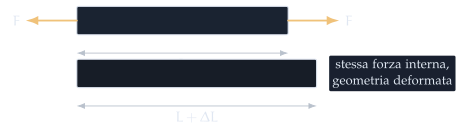

## Piano inclinato {#s-2-14}

Il piano inclinato non introduce una nuova forza: cambia la scomposizione del peso rispetto agli assi scelti. Con asse tangente e asse normale,

$$P_{\parallel}=mg\sin\theta,
\qquad
P_{\perp}=mg\cos\theta.$$

Se non vi sono altre forze normali al piano e il corpo non si stacca,

$$N=mg\cos\theta.$$

Su un piano liscio l'accelerazione lungo la discesa è $g\sin\theta$. Con attrito dinamico e moto verso il basso,

$$a=g(\sin\theta-\mu_k\cos\theta).$$

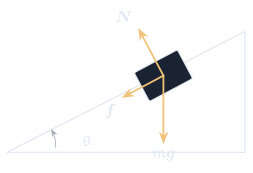

::: quotidiano Rampe e pendenze stradali
Una pendenza del 10% significa un aumento di quota di circa $10\un{m}$ ogni $100\un{m}$ orizzontali, non un angolo di $10^\circ$. La componente del peso lungo la strada cresce con la pendenza. Per questo un veicolo richiede più trazione in salita e deve dissipare più energia in discesa.
:::

## Corpi collegati e vincoli {#s-2-15}

Un filo inestensibile impone una relazione tra gli spostamenti dei corpi collegati. Nella macchina di Atwood ideale le accelerazioni hanno lo stesso modulo e versi opposti. Le equazioni vanno scritte separatamente perché pesi e tensioni agiscono su corpi differenti.

Per $m_2>m_1$,

$$a=\frac{m_2-m_1}{m_1+m_2}g,
\qquad
T=m_1(g+a)=m_2(g-a).$$

Il sistema complessivo fornisce un controllo: sommando le due equazioni, le tensioni interne si cancellano e resta la differenza dei pesi come forza esterna motrice.

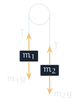

::: nota Il vincolo è parte del modello
Una fune ideale non si allunga, una carrucola ideale non ha attrito né inerzia, un tavolo ideale è rigido. Queste ipotesi trasformano il problema reale in un sistema risolvibile. Quando un risultato sperimentale differisce, occorre chiedere quale idealizzazione sia diventata rilevante.
:::

## Dinamica del moto circolare {#s-2-16}

Una traiettoria curva richiede una risultante con componente normale alla velocità. Per moto circolare di raggio $r$,

::: legge Equazione radiale
$$\sum F_{\mathrm{rad}}=m\frac{v^2}{r}.$$
:::

La “forza centripeta” non è una forza aggiuntiva da disegnare. È il nome del ruolo svolto dalla risultante radiale. A seconda del problema, tale risultante può essere prodotta da tensione, attrito, normale, peso o dalla loro somma.

Su una curva piana l'attrito statico può fornire la forza radiale. Alla soglia,

$$\frac{mv^2}{r}\le\mu_smg,
\qquad
v\le\sqrt{\mu_sgr}.$$

La massa si semplifica nel modello: su quella curva, veicoli di massa diversa hanno lo stesso limite ideale se pneumatici e coefficiente d'attrito sono equivalenti. Nella realtà distribuzione dei carichi, aerodinamica e pneumatici modificano il quadro.

::: quotidiano Perché la velocità conta più di quanto suggerisca l'intuizione
L'accelerazione radiale cresce con $v^2$. Passare da $50\un{km/h}$ a $100\un{km/h}$ non raddoppia la richiesta di aderenza: la quadruplica, a parità di raggio. Questa dipendenza è centrale nella progettazione stradale e nella sicurezza in curva.
:::

## Riferimenti accelerati e peso apparente {#s-2-17}

In un ascensore, scegliendo positivo verso l'alto,

$$N-mg=ma.$$

Se l'accelerazione è verso l'alto, $N>mg$; se è verso il basso, $N<mg$. La sensazione di “pesare di più” o “di meno” è legata alla forza di contatto, non a una variazione significativa della gravità.

In un riferimento la cui origine trasla con accelerazione $\vect a_0$ rispetto a un riferimento inerziale, e i cui assi non ruotano, si può introdurre la forza apparente

$$\vect F_{\mathrm{app}}=-m\vect a_0$$

per scrivere equazioni simili a quelle di un riferimento inerziale. Questa forza non rappresenta un'interazione con un agente fisico; compare perché il sistema di coordinate accelera. Se gli assi ruotano, questa sola espressione non basta: compaiono anche termini centrifugo, di Coriolis e, quando la velocità angolare cambia, di Euler.

::: quotidiano Autobus, ascensori e giostre
Quando un autobus parte, nel riferimento del veicolo sembra di essere spinti all'indietro. Nel riferimento stradale, invece, il pavimento e il sedile devono accelerare il corpo in avanti. Entrambe le descrizioni possono essere usate, ma non vanno mescolate senza introdurre correttamente le forze apparenti.
:::

## Dove il modello newtoniano funziona e dove va esteso {#s-2-21}

La meccanica newtoniana descrive con grande accuratezza oggetti quotidiani, macchine, strutture, veicoli e molti fenomeni astronomici. Non è però l'ultima teoria possibile. A velocità prossime a quella della luce occorre la relatività; su scale atomiche occorre la meccanica quantistica; campi gravitazionali estremi richiedono la relatività generale. Anche nel dominio quotidiano possono servire modelli più ricchi per fluidi, corpi deformabili, attrito complesso e sistemi caotici.

Questi limiti non rendono inutile il modello. Una carta stradale non rappresenta ogni dettaglio del territorio, ma è eccellente per orientarsi. La qualità di un modello dipende dalla scala, dalla precisione richiesta e dalla domanda.

::: metodo Strategia completa per i problemi
1. Scegliere sistema e riferimento.
2. Stabilire se il riferimento può essere trattato come inerziale.
3. Disegnare un diagramma di corpo libero per ogni sistema necessario.
4. Scegliere assi che seguano vincoli, piani o direzione radiale.
5. Scrivere $\sum F_x=ma_x$ e $\sum F_y=ma_y$ prima di sostituire i numeri.
6. Aggiungere relazioni di vincolo, attrito, elasticità o cinematica.
7. Controllare condizioni fisiche: $N\ge0$, tensioni non negative, attrito statico entro il massimo, versi compatibili con il moto.
8. Interpretare il risultato e verificare il regime di validità del modello.
:::

## Casi di studio e attività sperimentali {#casi}

### Caso di studio: Bilancia e accelerometro in ascensore

Una persona di massa $70\un{kg}$ è su una bilancia in ascensore. Durante una partenza verso l'alto la bilancia indica una forza normale di $760\un{N}$; durante una fase con accelerazione verso il basso indica $620\un{N}$. Con asse positivo verso l'alto,

$$N-mg=ma.$$

Nel primo caso

$$a=\frac{760}{70}-9{,}81=1{,}05\un{m/s^2},$$

nel secondo

$$a=\frac{620}{70}-9{,}81=-0{,}95\un{m/s^2}.$$

Un accelerometro ideale solidale con il pavimento misura l'accelerazione propria associata alla forza di sostegno. Lungo la verticale il suo modulo è quindi vicino a $N/m$: circa $10{,}86\un{m/s^2}$ nel primo caso e $8{,}86\un{m/s^2}$ nel secondo. Il valore non coincide direttamente con l'accelerazione cinematica $a$ rispetto all'edificio; le due grandezze sono legate da $N/m=g+a$ con la convenzione scelta. Un'app può inoltre mostrare un vettore “gravità” o “accelerazione lineare” ricostruito dal software, che va distinto dal segnale grezzo del sensore  [1](#fonti).

Questo caso chiarisce perché la bilancia non misura la massa in modo diretto e perché la frase “l'accelerometro misura la gravità” è ambigua. Strumento, riferimento e grandezza fisica devono essere specificati.

### Caso di studio: Curva stradale e aderenza disponibile

Una curva piana ha raggio $45\un{m}$. Nel modello elementare la massima rapidità senza slittamento è

$$v_{max}=\sqrt{\mu_sgr}.$$

Con $\mu_s=0{,}65$ si ottiene

$$v_{max}=\sqrt{0{,}65(9{,}81)(45)}=16{,}9\un{m/s}
\simeq61\un{km/h}.$$

Con $\mu_s=0{,}35$ il limite scende a

$$v_{max}=12{,}4\un{m/s}
\simeq45\un{km/h}.$$

La massa si semplifica, ma ciò non significa che tutti i veicoli reali abbiano lo stesso limite. Il coefficiente non è una costante universale; pneumatici, pressione, temperatura, acqua, distribuzione dei carichi, pendenza trasversale e aerodinamica modificano la forza disponibile. La formula individua una dipendenza fondamentale, $v_{max}\propto\sqrt{r}$, e permette un controllo d'ordine di grandezza; non sostituisce prove, norme o sistemi di controllo del veicolo.

### Attività sperimentale: Seconda legge con carrello e forza misurata

**Obiettivo.**  verificare la relazione fra risultante, massa e accelerazione distinguendo la forza applicata dalle altre forze presenti.

**Materiali o dati.**  carrello a basso attrito, masse note, dinamometro o sensore di forza e video laterale con scala metrica.

**Procedura.**

1. Misurare la massa totale del carrello e scegliere un tratto rettilineo.
2. Applicare una forza approssimativamente costante e registrare forza e posizione nel tempo.
3. Stimare l'accelerazione dal video mediante un adattamento quadratico oppure differenze finite.
4. Confrontare $F_{\mathrm{mis}}/m$ con l'accelerazione osservata.
5. Ripetere aggiungendo massa e mantenendo simile la forza applicata.

**Controllo e discussione.**  una discrepanza non confuta la seconda legge; può indicare che la risultante non coincide con la sola forza misurata, che l'attrito è stato trascurato o che i dati sono rumorosi. Stimare almeno l'incertezza sulla massa e sull'accelerazione.

**Sicurezza.**  usare masse piccole, fissare gli eventuali pesi sospesi e mantenere libera la traiettoria del carrello.

## Esempi svolti {#esempi}

::: esempio Risultante vettoriale e moto successivo
Su un corpo di massa $3\un{kg}$ agisce una risultante costante

$$\vect F=(18\vers i-6\vers j)\,\mathrm{N}.$$

Il corpo parte da fermo dall'origine. Trovare accelerazione, velocità e posizione dopo $4\un{s}$.

Dalla seconda legge,

$$\vect a=\frac{\vect F}{m}=(6\vers i-2\vers j)\,\mathrm{m/s^2}.$$

Poiché $\vect v_0=0$,

$$\vect v(4)=\vect a t=(24\vers i-8\vers j)\,\mathrm{m/s}.$$

La posizione è

$$\vect r(4)=\frac12\vect a t^2=(48\vers i-16\vers j)\,\mathrm{m}.$$

La dinamica fornisce l'accelerazione; la cinematica completa la descrizione del moto.
:::

::: esempio Attrito statico prima, dinamico dopo
Un blocco di massa $8\un{kg}$ è su un piano orizzontale con $\mu_s=0{,}40$ e $\mu_k=0{,}30$.

Con una forza orizzontale di $25\un{N}$,

$$f_{s,\max}=\mu_smg=0{,}40(8)(9{,}81)=31{,}4\un{N}.$$

Poiché $25<31{,}4$, il blocco resta fermo e l'attrito statico vale $25\un{N}$, non $31{,}4\un{N}$.

Se la forza aumenta a $40\un{N}$, il corpo scivola. L'attrito dinamico è

$$f_k=0{,}30(8)(9{,}81)=23{,}5\un{N},$$

quindi

$$a=\frac{40-23{,}5}{8}=2{,}06\un{m/s^2}.$$
:::

::: esempio Tiro obliquo e reazione normale
Un blocco di massa $20\un{kg}$ è trascinato su un piano orizzontale da una forza $100\un{N}$ inclinata di $30^\circ$ verso l'alto. Il coefficiente dinamico è $0{,}25$. Trovare l'accelerazione.

L'equilibrio verticale fornisce

$$N+F\sin30^\circ-mg=0,$$

perciò

$$N=20(9{,}81)-100\sin30^\circ=146{,}2\un{N}.$$

L'attrito vale $f_k=0{,}25N=36{,}6\un{N}$. Lungo l'orizzontale,

$$F\cos30^\circ-f_k=ma,$$

quindi

$$a=\frac{86{,}6-36{,}6}{20}=2{,}50\un{m/s^2}.$$

La componente verticale della forza riduce la normale e quindi anche l'attrito.
:::

::: esempio Discesa su piano inclinato con attrito
Un blocco di massa $5\un{kg}$ scivola lungo un piano inclinato di $25^\circ$ con $\mu_k=0{,}20$. Determinare accelerazione e normale.

Lungo il piano,

$$mg\sin25^\circ-f_k=ma,
\qquad f_k=\mu_kN.$$

Nella direzione normale non vi è accelerazione:

$$N=mg\cos25^\circ=44{,}5\un{N}.$$

Pertanto

$$a=g(\sin25^\circ-0{,}20\cos25^\circ)
=2{,}37\un{m/s^2}.$$

La massa si semplifica: su un piano ideale con attrito proporzionale alla normale, l'accelerazione non dipende dalla massa.
:::

::: esempio Macchina di Atwood
Due masse $m_1=3\un{kg}$ e $m_2=5\un{kg}$ sono collegate da un filo ideale su carrucola ideale. Determinare accelerazione e tensione.

Assumendo $m_2$ verso il basso e $m_1$ verso l'alto,

$$\begin{aligned}
T-m_1g&=m_1a,\\
m_2g-T&=m_2a.
\end{aligned}$$

Sommando,

$$a=\frac{m_2-m_1}{m_1+m_2}g
=2{,}45\un{m/s^2}.$$

Poi

$$T=m_1(g+a)=36{,}8\un{N}.$$

La tensione è compresa tra i due pesi, come deve essere.
:::

::: esempio Blocco sul tavolo collegato a massa appesa
Un blocco $m_1=4\un{kg}$ scorre su un tavolo con $\mu_k=0{,}20$ ed è collegato a una massa appesa $m_2=3\un{kg}$. Calcolare accelerazione e tensione.

Per il sistema complessivo, la forza esterna lungo il moto è

$$m_2g-\mu_km_1g.$$

Quindi

$$a=\frac{m_2g-\mu_km_1g}{m_1+m_2}
=3{,}08\un{m/s^2}.$$

Sul blocco sul tavolo,

$$T-f_k=m_1a,$$

perciò

$$T=m_1a+\mu_km_1g=20{,}2\un{N}.$$
:::

::: esempio Blocchi sovrapposti senza slittamento
Un blocco di $2\un{kg}$ è appoggiato su uno di $6\un{kg}$. Il pavimento è liscio e tra i blocchi $\mu_s=0{,}30$. Una forza orizzontale di $20\un{N}$ agisce sul blocco inferiore. Verificare se si muovono insieme.

Se non slittano, l'accelerazione comune è

$$a=\frac{20}{2+6}=2{,}50\un{m/s^2}.$$

L'unica forza orizzontale sul blocco superiore è l'attrito richiesto:

$$f_{s,\mathrm{rich}}=m_{sup}a=2(2{,}50)=5{,}00\un{N}.$$

Il massimo disponibile è

$$f_{s,\max}=\mu_sm_{sup}g=0{,}30(2)(9{,}81)=5{,}89\un{N}.$$

Poiché $5{,}00<5{,}89$, l'ipotesi è valida e i blocchi si muovono insieme.
:::

::: esempio Velocità massima in una curva piana
Un'automobile percorre una curva piana di raggio $50\un{m}$ con coefficiente di attrito statico $\mu_s=0{,}60$. Trovare la massima velocità senza slittare.

Alla soglia, l'attrito statico massimo fornisce tutta la risultante centripeta:

$$\mu_smg=m\frac{v^2}{r}.$$

La massa si semplifica:

$$v_{\max}=\sqrt{\mu_sgr}
=\sqrt{0{,}60(9{,}81)(50)}
=17{,}2\un{m/s}$$

cioè circa $61{,}8\un{km/h}$.
:::

## Sintesi e autoverifica {#sintesi}

Vettori, cinematica e dinamica formano una catena operativa: i vettori organizzano direzioni e componenti, la cinematica descrive il moto e la dinamica collega l'accelerazione alle interazioni. Il ragionamento può procedere dalle forze all'accelerazione e quindi al moto, oppure dai dati cinematici alla risultante richiesta.

::: sintesi Sintesi concettuale
- Le forze rappresentano interazioni tra sistema e ambiente.
- Il primo principio definisce l'inerzia e i riferimenti inerziali.
- La seconda legge collega risultante e variazione della quantità di moto.
- Le coppie del terzo principio agiscono su corpi differenti.
- Il diagramma di corpo libero precede le equazioni.
- Pressione, spinta, continuità e Bernoulli descrivono aspetti diversi dei fluidi e richiedono ipotesi diverse.
- Il moto del centro di massa dipende dalla risultante esterna; urti e razzi richiedono un bilancio di quantità di moto sul sistema corretto.
- Impulso e momento torcente descrivono effetti cumulativi nel tempo.
- Ogni soluzione deve controllare vincoli e validità delle idealizzazioni.
:::

::: sintesi Autoverifica
Senza consultare il formulario, verificare di saper:

1. scegliere il sistema e distinguere forze interne ed esterne;
2. costruire un diagramma di corpo libero senza aggiungere una “forza centripeta” separata;
3. dichiarare le condizioni di validità di legge di Hooke, attrito e forze apparenti;
4. distinguere pressione assoluta e relativa e scegliere fra idrostatica, Archimede, continuità e Bernoulli;
5. usare impulso e quantità di moto specificando sistema, flussi di massa e impulso esterno;
6. ricavare il moto del centro di massa e classificare un urto come elastico o anelastico;
7. applicare il teorema del momento angolare rispetto a un polo fisso inerziale;
8. confrontare una previsione newtoniana con una misura e discutere le idealizzazioni.
:::

::: sintesi Verifica breve: scegliere forze e sistema
1. Un libro è fermo su un tavolo. Peso e reazione normale sono una coppia di azione e reazione? Indicare invece il partner della forza esercitata dal tavolo sul libro.
2. Un carrello di $2{,}0\un{kg}$ riceve $6{,}0\un{N}$ verso destra e $2{,}0\un{N}$ verso sinistra. Trovare risultante e accelerazione.
3. Un blocco di $2{,}0\un{kg}$ è fermo su un piano orizzontale con $\mu_s=0{,}40$. Viene tirato orizzontalmente con $5{,}0\un{N}$. Qual è la forza d'attrito statico? Assumere $g=9{,}81\un{m/s^2}$ e nessun'altra forza verticale oltre a peso e normale.
4. Un corpo percorre una circonferenza di raggio $2{,}0\un{m}$ a rapidità costante $3{,}0\un{m/s}$. L'accelerazione è nulla? Calcolarne modulo e direzione.
:::

::: approfondimento Risposte essenziali: dinamica
1. No: agiscono sullo stesso corpo. Il partner è la forza del libro sul tavolo. Rivedere *Terzo principio: le interazioni sono reciproche*.
2. $F_{\mathrm{tot},x}=4{,}0\un{N}$ e $a_x=2{,}0\un{m/s^2}$, verso destra. Rivedere *Secondo principio*.
3. La soglia è $\mu_smg\simeq7{,}85\un{N}$. L'attrito effettivo vale $5{,}0\un{N}$ in verso opposto alla trazione. Rivedere *Attrito statico e dinamico*: la soglia non è il valore assunto in ogni situazione.
4. $a=v^2/r=4{,}5\un{m/s^2}$ verso il centro. Rivedere *Dinamica del moto circolare*.
:::

## Formulario ragionato {#formulario}

Le relazioni seguenti richiedono prima la scelta del sistema e del riferimento. Le equazioni non sostituiscono il diagramma di corpo libero: indicano come tradurlo in matematica.

::: legge Principi di Newton
In un riferimento inerziale, per massa costante:

$$\sum\vect F_{ext}=m\vect a.$$

Per una particella:

$$\sum\vect F_{ext}=\frac{\dd\vect p}{\dd t},
\qquad
\vect p=m\vect v.$$

Per un sistema chiuso di appartenenza fissata si usa invece la quantità di moto totale:

$$\sum\vect F_{ext}=\frac{\dd\vect P}{\dd t},
\qquad
\vect P=\sum_i m_i\vect v_i=M\vect V_{CM}.$$

Per un sistema aperto bisogna includere anche il flusso di quantità di moto attraverso il confine scelto.
Terzo principio:

$$\vect F_{A\to B}=-\vect F_{B\to A}.$$

Le due forze del terzo principio agiscono su corpi diversi e non si cancellano nel diagramma di un singolo corpo.
:::

::: legge Forze comuni
Peso vicino alla superficie terrestre:

$$\vect P=m\vect g.$$

Molla ideale, con $x$ misurato dalla lunghezza naturale:

$$\vect F_e=-k\vect x,
\qquad
U_e=\frac12kx^2.$$

Attrito secco elementare:

$$|f_s|\le\mu_sN,
\qquad
f_k=\mu_kN.$$

L'attrito statico assume il valore necessario fino alla soglia; non vale sempre $f_s=\mu_sN$. Il verso si oppone alla tendenza o alla velocità di scorrimento relativo nel contatto.
:::

::: legge Fluidi in equilibrio e in moto ideale
$$p=\frac{F_\perp}{A},
\qquad
p=p_0+\rho gh,
\qquad
F_A=\rho_fV_{\mathrm{sp}}g.$$

Regime stazionario:

$$\dot m=\rho Av=\text{costante},
\qquad
A_1v_1=A_2v_2\quad\text{se il fluido è incomprimibile}.$$

Bernoulli, per fluido ideale, incomprimibile, stazionario e lungo una linea di corrente:

$$p+\frac12\rho v^2+\rho gy=\text{costante}.$$
:::

::: legge Piano inclinato
Con assi tangente e normale a un piano di angolo $\theta$:

$$P_{\parallel}=mg\sin\theta,
\qquad
P_{\perp}=mg\cos\theta.$$

Se non agiscono altre forze normali e il contatto permane:

$$N=mg\cos\theta.$$

Discesa con attrito dinamico:

$$a=g(\sin\theta-\mu_k\cos\theta).$$

Soglia di scivolamento per un blocco inizialmente fermo, senza altre forze:

$$\tan\theta_c=\mu_s.$$
:::

::: legge Funi, carrucole e vincoli ideali
Per una macchina di Atwood ideale con $m_2>m_1$:

$$a=\frac{m_2-m_1}{m_1+m_2}g,$$

$$T=m_1(g+a)=m_2(g-a).$$

La stessa tensione sui due rami richiede fune priva di massa e carrucola senza inerzia né attrito. Con carrucola massiva:

$$\sum\tau=I\alpha,
\qquad
\alpha=\frac{a}{R},$$

per un disco uniforme $I=\tfrac12MR^2$.
:::

::: legge Moto circolare e vincolo radiale
Lungo la direzione verso il centro:

$$\sum F_{rad}=m\frac{v^2}{r}=m\omega^2r.$$

La forza centripeta non è una nuova interazione: è la risultante radiale delle forze reali. Curva piana al limite di aderenza:

$$v_{max}=\sqrt{\mu_sgr}.$$

Curva sopraelevata senza attrito, alla velocità di progetto:

$$\tan\theta=\frac{v^2}{rg}.$$

Al culmine di un anello, il contatto richiede $N\ge0$; alla soglia $N=0$.
:::

::: legge Riferimento in traslazione accelerata
Se gli assi non ruotano e l'origine ha accelerazione $\vect a_0$ rispetto a un riferimento inerziale:

$$\sum\vect F_{reali}+\vect F_{app}=m\vect a',
\qquad
\vect F_{app}=-m\vect a_0.$$

In un riferimento rotante servono anche i termini centrifugo, di Coriolis e, se cambia la velocità angolare, di Euler.
:::

::: legge Quantità di moto, impulso e urti
$$\vect p=m\vect v,
\qquad
\vect J=\int_{t_1}^{t_2}\vect F\dd t=\Delta\vect p.$$

Da dati discreti:

$$\vect J\approx\sum_k\bar{\vect F}_k\Delta t_k.$$

Se l'impulso esterno sul sistema è trascurabile:

$$\sum\vect p_{prima}=\sum\vect p_{dopo}.$$

Urto perfettamente anelastico unidimensionale:

$$v_f=\frac{m_1v_{1i}+m_2v_{2i}}{m_1+m_2}.$$

Negli urti elastici si conserva anche l'energia cinetica totale; negli urti anelastici no.
Per un razzo ideale senza forze esterne:

$$\Delta v=u\ln\!\left(\frac{M_i}{M_f}\right),
\qquad
T=u(-\dot M).$$
:::

::: legge Centro di massa
$$\vect R_{CM}=\frac{1}{M}\sum_i m_i\vect r_i,
\qquad
M=\sum_i m_i.$$

Per massa totale costante:

$$M\vect a_{CM}=\sum\vect F_{ext}.$$

Se la risultante delle forze esterne è nulla, la velocità del centro di massa resta costante.
:::

::: legge Momento torcente, rotazione e momento angolare
$$\vect\tau_O=\vect r\times\vect F,
\qquad
|\tau|=rF\sin\varphi=F d_{\perp}.$$

Equilibrio di un corpo rigido nel piano:

$$\sum F_x=0,
\qquad
\sum F_y=0,
\qquad
\sum\tau_O=0.$$

Rotazione attorno a un asse fisso:

$$\sum\tau=I\alpha.$$

Punto materiale:

$$\vect L_O=\vect r\times m\vect v.$$

Per un polo $O$ fisso in un riferimento inerziale:

$$\frac{\dd\vect L_O}{\dd t}=\vect\tau_{O,ext}.$$
:::

::: legge Resistenza del mezzo e orbita circolare
Modelli idealizzati di resistenza, validi in regimi differenti e con coefficienti determinati sperimentalmente:

$$\vect F_d=-b\vect v,
\qquad
\vect F_d=-\frac12\rho C_dA\,v\vect v.$$

Caduta verticale con resistenza quadratica $kv^2$ e spinta trascurabile:

$$v_t=\sqrt{\frac{mg}{k}}.$$

Se la spinta idrostatica non è trascurabile, sostituire $mg$ con il peso efficace $(m-\rho_fV)g$ per un corpo completamente immerso che scende.
Per un corpo di massa trascurabile rispetto alla massa centrale $M$, in orbita circolare e soggetto soltanto alla gravità newtoniana:

$$\frac{GMm}{r^2}=m\frac{v^2}{r},
\qquad
v=\sqrt{\frac{GM}{r}}.$$

Se è noto il modulo locale $g(r)$ del campo centrale, $v=\sqrt{g(r)r}$. La formula non descrive direttamente orbite ellittiche, propulsione o perturbazioni di altri corpi.
:::

::: metodo Controlli fisici obbligatori
1. La normale non può diventare negativa: se il calcolo dà $N<0$, il contatto è già perso.
2. Una fune ideale può tirare ma non spingere: una tensione negativa segnala un'ipotesi di vincolo non valida o un verso iniziale errato.
3. L'attrito statico calcolato deve soddisfare $|f_s|\le\mu_sN$.
4. La conservazione della quantità di moto richiede impulso esterno trascurabile sul sistema scelto.
5. La conservazione dell'energia meccanica richiede che il lavoro delle forze non conservative sia nullo o venga incluso nel bilancio.
6. Nei problemi circolari va sempre dichiarato il verso radiale positivo prima di scrivere l'equazione.
:::

## Glossario {#glossario}

- **Accelerazione propria**: Grandezza rilevata da un accelerometro ideale solidale con il corpo; in caduta libera ideale è nulla.
- **Equilibrio**: Condizione di risultante delle forze esterne nulla; per un punto materiale implica accelerazione nulla, non necessariamente velocità nulla.
- **Forza apparente**: Termine introdotto in un riferimento non inerziale per scrivere equazioni simili a quelle di un riferimento inerziale.
- **Massa**: Misura dell'inerzia nel modello newtoniano; non coincide con il peso.
- **Modello**: Rappresentazione selettiva di un fenomeno, valida entro ipotesi e precisione dichiarate.
- **Riferimento inerziale**: Sistema nel quale un corpo isolato mantiene velocità costante.
- **Risultante**: Somma vettoriale di tutte le forze esterne applicate al sistema scelto.

## Esercizi {#esercizi}

Gli esercizi riprendono quelli della dispensa. Ogni soluzione è nascosta finché non la apri: prova prima a impostare il problema da solo.

### Equilibrio, elasticità e attrito

::: esercizio Equilibrio su una retta [medio]
Agiscono $40\un{N}$ verso destra e $15\un{N}$ verso sinistra. Determinare la terza forza necessaria all'equilibrio.

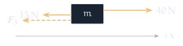
>>> soluzione
**Asse.**  Positivo verso destra.

**Somma delle forze note.**

$$F_{note}=40-15=25\un{N}$$

verso destra.

**Equilibrio.**  Per avere $\sum F_x=0$ serve

$$25+F_3=0\Rightarrow F_3=-25\un{N}.$$

**Conclusione.**  La terza forza deve avere modulo $25\un{N}$ ed essere diretta verso sinistra.
:::

::: esercizio Corpo appeso in quiete [base]
Una massa di $7\un{kg}$ è appesa a un filo verticale ed è ferma. Trovare la tensione.

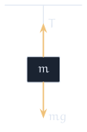
>>> soluzione
**Forze.**  Sul corpo agiscono tensione verso l'alto e peso verso il basso.

**Equilibrio.**

$$T-mg=0\Rightarrow T=mg.$$

**Calcolo.**

$$T=7\cdot9{,}81=68{,}7\un{N}.$$

La tensione uguaglia il peso soltanto perché l'accelerazione è nulla.
:::

::: esercizio Due funi simmetriche [medio]
Un peso di $600\un{N}$ è sostenuto da due funi identiche, ciascuna a $40^\circ$ sopra l'orizzontale. Calcolare la tensione in ogni fune.

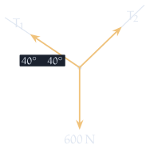
>>> soluzione
**Simmetria.**  Le componenti orizzontali delle due tensioni si annullano; le componenti verticali si sommano.

**Equilibrio verticale.**

$$2T\sin40^\circ=600.$$

**Tensione.**

$$T=\frac{600}{2\sin40^\circ}=467\un{N}.$$

**Controllo.**  Ogni fune fornisce circa $300$ N verticali; insieme sostengono il peso di $600$ N.
:::

::: esercizio Nodo con fune orizzontale e obliqua [base]
Un peso di $300\un{N}$ è sostenuto da un nodo collegato a una fune orizzontale e a una fune inclinata di $55^\circ$ sopra l'orizzontale. Trovare entrambe le tensioni.

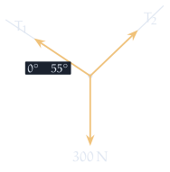
>>> soluzione
**Fune obliqua.**  Solo la fune a $55^\circ$ ha componente verticale:

$$T_o\sin55^\circ=300\Rightarrow T_o=\frac{300}{\sin55^\circ}=366\un{N}.$$

**Fune orizzontale.**  Le componenti orizzontali devono annullarsi:

$$T_h=T_o\cos55^\circ=366\cos55^\circ=210\un{N}.$$

**Controllo.**  $366\sin55^\circ\simeq300$ N e $366\cos55^\circ\simeq210$ N.
:::

::: esercizio Costante elastica [medio]
Una forza di $30\un{N}$ allunga una molla di $0{,}12\un{m}$. Determinare $k$.

>>> soluzione
**Legge di Hooke in modulo.**

$$F=kx.$$

**Isolamento di $k$.**

$$k=\frac{F}{x}=\frac{30}{0{,}12}=250\un{N/m}.$$

**Interpretazione.**  Nel tratto in cui la risposta è lineare, $k=250\un{N/m}$ è la pendenza della relazione forza-allungamento. Non è lecito concludere, da una sola misura a $0{,}12\un{m}$, che la molla sopporti davvero un allungamento di un metro: deformazioni molto maggiori richiedono una verifica sperimentale del limite elastico.
:::

::: esercizio Molla verticale in equilibrio [base]
Una massa di $2{,}5\un{kg}$ è appesa a una molla con $k=200\un{N/m}$. Trovare l'allungamento di equilibrio.

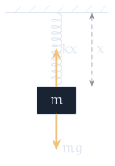
>>> soluzione
**Equilibrio.**  La forza elastica verso l'alto uguaglia il peso:

$$kx=mg.$$

**Allungamento.**

$$x=\frac{mg}{k}=\frac{2{,}5\cdot9{,}81}{200}=0{,}123\un{m}.$$

**Conclusione.**  L'allungamento di equilibrio è circa $12{,}3\un{cm}$.
:::

::: esercizio Attrito statico adattivo [medio]
Un blocco di $10\un{kg}$ ha $\mu_s=0{,}45$ ed è spinto orizzontalmente con $35\un{N}$. Stabilire se si muove e determinare l'attrito.

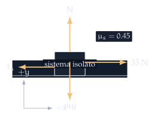
>>> soluzione
**Normale.**  Non vi sono altre forze verticali, quindi

$$N=mg=10\cdot9{,}81=98{,}1\un{N}.$$

**Massimo attrito statico.**

$$f_{s,max}=\mu_sN=0{,}45\cdot98{,}1=44{,}1\un{N}.$$

**Confronto.**  La spinta richiesta per mantenere il blocco fermo è $35$ N, inferiore a $44{,}1$ N.

**Conclusione.**  Il blocco non si muove e l'attrito statico assume il valore necessario $f_s=35\un{N}$, opposto alla spinta. Non vale automaticamente $f_s=\mu_sN$.
:::

::: esercizio Valore critico alla soglia di moto [avanzato]
Per lo stesso blocco dell'esercizio precedente, determinare il valore critico della forza orizzontale al limite dell'equilibrio statico e specificare la condizione per l'avvio effettivo del moto.

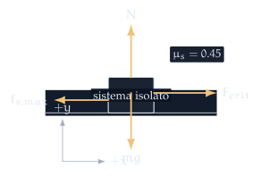
>>> soluzione
**Normale.**

$$N=mg=98{,}1\un{N}.$$

**Equilibrio limite.**  Finché il blocco resta fermo, l'attrito statico si adatta alla forza applicata. Il massimo modulo disponibile è

$$f_{s,max}=\mu_sN.$$

Al limite dell'equilibrio statico,

$$F_{crit}=f_{s,max}=\mu_sN.$$

**Calcolo.**

$$F_{crit}=0{,}45\cdot98{,}1=44{,}1\un{N}.$$

**Interpretazione.**  L'uguaglianza descrive la soglia ideale. Una forza inferiore può essere equilibrata dall'attrito statico; nel modello, lo scorrimento viene avviato da una forza appena superiore a $F_{crit}$.
:::

::: esercizio Attrito dinamico orizzontale [avanzato]
Un blocco di $10\un{kg}$ con $\mu_k=0{,}30$ è tirato orizzontalmente da $50\un{N}$. Calcolare l'accelerazione.

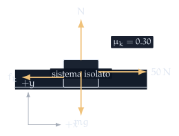
>>> soluzione
**Normale.**

$$N=mg=10\cdot9{,}81=98{,}1\un{N}.$$

**Attrito dinamico.**

$$f_k=\mu_kN=0{,}30\cdot98{,}1=29{,}4\un{N}.$$

**Risultante orizzontale.**

$$F_{ris}=50-29{,}4=20{,}6\un{N}.$$

**Accelerazione.**

$$a=\frac{20{,}6}{10}=2{,}06\un{m/s^2}.$$
:::

::: esercizio Forza inclinata verso l'alto [avanzato]
Un blocco di $15\un{kg}$ è tirato da $80\un{N}$ a $25^\circ$ sopra l'orizzontale; $\mu_k=0{,}20$. Trovare normale, attrito e accelerazione.

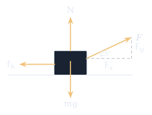
>>> soluzione
**Componenti della forza.**

$$F_x=80\cos25^\circ=72{,}5\un{N},\qquad
F_y=80\sin25^\circ=33{,}8\un{N}.$$

**Equilibrio verticale.**  Il blocco non accelera verticalmente:

$$N+F_y-mg=0\Rightarrow N=15\cdot9{,}81-33{,}8=113{,}3\un{N}.$$

**Attrito.**

$$f_k=0{,}20N=22{,}7\un{N}.$$

**Accelerazione orizzontale.**

$$a=\frac{F_x-f_k}{m}=\frac{72{,}5-22{,}7}{15}=3{,}32\un{m/s^2}.$$
:::

::: esercizio Spinta obliqua verso il basso [avanzato]
Ripetere il problema precedente quando la forza è inclinata di $25^\circ$ verso il basso. Confrontare il risultato con il tiro verso l'alto.

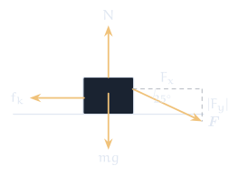
>>> soluzione
**Componenti.**  La componente verticale è ora verso il basso:

$$F_x=80\cos25^\circ=72{,}5\ \mathrm{N},\qquad |F_y|=80\sin25^\circ=33{,}8\ \mathrm{N}.$$

**Normale.**

$$N=mg+|F_y|=147{,}2+33{,}8=181{,}0\un{N}.$$

**Attrito.**

$$f_k=0{,}20N=36{,}2\un{N}.$$

**Accelerazione.**

$$a=\frac{72{,}5-36{,}2}{15}=2{,}42\un{m/s^2}.$$

La spinta verso il basso aumenta la normale, quindi aumenta l'attrito e riduce l'accelerazione rispetto al tiro verso l'alto.
:::

::: esercizio Arresto per solo attrito [medio]
Un blocco scivola a $12\un{m/s}$ su un piano orizzontale con $\mu_k=0{,}40$. Calcolare accelerazione e distanza di arresto.

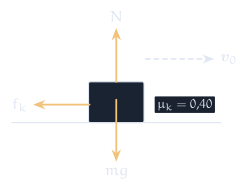
>>> soluzione
**Accelerazione.**  Su piano orizzontale $N=mg$, quindi

$$f_k=\mu_kmg,\qquad a=-\frac{f_k}{m}=-\mu_kg=-0{,}40\cdot9{,}81=-3{,}92\un{m/s^2}.$$

**Distanza di arresto.**  Con $v_f=0$:

$$0=v_0^2+2as\Rightarrow s=-\frac{v_0^2}{2a}.$$

$$s=\frac{12^2}{2(3{,}924)}=18{,}35\un{m}.$$

**Osservazione.**  La massa si semplifica: nel modello ideale la distanza dipende da $v_0$, $\mu_k$ e $g$.
:::

### Piani inclinati e vincoli

::: esercizio Piano inclinato liscio [medio]
Un blocco di $4\un{kg}$ scivola su un piano liscio di $30^\circ$. Calcolare accelerazione e normale.

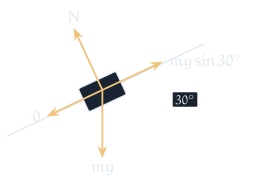
>>> soluzione
**Componenti del peso.**

$$P_{\parallel}=mg\sin30^\circ,\qquad P_{\perp}=mg\cos30^\circ.$$

**Accelerazione lungo il piano.**

$$ma=mg\sin30^\circ\Rightarrow a=g\sin30^\circ=4{,}91\un{m/s^2}.$$

**Normale.**

$$N=mg\cos30^\circ=4\cdot9{,}81\cdot0{,}866=34{,}0\un{N}.$$

La massa si semplifica nell'accelerazione, ma non nella normale.
:::

::: esercizio Piano inclinato con attrito [avanzato]
Un blocco scende su un piano di $35^\circ$ con $\mu_k=0{,}25$. Calcolare l'accelerazione.

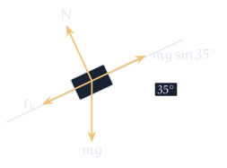
>>> soluzione
**Normale.**

$$N=mg\cos35^\circ.$$

**Attrito durante la discesa.**

$$f_k=\mu_kN=0{,}25mg\cos35^\circ$$

ed è diretto verso l'alto lungo il piano.

**Seconda legge lungo il piano.**

$$ma=mg\sin35^\circ-0{,}25mg\cos35^\circ.$$

**Accelerazione.**

$$a=g(\sin35^\circ-0{,}25\cos35^\circ)=3{,}62\un{m/s^2}.$$
:::

::: esercizio Angolo critico [medio]
Un blocco inizia a scivolare quando l'inclinazione raggiunge il valore per cui $\mu_s=0{,}50$. Determinare l'angolo critico.

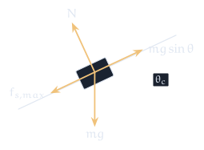
>>> soluzione
**Condizione alla soglia.**  Il blocco sta per scivolare, quindi

$$mg\sin\theta_c=f_{s,max}=\mu_sN.$$

**Normale.**

$$N=mg\cos\theta_c.$$

**Semplificazione.**

$$mg\sin\theta_c=\mu_smg\cos\theta_c
\Rightarrow \tan\theta_c=\mu_s.$$

**Angolo.**

$$\theta_c=\arctan(0{,}50)=26{,}6^\circ.$$
:::

::: esercizio Forza orizzontale su piano inclinato [medio]
Una massa di $5\un{kg}$ è in equilibrio su un piano liscio di $30^\circ$ grazie a una forza orizzontale. Trovare la forza e la normale.

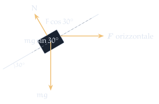
>>> soluzione
**Componente lungo il piano.**  La forza orizzontale forma $30^\circ$ con il piano, quindi la sua componente ascendente è $F\cos30^\circ$.

**Equilibrio lungo il piano.**

$$F\cos30^\circ-mg\sin30^\circ=0.$$

$$F=mg\tan30^\circ=5\cdot9{,}81\cdot0{,}577=28{,}3\un{N}.$$

**Equilibrio normale.**  La forza orizzontale spinge anche nel piano:

$$N=mg\cos30^\circ+F\sin30^\circ.$$

$$N=42{,}48+14{,}16=56{,}6\un{N}.$$
:::

### Corpi collegati e tensioni

::: esercizio Atwood con masse diverse [medio]
Una macchina di Atwood ha masse $2\un{kg}$ e $6\un{kg}$. Calcolare accelerazione e tensione.

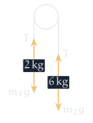
>>> soluzione
**Versi.**  La massa da 6 kg scende; quella da 2 kg sale con lo stesso modulo $a$.

**Equazioni.**

$$T-m_1g=m_1a,\qquad m_2g-T=m_2a.$$

**Somma.**

$$(m_2-m_1)g=(m_1+m_2)a
\Rightarrow a=\frac{6-2}{6+2}g=4{,}91\un{m/s^2}.$$

**Tensione.**

$$T=m_1(g+a)=2(9{,}81+4{,}905)=29{,}4\un{N}.$$
:::

::: esercizio Massa incognita in Atwood [medio]
In una macchina di Atwood la massa leggera è $3\un{kg}$ e l'accelerazione misurata è $2{,}0\un{m/s^2}$. Determinare la massa pesante e la tensione.

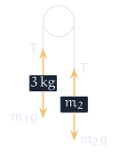
>>> soluzione
**Equazione della massa leggera.**  Essa sale con $a=2{,}0$ m/s$^2$:

$$T-m_1g=m_1a\Rightarrow T=m_1(g+a)=3(9{,}81+2{,}0)=35{,}4\un{N}.$$

**Equazione della massa pesante.**

$$m_2g-T=m_2a\Rightarrow m_2(g-a)=T.$$

**Massa.**

$$m_2=\frac{T}{g-a}=\frac{35{,}43}{7{,}81}=4{,}54\un{kg}.$$

Il valore è maggiore di 3 kg, coerentemente con il verso dell'accelerazione.
:::

::: esercizio Tavolo liscio e massa appesa [avanzato]
Una massa di $5\un{kg}$ su tavolo liscio è collegata a una massa appesa di $2\un{kg}$. Trovare accelerazione e tensione.

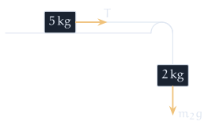
>>> soluzione
**Equazioni.**  Per il blocco sul tavolo $T=m_1a$. Per la massa appesa, scegliendo verso il basso positivo,

$$m_2g-T=m_2a.$$

**Sistema complessivo.**  Sostituendo $T=m_1a$:

$$m_2g=(m_1+m_2)a.$$

**Accelerazione.**

$$a=\frac{m_2g}{m_1+m_2}=\frac{2\cdot9{,}81}{5+2}=2{,}80\un{m/s^2}.$$

**Tensione.**

$$T=m_1a=5\cdot2{,}80=14{,}0\un{N}.$$
:::

::: esercizio Tavolo con attrito e massa appesa [avanzato]
Nel problema precedente il coefficiente dinamico sul tavolo è $0{,}20$. Trovare accelerazione e tensione.

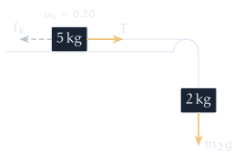
>>> soluzione
**Attrito sul blocco.**

$$f_k=\mu_km_1g=0{,}20\cdot5\cdot9{,}81=9{,}81\un{N}.$$

**Equazioni.**

$$T-f_k=m_1a,\qquad m_2g-T=m_2a.$$

**Somma del sistema.**

$$m_2g-f_k=(m_1+m_2)a.$$

$$a=\frac{19{,}62-9{,}81}{7}=1{,}40\un{m/s^2}.$$

**Tensione.**

$$T=m_2(g-a)=2(9{,}81-1{,}40)=16{,}8\un{N}.$$
:::

::: esercizio Due blocchi a contatto [medio]
Due blocchi di $3\un{kg}$ e $5\un{kg}$ sono a contatto su piano liscio. Una forza di $32\un{N}$ spinge il blocco da $3\un{kg}$. Trovare accelerazione e forza di contatto.

>>> soluzione
**Sistema complessivo.**  La forza esterna accelera la massa totale $3+5=8$ kg:

$$a=\frac{32}{8}=4{,}0\un{m/s^2}.$$

**Forza di contatto.**  Isoliamo il blocco da 5 kg. L'unica forza orizzontale su di esso è il contatto $C$:

$$C=m_2a=5\cdot4=20\un{N}.$$

**Controllo sul blocco da 3 kg.**

$$32-C=3a\Rightarrow 32-20=12=3\cdot4.$$

Le equazioni sono coerenti.
:::

::: esercizio Individuare il blocco direttamente spinto [avanzato]
Due blocchi di $3\un{kg}$ e $5\un{kg}$ sono a contatto su un piano liscio e accelerano insieme con modulo $4{,}0\un{m/s^2}$. Un sensore tra i blocchi misura una forza di contatto di $12\un{N}$. Stabilire quale blocco riceve direttamente la forza esterna e calcolarne il modulo.

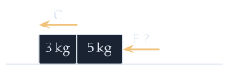
>>> soluzione
**Lettura del sensore.**  La forza di contatto vale

$$C=12\un{N}=3\cdot4\,\mathrm{N}.$$

Essa è quindi esattamente la forza necessaria ad accelerare il blocco da $3\un{kg}$.

**Deduzione.**  Sul blocco da $3\un{kg}$ la forza di contatto è l'unica forza orizzontale. Di conseguenza la forza esterna deve agire direttamente sul blocco da $5\un{kg}$, spingendolo verso il blocco più leggero.

**Forza esterna.**  Considerando i due blocchi come un unico sistema:

$$F=(3+5)\cdot4=32\un{N}.$$

**Controllo sul blocco da $5$ kg.**  La risultante su di esso è

$$F-C=32-12=20\un{N}=5\cdot4\,\mathrm{N}.$$

La misura interna consente quindi di ricostruire sia il punto di applicazione sia il valore della forza esterna.
:::

::: esercizio Forza esterna ricostruita da un accelerometro [avanzato]
Due carrelli di massa $4\un{kg}$ e $6\un{kg}$ sono collegati da un filo leggero su un piano liscio. Un accelerometro sul carrello da $4\un{kg}$, con asse sensibile orizzontale e verso positivo concorde con il moto, restituisce $+5{,}0\un{m/s^2}$. La forza esterna è applicata al carrello da $6\un{kg}$. Determinare tensione e forza esterna.

>>> soluzione
**Vincolo del filo.**  I due carrelli hanno lo stesso modulo di accelerazione, quindi la lettura $a=5{,}0\un{m/s^2}$ vale per entrambi.

**Tensione.**  Sul carrello da $4\un{kg}$ l'unica forza orizzontale è la tensione:

$$T=m_1a=4\cdot5=20\un{N}.$$

**Forza esterna.**  Sul carrello da $6\un{kg}$:

$$F-T=m_2a.$$

Pertanto

$$F=T+m_2a=20+6\cdot5=50\un{N}.$$

**Controllo sul sistema.**  La forza esterna deve accelerare la massa totale:

$$F=(4+6)5=50\un{N},$$

in accordo con il risultato ottenuto isolando i due carrelli.
:::

::: esercizio Tre blocchi e due tensioni [medio]
Tre blocchi di masse $2$, $3$ e $5\un{kg}$ sono allineati e collegati da fili su piano liscio. Una forza di $50\un{N}$ tira il blocco da $5\un{kg}$. Calcolare accelerazione e le due tensioni.

>>> soluzione
**Accelerazione comune.**

$$a=\frac{50}{2+3+5}=5{,}0\un{m/s^2}.$$

**Tensione tra 2 e 3 kg.**  Isoliamo il blocco da 2 kg:

$$T_1=2a=10\un{N}.$$

**Tensione tra 3 e 5 kg.**  Consideriamo insieme i blocchi da 2 e 3 kg, massa totale 5 kg:

$$T_2=(2+3)a=5\cdot5=25\un{N}.$$

**Controllo.**  Sul blocco da 5 kg: $50-T_2=25$ N, pari a $5a$.
:::

::: esercizio Tensione massima del filo [base]
Due blocchi di $3\un{kg}$ e $5\un{kg}$ sono collegati su piano liscio. La forza esterna tira il blocco da $3\un{kg}$ nella direzione che mette il filo in trazione; il filo sopporta al massimo $80\un{N}$. Trovare accelerazione e forza applicata massime.

>>> soluzione
**Vincolo del filo.**  La tensione massima è $T_{max}=80$ N.

**Blocco da 5 kg.**  La tensione è l'unica forza orizzontale su questo blocco:

$$T_{max}=m_2a_{max}\Rightarrow a_{max}=\frac{80}{5}=16\un{m/s^2}.$$

**Forza esterna massima.**  La forza accelera l'intero sistema di massa 8 kg:

$$F_{max}=(3+5)a_{max}=8\cdot16=128\un{N}.$$

Al di sopra di questo valore il filo supererebbe il limite dichiarato.
:::

::: esercizio Massima forza senza slittamento [medio]
Un blocco di $2\un{kg}$ è sopra uno di $6\un{kg}$, il pavimento è liscio e $\mu_s=0{,}30$. La forza agisce sul blocco inferiore. Trovare la massima forza che mantiene i blocchi solidali.

>>> soluzione
**Forza necessaria sul blocco superiore.**  L'unica forza orizzontale che accelera il blocco da 2 kg è l'attrito statico:

$$f_s=m_{sup}a.$$

**Limite statico.**

$$f_s\le\mu_sm_{sup}g\Rightarrow a\le\mu_sg=0{,}30\cdot9{,}81=2{,}94\un{m/s^2}.$$

**Forza sul sistema.**  I due blocchi si muovono insieme, massa totale 8 kg:

$$F_{max}=8a_{max}=8\cdot2{,}943=23{,}5\un{N}.$$

Una forza maggiore richiederebbe un attrito superiore al massimo disponibile.
:::

### Problemi trasversali e di modellizzazione

::: esercizio Calibrazione di un sensore di forza [avanzato]
Un sensore restituisce la lettura $R$ in funzione del peso reale $P$ secondo una legge lineare $R=aP+b$. A carico nullo legge $0{,}30\un{N}$; con una massa campione di $1{,}00\un{kg}$ legge $10{,}10\un{N}$. Determinare $a$ e $b$. Quale massa corrisponde a una lettura di $5{,}20\un{N}$?

>>> soluzione
**Offset.**  A peso nullo,

$$R(0)=b=0{,}30\un{N}.$$

**Sensibilità.**  La massa campione ha peso

$$P_c=mg=1{,}00\cdot9{,}81=9{,}81\un{N}.$$

Pertanto

$$a=\frac{10{,}10-0{,}30}{9{,}81}=0{,}99898\simeq0{,}999.$$

**Peso incognito.**  Dalla lettura $R=5{,}20$ N:

$$P=\frac{R-b}{a}=\frac{5{,}20-0{,}30}{0{,}99898}=4{,}905\un{N}.$$

**Massa.**

$$m=\frac{P}{g}=\frac{4{,}905}{9{,}81}=0{,}500\un{kg}.$$

Sottrarre l'offset prima di dividere per la sensibilità è essenziale: trattare direttamente la lettura come peso produrrebbe un errore sistematico.
:::

::: esercizio Massa e velocità terminale con resistenza quadratica [avanzato]
Una sfera di massa $0{,}080\un{kg}$ cade in aria e raggiunge la velocità terminale $20\un{m/s}$. Il modulo della resistenza è $D=kv^2$. Determinare $k$. Una seconda sfera geometricamente identica, per la quale si assume lo stesso $k$, ha massa $0{,}180\un{kg}$: quale velocità terminale raggiunge?

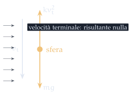
>>> soluzione
**Condizione terminale.**  Alla velocità terminale l'accelerazione è nulla, quindi peso e resistenza hanno lo stesso modulo:

$$mg=kv_t^2.$$

**Coefficiente della prima sfera.**

$$k=\frac{mg}{v_t^2}
=\frac{0{,}080\cdot9{,}81}{20^2}
=1{,}962\times10^{-3}\un{kg/m}.$$

**Seconda sfera.**

$$v_{t,2}=\sqrt{\frac{m_2g}{k}}
=\sqrt{\frac{0{,}180\cdot9{,}81}{1{,}962\times10^{-3}}}
=30{,}0\un{m/s}.$$

**Dipendenza dalla massa.**  A parità di forma e coefficiente aerodinamico, una massa maggiore richiede una velocità più alta perché la resistenza quadratica possa bilanciare il peso.
:::

::: esercizio Paracadutista prima della velocità terminale [avanzato]
Un paracadutista di massa $80\un{kg}$ sta scendendo. In un certo istante la resistenza dell'aria vale $500\un{N}$ verso l'alto. Determinare risultante e accelerazione. Stabilire se la rapidità sta aumentando o diminuendo.

>>> soluzione
**Peso.**

$$P=mg=80\cdot9{,}81=784{,}8\un{N}$$

verso il basso.

**Risultante.**  Prendendo positivo verso il basso:

$$F_{ris}=784{,}8-500=284{,}8\un{N}.$$

**Accelerazione.**

$$a=\frac{F_{ris}}{m}=\frac{284{,}8}{80}=3{,}56\un{m/s^2}$$

verso il basso.

**Rapidità.**  Velocità e accelerazione sono entrambe verso il basso, quindi la rapidità sta aumentando. La resistenza è già grande, ma non ha ancora raggiunto il valore del peso. Quando $D=mg$, l'accelerazione diventa nulla e la velocità si stabilizza.
:::

::: esercizio Moneta su una piattaforma rotante [avanzato]
Una moneta si trova a $0{,}25\un{m}$ dall'asse di una piattaforma orizzontale. Il coefficiente di attrito statico è $\mu_s=0{,}40$. Determinare la massima velocità angolare e convertirla in giri al minuto prima che la moneta inizi a slittare.

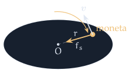
>>> soluzione
**Forza centripeta.**  L'unica forza orizzontale è l'attrito statico:

$$f_s=m\omega^2r.$$

**Condizione limite.**

$$f_{s,max}=\mu_sN=\mu_smg.$$

Alla soglia:

$$m\omega^2r=\mu_smg.$$

La massa si semplifica e

$$\omega_{max}=\sqrt{\frac{\mu_sg}{r}}
=\sqrt{\frac{0{,}40\cdot9{,}81}{0{,}25}}
=3{,}96\un{rad/s}.$$

**Giri al minuto.**

$$n=\frac{\omega}{2\pi}\,60
=\frac{3{,}96}{2\pi}\,60
=37{,}8\ \text{giri/min}.$$

La frequenza di rotazione massima è quindi circa $38$ giri al minuto. L'attrito statico non è necessariamente massimo a velocità minori: assume il valore richiesto dal moto circolare fino alla soglia.
:::

### Problemi di sintesi: dinamica

::: esercizio Cassa trascinata con attrito [base]
Una cassa di $12\un{kg}$ è trascinata orizzontalmente da $55\un{N}$ su un piano con $\mu_k=0{,}22$. Calcolare l'accelerazione.
>>> soluzione
**Forze verticali.**  $N=mg$.

**Attrito.**  $f_k=\mu_kN=25{,}9\un{N}$.

**Seconda legge.**  $a=(F-f_k)/m=2{,}43\un{m/s^2}$.
:::

::: esercizio Ascensore con accelerazione assegnata [base]
Una persona di $70\un{kg}$ è in un ascensore. Calcolare la lettura della bilancia quando l'accelerazione è $1{,}8\un{m/s^2}$ verso l'alto e quando è verso il basso.
>>> soluzione
**Verso l'alto.**  $N-mg=ma$, quindi $N=813\un{N}$.

**Verso il basso.**  $N-mg=-ma$, quindi $N=561\un{N}$. La bilancia misura la normale, non direttamente $mg$.
:::

::: esercizio Macchina di Atwood ideale [base]
Due masse $4\un{kg}$ e $7\un{kg}$ sono collegate da una fune ideale su carrucola ideale. Calcolare accelerazione e tensione.
>>> soluzione
**Sistema.**  $a=(m_2-m_1)g/(m_1+m_2)=2{,}68\un{m/s^2}$ verso il basso per $m_2$.

**Tensione.**  Per $m_1$, $T-m_1g=m_1a$, dunque $T=49{,}9\un{N}$.
:::

::: esercizio Blocco su piano inclinato ruvido [base]
Un blocco scivola lungo un piano inclinato di $28^\circ$ con coefficiente dinamico $\mu_k=0{,}18$. Calcolare l'accelerazione lungo il piano.
>>> soluzione
**Componenti.**  $mg\sin\theta$ scende, $f_k=\mu_kmg\cos\theta$ sale.

$$a=g(\sin\theta-\mu_k\cos\theta)=3{,}05\un{m/s^2}.$$
:::

::: esercizio Velocità di progetto di una curva sopraelevata [base]
Una curva di raggio $60\un{m}$ deve essere percorsa a $20\un{m/s}$ senza ricorrere all'attrito laterale. Calcolare l'angolo di sopraelevazione.
>>> soluzione
**Componenti della normale.**  $N\cos\theta=mg$ e $N\sin\theta=mv^2/r$.

**Rapporto.**  $\tan\theta=v^2/(rg)$, quindi $\theta=34{,}2^\circ$.
:::

::: esercizio Velocità limite con resistenza lineare [base]
Una particella di massa $0{,}05\un{kg}$ cade in un fluido con forza resistente $F_d=\beta v$, dove $\beta=0{,}012\un{kg/s}$. Calcolare velocità limite e costante di tempo.
>>> soluzione
**Equilibrio dinamico.**  $mg=\beta v_t$, dunque $v_t=40{,}9\un{m/s}$.

**Transitorio.**  $\tau=m/\beta=4{,}17\un{s}$.
:::

::: esercizio Velocità limite con resistenza quadratica [base]
Un oggetto di massa $0{,}08\un{kg}$ è soggetto a $F_d=bv^2$ con $b=0{,}025\un{kg/m}$. Calcolare la velocità limite.
>>> soluzione
**Bilancio al limite.**  $mg=bv_t^2$.

$$v_t=\sqrt{\frac{mg}{b}}=5{,}60\un{m/s}.$$

Il modello presuppone un regime in cui la resistenza quadratica domina.
:::

::: esercizio Allungamento di una barra d'acciaio [base]
Una barra lunga $2\un{m}$, area $0{,}004\un{m^2}$ e modulo di Young $Y=2{,}0\times10^{11}\un{Pa}$ è sottoposta a $25000{,}0\un{N}$. Calcolare l'allungamento nel regime elastico.
>>> soluzione
**Legge elastica.**  $\Delta L=FL/(AY)$.

$$\Delta L=6{,}25\times10^{-5}\un{m}=0{,}0625\un{mm}.$$
:::

::: esercizio Pendolo in un treno accelerato [base]
Un piccolo pendolo appeso in un treno che accelera orizzontalmente a $2{,}4\un{m/s^2}$ raggiunge una posizione inclinata costante. Calcolare l'angolo rispetto alla verticale.
>>> soluzione
**Campo efficace.**  Nel riferimento del treno agiscono $mg$ verso il basso e la forza inerziale $ma$ opposta all'accelerazione.

**Geometria.**  $\tan\theta=a/g$, quindi $\theta=13{,}7^\circ$.
:::

## Fonti {#fonti}

Il testo, le formule, i diagrammi e gli esercizi di questo capitolo provengono dalla *Dispensa di fisica* del corso (sezioni 2.6.5, 2.6.6, 2.8-2.17, 2.21 e materiali delle sezioni 2.22, 2.23, 2.24, 2.25), consultabile nel lettore della galassia. Per la lettura sul sito sono cambiati l'impaginazione, i colori delle figure, la numerazione e la posizione di alcuni riquadri ed esercizi; la sezione iniziale è scritta per il pianeta di questa unità.

Opere citate nel testo:

1. Android Developers, *Motion sensors*, documentazione ufficiale, [https://developer.android.com/develop/sensors-and-location/sensors/sensors_motion](https://developer.android.com/develop/sensors-and-location/sensors/sensors_motion) (consultato l'11 luglio 2026).
