## Prima di cominciare {#apertura}

Una navetta raddoppia la propria velocità e il responsabile del deposito prevede un consumo doppio. L'energia cinetica cresce con il quadrato della velocità, quindi la previsione va controllata con un bilancio energetico prima di caricare il serbatoio.

Il capitolo introduce il metodo energetico: lavoro di una forza calcolato con prodotto scalare, grafici, somme e integrali; teorema lavoro-energia; forze conservative ed energia potenziale; conservazione dell'energia meccanica e dissipazione; potenza, rendimento e costo energetico; diagrammi di energia; applicazioni a gravitazione, rotazione e sistemi. Il filo comune è la scelta del sistema prima della formula. Il capitolo prepara la [quantità di moto](unit:physics-09) e la [rotazione](unit:physics-10).

## Dalla dinamica al bilancio energetico {#s-2-18}

Le forze permettono di ricostruire l'accelerazione istante per istante. Quando interessa soprattutto il confronto fra uno stato iniziale e uno finale, la stessa dinamica può essere riorganizzata attraverso lavoro ed energia. Il resto del capitolo sviluppa questo secondo linguaggio: lavoro di forze costanti e variabili, energie cinetica e potenziale, dissipazione, potenza, rendimento, gravità e rotazione. Qui ne useremo soltanto i richiami necessari a controllare un risultato dinamico.

## Perché introdurre l'energia {#s-3-1}

Una descrizione dinamica richiede di identificare le forze e, in generale, di conoscere come cambiano nel tempo o nello spazio. In molte situazioni interessa però soltanto il confronto fra due stati. Per determinare la velocità di un carrello in fondo a una discesa, per esempio, può essere inutile conoscere in ogni istante l'accelerazione: basta contabilizzare quanto diminuisce l'energia associata alla quota e quanto aumenta quella associata al moto.

La parola *energia* non indica una sostanza materiale nascosta negli oggetti. Indica una grandezza contabile che può essere attribuita a un sistema e che, con una scelta coerente dei confini, permette di seguire trasformazioni e trasferimenti. Dire che un corpo “possiede energia” è un'abbreviazione; più precisamente, un sistema si trova in uno stato al quale il modello associa un certo valore energetico.

::: nota Prima il sistema, poi il bilancio
Un bilancio energetico è significativo soltanto dopo avere scelto il sistema. Se il sistema è il solo blocco che scivola su un tavolo ruvido, l'attrito compie lavoro esterno negativo. Se il sistema comprende blocco e tavolo, l'energia meccanica diminuisce mentre aumenta l'energia interna del sistema. La fisica non cambia; cambia il modo in cui i trasferimenti attraversano il confine scelto.
:::

::: storia Dalla *vis viva* a una grandezza unificante
Nel Seicento e nel Settecento non esisteva ancora il moderno concetto unitario di energia. Leibniz mise in evidenza la grandezza $mv^2$, chiamata *vis viva*, nelle discussioni sulla misura degli effetti del moto. Cartesiani e leibniziani attribuivano ruoli diversi a quantità che oggi distinguiamo come quantità di moto ed energia cinetica. La forma moderna $K=\tfrac12mv^2$ emerse gradualmente attraverso lo studio delle macchine, degli urti e del lavoro. Nel corso dell'Ottocento esperimenti sul calore e sulle trasformazioni meccaniche portarono alla formulazione di un principio di conservazione molto più generale  [1, 2](#fonti).
:::

## Il lavoro di una forza {#s-3-2}

Il lavoro misura quanto una forza trasferisce energia meccanica durante uno spostamento. Per una forza costante $\vect F$ e uno spostamento $\Delta\vect r$,

::: legge Lavoro di una forza costante
$$W=\vect F\cdot\Delta\vect r
=F\,\Delta r\cos\theta,$$

dove $\theta$ è l'angolo fra forza e spostamento.
:::

Il lavoro è uno scalare. È positivo quando la forza ha una componente nel verso dello spostamento, negativo quando la componente è opposta e nullo quando la forza è perpendicolare allo spostamento. L'unità SI è il joule:

$$1\un{J}=1\un{N\,m}.$$

Questa uguaglianza di unità non rende lavoro e momento torcente la stessa grandezza: entrambi si misurano in $\mathrm{N\,m}$, ma hanno significato fisico e struttura matematica differenti.

::: storia Il lavoro nasce nella scienza delle macchine
Il significato tecnico moderno di lavoro prese forma nell'Ottocento, quando ingegneri e matematici cercarono una misura comune per confrontare macchine capaci di esercitare forze diverse lungo spostamenti diversi. Nella scuola francese, Poncelet e Coriolis contribuirono a stabilizzare il linguaggio del *travail* e a collegarlo alla grandezza oggi chiamata energia cinetica. La definizione non fu quindi introdotta come pura astrazione: rispondeva al problema concreto di valutare l'effetto utile di motori, sollevamenti e trasmissioni  [1, 2](#fonti).
:::

::: quotidiano Portare una borsa lungo un corridoio
Una persona sostiene una borsa esercitando una forza prevalentemente verticale, mentre lo spostamento è orizzontale. Nel modello ideale il lavoro meccanico della forza della mano sulla borsa è nullo. Il corpo umano consuma comunque energia chimica, perché i muscoli non sono vincoli ideali e mantengono tensione attraverso processi metabolici. Il lavoro meccanico su un oggetto e il consumo energetico biologico non sono sinonimi.
:::

### Dalla previsione al calcolo del lavoro

::: sintesi Previsione senza calcolatrice
Una forza costante di $20\un{N}$ forma un angolo di $60^\circ$ con uno spostamento di $2{,}0\un{m}$. Il suo lavoro è positivo o negativo? È maggiore, uguale o minore di $40\un{J}$? Scrivere la previsione e motivarla mediante la componente della forza lungo lo spostamento.
:::

::: esempio La componente che trasferisce energia
Un carrello si sposta orizzontalmente di $4{,}0\un{m}$; la forza applicata, costante, ha modulo $30\un{N}$ e forma $60^\circ$ con lo spostamento.

**Proiezione.**  La componente parallela vale $F_\parallel=F\cos60^\circ=15\un{N}$. La componente perpendicolare non contribuisce al lavoro perché non vi è spostamento in quella direzione.

**Lavoro della forza applicata.**

$$W_F=F_\parallel\Delta x=(15)(4{,}0)=60\un{J}.$$

Il risultato è positivo e minore di $F\Delta x=120\un{J}$. Per conoscere il lavoro totale occorre valutare anche le altre forze: il lavoro della sola forza applicata non basta a descrivere l'intero bilancio.
:::

::: sintesi Completare un passaggio, poi risolvere da soli
**Attività guidata.** Una forza costante di $40\un{N}$ forma $60^\circ$ con uno spostamento orizzontale di $3{,}0\un{m}$. Completare

$$F_\parallel=40\cos60^\circ=\ldots\,\mathrm{N},
\qquad W_F=F_\parallel\Delta x=\ldots\,\mathrm{J}.$$

Una reazione normale verticale compie lavoro durante questo spostamento? Giustificare senza conoscerne il modulo.

**Prova autonoma.** Una forza costante di $50\un{N}$ forma invece $120^\circ$ con uno spostamento di $2{,}0\un{m}$. Prevedere il segno, disegnare la proiezione della forza e calcolare il lavoro. Spiegare perché il risultato può essere negativo pur essendo positivi i moduli forniti.
:::

::: approfondimento Risposte e correzione del ragionamento
La previsione iniziale dà $W=(20)(2{,}0)\cos60^\circ=20\un{J}$: positivo e inferiore a $40\un{J}$. Nell'attività guidata $F_\parallel=20\un{N}$, $W_F=60\un{J}$ e $W_N=0$. Nella prova autonoma $\cos120^\circ=-1/2$, dunque $W_F=-50\un{J}$. Se il segno è risultato positivo, controllare il verso della proiezione; se la normale ha prodotto lavoro, confrontarne la direzione con quella dello spostamento. Riprendere la definizione di lavoro di una forza costante.
:::

::: approfondimento Percorso senza analisi matematica: sommare piccoli lavori
Se la forza cambia lungo il percorso, si divide lo spostamento in tratti brevi. Sul tratto $k$,

$$\Delta W_k\approx \vect F_k\cdot\Delta\vect r_k.$$

Il lavoro totale viene stimato con

$$W\approx\sum_k \vect F_k\cdot\Delta\vect r_k.$$

In un grafico unidimensionale $F_x$ contro $x$, la somma corrisponde all'area con segno ottenuta con rettangoli o trapezi. Riducendo la larghezza dei tratti, la stima descrive meglio una forza regolare.
:::

::: approfondimento Calcolo: Derivazione continua
Per una forza che varia lungo una traiettoria $C$,

$$W=\int_C \vect F\cdot\dd\vect r.$$

In una dimensione,

$$W=\int_{x_i}^{x_f}F_x(x)\,\dd x.$$

L'integrale è il limite delle somme discrete quando la suddivisione diventa sempre più fine. Se la forza non è regolare o i dati sono sperimentali, l'integrale analitico può non essere disponibile e la quadratura numerica resta il metodo operativo.
:::

::: nota Il lavoro dipende dal percorso
La stessa forza può compiere lavori differenti lungo percorsi differenti. Una forza costante è un caso semplice: il lavoro dipende soltanto dallo spostamento netto. Per forze variabili occorre verificare se il campo è conservativo; non si può sostituire automaticamente la distanza percorsa allo spostamento.
:::

## Energia cinetica e teorema lavoro–energia {#s-3-3}

L'energia cinetica di un punto materiale di massa $m$ e rapidità $v$ è

::: legge Energia cinetica
$$K=\frac12mv^2.$$
:::

È sempre non negativa e dipende dal quadrato della rapidità. Raddoppiare la rapidità quadruplica l'energia cinetica. Questa dipendenza spiega perché spazi di frenata, danni da urto e richieste di dissipazione crescano molto rapidamente con la velocità.

Il teorema lavoro–energia collega il lavoro della risultante alla variazione di energia cinetica:

::: legge Teorema lavoro–energia
$$W_{\mathrm{tot}}=\Delta K=K_f-K_i.$$
:::

Il lavoro totale è la somma dei lavori di tutte le forze che agiscono sul sistema scelto. Una singola forza può compiere lavoro positivo mentre il lavoro totale è negativo.

::: approfondimento Derivazione con passi finiti
In un moto unidimensionale con massa costante, su un breve tratto $\Delta x$ si può usare

$$F_{\mathrm{media}}\Delta x\approx m a_{\mathrm{media}}\Delta x.$$

Poiché $v_f^2-v_i^2\approx2a_{\mathrm{media}}\Delta x$ quando l'accelerazione è quasi costante nel tratto,

$$F_{\mathrm{media}}\Delta x\approx\frac12m(v_f^2-v_i^2).$$

Sommando molti tratti, i termini intermedi si concatenano e resta la variazione complessiva di $K$.
:::

::: approfondimento Calcolo: Derivazione continua
Dalla seconda legge $\vect F_{\mathrm{tot}}=m\dd\vect v/\dd t$ e da $\dd\vect r=\vect v\,\dd t$,

$$\vect F_{\mathrm{tot}}\cdot\dd\vect r
=m\frac{\dd\vect v}{\dd t}\cdot\vect v\,\dd t
=m\vect v\cdot\dd\vect v
=\dd\!\left(\frac12mv^2\right).$$

Integrando tra stato iniziale e finale si ottiene $W_{\mathrm{tot}}=K_f-K_i$.
:::

::: approfondimento Caso di studio: Velocità e spazio di arresto
Se una forza frenante media di modulo $F_b$ agisce su un'automobile, il lavoro negativo necessario per arrestarla è $-F_bd=-K_i$. Nel modello più semplice,

$$d=\frac{mv_0^2}{2F_b}.$$

Se la forza è proporzionale al peso, $F_b\approx\mu mg$, la massa si semplifica e $d\propto v_0^2$. Passare da $50\un{km/h}$ a $100\un{km/h}$ quadruplica lo spazio di frenata ideale, prima ancora di aggiungere lo spazio percorso durante il tempo di reazione.
:::

## Forze conservative ed energia potenziale {#s-3-4}

Una forza è conservativa quando il lavoro fra due punti dipende soltanto dagli estremi e non dal percorso. Equivalentemente, il lavoro lungo un percorso chiuso è nullo. Per una forza conservativa si introduce un'energia potenziale $U$ tale che

::: legge Lavoro di una forza conservativa
$$W_{\mathrm{cons}}=-\Delta U.$$
:::

### Gravità uniforme e molla ideale

Vicino alla superficie terrestre, se $y$ cresce verso l'alto e $g$ è trattato come costante,

$$U_g=mgy.$$

Per una molla ideale deformata di $x$ rispetto alla lunghezza naturale,

$$U_e=\frac12kx^2.$$

La formula elastica vale nel regime in cui la legge di Hooke è una buona approssimazione.

::: approfondimento Forza da una tabella di energia
Se sono noti valori di $U(x)$ a punti vicini, la forza media nell'intervallo è

$$F_{x,\mathrm{media}}\approx-\frac{U(x+\Delta x)-U(x)}{\Delta x}.$$

Una diminuzione rapida di $U$ verso destra corrisponde a una forza positiva grande. Il segno meno indica che la forza tende a spingere il sistema verso energie potenziali minori.
:::

::: approfondimento Calcolo: Forza come pendenza dell'energia potenziale
In una dimensione,

$$F_x=-\frac{\dd U}{\dd x}.$$

In tre dimensioni,

$$\vect F=-\nabla U.$$

La relazione richiede una forza conservativa e un'energia potenziale differenziabile nel dominio considerato. Non ogni forza può essere descritta da una funzione $U$ dipendente soltanto dalla posizione.
:::

::: storia Potenziale, campo e conservazione
La nozione di potenziale divenne centrale nell'Ottocento nello studio della gravitazione e dell'elettricità. Essa permise di sostituire, in molti problemi, un campo vettoriale con una funzione scalare. Parallelamente, Mayer, Joule, Helmholtz e altri contribuirono a riconoscere che il lavoro e lo scambio di calore sono modalità di trasferimento dell'energia e che i processi chimici modificano l'energia interna del sistema. Il principio di conservazione dell'energia non nacque da una singola esperienza, ma dalla convergenza di meccanica, macchine termiche, fisiologia e teoria dei campi  [1](#fonti).
:::

## Conservazione dell'energia meccanica e dissipazione {#s-3-5}

L'energia meccanica è

$$E_{\mathrm{mec}}=K+U.$$

Se tutte le forze che compiono lavoro sono conservative,

::: legge Conservazione dell'energia meccanica
$$K_i+U_i=K_f+U_f.$$
:::

La conservazione riguarda la somma $K+U$: energia cinetica e potenziale possono variare trasformandosi l'una nell'altra.

Con attrito, resistenza dell'aria, deformazioni anelastiche o azionamenti esterni, il bilancio deve includere trasferimenti e variazioni interne. Dopo avere fissato il sistema e incluso in $U$ tutte le interazioni conservative rappresentate dal modello, una forma utile per la sua energia meccanica è

$$\Delta(K+U)=W_{\mathrm{ext,nc}},$$

dove $W_{\mathrm{ext,nc}}$ è il lavoro delle forze esterne non conservative, cioè dei trasferimenti meccanici non già rappresentati da $U$. Per un blocco scelto come sistema, l'attrito del tavolo è esterno; se il sistema comprende anche tavolo e ambiente immediato, lo stesso processo è interno e compare soprattutto come aumento di energia interna. In una descrizione più ampia,

$$\Delta E_{\mathrm{tot}}=E_{\mathrm{entrata}}-E_{\mathrm{uscita}},$$

con energia interna, termica, chimica o elettrica incluse secondo il problema.

::: errore L'energia non viene “consumata”
Un freno riduce l'energia cinetica macroscopica, ma l'energia totale non scompare: aumenta l'energia interna di dischi, pastiglie, pneumatici e aria. Nella lingua quotidiana “consumare energia” significa degradare energia disponibile in forme meno utili per lo scopo, non distruggerla.
:::

::: quotidiano Freni in una lunga discesa
A velocità costante lungo una discesa, l'energia potenziale gravitazionale diminuisce senza aumentare $K$. Il suo valore viene trasferito principalmente a energia interna nei freni, nel motore e nell'ambiente. La potenza da dissipare dipende dalla rapidità della discesa: la stessa perdita di quota in metà tempo richiede il doppio della potenza media.
:::

## Potenza, rendimento e costo energetico {#s-3-6}

La potenza misura la rapidità con cui avviene un trasferimento di energia o viene compiuto lavoro. La potenza media è

$$P_{\mathrm{media}}=\frac{\Delta W}{\Delta t},$$

mentre, quando le grandezze sono definite istantaneamente,

::: legge Potenza istantanea
$$P=\frac{\dd W}{\dd t}=\vect F\cdot\vect v.$$
:::

L'unità SI è il watt, $1\un{W}=1\un{J/s}$.

Energia e potenza non sono intercambiabili. Una batteria immagazzina una certa energia; il dispositivo può richiederla con potenza alta o bassa. Due motori possono compiere lo stesso lavoro ma in tempi differenti.

Il rendimento di conversione è

$$\eta=\frac{E_{\mathrm{utile}}}{E_{\mathrm{fornita}}}
=\frac{P_{\mathrm{utile}}}{P_{\mathrm{fornita}}}$$

quando il confronto riguarda lo stesso intervallo e il sistema è in regime appropriato. Per una singola macchina passiva o un convertitore ordinario, $0\le\eta\le1$. Coefficienti di prestazione di frigoriferi e pompe di calore possono invece superare 1 perché non sono rendimenti: confrontano calore trasferito e lavoro fornito.

::: approfondimento Potenza da contatori e sensori
Se un contatore misura energie $E_k$ a tempi $t_k$,

$$P_{k,\mathrm{media}}=\frac{E_{k+1}-E_k}{t_{k+1}-t_k}.$$

Con campioni di forza e velocità,

$$P_k\approx\vect F_k\cdot\vect v_k.$$

Le due stime rispondono a domande diverse: la prima media su un intervallo; la seconda approssima un valore locale ed è più sensibile al rumore.
:::

::: storia Dal cavallo-vapore al watt
La potenza divenne una grandezza tecnica decisiva con lo sviluppo delle macchine a vapore. James Watt confrontò le prestazioni delle macchine con il lavoro che poteva svolgere un cavallo, introducendo una misura commerciale che non coincide esattamente con il moderno watt. L'unità SI onora Watt, ma la distinzione concettuale resta: il joule misura una quantità di energia; il watt la rapidità del trasferimento  [1](#fonti).
:::

## Diagrammi di energia ed equilibrio {#s-3-7}

Un grafico $U(x)$ riassume molte informazioni sul moto unidimensionale. Se l'energia meccanica totale è $E$, l'energia cinetica è

$$K(x)=E-U(x).$$

Sono accessibili soltanto le regioni in cui $E\ge U(x)$. Nei punti di inversione $E=U$ e la velocità istantanea è nulla. Un minimo di $U$ corrisponde a un equilibrio stabile; un massimo a un equilibrio instabile, purché la forza sia $F_x=-\dd U/\dd x$.

::: approfondimento Stabilità senza derivate
Si confrontano i valori di $U$ poco a destra e poco a sinistra del punto. Se entrambi sono maggiori del valore centrale, una piccola perturbazione richiede energia e il punto è stabile. Se almeno da un lato $U$ diminuisce, la perturbazione può allontanare il sistema e il punto non è stabile.
:::

::: approfondimento Calcolo: Condizioni locali
Un punto di equilibrio $x_0$ soddisfa

$$U'(x_0)=0.$$

Se $U”(x_0)>0$ è un minimo locale e l'equilibrio è stabile; se $U”(x_0)<0$ è un massimo locale e l'equilibrio è instabile. Se $U”(x_0)=0$, il criterio è inconcludente e servono termini di ordine superiore o un'analisi diretta.
:::

## Gravitazione come applicazione energetica, rotazione e sistemi {#s-3-8}

Come anticipazione del [capitolo «Gravitazione»](unit:physics-12), per due masse puntiformi $M$ e $m$ separate da distanza $r$,

$$U(r)=-\frac{GMm}{r},$$

scelto $U\to0$ per $r\to\infty$. Il segno negativo esprime che serve lavoro positivo per separare le masse fino a distanza infinita. Dalla conservazione dell'energia si ricava la velocità di fuga ideale dalla superficie di un corpo sferico:

$$v_{\mathrm{esc}}=\sqrt{\frac{2GM}{R}}.$$

La formula trascura atmosfera, rotazione del corpo, propulsione durante la salita e interazioni con altri corpi. Campo gravitazionale, leggi di Keplero, orbite e satelliti sono sviluppati sistematicamente nel [capitolo «Gravitazione»](unit:physics-12).

Per un corpo rigido che ruota attorno a un asse fisso,

$$K_{\mathrm{rot}}=\frac12I\omega^2.$$

Un corpo che rotola senza strisciare ha sia energia traslazionale sia rotazionale:

$$K=\frac12Mv_{CM}^2+\frac12I_{CM}\omega^2,
\qquad v_{CM}=\omega R.$$

La distribuzione della massa influenza quindi la velocità raggiunta da oggetti che scendono lungo la stessa rampa.

::: approfondimento Verso termodinamica e fisica moderna
In termodinamica l'energia interna organizza i gradi di libertà microscopici e il primo principio include nel bilancio i trasferimenti mediante lavoro e scambio di calore. In relatività massa ed energia sono collegate da $E_0=mc^2$. In meccanica quantistica l'energia può assumere spettri discreti per sistemi vincolati e un fotone ha energia $E=hf$. Queste relazioni non derivano dalla sola meccanica classica: sono ponti verso teorie successive, da studiare con i loro postulati e ambiti di validità.
:::

## Bilanci energetici: scegliere il sistema prima della formula {#s-3-9}

La conservazione dell'energia è un metodo di contabilità, non una scorciatoia. Prima di scrivere equazioni occorre delimitare il sistema. Se la Terra è inclusa nel sistema, $mgy$ è energia potenziale interna al sistema corpo–Terra; se la Terra resta nell'ambiente, la gravità compie lavoro attraverso il confine concettuale. Entrambe le descrizioni sono valide, purché non si conti la stessa interazione due volte.

::: metodo Bilancio in quattro domande
1. Quali oggetti e campi appartengono al sistema?
2. Quali forme di energia possono cambiare: cinetica, potenziale, interna, chimica, elettrica o radiante?
3. Quali trasferimenti attraversano il confine: lavoro, calore o trasporto di materia?
4. Quali termini sono trascurabili e per quale motivo quantitativo?
:::

::: approfondimento Dimostrazione: Equilibrio stabile e oscillazione locale
**Ipotesi.** Il potenziale $U(x)$ è due volte derivabile e possiede un minimo in $x_0$, cioè $U'(x_0)=0$ e $U”(x_0)>0$.

**Passaggi.** Lo sviluppo di Taylor vicino al minimo è

$$U(x)\simeq U(x_0)+\frac12U”(x_0)(x-x_0)^2.$$

Derivando,

$$F_x=-\frac{\dd U}{\dd x}\simeq-U”(x_0)(x-x_0).$$

La dinamica locale è quindi quella di una molla con $k_{\mathrm{eff}}=U”(x_0)$ e

$$\omega_0=\sqrt{\frac{U”(x_0)}{m}}.$$

**Significato fisico.** L'oscillatore armonico non è un modello isolato: è l'approssimazione universale di molti sistemi vicino a un equilibrio stabile.

**Limiti di validità.** L'approssimazione vale soltanto per spostamenti abbastanza piccoli da rendere trascurabili i termini cubici e superiori.
:::

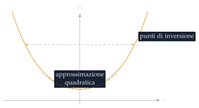

## Casi di studio e attività sperimentali {#casi}

### Caso di studio: Consumo domestico: energia, potenza e costo

Un bollitore da $2{,}0\un{kW}$ acceso per $3{,}0\un{min}$ assorbe idealmente

$$E=P\Delta t=(2000\un{W})(180\un{s})=3{,}6\times10^{5}\un{J}=0{,}10\un{kW\,h}.$$

Il kilowattora è un'unità di energia, non di potenza. Se l'acqua riceve meno energia di quella elettrica assorbita, la differenza riscalda recipiente e ambiente. Misurare tempo, massa d'acqua e aumento di temperatura permette di stimare il rendimento termico, ma richiede la capacità termica dell'acqua, grandezza introdotta nello studio della termodinamica.

### Caso di studio: Frenata rigenerativa

In un veicolo elettrico il motore può funzionare da generatore durante il rallentamento. Una parte dell'energia cinetica viene riconvertita in energia elettrica e immagazzinata nella batteria; il resto viene dissipato in resistenze, attriti, elettronica e batteria. Se un veicolo di massa $m$ rallenta da $v_i$ a $v_f$, l'energia cinetica disponibile è

$$\Delta K_{\mathrm{disp}}=\frac12m(v_i^2-v_f^2).$$

L'energia recuperata è inferiore a questo valore e dipende dal rendimento complessivo, dalla potenza massima accettabile dalla batteria e dall'aderenza disponibile.

### Attività sperimentale: Energia di una pallina che rimbalza

**Obiettivo.**  stimare la frazione di energia meccanica recuperata dopo un urto e interpretare la parte trasformata in altre forme di energia.

**Materiali o dati.**  pallina, riferimento verticale graduato e videocamera fissata.

**Procedura.**

1. Lasciare cadere la pallina da un'altezza $h_0$ senza lanciarla.
2. Misurare dal video l'altezza massima $h_1$ dopo il primo rimbalzo.
3. Calcolare il rapporto $E_1/E_0=h_1/h_0$ nel modello gravitazionale uniforme.
4. Ripetere per più altezze e materiali, stimando dispersione e incertezza.

**Controllo e discussione.**  verificare se il rapporto dipende dall'altezza iniziale e discutere il ruolo di deformazioni, energia interna e onde sonore. Distinguere le forme di energia dai trasferimenti mediante lavoro o calore.

**Sicurezza.**  usare oggetti leggeri, lasciare libero lo spazio di caduta e fissare sia il riferimento metrico sia la videocamera.

### Attività sperimentale: Lavoro di un elastico da dati forza–allungamento

**Obiettivo.**  ricavare il lavoro da una curva sperimentale $F(x)$ e riconoscere un comportamento non perfettamente elastico.

**Materiali o dati.**  elastico integro, supporto stabile, righello, dinamometro o masse note e foglio di calcolo.

**Procedura.**

1. Misurare la lunghezza non deformata e scegliere un intervallo di allungamento sicuro.
2. Aumentare gradualmente l'allungamento, registrando le coppie $(x,F)$ durante il carico.
3. Ridurre l'allungamento lungo gli stessi valori e registrare la curva di scarico.
4. Stimare il lavoro in ciascun ramo mediante una somma di trapezi.

**Controllo e discussione.**  confrontare le due curve. Se non coincidono, l'elastico presenta isteresi e non è descritto da un'unica costante di Hooke sull'intero intervallo; l'area compresa fra i rami misura l'energia dissipata per ciclo.

**Sicurezza.**  non superare l'intervallo elastico, indossare una protezione per gli occhi e non orientare l'elastico verso persone o oggetti fragili.

## Sintesi e autoverifica {#sintesi}

::: metodo Una procedura che evita scorciatoie sbagliate
1. Scegliere il sistema e dichiarare gli stati iniziale e finale.
2. Disegnare la geometria e fissare il livello zero delle energie potenziali.
3. Stabilire quali forze compiono lavoro e quali energie devono essere incluse.
4. Decidere se usare lavoro–energia, conservazione dell'energia meccanica o un bilancio più ampio.
5. Scrivere prima l'equazione simbolica, con segni coerenti.
6. Inserire dissipazioni, rendimenti o lavori esterni senza confonderli con “energia perduta”.
7. Controllare unità, segno, regioni accessibili e valori limite.
8. Confrontare il risultato con la dinamica quando entrambe le vie sono disponibili.
:::

::: sintesi Sintesi concettuale
- Il lavoro è un trasferimento dipendente da forza e spostamento.
- Il lavoro della risultante modifica l'energia cinetica.
- Le forze conservative permettono di introdurre un'energia potenziale.
- L'energia meccanica si conserva soltanto nelle condizioni dichiarate.
- Attrito e processi irreversibili trasformano energia meccanica in energia interna.
- La potenza misura la rapidità del trasferimento, non la quantità totale.
- I diagrammi $U(x)$ permettono di riconoscere equilibri, punti di inversione e regioni accessibili.
:::

::: sintesi Autoverifica
Senza consultare il formulario, verificare di saper:

1. calcolare un lavoro con prodotto scalare, area, somma discreta o integrale;
2. motivare il segno del lavoro e distinguere lavoro di una forza e lavoro totale;
3. applicare il teorema lavoro–energia e un bilancio energetico con dissipazione;
4. ricavare una forza da $U(x)$ con differenze finite o derivata;
5. interpretare potenza, rendimento e kilowattora;
6. leggere un diagramma di energia e dichiarare le ipotesi di gravità, molla e rotolamento;
7. riconoscere quando il metodo energetico non fornisce da solo tempi, direzioni o forze di vincolo.
:::

::: sintesi Verifica breve: scegliere il bilancio energetico
1. Una forza costante di $6\un{N}$ forma $120^\circ$ con uno spostamento di $3\un{m}$. Prevedere il segno e calcolare il lavoro.
2. Un punto materiale di $2{,}0\un{kg}$ rallenta da $4{,}0\un{m/s}$ a $2{,}0\un{m/s}$. Quanto vale il lavoro totale? È possibile ricavare da questi dati il tempo impiegato?
3. Un punto materiale si trova sul ramo crescente di un grafico $U(x)$. In quale verso agisce la forza conservativa? Per il percorso con il calcolo, usare $U(x)=(2\,\mathrm{J/m^2})x^2$ e trovare $F_x$ a $x=1\un{m}$.
4. Un dispositivo fornisce $600\un{W}$ utili con rendimento $0{,}75$. Calcolare la potenza assorbita e quella trasferita in forme non utili allo scopo dichiarato.
:::

::: approfondimento Risposte essenziali: energia
1. Il lavoro è negativo: $W=6\cdot3\cos120^\circ=-9\un{J}$. Rivedere *Il lavoro di una forza*.
2. $W_{\mathrm{tot}}=\Delta K=-12\un{J}$. Il tempo richiede informazioni sulla dinamica durante il moto. Rivedere *Energia cinetica e teorema lavoro–energia*.
3. La forza punta verso $x$ decrescente; $F_x=-\dd U/\dd x=-4\un{N}$ nel punto indicato. Rivedere *Forze conservative ed energia potenziale*.
4. $P_{\mathrm{in}}=600/0{,}75=800\un{W}$; la differenza è $200\un{W}$. Rivedere *Potenza, rendimento e costo energetico*.
:::

## Formulario ragionato {#formulario}

Le relazioni seguenti richiedono la scelta preventiva del sistema, degli stati iniziale e finale e dello zero delle energie potenziali. Prima di applicare una conservazione occorre stabilire quali trasferimenti attraversano il confine del sistema.

::: legge Lavoro
Per forza costante:

$$W=\vect F\cdot\Delta\vect r=F\Delta r\cos\theta.$$

Per dati discreti:

$$W\approx\sum_k \vect F_k\cdot\Delta\vect r_k,$$

oppure, in una dimensione, con trapezi:

$$W\approx\sum_k\frac{F_k+F_{k+1}}{2}\Delta x_k.$$

Con analisi matematica:

$$W=\int_C\vect F\cdot\dd\vect r,
\qquad
W=\int_{x_i}^{x_f}F_x(x)\,\dd x.$$

Il segno dipende dalla componente della forza lungo lo spostamento. Unità: $\mathrm{J}$=$\mathrm{N\,m}$.
:::

::: legge Energia cinetica e teorema lavoro–energia
$$K=\frac12mv^2,
\qquad
W_{tot}=\Delta K=K_f-K_i.$$

$W_{tot}$ è il lavoro della risultante, cioè la somma dei lavori di tutte le forze sul sistema scelto.
:::

::: legge Energia potenziale e forze conservative
$$W_{cons}=-\Delta U.$$

Gravità uniforme, con $y$ positivo verso l'alto:

$$U_g=mgy.$$

Molla ideale nel regime lineare:

$$U_e=\frac12kx^2.$$

Gravitazione universale, con zero all'infinito:

$$U(r)=-\frac{GMm}{r}.$$

Forza da valori discreti:

$$F_{x,med}\approx-\frac{\Delta U}{\Delta x}.$$

Forza da una funzione differenziabile:

$$F_x=-\frac{\dd U}{\dd x},
\qquad
\vect F=-\nabla U.$$
:::

::: legge Conservazione e dissipazione
Se compiono lavoro soltanto forze conservative:

$$K_i+U_i=K_f+U_f.$$

Fissato il sistema e incluse in $U$ le interazioni conservative modellate:

$$\Delta(K+U)=W_{\mathrm{ext,nc}}.$$

Per un sistema più ampio occorre includere energia interna e trasferimenti:

$$\Delta E_{tot}=E_{entrata}-E_{uscita}.$$

La scelta del sistema determina quali termini sono interni, quali attraversano il confine e quali sono già rappresentati da $U$.
:::

::: legge Potenza ed efficienza
$$P_{media}=\frac{\Delta W}{\Delta t},
\qquad
P=\frac{\dd W}{\dd t}=\vect F\cdot\vect v.$$

Da dati di energia:

$$P_{k,med}=\frac{E_{k+1}-E_k}{t_{k+1}-t_k}.$$

Rendimento:

$$\eta=\frac{E_{utile}}{E_{fornita}}
=\frac{P_{utile}}{P_{fornita}}.$$

Unità: $\mathrm{W}$=$\mathrm{J/s}$. Inoltre

$$1\un{kW\,h}=3{,}6\un{MJ}.$$
:::

::: legge Diagrammi di energia
$$K(x)=E-U(x)\ge0.$$

Punti di inversione: $E=U(x)$. Equilibrio:

$$U'(x_0)=0.$$

Se $U”(x_0)>0$ il punto è stabile; se $U”(x_0)<0$ è instabile. Se $U”(x_0)=0$, il test non decide.
:::

::: legge Rotazione e gravità
Corpo rigido attorno a un asse fisso:

$$K_{rot}=\frac12I\omega^2.$$

Rotolamento senza strisciamento:

$$K=\frac12Mv_{CM}^2+\frac12I_{CM}\omega^2,
\qquad v_{CM}=\omega R.$$

Velocità di fuga ideale:

$$v_{esc}=\sqrt{\frac{2GM}{R}}.$$

Orbita circolare:

$$K=\frac{GMm}{2r},
\quad
U=-\frac{GMm}{r},
\quad
E=-\frac{GMm}{2r}.$$
:::

::: errore Controlli prima di usare una formula
- Dichiarare il sistema, gli stati e il livello zero di $U$.
- Non usare la conservazione dell'energia meccanica se sono presenti dissipazioni non incluse.
- Non confondere lavoro nullo con forza nulla.
- Non confondere energia e potenza, né kilowatt e kilowattora.
- Ricordare che il metodo energetico spesso non determina tempi, direzioni o reazioni vincolari.
- Per molle, attrito, rotolamento e gravità universale dichiarare il regime di validità.
:::

## Glossario {#glossario}

- **Energia cinetica**: Grandezza $K=\tfrac12mv^2$ associata al moto di un punto materiale nel riferimento scelto.
- **Energia meccanica**: Somma di energia cinetica ed energie potenziali incluse nel modello, $E_{mec}=K+U$.
- **Energia potenziale**: Funzione di configurazione definita per interazioni conservative; le sue differenze determinano il lavoro della forza conservativa.
- **Lavoro**: Trasferimento energetico associato alla componente di una forza lungo uno spostamento.
- **Potenza**: Rapidità di trasferimento dell'energia o di compimento del lavoro; si misura in watt.
- **Rendimento**: Rapporto fra energia o potenza utile e quella fornita, per lo stesso processo e intervallo.
- **Velocità di fuga**: Velocità minima ideale che permette a un corpo non propulso di raggiungere distanza infinita con velocità finale nulla.

## Esercizi {#esercizi}

Gli esercizi riprendono quelli della dispensa. Ogni soluzione è nascosta finché non la apri: prova prima a impostare il problema da solo.

### Riferimenti accelerati e moto circolare

::: esercizio Peso apparente in ascensore [avanzato]
Una persona di $70\un{kg}$ è su una bilancia. Calcolare la lettura se l'ascensore accelera a $1{,}5\un{m/s^2}$ verso l'alto, verso il basso e in caduta libera.

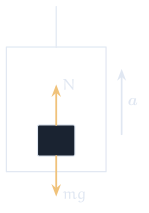
>>> soluzione
**Equazione generale.**  Con verso positivo verso l'alto:

$$N-mg=ma\Rightarrow N=m(g+a).$$

**Accelerazione verso l'alto.**  $a=+1{,}5$ m/s$^2$:

$$N=70(9{,}81+1{,}5)=792\un{N}.$$

**Accelerazione verso il basso.**  $a=-1{,}5$ m/s$^2$:

$$N=70(9{,}81-1{,}5)=582\un{N}.$$

**Caduta libera.**  $a=-g$:

$$N=70(g-g)=0.$$

La bilancia legge $N$, perciò il “peso apparente” cambia anche se la massa resta invariata.
:::

::: esercizio Tensione del cavo di un ascensore [avanzato]
La massa complessiva di cabina e passeggeri è $800\un{kg}$. L'ascensore accelera verso l'alto a $1{,}2\un{m/s^2}$. Trovare la tensione del cavo.

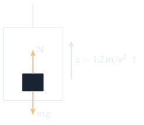
>>> soluzione
**Forze sulla cabina.**  Tensione verso l'alto e peso verso il basso.

**Seconda legge.**

$$T-mg=ma.$$

**Tensione.**

$$T=m(g+a)=800(9{,}81+1{,}2)=8{,}81\times10^{3}\un{N}.$$

**Controllo.**  La tensione è maggiore del peso $mg=7{,}85\times10^{3}\un{N}$, come deve accadere per accelerare verso l'alto.
:::

::: esercizio Pendolino in autobus accelerato [avanzato]
Un pendolino appeso in un autobus si inclina stabilmente quando il veicolo accelera orizzontalmente a $3{,}0\un{m/s^2}$. Trovare l'angolo dalla verticale.

>>> soluzione
**Forze.**  Sul pendolino agiscono peso $mg$ verso il basso e tensione lungo il filo.

**Componenti.**  La componente orizzontale della tensione produce l'accelerazione del pendolino:

$$T\sin\theta=ma.$$

Verticalmente non vi è accelerazione:

$$T\cos\theta=mg.$$

**Rapporto.**

$$\tan\theta=\frac{a}{g}=\frac{3{,}0}{9{,}81}=0{,}306.$$

**Angolo.**

$$\theta=\arctan(0{,}306)=17{,}0^\circ.$$

Il filo si inclina all'indietro rispetto al verso dell'accelerazione del veicolo.
:::

::: esercizio Atwood in ascensore accelerato [medio]
Una macchina di Atwood con masse $3\un{kg}$ e $5\un{kg}$ è in un ascensore che accelera verso l'alto a $2{,}0\un{m/s^2}$. Trovare accelerazione relativa e tensione.

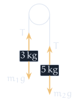
>>> soluzione
**Gravità efficace.**  Nel riferimento dell'ascensore che accelera verso l'alto, la gravità efficace ha modulo

$$g'=g+a_0=9{,}81+2{,}0=11{,}81\un{m/s^2}.$$

**Accelerazione relativa.**

$$a_{rel}=\frac{m_2-m_1}{m_1+m_2}g'=\frac{5-3}{8}(11{,}81)=2{,}95\un{m/s^2}.$$

**Tensione.**

$$T=m_1(g'+a_{rel})=3(11{,}81+2{,}95)=44{,}3\un{N}.$$

La massa da 5 kg scende rispetto alla cabina; quella da 3 kg sale.
:::

::: esercizio Attrito richiesto in curva [avanzato]
Un'auto percorre una curva piana di raggio $60\un{m}$ a $15\un{m/s}$. Determinare il minimo coefficiente di attrito statico.

>>> soluzione
**Forza radiale richiesta.**  Su curva piana l'attrito statico fornisce la forza centripeta:

$$f_s=\frac{mv^2}{r}.$$

**Valore massimo disponibile.**

$$f_{s,max}=\mu_sN=\mu_smg.$$

**Condizione minima.**

$$\frac{mv^2}{r}\le\mu_smg\Rightarrow
\mu_s\ge\frac{v^2}{rg}.$$

**Calcolo.**

$$\mu_{s,min}=\frac{15^2}{60\cdot9{,}81}=0{,}382.$$

La massa si semplifica.
:::

::: esercizio Velocità massima in curva [medio]
Una curva piana ha raggio $80\un{m}$ e $\mu_s=0{,}50$. Trovare la massima velocità senza slittamento.

>>> soluzione
**Condizione limite.**

$$\mu_smg=\frac{mv_{max}^2}{r}.$$

**Velocità.**

$$v_{max}=\sqrt{\mu_sgr}=\sqrt{0{,}50\cdot9{,}81\cdot80}=19{,}8\un{m/s}.$$

**Conversione.**

$$19{,}8\cdot3{,}6=71{,}3\un{km/h}.$$

Il valore è il limite ideale prima dello slittamento laterale.
:::

::: esercizio Curva sopraelevata senza attrito [avanzato]
Quale angolo deve avere una curva di raggio $100\un{m}$ progettata per $20\un{m/s}$ senza affidarsi all'attrito?

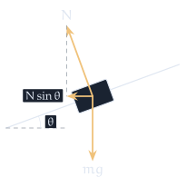
>>> soluzione
**Componenti della normale.**  Verticalmente:

$$N\cos\theta=mg.$$

Radialmente:

$$N\sin\theta=\frac{mv^2}{r}.$$

**Rapporto.**

$$\tan\theta=\frac{v^2}{rg}.$$

**Calcolo.**

$$\tan\theta=\frac{20^2}{100\cdot9{,}81}=0{,}408,
\qquad \theta=22{,}2^\circ.$$

A questa velocità la curva può essere percorsa senza ricorrere all'attrito laterale.
:::

::: esercizio Velocità minima al culmine [avanzato]
Un corpo compie un giro verticale all'interno di una guida circolare di raggio $4\un{m}$. Trovare la minima velocità al punto più alto per mantenere il contatto.

>>> soluzione
**Direzione radiale.**  Al punto più alto il centro è verso il basso. Peso e normale, se presente, puntano verso il centro:

$$mg+N=m\frac{v^2}{r}.$$

**Condizione limite di contatto.**  Alla velocità minima la guida non deve più spingere: $N=0$.

$$mg=m\frac{v_{min}^2}{r}.$$

**Velocità.**

$$v_{min}=\sqrt{gr}=\sqrt{9{,}81\cdot4}=6{,}26\un{m/s}.$$

Sotto questo valore sarebbe richiesta una normale negativa, impossibile per un contatto semplice.
:::

::: esercizio Normale al fondo di una traiettoria circolare [medio]
Una persona di $50\un{kg}$ passa al fondo di una traiettoria circolare di raggio $5\un{m}$ a $10\un{m/s}$. Calcolare la normale del sedile.

>>> soluzione
**Direzione radiale.**  Al fondo il centro è verso l'alto. La normale è verso l'alto, il peso verso il basso:

$$N-mg=m\frac{v^2}{r}.$$

**Isolamento di $N$.**

$$N=mg+m\frac{v^2}{r}.$$

**Calcolo.**

$$N=50\cdot9{,}81+50\frac{10^2}{5}=490{,}5+1000=1{,}49\times10^{3}\un{N}.$$

La normale supera il peso perché deve anche fornire l'accelerazione centripeta.
:::

### Prime letture energetiche

::: esercizio La spesa sollevata e trasportata [avanzato]
Una borsa di massa $6{,}0\un{kg}$ viene sollevata verticalmente di $0{,}80\un{m}$ e poi trasportata orizzontalmente per $12\un{m}$ a quota costante. Calcolare il lavoro della forza di gravità nelle due fasi e spiegare perché il consumo metabolico della persona non coincide con tale lavoro.

>>> soluzione
**Scelta del sistema.**  Consideriamo la borsa. La gravità è una forza esterna diretta verso il basso.

**Sollevamento.**  Lo spostamento è verso l'alto, quindi l'angolo con il peso è $180^\circ$:

$$W_g=-mg\Delta y=-(6{,}0)(9{,}81)(0{,}80)=-47{,}1\un{J}.$$

**Trasporto orizzontale.**  Peso e spostamento sono perpendicolari:

$$W_g=mg\Delta x\cos90^\circ=0.$$

**Interpretazione.**  La persona compie lavoro positivo durante il sollevamento. Nel tratto orizzontale il lavoro meccanico ideale sulla borsa è nullo, ma i muscoli consumano energia chimica per mantenere la tensione e per il movimento del corpo. Il bilancio biologico è più ampio del lavoro sulla borsa.
:::

::: esercizio Forza obliqua su una valigia [medio]
Una valigia viene trascinata per $9{,}0\un{m}$ da una forza costante di $65\un{N}$ inclinata di $35^\circ$ rispetto all'orizzontale. Calcolare il lavoro della forza applicata e il lavoro della reazione normale, assumendo spostamento orizzontale.

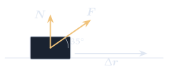
>>> soluzione
**Prodotto scalare.**  Solo la componente parallela allo spostamento compie lavoro:

$$W_F=F\Delta r\cos35^\circ=(65)(9{,}0)\cos35^\circ=479\un{J}.$$

**Reazione normale.**  La normale è verticale, lo spostamento orizzontale:

$$W_N=N\Delta r\cos90^\circ=0.$$

**Controllo.**  Il lavoro della forza applicata è inferiore a $F\Delta r=585\un{J}$ perché una parte della forza è verticale e non contribuisce allo spostamento orizzontale.
:::

::: esercizio Il lavoro non è il momento torcente [medio]
Una forza di $30\un{N}$ spinge tangenzialmente una porta nel punto distante $0{,}75\un{m}$ dai cardini. Durante l'apertura il punto di applicazione percorre un arco di $0{,}90\un{m}$. Calcolare il momento torcente e il lavoro, spiegando perché hanno la stessa unità ma non lo stesso significato.

>>> soluzione
**Momento.**  La forza è perpendicolare al raggio:

$$\tau=rF=(0{,}75)(30)=22{,}5\un{N\,m}.$$

**Lavoro.**  La forza è tangente alla traiettoria del punto di applicazione:

$$W=Fs=(30)(0{,}90)=27\un{J}.$$

**Interpretazione.**  Il momento di una forza quantifica il suo contributo istantaneo alla dinamica rotazionale rispetto al perno; il lavoro misura energia trasferita durante uno spostamento. L'unità algebrica $\mathrm{N\,m}$ coincide, ma il joule non si usa per il momento torcente proprio per non confondere le grandezze.
:::

::: esercizio Forza centripeta e lavoro [base]
Un disco di massa $0{,}40\un{kg}$ si muove su una guida circolare orizzontale di raggio $1{,}2\un{m}$ con rapidità costante. La guida esercita una forza radiale di $7{,}5\un{N}$. Calcolare il lavoro di questa forza durante un quarto di giro.

>>> soluzione
**Geometria locale.**  In ogni punto la forza radiale è perpendicolare allo spostamento tangenziale infinitesimo.

**Somma discreta.**  Dividendo l'arco in piccoli tratti, ogni contributo è circa

$$\Delta W_k\approx F_r\Delta s_k\cos90^\circ=0.$$

La somma è quindi $W=0$.

**Conseguenza.**  La forza cambia la direzione della velocità ma non la rapidità; perciò l'energia cinetica resta costante. Il risultato non dipende dalla lunghezza dell'arco finché la forza resta sempre perpendicolare al moto.
:::

::: esercizio Lavoro totale da più forze [avanzato]
Un carrello si sposta di $5{,}0\un{m}$ verso destra. Una persona esercita $42\un{N}$ verso destra, una resistenza di rotolamento vale $11\un{N}$ verso sinistra e il vento esercita $4{,}0\un{N}$ verso sinistra. Calcolare il lavoro di ogni forza e il lavoro totale.

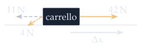
>>> soluzione
**Lavori singoli.**

$$W_{\mathrm{persona}}=(42)(5{,}0)=210\un{J},$$

$$W_{\mathrm{rot}}=-(11)(5{,}0)=-55\un{J},
\qquad
W_{\mathrm{vento}}=-(4{,}0)(5{,}0)=-20\un{J}.$$

Peso e normale, se presenti, compiono lavoro nullo sullo spostamento orizzontale.

**Somma.**

$$W_{\mathrm{tot}}=210-55-20=135\un{J}.$$

**Controllo alternativo.**  La risultante orizzontale è $42-11-4=27\un{N}$; il suo lavoro è $(27)(5{,}0)=135\un{J}$, coerente con la somma.
:::

::: esercizio Una forza che non produce spostamento [base]
Una persona spinge una parete con forza orizzontale di $250\un{N}$ per $20\un{s}$, ma la parete non si muove. Qual è il lavoro meccanico della forza sulla parete? Che cosa si può dire dell'energia spesa dalla persona?

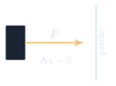
>>> soluzione
**Definizione.**  Il lavoro meccanico richiede spostamento del punto di applicazione:

$$W=\vect F\cdot\Delta\vect r=0.$$

La durata non cambia questo risultato.

**Sistema biologico.**  La persona converte energia chimica in energia interna e trasferisce energia all'ambiente mediante riscaldamento, anche perché i muscoli mantengono una contrazione. Questa energia non viene trasferita come lavoro meccanico alla parete ideale immobile. Una forza grande applicata a lungo non implica, da sola, lavoro meccanico.
:::

::: esercizio Lavoro del peso lungo due percorsi [base]
Un oggetto di massa $2{,}5\un{kg}$ passa dalla quota $1{,}2\un{m}$ alla quota $4{,}0\un{m}$. Nel primo caso viene sollevato verticalmente; nel secondo percorre una rampa lunga $7{,}0\un{m}$. Calcolare il lavoro del peso nei due casi.

>>> soluzione
**Dipendenza dalla quota.**  Il lavoro del peso vicino alla superficie terrestre è

$$W_g=-mg\Delta y.$$

Con $\Delta y=4{,}0-1{,}2=2{,}8\un{m}$,

$$W_g=-(2{,}5)(9{,}81)(2{,}8)=-68{,}7\un{J}.$$

**Confronto.**  Il risultato è lo stesso lungo la rampa. Il percorso è più lungo, ma la componente del peso lungo la rampa è più piccola in modo compensativo. Questo è un primo indizio della natura conservativa della gravità uniforme.
:::

::: esercizio Scelta del sistema in una frenata [medio]
Un blocco scivola su un tavolo ruvido e si arresta. Descrivere il bilancio energetico scegliendo prima il solo blocco come sistema e poi il sistema blocco più tavolo. Non sono richiesti valori numerici.

>>> soluzione
**Solo blocco.**  L'attrito del tavolo è una forza esterna che compie lavoro negativo:

$$\Delta K_{\mathrm{blocco}}=W_{\mathrm{attrito}}<0.$$

L'energia meccanica del blocco diminuisce.

**Blocco più tavolo.**  L'attrito al contatto è interno al sistema complessivo. L'energia cinetica macroscopica diminuisce, ma aumenta l'energia interna di blocco e tavolo:

$$\Delta K+\Delta E_{\mathrm{int}}=0$$

se non vi sono altri trasferimenti significativi.

**Conclusione.**  Non esiste una contraddizione: i due bilanci usano confini diversi. L'energia totale non scompare; cambia forma e distribuzione.
:::

### Lavoro da grafici, tabelle e forze variabili

::: esercizio Forza crescente lungo una rotaia [base]
Su un carrello agisce lungo $x$ la forza $F_x(x)=F_0+kx$, con $F_0=4{,}0\un{N}$ e $k=3{,}0\un{N/m}$. Calcolare il lavoro da $x=0$ a $x=5{,}0\un{m}$ sia come area di trapezio sia con l'integrale.

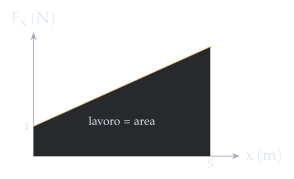
>>> soluzione
**Valori agli estremi.**  $F(0)=4{,}0\un{N}$ e $F(5)=4+3(5)=19\un{N}$.

**Metodo geometrico.**  L'area del trapezio è

$$W=\frac{F(0)+F(5)}{2}\Delta x
=\frac{4+19}{2}(5)=57{,}5\un{J}.$$

**Metodo con analisi.**

$$W=\int_0^5(4+3x)\,\dd x
=\left[4x+\frac32x^2\right]_0^5
=57{,}5\un{J}.$$

I due metodi coincidono perché il grafico è una retta e il trapezio ne dà l'area esatta.
:::

::: esercizio Forza tabulata e regola dei trapezi [medio]
Una slitta viene tirata lungo una pista. La componente della forza lungo il moto è misurata ai punti seguenti:

$$\begin{array}{c|ccccc}
x\,(\mathrm{m})&0&1&2&3&4\\\hline
F_x\,(\mathrm{N})&10&16&21&18&8
\end{array}$$

Stimare il lavoro con la regola dei trapezi.

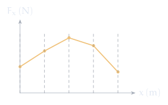
>>> soluzione
**Intervalli.**  Ogni intervallo ha larghezza $\Delta x=1\un{m}$. Il lavoro stimato è

$$W\approx\sum_{k=0}^{3}\frac{F_k+F_{k+1}}{2}\Delta x.$$

**Calcolo.**

$$W\approx\frac{10+16}{2}+\frac{16+21}{2}+\frac{21+18}{2}+\frac{18+8}{2}
=13+18{,}5+19{,}5+13=64\un{J}.$$

**Limite.**  Il risultato dipende dall'interpolazione lineare implicita. Con più punti si descriverebbero meglio eventuali variazioni rapide fra le misure.
:::

::: esercizio Una forza quadratica [medio]
Una forza unidimensionale vale $F_x(x)=a x^2$, con $a=1{,}5\un{N/m^2}$. Calcolare il lavoro tra $x=1{,}0\un{m}$ e $x=3{,}0\un{m}$. Confrontare con la stima ottenuta usando un solo rettangolo basato sul valore al punto medio.

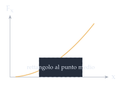
>>> soluzione
**Integrale.**

$$W=\int_1^3 ax^2\,\dd x
=\frac{a}{3}(3^3-1^3)
=\frac{1{,}5}{3}(26)=13{,}0\un{J}.$$

**Rettangolo al punto medio.**  Il punto medio è $x_m=2\un{m}$:

$$F(x_m)=1{,}5(2^2)=6{,}0\un{N},
\qquad
W_{mid}=F(x_m)(3-1)=12{,}0\un{J}.$$

**Confronto.**  La stima sottovaluta di $1{,}0\un{J}$. La curva è convessa: i valori verso l'estremo destro crescono più rapidamente di quanto rappresenti un solo campione centrale.
:::

::: esercizio Compressione di una molla a passi [avanzato]
Una molla ideale ha $k=200\un{N/m}$. Stimare il lavoro necessario per comprimerla da $x=0$ a $x=0{,}20\un{m}$ usando quattro trapezi uguali; confrontare con $\tfrac12kx^2$.

>>> soluzione
**Dati discreti.**  Con $\Delta x=0{,}05\un{m}$, le forze agli estremi sono $0,10,20,30,40\,\mathrm{N}$.

**Somma dei trapezi.**

$$W\approx\left(\frac{0+10}{2}+\frac{10+20}{2}+\frac{20+30}{2}+\frac{30+40}{2}\right)0{,}05.$$

La somma delle forze medie è $5+15+25+35=80\un{N}$, quindi

$$W=80(0{,}05)=4{,}0\un{J}.$$

**Formula continua.**

$$W=\int_0^{0{,}20}kx\,\dd x=\frac12k x^2
=\frac12(200)(0{,}20)^2=4{,}0\un{J}.$$

La regola dei trapezi è esatta perché $F(x)=kx$ è lineare.
:::

::: esercizio Lavoro di una forza a tratti [avanzato]
La forza lungo $x$ cresce linearmente da $0$ a $30\un{N}$ nei primi $2\un{m}$, resta costante fino a $x=5\un{m}$ e diminuisce linearmente a $-10\un{N}$ tra $x=5\un{m}$ e $x=7\un{m}$. Calcolare il lavoro totale.

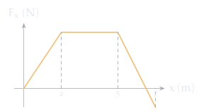
>>> soluzione
**Primo tratto.**  Triangolo positivo:

$$W_1=\frac12(2)(30)=30\un{J}.$$

**Secondo tratto.**  Rettangolo:

$$W_2=(3)(30)=90\un{J}.$$

**Terzo tratto.**  Il valore medio della forza lineare è $(30-10)/2=10\un{N}$:

$$W_3=(10)(2)=20\un{J}.$$

La parte sotto l'asse è già inclusa con segno negativo nel trapezio.

**Totale.**

$$W=30+90+20=140\un{J}.$$
:::

::: esercizio Forza dipendente dalla posizione ricavata da misure [avanzato]
Un attuatore sposta un cursore da $x=0$ a $x=0{,}30\un{m}$. Le misure sono:

$$\begin{array}{c|cccc}
x\,(\mathrm{m})&0&0{,}10&0{,}20&0{,}30\\\hline
F\,(\mathrm{N})&5&9&12&20
\end{array}$$

Stimare il lavoro con trapezi. Supponendo inoltre che, in ciascun intervallo, la forza resti compresa fra i due valori misurati agli estremi, costruire un intervallo di compatibilità per il lavoro e spiegare perché non sarebbe un limite rigoroso senza questa ipotesi.

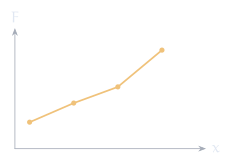
>>> soluzione
**Trapezi.**

$$W_T=0{,}10\left(\frac{5+9}{2}+\frac{9+12}{2}+\frac{12+20}{2}\right)
=0{,}10(7+10{,}5+16)=3{,}35\un{J}.$$

**Limite inferiore.**  Usando il minimo di ogni coppia:

$$W_{min}=0{,}10(5+9+12)=2{,}60\un{J}.$$

**Limite superiore.**

$$W_{max}=0{,}10(9+12+20)=4{,}10\un{J}.$$

**Interpretazione.**  Il trapezio fornisce una stima centrale se la forza varia in modo abbastanza regolare. Sotto l'ipotesi dichiarata che la forza non esca dall'intervallo definito dai valori agli estremi, $[2{,}60,4{,}10]$ è un intervallo di compatibilità. Senza monotonia, regolarità o ulteriori misure non è un limite matematico rigoroso: la forza potrebbe avere massimi o minimi fra i punti campionati.
:::

::: esercizio Lavoro lungo una traiettoria curva [medio]
Una forza costante $\vect F=(6\un{N})\vers i+(8\un{N})\vers j$ sposta un punto dal punto $A=(1\un{m},2\un{m})$ al punto $B=(5\un{m},1\un{m})$ lungo una traiettoria curva. Calcolare il lavoro e spiegare perché non serve conoscere la forma della curva.

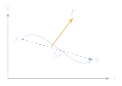
>>> soluzione
**Spostamento.**

$$\Delta\vect r=\vect r_B-\vect r_A=(4\un{m})\vers i-(1\un{m})\vers j.$$

**Prodotto scalare.**

$$W=\vect F\cdot\Delta\vect r
=(6)(4)+(8)(-1)=16\un{J}.$$

**Perché il percorso non serve.**  Una forza costante ha lo stesso vettore in ogni punto. La somma dei piccoli spostamenti lungo qualunque curva è lo spostamento netto $\Delta\vect r$; per linearità del prodotto scalare il lavoro dipende soltanto dagli estremi.
:::

### Dal lavoro alla variazione di velocità

::: esercizio Carrello spinto con attrito [medio]
Un carrello di massa $12\un{kg}$ parte da fermo. Una forza orizzontale di $50\un{N}$ agisce per $8{,}0\un{m}$; l'attrito dinamico vale $14\un{N}$. Trovare la rapidità finale con il teorema lavoro–energia.

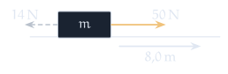
>>> soluzione
**Lavoro totale.**

$$W_{tot}=(50-14)(8{,}0)=288\un{J}.$$

Peso e normale compiono lavoro nullo.

**Teorema lavoro–energia.**

$$W_{tot}=\frac12mv_f^2-0.$$

Quindi

$$v_f=\sqrt{\frac{2W_{tot}}{m}}
=\sqrt{\frac{2(288)}{12}}=6{,}93\un{m/s}.$$

**Controllo.**  Il lavoro è positivo, perciò la rapidità deve aumentare. L'unità $\sqrt{\mathrm{J/kg}}$ equivale a $\mathrm{m/s}$.
:::

::: esercizio Spazio di frenata su fondo uniforme [base]
Un'automobile di massa $1350\un{kg}$ viaggia a $25\un{m/s}$. Durante una frenata la forza resistente totale può essere modellata come costante e pari a $9{,}0\un{kN}$. Calcolare lo spazio di arresto e discutere l'effetto di raddoppiare la velocità mantenendo la stessa forza.

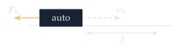
>>> soluzione
**Lavoro frenante.**

$$-F_bd=K_f-K_i=-\frac12mv_0^2.$$

**Distanza.**

$$d=\frac{mv_0^2}{2F_b}
=\frac{1350(25)^2}{2(9000)}
=46{,}9\un{m}.$$

**Dipendenza dalla velocità.**  Se $v_0$ raddoppia, $v_0^2$ quadruplica; con la stessa forza lo spazio diventa circa $188\un{m}$. Il modello non include il tempo di reazione né variazioni di aderenza o aerodinamica.
:::

::: esercizio Forza necessaria da un grafico di energia cinetica [medio]
L'energia cinetica di un corpo varia con la posizione secondo $K(x)=K_0+bx^2$, con $K_0=10\un{J}$ e $b=2{,}5\un{J/m^2}$. Determinare la risultante a $x=3{,}0\un{m}$ con la derivata e stimarla con una differenza centrale usando $x=2{,}9\un{m}$ e $x=3{,}1\un{m}$.

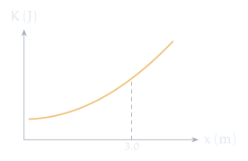
>>> soluzione
**Relazione energetica.**  In una dimensione il lavoro infinitesimo della risultante soddisfa $\dd K=F_{tot}\dd x$, quindi

$$F_{tot}=\frac{\dd K}{\dd x}=2bx.$$

A $x=3{,}0\,\mathrm{m}$,

$$F_{tot}=2(2{,}5)(3{,}0)=15{,}0\un{N}.$$

**Differenza centrale.**

$$F_{tot}\approx\frac{K(3{,}1)-K(2{,}9)}{0{,}2}.$$

Poiché $K(3{,}1)-K(2{,}9)=b(3{,}1^2-2{,}9^2)=2{,}5(1{,}20)=3{,}00\un{J}$,

$$F_{tot}\approx\frac{3{,}00}{0{,}20}=15{,}0\un{N}.$$

La stima è esatta per questa funzione quadratica con differenza centrale simmetrica.
:::

::: esercizio Pattinatore spinto per un tratto [avanzato]
Un pattinatore di massa $68\un{kg}$ si muove a $3{,}0\un{m/s}$. Riceve una spinta media di $95\un{N}$ nel verso del moto per $1{,}8\un{m}$; le resistenze compiono lavoro totale $-24\un{J}$. Calcolare la rapidità finale.

>>> soluzione
**Lavori.**  La spinta compie

$$W_s=(95)(1{,}8)=171\un{J}.$$

Il lavoro totale è

$$W_{tot}=171-24=147\un{J}.$$

**Energia iniziale.**

$$K_i=\frac12(68)(3{,}0)^2=306\un{J}.$$

Quindi $K_f=306+147=453\un{J}$.

**Rapidità finale.**

$$v_f=\sqrt{\frac{2K_f}{m}}
=\sqrt{\frac{906}{68}}=3{,}65\un{m/s}.$$
:::

::: esercizio Blocco tirato da una forza inclinata su piano ruvido [avanzato]
Un blocco di massa $15\un{kg}$ parte da fermo su un piano orizzontale. Una forza di $80\un{N}$ inclinata di $25^\circ$ verso l'alto lo trascina per $6{,}0\un{m}$. Il coefficiente dinamico è $\mu_k=0{,}20$. Calcolare la rapidità finale.

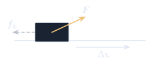
>>> soluzione
**Normale.**  Non c'è accelerazione verticale:

$$N=mg-F\sin25^\circ
=15(9{,}81)-80\sin25^\circ=113{,}3\un{N}.$$

**Attrito.**  $f_k=\mu_kN=22{,}7\un{N}$.

**Lavoro totale.**

$$W_{tot}=F\cos25^\circ\,d-f_kd
=[80\cos25^\circ-22{,}7](6{,}0)=299\un{J}.$$

**Rapidità.**

$$\frac12mv_f^2=W_{tot},
\qquad
v_f=\sqrt{\frac{2(299)}{15}}=6{,}31\un{m/s}.$$

Il calcolo della normale è essenziale: la componente verticale della trazione riduce l'attrito.
:::

::: esercizio Proiettile e variazione di rapidità con la quota [avanzato]
Una pallina viene lanciata con rapidità iniziale $18\un{m/s}$. Trascurando l'aria, determinare la rapidità quando si trova $7{,}0\un{m}$ più in alto, sapendo che la traiettoria raggiunge tale quota. Mostrare poi perché l'energia totale, da sola, non basta a stabilire la raggiungibilità e calcolare il minimo angolo di lancio rispetto all'orizzontale.

>>> soluzione
**Lavoro del peso.**  Il lavoro della gravità dipende solo dalla variazione di quota:

$$W_g=-mg\Delta y.$$

**Teorema lavoro–energia.**

$$\frac12mv^2-\frac12mv_0^2=-mg\Delta y.$$

La massa si semplifica:

$$v^2=v_0^2-2g\Delta y=18^2-2(9{,}81)(7{,}0)=186{,}7.$$

$$v=13{,}7\un{m/s}.$$

**Condizione sulla componente verticale.**  Il valore positivo di $v^2$ mostra che l'energia cinetica totale sarebbe sufficiente, ma non garantisce che la traiettoria reale salga di $7{,}0\un{m}$: conta la componente verticale iniziale. Deve valere

$$\frac12 m v_0^2\sin^2\theta\geq mg\Delta y.$$

Quindi

$$\sin\theta\geq\frac{\sqrt{2g\Delta y}}{v_0}
=\frac{\sqrt{2(9{,}81)(7{,}0)}}{18}=0{,}651,$$

$$\theta_{min}=\arcsin(0{,}651)=40{,}6^\circ.$$

Se $\theta\geq40{,}6^\circ$, la quota viene raggiunta e la rapidità calcolata sopra è indipendente dall'angolo; l'angolo continua invece a determinare traiettoria e tempo.
:::

::: esercizio Ciclista in discesa con resistenze [avanzato]
Un ciclista e la bicicletta hanno massa totale $82\un{kg}$. Partono a $6{,}0\un{m/s}$ e scendono di $14\un{m}$ di quota. Le resistenze compiono lavoro $-5{,}2\un{kJ}$. Calcolare la rapidità finale.

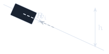
>>> soluzione
**Bilancio.**  Con $U_f=0$ e $U_i=mgh$,

$$K_f=K_i+mgh+W_R.$$

**Valori.**

$$K_i=\frac12(82)(6{,}0)^2=1476\un{J},$$

$$mgh=(82)(9{,}81)(14)=11{,}26\un{kJ}.$$

Quindi

$$K_f=1{,}476+11{,}26-5{,}20=7{,}54\un{kJ}.$$

**Rapidità.**

$$v_f=\sqrt{\frac{2K_f}{m}}
=\sqrt{\frac{2(7536)}{82}}=13{,}6\un{m/s}.$$

Le resistenze riducono fortemente il valore rispetto al caso ideale.
:::

::: esercizio Massa ignota da lavoro e velocità [medio]
Una forza risultante costante di $24\un{N}$ agisce nel verso del moto per $3{,}5\un{m}$. La rapidità di un corpo aumenta da $2{,}0\un{m/s}$ a $5{,}0\un{m/s}$. Determinare la massa.

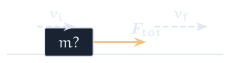
>>> soluzione
**Lavoro totale.**

$$W_{tot}=F_{tot}d=(24)(3{,}5)=84\un{J}.$$

**Variazione di energia cinetica.**

$$84=\frac12m(v_f^2-v_i^2)
=\frac12m(25-4).$$

**Massa.**

$$m=\frac{2(84)}{21}=8{,}0\un{kg}.$$

La massa emerge dalla risposta del corpo allo stesso trasferimento energetico: a parità di variazione di $v^2$, un corpo più massiccio richiede più lavoro.
:::

### Energia potenziale, conservazione e diagrammi

::: esercizio Caduta da una terrazza [base]
Una pietra viene lasciata da ferma da un'altezza di $22\un{m}$. Trascurando l'aria, calcolare la rapidità immediatamente prima di raggiungere il suolo usando la conservazione dell'energia.

>>> soluzione
**Riferimento.**  Poniamo $U_g=0$ al suolo. All'inizio $K_i=0$ e $U_i=mgh$; alla fine $U_f=0$.

**Conservazione.**

$$mgh=\frac12mv_f^2.$$

La massa si semplifica:

$$v_f=\sqrt{2gh}=\sqrt{2(9{,}81)(22)}=20{,}8\un{m/s}.$$

**Limite.**  Il risultato è ideale. La resistenza dell'aria ridurrebbe la rapidità e introdurrebbe dipendenza da forma, dimensioni e densità dell'oggetto.
:::

::: esercizio Montagne russe con velocità iniziale [base]
Un carrello parte a quota $28\un{m}$ con rapidità $4{,}0\un{m/s}$. Quale rapidità ideale raggiunge a quota $6{,}0\un{m}$? La massa del carrello è irrilevante nel modello: mostrarlo nel calcolo.

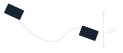
>>> soluzione
**Bilancio.**

$$\frac12mv_i^2+mgh_i=\frac12mv_f^2+mgh_f.$$

Dividendo per $m$,

$$\frac12v_i^2+gh_i=\frac12v_f^2+gh_f.$$

**Rapidità.**

$$v_f=\sqrt{v_i^2+2g(h_i-h_f)}
=\sqrt{4{,}0^2+2(9{,}81)(22)}
=21{,}2\un{m/s}.$$

La massa si elimina perché sia $K$ sia $U_g$ sono proporzionali a $m$.
:::

::: esercizio Pendolo rilasciato da un angolo [base]
Una massa puntiforme è appesa a un filo di lunghezza $1{,}5\un{m}$ e viene rilasciata da ferma a $50^\circ$ rispetto alla verticale. Calcolare la rapidità al punto più basso, trascurando le resistenze.

>>> soluzione
**Dislivello.**  Rispetto al punto più basso,

$$h=L-L\cos\theta=L(1-\cos\theta).$$

$$h=1{,}5(1-\cos50^\circ)=0{,}536\un{m}.$$

**Conservazione.**

$$mgh=\frac12mv^2,
\qquad
v=\sqrt{2gh}=\sqrt{2(9{,}81)(0{,}536)}=3{,}24\un{m/s}.$$

La tensione non compie lavoro perché è perpendicolare allo spostamento istantaneo lungo l'arco.
:::

::: esercizio Lanciatore a molla su piano liscio [medio]
Una molla con $k=360\un{N/m}$ è compressa di $0{,}18\un{m}$ e lancia un blocco di massa $0{,}45\un{kg}$ su un piano orizzontale liscio. Calcolare la rapidità quando la molla torna alla lunghezza naturale.

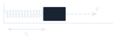
>>> soluzione
**Energia iniziale.**

$$U_{e,i}=\frac12kx^2=\frac12(360)(0{,}18)^2=5{,}832\un{J}.$$

**Trasformazione.**  Al distacco ideale $U_{e,f}=0$ e tutta l'energia è cinetica:

$$\frac12kx^2=\frac12mv^2.$$

$$v=x\sqrt{\frac{k}{m}}
=0{,}18\sqrt{\frac{360}{0{,}45}}=5{,}09\un{m/s}.$$

**Controllo.**  Il blocco più massiccio avrebbe rapidità minore a parità di molla e compressione.
:::

::: esercizio Molla, attrito e distanza di arresto [medio]
Il blocco dell'esercizio precedente entra in un tratto ruvido con coefficiente dinamico $\mu_k=0{,}30$. Calcolare la distanza percorsa prima di arrestarsi, assumendo il tratto orizzontale.

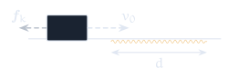
>>> soluzione
**Energia disponibile.**  All'ingresso del tratto ruvido il blocco ha $K_i=5{,}832\un{J}$.

**Lavoro dell'attrito.**

$$W_f=-f_kd=-\mu_kmgd.$$

All'arresto $K_f=0$:

$$0-K_i=-\mu_kmgd.$$

**Distanza.**

$$d=\frac{K_i}{\mu_kmg}
=\frac{5{,}832}{0{,}30(0{,}45)(9{,}81)}
=4{,}40\un{m}.$$

La massa non si semplifica completamente perché l'energia iniziale deriva da una molla e non è proporzionale alla massa.
:::

::: esercizio Il livello zero dell'energia gravitazionale [avanzato]
Un libro di massa $1{,}8\un{kg}$ si trova su uno scaffale a $1{,}6\un{m}$ dal pavimento. Calcolare $U_g$ scegliendo come zero il pavimento e poi un tavolo alto $0{,}75\un{m}$. Mostrare che la differenza di energia per una caduta fino al pavimento non cambia.

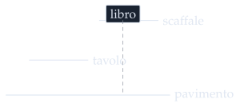
>>> soluzione
**Zero al pavimento.**

$$U_{sc}=mgh=(1{,}8)(9{,}81)(1{,}6)=28{,}3\un{J},
\qquad U_{pav}=0.$$

**Zero al tavolo.**  Le quote relative al tavolo sono $y_{sc}=1{,}6-0{,}75=0{,}85\un{m}$ e $y_{pav}=-0{,}75\un{m}$:

$$U'_{sc}=(1{,}8)(9{,}81)(0{,}85)=15{,}0\un{J},$$

$$U'_{pav}=-(1{,}8)(9{,}81)(0{,}75)=-13{,}2\un{J}.$$

**Differenza.**

$$U_{pav}-U_{sc}=0-28{,}3=-28{,}3\un{J},$$

$$U'_{pav}-U'_{sc}=-13{,}2-15{,}0\approx-28{,}3\un{J}.$$

Cambiare zero aggiunge una costante, ma non modifica $\Delta U$.
:::

::: esercizio Forza da una tabella di energia potenziale [base]
Per un sistema unidimensionale si misurano:

$$\begin{array}{c|ccccc}
x\,(\mathrm{m})&0&0{,}5&1{,}0&1{,}5&2{,}0\\\hline
U\,(\mathrm{J})&8{,}0&5{,}5&4{,}0&3{,}5&4{,}0
\end{array}$$

Stimare la forza media nei quattro intervalli e individuare la zona di equilibrio stabile.

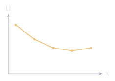
>>> soluzione
**Differenze finite.**  In ogni intervallo

$$F_{media}\approx-\frac{\Delta U}{\Delta x}.$$

Si ottiene:

$$F_{0-0{,}5}= -\frac{5{,}5-8{,}0}{0{,}5}=5{,}0\un{N},$$

$$F_{0{,}5-1{,}0}=3{,}0\un{N},
\quad
F_{1{,}0-1{,}5}=1{,}0\un{N},
\quad
F_{1{,}5-2{,}0}=-1{,}0\un{N}.$$

**Equilibrio.**  La pendenza cambia segno vicino a $x=1{,}5\un{m}$, dove $U$ è minima. A sinistra la forza è verso destra; a destra è verso sinistra: il punto è stabile.
:::

::: esercizio Potenziale quartico e stabilità [base]
Un sistema ha $U(x)=a(x^2-b^2)^2$, dove $x$ e $b$ hanno dimensione di lunghezza e $a$ ha unità di energia per lunghezza alla quarta, con $a>0$ e $b>0$. Individuare gli equilibri e classificarli. Poi disegnare qualitativamente le regioni accessibili per un'energia $0<E<ab^4$.

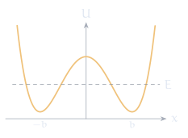
>>> soluzione
**Derivata.**

$$U'(x)=4ax(x^2-b^2).$$

Gli equilibri sono $x=0$ e $x=\pm b$.

**Classificazione.**  $U(\pm b)=0$ sono minimi, quindi equilibri stabili. $U(0)=ab^4$ è un massimo locale, quindi equilibrio instabile.

**Regioni accessibili.**  Per $0<E<ab^4$ il sistema non può superare la barriera centrale: sono accessibili due intervalli separati attorno a $-b$ e $+b$. In ciascun pozzo il moto oscilla fra due punti di inversione definiti da $U(x)=E$.
:::

::: esercizio Giro della morte ideale [medio]
Un piccolo carrello scivola senza attrito e percorre un anello verticale di raggio $2{,}0\un{m}$. Qual è la minima altezza di partenza, misurata dal punto più basso, affinché resti a contatto al punto più alto? Parte da fermo.

>>> soluzione
**Condizione di contatto.**  Alla cima, nel caso limite $N=0$ e il peso fornisce la risultante radiale:

$$mg=m\frac{v_{top}^2}{R},
\qquad v_{top}^2=gR.$$

**Energia.**  Ponendo zero al fondo,

$$mgh=mg(2R)+\frac12m v_{top}^2.$$

Sostituendo $v_{top}^2=gR$:

$$h=2R+\frac12R=\frac52R=5{,}0\un{m}.$$

**Nota.**  La sola conservazione dell'energia non basta: serve anche la condizione dinamica di contatto. È un esempio di complementarità fra metodi.
:::

::: esercizio Energia meccanica con lavoro esterno [medio]
Una cassa di massa $20\un{kg}$ viene sollevata di $3{,}0\un{m}$ da un argano. Parte e arriva ferma. Durante il sollevamento l'aria e gli attriti dissipano $180\un{J}$. Quanto lavoro deve compiere l'argano?

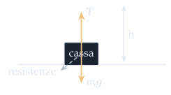
>>> soluzione
**Variazioni.**  $\Delta K=0$ perché la cassa parte e arriva ferma. L'aumento di energia potenziale è

$$\Delta U=mgh=(20)(9{,}81)(3{,}0)=588{,}6\un{J}.$$

**Bilancio.**  Il lavoro dell'argano deve fornire sia l'aumento di $U$ sia l'energia dissipata:

$$W_{arg}=\Delta U+E_{diss}=588{,}6+180=768{,}6\un{J}.$$

**Interpretazione.**  Un calcolo che producesse solo $mgh$ ignorerebbe il trasferimento a energia interna dovuto alle resistenze.
:::

### Dissipazione e bilanci estesi

::: esercizio Scivolo con attrito [medio]
Un bambino e lo slittino hanno massa totale $42\un{kg}$. Partono da fermi a un'altezza verticale di $5{,}0\un{m}$ e arrivano in fondo con rapidità $7{,}0\un{m/s}$. Calcolare l'energia trasformata in forme interne e sonore.

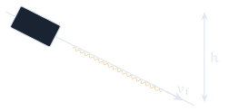
>>> soluzione
**Energia iniziale.**

$$E_i=mgh=(42)(9{,}81)(5{,}0)=2060\un{J}.$$

**Energia cinetica finale.**

$$K_f=\frac12mv_f^2=\frac12(42)(7{,}0)^2=1029\un{J}.$$

**Energia trasformata.**

$$E_{diss}=E_i-K_f=2060-1029=1031\un{J}.$$

Circa metà dell'energia gravitazionale è diventata energia cinetica e metà è stata trasferita a riscaldamento, deformazioni e suono.
:::

::: esercizio Coefficiente d'attrito da un arresto [base]
Un blocco scivola su un piano orizzontale con rapidità iniziale $5{,}5\un{m/s}$ e si arresta dopo $4{,}2\un{m}$. Assumendo attrito dinamico costante, determinare $\mu_k$.

>>> soluzione
**Bilancio.**

$$-\mu_kmgd=0-\frac12mv_0^2.$$

La massa si semplifica.

**Coefficiente.**

$$\mu_k=\frac{v_0^2}{2gd}
=\frac{5{,}5^2}{2(9{,}81)(4{,}2)}=0{,}367.$$

**Controllo.**  Il valore è adimensionale. Il modello presume piano orizzontale e attrito proporzionale alla normale; non separa resistenza dell'aria e rotolamento.
:::

::: esercizio Rimbalzo e coefficiente di restituzione [medio]
Una pallina viene lasciata da $1{,}80\un{m}$ e rimbalza fino a $1{,}05\un{m}$. Calcolare la frazione di energia meccanica conservata nel rimbalzo e il coefficiente di restituzione verticale $e=v_{dopo}/v_{prima}$.

>>> soluzione
**Energia.**  Subito prima dell'urto $K_-=mgh_0$; subito dopo $K_+=mgh_1$ se l'aria è trascurabile durante i voli.

$$\frac{K_+}{K_-}=\frac{h_1}{h_0}=\frac{1{,}05}{1{,}80}=0{,}583.$$

Quindi circa il $58{,}3\%$ dell'energia cinetica verticale resta dopo l'urto.

**Restituzione.**

$$e=\frac{v_+}{v_-}=\sqrt{\frac{K_+}{K_-}}
=\sqrt{0{,}583}=0{,}764.$$

**Interpretazione.**  Energia e velocità non si riducono della stessa percentuale, perché $K\propto v^2$.
:::

::: esercizio Freno che si riscalda in discesa [medio]
Un'automobile di massa $1500\un{kg}$ scende a velocità costante perdendo $120\un{m}$ di quota. Trascurando le altre resistenze, quanta energia devono assorbire i freni? Se la discesa dura $4{,}0\un{min}$, qual è la potenza termica media?

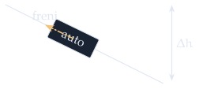
>>> soluzione
**Energia gravitazionale.**  La velocità è costante, quindi $\Delta K=0$. La diminuzione di energia potenziale è

$$E_{freni}=mg\Delta h=(1500)(9{,}81)(120)=1{,}77\times10^{6}\un{J}.$$

**Potenza media.**  $\Delta t=240\un{s}$:

$$P_{media}=\frac{E}{\Delta t}
=\frac{1{,}7658\times10^6}{240}=7{,}36\un{kW}.$$

**Significato.**  Questo valore medio deve aumentare l'energia interna dei freni e viene poi trasferito all'ambiente mediante scambio di calore. Picchi locali e distribuzione fra i freni richiedono un modello termico più dettagliato.
:::

::: esercizio Molla reale con isteresi [base]
Durante la compressione di un elemento elastico il lavoro fornito è $12{,}0\un{J}$; durante il ritorno alla configurazione iniziale l'elemento restituisce $8{,}5\un{J}$. Calcolare l'energia dissipata e la frazione restituita. Rappresentare il significato come area fra due curve forza-spostamento.

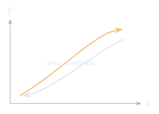
>>> soluzione
**Dissipazione.**

$$E_{diss}=W_{carico}-E_{restituita}=12{,}0-8{,}5=3{,}5\un{J}.$$

**Frazione restituita.**

$$\frac{E_{restituita}}{W_{carico}}=\frac{8{,}5}{12{,}0}=0{,}708,$$

cioè circa il $70{,}8\%$.

**Grafico.**  L'area sotto la curva di carico è l'energia fornita; quella sotto la curva di scarico è l'energia restituita. L'area racchiusa fra le curve è l'energia convertita in energia interna e altri processi dissipativi per ciclo.
:::

::: esercizio Resistenza dell'aria proporzionale a $v^2$ [medio]
Un ciclista procede a velocità costante $12\un{m/s}$ su strada orizzontale. La resistenza aerodinamica è $F_d=cv^2$ con $c=0{,}30\un{kg/m}$. Calcolare il lavoro compiuto dal ciclista contro l'aria in $2{,}0\un{km}$ e la potenza necessaria solo per questa resistenza.

>>> soluzione
**Forza di resistenza.**

$$F_d=cv^2=0{,}30(12)^2=43{,}2\un{N}.$$

A velocità costante la forza propulsiva ha lo stesso modulo.

**Lavoro su $2{,}0\un{km}$.**

$$W=F_dd=(43{,}2)(2000)=86{,}4\un{kJ}.$$

**Potenza.**

$$P=F_dv=(43{,}2)(12)=518\un{W}.$$

Poiché $F_d\propto v^2$, la potenza aerodinamica cresce come $v^3$: aumentare la velocità è energeticamente molto costoso.
:::

::: esercizio Energia recuperata in una frenata rigenerativa [avanzato]
Un veicolo elettrico di massa $1650\un{kg}$ rallenta da $22\un{m/s}$ a $8{,}0\un{m/s}$. Il sistema rigenerativo immagazzina il $62\%$ della diminuzione di energia cinetica. Calcolare l'energia recuperata e quella trasformata in altre forme.

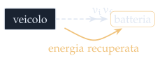
>>> soluzione
**Energia disponibile.**

$$\Delta K_{disp}=\frac12m(v_i^2-v_f^2)
=\frac12(1650)(22^2-8^2).$$

$$\Delta K_{disp}=825(420)=346{,}5\un{kJ}.$$

**Recupero.**

$$E_{rec}=0{,}62(346{,}5)=214{,}8\un{kJ}.$$

**Altre trasformazioni.**

$$E_{altre}=346{,}5-214{,}8=131{,}7\un{kJ}.$$

Sono incluse perdite elettriche, meccaniche, aerodinamiche e l'eventuale intervento dei freni tradizionali.
:::

::: esercizio Bilancio energetico di una pompa con perdite [medio]
Una pompa trasferisce $500\un{kg}$ d'acqua a una quota superiore di $18\un{m}$. L'energia elettrica assorbita è $120\un{kJ}$. Calcolare l'aumento di energia gravitazionale e il rendimento energetico del processo.

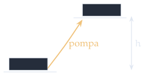
>>> soluzione
**Energia utile.**

$$\Delta U=mgh=(500)(9{,}81)(18)=88{,}3\un{kJ}.$$

**Rendimento.**

$$\eta=\frac{E_{utile}}{E_{fornita}}
=\frac{88{,}3}{120}=0{,}736.$$

Il rendimento è circa il $73{,}6\%$.

**Energia non utile.**

$$E_{non\ utile}=120-88{,}3=31{,}7\un{kJ},$$

trasferita soprattutto a riscaldamento, turbolenza, vibrazioni e perdite elettriche.
:::

### Potenza, rendimento e uso dell'energia

::: esercizio Ascensore a velocità costante [medio]
Un ascensore di massa totale $950\un{kg}$ sale a velocità costante $1{,}8\un{m/s}$. Le resistenze meccaniche equivalgono a $1{,}2\un{kN}$. Calcolare la potenza meccanica del motore e la potenza elettrica assorbita se il rendimento è $82\%$.

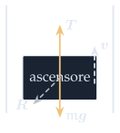
>>> soluzione
**Forza motrice.**  A velocità costante la risultante è nulla:

$$T=mg+R=950(9{,}81)+1200=10{,}52\un{kN}.$$

**Potenza meccanica.**

$$P_{mec}=Tv=(10519{,}5)(1{,}8)=18{,}9\un{kW}.$$

**Potenza elettrica.**

$$\eta=\frac{P_{mec}}{P_{el}},
\qquad
P_{el}=\frac{18{,}9}{0{,}82}=23{,}1\un{kW}.$$
:::

::: esercizio Salita in bicicletta [base]
Ciclista e bicicletta hanno massa totale $78\un{kg}$ e salgono una pendenza del $6{,}0\%$ a $7{,}0\un{m/s}$. Le resistenze non gravitazionali valgono $35\un{N}$. Stimare la potenza meccanica richiesta, usando $\sin\theta\approx0{,}060$.

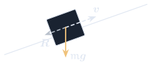
>>> soluzione
**Forza lungo la salita.**

$$F=m g\sin\theta+R
=78(9{,}81)(0{,}060)+35=80{,}9\un{N}.$$

**Potenza.**

$$P=Fv=(80{,}9)(7{,}0)=566\un{W}.$$

**Interpretazione.**  È potenza meccanica esterna. La potenza metabolica del ciclista è maggiore perché il corpo umano ha rendimento limitato e sostiene anche funzioni interne.
:::

::: esercizio Energia elettrica di un frigorifero [medio]
Un frigorifero assorbe in media $85\un{W}$ nell'arco di una giornata, tenendo conto dei cicli di accensione. Calcolare l'energia giornaliera in joule e in kilowattora. Con un costo di $0{,}28\un{\text{€}\,h/kW}$, stimare il costo in 30 giorni.

>>> soluzione
**In joule.**  Una giornata ha $86400\un{s}$:

$$E=P\Delta t=85(86400)=7{,}34\times10^{6}\un{J}.$$

**In kilowattora.**

$$E=(0{,}085\,\mathrm{kW})(24\,\mathrm{h})=2{,}04\un{kW\,h}.$$

**Costo mensile.**

$$C=2{,}04(30)(0{,}28)=17{,}1\un{\text{€}}.$$

Il kilowattora è energia: potenza moltiplicata per tempo.
:::

::: esercizio Potenza variabile da un contatore [base]
Un dispositivo accumula i seguenti consumi energetici:

$$\begin{array}{c|ccccc}
t\,(\mathrm{min})&0&2&4&6&8\\\hline
E\,(\mathrm{kJ})&0&18&42&63&87
\end{array}$$

Calcolare la potenza media in ciascun intervallo e quella complessiva.

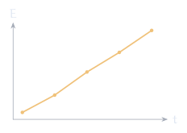
>>> soluzione
**Intervalli.**  Ogni intervallo dura $120\un{s}$. Le variazioni di energia sono $18,24,21,24\,\mathrm{kJ}$.

$$P_1=\frac{18000}{120}=150\un{W},
\quad
P_2=200\un{W},$$

$$P_3=175\un{W},
\quad
P_4=200\un{W}.$$

**Media complessiva.**

$$P_{med}=\frac{87000}{480}=181{,}25\un{W}.$$

La media complessiva è ponderata dalle durate; qui le durate uguali permettono anche la media aritmetica dei quattro valori.
:::

::: esercizio Potenza di un'automobile contro l'aria [avanzato]
La forza aerodinamica su un'automobile è $F_d=cv^2$ con $c=0{,}40\un{kg/m}$. Calcolare la potenza necessaria per vincere la sola resistenza aerodinamica a $20\un{m/s}$ e a $30\un{m/s}$. Confrontare i risultati.

>>> soluzione
**Relazione.**  La potenza è

$$P=F_dv=cv^3.$$

**A $20\un{m/s}$.**

$$P_{20}=0{,}40(20)^3=3{,}20\un{kW}.$$

**A $30\un{m/s}$.**

$$P_{30}=0{,}40(30)^3=10{,}8\un{kW}.$$

**Confronto.**  La velocità cresce di un fattore $1{,}5$, la potenza di $1{,}5^3=3{,}375$. Il dato riguarda soltanto l'aerodinamica, non rotolamento, pendenza o rendimento del motore.
:::

::: esercizio Salire le scale e stimare la potenza [medio]
Una persona di massa $72\un{kg}$ sale una rampa con dislivello $4{,}5\un{m}$ in $8{,}0\un{s}$. Calcolare la potenza meccanica media. Se il rendimento metabolico è stimato al $24\%$, calcolare la potenza metabolica media.

>>> soluzione
**Lavoro utile.**

$$W=mgh=(72)(9{,}81)(4{,}5)=3{,}18\un{kJ}.$$

**Potenza meccanica.**

$$P_{mec}=\frac{W}{\Delta t}=\frac{3178}{8{,}0}=397\un{W}.$$

**Potenza metabolica.**

$$\eta=\frac{P_{mec}}{P_{met}},
\qquad
P_{met}=\frac{397}{0{,}24}=1{,}65\un{kW}.$$

È una stima: il rendimento umano dipende da attività, tecnica e definizione del sistema biologico.
:::

::: esercizio Pannello solare e batteria [base]
Un pannello fornisce potenza elettrica media $240\un{W}$ per $5{,}5\un{h}$. Un regolatore e una batteria immagazzinano complessivamente il $78\%$ dell'energia prodotta. Calcolare l'energia solare convertita e quella effettivamente accumulata, in kilowattora e megajoule.

>>> soluzione
**Energia prodotta.**

$$E_{prod}=(0{,}240\,\mathrm{kW})(5{,}5\,\mathrm{h})
=1{,}32\un{kW\,h}.$$

Poiché $1\un{kW\,h}=3{,}6\un{MJ}$,

$$E_{prod}=1{,}32(3{,}6)=4{,}75\un{MJ}.$$

**Energia accumulata.**

$$E_{acc}=0{,}78(1{,}32)=1{,}03\un{kW\,h}
=3{,}71\un{MJ}.$$
:::

::: esercizio Due motori, stesso lavoro [base]
Due motori sollevano lo stesso carico compiendo $48\un{kJ}$ di lavoro. Il motore A impiega $12\un{s}$; il motore B $30\un{s}$. A assorbe $5{,}0\un{kW}$ elettrici, B $2{,}0\un{kW}$. Calcolare potenza meccanica e rendimento di ciascuno.

>>> soluzione
**Motore A.**

$$P_{mec,A}=\frac{48\,\mathrm{kJ}}{12\,\mathrm{s}}=4{,}0\un{kW},
\qquad
\eta_A=\frac{4{,}0}{5{,}0}=0{,}80.$$

**Motore B.**

$$P_{mec,B}=\frac{48}{30}=1{,}6\un{kW},
\qquad
\eta_B=\frac{1{,}6}{2{,}0}=0{,}80.$$

**Conclusione.**  I motori hanno lo stesso rendimento ma potenze diverse. A esegue lo stesso lavoro più rapidamente e richiede maggiore potenza in ingresso.
:::

### Rotazione, gravitazione e applicazioni moderne

::: esercizio Sfera e cilindro lungo una rampa [avanzato]
Una sfera piena e un cilindro pieno, con stessa massa e stesso raggio, partono da fermi dalla stessa altezza e rotolano senza strisciare. Determinare quale raggiunge il fondo con rapidità maggiore e calcolare $v/\sqrt{gh}$ per ciascuno. Usare $I_{sfera}=\tfrac25MR^2$ e $I_{cil}=\tfrac12MR^2$.

>>> soluzione
**Bilancio generale.**  Per rotolamento puro,

$$Mgh=\frac12Mv^2+\frac12I\frac{v^2}{R^2}.$$

**Sfera piena.**

$$Mgh=\frac12Mv^2\left(1+\frac25\right)=\frac7{10}Mv^2,$$

$$\frac{v_S}{\sqrt{gh}}=\sqrt{\frac{10}{7}}=1{,}195.$$

**Cilindro pieno.**

$$Mgh=\frac12Mv^2\left(1+\frac12\right)=\frac34Mv^2,$$

$$\frac{v_C}{\sqrt{gh}}=\sqrt{\frac43}=1{,}155.$$

La sfera è più rapida perché una frazione minore dell'energia va nella rotazione.
:::

::: esercizio Energia immagazzinata in un volano [avanzato]
Un volano ha momento d'inerzia $18\un{kg\,m^2}$ e ruota a $1200\un{giri/min}$. Calcolare l'energia cinetica rotazionale. Quanta energia viene ceduta se la velocità scende a $600\un{giri/min}$?

>>> soluzione
**Conversione.**  $1200\un{giri/min}$=20 $\mathrm{giri/s}$, quindi

$$\omega_1=40\pi=125{,}7\un{rad/s}.$$

A $600\un{giri/min}$, $\omega_2=20\pi=62{,}83\un{rad/s}$.

**Energie.**

$$K_1=\frac12(18)(125{,}7)^2=142\un{kJ},$$

$$K_2=\frac12(18)(62{,}83)^2=35{,}5\un{kJ}.$$

**Energia ceduta.**

$$\Delta E=K_1-K_2=106{,}6\un{kJ}.$$

Dimezzare $\omega$ riduce l'energia a un quarto.
:::

::: esercizio Velocità di fuga dalla Luna [avanzato]
Usando $M_L=7{,}35\times10^{22}\un{kg}$, $R_L=1{,}74\times10^{6}\un{m}$ e $G=6{,}674\times10^{-11}\un{N\,m^2/kg^2}$, calcolare la velocità di fuga ideale dalla superficie lunare.

>>> soluzione
**Bilancio limite.**  Alla superficie,

$$E_i=\frac12mv_{esc}^2-\frac{GM_Lm}{R_L}.$$

Nel caso limite all'infinito $K_f=0$ e $U_f=0$, quindi $E_i=0$.

**Formula.**

$$v_{esc}=\sqrt{\frac{2GM_L}{R_L}}.$$

**Calcolo.**

$$v_{esc}=\sqrt{\frac{2(6{,}674\times10^{-11})(7{,}35\times10^{22})}{1{,}74\times10^6}}
=2{,}38\times10^{3}\un{m/s}.$$

Quindi $v_{esc}\approx2{,}38\un{km/s}$. La formula trascura rotazione, atmosfera e propulsione successiva.
:::

::: esercizio Energia di un satellite in orbita circolare [avanzato]
Un satellite di massa $m$ descrive un'orbita circolare di raggio $r$ attorno a un pianeta di massa $M$. Ricavare l'energia cinetica, potenziale e totale in funzione di $r$. Spiegare perché l'energia meccanica orbitale totale è negativa.

>>> soluzione
**Dinamica radiale.**

$$\frac{GMm}{r^2}=m\frac{v^2}{r},
\qquad v^2=\frac{GM}{r}.$$

**Energia cinetica.**

$$K=\frac12mv^2=\frac{GMm}{2r}.$$

**Energia potenziale.**

$$U=-\frac{GMm}{r}.$$

**Energia totale.**

$$E=K+U=-\frac{GMm}{2r}.$$

È negativa perché l'orbita è legata: per portare il satellite all'infinito con velocità finale nulla occorre fornire energia positiva pari a $|E|$.
:::

::: esercizio Perdita di energia cinetica in un urto anelastico [avanzato]
Un carrello di massa $2{,}0\un{kg}$ viaggia a $5{,}0\un{m/s}$ e urta un carrello fermo di massa $3{,}0\un{kg}$. I carrelli restano uniti. Calcolare velocità comune, energia cinetica iniziale e finale ed energia trasformata in altre forme.

>>> soluzione
**Quantità di moto.**  Durante l'urto l'impulso esterno è trascurabile:

$$m_1v_1=(m_1+m_2)v_f.$$

$$v_f=\frac{2{,}0(5{,}0)}{5{,}0}=2{,}0\un{m/s}.$$

**Energie.**

$$K_i=\frac12(2{,}0)(5{,}0)^2=25\un{J},$$

$$K_f=\frac12(5{,}0)(2{,}0)^2=10\un{J}.$$

**Trasformazione.**

$$E_{trasf}=K_i-K_f=15\un{J}.$$

La quantità di moto si conserva nel sistema isolato; l'energia cinetica macroscopica no. L'energia totale include deformazioni, suono e riscaldamento.
:::

::: esercizio Energia di un fotone e equivalenza massa–energia [avanzato]
Calcolare l'energia di un fotone di luce verde con frequenza $f=5{,}5\times10^{14}\un{Hz}$ usando $E=hf$, con $h=6{,}626\times10^{-34}\un{J\,s}$. Esprimere il risultato anche in elettronvolt. Poi calcolare l'energia a riposo associata a $1{,}0\un{\mu g}$ di massa usando $E_0=mc^2$ e $c=2{,}998\times10^{8}\un{m/s}$.

>>> soluzione
**Fotone.**

$$E=hf=(6{,}626\times10^{-34})(5{,}5\times10^{14})
=3{,}64\times10^{-19}\un{J}.$$

Con $1\un{eV}=1{,}602\times10^{-19}\un{J}$,

$$E=\frac{3{,}64\times10^{-19}}{1{,}602\times10^{-19}}=2{,}28\un{eV}.$$

**Massa–energia.**  $1{,}0\un{\mu g}$=$1{,}0\times10^{-9}\un{kg}$:

$$E_0=mc^2=(1{,}0\times10^{-9})(2{,}998\times10^8)^2
=8{,}99\times10^{7}\un{J}.$$

**Avvertenza.**  Le due formule appartengono alla fisica moderna e non derivano dal bilancio meccanico classico. Il calcolo mostra soltanto ordini di grandezza e unità.
:::

### Problemi di sintesi: lavoro ed energia

::: esercizio Lavoro di una forza lineare [base]
Una forza unidimensionale vale $F_x(x)=4+3x$ in newton, con $x$ in metri. Calcolare il lavoro da $x=0$ a $x=5\,\mathrm{m}$.
>>> soluzione
**Integrale.**

$$W=\int_0^5(4+3x)\,dx=4(5)+\frac32(5)^2=57{,}5\un{J}.$$
:::

::: esercizio Lavoro da un grafico a tratti [base]
Nel grafico $F_x$–$x$, la forza cresce linearmente da 0 a $6\un{N}$ nei primi $2\un{m}$, resta a $6\un{N}$ per $3\un{m}$ e poi forma un triangolo negativo di base $1\un{m}$ e altezza $4\un{N}$. Calcolare il lavoro totale.
>>> soluzione
**Area algebrica.**

$$W=\tfrac12(2)(6)+(3)(6)-\tfrac12(1)(4)=22{,}0\un{J}.$$
:::

::: esercizio Energia immagazzinata in una molla [base]
Una molla di costante $240\un{N/m}$ è compressa di $0{,}18\un{m}$. Calcolare energia potenziale e velocità impartita a un blocco di $0{,}80\un{kg}$ su piano liscio.
>>> soluzione
**Molla.**  $U=\tfrac12kx^2=3{,}89\un{J}$.

**Conversione.**  $\tfrac12mv^2=U$, quindi $v=3{,}12\un{m/s}$.
:::

::: esercizio Equilibri in un doppio pozzo [base]
Un potenziale è $U(x)=2x^4-8x^2$ in joule, con $x$ in metri. Trovare i punti di equilibrio e classificarli.
>>> soluzione
**Derivata.**  $dU/dx=8x^3-16x=8x(x^2-2)$, quindi $x=0,\pm\sqrt2\,\mathrm{m}$.

**Seconda derivata.**  $U”=24x^2-16$. A $x=0$ è negativa: equilibrio instabile. A $x=\pm\sqrt2$ vale $32>0$: due minimi stabili. Il valore minimo è $U=-8{,}00\un{J}$.
:::

::: esercizio Potenza durante un'accelerazione [base]
Un'automobile di $1200\un{kg}$ accelera a $1{,}5\un{m/s^2}$ quando viaggia a $20\un{m/s}$; le resistenze valgono $350\un{N}$. Calcolare la potenza meccanica istantanea del motore.
>>> soluzione
**Forza di trazione.**  $F=ma+F_r=2150\un{N}$.

**Potenza.**  $P=Fv=4{,}30\times10^{4}\un{W}=43{,}0\un{kW}$.
:::

::: esercizio Rendimenti in cascata [base]
Tre stadi di conversione hanno rendimenti 88%, 92% e 75%. Calcolare il rendimento complessivo e l'energia utile ottenuta da $5{,}0\un{MJ}$.
>>> soluzione
**Prodotto.**  $\eta=0{,}88\cdot0{,}92\cdot0{,}75=0{,}607$, cioè $60{,}7\%$.

**Energia utile.**  $E_u=\eta E_{in}=3036\un{kJ}=3{,}04\un{MJ}$.
:::

::: esercizio Discesa con attrito lungo una rampa [base]
Un blocco parte da fermo e scende lungo una rampa lunga $50\un{m}$ con dislivello $12\un{m}$ e $\mu_k=0{,}08$. Calcolare la velocità finale.
>>> soluzione
**Lavori.**  $mgh-\mu_kmg\cos\theta\,L=\tfrac12mv^2$, con $\sin\theta=h/L$.

**Risultato.**  $v=\sqrt{2g[h-\mu_kL\cos\theta]}=12{,}6\un{m/s}$.
:::

::: esercizio Velocità al fondo di un pendolo [base]
Un pendolo di lunghezza $1{,}2\un{m}$ è lasciato da fermo a $35^\circ$ dalla verticale. Calcolare la velocità al punto più basso.
>>> soluzione
**Dislivello.**  $\Delta h=L(1-\cos\theta)=0{,}217\un{m}$.

**Energia.**  $mg\Delta h=\tfrac12mv^2$, quindi $v=2{,}06\un{m/s}$.
:::

::: esercizio Potenza elettrica di una pompa [base]
Una pompa solleva acqua con portata $0{,}015\un{m^3/s}$ di $18\un{m}$. Se il rendimento è 72%, calcolare la potenza elettrica richiesta.
>>> soluzione
**Potenza utile.**  $P_u=\rho Qgh=2649\un{W}$.

**Ingresso.**  $P_{in}=P_u/\eta=3679\un{W}=3{,}68\un{kW}$.
:::

::: esercizio Costo metabolico di una salita [medio]
Una persona di $65\un{kg}$ sale di $300\un{m}$. Con rendimento muscolare del 25%, stimare l'energia chimica minima in megajoule e kilocalorie.
>>> soluzione
**Energia meccanica.**  $mgh=1{,}91\times10^{5}\un{J}$.

**Energia chimica.**  $E=mgh/0{,}25=7{,}65\times10^{5}\un{J}=0{,}765\un{MJ}$.

**Alimentare.**  $E/4184=183\,\mathrm{kcal}$.
:::

::: esercizio Riscaldamento dei freni [base]
Un'auto di $1400\un{kg}$ rallenta da $25\un{m/s}$ a $5\un{m/s}$ su strada orizzontale. Stimare l'energia trasformata in energia interna dei freni e dell'ambiente.
>>> soluzione
**Diminuzione cinetica.**

$$\Delta E_{int}=\frac12m(v_i^2-v_f^2)=4{,}20\times10^{5}\un{J}=420\un{kJ}.$$

Il risultato trascura energia rotazionale delle ruote e resistenza aerodinamica.
:::

::: esercizio Due confini per lo stesso processo [avanzato]
Un blocco scivola e si arresta su un tavolo ruvido. Scrivere il bilancio energetico scegliendo (a) il solo blocco e (b) blocco più tavolo come sistema.
>>> soluzione
**Solo blocco.**  L'attrito è esterno e compie lavoro negativo: $\Delta K=W_{attr}<0$.

**Blocco più tavolo.**  Le forze di attrito al contatto sono interne. La diminuzione di energia cinetica macroscopica diventa aumento di energia interna: $\Delta K+\Delta E_{int}=0$ se non vi sono scambi con l'esterno.

**Interpretazione.**  I due bilanci descrivono la stessa fisica con confini diversi; non bisogna sommare il lavoro di attrito e l'aumento di energia interna nello stesso bilancio se rappresentano la medesima conversione.
:::

## Fonti {#fonti}

Il testo, le formule, i diagrammi e gli esercizi di questo capitolo provengono dalla *Dispensa di fisica* del corso (sezioni 2.18, 3.1-3.9 e materiali delle sezioni 3.10, 3.11, 3.12), consultabile nel lettore della galassia. Per la lettura sul sito sono cambiati l'impaginazione, i colori delle figure, la numerazione e la posizione di alcuni riquadri ed esercizi; la sezione iniziale è scritta per il pianeta di questa unità.

Opere citate nel testo:

1. J. Coopersmith, *Energy, the Subtle Concept: The Discovery of Feynman's Blocks from Leibniz to Einstein*, Oxford University Press, Oxford, 2010.
2. E. Mach, *The Science of Mechanics: A Critical and Historical Account of Its Development*, 4a edizione inglese, Open Court, Chicago, 1919; edizione originale tedesca, 1883.
