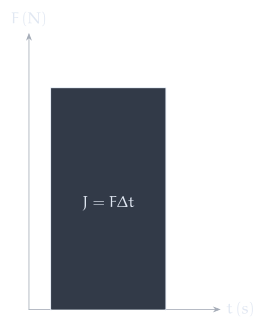
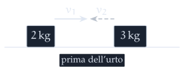
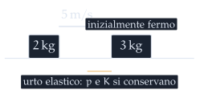
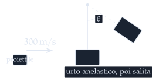
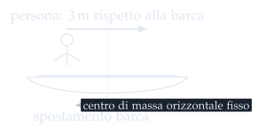
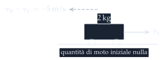
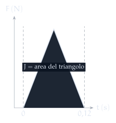

## Prima di cominciare {#apertura}

Due moduli scorrono in versi opposti lungo la stessa guida e si urtano. Le loro energie cinetiche sono positive entrambe e perdono l'informazione sul verso del moto, che invece serve per prevedere che cosa accade dopo l'urto. La quantità di moto è un vettore e conserva quella informazione.

Il capitolo tratta quantità di moto e impulso, centro di massa e dinamica dei sistemi di particelle, urti elastici e anelastici, sistemi a massa variabile e razzo. Gli esercizi provengono da più punti della dispensa: pendolo balistico, carrelli, airbag, reti di sicurezza, razzi ideali. Il capitolo usa il [bilancio energetico](unit:physics-08) per distinguere gli urti che conservano l'energia cinetica da quelli che la trasformano.

## Quantità di moto e impulso {#s-2-19}

La quantità di moto è

$$\vect p=m\vect v.$$

L'impulso di una forza è

::: legge Teorema impulso-quantità di moto
$$\vect J=\int_{t_1}^{t_2}\vect F\,\dd t
=\Delta\vect p.$$
:::

L'impulso tiene insieme intensità della forza e durata. Una forza moderata applicata a lungo può produrre la stessa variazione di quantità di moto di una forza molto grande applicata per poco tempo.

::: approfondimento Impulso come somma di aree
Se la forza è misurata a intervalli $\Delta t$,

$$\vect J\approx\sum_k\vect F_k\Delta t.$$

Con valori agli estremi di ogni intervallo,

$$\vect J\approx\sum_k
\frac{\vect F_k+\vect F_{k+1}}{2}\Delta t.$$

Nel grafico forza-tempo si sommano rettangoli o trapezi con segno. La variazione di quantità di moto è il risultato cumulativo di tutti questi piccoli impulsi.
:::

### Centro di massa e dinamica di un sistema

Per particelle di massa $m_i$ in posizioni $\vect r_i$, il centro di massa è

$$\vect R_{CM}=\frac{1}{M}\sum_i m_i\vect r_i,
\qquad M=\sum_i m_i.$$

Derivando nel tempo, per massa totale costante,

$$\vect P=M\vect V_{CM},
\qquad
M\vect a_{CM}=\sum\vect F_{\mathrm{ext}}.$$

Le forze interne possono cambiare il moto relativo delle parti, deformare il sistema o trasformare energia, ma si cancellano nella somma che determina l'accelerazione del centro di massa. Se l'impulso esterno è trascurabile, il centro di massa procede a velocità costante anche durante un urto violento.

### Urti elastici e anelastici

In ogni urto occorre prima scegliere il sistema e stimare l'impulso esterno durante il breve intervallo di interazione. Se tale impulso è trascurabile, la quantità di moto totale si conserva. L'energia cinetica totale distingue poi i modelli:

- in un urto elastico si conservano quantità di moto ed energia cinetica;
- in un urto anelastico si conserva la quantità di moto, ma una parte dell'energia cinetica diventa deformazione, calore, suono o altra energia interna;
- in un urto perfettamente anelastico i corpi restano uniti e condividono la velocità finale.

Per un urto perfettamente anelastico unidimensionale,

$$v_f=\frac{m_1v_{1i}+m_2v_{2i}}{m_1+m_2}.$$

La perdita di energia cinetica non viola la conservazione dell'energia totale: segnala una trasformazione interna.

::: errore Conservare la quantità di moto non significa conservare la velocità
La quantità di moto è vettoriale e dipende dalla massa. In un sistema isolato può restare costante mentre le velocità dei singoli corpi cambiano drasticamente. Negli urti bidimensionali vanno conservate separatamente le componenti della quantità di moto.
:::

### Sistemi a massa variabile e razzo

Scrivere semplicemente $F=m\,\dd v/\dd t$ per il razzo isolato è insufficiente, perché materia e quantità di moto attraversano il confine del sistema. Considerando insieme il razzo e una piccola massa di propellente espulsa, in assenza di forze esterne si ottiene

$$M\,\dd v=-u\,\dd M,$$

dove $u>0$ è il modulo della velocità dei gas rispetto al razzo e $\dd M<0$. Integrando fra massa iniziale $M_i$ e massa finale $M_f$,

::: legge Equazione ideale del razzo
$$\Delta v=u\ln\!\left(\frac{M_i}{M_f}\right).$$
:::

La spinta istantanea ideale è $T=u(-\dot M)$. Gravità, resistenza aerodinamica, variazioni di $u$, assetto e traiettoria richiedono un'equazione differenziale completa; la formula logaritmica fornisce il contributo propulsivo ideale.

::: esempio Rapporto di massa e incremento di velocità
Un motore espelle gas a $u=2{,}50\un{km/s}$ e il veicolo passa da $M_i$ a $M_f=M_i/3$. Nel modello ideale,

$$\Delta v=u\ln3=(2{,}50)(1{,}099)=2{,}75\un{km/s}.$$

Raddoppiare il rapporto di massa non raddoppia in generale $\Delta v$: la dipendenza è logaritmica. Per questo stadi multipli e alta velocità di scarico sono centrali nella progettazione dei lanciatori.
:::

::: quotidiano Cinture, airbag e zone deformabili
Per arrestare un passeggero con una data variazione di quantità di moto serve un certo impulso. Aumentare il tempo di arresto riduce la forza media necessaria. Cintura, airbag e deformazione controllata del veicolo prolungano l'intervallo e distribuiscono le forze su aree più adatte del corpo. Non eliminano la variazione di velocità; la rendono meno brusca.
:::

::: storia Urti, quantità di moto e sistemi isolati
Lo studio degli urti tra sfere, pendoli e corpi in movimento precedette la formulazione compatta della quantità di moto. Huygens analizzò gli urti elastici; Newton organizzò questi risultati nel quadro dei principi del moto e delle interazioni reciproche  [1](#fonti). La conservazione non significa che ogni corpo mantenga la propria quantità di moto: significa che, quando l'impulso esterno è trascurabile, le variazioni interne si compensano nella somma del sistema.
:::

## Glossario {#glossario}

- **Impulso**: Integrale della forza nel tempo, uguale alla variazione della quantità di moto.
- **Quantità di moto**: Prodotto $m\vect v$ per una particella di massa costante.

## Esercizi {#esercizi}

Gli esercizi riprendono quelli della dispensa. Ogni soluzione è nascosta finché non la apri: prova prima a impostare il problema da solo.

### Impulso, urti e rotazione

::: esercizio Impulso e variazione di velocità [medio]
Una forza media di $120\un{N}$, diretta nel verso positivo dell'asse, agisce per $0{,}25\un{s}$ su una massa di $2\un{kg}$ che inizialmente ha velocità $-4\un{m/s}$. Trovare impulso e velocità finale.

>>> soluzione
**Impulso.**  Per forza media costante:

$$J=F_m\Delta t=120\cdot0{,}25=30\un{N\,s}.$$

**Quantità di moto iniziale.**

$$p_i=mv_i=2(-4)=-8\un{kg\,m/s}.$$

**Teorema impulso-quantità di moto.**

$$J=p_f-p_i\Rightarrow p_f=p_i+J=-8+30=22\un{kg\,m/s}.$$

**Velocità finale.**

$$v_f=\frac{p_f}{m}=\frac{22}{2}=11\un{m/s}.$$

Senza integrali, l'impulso è l'area rettangolare $F_m\Delta t$; per forze variabili si sommano piccoli rettangoli o trapezi.
:::

::: esercizio Urto perfettamente anelastico [medio]
Una massa di $2\un{kg}$ viaggia a $6\un{m/s}$ e urta frontalmente una massa di $3\un{kg}$ che viaggia a $-2\un{m/s}$. I corpi restano uniti. Trovare la velocità finale.

>>> soluzione
**Asse.**  Positivo nel verso iniziale della massa da 2 kg. Allora $v_1=+6$ m/s e $v_2=-2$ m/s.

**Conservazione della quantità di moto.**

$$m_1v_1+m_2v_2=(m_1+m_2)v_f.$$

**Sostituzione.**

$$2(6)+3(-2)=5v_f\Rightarrow 12-6=5v_f.$$

**Velocità comune.**

$$v_f=1{,}2\un{m/s}.$$

Il segno positivo indica che il sistema unito prosegue nel verso iniziale della prima massa.
:::

::: esercizio Rinculo [medio]
Un proiettile di $0{,}020\un{kg}$ lascia un fucile di $4{,}0\un{kg}$ con velocità $400\un{m/s}$ misurata rispetto al suolo. Il sistema era inizialmente fermo. Trovare la velocità di rinculo.

>>> soluzione
**Quantità di moto iniziale.**  Il sistema è fermo, quindi $p_{tot,i}=0$.

**Conservazione.**

$$m_pv_p+m_fv_f=0.$$

**Velocità del fucile.**

$$v_f=-\frac{m_pv_p}{m_f}=-\frac{0{,}020\cdot400}{4{,}0}=-2{,}0\un{m/s}.$$

**Interpretazione.**  Il segno negativo indica rinculo nel verso opposto al proiettile. Il fucile ha velocità molto minore perché ha massa molto maggiore.
:::

### Problemi trasversali e di modellizzazione

::: esercizio Urto elastico tra due carrelli [avanzato]
Un carrello di massa $2\un{kg}$ viaggia a $5\un{m/s}$ e urta elasticamente, lungo una retta, un carrello fermo di massa $3\un{kg}$. Determinare le velocità finali e verificare entrambe le conservazioni.

>>> soluzione
**Equazioni di conservazione.**

$$2\cdot5=2v_1'+3v_2',$$

$$\frac12(2)5^2=\frac12(2)v_1'^2+\frac12(3)v_2'^2.$$

Risolvendo il sistema non banale si ottiene

$$v_1'=-1\un{m/s},
\qquad
v_2'=4\un{m/s}.$$

**Verifica della quantità di moto.**

$$p_i=2\cdot5=10\un{kg\,m/s},$$

$$p_f=2(-1)+3(4)=10\un{kg\,m/s}.$$

**Verifica dell'energia cinetica.**

$$K_i=\frac12(2)25=25\un{J},$$

$$K_f=\frac12(2)1+\frac12(3)16=1+24=25\un{J}.$$

Il carrello più leggero rimbalza, mentre quello più pesante prosegue in avanti.
:::

::: esercizio Pendolo balistico [avanzato]
Un proiettile di massa $0{,}020\un{kg}$ viaggia a $300\un{m/s}$ e si conficca in un blocco di massa $0{,}980\un{kg}$ appeso a un filo di lunghezza $2{,}5\un{m}$. Determinare la velocità subito dopo l'urto, l'altezza raggiunta e l'angolo massimo rispetto alla verticale.

>>> soluzione
**Urto.**  Durante il brevissimo urto si conserva la quantità di moto orizzontale, non l'energia cinetica:

$$(0{,}020)(300)=(0{,}020+0{,}980)V.$$

La massa complessiva è $1{,}000\un{kg}$, quindi

$$V=6{,}00\un{m/s}.$$

**Salita.**  Dopo l'urto, l'energia meccanica del sistema blocco-proiettile si conserva:

$$\frac12MV^2=Mgh
\Rightarrow
h=\frac{V^2}{2g}=1{,}83\un{m}.$$

**Geometria del pendolo.**

$$h=L(1-\cos\theta),$$

quindi

$$\cos\theta=1-\frac{1{,}83}{2{,}5}=0{,}266,
\qquad
\theta=74{,}6^\circ.$$

Usare la conservazione dell'energia durante l'urto sarebbe errato, perché il proiettile resta nel blocco e parte dell'energia cinetica macroscopica viene convertita in energia interna e deformazione.
:::

::: esercizio Persona che cammina su una barca [medio]
Una persona di massa $60\un{kg}$ cammina di $3{,}0\un{m}$ verso destra rispetto a una barca di massa $140\un{kg}$. La barca galleggia in acqua calma e le forze orizzontali esterne sono trascurabili. Determinare lo spostamento della barca e quello della persona rispetto alla riva.

>>> soluzione
**Variabile.**  Sia $x_B$ lo spostamento della barca rispetto alla riva, positivo verso destra. Poiché la persona avanza di $3$ m rispetto alla barca, il suo spostamento rispetto alla riva è

$$x_P=x_B+3.$$

**Centro di massa.**  Senza forza esterna orizzontale, il centro di massa non si sposta:

$$140x_B+60x_P=0.$$

Sostituendo $x_P$:

$$140x_B+60(x_B+3)=0.$$

**Soluzione.**

$$200x_B=-180
\Rightarrow
x_B=-0{,}90\un{m}.$$

La persona si sposta rispetto alla riva di

$$x_P=-0{,}90+3{,}00=2{,}10\un{m}.$$

La barca arretra: i due spostamenti hanno versi opposti e sono pesati dalle masse.
:::

::: esercizio Espulsione di un pacco da un carrello [avanzato]
Un carrello con il pacco ha massa totale $10\un{kg}$ ed è inizialmente fermo su un binario orizzontale. Il pacco di massa $2\un{kg}$ viene espulso all'indietro con velocità $5\un{m/s}$ rispetto al carrello. Determinare le velocità del carrello e del pacco rispetto al suolo.

>>> soluzione
**Masse finali.**  Dopo l'espulsione il carrello ha massa

$$m_c=10-2=8\un{kg}.$$

**Relazione tra velocità.**  Se $v_c$ è positiva in avanti, la frase “$5$ m/s all'indietro rispetto al carrello” significa

$$v_p-v_c=-5
\Rightarrow
v_p=v_c-5.$$

**Conservazione della quantità di moto.**

$$0=8v_c+2v_p.$$

Sostituendo:

$$0=8v_c+2(v_c-5)=10v_c-10,$$

quindi

$$v_c=1{,}0\un{m/s}.$$

**Velocità del pacco.**

$$v_p=1{,}0-5{,}0=-4{,}0\un{m/s}.$$

Il dato relativo non può essere inserito direttamente nella conservazione della quantità di moto: prima va trasformato in velocità rispetto allo stesso riferimento inerziale.
:::

::: esercizio Impulso triangolare di un airbag [avanzato]
Un passeggero di massa $70\un{kg}$ viaggia a $15\un{m/s}$. In un modello unidimensionale, si assume che la forza orizzontale risultante esercitata dal sistema di ritenuta sia opposta al moto e abbia andamento triangolare: zero all'inizio, picco $6{,}0\un{kN}$ e ritorno a zero dopo $0{,}12\un{s}$. Calcolare l'impulso e la velocità finale. Quale picco sarebbe necessario, con la stessa durata e forma, per arrestare il passeggero?

>>> soluzione
**Area e segno del grafico.**  Il modulo dell'impulso è l'area del triangolo:

$$|J_x|=\frac12F_{max}\Delta t
=\frac12(6000)(0{,}12)
=360\un{N\,s}.$$

Scegliendo positivo il verso del moto iniziale, l'impulso è opposto e dunque $J_x=-360\un{N\,s}$.

**Quantità di moto finale.**

$$p_{f,x}=p_{i,x}+J_x
=70(15)-360
=690\un{kg\,m/s}.$$

**Velocità finale.**

$$v_f=\frac{690}{70}=9{,}86\un{m/s}.$$

Il picco dato riduce la velocità, ma non arresta il passeggero.

**Picco necessario per l'arresto.**  Occorre un impulso di modulo $mv_i=1050$ N s:

$$1050=\frac12F_{max,stop}(0{,}12),$$

$$F_{max,stop}=1{,}75\times10^{4}\un{N}=17{,}5\un{kN}.$$

La forma temporale della forza conta: a parità di picco e durata, un triangolo fornisce metà dell'impulso di un rettangolo.
:::

### Problemi di sintesi: dinamica

::: esercizio Centro di massa di due carrelli [base]
Due carrelli di masse $3{,}0\un{kg}$ e $5{,}0\un{kg}$ si trovano alle coordinate $-2{,}0\,\mathrm{m}$ e $4{,}0\,\mathrm{m}$. Calcolare il centro di massa.
>>> soluzione
**Media pesata.**

$$x_{CM}=\frac{3(-2)+5(4)}{3+5}=1{,}75\un{m}.$$

Il centro è più vicino al carrello più massiccio.
:::

::: esercizio Impulso di una rete di sicurezza [base]
Una rete esercita una forza media di $850\un{N}$ per $0{,}12\un{s}$ su una persona di $75\un{kg}$. Calcolare impulso e variazione di velocità lungo la direzione della forza.
>>> soluzione
**Impulso.**  $J=F_{med}\Delta t=102\un{N\,s}$.

**Quantità di moto.**  $J=m\Delta v$, dunque $\Delta v=1{,}36\un{m/s}$.
:::

::: esercizio Urto completamente anelastico [medio]
Un corpo di $2{,}0\un{kg}$ a $6{,}0\un{m/s}$ urta frontalmente un corpo di $3{,}0\un{kg}$ che si muove a $-1{,}0\un{m/s}$. I corpi restano uniti. Calcolare velocità finale e perdita di energia cinetica.
>>> soluzione
**Quantità di moto.**  $v_f=(2\cdot6+3\cdot(-1))/5=1{,}80\un{m/s}$.

**Energia.**  $K_i=37{,}5\un{J}$, $K_f=8{,}10\un{J}$; la diminuzione è $29{,}4\un{J}$, convertita in energia interna e deformazione.
:::

::: esercizio Urto elastico con bersaglio fermo [base]
Una massa $1{,}5\un{kg}$ a $8\un{m/s}$ urta elasticamente una massa ferma di $4\un{kg}$. Calcolare le velocità finali in una dimensione.
>>> soluzione
**Formule elastiche.**

$$v_1=\frac{m_1-m_2}{m_1+m_2}u_1=-3{,}64\un{m/s},
\quad
v_2=\frac{2m_1}{m_1+m_2}u_1=4{,}36\un{m/s}.$$

Il primo corpo rimbalza perché incontra una massa maggiore.
:::

::: esercizio Incremento di velocità di un razzo ideale [base]
Un razzo espelle gas a velocità relativa $2800\un{m/s}$ e ha rapporto di massa $m_0/m_f=4{,}5$. Calcolare l'incremento ideale di velocità, trascurando gravità e resistenza.
>>> soluzione
**Equazione di Tsiolkovskij.**

$$\Delta v=v_e\ln\frac{m_0}{m_f}=4211\un{m/s}.$$

Il risultato dipende logaritmicamente dal rapporto di massa.
:::

### Problemi di sintesi: lavoro ed energia

::: esercizio Energia persa in un urto adesivo [base]
Una massa di $1{,}0\un{kg}$ a $5{,}0\un{m/s}$ si attacca a una massa ferma di $2{,}0\un{kg}$. Calcolare velocità finale e frazione di energia cinetica persa.
>>> soluzione
**Quantità di moto.**  $v_f=5/3=1{,}67\un{m/s}$.

**Energie.**  $K_i=12{,}5\,\mathrm{J}$, $K_f=4{,}17\un{J}$. La perdita è $8{,}33\un{J}$, pari al $66{,}7\%$.
:::

## Fonti {#fonti}

Il testo, le formule, i diagrammi e gli esercizi di questo capitolo provengono dalla *Dispensa di fisica* del corso (sezione 2.19 e materiali delle sezioni 2.20, 2.22, 2.23, 3.10), consultabile nel lettore della galassia. Per la lettura sul sito sono cambiati l'impaginazione, i colori delle figure, la numerazione e la posizione di alcuni riquadri ed esercizi; la sezione iniziale è scritta per il pianeta di questa unità.

Opere citate nel testo:

1. I. Newton, *The Principia: Mathematical Principles of Natural Philosophy*, nuova traduzione di I. B. Cohen e A. Whitman, University of California Press, Berkeley, 1999; edizione originale latina, Londra, 1687.
