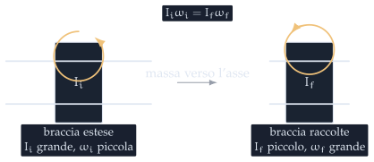
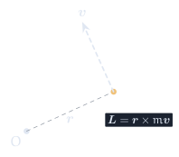
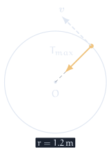
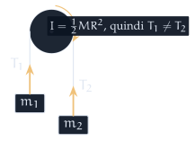

## Prima di cominciare {#apertura}

Su un braccio rotante della stazione una massa viene spostata verso l'estremità. La massa totale resta la stessa, eppure il braccio risponde più lentamente quando si prova ad accelerarne la rotazione. La grandezza che descrive questa risposta tiene conto di come la massa è distribuita rispetto all'asse.

Il capitolo tratta la cinematica angolare, i corpi rigidi, il momento d’inerzia e la conservazione del momento angolare. Le sezioni aggiunte per il sito raccolgono i momenti d’inerzia dei corpi più comuni, il teorema degli assi paralleli, l’energia di rotazione e il rotolamento. Il capitolo sui [momenti e sulle leve](unit:physics-11) completa il quadro con l'equilibrio dei corpi estesi.

## Cinematica angolare e corpi rigidi {#s-2-20-1}

Per una rotazione attorno a un asse fisso, angolo $\theta$, velocità angolare $\omega$ e accelerazione angolare $\alpha$ sono legati da

$$\omega=\frac{\dd\theta}{\dd t},\qquad
\alpha=\frac{\dd\omega}{\dd t}.$$

Se $\alpha$ è costante, le relazioni hanno la stessa struttura del moto rettilineo uniformemente accelerato:

$$\omega=\omega_0+\alpha t,
\qquad
\theta-\theta_0=\omega_0t+\frac12\alpha t^2,
\qquad
\omega^2-\omega_0^2=2\alpha(\theta-\theta_0).$$

Per un punto a distanza $r_\perp$ dall'asse,

$$v=r_\perp\omega,
\qquad
a_t=r_\perp\alpha,
\qquad
a_n=r_\perp\omega^2.$$

La distribuzione della massa entra attraverso il momento d'inerzia

$$I=\int r_\perp^2\,\dd m.$$

Massa posta lontano dall'asse contribuisce in modo quadratico.

::: approfondimento Dimostrazione: Dalla seconda legge a $\tau=I\alpha$
**Ipotesi.** Il corpo è rigido, ruota attorno a un asse fisso e ogni elemento di massa condivide la stessa accelerazione angolare $\alpha$.

**Passaggi.** Per l'elemento $\dd m$, la componente tangenziale della forza è $\dd F_t=\dd m\,r_\perp\alpha$. Il momento elementare è

$$\dd\tau=r_\perp\dd F_t=r_\perp^2\alpha\,\dd m.$$

Integrando su tutto il corpo,

$$\tau_{\mathrm{ext}}=\alpha\int r_\perp^2\,\dd m=I\alpha.$$

**Significato fisico.** $I$ svolge nella rotazione il ruolo della massa nella traslazione: misura la resistenza al cambiamento di velocità angolare.

**Limiti di validità.** La forma scalare vale per un asse fisso e per la componente del momento lungo quell'asse. Nella rotazione tridimensionale generale servono il tensore d'inerzia e relazioni vettoriali più complete.
:::

## Conservazione del momento angolare {#s-2-20-2}

Se il momento esterno risultante rispetto a un asse è nullo,

$$L=I\omega=\text{costante}.$$

Un pattinatore che avvicina le braccia all'asse riduce $I$ e aumenta $\omega$; non crea momento angolare, ma ridistribuisce la massa mantenendo la stessa quantità totale.

Una coppia esterna perpendicolare a $\vect L$ ne modifica la direzione senza cambiarne istantaneamente il modulo. In una precessione regolare attorno a un asse fisso,

$$\frac{\dd\vect L}{\dd t}=\vect\Omega\times\vect L,
\qquad
\tau=\Omega L\sin\theta,$$

dove $\theta$ è l'angolo fra $\vect L$ e l'asse di precessione. Per $\sin\theta\ne0$,

$$\Omega=\frac{\tau}{L\sin\theta}.$$

La relazione $\Omega=\tau/L$ è quindi il caso particolare $\theta=90^\circ$.

Per una trottola simmetrica che ruota rapidamente, il momento angolare è approssimativamente lungo l'asse del corpo. Se il centro di massa dista $d$ dal perno, il momento della gravità ha modulo $mgd\sin\theta$ e la precessione lenta soddisfa

$$\Omega\simeq\frac{mgd}{L}\simeq\frac{mgd}{I\omega}.$$

Qui $I$ è il momento d'inerzia attorno all'asse di rotazione e $\omega$ la velocità angolare di rotazione propria. L'approssimazione trascura il contributo della precessione al momento angolare e non descrive nutazioni o moti generali del corpo rigido.

## Momenti d'inerzia notevoli {#g-momenti-notevoli}

Il momento d'inerzia $I=\int r_\perp^2\,\dd m$ dipende dalla massa del corpo, dalla sua forma e dalla posizione dell'asse. Per i corpi omogenei di forma semplice l'integrale si calcola una volta per tutte, e il risultato si scrive come $I=k\,MR^2$ oppure $I=k\,ML^2$, con un coefficiente numerico $k$ che riassume la distribuzione della massa.

| Corpo omogeneo | Asse | Momento d'inerzia |
|---|---|---|
| Anello o guscio cilindrico sottile di raggio $R$ | asse di simmetria | $MR^2$ |
| Disco o cilindro pieno di raggio $R$ | asse di simmetria | $\tfrac12MR^2$ |
| Sfera piena di raggio $R$ | un diametro | $\tfrac25MR^2$ |
| Guscio sferico sottile di raggio $R$ | un diametro | $\tfrac23MR^2$ |
| Asta sottile di lunghezza $L$ | perpendicolare, per il centro | $\tfrac1{12}ML^2$ |
| Asta sottile di lunghezza $L$ | perpendicolare, per un estremo | $\tfrac13ML^2$ |

Il confronto fra anello e disco mostra il peso della distribuzione: a parità di massa e raggio, l'anello ha tutta la massa alla distanza massima dall'asse e un momento d'inerzia doppio di quello del disco.

::: legge Teorema degli assi paralleli
Se $I_\mathrm{cm}$ è il momento d'inerzia rispetto a un asse passante per il centro di massa, il momento rispetto a un asse parallelo a distanza $d$ vale
$$I=I_\mathrm{cm}+Md^2.$$
:::

Il teorema, attribuito a Steiner, segue dalla definizione. Scrivendo la posizione di ogni elemento rispetto al nuovo asse come somma della posizione del centro di massa e della posizione relativa, il termine misto si annulla perché il centro di massa è la media pesata delle posizioni. Per un'asta di $1{,}2\un{kg}$ lunga $0{,}90\un{m}$ si ottiene, rispetto a un estremo, $I=\tfrac1{12}ML^2+M(L/2)^2=0{,}081+0{,}243=0{,}324\un{kg\,m^2}$, lo stesso valore di $\tfrac13ML^2$ della tabella. Il momento d'inerzia minimo, fra tutti gli assi paralleli, è quello per il centro di massa.

## Energia di rotazione e rotolamento {#g-rotolamento}

Ogni elemento di un corpo che ruota attorno a un asse fisso con velocità angolare $\omega$ ha velocità $r_\perp\omega$. Sommando le energie cinetiche degli elementi:

$$K_\mathrm{rot}=\int\tfrac12(r_\perp\omega)^2\,\dd m=\tfrac12I\omega^2.$$

Un volano d'acciaio a forma di disco, di $20\un{kg}$ e raggio $0{,}25\un{m}$, ha $I=\tfrac12MR^2=0{,}625\un{kg\,m^2}$. A $3000$ giri al minuto, cioè $\omega\simeq314\un{rad/s}$, immagazzina $K\simeq3{,}1\times10^{4}\un{J}$, l'energia necessaria per sollevare una tonnellata di circa tre metri.

Un corpo che rotola senza strisciare ha il punto di contatto istantaneamente fermo, quindi la velocità del centro e quella angolare sono legate da $v=R\omega$. La sua energia cinetica è la somma di un termine di traslazione del centro di massa e di uno di rotazione attorno al centro di massa:

$$K=\tfrac12Mv^2+\tfrac12I_\mathrm{cm}\omega^2=\tfrac12Mv^2\left(1+\frac{I_\mathrm{cm}}{MR^2}\right).$$

L'attrito statico che impedisce lo strisciamento agisce su un punto fermo e non compie lavoro, quindi l'energia meccanica si conserva. Un corpo che scende di una quota $h$ partendo da fermo raggiunge la velocità

$$v=\sqrt{\frac{2gh}{1+I_\mathrm{cm}/(MR^2)}}.$$

::: esempio La gara dei corpi che rotolano
Una sfera piena, un cilindro pieno e un anello scendono rotolando lungo lo stesso piano inclinato da un dislivello di $1{,}0\un{m}$. Con $I_\mathrm{cm}/(MR^2)$ pari a $0{,}4$, $0{,}5$ e $1$ si ottengono velocità finali di circa $3{,}74$, $3{,}62$ e $3{,}13\un{m/s}$. Un blocco che scivolasse senza attrito arriverebbe a $4{,}43\un{m/s}$. L'ordine di arrivo è indipendente dalla massa e dal raggio e dipende soltanto da come la massa è distribuita. La sfera vince perché destina alla rotazione la frazione più piccola dell'energia disponibile.
:::

::: esercizio Asta che cade [medio]
Un'asta omogenea lunga $1{,}0\un{m}$, incernierata senza attrito a un estremo, viene lasciata cadere da ferma in posizione orizzontale. Calcolare la velocità angolare quando passa per la verticale e la velocità dell'estremo libero.
>>> soluzione
Il centro di massa scende di $L/2$. La conservazione dell'energia dà $Mg\,L/2=\tfrac12\cdot\tfrac13ML^2\omega^2$, quindi $\omega=\sqrt{3g/L}\simeq5{,}42\un{rad/s}$. L'estremo libero si muove a $v=L\omega\simeq5{,}42\un{m/s}$, più veloce di un corpo caduto liberamente dalla stessa altezza del centro di massa.
:::

::: esercizio Energia di un disco che rotola [base]
Quale frazione dell'energia cinetica di un cilindro pieno che rotola senza strisciare è energia di rotazione?
>>> soluzione
Con $I_\mathrm{cm}=\tfrac12MR^2$ e $\omega=v/R$, l'energia di rotazione è $\tfrac14Mv^2$ e quella di traslazione $\tfrac12Mv^2$. La frazione di rotazione è $\tfrac14/\tfrac34=1/3$.
:::

::: esercizio Volano e frenata [medio]
Il volano dell'esempio del testo rallenta da $3000$ a $1500$ giri al minuto. Quanta energia cede? Se la cede in $20\un{s}$, quale potenza media fornisce?
>>> soluzione
L'energia è proporzionale a $\omega^2$: dimezzando la velocità angolare resta un quarto dell'energia iniziale. Il volano cede quindi $\tfrac34\cdot3{,}08\times10^{4}\un{J}\simeq2{,}3\times10^{4}\un{J}$, con una potenza media di circa $1{,}2\un{kW}$.
:::

## Esercizi {#esercizi}

Gli esercizi riprendono quelli della dispensa. Ogni soluzione è nascosta finché non la apri: prova prima a impostare il problema da solo.

### Impulso, urti e rotazione

::: esercizio Momento angolare tangenziale [medio]
Una particella di $2\un{kg}$ si trova a $1{,}5\un{m}$ dal polo e si muove tangenzialmente a $4\un{m/s}$. Trovare $L$.

>>> soluzione
**Geometria.**  La velocità è tangenziale, quindi $\vect r\perp\vect v$ e $\sin90^\circ=1$.

**Formula.**

$$L=|\vect r\times m\vect v|=mrv.$$

**Calcolo.**

$$L=2\cdot1{,}5\cdot4=12\un{kg\,m^2/s}.$$

Il verso si determina con la regola della mano destra applicata da $\vect r$ a $\vect v$.
:::

::: esercizio Tensione massima in rotazione [avanzato]
Una pietra di $0{,}50\un{kg}$ scorre su un piano orizzontale liscio ed è legata a un filo che la costringe a una circonferenza di raggio $1{,}2\un{m}$. Il piano sostiene il peso; il filo, orizzontale, sopporta al massimo $60\un{N}$. Trovare la velocità massima.

>>> soluzione
**Equazione radiale.**  La tensione fornisce la forza centripeta:

$$T=m\frac{v^2}{r}.$$

**Condizione limite.**  Poniamo $T=T_{max}=60$ N:

$$v_{max}=\sqrt{\frac{T_{max}r}{m}}.$$

**Calcolo.**

$$v_{max}=\sqrt{\frac{60\cdot1{,}2}{0{,}50}}=\sqrt{144}=12\un{m/s}.$$

Una velocità maggiore richiederebbe una tensione superiore al limite del filo.
:::

### Problemi trasversali e di modellizzazione

::: esercizio Macchina di Atwood con puleggia massiva [avanzato]
Due masse $m_1=2\un{kg}$ e $m_2=4\un{kg}$ sono collegate da un filo ideale che non slitta su una puleggia a disco uniforme di massa $M=2\un{kg}$. L'asse è privo di attrito. Determinare accelerazione e tensioni ai due lati.

>>> soluzione
**Equazioni delle masse.**  Se $m_2$ scende e $m_1$ sale:

$$T_1-m_1g=m_1a,
\qquad
m_2g-T_2=m_2a.$$

**Rotazione della puleggia.**

$$(T_2-T_1)R=I\alpha.$$

Per un disco $I=\frac12MR^2$ e, senza slittamento, $\alpha=a/R$. Quindi

$$T_2-T_1=\frac12Ma.$$

**Accelerazione.**  Sommando le tre relazioni:

$$(m_2-m_1)g=\left(m_1+m_2+\frac12M\right)a.$$

Pertanto

$$a=\frac{(4-2)9{,}81}{2+4+1}=2{,}80\un{m/s^2}.$$

**Tensioni.**

$$T_1=m_1(g+a)=2(9{,}81+2{,}80)=25{,}2\un{N},$$

$$T_2=m_2(g-a)=4(9{,}81-2{,}80)=28{,}0\un{N}.$$

Le tensioni non sono uguali: la loro differenza produce il momento necessario ad accelerare la puleggia.
:::

### Problemi di sintesi: dinamica

::: esercizio Cilindro pieno in rotolamento [base]
Un cilindro pieno parte da fermo e rotola senza strisciare da un dislivello $1{,}8\un{m}$. Calcolare la velocità finale.
>>> soluzione
**Energia.**  $mgh=\tfrac12mv^2+\tfrac12(\tfrac12mR^2)(v^2/R^2)=\tfrac34mv^2$.

**Velocità.**  $v=\sqrt{4gh/3}=4{,}85\un{m/s}$.
:::

### Problemi di sintesi: lavoro ed energia

::: esercizio Lavoro di un momento costante [base]
Un rotore ha $I=0{,}35\un{kg\,m^2}$ e velocità angolare iniziale $4\un{rad/s}$. Un momento costante $3\un{N\,m}$ agisce per $8\un{rad}$. Calcolare $\omega_f$.
>>> soluzione
**Lavoro rotazionale.**  $\tau\Delta\theta=\tfrac12I(\omega_f^2-\omega_0^2)$.

**Risultato.**  $\omega_f=12{,}4\un{rad/s}$.
:::

::: esercizio Sfera piena che rotola [medio]
Una sfera piena parte da fermo e rotola senza strisciare da un dislivello $2\un{m}$. Con $I=\tfrac25mR^2$, calcolare la velocità finale.
>>> soluzione
**Energia.**  $mgh=\tfrac12mv^2+\tfrac12(\tfrac25mR^2)(v^2/R^2)=\tfrac7{10}mv^2$.

**Velocità.**  $v=\sqrt{10gh/7}=5{,}29\un{m/s}$.
:::

## Fonti {#fonti}

Il testo, le formule, i diagrammi e gli esercizi di questo capitolo provengono dalla *Dispensa di fisica* del corso (sezioni 2.20.1, 2.20.2 e materiali delle sezioni 2.22, 2.23, 3.10), consultabile nel lettore della galassia. Per la lettura sul sito sono cambiati l'impaginazione, i colori delle figure, la numerazione e la posizione di alcuni riquadri ed esercizi; la sezione iniziale è scritta per il pianeta di questa unità.
