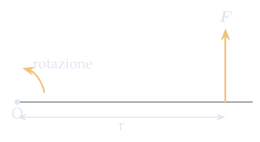
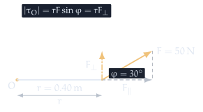
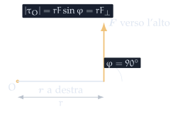
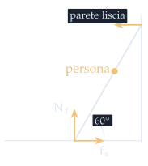

## Prima di cominciare {#apertura}

Una porta della stazione si apre a fatica quando la spinta è applicata vicino alla cerniera o quasi parallela al battente. La stessa forza produce effetti di rotazione diversi secondo il punto di applicazione e la direzione, e la grandezza che li misura è il momento torcente.

Il capitolo definisce il momento di una forza, collega leve e bracci all'equilibrio dei corpi estesi e mostra come una risultante nulla lasci ancora possibile una rotazione. Le sezioni aggiunte per il sito sviluppano la statica del corpo rigido con esempi su travi, scale e leve. Il capitolo presuppone la [rotazione e il momento d'inerzia](unit:physics-10).

## Momento torcente, leve e rotazione {#s-2-20}

Rispetto a un polo $O$, il momento torcente di una forza è

$$\vect\tau_O=\vect r\times\vect F,
\qquad
|\tau|=rF\sin\varphi.$$

Conta la distanza perpendicolare tra il polo e la linea d'azione della forza. Una forza grande applicata vicino al perno può produrre meno effetto rotatorio di una forza più piccola applicata lontano.

Il momento angolare di un punto materiale è

$$\vect L_O=\vect r\times m\vect v.$$

Se il polo $O$ è fisso in un riferimento inerziale, il legame dinamico è

$$\frac{\dd\vect L_O}{\dd t}=\vect\tau_{O,\mathrm{ext}}.
\tag{1}$$

Per un polo mobile la derivata di $\vect L_O$ contiene in generale termini aggiuntivi. Nel presente capitolo l'equazione (1) viene usata soltanto rispetto a poli fissi nel riferimento inerziale scelto.

::: approfondimento Momento torcente senza derivata
Su un intervallo breve,

$$\vect\tau_{O,\mathrm{media}}\approx
\frac{\vect L_O(t+\Delta t)-\vect L_O(t)}{\Delta t}.$$

Equivalentemente,

$$\Delta\vect L_O\approx
\vect\tau_{O,\mathrm{media}}\Delta t.$$

Il momento torcente accumulato nel tempo modifica il momento angolare, nello stesso modo in cui l'impulso modifica la quantità di moto.
:::

::: quotidiano Chiavi inglesi, porte e articolazioni
Una chiave più lunga permette di ottenere lo stesso momento con una forza minore. La maniglia di una porta è lontana dai cardini per lo stesso motivo. Nel corpo umano, muscoli e tendini agiscono con bracci spesso piccoli: per produrre un momento esterno moderato possono essere necessarie forze muscolari elevate.
:::

::: storia Dal baricentro al momento angolare
Il problema del baricentro nasce nella statica antica, ma nella meccanica moderna il centro di massa diventa il punto la cui accelerazione è determinata dalla risultante delle forze esterne. In modo analogo, il momento angolare organizza gli effetti rotatori rispetto a un polo. La formulazione ottocentesca rese chiaro che traslazione del centro di massa e rotazione attorno ad esso sono descrizioni complementari, non fenomeni indipendenti. Una ricostruzione critica di questo sviluppo si trova in Mach  [1](#fonti).
:::

## Il momento come prodotto vettoriale {#g-momento}

L'effetto di rotazione di una forza $\vect F$ applicata nel punto $P$, rispetto a un polo $O$, è descritto dal **momento** della forza

$$\vect\tau=\vect r\times\vect F,\qquad \vect r=\overrightarrow{OP}.$$

Il modulo vale $\tau=rF\sin\theta$, dove $\theta$ è l'angolo fra $\vect r$ e $\vect F$. Lo stesso prodotto si legge in due modi equivalenti: $F$ per il **braccio** $b=r\sin\theta$, cioè la distanza del polo dalla retta d'azione della forza, oppure $r$ per la componente di $\vect F$ perpendicolare a $\vect r$. La direzione di $\vect\tau$ è perpendicolare al piano di $\vect r$ e $\vect F$, con il verso della regola della mano destra; nei problemi piani si usa un segno, positivo per le rotazioni antiorarie.

La porta del pianeta di questa unità mostra la regola all'opera. Una forza di $40\un{N}$ applicata alla maniglia, a $0{,}80\un{m}$ dalla cerniera, con un angolo di $60^\circ$ rispetto al piano della porta, produce un momento $0{,}80\cdot40\cdot\sin60^\circ\un{N\,m}\simeq27{,}7\un{N\,m}$. La stessa forza diretta verso la cerniera ha braccio nullo e momento nullo.

## Le condizioni di equilibrio del corpo rigido {#g-equilibrio}

Un corpo rigido è in equilibrio se resta fermo, oppure se il centro di massa si muove di moto rettilineo uniforme e il corpo non cambia il proprio stato di rotazione. Servono due condizioni:

$$\sum\vect F_\mathrm{est}=\vect 0,\qquad \sum\vect\tau_\mathrm{est}=\vect 0.$$

La prima riguarda la traslazione del centro di massa, la seconda la rotazione. Quando la risultante delle forze è nulla, il momento totale non dipende dal polo scelto. Se $O'$ è un altro polo e $\vect d=\overrightarrow{O'O}$, ogni braccio cambia da $\vect r_i$ a $\vect r_i+\vect d$ e

$$\sum\vect\tau'=\sum(\vect r_i+\vect d)\times\vect F_i=\sum\vect\tau+\vect d\times\sum\vect F_i=\sum\vect\tau.$$

Questo risultato è un potente strumento di calcolo. Conviene scegliere il polo nel punto di applicazione di una forza incognita, che così sparisce dall'equazione dei momenti.

::: metodo Risolvere un problema di statica
1. Isolare il corpo e disegnare tutte le forze esterne nel loro punto di applicazione; il peso va nel baricentro.
2. Scrivere le equazioni delle componenti della risultante.
3. Scegliere il polo dove agiscono più forze incognite e scrivere l'equazione dei momenti con i segni.
4. Risolvere e controllare con un'equazione dei momenti rispetto a un secondo polo.
:::

::: figura trave-appoggiata
{"w":560,"h":290,"items":[
{"t":"rect","p":[60,120,400,18],"c":"body","r":2},
{"t":"poly","pts":[[69,138],[54,170],[84,170]],"close":true,"fill":true,"c":"muted"},
{"t":"poly","pts":[[451,138],[436,170],[466,170]],"close":true,"fill":true,"c":"muted"},
{"t":"ground","p":[30,170,110]},{"t":"ground","p":[412,170,490]},
{"t":"arrow","p":[69,225,69,142],"c":"force3","w":3,"s":"R","sub":"A","off":[-28,72]},
{"t":"arrow","p":[451,225,451,142],"c":"force3","w":3,"s":"R","sub":"B","off":[30,72]},
{"t":"arrow","p":[260,129,260,215],"c":"force","w":3,"s":"P","sub":"t","off":[0,18]},
{"t":"rect","p":[128,78,64,42],"c":"muted","s":"50 kg"},
{"t":"arrow","p":[160,129,160,215],"c":"force4","w":3,"s":"P","sub":"c","off":[0,18]},
{"t":"line","p":[69,262,451,262],"c":"muted","w":1},
{"t":"line","p":[69,255,69,269],"c":"muted"},{"t":"line","p":[160,255,160,269],"c":"muted"},{"t":"line","p":[260,255,260,269],"c":"muted"},{"t":"line","p":[451,255,451,269],"c":"muted"},
{"t":"text","p":[114,284],"s":"1,0 m","c":"muted","size":12},
{"t":"text","p":[355,284],"s":"lunghezza 4,0 m","c":"muted","size":12}
]}
---
Trave omogenea di $20\un{kg}$, lunga $4{,}0\un{m}$, appoggiata alle estremità con un carico di $50\un{kg}$ a $1{,}0\un{m}$ dall'appoggio $A$. Le reazioni degli appoggi si ricavano dall'equazione dei momenti.
:::

::: esempio Reazioni di una trave appoggiata
Per la trave della figura si sceglie il polo in $A$, dove agisce l'incognita $R_A$. I momenti antiorari sono positivi:
$$R_B\cdot4{,}0-(20\cdot9{,}81)\cdot2{,}0-(50\cdot9{,}81)\cdot1{,}0=0\qquad\Longrightarrow\qquad R_B\simeq221\un{N}.$$
L'equazione della risultante verticale dà $R_A=(70\cdot9{,}81-221)\un{N}\simeq466\un{N}$. Controllo con il polo in $B$: $R_A\cdot4{,}0=196{,}2\cdot2{,}0+490{,}5\cdot3{,}0$, da cui $R_A\simeq466\un{N}$. L'appoggio più vicino al carico sostiene la parte maggiore del peso.
:::

## Le leve {#g-leve}

Una leva è un corpo rigido che può ruotare attorno a un punto fisso, il **fulcro**. Su di essa agiscono una forza motrice $F_m$ con braccio $b_m$ e una forza resistente $F_r$ con braccio $b_r$. In equilibrio i momenti rispetto al fulcro si compensano:

$$F_m\,b_m=F_r\,b_r\qquad\Longrightarrow\qquad \frac{F_r}{F_m}=\frac{b_m}{b_r}.$$

Il rapporto $b_m/b_r$ è il vantaggio meccanico. Come nel sollevatore idraulico, la forza moltiplicata si paga con uno spostamento ridotto: i punti di applicazione percorrono archi proporzionali ai bracci, quindi il lavoro motore e quello resistente coincidono in assenza di attriti.

Le leve si classificano secondo la posizione del fulcro. In quelle di primo genere il fulcro sta fra le due forze, come nell'altalena a bilico e nelle forbici. In quelle di secondo genere la resistenza sta fra il fulcro e la forza motrice, come nella carriola e nello schiaccianoci: il vantaggio è sempre maggiore di uno. In quelle di terzo genere la forza motrice sta fra il fulcro e la resistenza, come nelle pinzette: il vantaggio è minore di uno, e la leva serve a ottenere spostamenti ampi e rapidi.

::: quotidiano L'avambraccio è una leva di terzo genere
Il gomito fa da fulcro, il bicipite si inserisce sul radio pochi centimetri più avanti, la mano regge il carico molto più lontano. Con valori tipici di $4\un{cm}$ per il braccio del muscolo e $35\un{cm}$ per quello del carico, reggere $5{,}0\un{kg}$ con l'avambraccio orizzontale richiede al bicipite una forza di circa $5{,}0\cdot9{,}81\cdot35/4\un{N}\simeq430\un{N}$, trascurando il peso dell'avambraccio. La disposizione è svantaggiosa per la forza e vantaggiosa per la velocità della mano.
:::

## Baricentro e stabilità {#g-baricentro}

Il peso di un corpo esteso agisce come se fosse applicato in un solo punto, il **baricentro**, che in un campo gravitazionale uniforme coincide con il centro di massa. Un corpo appoggiato su una base è in equilibrio se la verticale per il baricentro cade dentro la base d'appoggio; in caso contrario il peso produce un momento rispetto allo spigolo e il corpo si ribalta.

Una cassa con base larga $0{,}40\un{m}$ e baricentro a $0{,}60\un{m}$ di altezza, inclinata attorno a uno spigolo, si ribalta quando la verticale per il baricentro supera lo spigolo, cioè per un angolo $\theta$ con $\tan\theta=0{,}20/0{,}60$, circa $18^\circ$. Abbassando il baricentro o allargando la base l'angolo critico cresce: è il motivo per cui si caricano in basso gli oggetti pesanti di un furgone e per cui un equilibrista allarga le braccia o usa un'asta lunga.

::: esercizio Altalena a bilico [base]
Due bambini di $25\un{kg}$ e $35\un{kg}$ siedono su un'altalena a bilico con il fulcro al centro. Il primo è a $1{,}4\un{m}$ dal fulcro. A quale distanza deve sedersi il secondo perché l'asse resti in equilibrio orizzontale?
>>> soluzione
L'equilibrio dei momenti rispetto al fulcro richiede $25\cdot1{,}4=35\cdot d$, quindi $d=1{,}0\un{m}$. Il peso dell'asse ha braccio nullo, perché il baricentro dell'asse coincide con il fulcro.
:::

::: esercizio Carriola [medio]
Una carriola carica pesa in totale $600\un{N}$; il baricentro si trova a $0{,}50\un{m}$ dall'asse della ruota, misurati in orizzontale, e le maniglie a $1{,}30\un{m}$. Quale forza verticale serve per sollevare le maniglie? Quale forza sostiene la ruota?
>>> soluzione
Con il polo sull'asse della ruota: $F\cdot1{,}30=600\cdot0{,}50$, quindi $F\simeq231\un{N}$. La ruota sostiene $600-231\simeq369\un{N}$. La carriola è una leva di secondo genere: la forza richiesta è minore del peso.
:::

::: esercizio Mensola con tirante [avanzato]
Una mensola orizzontale omogenea, lunga $1{,}2\un{m}$ e di massa $4{,}0\un{kg}$, è incernierata al muro e sostenuta all'estremità libera da un tirante che forma un angolo di $30^\circ$ con la mensola. Calcolare la tensione del tirante e le componenti della forza della cerniera.
>>> soluzione
Momenti rispetto alla cerniera: $T\sin30^\circ\cdot1{,}2=4{,}0\cdot9{,}81\cdot0{,}60$, quindi $T=39{,}2\un{N}$. Equilibrio orizzontale: la cerniera spinge verso l'esterno del muro con $H=T\cos30^\circ\simeq34{,}0\un{N}$. Equilibrio verticale: $V=39{,}2-T\sin30^\circ=39{,}2-19{,}6=19{,}6\un{N}$ verso l'alto. Cerniera e tirante si dividono a metà il peso, come richiede la simmetria della mensola omogenea.
:::

## Glossario {#glossario}

- **Momento torcente**: Misura dell'effetto rotatorio di una forza rispetto a un polo.

## Esercizi {#esercizi}

Gli esercizi riprendono quelli della dispensa. Ogni soluzione è nascosta finché non la apri: prova prima a impostare il problema da solo.

### Impulso, urti e rotazione

::: esercizio Momento torcente [medio]
Una forza di $50\un{N}$ agisce a $0{,}40\un{m}$ dal perno formando $30^\circ$ con il braccio. Trovare il modulo del momento.

>>> soluzione
**Formula.**

$$\tau=rF\sin\varphi.$$

**Sostituzione.**

$$\tau=0{,}40\cdot50\cdot\sin30^\circ.$$

**Calcolo.**

$$\tau=20\cdot0{,}5=10\un{N\,m}.$$

**Interpretazione.**  Solo la componente della forza perpendicolare al braccio produce momento.
:::

::: esercizio Segno del momento [base]
Una forza applicata a destra del perno e diretta verso l'alto tende a produrre rotazione antioraria. Stabilire il verso di $\vect\tau$ usando la regola della mano destra.

>>> soluzione
**Vettori.**  Il braccio $\vect r$ punta verso destra, lungo $+x$; la forza punta verso l'alto, lungo $+y$.

**Prodotto vettoriale.**

$$\vect\tau=\vect r\times\vect F=(+x)\times(+y)=+z.$$

**Regola della mano destra.**  Ruotando le dita da destra verso l'alto, il pollice punta fuori dal piano.

**Conclusione.**  Il momento è uscente dal foglio e corrisponde a rotazione antioraria, positiva nella convenzione usuale.
:::

### Problemi trasversali e di modellizzazione

::: esercizio Equilibrio su un'altalena a bilico [medio]
Una tavola uniforme lunga $4\un{m}$ e di massa $20\un{kg}$ è sostenuta nel proprio centro. Un bambino di $30\un{kg}$ siede a $1{,}5\un{m}$ a sinistra del perno. A quale distanza a destra deve sedersi un adulto di $45\un{kg}$ per l'equilibrio?

>>> soluzione
**Scelta del polo.**  Calcoliamo i momenti rispetto al perno centrale. La reazione del perno non dà momento perché il suo braccio è nullo.

**Peso della tavola.**  Essendo uniforme, il peso della tavola agisce nel centro, proprio sul perno. Anche il suo momento è nullo.

**Equilibrio dei momenti.**

$$(30g)(1{,}5)=(45g)x.$$

La gravità si semplifica:

$$x=\frac{30\cdot1{,}5}{45}=1{,}0\un{m}.$$

L'adulto, più pesante, deve sedersi più vicino al perno per produrre lo stesso momento del bambino.
:::

::: esercizio Scala appoggiata a una parete liscia [avanzato]
Una scala uniforme lunga $5{,}0\un{m}$ e di massa $20\un{kg}$ forma $60^\circ$ con il pavimento. Una persona di massa $60\un{kg}$ si trova a $3{,}0\un{m}$ dal piede, misurati lungo la scala. La parete è liscia. Determinare la reazione della parete, la normale del pavimento e il coefficiente minimo di attrito statico al piede.

>>> soluzione
**Forze.**  La parete esercita una normale orizzontale $N_w$. Il pavimento esercita normale verticale $N_f$ e attrito orizzontale $f_s$.

**Momenti rispetto al piede.**  La reazione del pavimento non contribuisce. Con verso antiorario positivo:

$$N_wL\sin60^\circ
-(20g)\frac{L}{2}\cos60^\circ
-(60g)(3{,}0)\cos60^\circ=0.$$

Da cui

$$N_w=261\un{N}.$$

**Equilibrio delle forze.**

$$f_s=N_w=261\un{N},$$

$$N_f=(20+60)g=784{,}8\un{N}.$$

**Attrito minimo.**

$$\mu_{s,min}=\frac{f_s}{N_f}
=\frac{260{,}5}{784{,}8}=0{,}332.$$

Un coefficiente minore non consentirebbe all'attrito statico di bilanciare la spinta orizzontale della parete.
:::

### Problemi di sintesi: dinamica

::: esercizio Trave orizzontale sostenuta da un cavo [base]
Una trave uniforme lunga $4\un{m}$ pesa $600\un{N}$ ed è incernierata a un'estremità. Un cavo applicato all'altra estremità forma $55^\circ$ con la trave. Calcolare la tensione in equilibrio.
>>> soluzione
**Momenti rispetto alla cerniera.**  La reazione della cerniera non produce momento:

$$TL\sin\theta=W\frac L2.$$

**Tensione.**  $T=W/[2\sin\theta]=366\un{N}$.
:::

## Fonti {#fonti}

Il testo, le formule, i diagrammi e gli esercizi di questo capitolo provengono dalla *Dispensa di fisica* del corso (sezione 2.20 e materiali delle sezioni 2.22, 2.23), consultabile nel lettore della galassia. Per la lettura sul sito sono cambiati l'impaginazione, i colori delle figure, la numerazione e la posizione di alcuni riquadri ed esercizi; la sezione iniziale è scritta per il pianeta di questa unità.

Opere citate nel testo:

1. E. Mach, *The Science of Mechanics: A Critical and Historical Account of Its Development*, 4a edizione inglese, Open Court, Chicago, 1919; edizione originale tedesca, 1883.
