## Prima di cominciare {#apertura}

Una sonda si allontana da una massa centrale e registra un campo gravitazionale sempre più debole. La diminuzione segue il rapporto fra le distanze: raddoppiando la distanza dal centro il campo si riduce a un quarto. Per prevederlo basta il prodotto della costante gravitazionale per la massa della sorgente.

Il capitolo ripercorre la strada dal cielo antico alla gravitazione universale, poi tratta la legge di Newton, il campo gravitazionale, massa e peso, i corpi sferici, il potenziale e l'energia gravitazionale, le maree e il limite di Roche, e infine i limiti della teoria newtoniana con il contributo della relatività generale. Le [orbite](unit:physics-13) sono l'argomento del capitolo successivo.

## Dal cielo antico alla gravitazione universale {#s-4-1}

Il cielo offre moti regolari ma non immediatamente semplici. Il Sole e le stelle sembrano ruotare ogni giorno attorno alla Terra; i pianeti cambiano lentamente posizione rispetto alle stelle e, in alcuni intervalli, sembrano invertire il verso del loro moto. Per secoli il problema principale fu costruire una descrizione geometrica capace di prevedere tali posizioni.

::: storia Dai modelli geometrici al sistema copernicano
Nell'astronomia greca i moti celesti venivano ricostruiti mediante combinazioni di circonferenze. Nel sistema esposto da Claudio Tolomeo nell'*Almagesto*, composto nel II secolo, deferenti, epicicli ed eccentrici organizzavano quantitativamente le osservazioni e permettevano di prevedere le posizioni planetarie. Il modello non era privo di matematica né di capacità predittiva; mancava però una dinamica comune ai fenomeni terrestri e celesti  [1](#fonti).

Nel 1543 Niccolò Copernico pose la Terra fra i pianeti e le attribuì rotazione e rivoluzione. Il moto retrogrado divenne così un effetto prospettico del moto relativo fra la Terra e gli altri pianeti. Copernico conservò tuttavia l'ideale dei moti circolari uniformi e una costruzione geometrica ancora complessa. La novità riguardava l'ordine del sistema, non ancora la legge fisica delle orbite  [2, 3](#fonti).
:::

::: storia Dalla precisione di Tycho alle leggi di Keplero
Prima dell'uso astronomico del telescopio, Tycho Brahe ottenne osservazioni planetarie di precisione eccezionale. I dati su Marte furono decisivi per Johannes Kepler: uno scarto piccolo ma sistematico rispetto ai modelli circolari non venne trattato come semplice rumore, ma come indizio che la geometria dell'orbita dovesse essere modificata  [4, 5](#fonti).

Kepler adottò per Marte un'ellisse e formulò le prime due leggi nell'*Astronomia nova* del 1609; la relazione fra periodo e dimensione dell'orbita comparve nell'*Harmonices mundi* del 1619. Le tre leggi descrivevano il moto con grande precisione, ma non identificavano ancora l'interazione responsabile  [5, 6](#fonti).
:::

::: storia Galileo, Newton e l'unificazione di cielo e Terra
Nel *Sidereus Nuncius* del 1610 Galileo pubblicò osservazioni dei rilievi lunari e dei satelliti di Giove. Nello stesso anno osservò la sequenza completa delle fasi di Venere, incompatibile con la disposizione planetaria tolemaica ma ancora compatibile con il sistema geoeliocentrico di Tycho. Parallelamente, lo studio della caduta e del moto inerziale fornì strumenti concettuali per descrivere il moto senza supporre una spinta continua  [7, 8, 9](#fonti).

Nei *Principia* del 1687 Newton mostrò che una forza attrattiva inversamente proporzionale al quadrato della distanza spiega le leggi di Keplero. La Luna divenne un corpo in caduta continua: accelera verso la Terra, ma la velocità tangenziale le impedisce di raggiungerne la superficie. Caduta dei gravi e moto orbitale entrarono così nello stesso quadro dinamico  [10, 11](#fonti).
:::

::: nota Modelli, prove e cambiamenti scientifici
Il passaggio da Tolomeo a Newton non fu una marcia lineare dall'errore alla verità. Ogni modello rispondeva a domande specifiche, incorporava osservazioni e tecniche precedenti e lasciava problemi aperti. La trasformazione nacque dall'interazione fra precisione dei dati, strumenti, scelte geometriche e nuove idee sul moto; non da una singola osservazione risolutiva.
:::

## La legge di gravitazione universale {#s-4-2}

Due masse puntiformi $m_1$ e $m_2$, separate da una distanza $r$, si attraggono con forze uguali e opposte di modulo

::: legge Legge di gravitazione universale
$$F=G\frac{m_1m_2}{r^2},
\qquad
G=(6{,}67430\pm0{,}00015)\times10^{-11}\,\mathrm{N\,m^2/kg^2}.$$
:::

Se $\vect r_1$ e $\vect r_2$ sono le posizioni delle masse e

$$\vect r_{12}=\vect r_2-\vect r_1,
\qquad r=|\vect r_{12}|,$$

la forza esercitata da $m_1$ su $m_2$ è

$$\vect F_{1\to2}=-G\frac{m_1m_2}{r^3}\vect r_{12}.$$

Il segno meno indica che la forza è diretta verso $m_1$. La forza su $m_1$ è $\vect F_{2\to1}=-\vect F_{1\to2}$. Il valore di $G$ non è definito esattamente: è un risultato sperimentale e, fra le costanti fondamentali, è noto con una precisione relativamente modesta. L'incertezza indicata nella formula è l'incertezza standard raccomandata da CODATA  [12](#fonti).

::: nota Perché compare $r^3$ nella forma vettoriale
Il vettore $\vect r_{12}$ ha modulo $r$. Moltiplicarlo per $1/r^3$ produce un vettore di modulo $1/r^2$. La stessa relazione può essere scritta con il versore radiale $\vers r_{12}$:

$$\vect F_{1\to2}=-G\frac{m_1m_2}{r^2}\vers r_{12}.$$
:::

::: errore La distanza è fra i centri di massa
Per corpi sferici con distribuzione di massa simmetrica, e per punti esterni al corpo, la forza è la stessa che si avrebbe concentrando tutta la massa nel centro. La distanza $r$ va quindi misurata fra i centri, non fra le superfici. Per corpi irregolari o molto vicini questa semplificazione può non essere adeguata.
:::

::: esempio Attrazione fra due persone
Due persone di massa $m_1=70\un{kg}$ e $m_2=60\un{kg}$ hanno i centri di massa distanti $r=1{,}0\un{m}$. Il modulo della forza gravitazionale reciproca è

$$F=G\frac{m_1m_2}{r^2}
=(6{,}67430\times10^{-11})\frac{(70)(60)}{1{,}0^2}
\approx2{,}8\times10^{-7}\un{N}.$$

La forza è reale ma molto più piccola delle forze di contatto e degli effetti dovuti all'ambiente. Su scala macroscopica le cariche positive e negative tendono a compensarsi. La massa gravitazionale, invece, ha un solo segno e non presenta un'analoga schermatura ordinaria. La gravitazione può così dominare nei sistemi astronomici molto massicci nonostante la debolezza dell'interazione fra oggetti comuni.
:::

### Sovrapposizione

Se più masse agiscono su una massa di prova $m$, la forza totale è la somma vettoriale:

$$\vect F_{\mathrm{tot}}=\sum_i \vect F_i.$$

La sovrapposizione rende possibile calcolare il campo di distribuzioni estese dividendo la massa in elementi piccoli. In forma continua,

$$\vect F(\vect r)=-Gm\int \frac{\vect r-\vect r'}{|\vect r-\vect r'|^3}\,\dd m(\vect r').$$

L'integrale esprime il principio generale. Nei calcoli elementari si usano soprattutto simmetrie e risultati già ricavati per sfere e gusci.

::: storia Cavendish e la “densità della Terra”
Nel 1798 Henry Cavendish realizzò, a partire da un apparato concepito da John Michell, una bilancia di torsione capace di misurare la debole attrazione fra masse di laboratorio. Il suo obiettivo dichiarato era determinare la densità media della Terra. In linguaggio moderno l'esperimento permette di ricavare $G$ combinando la misura della forza con masse e distanze note. È quindi corretto collegarlo alla misura di $G$, ma storicamente Cavendish non presentò il lavoro come una misura della costante universale nel senso moderno  [13, 14](#fonti).
:::

## Campo gravitazionale, massa e peso {#s-4-3}

Il campo gravitazionale generato da una massa $M$ è definito come forza per unità di massa di prova:

::: legge Campo di una massa puntiforme
$$\vect g(\vect r)=\frac{\vect F}{m}=-G\frac{M}{r^2}\vers r.$$
:::

L'unità $\mathrm{N/kg}$ è equivalente a $\mathrm{m/s^2}$. Il campo indica l'accelerazione di una massa di prova in caduta libera ideale, purché la sua presenza non modifichi significativamente la sorgente.

Il peso gravitazionale di un corpo è

$$\vect P=m\vect g.$$

La massa misura l'inerzia nel modello newtoniano; il peso dipende dal campo locale. Una persona conserva la stessa massa sulla Terra e sulla Luna, ma ha pesi differenti.

::: nota Massa inerziale e massa gravitazionale
La massa inerziale misura la risposta di un corpo a una forza; la massa gravitazionale determina l'intensità dell'interazione gravitazionale. Gli esperimenti mostrano con altissima precisione che il loro rapporto è universale. Con una scelta coerente delle unità, le due masse vengono quindi identificate. Quando le altre forze sono trascurabili, tutti i corpi hanno la stessa accelerazione di caduta. Nella teoria newtoniana questa equivalenza è un fatto sperimentale; nella relatività generale diventa parte del principio di equivalenza.
:::

::: quotidiano Perché una bilancia non misura direttamente la forza di gravità
Una bilancia da bagno misura la forza normale esercitata sul corpo, non il campo gravitazionale in modo diretto. In un ascensore accelerato la lettura cambia, mentre la gravità locale cambia pochissimo. In caduta libera ideale la lettura tende a zero: la persona non ha perso massa e la gravità non è scomparsa; manca la forza di sostegno.
:::

## Corpi sferici e gravità vicino alla superficie {#s-4-4}

Per una distribuzione sfericamente simmetrica, il campo esterno è uguale a quello di una massa puntiforme collocata nel centro:

$$g(r)=G\frac{M}{r^2},\qquad r\ge R.$$

Questo risultato, spesso chiamato teorema dei gusci, permette di trattare pianeti e stelle come masse puntiformi quando si studia il campo esterno e si trascurano irregolarità e rotazione.

Sulla superficie di un corpo sferico,

::: legge Gravità superficiale
$$g_0=G\frac{M}{R^2}.$$
:::

A quota $h$ sopra la superficie,

$$g(h)=G\frac{M}{(R+h)^2}
=g_0\left(\frac{R}{R+h}\right)^2.$$

L'approssimazione $g\approx g_0$ è buona soltanto quando $h\ll R$.

::: esempio Quanto diminuisce $g$ a $400\un{km}$?
Con $R_T\approx6371\un{km}$ e $h=400\un{km}$,

$$\frac{g(h)}{g_0}=\left(\frac{6371}{6371+400}\right)^2\approx0{,}885.$$

L'accelerazione gravitazionale è ancora circa l'88,5% del valore al suolo. Gli astronauti in orbita non sono senza gravità: sono in caduta libera continua insieme alla stazione spaziale.
:::

All'interno di un guscio sferico sottile e uniforme il campo gravitazionale netto è nullo. All'interno di una sfera uniforme di densità $\rho$, la massa che contribuisce al campo a distanza $r$ dal centro è quella racchiusa entro il raggio $r$:

$$M(r)=\frac43\pi r^3\rho,$$

perciò

$$g(r)=\frac{GM(r)}{r^2}=\frac43\pi G\rho\,r.$$

Il campo cresce linearmente dal centro alla superficie nel modello di densità uniforme. La Terra reale non ha densità uniforme, quindi il profilo reale è differente.

::: approfondimento Il teorema dei gusci senza formalismo avanzato
La cancellazione interna può essere intuita tracciando, da un punto interno, un cono solido molto stretto che intercetta due piccole porzioni opposte del guscio. Per una porzione a distanza $s$, vista sotto l'angolo solido $\dd\Omega$, vale $\dd A=s^2\dd\Omega/\cos\alpha$, dove $\alpha$ è l'angolo fra il raggio del cono e la normale al guscio. La geometria della sfera assegna lo stesso valore di $\cos\alpha$ alle due intersezioni opposte della medesima retta. Di conseguenza $\dd A/s^2=\dd\Omega/\cos\alpha$ è uguale sui due lati: le due piccole masse producono forze di uguale modulo e verso opposto e si cancellano. Questa è soltanto una traccia geometrica; una dimostrazione completa richiede l'integrazione sull'intero guscio.
:::

## Potenziale ed energia gravitazionale {#s-4-5}

Per una massa puntiforme $M$, scegliendo il potenziale nullo a distanza infinita,

::: legge Potenziale gravitazionale
$$\phi(r)=-\frac{GM}{r}.$$
:::

Il potenziale è energia per unità di massa e si misura in $\mathrm{J/kg}$. L'energia potenziale di una massa $m$ è

::: legge Energia potenziale gravitazionale
$$U(r)=m\phi(r)=-\frac{GMm}{r}.$$
:::

Il segno negativo dipende dalla scelta $U(\infty)=0$: a ogni distanza finita l'energia potenziale gravitazionale è negativa. Il fatto che una traiettoria sia legata non dipende dal solo segno di $U$, ma dall'energia meccanica totale $E=K+U$. Per portare lentamente le masse da una distanza finita fino all'infinito occorre fornire lavoro positivo.

Il lavoro compiuto dalla gravità nello spostamento da $r_i$ a $r_f$ è

$$W_g=-\Delta U
=GMm\left(\frac{1}{r_f}-\frac{1}{r_i}\right).$$

Vicino alla superficie, per variazioni di quota $h$ piccole rispetto a $R$, si recupera la formula $\Delta U\approx mgh$. Infatti,

$$\Delta U=GMm\left(\frac1R-\frac{1}{R+h}\right)
\approx GMm\frac{h}{R^2}=mgh.$$

::: errore $mgh$ non vale per qualunque quota
La relazione $\Delta U=mgh$ assume un campo quasi uniforme. Per satelliti, pianeti e velocità di fuga occorre usare $U=-GMm/r$. Estendere $mgh$ fino all'infinito produrrebbe un'energia infinita, in contrasto con la legge inversa del quadrato.
:::

::: storia Il potenziale e la matematica dei campi
Nel Settecento e nell'Ottocento la gravitazione divenne un laboratorio per la teoria del potenziale. Lagrange, Laplace, Poisson e Gauss trasformarono problemi di forze a distanza in problemi su funzioni scalari e distribuzioni continue. Qui vengono usati soltanto i risultati elementari; il formalismo generale richiede strumenti di analisi vettoriale e fisica matematica  [15, 16](#fonti).
:::

## Maree, gradienti gravitazionali e limite di Roche {#s-4-11}

Le maree dipendono dalla variazione del campo gravitazionale fra punti diversi del sistema, non dal solo valore della forza in un punto. Il centro della Terra e gli oceani ricevono dalla Luna accelerazioni leggermente diverse. Per una dimensione $L$ piccola rispetto alla distanza $r$, la differenza radiale è dell'ordine

::: legge Stima dell'accelerazione di marea
$$\Delta g\approx\frac{2GM}{r^3}L.$$
:::

La dipendenza $1/r^3$ mostra che gli effetti di marea diminuiscono più rapidamente del campo $1/r^2$.

Il Sole esercita sulla Terra una forza gravitazionale maggiore di quella lunare. La componente mareale della Luna è però più intensa, perché scala come $M/r^3$ e la Luna è molto più vicina. Quando Sole, Terra e Luna sono quasi allineati, i contributi tendono a rinforzarsi; quando le direzioni sono circa perpendicolari, si compensano in parte. Coste, profondità, risonanze e rotazione terrestre determinano poi la risposta effettiva degli oceani.

::: quotidiano Le maree non sono due montagne d'acqua rigide
Il diagramma con due rigonfiamenti opposti è una rappresentazione del campo di marea, non una fotografia istantanea degli oceani. Sui bacini reali le onde di marea si propagano, interferiscono e sono fortemente modificate dalla geografia. Gli orari locali devono essere previsti con modelli e dati osservativi.
:::

Il limite di Roche stima la distanza entro la quale le forze di marea possono superare l'autogravità di un satellite tenuto insieme principalmente dalla propria gravità. Il valore dipende dalla struttura, dalla densità e dalla rigidità del satellite. Non è una frontiera universale e istantanea: corpi coesi possono sopravvivere più internamente rispetto a un corpo fluido ideale.

## I limiti della gravitazione newtoniana {#s-4-13}

### Principio di equivalenza: gravità locale e accelerazione

L'uguaglianza sperimentale fra massa inerziale e massa gravitazionale suggerisce un fatto più profondo: in una regione sufficientemente piccola, un laboratorio in caduta libera elimina localmente gli effetti di un campo gravitazionale uniforme. Viceversa, un laboratorio accelerato nello spazio può riprodurre localmente molti effetti attribuiti alla gravità. Questa equivalenza è locale: non elimina i gradienti del campo, che si manifestano come effetti di marea e permettono di distinguere un campo gravitazionale reale da un'accelerazione uniforme su regioni abbastanza estese.

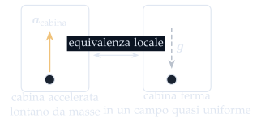

L'equivalenza è *locale*. In una cabina estesa, due oggetti in caduta libera possono avvicinarsi perché le linee di caduta convergono verso il centro della Terra; questi effetti di marea non possono essere eliminati su tutta la regione con un solo cambio di riferimento. Proprio i gradienti del campo segnalano la curvatura dello spazio-tempo.

::: errore La persona in orbita non è fuori dal campo gravitazionale
L'assenza di peso apparente in un veicolo orbitante deriva dal fatto che veicolo e occupanti cadono insieme. Il campo gravitazionale resta intenso; ciò che si annulla localmente è la forza di sostegno letta da una bilancia.
:::

Un'anomalia storicamente importante riguardava la precessione del perielio di Mercurio. Dopo avere sottratto la precessione del sistema di riferimento terrestre e i contributi newtoniani dovuti soprattutto alle perturbazioni degli altri pianeti, restava un residuo di circa $43”$ per secolo non riprodotto dalla teoria newtoniana. Nel 1915 Einstein mostrò che la relatività generale fornisce il termine mancante. Nella relatività generale la gravità non è descritta come una forza newtoniana istantanea, ma come geometria dinamica dello spazio-tempo.

::: storia Dal pianeta ipotetico Vulcano alla relatività
Le Verrier, dopo il successo di Nettuno, studiò l'anomalia di Mercurio e ipotizzò che potesse dipendere da materia non osservata o da un pianeta interno, spesso chiamato Vulcano. Le ricerche non produssero una conferma convincente. La spiegazione relativistica mostrò che un disaccordo può richiedere non un nuovo oggetto, ma una modifica della teoria. Il confronto fra Nettuno e Mercurio è quindi didatticamente prezioso: anomalie simili possono avere cause concettualmente diverse  [17, 18](#fonti).
:::

### Curvatura, luce e raggio di Schwarzschild

Nella relatività generale materia ed energia modificano la geometria dello spazio-tempo, e corpi liberi e raggi luminosi seguono le traiettorie consentite da tale geometria. Una conseguenza osservabile è la **lente gravitazionale**: la luce proveniente da una sorgente lontana può essere deviata da una massa interposta e produrre immagini multiple, archi o anelli. Dire che “la gravità tira il fotone come una pallina newtoniana” non è una spiegazione completa; la deviazione relativistica dipende dalla geometria dello spazio-tempo.

Per una massa sferica, non rotante e priva di carica, la soluzione esterna di Schwarzschild introduce la scala

::: legge Raggio di Schwarzschild
$$r_s=\frac{2GM}{c^2}.$$
:::

Per il Sole $r_s\approx2{,}95\un{km}$, molto minore del suo raggio reale; per la Terra $r_s\approx8{,}9\un{mm}$. Questi numeri non affermano che i due corpi siano buchi neri: indicano quanto dovrebbero essere compressi, nel modello ideale, perché il loro raggio coincidesse con questa scala.

::: errore Il raggio di Schwarzschild non è soltanto una velocità di fuga newtoniana
Ponendo formalmente $v_{\mathrm{fuga}}=c$ nella formula newtoniana si ottiene lo stesso valore numerico, ma un orizzonte degli eventi è un concetto relativistico. Non è una superficie materiale e non può essere descritto correttamente con particelle lanciate in uno spazio e in un tempo assoluti.
:::

La relatività generale è necessaria per campi intensi, buchi neri, onde gravitazionali e cosmologia; interviene anche nelle correzioni temporali dei sistemi globali di navigazione. Una derivazione relativistica esula dagli strumenti del capitolo. Il confronto serve a delimitare il dominio di validità del modello newtoniano.

::: sintesi Newton e Einstein: che cosa cambia
La teoria newtoniana tratta la gravità come forza istantanea in uno spazio e in un tempo assoluti. La relatività generale la descrive mediante la geometria dinamica dello spazio-tempo. Nel limite di campi deboli e velocità piccole, le previsioni relativistiche devono ridursi con ottima approssimazione a quelle newtoniane.
:::

::: nota Una buona teoria può essere limitata senza essere inutile
Dire che la teoria di Newton è approssimata non significa che sia falsa in ogni applicazione. Una teoria fisica è valutata anche attraverso il proprio dominio di validità. Per satelliti ordinari e pianeti, la gravitazione newtoniana costituisce spesso il primo modello quantitativo e rimane indispensabile.
:::

## Casi di studio e attività sperimentali {#casi}

### Caso di studio: Perché la densità conta quanto la massa

La gravità superficiale di una sfera di densità media $\rho$ è

$$g=\frac{GM}{R^2}
=\frac{G(4\pi R^3\rho/3)}{R^2}
=\frac43\pi G\rho R.$$

A parità di densità, un corpo più grande ha gravità superficiale maggiore; a parità di massa, prevale invece il corpo più compatto. Massa, raggio e densità devono quindi essere considerati insieme quando si confrontano pianeti rocciosi, giganti gassosi e piccoli corpi.

### Attività sperimentale: Misurare $g$ con un pendolo

**Obiettivo.**  stimare l'accelerazione di gravità dalla dipendenza del periodo dalla lunghezza,

$$T\approx2\pi\sqrt{\frac{\ell}{g}},$$

valida per piccole oscillazioni.

**Materiali o dati.**  filo leggero, piccola massa compatta, supporto stabile, metro e cronometro oppure video.

**Procedura.**

1. Misurare la lunghezza dal punto di sospensione al centro della massa.
2. Avviare oscillazioni di piccola ampiezza senza imprimere spinte.
3. Cronometrare almeno venti periodi e ripetere la misura.
4. Eseguire la prova per più lunghezze e rappresentare $T^2$ in funzione di $\ell$.
5. Ricavare $g$ dalla pendenza, pari a $4\pi^2/g$ nel modello ideale.

**Controllo e discussione.**  valutare la dispersione dei tempi, l'incertezza sulla lunghezza e l'effetto dell'ampiezza. Cronometrare molti periodi riduce l'incidenza relativa del tempo di reazione, ma non elimina gli errori sistematici.

**Sicurezza.**  fissare bene il supporto, usare una massa leggera e mantenere libera la zona di oscillazione.

## Glossario {#glossario}

- **Campo gravitazionale**: Forza gravitazionale per unità di massa di prova; nel modello newtoniano coincide con l'accelerazione di caduta libera ideale.
- **Costante gravitazionale**: Costante universale $G$ che determina l'intensità dell'interazione gravitazionale newtoniana.
- **Potenziale gravitazionale**: Energia potenziale gravitazionale per unità di massa; per una massa puntiforme, con zero all'infinito, $\phi=-GM/r$.

## Esercizi {#esercizi}

Gli esercizi riprendono quelli della dispensa. Ogni soluzione è nascosta finché non la apri: prova prima a impostare il problema da solo.

### Storia dell’astronomia e leggi empiriche

::: esercizio Ordinare una rivoluzione scientifica [avanzato]
Disporre in ordine cronologico Tolomeo, Copernico, Tycho Brahe, Keplero, Galileo e Newton. Per ciascuno indicare in una frase il contributo specifico alla comprensione del moto celeste, evitando di descrivere la storia come una semplice sostituzione immediata di un modello “sbagliato” con uno “giusto”.

>>> soluzione
**Ordine.**  Tolomeo, Copernico, Tycho Brahe, Keplero, Galileo, Newton.

**Contributi.**  Tolomeo organizzò quantitativamente il cielo geocentrico con deferenti ed epicicli. Copernico pose la Terra fra i pianeti e interpretò il moto retrogrado come effetto del moto relativo. Tycho produsse osservazioni molto precise. Keplero ricavò orbite ellittiche e tre leggi empiriche. Galileo fornì osservazioni telescopiche incompatibili con una semplice cosmologia geocentrica e sviluppò la fisica del moto. Newton collegò le leggi di Keplero a una dinamica universale.

**Interpretazione.**  Ogni passaggio conservò dati, tecniche o problemi dei modelli precedenti. La storia fu cumulativa e conflittuale, non istantanea.
:::

::: esercizio Il moto retrogrado come moto relativo [avanzato]
La Terra percorre un'orbita interna più rapidamente di Marte. Spiegare perché, durante un sorpasso orbitale, Marte sembra muoversi temporaneamente all'indietro rispetto allo sfondo delle stelle, pur continuando a orbitare nello stesso verso.

>>> soluzione
**Moto reale.**  Terra e Marte continuano entrambi a orbitare nello stesso verso attorno al Sole.

**Linea di vista.**  Durante il sorpasso la direzione Terra–Marte ruota rispetto alle stelle lontane nel verso opposto a quello apparente abituale di Marte.

**Conclusione.**  Il moto retrogrado è un effetto prospettico del moto relativo dell'osservatore terrestre. Non richiede che Marte inverta realmente la propria velocità orbitale.
:::

::: esercizio Quando un piccolo residuo conta [avanzato]
Un modello circolare prevede per Marte una posizione angolare che differisce sistematicamente dalle osservazioni di circa $8'$ d'arco, mentre l'incertezza osservativa è circa $2'$. È ragionevole ignorare la differenza come rumore? Motivare quantitativamente.

>>> soluzione
**Confronto.**  Il residuo è $8'/2'=4$ volte l'incertezza caratteristica.

**Regolarità.**  Se la differenza compare ripetutamente con lo stesso andamento, non è ben descritta come fluttuazione casuale.

**Conclusione.**  È ragionevole verificare calibrazione e dati, ma non semplicemente ignorare il residuo. Una discrepanza sistematica più grande dell'incertezza può indicare un limite del modello.
:::

::: esercizio Geometria minima di un'ellisse [avanzato]
Un'orbita ellittica ha semiasse maggiore $a=2{,}0\un{au}$ ed eccentricità $e=0{,}25$. Calcolare distanza al perielio e all'afelio.

>>> soluzione
**Perielio.**

$$r_p=a(1-e)=2{,}0(1-0{,}25)=1{,}5\un{au}.$$

**Afelio.**

$$r_a=a(1+e)=2{,}0(1+0{,}25)=2{,}5\un{au}.$$

**Controllo.**  La media $(r_p+r_a)/2=2{,}0\un{au}$ coincide con $a$.
:::

::: esercizio Aree uguali e velocità diverse [medio]
Due settori di un'orbita ellittica hanno la stessa area e sono percorsi nello stesso intervallo. Il primo è vicino al perielio, il secondo vicino all'afelio. Quale arco è percorso con velocità maggiore? Spiegare senza usare formule avanzate.

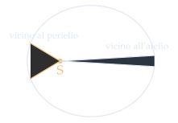
>>> soluzione
**Seconda legge.**  Aree uguali sono spazzate in tempi uguali.

**Geometria.**  Vicino al perielio il raggio vettore è più corto. Per produrre la stessa area nello stesso tempo il pianeta deve coprire un arco più lungo.

**Conclusione.**  La velocità è maggiore al perielio e minore all'afelio.
:::

::: esercizio I satelliti di Giove e il centro del mondo [avanzato]
Spiegare perché l'osservazione di corpi che orbitano attorno a Giove indebolì l'affermazione secondo cui ogni corpo celeste deve orbitare direttamente attorno alla Terra. L'osservazione, da sola, dimostrava già che la Terra orbita attorno al Sole?

>>> soluzione
**Conseguenza diretta.**  Esiste almeno un centro di moto celeste diverso dalla Terra: i satelliti orbitano attorno a Giove.

**Limite logico.**  Questo fatto confuta la versione più rigida del geocentrismo, ma non dimostra da solo il moto terrestre.

**Quadro complessivo.**  Le fasi di Venere esclusero la disposizione tolemaica, ma non il sistema geoeliocentrico di Tycho. Il moto terrestre fu sostenuto dall'insieme di osservazioni, dalla maggiore coerenza del quadro copernicano-kepleriano e, successivamente, dalla dinamica newtoniana.
:::

::: esercizio Caduta terrestre e orbita lunare [medio]
Descrivere l'idea fisica che consente a Newton di trattare una pietra che cade e la Luna come casi dello stesso fenomeno, chiarendo perché la Luna non colpisce la Terra.

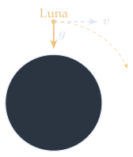
>>> soluzione
**Causa comune.**  Entrambi i corpi accelerano verso il centro della Terra per gravità.

**Differenza.**  La pietra ordinaria ha velocità tangenziale insufficiente e raggiunge il suolo. La Luna possiede una grande velocità trasversale.

**Orbita.**  Mentre cade, la Luna avanza lateralmente e la superficie terrestre si incurva sotto la traiettoria. Continua quindi a mancare la Terra.
:::

::: esercizio Descrizione e spiegazione [avanzato]
Classificare le seguenti affermazioni come prevalentemente descrittive o esplicative: (a) i pianeti spazzano aree uguali in tempi uguali; (b) una forza centrale produce momento torcente nullo; (c) il periodo cresce come $a^{3/2}$; (d) la gravitazione inversa al quadrato implica orbite kepleriane. Discutere perché una legge empirica può essere scientificamente importante anche prima di una spiegazione dinamica.

>>> soluzione
**Classificazione.**  (a) e (c) sono leggi descrittive del moto. (b) è un passaggio dinamico generale. (d) collega il modello di forza alle leggi osservate ed è esplicativa.

**Valore delle leggi empiriche.**  Una regolarità quantitativa permette previsioni, confronti e vincoli sulle teorie anche quando la causa non è ancora nota.

**Conclusione.**  Descrizione ed esplicazione non sono opposti: una buona spiegazione deve riprodurre le regolarità descritte.
:::

### Forza, sovrapposizione e campo

::: esercizio Forza gravitazionale fra due masse di laboratorio [avanzato]
Due sfere di massa $m_1=5{,}0\un{kg}$ e $m_2=8{,}0\un{kg}$ hanno i centri distanti $r=0{,}20\un{m}$. Calcolare la forza gravitazionale reciproca e confrontarla con il peso della sfera da $5{,}0\un{kg}$.

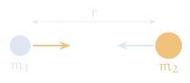
>>> soluzione
**Forza.**

$$F=G\frac{m_1m_2}{r^2}=6{,}67430\times10^{-11}\frac{(5{,}0)(8{,}0)}{0{,}20^2}
=6{,}67\times10^{-8}\un{N}.$$

**Peso.**  $P=m_1g\approx(5{,}0)(9{,}81)=49{,}1\un{N}$.

**Confronto.**

$$\frac{F}{P}\approx1{,}36\times10^{-9}.$$

La forza gravitazionale fra oggetti ordinari è estremamente piccola rispetto al peso terrestre.
:::

::: esercizio Verificare la legge dell'inverso del quadrato [base]
Una massa di prova subisce una forza $F_0$ alla distanza $r_0$. Quale forza subisce a $2r_0$, $3r_0$ e $r_0/2$?

>>> soluzione
**Impostazione.**
Poiché $F\propto1/r^2$,

$$F(2r_0)=\frac{F_0}{4},\qquad
F(3r_0)=\frac{F_0}{9},\qquad
F(r_0/2)=4F_0.$$

Dimezzare la distanza quadruplica la forza; non la raddoppia.
:::

::: esercizio Forza Terra–Luna [base]
Usare $M_T=5{,}972\times10^{24}\un{kg}$, $M_L=7{,}35\times10^{22}\un{kg}$ e $r=3{,}844\times10^{8}\un{m}$ per calcolare il modulo della forza gravitazionale fra Terra e Luna.

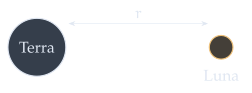
>>> soluzione
**Impostazione.**

$$F=G\frac{M_TM_L}{r^2}
=6{,}67430\times10^{-11}\frac{(5{,}972\times10^{24})(7{,}35\times10^{22})}{(3{,}844\times10^8)^2}
\approx1{,}98\times10^{20}\un{N}.$$

La Terra esercita sulla Luna una forza dello stesso modulo e verso opposto a quella esercitata dalla Luna sulla Terra.
:::

::: esercizio Forza vettoriale nel piano [avanzato]
Una massa $M=4{,}0\times10^{12}\un{kg}$ è nell'origine. Una massa $m=1000\un{kg}$ è nel punto $(3{,}0\un{km},4{,}0\un{km})$. Calcolare il vettore forza su $m$.

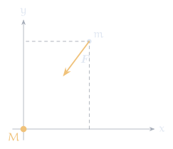
>>> soluzione
**Distanza e versore.**  $r=5{,}0\un{km}=5000\un{m}$ e il versore dalla sorgente alla massa è $(3/5,4/5)$.

**Modulo.**

$$F=G\frac{Mm}{r^2}=6{,}67430\times10^{-11}\frac{(4{,}0\times10^{12})(1000)}{(5000)^2}
=1{,}07\times10^{-2}\un{N}.$$

**Componenti.**  La forza punta verso l'origine:

$$\vect F=-F\left(\frac35\vers i+\frac45\vers j\right)
\approx(-6{,}41\times10^{-3}\vers i-8{,}54\times10^{-3}\vers j)\,\mathrm{N}.$$
:::

::: esercizio Punto di equilibrio fra due masse [medio]
Due masse $M_1=4M$ e $M_2=M$ sono ferme e distano $d$. Determinare, lungo il segmento che le unisce, il punto in cui il campo gravitazionale totale è nullo.

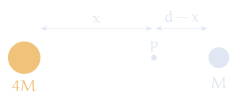
>>> soluzione
**Impostazione.**
Nel punto interno i campi sono opposti. Ponendo $x$ la distanza da $4M$,

$$G\frac{4M}{x^2}=G\frac{M}{(d-x)^2}.$$

Prendendo radici positive,

$$\frac{2}{x}=\frac{1}{d-x}\quad\Rightarrow\quad2(d-x)=x.$$

Quindi

$$x=\frac{2d}{3},\qquad d-x=\frac d3.$$

Il punto è più vicino alla massa minore.
:::

::: esercizio Tre masse ai vertici di un triangolo equilatero [medio]
Tre masse uguali $M$ occupano i vertici di un triangolo equilatero di lato $a$. Calcolare il modulo della forza risultante su una delle masse.

>>> soluzione
**Impostazione.**
Ciascuna delle altre masse esercita una forza di modulo

$$F_0=G\frac{M^2}{a^2}.$$

L'angolo fra le due forze è $60^\circ$. La risultante lungo la bisettrice vale

$$F_R=2F_0\cos30^\circ=\sqrt3\,F_0
=\sqrt3\,G\frac{M^2}{a^2}.$$

È diretta verso il centro del triangolo.
:::

::: esercizio Peso sulla Luna [base]
Una persona di massa $72\un{kg}$ si trova sulla Luna, dove $g_L=1{,}62\un{m/s^2}$. Calcolare massa e peso. Confrontare il peso con quello terrestre.

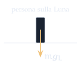
>>> soluzione
**Impostazione.**
La massa resta $72\un{kg}$. Il peso lunare è

$$P_L=mg_L=(72)(1{,}62)=117\un{N}.$$

Sulla Terra,

$$P_T=(72)(9{,}81)=706\un{N}.$$

Il rapporto è $P_L/P_T\approx0{,}165$: il peso lunare è circa un sesto di quello terrestre.
:::

::: esercizio Bilancia in ascensore e campo gravitazionale [avanzato]
Una persona di massa $65\un{kg}$ è su una bilancia in un ascensore che accelera verso l'alto con $a=1{,}5\un{m/s^2}$. Calcolare il peso gravitazionale e la lettura della bilancia. Spiegare quale delle due grandezze cambia durante l'accelerazione.

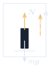
>>> soluzione
**Peso gravitazionale.**

$$P=mg=(65)(9{,}81)=638\un{N}.$$

**Seconda legge.**  Verso l'alto positivo:

$$N-mg=ma\quad\Rightarrow\quad N=m(g+a).$$

$$N=65(9{,}81+1{,}5)=735\un{N}.$$

**Interpretazione.**  Il campo e il peso gravitazionale cambiano trascurabilmente; cambia la forza normale misurata dalla bilancia.
:::

### Corpi sferici, gravità e potenziale

::: esercizio Gravità superficiale di un pianeta [base]
Un pianeta sferico ha massa $M=8{,}0\times10^{23}\un{kg}$ e raggio $R=3{,}0\times10^{6}\un{m}$. Calcolare l'accelerazione di gravità alla superficie.

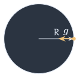
>>> soluzione
**Impostazione.**

$$g=G\frac{M}{R^2}=6{,}67430\times10^{-11}\frac{8{,}0\times10^{23}}{(3{,}0\times10^6)^2}
\approx5{,}93\un{m/s^2}.$$

Il valore è circa il 60% di quello terrestre.
:::

::: esercizio Variazione di $g$ con la quota [base]
Assumere $R_T=6371\un{km}$. A quale frazione di $g_0$ si trova $g$ alla quota $h=R_T$ sopra la superficie?

>>> soluzione
**Impostazione.**
La distanza dal centro è $R+h=2R$. Quindi

$$\frac{g(h)}{g_0}=\left(\frac{R}{R+h}\right)^2=\left(\frac12\right)^2=\frac14.$$

A una quota pari al raggio terrestre, $g$ è il 25% del valore superficiale.
:::

::: esercizio Massa ricavata da raggio e gravità [base]
Un corpo sferico ha raggio $R=1{,}74\times10^{6}\un{m}$ e gravità superficiale $g=1{,}62\un{m/s^2}$. Stimare la sua massa.

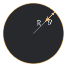
>>> soluzione
**Impostazione.**
Da $g=GM/R^2$,

$$M=\frac{gR^2}{G}
=\frac{(1{,}62)(1{,}74\times10^6)^2}{6{,}67430\times10^{-11}}
\approx7{,}35\times10^{22}\un{kg}.$$

Il risultato è compatibile con la massa lunare.
:::

::: esercizio Campo all'interno di una sfera uniforme [base]
In una sfera uniforme il campo cresce linearmente con la distanza dal centro. Se alla superficie vale $g_0$, quanto vale a $r=R/3$ e in quale direzione?

>>> soluzione
**Impostazione.**
Per densità uniforme,

$$g(r)=g_0\frac{r}{R}.$$

A $r=R/3$,

$$g=\frac{g_0}{3}.$$

Il campo è diretto verso il centro. Nel centro esatto il campo è nullo per simmetria.
:::

::: esercizio Una massa al centro di un guscio [base]
Una piccola massa si trova al centro di un guscio sferico uniforme. Qual è la forza gravitazionale risultante esercitata dal guscio? Cosa cambia se la massa viene spostata leggermente ma resta all'interno del guscio ideale?

>>> soluzione
**Impostazione.**
Il teorema dei gusci stabilisce che il campo è nullo in ogni punto interno a un guscio sferico sottile e uniforme. Pertanto

$$\vect F=m\vect g=\vect0$$

sia al centro sia dopo un piccolo spostamento, purché la massa rimanga nella cavità e il guscio resti ideale e sfericamente uniforme.
:::

::: esercizio Differenza di potenziale gravitazionale [medio]
Calcolare la differenza di potenziale per unità di massa fra la superficie terrestre e una quota $h=1000\un{km}$. Usare $GM_T=3{,}986\times10^{14}\un{m^3/s^2}$ e $R_T=6{,}371\times10^{6}\un{m}$.

>>> soluzione
**Impostazione.**

$$\Delta\phi=GM_T\left(\frac1{R_T}-\frac1{R_T+h}\right).$$

Con $R_T+h=7{,}371\times10^{6}\un{m}$,

$$\Delta\phi\approx3{,}986\times10^{14}
\left(\frac1{6{,}371\times10^6}-\frac1{7{,}371\times10^6}\right)
\approx8{,}48\times10^{6}\un{J/kg}.$$

Il potenziale aumenta, diventando meno negativo.
:::

::: esercizio Confronto fra $mgh$ e formula esatta [avanzato]
Una massa di $1000\un{kg}$ viene portata dalla superficie terrestre a quota $100\un{km}$. Confrontare l'approssimazione $m g_0 h$ con la variazione esatta $GMm(1/R-1/(R+h))$, usando in entrambe lo stesso modello sferico: $R=6{,}371\times10^{6}\un{m}$, $GM=3{,}986\times10^{14}\un{m^3/s^2}$ e $g_0=GM/R^2$.

>>> soluzione
**Campo uniforme coerente con il modello.**

$$g_0=\frac{GM}{R^2}\approx9{,}820\un{m/s^2},
\qquad
\Delta U_{mgh}=m g_0 h\approx9{,}82\times10^{8}\un{J}.$$

**Formula esatta.**

$$\Delta U=GMm\left(\frac1R-\frac1{R+h}\right)
\approx9{,}668\times10^{8}\un{J}.$$

**Scarto.**  L'approssimazione supera il valore esatto di circa $1{,}52\times10^7$ J, pari a circa l'1,57% del valore esatto. Lo scarto misura qui soltanto l'effetto della diminuzione del campo con la quota, perché $g_0$, $GM$ e $R$ sono internamente coerenti.
:::

::: esercizio Lavoro della gravità in una discesa orbitale [medio]
Un satellite di massa $500\un{kg}$ si sposta da $r_i=8{,}0\times10^{6}\un{m}$ a $r_f=7{,}0\times10^{6}\un{m}$ attorno alla Terra. Calcolare il lavoro della gravità usando $GM_T=3{,}986\times10^{14}\un{m^3/s^2}$.

>>> soluzione
**Impostazione.**

$$W_g=GMm\left(\frac1{r_f}-\frac1{r_i}\right).$$

$$W_g=(3{,}986\times10^{14})(500)
\left(\frac1{7{,}0\times10^6}-\frac1{8{,}0\times10^6}\right)
\approx3{,}56\times10^{9}\un{J}.$$

Il lavoro è positivo perché la quota finale è minore. Essendo la gravità conservativa, il risultato dipende soltanto dai raggi iniziale e finale, non dalla forma del percorso.
:::

### Maree, gradienti e sistemi estesi

::: esercizio Periodo di un satellite di navigazione [medio]
Un satellite percorre un'orbita circolare terrestre di raggio $r=2{,}66\times10^{7}\un{m}$. Calcolare il periodo e convertirlo in ore. Usare $GM_T=3{,}986\times10^{14}\un{m^3/s^2}$.

>>> soluzione
**Impostazione.**

$$T=2\pi\sqrt{\frac{r^3}{GM_T}}
=2\pi\sqrt{\frac{(2{,}66\times10^7)^3}{3{,}986\times10^{14}}}
\approx4{,}32\times10^{4}\un{s}.$$

$$T\approx\frac{4{,}32\times10^4}{3600}=12{,}0\un{h}.$$

Un periodo di circa dodici ore è tipico di molte orbite di navigazione.
:::

::: esercizio Orbita polare e copertura della Terra [base]
Spiegare perché un satellite in orbita polare può osservare nel tempo quasi tutta la superficie terrestre, mentre una singola orbita equatoriale sorvola sempre una fascia limitata.

>>> soluzione
**Impostazione.**
Il piano di un'orbita polare attraversa regioni vicine ai poli. Mentre il satellite ripete i passaggi, la Terra ruota sotto il piano orbitale e porta longitudini differenti sotto la traccia del satellite. Un'orbita equatoriale resta invece vicina all'equatore e non sorvola direttamente le alte latitudini. La copertura reale dipende da quota, inclinazione, periodo e campo visivo dello strumento.
:::

::: esercizio Condizioni per essere geostazionario [base]
Tre satelliti hanno periodo uguale al giorno siderale: A è in orbita circolare equatoriale prograda; B è in orbita circolare inclinata di $30^\circ$; C è in orbita equatoriale ellittica. Quale appare fermo nel cielo rispetto a un osservatore terrestre ideale?

>>> soluzione
**Impostazione.**
Solo A è geostazionario. Il periodo corretto è necessario ma non sufficiente. L'orbita deve essere circolare, equatoriale e percorsa nello stesso verso della rotazione terrestre. B descrive una traccia periodica a forma di analemma, con oscillazione nord-sud e una componente est-ovest; C cambia velocità e distanza e oscilla soprattutto in longitudine. Nessuno dei due resta fermo.
:::

::: esercizio Resistenza atmosferica e decadimento orbitale [medio]
Un satellite in orbita bassa perde lentamente energia per resistenza atmosferica. Spiegare perché la sua quota media diminuisce e perché, dopo essersi portato su un'orbita quasi circolare più bassa, la sua velocità orbitale può essere maggiore.

>>> soluzione
**Impostazione.**
La resistenza compie lavoro negativo, rendendo l'energia orbitale più negativa. Poiché per un'orbita circolare $E=-GMm/(2r)$, un'energia più negativa corrisponde a un raggio minore. In una nuova orbita circolare più bassa,

$$v_c=\sqrt{GM/r}$$

è maggiore. Durante il transitorio la resistenza riduce localmente la velocità, ma la caduta verso quote inferiori converte energia potenziale in cinetica. Il processo non è contraddittorio.
:::

::: esercizio Accelerazione mareale dovuta alla Luna [medio]
Stimare la differenza di accelerazione lunare fra il centro e il lato vicino della Terra usando

$$\Delta g\approx\frac{2GM_LR_T}{r^3},$$

con $M_L=7{,}35\times10^{22}\un{kg}$, $R_T=6{,}371\times10^{6}\un{m}$ e $r=3{,}844\times10^{8}\un{m}$.

>>> soluzione
**Impostazione.**

$$\Delta g\approx\frac{2(6{,}67430\times10^{-11})(7{,}35\times10^{22})(6{,}371\times10^6)}{(3{,}844\times10^8)^3}.$$

$$\Delta g\approx1{,}10\times10^{-6}\un{m/s^2}.$$

È circa $10^{-7}$ volte $g$. L'effetto osservabile nasce dalla variazione spaziale del campo che forza continuamente oceani e parte solida della Terra; l'ampiezza reale dipende anche da geometria, rotazione, attrito e risonanze dei bacini, non semplicemente dalla grande massa dell'acqua.
:::

::: esercizio Maree lunari e solari [medio]
Il rapporto fra le intensità mareali di due corpi è approssimativamente $(M_1/r_1^3)/(M_2/r_2^3)$. Usare $M_S/M_L\approx2{,}71\times10^7$ e $r_S/r_L\approx389$ per stimare il rapporto marea solare/marea lunare.

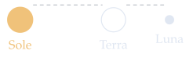
>>> soluzione
**Impostazione.**

$$\frac{\text{marea solare}}{\text{marea lunare}}
=\frac{M_S/M_L}{(r_S/r_L)^3}
=\frac{2{,}71\times10^7}{389^3}.$$

Poiché $389^3\approx5{,}89\times10^7$,

$$\frac{\text{solare}}{\text{lunare}}\approx0{,}46.$$

La marea solare è circa il 46% di quella lunare: il Sole è molto più massiccio ma assai più lontano.
:::

::: esercizio Densità e limite di Roche [base]
Due satelliti fluidi ideali, A e B, orbitano lo stesso pianeta. B ha densità media quattro volte maggiore di A. Sapendo che il limite di Roche scala approssimativamente come $r_R\propto\rho_s^{-1/3}$, trovare $r_{R,B}/r_{R,A}$.

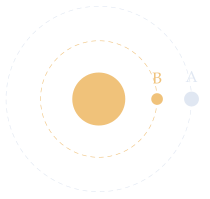
>>> soluzione
**Impostazione.**

$$\frac{r_{R,B}}{r_{R,A}}=
\left(\frac{\rho_B}{\rho_A}\right)^{-1/3}
=4^{-1/3}\approx0{,}630.$$

Il satellite più denso può avvicinarsi maggiormente prima che le maree superino la sua autogravità nel modello fluido. Rigidità e coesione possono modificare il limite reale.
:::

::: esercizio Peso apparente in una stazione orbitale [base]
Una stazione orbita a una quota dove $g=8{,}7\un{m/s^2}$. Un astronauta di massa $80\un{kg}$ fluttua senza contatto con le pareti. Calcolare la forza gravitazionale e la lettura ideale di una bilancia solidale con la stazione.

>>> soluzione
**Impostazione.**
La forza gravitazionale è

$$F_g=mg=(80)(8{,}7)=696\un{N}.$$

Tuttavia astronauta e stazione hanno quasi la stessa accelerazione. Non serve una forza normale per sostenerlo, quindi una bilancia ideale non compressa leggerebbe circa zero. Il peso gravitazionale non è nullo; è quasi nullo il peso apparente.
:::

### Perturbazioni e limiti del modello newtoniano

::: esercizio Nettuno o Mercurio: due anomalie diverse [avanzato]
Perché fu ragionevole cercare un pianeta perturbatore per spiegare le anomalie di Urano, mentre l'analoga strategia non risolse il problema del perielio di Mercurio? Formulare una risposta che distingua dati, modello e ipotesi.

>>> soluzione
**Urano.**  Le differenze erano compatibili con l'effetto newtoniano di una massa esterna non ancora osservata. Il calcolo produsse una posizione celeste controllabile e Nettuno fu trovato vicino alla previsione.

**Mercurio.**  Furono cercati materia e pianeti interni, ma non emerse un corpo capace di spiegare coerentemente il residuo.

**Lezione.**  Un'anomalia non determina da sola la causa. Può indicare dati incompleti, un corpo non osservato oppure un limite della teoria. Servono previsioni quantitative e controlli indipendenti.
:::

::: esercizio Interpretare i punti di Lagrange [base]
Nel sistema Sole–Terra, spiegare qualitativamente perché un veicolo vicino a $L_1$ può mantenere una posizione approssimativamente allineata fra Sole e Terra, pur essendo più vicino al Sole e quindi su un'orbita che, isolatamente, avrebbe periodo minore.

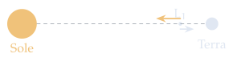
>>> soluzione
**Impostazione.**
Un corpo alla distanza di $L_1$ dal Sole, se fosse soggetto soltanto alla gravità solare, riceverebbe un'accelerazione verso il Sole troppo grande per ruotare con la stessa velocità angolare della Terra. L'attrazione terrestre, diretta verso l'esterno lungo la linea Sole–Terra, riduce l'accelerazione gravitazionale netta verso il Sole fino al valore centripeto necessario alla rotazione sincrona. Nel riferimento che ruota con la Terra può quindi esistere un equilibrio relativo. Il punto è instabile e le missioni operano nelle sue vicinanze con correzioni periodiche.
:::

::: esercizio Precessione: riconoscere ciò che cambia [base]
In un modello di pura precessione apsidale, un'orbita quasi ellittica presenta un perielio che ruota lentamente dopo ogni rivoluzione. Quali grandezze restano approssimativamente periodiche e quale elemento geometrico cambia? Perché non è corretto dire semplicemente che “l'orbita non è più ellittica”?

>>> soluzione
**Impostazione.**
Su ogni rivoluzione la traiettoria può essere molto ben approssimata da un'ellisse con dimensione ed eccentricità quasi costanti. Ciò che cambia lentamente è l'orientamento della linea degli apsidi, cioè la direzione perielio–afelio. L'orbita completa nel tempo non si chiude su una singola ellisse fissa, ma l'approssimazione ellittica istantanea resta utile.
:::

::: esercizio Misurare $g$ con un pendolo [medio]
Un pendolo di lunghezza $\ell=0{,}80\un{m}$ compie 20 oscillazioni complete in $35{,}9\un{s}$. Stimare $g$ e discutere due fonti di errore sistematico.

>>> soluzione
**Impostazione.**
Il periodo è

$$T=\frac{35{,}9}{20}=1{,}795\un{s}.$$

Da $T=2\pi\sqrt{\ell/g}$,

$$g=\frac{4\pi^2\ell}{T^2}
=\frac{4\pi^2(0{,}80)}{1{,}795^2}
\approx9{,}80\un{m/s^2}.$$

Fonti sistematiche: misurare $\ell$ fino al bordo invece che al centro di massa; usare ampiezze troppo grandi; attrito del perno o resistenza dell'aria. Il conteggio di molti periodi riduce l'errore relativo dovuto al tempo di reazione, ma non corregge questi errori sistematici.
:::

::: esercizio Passo temporale in una simulazione orbitale [base]
Due simulazioni della stessa orbita usano passi $\Delta t_1=10\un{s}$ e $\Delta t_2=100\un{s}$. La seconda mostra una deriva dell'energia molto maggiore. Spiegare perché ridurre il passo può migliorare il risultato e perché non garantisce, da solo, una conservazione perfetta.

>>> soluzione
**Impostazione.**
Con un passo più piccolo l'accelerazione viene aggiornata più spesso e l'approssimazione locale della traiettoria è migliore. Tuttavia l'errore dipende anche dallo schema numerico: alcuni metodi accumulano sistematicamente errore energetico anche con passi moderati. Ridurre $\Delta t$ deve essere accompagnato da un test di convergenza e, per simulazioni lunghe, dalla scelta di integratori adatti alla dinamica orbitale.
:::

::: esercizio Verificare la terza legge con dati [medio]
Tre lune dello stesso pianeta hanno $(a,T)$ proporzionali a $(1,1)$, $(2,2{,}84)$ e $(3,5{,}20)$ in unità arbitrarie. Calcolare $T^2/a^3$ per ciascuna e valutare la compatibilità con la terza legge.

>>> soluzione
**Impostazione.**
Per la prima luna,

$$\frac{T^2}{a^3}=1.$$

Per la seconda,

$$\frac{2{,}84^2}{2^3}=\frac{8{,}0656}{8}=1{,}008.$$

Per la terza,

$$\frac{5{,}20^2}{3^3}=\frac{27{,}04}{27}=1{,}0015.$$

I tre valori differiscono di meno dell'1% e sono compatibili con una costante comune, tenendo conto di arrotondamenti.
:::

::: esercizio Sorvolo di un asteroide: sintesi di modello [base]
Un asteroide si avvicina a un pianeta con energia orbitale positiva rispetto al pianeta. Senza entrare in collisione e trascurando atmosfera e altri corpi, descrivere la forma della traiettoria, il segno dell'energia all'uscita e come cambia la direzione della velocità.

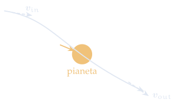
>>> soluzione
**Impostazione.**
Con energia positiva la traiettoria relativa ideale è iperbolica. La gravità accelera l'asteroide durante l'avvicinamento e lo rallenta durante l'allontanamento; a uguale distanza, il modulo della velocità è lo stesso in entrata e in uscita per conservazione dell'energia. L'energia resta positiva e il corpo non viene catturato. La direzione della velocità viene però deviata verso il pianeta, producendo un angolo di scattering.
:::

### Problemi di sintesi: gravitazione

::: esercizio Accelerazione gravitazionale terrestre [medio]
Usando $M_T=5{,}972\times10^{24}\,\mathrm{kg}$ e $R_T=6{,}371\times10^6\,\mathrm{m}$, calcolare $g$ alla superficie.
>>> soluzione
**Campo.**  $g=GM_T/R_T^2=9{,}82\un{m/s^2}$.
:::

::: esercizio Gravità in orbita bassa [avanzato]
Calcolare l'accelerazione gravitazionale a quota $400\un{km}$ sopra la Terra.
>>> soluzione
**Distanza dal centro.**  $r=R_T+h$.

**Campo.**  $g(r)=GM_T/r^2=8{,}69\un{m/s^2}$, ancora circa il $88{,}5\%$ del valore superficiale. L'assenza di peso orbitale è dovuta alla caduta libera, non a gravità nulla.
:::

::: esercizio Campo dentro una Terra uniforme [avanzato]
Assumendo densità terrestre uniforme, quale sarebbe $g$ a metà del raggio terrestre in rapporto al valore superficiale?
>>> soluzione
**Massa racchiusa.**  $M(r)=M_T(r/R_T)^3$.

**Campo.**  $g(r)=GM(r)/r^2=g_s(r/R_T)$. A $r=R_T/2$, $g=g_s/2$. Il risultato cambia per la Terra reale, la cui densità non è uniforme.
:::

::: esercizio Potenziale gravitazionale alla superficie [medio]
Calcolare il potenziale gravitazionale terrestre alla superficie, ponendo zero all'infinito.
>>> soluzione
**Definizione.**

$$\Phi(R_T)=-\frac{GM_T}{R_T}=-6{,}26\times10^{7}\un{J/kg}.$$

Il valore è l'energia potenziale per unità di massa.
:::

::: esercizio Gradiente mareale lunare [avanzato]
Stimare la differenza di accelerazione lunare fra due punti separati radialmente di $2\un{m}$ alla distanza media Terra–Luna $r=3{,}844\times10^8\,\mathrm{m}$.
>>> soluzione
**Linearizzazione.**  $|dg/dr|=2GM/r^3$.

$$\Delta g\simeq\frac{2GM_L}{r^3}L=3{,}45\times10^{-13}\un{m/s^2}.$$

Il valore minuscolo mostra perché gli effetti mareali richiedano grandi estensioni o misure sensibili.
:::

::: esercizio Limite di Roche per un satellite fluido [medio]
Stimare il limite di Roche di un satellite fluido con densità $1000\un{kg/m^3}$ attorno alla Terra, usando $d\simeq2{,}44R_T(\rho_T/\rho_s)^{1/3}$ e $\rho_T=5515\,\mathrm{kg/m^3}$.
>>> soluzione
**Sostituzione.**

$$d=2{,}75\times10^{7}\un{m}=2{,}75\times10^{4}\un{km}$$

dal centro terrestre. La formula dipende dalla struttura e dalla resistenza interna del satellite.
:::

::: esercizio Raggio di Schwarzschild del Sole [medio]
Calcolare il raggio di Schwarzschild del Sole con $M_S=1{,}989\times10^{30}\,\mathrm{kg}$.
>>> soluzione
**Formula.**

$$r_s=\frac{2GM_S}{c^2}=2954\un{m}=2{,}95\un{km}.$$

Il Sole reale ha raggio molto maggiore e non è un buco nero.
:::

::: esercizio Deviazione della luce al lembo solare [avanzato]
Nel limite debole della relatività generale, la deviazione di un raggio radente al Sole è $\alpha=4GM/(c^2b)$. Calcolarla per $b=R_S=6{,}957\times10^8\,\mathrm{m}$.
>>> soluzione
**Angolo.**

$$\alpha=8{,}49\times10^{-6}\un{rad}.$$

**Secondi d'arco.**  Moltiplicando per $206265$, $\alpha=1{,}75”$.
:::

## Fonti {#fonti}

Il testo, le formule, i diagrammi e gli esercizi di questo capitolo provengono dalla *Dispensa di fisica* del corso (sezioni 4.1-4.5, 4.11, 4.13 e materiali delle sezioni 4.14), consultabile nel lettore della galassia. Per la lettura sul sito sono cambiati l'impaginazione, i colori delle figure, la numerazione e la posizione di alcuni riquadri ed esercizi; la sezione iniziale è scritta per il pianeta di questa unità.

Opere citate nel testo:

1. G. J. Toomer, *Ptolemy's Almagest*, Duckworth, Londra, 1984.
2. N. Copernico, *De revolutionibus orbium coelestium*, Norimberga, 1543; traduzione inglese di E. Rosen, Johns Hopkins University Press, Baltimora, 1992.
3. T. S. Kuhn, *The Copernican Revolution: Planetary Astronomy in the Development of Western Thought*, Harvard University Press, Cambridge (MA), 1957.
4. J. L. E. Dreyer, *Tycho Brahe: A Picture of Scientific Life and Work in the Sixteenth Century*, Adam and Charles Black, Edimburgo, 1890.
5. J. Kepler, *Astronomia nova*, Praga, 1609; traduzione inglese di W. H. Donahue, Cambridge University Press, Cambridge, 1992.
6. J. Kepler, *Harmonices mundi*, Linz, 1619; traduzione inglese di E. J. Aiton, A. M. Duncan e J. V. Field, American Philosophical Society, Filadelfia, 1997.
7. G. Galilei, *Sidereus Nuncius*, Venezia, 1610; traduzione inglese e introduzione di A. Van Helden, University of Chicago Press, Chicago, 1989.
8. Museo Galileo, *Le fasi di Venere*, catalogo scientifico digitale, [https://catalogue.museogalileo.it/indepth/PhasesVenus.html](https://catalogue.museogalileo.it/indepth/PhasesVenus.html) (consultato il 15 luglio 2026).
9. G. Galilei, *Discorsi e dimostrazioni matematiche intorno a due nuove scienze*, Elsevier, Leida, 1638; traduzione inglese di S. Drake, *Two New Sciences*, University of Wisconsin Press, Madison, 1974.
10. I. Newton, *The Principia: Mathematical Principles of Natural Philosophy*, nuova traduzione di I. B. Cohen e A. Whitman, University of California Press, Berkeley, 1999; edizione originale latina, Londra, 1687.
11. R. S. Westfall, *Never at Rest: A Biography of Isaac Newton*, Cambridge University Press, Cambridge, 1980.
12. P. J. Mohr, D. B. Newell, B. N. Taylor ed E. Tiesinga, “CODATA recommended values of the fundamental physical constants: 2022”, *Journal of Physical and Chemical Reference Data*, vol. 54, 033105, 2025, doi: 10.1063/5.0279860; valori disponibili presso NIST, [https://physics.nist.gov/constants/](https://physics.nist.gov/constants/) (consultato il 15 luglio 2026).
13. H. Cavendish, “Experiments to Determine the Density of the Earth”, *Philosophical Transactions of the Royal Society of London*, vol. 88, 1798, pp. 469–526.
14. C. V. Boys, “On the Newtonian Constant of Gravitation”, *Philosophical Transactions of the Royal Society A*, vol. 186, 1895, pp. 1–72.
15. P.-S. Laplace, *Traité de mécanique céleste*, 5 voll., Parigi, 1799–1825.
16. C. F. Gauss, *Allgemeine Lehrsätze in Beziehung auf die im verkehrten Verhältnisse des Quadrats der Entfernung wirkenden Anziehungs- und Abstossungs-Kräfte*, Lipsia, 1840.
17. U. Le Verrier, “Théorie du mouvement de Mercure”, *Annales de l'Observatoire impérial de Paris*, vol. 5, 1859, pp. 1–196.
18. A. Einstein, “Erklärung der Perihelbewegung des Merkur aus der allgemeinen Relativitätstheorie”, *Sitzungsberichte der Königlich Preussischen Akademie der Wissenschaften*, 1915, pp. 831–839.
