## Prima di cominciare {#apertura}

La sonda deve restare su un'orbita circolare attorno a una sorgente ideale. A ogni raggio corrisponde una sola velocità compatibile con l'accelerazione centripeta fornita dalla gravità, e la massa della sonda si semplifica nel conto: chi pianifica la manovra sceglie il raggio e ne ricava la velocità.

Il capitolo presenta l'orbita come caduta continua, le tre leggi di Keplero, l'energia delle orbite e la velocità di fuga, il potenziale efficace e la classificazione delle orbite, satelliti e missioni spaziali, perturbazioni e punti di Lagrange. Le sezioni finali raccolgono casi di studio, attività con dati pubblici e il formulario della gravitazione. Il capitolo usa la [legge di gravitazione](unit:physics-12) e il [bilancio energetico](unit:physics-08).

## Un'orbita è una caduta continua {#s-4-6}

Consideriamo un satellite di massa $m$ in orbita circolare di raggio $r$ attorno a un corpo di massa $M$, con $M\gg m$. La forza gravitazionale fornisce la forza centripeta:

$$G\frac{Mm}{r^2}=m\frac{v^2}{r}.$$

La massa del satellite si semplifica:

::: legge Velocità di un'orbita circolare
$$v_c=\sqrt{\frac{GM}{r}}.$$
:::

Il periodo è

::: legge Periodo di un'orbita circolare
$$T=\frac{2\pi r}{v_c}
=2\pi\sqrt{\frac{r^3}{GM}}.$$
:::

Aumentando il raggio orbitale, la velocità circolare diminuisce ma il periodo aumenta. Un satellite più lontano percorre una circonferenza maggiore e si muove più lentamente.

::: esempio Orbita bassa terrestre ideale
Per $r=R_T+h\approx6{,}771\times10^{6}\un{m}$ e $GM_T\approx3{,}986\times10^{14}\un{m^3/s^2}$,

$$v_c=\sqrt{\frac{3{,}986\times10^{14}}{6{,}771\times10^6}}
\approx7{,}67\un{km/s}.$$

Il periodo vale

$$T=2\pi\sqrt{\frac{(6{,}771\times10^6)^3}{3{,}986\times10^{14}}}
\approx5{,}55\times10^{3}\un{s}\approx92{,}5\un{min}.$$

Il calcolo trascura atmosfera, schiacciamento e armoniche non sferiche del campo terrestre, oltre alle perturbazioni lunisolari.
:::

::: storia Il “cannone di Newton”
Newton immaginò, in una celebre costruzione concettuale, un proiettile lanciato orizzontalmente dalla cima di una montagna molto alta. A velocità crescente il proiettile cade sempre più lontano; a una velocità appropriata la superficie terrestre si incurva con la stessa rapidità con cui il proiettile cade. L'orbita è quindi una caduta che non raggiunge il suolo. L'immagine non descrive un metodo pratico di lancio, ma chiarisce l'unità fra traiettoria balistica e moto orbitale  [1](#fonti).
:::

::: quotidiano Microgravità
In un veicolo orbitale astronauti e oggetti subiscono quasi la stessa accelerazione gravitazionale. Poiché non esiste una superficie che li sostenga, il loro peso apparente è molto piccolo. Il termine *microgravità* ricorda che restano accelerazioni residue dovute a gradienti gravitazionali, rotazioni, vibrazioni e resistenza atmosferica.
:::

## Le tre leggi di Keplero {#s-4-7}

### Prima legge: orbite ellittiche

Un pianeta percorre un'ellisse con il Sole in uno dei fuochi. Un'ellisse è caratterizzata dal semiasse maggiore $a$ e dall'eccentricità $e$, con $0\le e<1$ per un'orbita legata ellittica. Le distanze al perielio e all'afelio sono

$$r_p=a(1-e),
\qquad
r_a=a(1+e).$$

Per $e=0$ l'ellisse diventa una circonferenza.


### Seconda legge: aree uguali in tempi uguali

### Terza legge: periodo e semiasse maggiore

Per corpi che orbitano attorno alla stessa massa dominante $M$,

::: legge Terza legge di Keplero in forma newtoniana
$$T^2=\frac{4\pi^2}{GM}a^3.$$
:::

Per due masse confrontabili, $M$ va sostituita con $M+m$:

$$T^2=\frac{4\pi^2}{G(M+m)}a^3,$$

dove $a$ è il semiasse maggiore della separazione relativa fra i due corpi. Entrambi orbitano attorno al centro di massa comune.

::: errore Il Sole non occupa il centro dell'ellisse
Il Sole è in un fuoco, non nel centro geometrico. Inoltre, nel problema reale, Sole e pianeta orbitano entrambi attorno al baricentro. L'approssimazione del Sole fermo è eccellente per pianeti di massa molto minore, ma non è esatta.
:::

## Energia delle orbite e velocità di fuga {#s-4-8}

L'energia meccanica di una massa $m$ nel campo di $M$ è

$$E=\frac12mv^2-\frac{GMm}{r}.$$

Il segno dell'energia permette una prima classificazione:

- $E<0$: moto legato; se il momento angolare non è nullo, la traiettoria è un'ellisse, con il cerchio come caso particolare;
- $E=0$: moto al limite della fuga; con momento angolare non nullo, la traiettoria è parabolica;
- $E>0$: moto non legato; con momento angolare non nullo, la traiettoria è iperbolica.

I moti puramente radiali, con momento angolare nullo, costituiscono casi degeneri e non hanno la forma delle coniche non degeneri appena elencate.

Per un'orbita circolare, usando $v_c^2=GM/r$,

$$K=\frac{GMm}{2r},
\qquad
U=-\frac{GMm}{r},
\qquad
E=-\frac{GMm}{2r}.$$

L'energia meccanica orbitale totale è negativa e vale metà dell'energia potenziale.

Le formule che seguono assumono dapprima una massa dominante $M$ trattata come fissa e una massa orbitante $m$ molto più piccola. Nel problema generale a due corpi la vis-viva usa il parametro $G(M+m)$ e la velocità relativa; l'energia orbitale totale resta $-GMm/(2a)$, con $a$ semiasse maggiore della separazione relativa.

Per un'orbita ellittica di semiasse maggiore $a$,

::: legge Energia di un'orbita ellittica
$$E=-\frac{GMm}{2a}.$$
:::

Combinando questa relazione con l'energia in un punto si ottiene l'equazione vis-viva:

::: legge Equazione vis-viva
$$v^2=GM\left(\frac{2}{r}-\frac{1}{a}\right).$$
:::

Essa permette di calcolare la velocità a qualunque distanza $r$ lungo un'orbita kepleriana.

La velocità minima iniziale che consente di raggiungere distanza infinita con velocità finale nulla è

::: legge Velocità di fuga
$$v_{\mathrm{esc}}=\sqrt{\frac{2GM}{R}}=\sqrt{2}\,v_c(R).$$
:::

La formula non significa che un razzo debba raggiungere istantaneamente tale velocità al suolo. Un veicolo propulso continua a ricevere energia durante la salita e deve affrontare resistenza atmosferica e perdite gravitazionali.

::: esempio Energia per portare un satellite su un'orbita più alta
Per una massa $m$ in orbita circolare, l'energia è $E=-GMm/(2r)$. Passando da $r_1$ a $r_2>r_1$,

$$\Delta E=\frac{GMm}{2}\left(\frac1{r_1}-\frac1{r_2}\right)>0.$$

Occorre fornire energia, anche se la velocità finale dell'orbita circolare più alta è minore. Il punto apparentemente paradossale si risolve osservando che l'energia potenziale aumenta più di quanto diminuisca l'energia cinetica.
:::

::: storia Halley e la previsione di una cometa
Nel 1705 Edmond Halley confrontò le orbite delle comete osservate nel 1531, 1607 e 1682 e propose che fossero passaggi dello stesso corpo, perturbato soprattutto da Giove e Saturno. Predisse un ritorno attorno al 1758; la cometa fu osservata nuovamente e prese il suo nome. Fu una dimostrazione spettacolare del potere predittivo della gravitazione newtoniana, ma la previsione richiese anche la considerazione delle perturbazioni planetarie  [2, 3](#fonti).
:::

## Potenziale efficace e classificazione delle orbite {#s-4-9}

In un campo centrale il momento angolare $L$ si conserva e il moto resta in un piano. Separando il moto radiale da quello angolare, l'energia può essere scritta come

$$E=\frac12m\dot r^2+U_{\mathrm{eff}}(r),
\qquad
U_{\mathrm{eff}}(r)=-\frac{GMm}{r}+\frac{L^2}{2mr^2}.$$

Il secondo termine non è una nuova interazione: rappresenta nel problema radiale il costo cinetico associato al momento angolare.

::: approfondimento Dimostrazione: Condizione per un'orbita circolare
**Ipotesi.** Campo newtoniano di una massa centrale $M$, massa orbitante $m$ e momento angolare costante $L$.

**Passaggi.** Un'orbita circolare corrisponde a un estremo del potenziale efficace:

$$\frac{\dd U_{\mathrm{eff}}}{\dd r}=\frac{GMm}{r^2}-\frac{L^2}{mr^3}=0.$$

Da cui

$$L^2=GMm^2r.$$

Poiché $L=mvr$, segue $v^2=GM/r$.

**Significato fisico.** La formula usuale della velocità orbitale è la condizione di equilibrio radiale nel potenziale efficace. Il minimo è stabile nel problema newtoniano.

**Limiti di validità.** La trattazione trascura perturbazioni, distribuzione non sferica della massa, resistenza e correzioni relativistiche.
:::

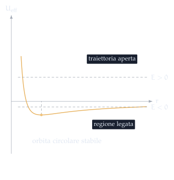

### Gravità all'interno di una sfera uniforme

### Masse astronomiche ricavate dalle orbite

## Satelliti artificiali e missioni spaziali {#s-4-10}

Un satellite artificiale è un corpo posto su una traiettoria orbitale mediante un lanciatore. La scelta dell'orbita dipende dalla missione.

- Le orbite terrestri basse hanno periodi dell'ordine di un'ora e mezza e sono usate per osservazione, ricerca e voli umani.
- Le orbite polari attraversano regioni prossime ai poli e permettono di osservare progressivamente gran parte della superficie terrestre.
- Un'orbita geosincrona ha periodo uguale al giorno siderale terrestre. Se è circolare, equatoriale e percorsa nello stesso verso della rotazione terrestre, è geostazionaria e il satellite appare fermo rispetto al suolo.
- Le orbite molto eccentriche possono offrire lunghi tempi di permanenza apparente sopra determinate regioni.

Il raggio geostazionario si ottiene imponendo $T$ uguale al giorno siderale:

$$r_{\mathrm{geo}}=\left(\frac{GMT^2}{4\pi^2}\right)^{1/3}.$$

La quota è $h=r_{\mathrm{geo}}-R_T$.

::: esempio Quota geostazionaria
Con $T=86164\un{s}$ e $GM_T=3{,}986\times10^{14}\un{m^3/s^2}$,

$$r_{\mathrm{geo}}\approx4{,}2164\times10^{7}\un{m}.$$

Per una quota sopra l'equatore si sottrae il raggio equatoriale terrestre $R_{\mathrm{eq}}\approx6378{,}1\un{km}$, non il raggio medio:

$$h\approx3{,}5786\times10^{7}\un{m}\approx35786\un{km}.$$

Nel modello ideale l'orbita deve essere circolare, equatoriale e prograda per risultare geostazionaria; nella pratica sono necessarie manovre di mantenimento della posizione  [4](#fonti).
:::

### Cambiare orbita

Un impulso tangenziale modifica energia e momento angolare. Se viene applicato in un punto in cui la velocità radiale è nulla, cioè a un apside, un impulso nel verso del moto mantiene quel punto come apside e innalza l'apside opposto; un impulso retrogrado lo abbassa. In un punto generico la nuova orbita non ha necessariamente un apside nel punto dell'impulso. Per passare fra due orbite circolari coplanari si può usare un'ellisse di trasferimento tangente a entrambe, detta trasferimento di Hohmann. Il calcolo esatto degli impulsi usa l'equazione vis-viva; qui interessa soprattutto il principio fisico: i motori non “spingono verso l'alto” per tutta la missione, ma modificano la velocità in punti scelti, trasformando l'intera traiettoria.

::: errore Una spinta in avanti può portare a una velocità orbitale finale minore
Partendo da un'orbita circolare, un impulso tangenziale progrado sufficientemente piccolo da non produrre la fuga inserisce il satellite in un'orbita ellittica il cui perigeo coincide con il punto della manovra. Durante la salita la velocità diminuisce mentre l'energia potenziale aumenta. Dopo un secondo impulso che circolarizza l'orbita all'apogeo, la velocità finale è minore di quella della prima orbita circolare, ma l'energia meccanica totale è maggiore.
:::

::: storia Dalla teoria delle orbite all'era spaziale
La meccanica newtoniana fu applicata per secoli a pianeti, comete e stelle doppie prima dell'esistenza di satelliti artificiali. Il lancio dello Sputnik 1 nel 1957 trasformò l'orbita artificiale in una tecnologia operativa. Da allora la meccanica orbitale è diventata essenziale per telecomunicazioni, meteorologia, navigazione, osservazione della Terra e scienza planetaria. Le missioni reali richiedono modelli più completi di quelli del problema a due corpi: forma non sferica della Terra, atmosfera, pressione di radiazione e perturbazioni di Sole e Luna  [5, 6, 7](#fonti).
:::

## Perturbazioni, tre corpi e punti di Lagrange {#s-4-12}

Il problema ideale a due corpi ammette orbite coniche esatte. In un sistema reale agiscono anche altri corpi, la forma non sferica delle sorgenti e forze non gravitazionali. Se questi contributi sono piccoli, l'orbita kepleriana resta la prima approssimazione e i suoi parametri variano lentamente. Le perturbazioni diventano così segnali misurabili: possono verificare il modello, rivelare masse non osservate o indicare effetti trascurati.

::: storia Nettuno: una scoperta guidata dalle perturbazioni
Nell'Ottocento l'orbita osservata di Urano mostrava differenze rispetto alle previsioni basate sui pianeti noti. John Couch Adams e Urbain Le Verrier calcolarono indipendentemente la possibile posizione di un pianeta perturbatore. Nel 1846 Johann Gottfried Galle e Heinrich d'Arrest osservarono Nettuno vicino alla posizione prevista da Le Verrier. La vicenda non fu una dimostrazione che ogni anomalia implica un nuovo pianeta: fu un successo ottenuto perché il modello, i dati e la previsione quantitativa erano sufficientemente precisi  [8, 9](#fonti).
:::

Nel problema ristretto circolare a tre corpi si considerano due masse grandi in orbita circolare e una terza massa così piccola da non influenzarle. In un riferimento che ruota con le due masse esistono cinque posizioni di equilibrio relativo, chiamate punti di Lagrange. I punti collineari $L_1$, $L_2$ e $L_3$ sono instabili. I punti triangolari $L_4$ e $L_5$ sono linearmente stabili soltanto se il parametro di massa $\mu=m_2/(m_1+m_2)$ è minore di circa $0{,}0385$; la condizione è ampiamente soddisfatta, per esempio, nei sistemi Sole–Terra e Sole–Giove  [10](#fonti).

::: approfondimento Perché un veicolo non resta esattamente fermo in un punto di Lagrange
Le missioni associate ai punti collineari, come $L_1$ e $L_2$, percorrono spesso orbite halo o Lissajous attorno alla regione di equilibrio, anziché sostare nel punto matematico. I punti collineari sono instabili e il sistema reale è perturbato, perciò servono manovre periodiche di mantenimento. $L_4$ e $L_5$ hanno proprietà diverse quando è soddisfatta la condizione di stabilità. L'equilibrio va interpretato nel riferimento rotante e dipende insieme dalla gravità e dal moto orbitale  [11, 12](#fonti).
:::

## Casi di studio e attività sperimentali {#casi}

### Caso di studio: Determinare la massa di un pianeta da un satellite

Se un satellite percorre un'orbita quasi circolare di raggio $r$ e periodo $T$, dalla terza legge si ricava

$$M\approx\frac{4\pi^2r^3}{GT^2}.$$

La massa del pianeta non viene misurata ponendolo su una bilancia: viene inferita dalla risposta dinamica di un corpo che si muove nel suo campo. Se la massa del satellite non è trascurabile, si determina $M+m$.

### Attività sperimentale: Ricostruire un'orbita da dati pubblici

**Obiettivo.**  verificare la terza legge di Keplero per satelliti dello stesso corpo centrale e stimare il parametro gravitazionale $GM$.

**Materiali o dati.**  tabella di periodi e semiassi maggiori tratta da una fonte dichiarata, calcolatrice o foglio di calcolo.

**Procedura.**

1. Selezionare satelliti naturali dello stesso pianeta e registrare $T$ e $a$ in unità coerenti.
2. Calcolare $T^2$ e $a^3$ con un numero di cifre adeguato ai dati iniziali.
3. Rappresentare $T^2$ in funzione di $a^3$ e adattare una retta passante, entro l'incertezza, per l'origine.
4. Ricavare $GM=4\pi^2/(\text{pendenza})$.

**Controllo e discussione.**  indicare fonte, unità e cifre significative; non confondere semiasse maggiore, distanza istantanea e quota sopra la superficie. Esaminare gli scarti dalla retta prima di attribuirli a un limite della teoria.

### Attività sperimentale: Simulazione numerica elementare di un'orbita

**Obiettivo.**  integrare numericamente un'orbita e distinguere l'evoluzione fisica dall'errore introdotto dall'algoritmo.

**Materiali o dati.**  foglio di calcolo oppure breve programma, valore di $GM$ e condizioni iniziali dichiarate.

**Modello numerico.**  con passo $\Delta t$, lo schema di Eulero simplettico aggiorna

$$\vect a_k=-\frac{GM}{|\vect r_k|^3}\vect r_k,
\qquad
\vect v_{k+1}=\vect v_k+\vect a_k\Delta t,
\qquad
\vect r_{k+1}=\vect r_k+\vect v_{k+1}\Delta t.$$

**Procedura.**

1. Scegliere posizione e velocità iniziali, verificandone unità e ordine di grandezza.
2. Calcolare almeno un periodo orbitale con un passo temporale iniziale.
3. Rappresentare la traiettoria e l'energia meccanica specifica a ogni passo.
4. Ripetere dimezzando $\Delta t$ e confrontare orbita, periodo ed errore energetico.

**Controllo e discussione.**  lo schema non conserva esattamente l'energia; per problemi regolari e passi adeguati l'errore resta spesso limitato e oscillante, ma passi troppo grandi, incontri ravvicinati e singolarità possono produrre instabilità. Una traiettoria numericamente alterata non va interpretata automaticamente come un nuovo effetto fisico.

## Sintesi e autoverifica {#sintesi}

::: sintesi Autoverifica
1. Perché un astronauta in orbita ha peso apparente quasi nullo pur trovandosi in un campo gravitazionale intenso?
2. Qual è la differenza fra campo gravitazionale, potenziale ed energia potenziale?
3. Perché un pianeta è più veloce al perielio?
4. Perché un satellite in un'orbita circolare più alta è più lento ma possiede energia meccanica orbitale maggiore?
5. Quali condizioni rendono un satellite geostazionario?
6. Perché le maree dipendono dal gradiente del campo e non soltanto dal suo valore?
7. In che senso la scoperta di Nettuno e l'anomalia di Mercurio suggeriscono due reazioni scientifiche differenti a un disaccordo fra teoria e osservazione?
:::

::: sintesi Sintesi concettuale
La gravitazione newtoniana unifica caduta e orbita attraverso una forza centrale inversa al quadrato. Il campo descrive l'azione per unità di massa, il potenziale organizza il bilancio energetico, il momento angolare spiega la legge delle aree e l'energia distingue orbite legate e traiettorie di fuga. Le leggi di Keplero non sono formule isolate: emergono come descrizione geometrica del moto gravitazionale. Satelliti, maree e perturbazioni mostrano la potenza e i limiti del modello a due corpi. La discussione storica evidenzia che osservazioni, strumenti, matematica e interpretazioni teoriche si sono sviluppati insieme.
:::

::: approfondimento Piccole oscillazioni in sistemi gravitazionali
Le orbite quasi circolari e i moti libratori forniscono esempi di piccole oscillazioni attorno a configurazioni stabili. Maree e risonanze orbitali mostrano inoltre come gradi di libertà diversi possano accoppiarsi.
:::

::: sintesi Verifica breve: campo e orbite
Adottare il modello newtoniano di una sorgente sferica e trascurare perturbazioni e resistenza.

1. Alla superficie di un pianeta di raggio $R$ il campo ha modulo $g_0$. Quanto vale a quota $h=R$? Distinguere quota e distanza dal centro.
2. Il raggio di un'orbita circolare viene quadruplicato. Come cambiano velocità orbitale e periodo attorno alla stessa massa centrale?
3. Un satellite in orbita circolare ha energia cinetica $K$. Quanto valgono l'energia potenziale gravitazionale e l'energia meccanica totale, ponendo $U=0$ all'infinito?
4. Un sistema ha dimensioni molto minori della sua distanza dalla sorgente. A parità di sorgente e dimensione del sistema, come cambiano campo gravitazionale ed effetto mareale radiale raddoppiando la distanza?
:::

::: approfondimento Risposte essenziali: gravitazione
1. La distanza è $r=R+h=2R$, dunque $g=g_0/4$. Rivedere *Corpi sferici e gravità vicino alla superficie*.
2. $v\propto r^{-1/2}$: la velocità si dimezza. $T\propto r^{3/2}$: il periodo diventa otto volte maggiore. Rivedere *Un'orbita è una caduta continua*.
3. $U=-2K$ ed $E=K+U=-K$. Il segno negativo segnala uno stato legato. Rivedere *Energia delle orbite e velocità di fuga*.
4. Il campo diventa $1/4$; l'effetto mareale, nel limite di piccole dimensioni rispetto alla distanza, diventa $1/8$. Rivedere *Maree, gradienti gravitazionali e limite di Roche*.
:::

## Formulario ragionato {#formulario}

Le relazioni raccolte qui valgono nel modello newtoniano e, salvo diversa indicazione, nel limite in cui una massa dominante può essere trattata come sorgente centrale. Prima dell'uso occorre distinguere raggio orbitale, quota sopra la superficie, semiasse maggiore e distanza istantanea.

::: legge Relazioni essenziali
$$F=G\frac{m_1m_2}{r^2},
\qquad
\vect g=-G\frac{M}{r^2}\vers r,
\qquad
U=-\frac{GMm}{r},$$

$$v_c=\sqrt{\frac{GM}{r}},
\qquad
T=2\pi\sqrt{\frac{r^3}{GM}},
\qquad
v_{\mathrm{esc}}=\sqrt{\frac{2GM}{R}},$$

$$T^2=\frac{4\pi^2}{GM}a^3,
\qquad
E=-\frac{GMm}{2a},
\qquad
v^2=GM\left(\frac2r-\frac1a\right).$$
:::

## Glossario {#glossario}

- **Baricentro**: Centro di massa attorno al quale orbitano due corpi gravitazionalmente legati.
- **Eccentricità**: Parametro adimensionale che descrive quanto un'orbita conica si discosta da una circonferenza; per un'ellisse $0\le e<1$.
- **Momento angolare**: Grandezza rotazionale definita, per una particella, da $\vect r\times\vect p$ rispetto a un polo specificato.
- **Orbita**: Traiettoria di un corpo soggetto prevalentemente a un'interazione gravitazionale; può essere legata o non legata.
- **Punto di Lagrange**: Posizione di equilibrio relativo nel problema ristretto a tre corpi, descritta in un riferimento che ruota con le due masse principali.
- **Raggio orbitale**: Distanza istantanea fra il corpo orbitante e il centro del corpo centrale; in un'orbita ellittica varia nel tempo.
- **Semiasse maggiore**: Metà dell'asse maggiore di un'ellisse; nelle orbite kepleriane determina periodo ed energia meccanica orbitale.
- **Orbitale**: Funzione d'onda monoelettronica o sua approssimazione; non è una traiettoria classica.

## Esercizi {#esercizi}

Gli esercizi riprendono quelli della dispensa. Ogni soluzione è nascosta finché non la apri: prova prima a impostare il problema da solo.

### Orbite circolari, leggi di Keplero ed energia

::: esercizio Velocità di un satellite in orbita bassa [base]
Calcolare la velocità circolare a quota $h=300\un{km}$ sopra la Terra. Usare $R_T=6371\un{km}$ e $GM_T=3{,}986\times10^{14}\un{m^3/s^2}$.

>>> soluzione
**Impostazione.**
Il raggio orbitale è

$$r=R_T+h=(6371+300)\,\mathrm{km}=6{,}671\times10^{6}\un{m}.$$

$$v_c=\sqrt{\frac{GM_T}{r}}
=\sqrt{\frac{3{,}986\times10^{14}}{6{,}671\times10^6}}
\approx7{,}73\un{km/s}.$$
:::

::: esercizio Periodo dalla velocità orbitale [base]
Per il satellite dell'esercizio precedente calcolare il periodo usando $T=2\pi r/v$ e convertirlo in minuti.

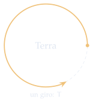
>>> soluzione
**Impostazione.**
Con $r=6{,}671\times10^{6}\un{m}$ e $v=7{,}73\times10^{3}\un{m/s}$,

$$T=\frac{2\pi r}{v}
\approx\frac{2\pi(6{,}671\times10^6)}{7{,}73\times10^3}
\approx5{,}42\times10^{3}\un{s}.$$

$$T\approx\frac{5420}{60}=90{,}3\un{min}.$$
:::

::: esercizio Raggio di un'orbita geostazionaria [base]
Imporre $T=86164\un{s}$ e calcolare il raggio geostazionario con $GM_T=3{,}986\times10^{14}\un{m^3/s^2}$. Ricavare poi la quota sopra l'equatore usando $R_{\mathrm{eq}}=6378{,}1\un{km}$.

>>> soluzione
**Impostazione.**

$$r=\left(\frac{GMT^2}{4\pi^2}\right)^{1/3}
\approx\left(\frac{(3{,}986\times10^{14})(86164)^2}{4\pi^2}\right)^{1/3}
\approx4{,}216\times10^{7}\un{m}.$$

La quota è

$$h=r-R_{\mathrm{eq}}\approx4{,}2164\times10^7-6{,}3781\times10^6
\approx3{,}5786\times10^{7}\un{m}=35786\un{km}.$$
:::

::: esercizio Periodo di un pianeta dalla terza legge [base]
Un pianeta orbita attorno al Sole con semiasse maggiore $a=4$ volte quello terrestre. Esprimere il suo periodo in anni terrestri, trascurando la massa del pianeta.

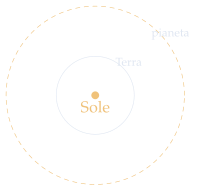
>>> soluzione
**Impostazione.**
Per corpi attorno allo stesso Sole,

$$\left(\frac{T}{T_T}\right)^2=\left(\frac{a}{a_T}\right)^3=4^3=64.$$

Quindi

$$\frac{T}{T_T}=8.$$

Il periodo è $8\un{anni}$ terrestri.
:::

::: esercizio Massa di un pianeta da una luna [medio]
Una luna percorre un'orbita quasi circolare di raggio $r=2{,}0\times10^{8}\un{m}$ in $T=4{,}0\times10^{5}\un{s}$. Trascurando la massa della luna, stimare la massa del pianeta.

>>> soluzione
**Impostazione.**
Dalla terza legge,

$$M=\frac{4\pi^2r^3}{GT^2}.$$

$$M=\frac{4\pi^2(2{,}0\times10^8)^3}{(6{,}67430\times10^{-11})(4{,}0\times10^5)^2}
\approx2{,}96\times10^{25}\un{kg}.$$

La relazione vale anche per un'orbita ellittica se $r$ è sostituito dal semiasse maggiore $a$. L'incertezza dipende quindi soprattutto da quanto bene il valore fornito rappresenta $a$ e dalla precisione di $a$ e $T$.
:::

::: esercizio Perielio, afelio ed eccentricità [base]
Un asteroide ha distanza al perielio $r_p=1{,}2\un{au}$ e all'afelio $r_a=4{,}8\un{au}$. Calcolare semiasse maggiore ed eccentricità.

>>> soluzione
**Impostazione.**

$$a=\frac{r_p+r_a}{2}=\frac{1{,}2+4{,}8}{2}=3{,}0\un{au}.$$

Poiché $r_a-r_p=2ae$,

$$e=\frac{r_a-r_p}{r_a+r_p}
=\frac{4{,}8-1{,}2}{4{,}8+1{,}2}=0{,}60.$$
:::

::: esercizio Rapporto fra velocità al perielio e all'afelio [base]
Per un'orbita ellittica con $r_p=2{,}0\times10^{10}\un{m}$ e $r_a=5{,}0\times10^{10}\un{m}$, usare la conservazione del momento angolare per trovare $v_p/v_a$.

>>> soluzione
**Impostazione.**
Al perielio e all'afelio la velocità è perpendicolare al raggio. La conservazione di $L=mrv$ dà

$$mr_pv_p=mr_av_a.$$

Quindi

$$\frac{v_p}{v_a}=\frac{r_a}{r_p}=\frac{5{,}0}{2{,}0}=2{,}5.$$

Il corpo è due volte e mezzo più veloce al perielio.
:::

::: esercizio Sistema binario e baricentro [medio]
Due stelle di masse $M_1=2M_2$ percorrono orbite circolari attorno al baricentro e hanno separazione costante $a=3{,}0\times10^{11}\un{m}$. Determinare le distanze $r_1$ e $r_2$ dal baricentro e scrivere il periodo in funzione di $M_2$.

>>> soluzione
**Impostazione.**
Il baricentro soddisfa $M_1r_1=M_2r_2$ e $r_1+r_2=a$. Con $M_1=2M_2$,

$$2r_1=r_2,\qquad3r_1=a.$$

Quindi

$$r_1=\frac a3=1{,}0\times10^{11}\un{m},\qquad
r_2=\frac{2a}{3}=2{,}0\times10^{11}\un{m}.$$

La terza legge generale dà

$$T=2\pi\sqrt{\frac{a^3}{G(M_1+M_2)}}
=2\pi\sqrt{\frac{a^3}{3GM_2}}.$$
:::

### Fuga, satelliti e trasferimenti orbitali

::: esercizio Velocità di fuga dalla Terra [base]
Usare $GM_T=3{,}986\times10^{14}\un{m^3/s^2}$ e $R_T=6{,}371\times10^{6}\un{m}$ per calcolare la velocità di fuga ideale dalla superficie terrestre.

>>> soluzione
**Impostazione.**

$$v_{esc}=\sqrt{\frac{2GM_T}{R_T}}
=\sqrt{\frac{2(3{,}986\times10^{14})}{6{,}371\times10^6}}
\approx1{,}119\times10^{4}\un{m/s}.$$

Quindi $v_{esc}\approx11{,}2\un{km/s}$. Il valore trascura atmosfera e rotazione terrestre.
:::

::: esercizio Calcolo della velocità di fuga lunare [base]
Calcolare la velocità di fuga lunare usando $M_L=7{,}35\times10^{22}\un{kg}$ e $R_L=1{,}74\times10^{6}\un{m}$.

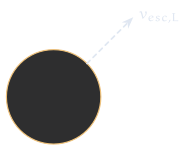
>>> soluzione
**Impostazione.**

$$v_{esc,L}=\sqrt{\frac{2GM_L}{R_L}}
=\sqrt{\frac{2(6{,}67430\times10^{-11})(7{,}35\times10^{22})}{1{,}74\times10^6}}
\approx2{,}37\un{km/s}.$$

È molto minore del valore terrestre per la minore massa e la diversa compattezza della Luna.
:::

::: esercizio Energia totale di un'orbita circolare [medio]
Un satellite di massa $1200\un{kg}$ percorre un'orbita circolare terrestre di raggio $r=7{,}0\times10^{6}\un{m}$. Calcolare energia cinetica, potenziale e totale. Usare $GM_T=3{,}986\times10^{14}\un{m^3/s^2}$.

>>> soluzione
**Impostazione.**
Per un'orbita circolare,

$$K=\frac{GMm}{2r},\quad U=-\frac{GMm}{r},\quad E=-\frac{GMm}{2r}.$$

$$K=\frac{(3{,}986\times10^{14})(1200)}{2(7{,}0\times10^6)}\approx3{,}42\times10^{10}\un{J},$$

$$U\approx-6{,}83\times10^{10}\un{J},\qquad E\approx-3{,}42\times10^{10}\un{J}.$$

Si verifica $U=-2K$ ed $E=-K$.
:::

::: esercizio Energia per alzare un'orbita circolare [base]
Un satellite di massa $500\un{kg}$ passa idealmente da un'orbita circolare di raggio $r_1=7{,}0\times10^{6}\un{m}$ a una di raggio $r_2=1{,}4\times10^{7}\un{m}$. Calcolare l'aumento di energia meccanica.

>>> soluzione
**Impostazione.**

$$\Delta E=E_2-E_1=\frac{GMm}{2}\left(\frac1{r_1}-\frac1{r_2}\right).$$

$$\Delta E=\frac{(3{,}986\times10^{14})(500)}{2}
\left(\frac1{7{,}0\times10^6}-\frac1{1{,}4\times10^7}\right)
\approx7{,}12\times10^{9}\un{J}.$$

L'energia aumenta anche se la velocità circolare finale è minore.
:::

::: esercizio Velocità al perigeo con la vis-viva [medio]
Un satellite terrestre ha semiasse maggiore $a=1{,}0\times10^{7}\un{m}$ e perigeo $r_p=7{,}0\times10^{6}\un{m}$. Calcolare la velocità al perigeo.

>>> soluzione
**Impostazione.**

$$v_p=\sqrt{GM_T\left(\frac2{r_p}-\frac1a\right)}.$$

$$v_p=\sqrt{3{,}986\times10^{14}
\left(\frac2{7{,}0\times10^6}-\frac1{1{,}0\times10^7}\right)}
\approx8{,}60\un{km/s}.$$

La velocità supera quella circolare allo stesso raggio perché l'orbita prosegue verso distanze maggiori.
:::

::: esercizio Classificare una traiettoria dall'energia [base]
Una sonda di massa $m$ si trova a distanza $r$ da un pianeta e ha velocità tangenziale $v=1{,}2\sqrt{GM/r}$. Determinare il segno dell'energia e classificare la traiettoria ideale.

>>> soluzione
**Impostazione.**

$$E=\frac12m(1{,}2^2GM/r)-\frac{GMm}{r}
=\left(0{,}72-1\right)\frac{GMm}{r}
=-0{,}28\frac{GMm}{r}<0.$$

L'energia è negativa: la traiettoria è legata ed ellittica. La velocità supera quella circolare ma resta inferiore alla velocità di fuga $\sqrt2v_c\approx1{,}414v_c$.
:::

::: esercizio Velocità all'infinito dopo la fuga [medio]
Una sonda parte dalla superficie di un corpo con velocità $v_0=1{,}10v_{esc}$. Trascurando atmosfera e propulsione successiva, trovare la velocità residua $v_\infty$ in funzione di $v_{esc}$.

>>> soluzione
**Impostazione.**
Conservando l'energia per unità di massa,

$$\frac12v_0^2-\frac{GM}{R}=\frac12v_\infty^2.$$

Poiché $v_{esc}^2=2GM/R$,

$$v_\infty^2=v_0^2-v_{esc}^2=(1{,}10^2-1)v_{esc}^2=0{,}21v_{esc}^2.$$

$$v_\infty=\sqrt{0{,}21}\,v_{esc}\approx0{,}458v_{esc}.$$

Una piccola eccedenza iniziale rispetto alla fuga produce una velocità residua sensibilmente minore.
:::

::: esercizio Primo impulso di un trasferimento di Hohmann [medio]
Una sonda passa da un'orbita circolare di raggio $r_1$ a una più alta di raggio $r_2=2r_1$. Calcolare il rapporto fra la velocità subito dopo il primo impulso e la velocità circolare iniziale.

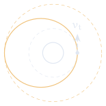
>>> soluzione
**Impostazione.**
L'ellisse di trasferimento ha

$$a_t=\frac{r_1+r_2}{2}=\frac32r_1.$$

Al perigeo, la vis-viva dà

$$v_t^2=GM\left(\frac2{r_1}-\frac1{(3/2)r_1}\right)
=\frac{GM}{r_1}\left(2-\frac23\right)
=\frac43\frac{GM}{r_1}.$$

Poiché $v_{c1}=\sqrt{GM/r_1}$,

$$\frac{v_t}{v_{c1}}=\sqrt{\frac43}\approx1{,}155.$$

Il primo impulso aumenta la velocità di circa il 15,5%.
:::

### Problemi trasversali e di modellizzazione

::: esercizio Orbita bassa e apparente assenza di peso [avanzato]
Assumere raggio terrestre $R=6{,}37\times10^{6}\un{m}$ e $g_0=9{,}81\un{m/s^2}$ al suolo. Per un satellite a quota $h=4{,}00\times10^{5}\un{m}$, calcolare l'accelerazione gravitazionale

$$g'=g_0\left(\frac{R}{R+h}\right)^2$$

e la velocità di un'orbita circolare $v=\sqrt{g'(R+h)}$. Spiegare perché gli astronauti appaiono senza peso pur essendo soggetti a gravità.

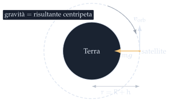
>>> soluzione
**Distanza dal centro.**

$$r=R+h=6{,}37\times10^6+0{,}40\times10^6
=6{,}77\times10^{6}\un{m}.$$

**Gravità in orbita.**

$$g'=9{,}81\left(\frac{6{,}37}{6{,}77}\right)^2
=8{,}69\un{m/s^2}.$$

La gravità è ancora circa l'$89\%$ di quella al suolo.

**Velocità orbitale.**

$$v=\sqrt{8{,}69\cdot6{,}77\times10^6}
=7{,}67\times10^{3}\un{m/s}.$$

**Interpretazione.**  Satellite e astronauti accelerano insieme verso la Terra. Non manca la gravità: manca una forza di sostegno come la normale del pavimento. Tutto il sistema è in caduta libera continua mentre la velocità tangenziale fa curvare la traiettoria attorno al pianeta.
:::

### Problemi di sintesi: lavoro ed energia

::: esercizio Fuga lunare da dati astronomici [avanzato]
Usando $M_L=7{,}35\times10^{22}\,\mathrm{kg}$ e $R_L=1{,}737\times10^6\,\mathrm{m}$, calcolare la velocità di fuga dalla superficie lunare.
>>> soluzione
**Bilancio energetico.**  Ponendo energia finale nulla all'infinito,

$$\frac12mv_e^2-\frac{GM_Lm}{R_L}=0.$$

**Risultato.**  $v_e=\sqrt{2GM_L/R_L}=2377\un{m/s}$.
:::

::: esercizio Energia totale di un satellite [medio]
Un satellite di $500\un{kg}$ è in orbita circolare a raggio $r=6771000{,}0\un{m}$ dal centro terrestre. Calcolare l'energia meccanica totale usando $M_T=5{,}972\times10^{24}\,\mathrm{kg}$.
>>> soluzione
**Orbita circolare.**

$$E=-\frac{GM_Tm}{2r}=-1{,}47\times10^{10}\un{J}.$$

Il segno negativo indica uno stato legato.
:::

### Problemi di sintesi: gravitazione

::: esercizio Velocità in orbita circolare [avanzato]
Calcolare la velocità di un satellite in orbita circolare a quota $500\un{km}$.
>>> soluzione
**Centripeta e gravità.**  $v=\sqrt{GM_T/r}$ con $r=R_T+h$.

**Risultato.**  $v=7616\un{m/s}=7{,}62\un{km/s}$.
:::

::: esercizio Periodo della stessa orbita bassa [medio]
Per il satellite a quota $500\un{km}$ del problema precedente, calcolare il periodo orbitale.
>>> soluzione
**Terza legge.**  $T=2\pi\sqrt{r^3/(GM_T)}=5668\un{s}=94{,}5\un{min}$.
:::

::: esercizio Velocità di fuga terrestre [medio]
Calcolare la velocità di fuga dalla superficie terrestre nel modello senza atmosfera e rotazione.
>>> soluzione
**Energia nulla all'infinito.**  $v_e=\sqrt{2GM_T/R_T}=1{,}12\times10^{4}\un{m/s}=11{,}2\un{km/s}$.
:::

::: esercizio Velocità a perigeo e apogeo [avanzato]
Un satellite terrestre ha perigeo $r_p=7{,}0\times10^6\,\mathrm{m}$ e apogeo $r_a=1{,}5\times10^7\,\mathrm{m}$. Calcolare le velocità ai due estremi.
>>> soluzione
**Semiasse.**  $a=(r_p+r_a)/2=1{,}10\times10^7\,\mathrm{m}$.

**Vis-viva.**  $v=\sqrt{GM_T(2/r-1/a)}$.

$$v_p=8812\un{m/s},\qquad v_a=4112\un{m/s}.$$

La velocità è maggiore al perigeo.
:::

::: esercizio Raggio dell'orbita geostazionaria [avanzato]
Usando il giorno siderale $T=86164\un{s}$, calcolare raggio e quota dell'orbita geostazionaria.
>>> soluzione
**Terza legge.**

$$r=\left(\frac{GM_TT^2}{4\pi^2}\right)^{1/3}=4{,}22\times10^{7}\un{m}.$$

**Quota.**  $h=r-R_T=3{,}58\times10^{4}\un{km}$.
:::

::: esercizio Trasferimento di Hohmann [avanzato]
Calcolare i due impulsi ideali per un trasferimento di Hohmann fra orbite circolari terrestri di raggi $7{,}0\times10^6$ e $1{,}4\times10^7\,\mathrm{m}$.
>>> soluzione
**Impulso al perigeo.**  $\Delta v_1=1167\un{m/s}$.

**Circolarizzazione.**  $\Delta v_2=979\un{m/s}$.

**Totale.**  $\Delta v=2146\un{m/s}$. Le formule derivano dalla vis-viva sull'ellisse di trasferimento.
:::

::: esercizio Massa di un sistema binario [avanzato]
Due stelle orbitano con periodo $10\un{d}$ e semiasse maggiore relativo $a=2{,}0\times10^{10}\un{m}$. Stimare la massa totale.
>>> soluzione
**Keplero generalizzata.**

$$M_1+M_2=\frac{4\pi^2a^3}{GT^2}=6{,}34\times10^{30}\un{kg}.$$

In masse solari ($M_\odot=1{,}989\times10^{30}\,\mathrm{kg}$) vale $3{,}19\,M_\odot$.
:::

::: esercizio Velocità angolare dell'orbita terrestre [avanzato]
Calcolare la velocità angolare orbitale terrestre approssimando il Sole come massa centrale, con $M_S=1{,}989\times10^{30}\,\mathrm{kg}$ e $r=1{,}496\times10^{11}\,\mathrm{m}$.
>>> soluzione
**Moto circolare.**  $\omega=\sqrt{GM_S/r^3}=1{,}99\times10^{-7}\un{rad/s}$.

**Periodo.**  $T=2\pi/\omega=365\un{d}$, vicino a un anno.
:::

::: esercizio Minimo del potenziale efficace [avanzato]
Un satellite di massa $1000\un{kg}$ ha momento angolare $L=7{,}5\times10^{13}\,\mathrm{kg\,m^2/s}$ attorno alla Terra. Calcolare il raggio dell'orbita circolare associata al minimo di $U_{eff}$.
>>> soluzione
**Condizione di minimo.**  $dU_{eff}/dr=GMm/r^2-L^2/(mr^3)=0$.

**Raggio.**

$$r_c=\frac{L^2}{GMm^2}=1{,}41\times10^{7}\un{m}.$$
:::

## Fonti {#fonti}

Il testo, le formule, i diagrammi e gli esercizi di questo capitolo provengono dalla *Dispensa di fisica* del corso (sezioni 4.6-4.10, 4.12 e materiali delle sezioni 2.22, 3.10, 4.14, 4.15, 4.16), consultabile nel lettore della galassia. Per la lettura sul sito sono cambiati l'impaginazione, i colori delle figure, la numerazione e la posizione di alcuni riquadri ed esercizi; la sezione iniziale è scritta per il pianeta di questa unità.

Opere citate nel testo:

1. I. Newton, *A Treatise of the System of the World*, Londra, 1728; composto originariamente come versione divulgativa del Libro III dei *Principia*.
2. E. Halley, “Astronomiae cometicae synopsis”, *Philosophical Transactions of the Royal Society*, vol. 24, 1705, pp. 1882–1899.
3. A.-C. Clairaut, *Théorie du mouvement des comètes*, Parigi, 1760; memoria e calcoli sul ritorno della cometa del 1759.
4. NASA Earthdata, *Orbits*, [https://www.earthdata.nasa.gov/learn/earth-observation-data-basics/orbits](https://www.earthdata.nasa.gov/learn/earth-observation-data-basics/orbits) (consultato il 15 luglio 2026).
5. A. A. Siddiqi, *Challenge to Apollo: The Soviet Union and the Space Race, 1945–1974*, NASA SP-2000-4408, NASA History Division, Washington, 2000.
6. NASA Science, *Orbits and Kepler's Laws*, [https://science.nasa.gov/solar-system/orbits-and-keplers-laws/](https://science.nasa.gov/solar-system/orbits-and-keplers-laws/) (consultato il 15 luglio 2026).
7. European Space Agency, *Types of orbits*, [https://www.esa.int/Enabling_Support/Space_Transportation/Types_of_orbits](https://www.esa.int/Enabling_Support/Space_Transportation/Types_of_orbits) (consultato il 15 luglio 2026).
8. M. Grosser, *The Discovery of Neptune*, Harvard University Press, Cambridge (MA), 1962.
9. U. Le Verrier, “Recherches sur les mouvements de la planète Herschel dite Uranus”, *Comptes rendus hebdomadaires des séances de l'Académie des sciences*, vol. 22–23, 1846.
10. C. D. Murray e S. F. Dermott, *Solar System Dynamics*, Cambridge University Press, Cambridge, 1999.
11. European Space Agency, *What are Lagrange points?*, [https://www.esa.int/Enabling_Support/Operations/What_are_Lagrange_points](https://www.esa.int/Enabling_Support/Operations/What_are_Lagrange_points) (consultato il 15 luglio 2026).
12. European Space Agency, *L2, the second Lagrangian Point*, [https://www.esa.int/Science_Exploration/Space_Science/L2_the_second_Lagrangian_Point](https://www.esa.int/Science_Exploration/Space_Science/L2_the_second_Lagrangian_Point) (consultato il 15 luglio 2026).
