## Prima di cominciare {#apertura}

Un sensore montato su una molla oscilla attorno alla posizione di equilibrio. Il moto si ripete con regolarità, e l'ampiezza delle oscillazioni e la loro rapidità sono due proprietà indipendenti: la prima dipende da come il moto è stato avviato, la seconda dalla massa e dalla rigidità della molla.

Il capitolo costruisce il modello dell'oscillatore: moto periodico, frequenza e fase, sistema massa-molla, energia e ritratto di fase, pendolo e oscillatore torsionale, smorzamento, oscillazioni forzate e risonanza, battimenti e oscillatori accoppiati, limiti dell'approssimazione armonica. Dalla parte matematica della dispensa arrivano la serie di Taylor, le equazioni differenziali e i numeri complessi. Le [onde](unit:physics-17) sono il passo successivo.

## Dagli orologi al modello universale dell'oscillatore {#s-5-1}

La ripetizione regolare di un moto fu studiata molto prima che esistesse l'equazione dell'oscillatore armonico. Le oscillazioni di corpi sospesi e le vibrazioni di corde offrirono strumenti per misurare il tempo, confrontare frequenze e interrogarsi su ciò che rende un moto quasi isocrono. La storia del modello procede quindi insieme alla storia degli strumenti: pendoli, molle, diapason e risonatori trasformarono un fenomeno osservabile in una grandezza misurabile.

::: storia Galileo, Huygens e la misura del tempo
Galileo discusse le proprietà del pendolo e il suo possibile impiego nella misura del tempo, ma l'isochronismo è soltanto approssimato per oscillazioni piccole. Christiaan Huygens costruì nel 1656 un orologio a pendolo efficace e nell'*Horologium Oscillatorium* del 1673 studiò il problema con maggiore precisione, mostrando anche il ruolo della cicloide nel rendere il periodo indipendente dall'ampiezza nel modello ideale  [1, 2](#fonti).
:::

::: storia Hooke, elasticità e linearizzazione
Robert Hooke pubblicò nel 1678 la relazione fra deformazione e forza elastica espressa dalla formula latina *ut tensio, sic vis*: entro il limite elastico, l'allungamento è proporzionale alla forza applicata. In notazione moderna questa proporzionalità conduce a $F=-kx$. La legge non descrive ogni deformazione possibile; è un modello locale che diventa accurato quando il materiale resta nel proprio regime elastico lineare  [3](#fonti).
:::

::: storia Dalle vibrazioni sonore alla fisica moderna
Nel XIX secolo lo studio di corde, membrane, risonatori e strumenti musicali rese centrale l'analisi delle vibrazioni. Helmholtz collegò risonanza e percezione dei suoni, mentre Rayleigh organizzò in modo sistematico la teoria fisica del suono e dei modi di vibrazione  [4, 5](#fonti). Nel Novecento l'oscillatore armonico divenne un modello trasversale: compare nelle vibrazioni molecolari, nei circuiti, nei campi e nella meccanica quantistica. La sua universalità nasce dalla forma locale delle forze vicino a un equilibrio stabile, non dall'idea che ogni sistema reale sia esattamente armonico.
:::

::: nota Perché il modello armonico ricompare
Sia $x_0$ un equilibrio stabile non degenere, cioè

$$U'(x_0)=0,
\qquad
U”(x_0)=k>0.$$

Per spostamenti piccoli, lo sviluppo locale dell'energia potenziale è

$$U(x)=U(x_0)+\frac12k(x-x_0)^2+\mathcal O\!\left((x-x_0)^3\right).$$

Ne segue

$$F(x)=-\frac{\dd U}{\dd x}\approx-k(x-x_0).$$

L'oscillatore armonico è quindi il primo modello locale di un equilibrio stabile non degenere. Se $U”(x_0)=0$, oppure se gli spostamenti rendono importanti i termini di ordine superiore, il termine armonico può non dominare e il periodo può dipendere dall'ampiezza.
:::

## Moto periodico, frequenza e fase {#s-5-2}

Un moto è **periodico** se esiste un intervallo $T>0$ tale che

$$x(t+T)=x(t)$$

per ogni istante nel dominio considerato. Il più piccolo valore positivo che soddisfa la relazione è il **periodo**. La frequenza è

$$f=\frac1T,$$

misurata in hertz, mentre la pulsazione è

$$\omega=2\pi f=\frac{2\pi}{T}.$$

Periodo e frequenza descrivono la ripetizione temporale; l'ampiezza misura la massima distanza dall'equilibrio; la fase specifica lo stato dell'oscillazione entro un ciclo.

::: errore Periodico non significa necessariamente armonico
Un'onda quadra, il moto di un pianeta su un'ellisse e una vibrazione fortemente non lineare possono essere periodici senza avere andamento sinusoidale. Il moto armonico semplice è una particolare forma di moto periodico, caratterizzata da accelerazione proporzionale e opposta allo spostamento.
:::

### La legge oraria armonica

La forma più comune è

::: legge Moto armonico semplice
$$x(t)=A\cos(\omega t+\varphi),$$

$$v(t)=-A\omega\sin(\omega t+\varphi),
\qquad
a(t)=-A\omega^2\cos(\omega t+\varphi)=-\omega^2x(t).$$
:::

L'ampiezza $A$ è non negativa. La fase iniziale $\varphi$ dipende dall'origine dei tempi e dalle condizioni iniziali. Forme con seno e coseno sono equivalenti: cambiano soltanto la fase scelta.

::: approfondimento Calcolo: Derivare velocità e accelerazione
Derivando due volte $x(t)=A\cos(\omega t+\varphi)$ si ottiene

$$\dot x=-A\omega\sin(\omega t+\varphi),
\qquad
\ddot x=-A\omega^2\cos(\omega t+\varphi).$$

La seconda derivata è opposta allo spostamento e cresce in modulo con $\omega^2$. La relazione $\ddot x=-\omega^2x$ non è una proprietà generica dei moti periodici: identifica il moto armonico semplice.
:::

::: approfondimento Riconoscere un'oscillazione nei dati
Con dati campionati si stima il periodo dalla distanza temporale fra massimi successivi oppure fra attraversamenti dell'equilibrio con lo stesso verso. Prima di ricavare ampiezza e fase occorre sottrarre l'eventuale valore medio e controllare la deriva del sensore. Se la frequenza di campionamento è troppo bassa, oscillazioni rapide possono apparire più lente: è il fenomeno di aliasing. Rumore, saturazione e movimento del supporto possono inoltre produrre massimi apparenti che non appartengono al moto studiato.
:::

### Proiezione del moto circolare uniforme

Un punto che percorre una circonferenza di raggio $A$ con velocità angolare costante $\omega$ ha coordinata orizzontale

$$x=A\cos(\omega t+\varphi).$$

Il moto armonico può quindi essere visualizzato come proiezione di un moto circolare uniforme su un diametro. L'analogia chiarisce fase e pulsazione, ma non implica che ogni oscillatore reale nasconda materialmente un moto circolare.


## Oscillatore massa–molla {#s-5-3}

Si consideri una massa $m$ collegata a una molla ideale di costante elastica $k$ su un piano orizzontale privo di attrito. Misurando $x$ dalla posizione di equilibrio, la legge di Hooke fornisce

$$F_x=-kx.$$

La seconda legge di Newton diventa

::: legge Equazione dell'oscillatore armonico
$$m\ddot x=-kx,
\qquad
\ddot x+\omega_0^2x=0,
\qquad
\omega_0=\sqrt{\frac{k}{m}}.$$

$$T=2\pi\sqrt{\frac{m}{k}},
\qquad
f=\frac{1}{2\pi}\sqrt{\frac{k}{m}}.$$
:::

La pulsazione naturale $\omega_0$ dipende dalle proprietà del sistema, non dall'ampiezza, finché la molla resta lineare e gli attriti sono trascurabili. Una massa maggiore aumenta il periodo; una molla più rigida lo riduce.

::: esempio Dalle condizioni iniziali alla legge oraria
Una massa oscilla con $\omega_0=5{,}0\un{rad/s}$, posizione iniziale $x_0=3{,}0\un{cm}$ e velocità iniziale $v_0=-0{,}20\un{m/s}$. Scrivendo

$$x(t)=C\cos\omega_0t+D\sin\omega_0t,$$

si ha $C=x_0$ e $D=v_0/\omega_0$. Quindi

$$x(t)=0{,}030\cos(5t)-0{,}040\sin(5t)\quad\text{m}.$$

L'ampiezza è

$$A=\sqrt{C^2+D^2}=5{,}0\un{cm}.$$

La fase può essere ottenuta confrontando $C=A\cos\varphi$ e $D=-A\sin\varphi$.
:::

### Molle verticali e posizione di equilibrio

Per una molla verticale la gravità sposta l'equilibrio. Se $y$ è l'allungamento rispetto alla lunghezza naturale,

$$m\ddot y=mg-ky.$$

L'equilibrio è $y_0=mg/k$. Introducendo $x=y-y_0$ si ottiene nuovamente

$$m\ddot x=-kx.$$

La gravità modifica la posizione di equilibrio ma non il periodo nel modello ideale lineare.

::: errore L'ampiezza va misurata dall'equilibrio
In una molla verticale l'allungamento totale rispetto alla lunghezza naturale non coincide con l'ampiezza. L'ampiezza è la massima distanza dalla posizione di equilibrio già spostata dal peso.
:::

### Molle equivalenti

Per molle ideali in parallelo le forze si sommano:

$$k_{\mathrm{eq}}=k_1+k_2+\cdots.$$

Per due molle in serie, soggette alla stessa forza,

$$\frac1{k_{\mathrm{eq}}}=\frac1{k_1}+\frac1{k_2}.$$

Queste relazioni valgono nel regime lineare e con collegamenti ideali.

::: approfondimento Caso di studio: La massa di prova di un accelerometro MEMS
In molti accelerometri una piccola massa è sospesa mediante elementi elastici micrometrici. Se l'involucro accelera, la massa tende per inerzia a conservare il proprio stato di moto e compare uno spostamento relativo, misurato spesso tramite una variazione di capacità elettrica. Nel modello a un grado di libertà, indicando con $y(t)$ il moto dell'involucro e con $z=x-y$ lo spostamento relativo,

$$m\ddot z+b\dot z+kz=-m\ddot y.$$

A frequenze molto inferiori a quella naturale, $z\approx-\ddot y/\omega_0^2$: lo spostamento è proporzionale all'accelerazione da misurare. Vicino alla risonanza la risposta cresce e la fase cambia; urti di fine corsa, elettronica di lettura e più modi elastici limitano il modello ideale.
:::

## Energia e ritratto di fase {#s-5-4}

Per l'oscillatore massa–molla ideale,

$$U(x)=\frac12kx^2,
\qquad
K=\frac12mv^2.$$

L'energia meccanica si conserva:

::: legge Bilancio energetico dell'oscillatore ideale
$$E=\frac12mv^2+\frac12kx^2=\frac12kA^2=\frac12m\omega_0^2A^2.$$

$$v(x)=\pm\omega_0\sqrt{A^2-x^2}.$$
:::

Ai punti di inversione $x=\pm A$ la velocità è nulla e l'energia è tutta potenziale. All'equilibrio $x=0$ il modulo della velocità è massimo e l'energia è tutta cinetica. Il segno di $v$ non è determinato dalla sola posizione: distingue i due versi di percorrenza. Nel piano $(x,v)$ la traiettoria è un'ellisse; poiché $\dot x=v$, nella metà superiore il punto si muove verso valori crescenti di $x$ e l'ellisse viene percorsa in senso orario.

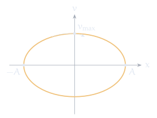

::: approfondimento Calcolo: Forza come pendenza dell'energia potenziale
La forza conservativa è $F=-\dd U/\dd x$. Per $U=\tfrac12kx^2$ segue $F=-kx$. Un minimo dell'energia potenziale corrisponde a equilibrio stabile; la curvatura $U”(x_0)$ determina la costante efficace $k$ dell'approssimazione armonica.
:::

## Pendolo semplice e oscillatore torsionale {#s-5-5}

Un pendolo semplice ideale è formato da una massa puntiforme sospesa a un filo inestensibile e privo di massa, di lunghezza $\ell$. La componente tangenziale del peso produce

$$\ddot\theta+\frac{g}{\ell}\sin\theta=0.$$

L'equazione è non lineare. Per piccoli angoli espressi in radianti, $\sin\theta\approx\theta$, e si ottiene

::: legge Pendolo semplice per piccole oscillazioni
$$\ddot\theta+\frac{g}{\ell}\theta=0,
\qquad
\omega_0=\sqrt{\frac{g}{\ell}},
\qquad
T\approx2\pi\sqrt{\frac{\ell}{g}}.$$
:::

Il periodo non dipende dalla massa. Dipende debolmente dall'ampiezza quando l'angolo non è piccolo; la formula elementare sottostima allora il periodo reale.

::: errore L'approssimazione usa radianti
La sostituzione $\sin\theta\approx\theta$ è corretta soltanto se $\theta$ è espresso in radianti. A $10^\circ$ lo scarto relativo fra $\theta$ e $\sin\theta$ è circa lo $0{,}51\%$: questo valore riguarda il termine di richiamo, non direttamente il periodo. La prima correzione del periodo è più piccola, circa $\theta_0^2/16$, e vale approssimativamente lo $0{,}19\%$ a $10^\circ$.
:::

### Pendolo fisico

Un corpo rigido che oscilla attorno a un asse orizzontale è un pendolo fisico. Se $I$ è il momento d'inerzia rispetto all'asse e $d$ la distanza del centro di massa dall'asse,

::: legge Pendolo fisico, piccole oscillazioni
$$I\ddot\theta+mgd\,\theta=0,
\qquad
T=2\pi\sqrt{\frac{I}{mgd}}.$$
:::

### Oscillatore torsionale

Se un filo esercita un momento torcente di richiamo $\tau=-\kappa\theta$, allora

$$I\ddot\theta+\kappa\theta=0,
\qquad
T=2\pi\sqrt{\frac{I}{\kappa}}.$$

L'oscillatore torsionale è alla base di strumenti sensibili, comprese bilance di torsione e alcuni sensori inerziali.

## Smorzamento {#s-5-6}

In un sistema reale l'ampiezza tende spesso a diminuire perché energia meccanica viene trasferita all'ambiente o convertita in energia interna. Un modello lineare comune usa una forza viscosa $F_d=-bv$:

::: legge Oscillatore smorzato lineare
$$m\ddot x+b\dot x+kx=0.$$

Ponendo

$$\omega_0=\sqrt{\frac{k}{m}},
\qquad
\gamma=\frac{b}{2m},$$

si distinguono tre regimi.
:::

- **Sottosmorzato**, $\gamma<\omega_0$: il sistema oscilla con ampiezza decrescente e pulsazione $\omega_d=\sqrt{\omega_0^2-\gamma^2}$.
- **Criticamente smorzato**, $\gamma=\omega_0$: è il confine fra risposta oscillante e non oscillante. L'equilibrio viene raggiunto solo asintoticamente; per condizioni iniziali e criteri di assestamento usuali, questo regime offre in genere il più rapido rientro entro una banda di tolleranza senza oscillazioni persistenti.
- **Sovrasmorzato**, $\gamma>\omega_0$: la risposta non oscilla ed è dominata da due decadimenti esponenziali; di norma l'assestamento è più lento del caso critico nello stesso modello.

Nel caso sottosmorzato,

$$x(t)=A_0e^{-\gamma t}\cos(\omega_dt+\varphi).$$

L'inviluppo dell'ampiezza decade come $e^{-\gamma t}$; l'energia media decade approssimativamente come $e^{-2\gamma t}$.

::: nota Il modello viscoso è un'approssimazione
Una forza proporzionale alla velocità descrive bene alcuni regimi di fluidi e smorzatori. Attrito radente, turbolenza, isteresi dei materiali e urti richiedono modelli differenti. Una curva esponenziale osservata sperimentalmente è un indizio, non una prova automatica, di smorzamento viscoso lineare.
:::

::: legge Fattore di qualità nel regime debolmente smorzato
$$Q\approx\frac{\omega_0}{2\gamma}=\frac{m\omega_0}{b}.$$

Un valore elevato di $Q$ indica che l'energia viene dissipata lentamente e che la risposta in frequenza è stretta. La relazione scritta è un'approssimazione di smorzamento debole: fuori da tale regime, definizioni di $Q$ basate su energia, decadimento e larghezza di banda non coincidono più con la stessa accuratezza.
:::

::: approfondimento Caso di studio: Ammortizzatore e sospensione di un veicolo
Nel modello più semplice di una sospensione, la carrozzeria è una massa collegata alla ruota mediante molla e smorzatore. Lo smorzamento troppo piccolo lascia oscillare il veicolo dopo una sconnessione; uno smorzamento eccessivo può invece trasmettere forze elevate e peggiorare l'isolamento su alcune frequenze. La strada impone soprattutto un moto alla base, quindi non basta applicare senza modifiche la formula della forza armonica esterna. Pneumatico, massa non sospesa, geometria e comportamento non lineare degli ammortizzatori richiedono almeno un modello a più gradi di libertà per una previsione progettuale.
:::

## Oscillatore forzato e risonanza {#s-5-7}

Una forza periodica esterna può mantenere l'oscillazione contro la dissipazione:

::: legge Oscillatore armonico forzato
$$m\ddot x+b\dot x+kx=F_0\cos\omega t.$$

Nel regime stazionario la risposta ha la stessa pulsazione della forza:

$$x(t)=A(\omega)\cos(\omega t-\delta),$$

$$A(\omega)=\frac{F_0}{\sqrt{(k-m\omega^2)^2+(b\omega)^2}},
\qquad
\delta=\operatorname{atan2}(b\omega,k-m\omega^2),
\qquad 0\leq\delta\leq\pi.$$
:::

Il moto completo contiene un transitorio, determinato dalle condizioni iniziali, e una risposta stazionaria alla pulsazione della forza. In presenza di smorzamento il transitorio si estingue. La risonanza non significa ampiezza infinita nei sistemi reali: dissipazione, non linearità, corsa disponibile e resistenza dei componenti limitano la risposta. Inoltre la curva dipende dal modo in cui il sistema viene eccitato: una forza applicata e un movimento imposto alla base non producono, in generale, la stessa funzione di risposta.

::: esempio Ampiezza vicino alla risonanza
Per $m=1{,}0\un{kg}$, $k=100\un{N/m}$, $b=4{,}0\un{N\,s/m}$, $F_0=10\un{N}$ e $\omega=8{,}0\un{rad/s}$,

$$A=\frac{10}{\sqrt{(100-64)^2+(32)^2}}
\approx0{,}208\un{m}.$$

La pulsazione naturale non smorzata è $\omega_0=10\un{rad/s}$; la pulsazione di eccitazione è vicina ma non coincide con essa.
:::

::: storia Che cosa occorre specificare quando si parla di risonanza
La risonanza fu studiata in acustica, strumenti musicali, macchine e strutture. Attribuire ogni grande vibrazione alla sola coincidenza di frequenze è però insufficiente: forma della forzante, smorzamento, accoppiamento, non linearità e instabilità aeroelastiche possono essere decisivi. Una spiegazione fisica deve specificare quale energia entra nel sistema e con quale meccanismo.
:::

### Potenza assorbita

Nel regime stazionario la potenza media trasferita dalla forza esterna e dissipata dallo smorzatore è

$$\langle P\rangle=\frac12b\omega^2A^2.$$

Per una forza armonica applicata direttamente, il massimo dell'ampiezza di spostamento si trova a

$$\omega_A=\sqrt{\omega_0^2-2\gamma^2}$$

soltanto se $\gamma<\omega_0/\sqrt2$; altrimenti non compare un picco a pulsazione positiva. Nello stesso modello il massimo della potenza media assorbita cade invece a $\omega=\omega_0$. Parlare genericamente di “frequenza di risonanza” senza specificare la grandezza osservata può quindi essere ambiguo.

::: approfondimento Caso di studio: Centrifuga di una lavatrice
Un carico distribuito in modo non uniforme produce durante la rotazione una forza periodica la cui ampiezza cresce, nel modello elementare, come $m_e r\,\omega^2$. Durante l'aumento di velocità la macchina può attraversare una regione vicina a una frequenza naturale del gruppo vasca–sospensioni. I controlli reali tentano di redistribuire il carico, limitare l'accelerazione o attraversare rapidamente la zona critica. La situazione non è descritta da una forza di ampiezza costante: la forzante dipende dalla velocità e possono intervenire contatti, giochi e non linearità.
:::

## Sovrapposizione, battimenti e oscillatori accoppiati {#s-5-8}

La linearità permette di sommare soluzioni. Due oscillazioni di frequenze vicine producono battimenti:

$$\cos\omega_1t+\cos\omega_2t
=2\cos\left(\frac{\omega_1-\omega_2}{2}t\right)
\cos\left(\frac{\omega_1+\omega_2}{2}t\right).$$

L'oscillazione rapida ha frequenza media. Il fattore lento con segno, $\cos[(\omega_1-\omega_2)t/2]$, cambia segno ogni mezza modulazione; l'ampiezza fisicamente osservata è il suo valore assoluto. Per questo i massimi dell'inviluppo si ripetono con frequenza

$$f_b=|f_1-f_2|.$$

Quando due oscillatori interagiscono, l'energia può passare dall'uno all'altro. I **modi normali** sono movimenti collettivi nei quali tutte le parti oscillano con la stessa frequenza e con rapporti di ampiezza costanti.

::: nota Due masse uguali collegate da molle
Per due masse uguali $m$, ciascuna collegata a una parete con una molla $k$ e fra loro con una molla di accoppiamento $k_c$, la simmetria suggerisce due modi senza usare matrici:

- modo in fase, $x_1=x_2$: la molla centrale non si deforma e $\omega_1=\sqrt{k/m}$;
- modo in opposizione di fase, $x_1=-x_2$: la molla centrale si deforma e $\omega_2=\sqrt{(k+2k_c)/m}$.

Un moto generico è una sovrapposizione dei due modi. Questa descrizione introduce l'idea fisica senza sviluppare la teoria generale degli autovalori dei sistemi meccanici.
:::

::: approfondimento Caso di studio: Smorzatore a massa accordata
Una massa secondaria collegata a una struttura mediante molla e smorzatore può essere accordata vicino a un modo strutturale dominante. L'accoppiamento divide la risposta in due modi e permette alla massa secondaria di assorbire temporaneamente parte dell'energia, che viene poi dissipata. Il dispositivo non “annulla” ogni vibrazione: è efficace in una banda limitata e deve essere progettato considerando più modi, variazioni dei parametri e limiti di corsa.
:::

::: approfondimento Dalle oscillazioni alle onde
Una catena di molti oscillatori accoppiati permette a una perturbazione di propagarsi. Nel limite continuo emergono onde su corde, suono nei fluidi e vibrazioni nei solidi. Le sezioni seguenti sviluppano questo passaggio introducendo lunghezza d'onda, velocità di propagazione, trasporto di energia e condizioni al contorno.
:::

## Limiti dell'approssimazione armonica {#s-5-13}

Il modello armonico descrive il comportamento locale attorno a un equilibrio stabile non degenere. Una molla reale può irrigidirsi o ammorbidirsi con la deformazione; il pendolo conserva il termine $\sin\theta$; urti, giochi meccanici e contatti introducono discontinuità. Un potenziale semplice più generale è

$$U(x)=\frac12kx^2+\alpha x^3+\beta x^4+\cdots.$$

I termini non quadratici possono rendere il periodo dipendente dall'ampiezza, generare armoniche e modificare la risposta in risonanza.

::: errore Linearizzare non significa ignorare la fisica
La linearizzazione è una scelta controllata: si identifica un equilibrio, si specifica l'intervallo di spostamenti e si confrontano le previsioni con dati o stime d'errore. Usare il modello armonico senza dichiarare tali condizioni trasforma un'approssimazione utile in un'affermazione ingiustificata.
:::

::: approfondimento Caso di studio: Sospensioni e strumenti di misura
Una sospensione deve sostenere il carico, mantenere il contatto con il suolo e limitare le accelerazioni trasmesse. Un accelerometro, invece, usa il moto relativo di una massa di prova per ricostruire l'accelerazione dell'involucro. In entrambi i casi compaiono massa, rigidezza e smorzamento, ma l'ingresso fisico è spesso il movimento della base, non una forza applicata direttamente alla massa. La stessa equazione differenziale può quindi avere funzioni di risposta e criteri di progetto differenti.
:::

::: approfondimento Caso di studio: Vibrazioni microscopiche
Vicino a una configurazione stabile, piccole variazioni delle distanze atomiche possono essere descritte in prima approssimazione come oscillazioni accoppiate. Nei solidi questa idea conduce ai modi di vibrazione del reticolo; nelle molecole, a frequenze caratteristiche osservabili mediante spettroscopia. In meccanica quantistica l'oscillatore armonico possiede livelli energetici discreti. Il collegamento mostra la portata del modello, ma né i legami reali né la quantizzazione sono esauriti dalla meccanica classica sviluppata qui.
:::

## Approssimazioni, serie di Taylor e linearizzazione {#s-0-29}

Un modello utile non deve sempre essere esatto: deve avere un errore controllato nella regione di interesse. Se una funzione possiede derivate sufficienti vicino a $a$, il **polinomio di Taylor** di ordine $n$ fornisce

$$f(x)=\sum_{k=0}^{n}\frac{f^{(k)}(a)}{k!}(x-a)^k+R_n(x),$$

dove il resto $R_n(x)$ quantifica l'errore. Sotto opportune ipotesi di regolarità, il resto di Lagrange ha la forma

$$R_n(x)=\frac{f^{(n+1)}(\xi)}{(n+1)!}(x-a)^{n+1},$$

con $\xi$ compreso fra $a$ e $x$. Soltanto per funzioni analitiche, e soltanto entro il raggio di convergenza, la serie infinita dei polinomi di Taylor coincide con la funzione. L'esistenza di derivate di ogni ordine, da sola, non basta.

Il primo ordine,

$$f(x)\simeq f(a)+f'(a)(x-a),$$

è la linearizzazione mediante la tangente.

Per $|x|\ll1$,

$$e^x\simeq1+x+\frac{x^2}{2},
\qquad
\ln(1+x)\simeq x-\frac{x^2}{2},$$

$$(1+x)^\alpha\simeq1+\alpha x,
\qquad
\frac1{1-x}\simeq1+x+x^2.$$

Il simbolo $\ll$ indica che il parametro è piccolo rispetto a uno, ma la precisione richiesta deve essere dichiarata. Un termine trascurabile in un calcolo qualitativo può essere importante in una misura di precisione.

Le funzioni iperboliche,

$$\sinh x=\frac{e^x-e^{-x}}2,
\qquad
\cosh x=\frac{e^x+e^{-x}}2,$$

soddisfano $\cosh^2x-\sinh^2x=1$. Compaiono nelle soluzioni di alcune equazioni differenziali, nella forma di una catena sospesa e nelle trasformazioni di Lorentz scritte mediante la rapidità. Per $|x|\ll1$, $\sinh x\simeq x$ e $\cosh x\simeq1+x^2/2$.

Le approssimazioni mostrano anche come una teoria più generale contenga una teoria limite. Il fattore relativistico

$$\gamma=\frac1{\sqrt{1-v^2/c^2}}$$

per $v\ll c$ diventa

$$\gamma\simeq1+\frac12\frac{v^2}{c^2}.$$

Questa espansione mostra uno dei modi in cui le espressioni relativistiche si riducono alle corrispondenti approssimazioni classiche quando $v/c\ll1$. Ricavare l’intera meccanica newtoniana come limite della relatività richiede anche il confronto fra quantità di moto, energia e leggi del moto.

::: approfondimento Equazioni differenziali e campi
Molte leggi fisiche specificano un tasso di variazione o una derivata seconda anziché la grandezza cercata. Le condizioni iniziali selezionano una soluzione, mentre gradiente, divergenza e rotore descrivono proprietà locali dei campi.
:::

## Equazioni differenziali e condizioni iniziali {#s-0-30}

Una legge fisica esprime spesso una relazione fra una grandezza e le sue derivate. Un'equazione di questo tipo è un'**equazione differenziale**. La seconda legge di Newton,

$$m\frac{\dd^2x}{\dd t^2}=F(x,\dot x,t),$$

non fornisce direttamente $x(t)$: stabilisce come cambia la velocità e, nel moto unidimensionale, come evolve la concavità del grafico posizione-tempo. La derivata seconda è l’accelerazione; non va confusa con la curvatura geometrica di una traiettoria nello spazio.

L'equazione

$$\frac{\dd y}{\dd t}=ky$$

afferma che il tasso di variazione è proporzionale alla quantità presente. Separando le variabili,

$$\frac{\dd y}{y}=k\dd t,$$

e integrando,

$$\ln|y|=kt+C,
\qquad
y(t)=Ae^{kt}.$$

La condizione iniziale $y(0)=y_0$ determina $A=y_0$. Senza condizioni iniziali, l'equazione differenziale descrive una famiglia di evoluzioni possibili.

L'oscillatore armonico ideale soddisfa

$$\frac{\dd^2x}{\dd t^2}+\omega^2x=0.$$

La soluzione generale è

$$x(t)=A\cos\omega t+B\sin\omega t
=C\cos(\omega t+\phi).$$

Ampiezza e fase dipendono dalle condizioni iniziali. Questa equazione compare in molle, pendoli per piccoli angoli, circuiti LC, vibrazioni molecolari e onde.

Non tutte le equazioni differenziali hanno una soluzione elementare. In tal caso si usano metodi numerici. Il metodo di Eulero traduce

$$\frac{\dd y}{\dd t}=f(t,y)$$

nel passo discreto

$$y_{n+1}=y_n+f(t_n,y_n)\Delta t.$$

Il metodo è intuitivo ma può accumulare errore e diventare instabile; metodi più avanzati, come Runge–Kutta, migliorano l'accuratezza.

## Numeri complessi: ampiezza e fase in un solo oggetto {#s-0-34}

::: storia Da quantità ritenute impossibili a strumento fisico
Le radici di numeri negativi comparvero nei procedimenti rinascimentali per le equazioni cubiche prima che fosse chiaro come interpretarle. Cardano le incontrò nei calcoli e Bombelli ne organizzò le regole algebriche. Fra Settecento e Ottocento, la rappresentazione geometrica nel piano e la formula di Eulero mostrarono che i numeri complessi unificano rotazioni, oscillazioni e funzioni esponenziali. Il loro ingresso nella fisica non fu un ornamento formale: essi permettono di tenere insieme ampiezza e fase.  [6, 7](#fonti)
:::

Un numero complesso ha forma

$$z=a+ib,
\qquad i^2=-1.$$

La parte reale è $a$, la parte immaginaria è $b$. Nel piano complesso, $z$ è rappresentato dal punto $(a,b)$. Il modulo e l'argomento sono

$$|z|=\sqrt{a^2+b^2},
\qquad
\phi=\operatorname{atan2}(b,a).$$

Il coniugato è $z^*=a-ib$ e soddisfa

$$zz^*=|z|^2.$$

La formula di Eulero

$$e^{i\phi}=\cos\phi+i\sin\phi$$

permette di scrivere

$$z=|z|e^{i\phi}.$$

La forma cartesiana è comoda per somme e differenze; la forma polare è comoda per prodotti, rapporti e potenze:

$$(r_1e^{i\phi_1})(r_2e^{i\phi_2})=r_1r_2e^{i(\phi_1+\phi_2)}.$$

In elettrotecnica i numeri complessi rappresentano oscillazioni sinusoidali con ampiezza e fase. Nella meccanica quantistica la funzione d'onda è in generale complessa. In rappresentazione di posizione, $|\psi(x,t)|^2$ è una densità di probabilità: la probabilità di trovare la particella in un intervallo si ottiene integrandola sull'intervallo. Una fase globale comune non modifica le probabilità, mentre le fasi relative fra componenti determinano i fenomeni di interferenza.

## Casi di studio e attività sperimentali {#casi}

### Attività sperimentale: Periodo di una massa collegata a una molla

**Obiettivo.**  verificare la dipendenza $T^2=4\pi^2m/k$ e stimare la costante elastica dinamicamente.

**Materiali o dati.**  molla entro il limite elastico, masse note, supporto stabile, righello e cronometro oppure video.

**Procedura.**

1. Misurare l'allungamento statico per controllare che la risposta sia approssimativamente lineare.
2. Applicare più masse senza superare il carico sicuro della molla.
3. Per ogni massa cronometrare almeno dieci oscillazioni di piccola ampiezza.
4. Rappresentare $T^2$ in funzione di $m$ e ricavare $k$ dalla pendenza $4\pi^2/k$.

**Controllo e discussione.**  confrontare la costante dinamica con quella statica; discutere massa della molla, attrito, ampiezza e incertezza temporale.

**Sicurezza.**  fissare il supporto, non portare il viso sotto le masse, usare un fermo inferiore e non superare il limite elastico.

### Attività sperimentale: Validità dell'approssimazione del pendolo

**Obiettivo.**  misurare come il periodo cambia con l'ampiezza iniziale.

**Materiali o dati.**  pendolo, goniometro, metro, cronometro o video.

**Procedura.**

1. Mantenere fissa la lunghezza e misurare il periodo per ampiezze iniziali di circa $5^\circ$, $10^\circ$, $20^\circ$ e $30^\circ$.
2. Cronometrare più periodi e ripetere ogni misura.
3. Normalizzare i periodi rispetto al valore ottenuto alla minore ampiezza.
4. Confrontare i dati con l'idea che $T\approx2\pi\sqrt{\ell/g}$ sia un'approssimazione di piccola ampiezza.

**Controllo e discussione.**  separare la variazione sistematica con l'ampiezza dalla dispersione delle misure; verificare che il punto di sospensione resti fisso.

**Sicurezza.**  usare una massa leggera e mantenere libera la zona di oscillazione.

### Attività sperimentale: Curva di risonanza di un oscillatore forzato

**Obiettivo.**  misurare ampiezza e fase al variare della frequenza di una forzante periodica.

**Materiali o dati.**  oscillatore a bassa energia, eccitatore regolabile o simulazione, sensore di posizione oppure video.

**Procedura.**

1. Stimare prima la frequenza naturale con oscillazioni libere di piccola ampiezza.
2. Applicare una forzante debole e attendere l'estinzione del transitorio a ogni frequenza.
3. Misurare ampiezza e ritardo di fase in punti sotto, vicino e sopra la risonanza.
4. Ripetere con due livelli di smorzamento e confrontare altezza e larghezza della curva.

**Controllo e discussione.**  mantenere costante l'ampiezza della forza, non soltanto la regolazione nominale dell'eccitatore; distinguere risposta stazionaria e transitorio.

**Sicurezza.**  limitare ampiezza e accelerazione, interrompere la prova se compaiono urti, allentamenti o deformazioni permanenti.

## Formulario ragionato {#formulario}

Le relazioni seguenti usano spostamenti misurati dall'equilibrio. Le formule del pendolo richiedono piccoli angoli in radianti; quelle di smorzamento e forzamento assumono coefficienti costanti, forza dissipativa lineare e, per la risposta stazionaria riportata, una forza armonica applicata direttamente. Le formule ondulatorie richiedono mezzi lineari e le condizioni al contorno dichiarate.

::: legge Descrizione cinematica
$$x=A\cos(\omega t+\varphi),
\quad
v=-A\omega\sin(\omega t+\varphi),
\quad
a=-\omega^2x,$$

$$T=\frac{2\pi}{\omega},
\qquad
f=\frac1T.$$
:::

::: legge Oscillatori ideali
$$\omega_0=\sqrt{\frac{k}{m}},
\qquad
T_{\mathrm{molla}}=2\pi\sqrt{\frac{m}{k}},$$

$$T_{\mathrm{pendolo}}\approx2\pi\sqrt{\frac{\ell}{g}},
\qquad
T_{\mathrm{fisico}}=2\pi\sqrt{\frac{I}{mgd}},
\qquad
T_{\mathrm{torsione}}=2\pi\sqrt{\frac{I}{\kappa}}.$$
:::

::: legge Energia
$$E=\frac12mv^2+\frac12kx^2=\frac12kA^2,
\qquad
v=\pm\omega_0\sqrt{A^2-x^2}.$$
:::

::: legge Smorzamento e forzamento
$$m\ddot x+b\dot x+kx=0,
\qquad
\gamma=\frac{b}{2m},
\qquad
\omega_d=\sqrt{\omega_0^2-\gamma^2},$$

$$A(\omega)=\frac{F_0}{\sqrt{(k-m\omega^2)^2+(b\omega)^2}},
\qquad
\delta=\operatorname{atan2}(b\omega,k-m\omega^2),
\qquad 0\leq\delta\leq\pi.$$

Per il massimo dell'ampiezza di spostamento,

$$\omega_A=\sqrt{\omega_0^2-2\gamma^2},
\qquad \gamma<\frac{\omega_0}{\sqrt2}.$$
:::

::: legge Onde progressive e corda tesa
$$y=A\cos(kx-\omega t+\varphi),
\qquad
k=\frac{2\pi}{\lambda},
\qquad
v=\frac{\omega}{k}=\lambda f.$$

$$\frac{\partial^2y}{\partial t^2}=v^2\frac{\partial^2y}{\partial x^2},
\qquad
v_{\mathrm{corda}}=\sqrt{\frac{\mathcal T}{\mu}},
\qquad
\overline P=\frac12\mu v\omega^2A^2.$$
:::

::: legge Onde stazionarie e risonanze
$$y=2A\sin(kx)\cos(\omega t).$$

Corda fissata o tubo aperto a entrambe le estremità:

$$f_n=\frac{nv}{2L},
\qquad n=1,2,3,\ldots$$

Tubo chiuso a un'estremità:

$$f_n=\frac{nv}{4L},
\qquad n=1,3,5,\ldots$$
:::

::: legge Suono
$$v=\sqrt{\frac{B}{\rho}},
\qquad
I=\frac{P}{A},
\qquad
I_{\mathrm{isotropa}}=\frac{P_s}{4\pi r^2},$$

$$\beta=(10\,\mathrm{dB})\log_{10}\!\left(\frac{I}{I_0}\right),
\qquad I_0=10^{-12}\un{W/m^2},$$

$$f'=f\frac{v\pm v_D}{v\mp v_S}.$$

Nel Doppler acustico le velocità sono misurate rispetto al mezzo; scegliere i segni affinché l'avvicinamento aumenti la frequenza rivelata.
:::

## Glossario {#glossario}

- **Ampiezza**: Massimo valore assoluto dello spostamento rispetto alla posizione di equilibrio in un moto oscillatorio.
- **Battimento**: Variazione periodica dell'ampiezza risultante dalla sovrapposizione di oscillazioni con frequenze vicine; la frequenza di battimento è il modulo della loro differenza.
- **Fase**: Grandezza adimensionale che individua lo stato di un'oscillazione entro il ciclo; dipende dalla scelta dell'origine dei tempi.
- **Frequenza**: Numero di cicli completi per unità di tempo; si misura in hertz ed è l'inverso del periodo.
- **Moto armonico semplice**: Moto oscillatorio descritto da una sinusoide e caratterizzato dalla relazione $a=-\omega^2x$.
- **Numero complesso**: Numero della forma $a+ib$, con $i^2=-1$, rappresentabile mediante modulo e fase.
- **Oscillatore**: Sistema capace di evolvere ripetutamente attorno a una configurazione di equilibrio. Un oscillatore non è necessariamente armonico.
- **Periodo**: Minimo intervallo positivo dopo il quale un moto periodico si ripete nello stesso stato.
- **Pulsazione**: Frequenza angolare $\omega=2\pi f$, misurata in radianti al secondo.
- **Risonanza**: Risposta accentuata di un sistema forzato quando la frequenza di eccitazione cade vicino a una frequenza caratteristica; ampiezza e larghezza dipendono dallo smorzamento e dal tipo di risposta osservata.
- **Smorzamento**: Riduzione dell'ampiezza dovuta a dissipazione o trasferimento di energia; il modello viscoso lineare usa una forza proporzionale e opposta alla velocità.
- **Serie di Taylor**: Espansione locale di una funzione in potenze della distanza da un punto, costruita con le sue derivate.

## Esercizi {#esercizi}

Gli esercizi riprendono quelli della dispensa. Ogni soluzione è nascosta finché non la apri: prova prima a impostare il problema da solo.

### Periodicità, fase e moto armonico

::: esercizio Periodo da una sequenza di oscillazioni [base]
Un sistema compie 12 oscillazioni complete in $9{,}6\un{s}$. Determinare periodo, frequenza e pulsazione.

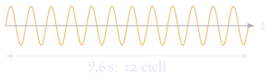
>>> soluzione
**Periodo.**  $T=9{,}6/12=0{,}80\un{s}$.

**Frequenza.**  $f=1/T=1{,}25\un{Hz}$.

**Pulsazione.**  $\omega=2\pi f\approx7{,}85\un{rad/s}$.
:::

::: esercizio Leggere ampiezza e fase iniziale [avanzato]
Per $x(t)=0{,}060\cos(4{,}0t+\pi/3)$, con $x$ in metri e $t$ in secondi, trovare ampiezza, periodo, frequenza, posizione e velocità iniziali.

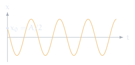
>>> soluzione
**Parametri.**  $A=0{,}060\un{m}$ e $\omega=4{,}0\un{rad/s}$.

**Tempo caratteristico.**  $T=2\pi/4=1{,}57\un{s}$ e $f=\omega/(2\pi)\approx0{,}637\un{Hz}$.

**Condizioni iniziali.**  $x_0=A\cos(\pi/3)=0{,}030\un{m}$ e $v_0=-A\omega\sin(\pi/3)\approx-0{,}208\un{m/s}$.
:::

::: esercizio Avanzamento di fase [base]
Un oscillatore ha frequenza $2{,}0\un{Hz}$. Di quanto avanza la fase in $0{,}35\un{s}$? Esprimere il risultato in radianti e gradi.

>>> soluzione
**Pulsazione.**  $\omega=2\pi f=4\pi\,\mathrm{rad/s}$.

**Fase.**  $\Delta\varphi=\omega\Delta t=4\pi(0{,}35)=1{,}4\pi\,\mathrm{rad}$.

**Conversione.**  $1{,}4\pi\,\mathrm{rad}=252^\circ$.
:::

::: esercizio Condizioni iniziali all'equilibrio [medio]
Un punto materiale passa per l'equilibrio all'istante $t=0$ con velocità positiva $0{,}24\un{m/s}$. La pulsazione è $6{,}0\un{rad/s}$. Scrivere una legge oraria e determinare l'ampiezza.

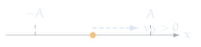
>>> soluzione
**Scelta della fase.**  Una forma immediata è $x(t)=A\sin(\omega t)$, perché $x(0)=0$ e $v(0)=A\omega>0$.

**Ampiezza.**  $A=v_0/\omega=0{,}24/6=0{,}040\un{m}$.

**Legge oraria.**  $x(t)=0{,}040\sin(6t)\,\mathrm{m}$.
:::

::: esercizio Attraversamenti dell'equilibrio [medio]
Per $x(t)=A\cos(\pi t)$ determinare i primi quattro istanti non negativi nei quali il corpo attraversa l'equilibrio e indicare il verso del moto.

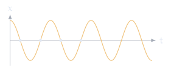
>>> soluzione
**Zeri.**  $\cos(\pi t)=0$ quando $\pi t=\pi/2+n\pi$, quindi $t=0{,}5+n$.

**Primi istanti.**  $0{,}5\un{s}$, $1{,}5\un{s}$, $2{,}5\un{s}$ e $3{,}5\un{s}$.

**Verso.**  Da $v=-A\pi\sin(\pi t)$: il verso è negativo a $0{,}5$ e $2{,}5$ s, positivo a $1{,}5$ e $3{,}5$ s.
:::

::: esercizio Velocità e accelerazione massime [medio]
Un oscillatore ha ampiezza $8{,}0\un{cm}$ e pulsazione $5{,}0\un{rad/s}$. Calcolare velocità e accelerazione massime.

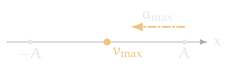
>>> soluzione
**Velocità.**  $v_{\max}=A\omega=(0{,}080)(5{,}0)=0{,}40\un{m/s}$.

**Accelerazione.**  $a_{\max}=A\omega^2=(0{,}080)(25)=2{,}0\un{m/s^2}$.

**Posizioni.**  $v_{\max}$ si ha all'equilibrio; $a_{\max}$ in modulo ai punti di inversione.
:::

::: esercizio Proiezione di un moto circolare [medio]
Un punto percorre una circonferenza di raggio $0{,}12\un{m}$ con periodo $1{,}5\un{s}$. Determinare la pulsazione e la velocità massima della sua proiezione su un diametro.

>>> soluzione
**Pulsazione.**  $\omega=2\pi/T=2\pi/1{,}5\approx4{,}19\un{rad/s}$.

**Ampiezza.**  La proiezione ha ampiezza uguale al raggio: $A=0{,}12\un{m}$.

**Velocità massima.**  $v_{\max}=A\omega\approx(0{,}12)(4{,}19)=0{,}503\un{m/s}$.
:::

::: esercizio Velocità media scalare in un periodo [medio]
Un oscillatore armonico ha ampiezza $5{,}0\un{cm}$ e periodo $2{,}0\un{s}$. Calcolare la velocità media vettoriale e la velocità media scalare su un periodo completo.

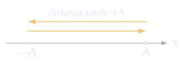
>>> soluzione
**Velocità media vettoriale.**  Dopo un periodo lo spostamento è nullo, quindi $\bar v=0$.

**Distanza.**  In un ciclo il punto percorre $4A=0{,}20\un{m}$.

**Velocità media scalare.**  $\bar s/T=0{,}20/2{,}0=0{,}10\un{m/s}$.
:::

### Oscillatore massa–molla

::: esercizio Costante elastica da una prova statica [base]
Una forza di $4{,}0\un{N}$ allunga una molla di $2{,}0\un{cm}$. Determinare la costante elastica nel regime lineare.

>>> soluzione
**Modello.**  Nel regime lineare $F=k\Delta\ell$.

**Conversione.**  $\Delta\ell=0{,}020\un{m}$.

**Risultato.**  $k=4{,}0/0{,}020=200\un{N/m}$.
:::

::: esercizio Periodo di una massa su molla [medio]
Una massa di $0{,}50\un{kg}$ è collegata a una molla di costante $200\un{N/m}$. Calcolare pulsazione e periodo.

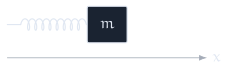
>>> soluzione
**Pulsazione.**  $\omega_0=\sqrt{k/m}=\sqrt{200/0{,}50}=20\un{rad/s}$.

**Periodo.**  $T=2\pi/\omega_0=2\pi/20\approx0{,}314\un{s}$.

**Controllo.**  Una molla rigida e una massa moderata producono un periodo inferiore al secondo.
:::

::: esercizio Massa incognita dal periodo [medio]
Una molla con $k=50\un{N/m}$ oscilla con periodo $0{,}80\un{s}$. Trascurando la massa della molla, determinare la massa collegata.

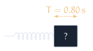
>>> soluzione
**Relazione.**  $T=2\pi\sqrt{m/k}$ implica $m=k(T/2\pi)^2$.

**Calcolo.**  $m=50(0{,}80/2\pi)^2\approx0{,}811\un{kg}$.

**Cifre.**  Il risultato va espresso con due o tre cifre significative, coerentemente con i dati.
:::

::: esercizio Molla verticale: equilibrio e periodo [medio]
Una massa di $0{,}30\un{kg}$ è sospesa a una molla con $k=120\un{N/m}$. Calcolare l'allungamento statico e il periodo delle piccole oscillazioni.

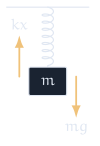
>>> soluzione
**Equilibrio.**  $ky_0=mg$, quindi $y_0=mg/k=(0{,}30)(9{,}81)/120\approx0{,}0245\un{m}$.

**Pulsazione.**  $\omega_0=\sqrt{k/m}=\sqrt{120/0{,}30}=20\un{rad/s}$.

**Periodo.**  $T=2\pi/20\approx0{,}314\un{s}$. La gravità sposta l'equilibrio ma non cambia il periodo ideale.
:::

::: esercizio Due molle in parallelo [base]
Una massa di $0{,}50\un{kg}$ è collegata a due molle parallele con $k_1=80\un{N/m}$ e $k_2=120\un{N/m}$. Determinare il periodo.

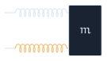
>>> soluzione
**Equivalente.**  In parallelo $k_{eq}=k_1+k_2=200\un{N/m}$.

**Periodo.**  $T=2\pi\sqrt{m/k_{eq}}=2\pi\sqrt{0{,}50/200}$.

**Risultato.**  $T\approx0{,}314\un{s}$.
:::

::: esercizio Due molle in serie [base]
Una massa di $0{,}60\un{kg}$ è collegata a due molle in serie con $k_1=100\un{N/m}$ e $k_2=300\un{N/m}$. Calcolare la costante equivalente e il periodo.

>>> soluzione
**Equivalente.**  $k_{eq}=k_1k_2/(k_1+k_2)=100\cdot300/400=75\un{N/m}$.

**Periodo.**  $T=2\pi\sqrt{0{,}60/75}$.

**Risultato.**  $T\approx0{,}562\un{s}$.
:::

::: esercizio Tagliare una molla uniforme [medio]
Una molla uniforme viene tagliata in due metà uguali. Spiegare come cambia la costante elastica di ciascuna metà e il periodo di una stessa massa collegata a una metà.

>>> soluzione
**Rigidità.**  Per una molla uniforme $k$ è inversamente proporzionale alla lunghezza. Dimezzando la lunghezza si ottiene $k'=2k$.

**Periodo.**  $T'=2\pi\sqrt{m/(2k)}=T/\sqrt2$.

**Interpretazione.**  Una porzione più corta si deforma meno sotto la stessa forza ed è quindi più rigida.
:::

::: esercizio Rilascio da una deformazione assegnata [medio]
Una massa di $0{,}20\un{kg}$ collegata a una molla di $k=80\un{N/m}$ viene spostata di $5{,}0\un{cm}$ dall'equilibrio e rilasciata da ferma. Determinare ampiezza, energia e velocità massima.

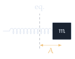
>>> soluzione
**Ampiezza.**  Il rilascio da fermo avviene a un punto di inversione, quindi $A=0{,}050\un{m}$.

**Energia.**  $E=\tfrac12kA^2=\tfrac12(80)(0{,}050)^2=0{,}100\un{J}$.

**Velocità massima.**  $v_{max}=A\sqrt{k/m}=0{,}050\sqrt{80/0{,}20}=1{,}00\un{m/s}$.
:::

### Energia e spazio delle fasi

::: esercizio Energia dall'ampiezza [base]
Una massa oscilla su una molla con $k=150\un{N/m}$ e ampiezza $4{,}0\un{cm}$. Calcolare l'energia meccanica.

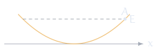
>>> soluzione
**Relazione.**  Ai punti di inversione $E=\tfrac12kA^2$.

**Calcolo.**  $E=\tfrac12(150)(0{,}040)^2$.

**Risultato.**  $E=0{,}120\un{J}$.
:::

::: esercizio Dove energia cinetica e potenziale sono uguali [base]
In un oscillatore armonico di ampiezza $A$, determinare le posizioni nelle quali $K=U$.

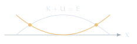
>>> soluzione
**Energie.**  $U=\tfrac12kx^2$ ed $E=\tfrac12kA^2$, quindi $K=E-U$.

**Uguaglianza.**  $U=K=E/2$ implica $\tfrac12kx^2=\tfrac14kA^2$.

**Posizioni.**  $|x|=A/\sqrt2$, dunque $x=\pm A/\sqrt2$.
:::

::: esercizio Velocità a una posizione assegnata [medio]
Una massa di $0{,}25\un{kg}$ oscilla con $k=100\un{N/m}$ e ampiezza $5{,}0\un{cm}$. Calcolare il modulo della velocità quando $|x|=3{,}0\un{cm}$.

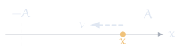
>>> soluzione
**Pulsazione.**  $\omega_0=\sqrt{k/m}=\sqrt{100/0{,}25}=20\un{rad/s}$.

**Energia.**  $v=\omega_0\sqrt{A^2-x^2}$.

**Risultato.**  $v=20\sqrt{0{,}050^2-0{,}030^2}=0{,}80\un{m/s}$.
:::

::: esercizio Leggere un ritratto di fase [medio]
Un'orbita nello spazio $(x,v)$ intercetta l'asse delle posizioni a $\pm6{,}0\un{cm}$ e l'asse delle velocità a $\pm0{,}30\un{m/s}$. Determinare ampiezza e pulsazione.

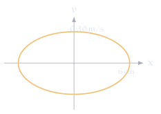
>>> soluzione
**Ampiezza.**  L'intercetta orizzontale è $A=0{,}060\un{m}$.

**Velocità massima.**  L'intercetta verticale è $v_{max}=0{,}30\un{m/s}$.

**Pulsazione.**  $\omega_0=v_{max}/A=0{,}30/0{,}060=5{,}0\un{rad/s}$.
:::

::: esercizio Ampiezza da energia cinetica massima [medio]
Una massa di $0{,}40\un{kg}$ raggiunge velocità massima $0{,}50\un{m/s}$ su una molla con $k=40\un{N/m}$. Trovare energia e ampiezza.

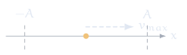
>>> soluzione
**Energia.**  All'equilibrio $E=K_{max}=\tfrac12mv_{max}^2=\tfrac12(0{,}40)(0{,}50)^2=0{,}050\un{J}$.

**Ampiezza.**  $E=\tfrac12kA^2$, quindi $A=\sqrt{2E/k}$.

**Risultato.**  $A=\sqrt{0{,}10/40}=0{,}050\un{m}$.
:::

::: esercizio Tempo dal massimo a metà ampiezza [medio]
Un oscillatore parte da $x=A$ con velocità nulla e ha periodo $1{,}20\un{s}$. Quanto tempo impiega per raggiungere per la prima volta $x=A/2$?

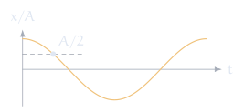
>>> soluzione
**Legge oraria.**  Con il massimo a $t=0$, $x=A\cos\omega t$.

**Fase.**  $x=A/2$ implica $\cos\omega t=1/2$, quindi $\omega t=\pi/3$ al primo passaggio.

**Tempo.**  Poiché $\omega=2\pi/T$, $t=T/6=0{,}200\un{s}$.
:::

::: esercizio Dall'energia potenziale alla forza [medio]
L'energia potenziale di un sistema è $U(x)=\tfrac12kx^2$. Ricavare la forza e discutere la stabilità dell'equilibrio $x=0$.

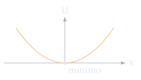
>>> soluzione
**Derivata.**  $F=-\dd U/\dd x=-kx$.

**Verso.**  Per $x>0$ la forza è negativa; per $x<0$ è positiva. In entrambi i casi punta verso l'origine.

**Stabilità.**  $U$ ha un minimo in $x=0$, quindi l'equilibrio è stabile nel modello.
:::

::: esercizio Un potenziale debolmente anarmonico [avanzato]
Un sistema ha $U(x)=\tfrac12kx^2+\beta x^4$ con $\beta>0$. Spiegare come cambia la forza e perché il periodo può dipendere dall'ampiezza.

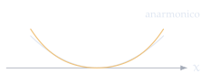
>>> soluzione
**Forza.**  $F=-\dd U/\dd x=-kx-4\beta x^3$.

**Interpretazione.**  Il termine cubico nella forza cresce più rapidamente del termine lineare e rende il richiamo più intenso alle grandi ampiezze.

**Periodo.**  L'equazione non ha più la forma $\ddot x+\omega_0^2x=0$ con pulsazione costante; il periodo può quindi dipendere dall'ampiezza.
:::

### Pendoli e oscillazioni angolari

::: esercizio Periodo di un pendolo di un metro [base]
Calcolare il periodo di un pendolo semplice di lunghezza $1{,}00\un{m}$ per piccole oscillazioni, usando $g=9{,}81\un{m/s^2}$.

>>> soluzione
**Formula.**  $T=2\pi\sqrt{\ell/g}$.

**Calcolo.**  $T=2\pi\sqrt{1{,}00/9{,}81}\approx2{,}006\un{s}$.

**Validità.**  Il risultato vale per ampiezze angolari sufficientemente piccole e attriti trascurabili.
:::

::: esercizio Lunghezza di un pendolo da un secondo [base]
Quale lunghezza deve avere un pendolo semplice affinché il periodo completo sia $1{,}00\un{s}$?

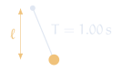
>>> soluzione
**Inversione.**  $\ell=g(T/2\pi)^2$.

**Calcolo.**  $\ell=9{,}81(1{,}00/2\pi)^2\approx0{,}248\un{m}$.

**Nota.**  Il cosiddetto pendolo dei secondi ha invece semiperiodo di un secondo e periodo di due secondi.
:::

::: esercizio Misurare $g$ con il pendolo [medio]
Un pendolo lungo $0{,}80\un{m}$ ha periodo misurato $1{,}80\un{s}$. Stimare $g$.

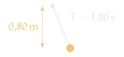
>>> soluzione
**Relazione.**  $g=4\pi^2\ell/T^2$.

**Calcolo.**  $g=4\pi^2(0{,}80)/(1{,}80)^2\approx9{,}75\un{m/s^2}$.

**Valutazione.**  Lo scarto rispetto a $9{,}81\un{m/s^2}$ è compatibile con una misura didattica ordinaria.
:::

::: esercizio Errore nel termine di richiamo a dieci gradi [avanzato]
Valutare l'errore relativo commesso sostituendo $\sin\theta$ con $\theta$ per $\theta=10^\circ$.

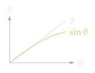
>>> soluzione
**Radianti.**  $10^\circ=0{,}17453\,\mathrm{rad}$ e $\sin10^\circ=0{,}17365$.

**Errore relativo.**  $(\theta-\sin\theta)/\theta\approx0{,}00507$.

**Percentuale.**  Lo scarto nel sostituire $\sin\theta$ con $\theta$ è circa $0{,}51\%$. Non è l'errore del periodo: la prima correzione relativa del periodo vale circa $\theta_0^2/16\approx0{,}19\%$.
:::

::: esercizio Velocità massima da un'ampiezza angolare [medio]
Un pendolo di lunghezza $0{,}75\un{m}$ viene lasciato da fermo a $8{,}0^\circ$. Trascurando gli attriti, calcolare la velocità al punto più basso usando il bilancio energetico esatto.

>>> soluzione
**Dislivello.**  $h=\ell(1-\cos\theta_0)$.

**Energia.**  $\tfrac12mv^2=mg\ell(1-\cos\theta_0)$, quindi $v=\sqrt{2g\ell(1-\cos\theta_0)}$.

**Risultato.**  Con $\theta_0=8{,}0^\circ$, $v\approx0{,}378\un{m/s}$.
:::

::: esercizio Pendolo fisico formato da un'asta [medio]
Un'asta uniforme di lunghezza $1{,}00\un{m}$ oscilla attorno a un asse orizzontale passante per un'estremità. Calcolare il periodo per piccole oscillazioni.

>>> soluzione
**Dati rotazionali.**  Per un'asta attorno all'estremità, $I=\tfrac13mL^2$ e $d=L/2$.

**Periodo.**  $T=2\pi\sqrt{I/(mgd)}=2\pi\sqrt{2L/(3g)}$.

**Risultato.**  Per $L=1{,}00\un{m}$, $T\approx1{,}64\un{s}$.
:::

::: esercizio Oscillatore torsionale [base]
Un disco con momento d'inerzia $0{,}025\un{kg\,m^2}$ è sospeso a un filo con costante torsionale $0{,}20\un{N\,m/rad}$. Calcolare il periodo.

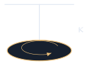
>>> soluzione
**Formula.**  $T=2\pi\sqrt{I/\kappa}$.

**Calcolo.**  $T=2\pi\sqrt{0{,}025/0{,}20}=2\pi\sqrt{0{,}125}$.

**Risultato.**  $T\approx2{,}22\un{s}$.
:::

::: esercizio Pendolo sulla Luna [base]
Calcolare il periodo di un pendolo semplice lungo $1{,}00\un{m}$ sulla Luna, dove $g=1{,}62\un{m/s^2}$.

>>> soluzione
**Formula.**  $T=2\pi\sqrt{\ell/g_L}$.

**Calcolo.**  $T=2\pi\sqrt{1{,}00/1{,}62}$.

**Risultato.**  $T\approx4{,}94\un{s}$, più lungo che sulla Terra perché la gravità è minore.
:::

### Smorzamento e decadimento

::: esercizio Decadimento dell'ampiezza [base]
L'inviluppo di un oscillatore sottosmorzato è $A(t)=A_0e^{-\gamma t}$ con $\gamma=0{,}25\un{s^{-1}}$. Quale frazione dell'ampiezza iniziale resta dopo $4{,}0\un{s}$?

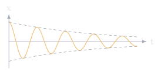
>>> soluzione
**Rapporto.**  $A/A_0=e^{-\gamma t}=e^{-(0{,}25)(4{,}0)}=e^{-1}$.

**Valore.**  $e^{-1}\approx0{,}368$.

**Interpretazione.**  Resta circa il $36{,}8\%$ dell'ampiezza iniziale.
:::

::: esercizio Tempo di dimezzamento dell'ampiezza [base]
Per un oscillatore con $\gamma=0{,}18\un{s^{-1}}$ determinare il tempo nel quale l'ampiezza si dimezza.

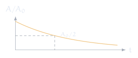
>>> soluzione
**Equazione.**  $e^{-\gamma t_{1/2}}=1/2$.

**Soluzione.**  $t_{1/2}=\ln2/\gamma$.

**Risultato.**  $t_{1/2}=0{,}693/0{,}18\approx3{,}85\un{s}$.
:::

::: esercizio Decadimento dell'energia [base]
Nel regime debolmente smorzato l'energia media decade come $E(t)=E_0e^{-2\gamma t}$. Con $\gamma=0{,}20\un{s^{-1}}$, quale frazione resta dopo $3{,}0\un{s}$?

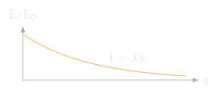
>>> soluzione
**Rapporto.**  $E/E_0=e^{-2\gamma t}=e^{-2(0{,}20)(3{,}0)}=e^{-1{,}2}$.

**Valore.**  $e^{-1{,}2}\approx0{,}301$.

**Interpretazione.**  Resta circa il $30\%$ dell'energia meccanica iniziale.
:::

::: esercizio Classificare tre regimi di smorzamento [base]
Per $\omega_0=5{,}0\un{rad/s}$ classificare i casi $\gamma=2{,}0\un{s^{-1}}$, $\gamma=5{,}0\un{s^{-1}}$ e $\gamma=7{,}0\un{s^{-1}}$.

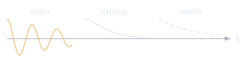
>>> soluzione
**Confronto.**  Si confronta $\gamma$ con $\omega_0$.

**Classificazione.**  $2<5$: sottosmorzato; $5=5$: critico; $7>5$: sovrasmorzato.

**Moto.**  Solo il primo caso conserva oscillazioni attorno all'equilibrio.
:::

::: esercizio Frequenza smorzata [base]
Un oscillatore ha $\omega_0=10\un{rad/s}$ e $\gamma=2{,}0\un{s^{-1}}$. Calcolare pulsazione e periodo smorzati.

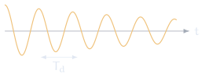
>>> soluzione
**Pulsazione.**  $\omega_d=\sqrt{\omega_0^2-\gamma^2}=\sqrt{100-4}=9{,}80\un{rad/s}$.

**Periodo.**  $T_d=2\pi/\omega_d$.

**Risultato.**  $T_d\approx0{,}641\un{s}$.
:::

::: esercizio Fattore di qualità [medio]
Un oscillatore debolmente smorzato ha $\omega_0=20\un{rad/s}$ e $\gamma=0{,}40\un{s^{-1}}$. Stimare $Q$.

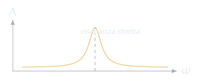
>>> soluzione
**Formula.**  Per smorzamento debole $Q\approx\omega_0/(2\gamma)$.

**Calcolo.**  $Q=20/(0{,}80)=25$.

**Interpretazione.**  Il valore elevato indica dissipazione debole e una risposta risonante relativamente stretta.
:::

::: esercizio Smorzamento critico di una sospensione [base]
Una massa di $0{,}50\un{kg}$ è collegata a una molla con $k=200\un{N/m}$. Determinare il coefficiente viscoso critico $b_c$.

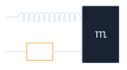
>>> soluzione
**Condizione.**  Lo smorzamento critico richiede $b_c=2\sqrt{km}$.

**Calcolo.**  $b_c=2\sqrt{(200)(0{,}50)}=2\sqrt{100}$.

**Risultato.**  $b_c=20\un{N\,s/m}$.
:::

::: esercizio Decremento logaritmico [base]
Due massimi successivi di un'oscillazione sottosmorzata valgono $10{,}0\un{cm}$ e $7{,}4\un{cm}$. Il periodo smorzato è $0{,}80\un{s}$. Stimare il decremento logaritmico e $\gamma$.

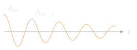
>>> soluzione
**Decremento.**  $\delta=\ln(A_n/A_{n+1})=\ln(10{,}0/7{,}4)\approx0{,}301$.

**Relazione.**  Per massimi successivi $\delta=\gamma T_d$.

**Risultato.**  $\gamma=0{,}301/0{,}80\approx0{,}376\un{s^{-1}}$.
:::

### Forzamento e risonanza

::: esercizio Identificare i parametri di un oscillatore forzato [avanzato]
Per l'equazione $2\ddot x+6\dot x+50x=8\cos(4t)$ in unità SI, identificare $m$, $b$, $k$, $F_0$, $\omega$ e la pulsazione naturale non smorzata.

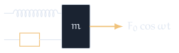
>>> soluzione
**Confronto.**  Con $m\ddot x+b\dot x+kx=F_0\cos\omega t$ si leggono $m=2\un{kg}$, $b=6\un{N\,s/m}$, $k=50\un{N/m}$, $F_0=8\un{N}$ e $\omega=4\un{rad/s}$.

**Naturale.**  $\omega_0=\sqrt{k/m}=\sqrt{25}=5\un{rad/s}$.

**Nota.**  La pulsazione della risposta stazionaria è quella della forza, $\omega$, non la pulsazione naturale $\omega_0$; la frequenza ordinaria è $f=\omega/(2\pi)$.
:::

::: esercizio Ampiezza della risposta stazionaria [base]
Per $m=1{,}0\un{kg}$, $k=100\un{N/m}$, $b=4{,}0\un{N\,s/m}$, $F_0=10\un{N}$ e $\omega=8{,}0\un{rad/s}$ calcolare l'ampiezza stazionaria.

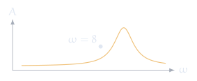
>>> soluzione
**Denominatore.**  $\sqrt{(k-m\omega^2)^2+(b\omega)^2}=\sqrt{36^2+32^2}\approx48{,}17$.

**Ampiezza.**  $A=F_0/48{,}17$.

**Risultato.**  $A\approx0{,}208\un{m}$.
:::

::: esercizio Limite di bassa frequenza [base]
Una forza lentamente variabile di ampiezza $5{,}0\un{N}$ agisce su una molla con $k=100\un{N/m}$. Stimare l'ampiezza nel limite $\omega\to0$.

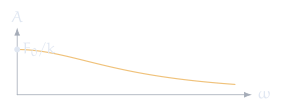
>>> soluzione
**Quasi-statico.**  Per $\omega\to0$, inerzia e smorzamento diventano trascurabili nella risposta stazionaria.

**Ampiezza.**  $A\approx F_0/k=5{,}0/100$.

**Risultato.**  $A\approx0{,}050\un{m}$.
:::

::: esercizio Limite di alta frequenza [base]
Per $m=2{,}0\un{kg}$, $F_0=10\un{N}$ e $\omega=20\un{rad/s}$ stimare l'ampiezza nel limite in cui domina l'inerzia.

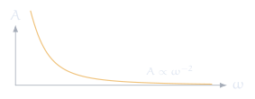
>>> soluzione
**Dominio inerziale.**  Per frequenza molto alta, $|k-m\omega^2|\approx m\omega^2$.

**Stima.**  $A\approx F_0/(m\omega^2)$.

**Risultato.**  $A\approx10/[2(20)^2]=0{,}0125\un{m}$.
:::

::: esercizio Fase alla pulsazione naturale [medio]
Mostrare che, per $b>0$, alla pulsazione $\omega=\omega_0=\sqrt{k/m}$ la risposta stazionaria è in ritardo di $\pi/2$ rispetto alla forza.

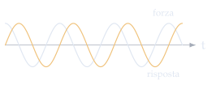
>>> soluzione
**Fase.**  $\tan\delta=b\omega/(k-m\omega^2)$.

**Alla naturale.**  Per $\omega^2=k/m$ il denominatore si annulla mentre il numeratore resta positivo.

**Conclusione.**  La fase tende a $\delta=\pi/2$: lo spostamento è in ritardo di un quarto di periodo.
:::

::: esercizio Pulsazione della massima ampiezza [avanzato]
Per $m=1{,}0\un{kg}$, $b=2{,}0\un{N\,s/m}$ e $k=100\un{N/m}$ calcolare la pulsazione alla quale l'ampiezza è massima nel modello lineare.

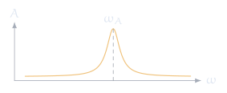
>>> soluzione
**Parametri.**  $\omega_0=\sqrt{k/m}=10\un{rad/s}$ e $\gamma=b/(2m)=1{,}0\un{s^{-1}}$.

**Condizione.**  Il massimo dell'ampiezza a pulsazione positiva esiste soltanto se $\gamma<\omega_0/\sqrt2$, condizione qui soddisfatta.

**Risonanza di spostamento.**  $\omega_A=\sqrt{\omega_0^2-2\gamma^2}$.

**Risultato.**  $\omega_A=\sqrt{100-2}\approx9{,}90\un{rad/s}$. Il massimo della potenza media, per la stessa eccitazione a forza, cade invece a $\omega_0$.
:::

::: esercizio Potenza media dissipata [medio]
Un oscillatore stazionario ha $b=3{,}0\un{N\,s/m}$, $\omega=6{,}0\un{rad/s}$ e ampiezza $4{,}0\un{cm}$. Calcolare la potenza media dissipata.

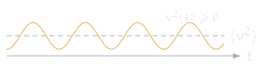
>>> soluzione
**Formula.**  Poiché $P_{\mathrm{diss}}(t)=bv^2(t)\geq0$ e $\langle v^2\rangle=\tfrac12\omega^2A^2$, si ha $\langle P\rangle=\tfrac12b\omega^2A^2$.

**Calcolo.**  $\langle P\rangle=\tfrac12(3{,}0)(6{,}0)^2(0{,}040)^2$.

**Risultato.**  $\langle P\rangle=0{,}0864\un{W}$.
:::

::: esercizio Risonanza e sicurezza strutturale [avanzato]
Una macchina applica una forza periodica a un supporto elastico. Indicare tre interventi fisicamente distinti per ridurre una risposta risonante e spiegare il principio di ciascuno.

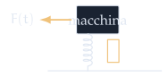
>>> soluzione
**Detuning.**  Modificare massa o rigidezza sposta la frequenza naturale lontano dalla frequenza di eccitazione.

**Dissipazione.**  Aumentare lo smorzamento riduce e allarga il picco di ampiezza.

**Forzante o isolamento.**  Ridurre la forza periodica alla sorgente oppure inserire un isolamento che limiti il trasferimento. La scelta dipende dalle frequenze operative e dai vincoli statici.
:::

### Battimenti, accoppiamento e applicazioni

::: esercizio Frequenza di battimento [medio]
Due sorgenti producono frequenze $5{,}0\un{Hz}$ e $5{,}4\un{Hz}$. Determinare frequenza di battimento e frequenza media dell'oscillazione rapida.

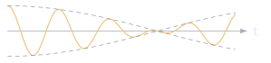
>>> soluzione
**Battimento.**  $f_b=|f_2-f_1|=|5{,}4-5{,}0|=0{,}40\un{Hz}$.

**Portante.**  $f_m=(f_1+f_2)/2=5{,}20\un{Hz}$.

**Interpretazione.**  L'ampiezza cresce e diminuisce $0{,}40$ volte al secondo mentre l'oscillazione rapida avviene attorno a $5{,}20$ Hz.
:::

::: esercizio Periodo dei battimenti [base]
Per le frequenze del problema precedente determinare l'intervallo fra due massimi successivi dell'inviluppo.

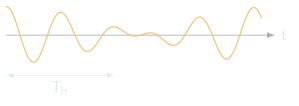
>>> soluzione
**Relazione.**  $T_b=1/f_b$.

**Calcolo.**  $T_b=1/0{,}40$.

**Risultato.**  $T_b=2{,}5\un{s}$.
:::

::: esercizio Due masse: modi in fase e in opposizione [medio]
Due masse uguali $m=1{,}0\un{kg}$ sono collegate alle pareti da molle $k=100\un{N/m}$ e fra loro da una molla $k_c=20\un{N/m}$. Calcolare le pulsazioni dei due modi normali.

>>> soluzione
**In fase.**  La molla centrale non si deforma: $\omega_1=\sqrt{k/m}=\sqrt{100}=10{,}0\un{rad/s}$.

**Opposizione.**  La rigidezza efficace è $k+2k_c=140\,\mathrm{N/m}$.

**Risultato.**  $\omega_2=\sqrt{140/1{,}0}\approx11{,}8\un{rad/s}$.
:::

::: esercizio Trasferimento di energia fra due pendoli [avanzato]
Due pendoli quasi identici sono debolmente accoppiati. Inizialmente oscilla soltanto il primo. Descrivere qualitativamente l'evoluzione delle ampiezze.

>>> soluzione
**Scomposizione.**  Lo stato iniziale è una combinazione dei modi in fase e in opposizione.

**Evoluzione.**  Poiché i due modi hanno frequenze leggermente diverse, la loro fase relativa cambia lentamente.

**Osservazione.**  L'ampiezza del primo diminuisce mentre quella del secondo cresce; poi il trasferimento si inverte. Con dissipazione, l'energia totale cala nel tempo.
:::

::: esercizio Ricorrenza da due modi [base]
Un sistema lineare presenta due modi di frequenza $2{,}0\un{Hz}$ e $3{,}0\un{Hz}$. Qual è il più breve intervallo dopo il quale le loro fasi relative tornano uguali?

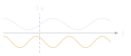
>>> soluzione
**Fase relativa.**  La differenza di frequenza è $\Delta f=1{,}0\un{Hz}$.

**Ricorrenza.**  La fase relativa accumula un ciclo in $1/\Delta f$.

**Risultato.**  Il più breve intervallo è $1{,}0\un{s}$.
:::

::: esercizio Larghezza di banda e fattore di qualità [base]
Un risonatore ha frequenza centrale $10{,}0\un{Hz}$ e fattore di qualità $Q=20$. Stimare la larghezza di banda a metà potenza nel regime debolmente smorzato.

>>> soluzione
**Relazione.**  Per un risonatore debolmente smorzato $Q\approx f_0/\Delta f$.

**Calcolo.**  $\Delta f=f_0/Q=10{,}0/20$.

**Risultato.**  $\Delta f\approx0{,}50\un{Hz}$.
:::

::: esercizio Progettare una sospensione semplificata [avanzato]
Una sospensione deve riportare rapidamente una massa all'equilibrio senza oscillazioni prolungate. Quale regime di smorzamento è un buon punto di partenza e quali compromessi reali devono essere considerati?

>>> soluzione
**Modello.**  Lo smorzamento critico è un buon punto di partenza perché, per condizioni iniziali e criteri di assestamento usuali, porta rapidamente entro una banda di tolleranza senza risposta oscillante. L'equilibrio è comunque raggiunto asintoticamente.

**Compromessi.**  Smorzamento elevato può trasmettere forze e peggiorare l'isolamento alle alte frequenze; smorzamento basso aumenta oscillazioni e tempi di assestamento.

**Realtà.**  Corsa disponibile, carico variabile, non linearità, temperatura e frequenze della strada richiedono prove e modelli più completi.
:::

### Approssimazioni, serie di Taylor e linearizzazione

::: esercizio Approssimazione relativistica a bassa velocità [avanzato]
Confrontare il valore esatto di $\gamma$ con l'approssimazione $1+\tfrac12\beta^2$, dove $\beta=v/c$, per $\beta=0{,}10$ e $\beta=0{,}50$. Calcolare l'errore relativo.

>>> soluzione
**Caso $\beta=0{,}10$.**

$$\gamma_{es}=\frac1{\sqrt{0{,}99}}=1{,}00504,
\qquad
\gamma_{app}=1+\frac12(0{,}10)^2=1{,}00500.$$

L'errore relativo è circa

$$\frac{|1{,}00500-1{,}00504|}{1{,}00504}=4{,}0\times10^{-5}=0{,}004\%.$$

**Caso $\beta=0{,}50$.**

$$\gamma_{es}=\frac1{\sqrt{0{,}75}}=1{,}15470,
\qquad
\gamma_{app}=1{,}12500.$$

L'errore relativo è circa $2{,}57\%$.

**Interpretazione.**  L'approssimazione quadratica è eccellente a $0{,}1c$, ma a $0{,}5c$ i termini superiori non sono più trascurabili.
:::

::: esercizio Linearizzare una misura indiretta [avanzato]
La frequenza di un oscillatore è $f(L)=\dfrac{1}{2\pi}\sqrt{g/L}$. Intorno a $L_0=1{,}00\un{m}$, stimare la variazione relativa di $f$ prodotta da un aumento $\Delta L=0{,}020\un{m}$ usando la linearizzazione. Confrontare con il rapporto esatto.

>>> soluzione
**Dipendenza di potenza.**  Poiché $f\propto L^{-1/2}$, per piccole variazioni

$$\frac{\Delta f}{f}\simeq-\frac12\frac{\Delta L}{L_0}.$$

**Stima lineare.**

$$\frac{\Delta f}{f}\simeq-\frac12\frac{0{,}020}{1{,}00}=-0{,}010.$$

La frequenza diminuisce di circa l'$1{,}0\%$.

**Rapporto esatto.**

$$\frac{f(L_0+\Delta L)}{f(L_0)}
=\sqrt{\frac{L_0}{L_0+\Delta L}}
=\frac1{\sqrt{1{,}02}}=0{,}99015.$$

La variazione esatta è $-0{,}985\%$, molto vicina alla stima lineare.
:::

### Equazioni differenziali e condizioni iniziali

::: esercizio Raffreddamento di Newton [avanzato]
Un corpo a $90\,{}^\circ\mathrm{C}$ viene posto in una stanza a $20\,{}^\circ\mathrm{C}$. Il modello è

$$\frac{\dd T}{\dd t}=-k(T-20),$$

con $k=0{,}080\,\mathrm{min^{-1}}$. Determinare $T(t)$ e il tempo necessario per raggiungere $40\,{}^\circ\mathrm{C}$.

>>> soluzione
**Variabile di scarto.**  Poniamo $\theta=T-20$. Allora

$$\frac{\dd\theta}{\dd t}=-k\theta.$$

**Soluzione esponenziale.**

$$\theta(t)=\theta_0e^{-kt}.$$

Poiché $\theta_0=90-20=70\,\mathrm{°C}$,

$$T(t)=20+70e^{-0{,}080t}.$$

**Tempo per $40^\circ\mathrm C$.**

$$40=20+70e^{-0{,}080t}
\quad\Rightarrow\quad
\frac{20}{70}=e^{-0{,}080t}.$$

$$t=-\frac1{0{,}080}\ln\frac{2}{7}
=15{,}7\un{min}.$$

La temperatura si avvicina asintoticamente a quella ambiente e non la attraversa nel modello ideale.
:::

::: esercizio Oscillatore armonico e passo numerico [avanzato]
Un oscillatore soddisfa $x”+\omega^2x=0$, con $\omega=2\un{rad/s}$, $x(0)=1\un{m}$ e $v(0)=0$. Poiché il radiante è adimensionale, $\omega^2$ ha dimensione $\mathrm{s^{-2}}$. Scrivere la soluzione esatta. Poi eseguire due passi del metodo di Eulero-Cromer con $\Delta t=0{,}10\un{s}$:

$$v_{n+1}=v_n-\omega^2x_n\Delta t,
\qquad
x_{n+1}=x_n+v_{n+1}\Delta t.$$

>>> soluzione
**Soluzione esatta.**  L'equazione è già nella forma $x”+\omega^2x=0$, con $\omega=2\un{rad/s}$. Le condizioni iniziali danno

$$x(t)=\cos(2t)\,\mathrm{m},
\qquad
v(t)=-2\sin(2t)\,\mathrm{m/s}.$$

**Primo passo.**

$$v_1=0-\omega^2(1)(0{,}10)=-0{,}40\,\mathrm{m/s},$$

$$x_1=1+(-0{,}40)(0{,}10)=0{,}960\,\mathrm{m}.$$

**Secondo passo.**

$$v_2=-0{,}40-\omega^2(0{,}960)(0{,}10)=-0{,}784\,\mathrm{m/s},$$

$$x_2=0{,}960+(-0{,}784)(0{,}10)=0{,}8816\,\mathrm{m}.$$

**Confronto.**  La soluzione esatta a $t=0{,}20\,\mathrm{s}$ è $\cos0{,}4=0{,}9211\,\mathrm{m}$. Il passo numerico produce un errore visibile; ridurre $\Delta t$ migliora la stima.
:::

### Numeri complessi: ampiezza e fase in un solo oggetto

::: esercizio Somma di due oscillazioni in fase diversa [avanzato]
Due oscillazioni della stessa frequenza sono rappresentate dai fasori

$$z_1=3e^{i0},
\qquad
z_2=4e^{i\pi/2}.$$

Calcolare il fasore risultante, il modulo e la fase.

>>> soluzione
**Forma cartesiana.**

$$z_1=3,
\qquad
z_2=4i.$$

**Somma.**

$$z=z_1+z_2=3+4i.$$

**Modulo.**

$$|z|=\sqrt{3^2+4^2}=5.$$

**Fase.**

$$\phi=\arctan\frac43=53{,}1^\circ=0{,}927\,\mathrm{rad}.$$

La risultante può essere scritta $z=5e^{i0{,}927}$.
:::

::: esercizio Ampiezza quantistica e probabilità [avanzato]
Uno stato a due componenti è descritto da

$$\psi=\begin{pmatrix}1/\sqrt3\\ i\sqrt{2/3}\end{pmatrix}.$$

Verificare la normalizzazione e calcolare le probabilità associate alle due componenti. Determinare inoltre il prodotto interno con

$$\phi=\begin{pmatrix}1/\sqrt2\\1/\sqrt2\end{pmatrix}.$$

>>> soluzione
**Normalizzazione.**  Il modulo quadrato totale è

$$\left|\frac1{\sqrt3}\right|^2+
\left|i\sqrt{\frac23}\right|^2
=\frac13+\frac23=1.$$

Lo stato è normalizzato.

**Probabilità.**

$$P_1=\frac13,
\qquad
P_2=\frac23.$$

La fase $i$ non cambia il modulo della seconda componente.

**Prodotto interno.**  Per vettori complessi si coniuga il primo fattore:

$$\langle\phi|\psi\rangle
=\frac1{\sqrt2}\frac1{\sqrt3}
+\frac1{\sqrt2}i\sqrt{\frac23}
=\frac1{\sqrt6}+\frac{i}{\sqrt3}.$$

Il suo modulo quadrato è

$$|\langle\phi|\psi\rangle|^2
=\frac16+\frac13=\frac12.$$

Se $|\phi\rangle$ rappresenta uno dei risultati possibili di una misura proiettiva, questo modulo quadrato è la probabilità di ottenere quel risultato. La fase relativa, invisibile nelle probabilità delle due componenti originali, entra quindi nelle probabilità calcolate in una base diversa.
:::

### Problemi di sintesi: strumenti matematici e vettori

::: esercizio Somma di due fasori [avanzato]
Due oscillazioni della stessa frequenza hanno fasori $3$ e $4e^{i60^\circ}$. Determinare ampiezza e fase del fasore risultante.
>>> soluzione
**Componenti complesse.**  $Z=3+4(\cos60^\circ+i\sin60^\circ)=5+i3{,}46$.

**Forma polare.**

$$|Z|=6{,}08,\qquad \phi=\arctan\frac{3{,}46}5=34{,}7^\circ.$$
:::

### Problemi di sintesi: oscillazioni, onde e suono

::: esercizio Periodo massa–molla [avanzato]
Una massa di $0{,}6\un{kg}$ è collegata a una molla di costante $150\un{N/m}$. Calcolare periodo e frequenza.
>>> soluzione
**Pulsazione.**  $\omega_0=\sqrt{k/m}=15{,}8\un{rad/s}$.

**Periodo e frequenza.**  $T=2\pi/\omega_0=0{,}397\un{s}$, $f=1/T=2{,}52\un{Hz}$.
:::

::: esercizio Allungamento statico e periodo verticale [avanzato]
Una massa di $0{,}35\un{kg}$ pende da una molla di costante $70\un{N/m}$. Calcolare allungamento di equilibrio e periodo delle piccole oscillazioni.
>>> soluzione
**Equilibrio.**  $x_e=mg/k=0{,}0491\un{m}$.

**Periodo.**  La gravità sposta l'equilibrio ma non cambia la curvatura: $T=2\pi\sqrt{m/k}=0{,}444\un{s}$.
:::

::: esercizio Ampiezza dall'energia totale [avanzato]
Un oscillatore con $m=0{,}50\un{kg}$ e $k=200\un{N/m}$ ha energia totale $0{,}9\un{J}$. Calcolare ampiezza e velocità massima.
>>> soluzione
**Punti di inversione.**  $E=\tfrac12kA^2$, quindi $A=0{,}0949\un{m}$.

**Equilibrio.**  $E=\tfrac12mv_{max}^2$, quindi $v_{max}=1{,}90\un{m/s}$.
:::

::: esercizio Pendolo semplice [avanzato]
Calcolare il periodo di un pendolo semplice lungo $0{,}85\un{m}$ per piccole oscillazioni.
>>> soluzione
**Formula.**  $T=2\pi\sqrt{L/g}=1{,}85\un{s}$.

**Dominio.**  Il risultato è indipendente dalla massa e approssimato per angoli piccoli.
:::

::: esercizio Dimezzamento dell'ampiezza [avanzato]
L'ampiezza di un oscillatore smorzato segue $A(t)=A_0e^{-\beta t}$ con $\beta=0{,}18\un{s^{-1}}$. Calcolare il tempo di dimezzamento dell'ampiezza e dell'energia.
>>> soluzione
**Ampiezza.**  $t_{1/2,A}=\ln2/\beta=3{,}85\un{s}$.

**Energia.**  Poiché $E\propto A^2$, $E=E_0e^{-2\beta t}$ e $t_{1/2,E}=\ln2/(2\beta)=1{,}93\un{s}$.
:::

::: esercizio Fattore di qualità da una curva di risonanza [avanzato]
Una risonanza è centrata a $500\un{Hz}$ e ha larghezza a metà potenza $5\un{Hz}$. Calcolare $Q$ e stimare la frazione di energia persa per ciclo come $2\pi/Q$.
>>> soluzione
**Qualità.**  $Q=f_0/\Delta f=100$.

**Perdita per ciclo.**  Per smorzamento debole $\Delta E/E\simeq2\pi/Q=0{,}0628$, circa $6{,}28\%$.
:::

::: esercizio Battimenti fra due diapason [avanzato]
Due toni hanno frequenze $440\un{Hz}$ e $444\un{Hz}$. Calcolare frequenza dei battimenti e frequenza portante media.
>>> soluzione
**Battimenti.**  $f_b=|f_2-f_1|=4\un{Hz}$.

**Portante.**  $f_m=(f_1+f_2)/2=442{,}0\un{Hz}$.
:::

::: esercizio Due oscillatori accoppiati [avanzato]
Due masse identiche $m=0{,}5\un{kg}$ sono collegate ciascuna a una parete da una molla $k=40\un{N/m}$ e fra loro da una molla $k_c=10\un{N/m}$. Calcolare le pulsazioni dei modi in fase e in opposizione.
>>> soluzione
**Modo in fase.**  La molla di accoppiamento non si deforma: $\omega_1=\sqrt{k/m}=8{,}94\un{rad/s}$.

**Modo opposto.**  La rigidezza efficace è $k+2k_c$: $\omega_2=11{,}0\un{rad/s}$.
:::

## Fonti {#fonti}

Il testo, le formule, i diagrammi e gli esercizi di questo capitolo provengono dalla *Dispensa di fisica* del corso (sezioni 0.29-0.30, 0.34, 5.1-5.8, 5.13 e materiali delle sezioni 0.22, 5.14, 5.16), consultabile nel lettore della galassia. Per la lettura sul sito sono cambiati l'impaginazione, i colori delle figure, la numerazione e la posizione di alcuni riquadri ed esercizi; la sezione iniziale è scritta per il pianeta di questa unità.

Opere citate nel testo:

1. G. Galilei, *Discorsi e dimostrazioni matematiche intorno a due nuove scienze*, Elsevier, Leida, 1638; traduzione inglese di S. Drake, *Two New Sciences*, University of Wisconsin Press, Madison, 1974.
2. C. Huygens, *Horologium Oscillatorium sive de motu pendulorum*, Parigi, 1673; traduzione inglese e commento di R. J. Blackwell, *Christiaan Huygens' The Pendulum Clock*, Iowa State University Press, Ames, 1986.
3. R. Hooke, *Lectures de Potentia Restitutiva, or of Spring Explaining the Power of Springing Bodies*, John Martyn, Londra, 1678.
4. H. von Helmholtz, *Die Lehre von den Tonempfindungen als physiologische Grundlage fuer die Theorie der Musik*, Vieweg, Braunschweig, 1863; traduzione inglese di A. J. Ellis, *On the Sensations of Tone*, Dover Publications, New York, 1954.
5. J. W. Strutt, barone Rayleigh, *The Theory of Sound*, 2 voll., Macmillan, Londra, 1877–1878; 2a edizione, 1894–1896; ristampa Dover Publications, New York, 1945.
6. G. Cardano, *Ars Magna*, Norimberga, 1545; traduzione inglese di T. R. Witmer, Dover Publications, New York, 1993.
7. P. J. Nahin, *An Imaginary Tale: The Story of $\sqrt{-1}$*, Princeton University Press, Princeton, 1998.
