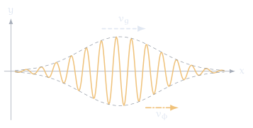
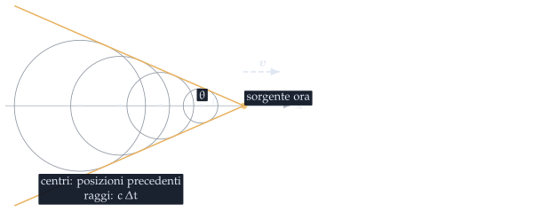
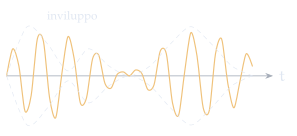
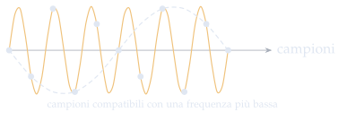

## Prima di cominciare {#apertura}

Una perturbazione percorre una guida tesa. Il profilo sembra spostarsi da un'estremità all'altra, mentre ogni tratto della guida oscilla attorno alla propria posizione di riposo. L'onda trasporta energia e informazione senza trasportare il materiale lungo tutto il percorso.

Il capitolo tratta onde meccaniche, propagazione e trasporto di energia, sovrapposizione, riflessione e onde stazionarie, suono con velocità, intensità, risonanza ed effetto Doppler, spettri, dispersione e impedenza. Le sezioni matematiche finali presentano le equazioni alle derivate parziali e l'analisi di Fourier con il campionamento. Il capitolo presuppone le [oscillazioni armoniche](unit:physics-16).

## Onde meccaniche: propagazione e trasporto di energia {#s-5-9}

Una perturbazione ondulatoria trasporta energia e informazione senza trasportare in blocco la materia del mezzo. In una corda, ogni elemento oscilla soprattutto trasversalmente mentre la forma dell'onda si sposta lungo la corda; nel suono, le particelle del mezzo oscillano prevalentemente lungo la direzione di propagazione. La velocità dell'onda non va confusa con la velocità istantanea delle particelle del mezzo.

Una forma che si propaga verso $+x$ senza deformarsi può essere scritta

$$y(x,t)=f(x-vt),$$

mentre $f(x+vt)$ si propaga verso $-x$. Per un'onda sinusoidale,

::: legge Onda armonica progressiva
$$y(x,t)=A\cos(kx-\omega t+\varphi),$$

$$k=\frac{2\pi}{\lambda},
\qquad
\omega=2\pi f,
\qquad
v=\frac{\omega}{k}=\lambda f.$$
:::

### Equazione delle onde e velocità su una corda

Per piccole pendenze, una corda uniforme di densità lineare $\mu$ sottoposta a tensione $\mathcal T$ soddisfa

::: legge Equazione delle onde unidimensionale
$$\frac{\partial^2 y}{\partial t^2}=v^2\frac{\partial^2y}{\partial x^2},
\qquad
v=\sqrt{\frac{\mathcal T}{\mu}}.$$
:::

La velocità dipende dalle proprietà del mezzo e dalla tensione, non dall'ampiezza, finché valgono linearità e piccole deformazioni. Aumentare la tensione rende più rapida la propagazione; aumentare la massa per unità di lunghezza la rallenta.

Un'onda sinusoidale su una corda trasporta energia cinetica ed elastica. La potenza media è

::: legge Potenza media trasportata da una corda
$$\overline P=\frac12\mu v\omega^2A^2.$$
:::

La dipendenza quadratica da ampiezza e frequenza spiega perché piccole variazioni dell'oscillazione possano modificare molto il flusso energetico.

::: esempio Frequenza fondamentale di una corda
Una corda lunga $L=0{,}650\un{m}$ ha densità lineare $\mu=5{,}00\times10^{-3}\un{kg/m}$ ed è tesa con $\mathcal T=120\un{N}$. La velocità delle onde è

$$v=\sqrt{\frac{120}{5{,}00\times10^{-3}}}=155\un{m/s}.$$

Con estremi fissi, la fondamentale ha $\lambda_1=2L$ e

$$f_1=\frac{v}{2L}=\frac{154{,}9}{1{,}30}=119\un{Hz}.$$

La frequenza cambierebbe come $\sqrt{\mathcal T}$, non in proporzione diretta alla tensione.
:::

::: errore L'onda avanza, il mezzo in genere no
In un'onda armonica sulla corda, un punto materiale oscilla attorno alla propria posizione di equilibrio e può avere velocità trasversale molto diversa da $v$. La velocità $v=\lambda f$ descrive la propagazione della fase o della forma nel modello non dispersivo.
:::

## Sovrapposizione, riflessione e onde stazionarie {#s-5-10}

In un mezzo lineare, se $y_1$ e $y_2$ sono soluzioni, anche $y_1+y_2$ lo è. Onde coerenti possono rinforzarsi o cancellarsi localmente; l'interferenza redistribuisce l'energia nello spazio, ma non crea energia dal nulla. La fase relativa decide il risultato.

Due onde sinusoidali uguali che viaggiano in versi opposti producono

::: legge Onda stazionaria
$$y(x,t)=2A\sin(kx)\cos(\omega t).$$
:::

I nodi, dove l'ampiezza è sempre nulla, sono separati da $\lambda/2$; gli antinodi si trovano a metà fra nodi consecutivi. Non c'è trasporto medio netto di energia lungo una stazionaria ideale, perché i flussi delle due onde opposte si compensano.

Per una corda di lunghezza $L$ fissata a entrambi gli estremi, le condizioni al contorno impongono

::: legge Modi normali di una corda fissata
$$\lambda_n=\frac{2L}{n},
\qquad
f_n=\frac{nv}{2L},
\qquad n=1,2,3,\ldots$$
:::

La fondamentale è $n=1$; i valori successivi sono armoniche. Una forzante vicina a una frequenza propria può alimentare efficacemente quel modo, ma l'ampiezza reale è limitata da dissipazione e non linearità.

::: sintesi Riflessione e condizioni al contorno
Un'estremità fissa impone spostamento nullo e produce un nodo. Un'estremità libera ideale impone forza trasversale nulla e produce un antinodo di spostamento. La fase della riflessione dipende dal tipo di vincolo: non va memorizzata senza identificare la condizione al contorno.
:::

## Suono: velocità, intensità, risonanza e Doppler {#s-5-11}

Il suono ordinario in un fluido è un'onda meccanica longitudinale di compressioni e rarefazioni. Per piccole perturbazioni in un mezzo con modulo di compressibilità $B$ e densità $\rho$,

::: legge Velocità del suono
$$v=\sqrt{\frac{B}{\rho}}.$$
:::

Nel gas ideale la trasformazione locale è approssimativamente adiabatica, per cui $B=\gamma p$ e $v=\sqrt{\gamma p/\rho}=\sqrt{\gamma RT/M}$. La velocità dipende dal mezzo e dalla temperatura; non cresce automaticamente con la frequenza in un mezzo non dispersivo.

L'intensità è la potenza media che attraversa l'unità di area,

$$I=\frac{P}{A}.$$

Per un'onda sonora piana sinusoidale, indicando con $s_m$ l'ampiezza di spostamento delle particelle del mezzo e con $\Delta p_m$ l'ampiezza di pressione,

::: legge Intensità di un'onda sonora armonica
$$I=\frac12\rho v\omega^2s_m^2
  =\frac{(\Delta p_m)^2}{2\rho v}.$$
:::

Queste relazioni valgono nel regime lineare e per onde progressive piane; vicino a una sorgente o in un campo riverberante la relazione locale fra pressione, velocità delle particelle e flusso energetico può essere più complessa.

Per una sorgente puntiforme isotropa di potenza $P_s$, senza assorbimento né riflessioni,

$$I(r)=\frac{P_s}{4\pi r^2}.$$

La scala logaritmica dei livelli sonori è

::: legge Livello sonoro
$$\beta=(10\,\mathrm{dB})\log_{10}\!\left(\frac{I}{I_0}\right),
\qquad
I_0=1{,}0\times10^{-12}\un{W/m^2}.$$
:::

Un aumento di $10\un{dB}$ corrisponde a un'intensità dieci volte maggiore; raddoppiare l'intensità aumenta il livello di circa $3\un{dB}$. I livelli in decibel non si sommano come intensità lineari.

::: esempio Livello a distanza da una sorgente ideale
Una sorgente emette $P_s=2{,}0\un{mW}$ isotropicamente. A $r=5{,}0\un{m}$,

$$I=\frac{2{,}0\times10^{-3}}{4\pi(5{,}0)^2}=6{,}37\times10^{-6}\un{W/m^2},$$

$$\beta=10\log_{10}\!\left(\frac{6{,}37\times10^{-6}}{10^{-12}}\right)=68{,}0\un{dB}.$$

Pareti, direzionalità, assorbimento atmosferico e rumore di fondo possono rendere la misura reale molto diversa.
:::

### Colonne d'aria e armoniche

### Effetto Doppler nel mezzo

Per sorgente e rivelatore che si muovono lungo la linea che li unisce rispetto al mezzo,

::: legge Doppler classico per il suono
$$f'=f\frac{v\pm v_D}{v\mp v_S}.$$
:::

Si scelgono i segni in modo che l'avvicinamento aumenti $f'$ e l'allontanamento la diminuisca. Le velocità $v_D$ e $v_S$ sono misurate rispetto al mezzo, non soltanto una rispetto all'altra. Questa formula classica non è quella relativistica della luce.

::: errore Frequenza emessa, frequenza del mezzo e frequenza rivelata
Una sorgente in moto modifica la distanza fra i fronti d'onda nel mezzo; un rivelatore in moto incontra i fronti con un ritmo diverso. I due effetti entrano in parti differenti della formula. Usare soltanto la velocità relativa sorgente–rivelatore può dare un risultato errato quando il mezzo definisce un riferimento fisico, come nel suono in aria con vento.
:::

## Onde reali: spettro, dispersione e impedenza {#s-5-12}

Una sinusoide infinita è un modello elementare. Un impulso localizzato o un suono complesso richiedono una sovrapposizione di numeri d'onda:

$$y(x,t)=\int A(k)e^{i[kx-\omega(k)t]}\,\dd k.$$

La localizzazione spaziale e la larghezza spettrale sono legate: un pacchetto stretto richiede molte componenti $k$. Se $\omega$ è proporzionale a $k$, tutte le componenti viaggiano alla stessa velocità e la forma si conserva; se la relazione è non lineare, il pacchetto si deforma.

::: approfondimento Dimostrazione: Velocità di gruppo di un pacchetto stretto
**Ipotesi.** Lo spettro è concentrato attorno a $k_0$ e $\omega(k)$ è regolare.

**Passaggi.** Sviluppando la dispersione al primo ordine,

$$\omega(k)\simeq\omega_0+(k-k_0)\left.\frac{\dd\omega}{\dd k}\right|_{k_0}.$$

La fase rapida viaggia con $v_\phi=\omega_0/k_0$, mentre l'inviluppo dipende da

$$x-\left.\frac{\dd\omega}{\dd k}\right|_{k_0}t.$$

Perciò

$$v_g=\left.\frac{\dd\omega}{\dd k}\right|_{k_0}.$$

**Significato fisico.** La velocità di fase descrive il moto delle creste; la velocità di gruppo descrive il moto dell'inviluppo in un mezzo debolmente dispersivo.

**Limiti di validità.** Per spettri larghi, forte assorbimento o dispersione anomala, l'identificazione fra $v_g$ e velocità di trasporto dell'informazione richiede cautela.
:::

### Fattore di qualità e risonanza

### Onde d'urto e numero di Mach

Se una sorgente supera la velocità del suono, i fronti emessi in istanti successivi si accumulano su un cono. La geometria fornisce

$$\sin\theta=\frac{c}{v}=\frac1M.$$

Il cono di Mach descrive l'orientamento del fronte; lo spessore e la dissipazione dello shock richiedono la fluidodinamica comprimibile.

## Equazioni alle derivate parziali e condizioni al contorno {#s-0-33}

Quando una grandezza dipende sia dalla posizione sia dal tempo, la sua evoluzione è spesso descritta da un'equazione alle derivate parziali. Il **laplaciano** di un campo scalare è

$$\nabla^2u=
\frac{\partial^2u}{\partial x^2}+
\frac{\partial^2u}{\partial y^2}+
\frac{\partial^2u}{\partial z^2}.$$

Esso confronta il valore locale con i valori circostanti e misura una curvatura spaziale complessiva.

Tre equazioni fondamentali mostrano ruoli diversi dello stesso operatore:

$$\frac{\partial u}{\partial t}=D\nabla^2u
\qquad\text{(diffusione)},$$

$$\frac{\partial^2u}{\partial t^2}=c^2\nabla^2u
\qquad\text{(onda)},$$

$$i\hbar\frac{\partial\psi}{\partial t}
=-\frac{\hbar^2}{2m}\nabla^2\psi+V(\vect r,t)\psi
\qquad\text{(Schrödinger, particella non relativistica)}.$$

Nella diffusione le irregolarità si smussano; nell'equazione delle onde una perturbazione si propaga; nell'equazione di Schrödinger evolve un'ampiezza complessa e il laplaciano compare nel termine di energia cinetica. La forma mostrata vale per una singola particella senza spin in un potenziale scalare; campi elettromagnetici, spin o sistemi a molte particelle richiedono un'hamiltoniana più ricca. Le tre equazioni non sono intercambiabili: differiscono per ordine temporale, significato delle variabili e condizioni richieste.

Una soluzione è determinata non soltanto dall'equazione, ma anche dalle condizioni iniziali e dalle condizioni al contorno. Una corda fissata impone $u(0,t)=u(L,t)=0$; una parete isolante impone un flusso termico normale nullo; una funzione d'onda legata deve essere normalizzabile e soddisfare le condizioni del potenziale. In forma discreta, la derivata seconda spaziale in una dimensione può essere stimata con

$$\frac{\partial^2u}{\partial x^2}(x_i,t)
\simeq
\frac{u_{i+1}(t)-2u_i(t)+u_{i-1}(t)}{(\Delta x)^2}.$$

La relazione collega l'equazione continua alla simulazione su griglia.

::: approfondimento Onde e strumenti della fisica moderna
Numeri complessi e trasformate di Fourier descrivono ampiezza, fase e spettro; matrici e autovalori descrivono trasformazioni e modi normali; la probabilità organizza misure, fluttuazioni e risultati quantistici.
:::

## Onde, frequenze, analisi di Fourier e campionamento {#s-0-37}

::: storia Il problema del calore e la scomposizione in armoniche
Fourier sviluppò le serie trigonometriche studiando la conduzione del calore. L'idea di rappresentare profili complicati come somme di seni e coseni suscitò obiezioni, anche perché il concetto moderno di funzione e le condizioni di convergenza non erano ancora pienamente stabiliti. Il lavoro successivo di Dirichlet, Riemann e altri rese più precise le condizioni matematiche. La stessa strategia è oggi alla base dell'analisi di suoni, immagini, segnali elettrici e stati ondulatori: si passa dal tempo o dallo spazio alle frequenze che compongono il segnale.  [1, 2](#fonti)
:::

Una funzione sinusoidale

$$y(t)=A\cos(\omega t+\phi)$$

è caratterizzata da ampiezza $A$, pulsazione $\omega$, fase $\phi$, periodo $T=2\pi/\omega$ e frequenza $f=1/T=\omega/(2\pi)$. Una traslazione temporale modifica la fase; un cambiamento di ampiezza non modifica il periodo.

L'analisi di Fourier rappresenta, sotto ipotesi appropriate, un segnale periodico come somma di seni e coseni a frequenze multiple della fondamentale. Per segnali non periodici si introduce uno spettro continuo. Lo stesso linguaggio ricorre in vibrazioni meccaniche, suono, ottica, circuiti, spettroscopia e meccanica quantistica.

La somma di due oscillazioni vicine,

$$\cos\omega_1t+\cos\omega_2t
=2\cos\left(\frac{\omega_1-\omega_2}{2}t\right)
\cos\left(\frac{\omega_1+\omega_2}{2}t\right),$$

produce battimenti: un'oscillazione rapida modulata da un inviluppo lento.

Un segnale digitale è campionato a intervalli $\Delta t$, con frequenza di campionamento $f_s=1/\Delta t$. Per ricostruire una sinusoide senza ambiguità è necessario, in condizioni ideali, $f_s>2f_{max}$. Se il campionamento è troppo lento, frequenze diverse producono gli stessi campioni: è il fenomeno di aliasing.

## Sintesi e autoverifica {#sintesi}

::: metodo Come analizzare un oscillatore reale
1. Identificare la configurazione di equilibrio e scegliere la coordinata misurata rispetto a essa.
2. Stabilire se il richiamo è lineare nell'intervallo di moto considerato e stimare la pulsazione naturale.
3. Chiarire l'ingresso fisico: forza applicata, spostamento della base, impulso o condizione iniziale.
4. Valutare la dissipazione osservando decadimento, larghezza della risonanza o ritardo di fase, senza assumere automaticamente attrito viscoso.
5. Separare transitorio e regime stazionario e specificare quale grandezza viene massimizzata quando si parla di risonanza.
6. Controllare ampiezza, saturazioni, fine corsa e presenza di altri modi; se questi effetti sono rilevanti, abbandonare il modello lineare a un grado di libertà.
7. Confrontare il risultato con ordini di grandezza, dati sperimentali e condizioni di validità dichiarate.
:::

::: sintesi Autoverifica
1. Quale proprietà distingue un moto armonico semplice da un moto soltanto periodico?
2. Perché la pulsazione naturale di una massa–molla ideale non dipende dall'ampiezza?
3. In una molla verticale, che cosa cambia e che cosa non cambia rispetto al caso orizzontale?
4. Dove sono massime energia cinetica ed energia potenziale durante un ciclo?
5. Perché la formula elementare del pendolo richiede piccoli angoli in radianti?
6. Qual è la differenza fisica fra smorzamento critico e sottosmorzamento?
7. Che cosa determina l'ampiezza stazionaria di un oscillatore forzato?
8. Perché una risonanza reale non produce ampiezza infinita?
9. Come si riconoscono battimenti e modi normali?
10. Qual è la differenza fra velocità di propagazione dell'onda e velocità delle particelle del mezzo?
11. Da quali proprietà dipende la velocità di un'onda su una corda?
12. Perché una corda fissata ammette soltanto frequenze discrete?
13. Come si convertono rapporto di intensità e differenza di livello in decibel?
14. Perché nel Doppler acustico le velocità vanno riferite al mezzo?
15. In quale senso il modello armonico è universale ma non esatto?
:::

::: sintesi Sintesi concettuale
Il moto armonico semplice nasce da una forza lineare di richiamo attorno a un equilibrio stabile. Nel sistema massa–molla la seconda legge di Newton conduce a $\omega_0=\sqrt{k/m}$; il bilancio energetico descrive lo scambio periodico fra energia cinetica e potenziale, mentre il ritratto di fase conserva anche l'informazione sul verso del moto. Pendolo e oscillatore torsionale diventano armonici soltanto dopo una linearizzazione.

Smorzamento e forzamento introducono dissipazione, transitori, fase e differenti nozioni di risonanza. Battimenti e modi normali mostrano come la sovrapposizione organizzi sistemi accoppiati. Nel limite continuo, la stessa struttura conduce a onde progressive, trasporto di energia, interferenza e modi stazionari; il suono aggiunge intensità, risonanze nelle colonne d'aria e Doppler rispetto al mezzo.

Le formule non sono etichette universali: valgono entro ipotesi precise su linearità, ampiezza, parametri, condizioni al contorno e tipo di eccitazione.
:::

::: approfondimento Dagli oscillatori alle onde e alla termodinamica dei solidi
In un solido gli atomi non oscillano come masse isolate: le interazioni li accoppiano e il moto collettivo si organizza in modi normali. L'energia immagazzinata in questi modi contribuisce alla capacità termica; la loro propagazione partecipa al trasporto di energia e la non armonicità dei legami è essenziale per comprendere la dilatazione termica. Il [capitolo «Calore e capacità termica»](unit:physics-19) riprende questi risultati per collegare il modello armonico alle proprietà macroscopiche dei solidi, chiarendo anche perché la descrizione classica fallisce alle basse temperature.
:::

::: sintesi Verifica breve: oscillazioni e onde
1. Un oscillatore armonico ideale attraversa la posizione di equilibrio. In quell'istante sono nulle velocità, accelerazione o entrambe?
2. Per un sistema massa–molla, come cambia il periodo quadruplicando soltanto la massa? E quadruplicando soltanto la costante elastica?
3. Un oscillatore ideale di ampiezza $A$ si trova in $x=A/2$. Quale frazione dell'energia meccanica è potenziale elastica e quale cinetica?
4. Due suoni hanno frequenze $440\un{Hz}$ e $442\un{Hz}$. Calcolare la frequenza dei battimenti e il tempo fra due massimi consecutivi dell'inviluppo osservato.
:::

::: approfondimento Risposte essenziali: oscillazioni
1. L'accelerazione è nulla; il modulo della velocità è massimo e non nullo se $A>0$. Rivedere *Moto armonico* e la relazione $a=-\omega_0^2x$.
2. Da $T=2\pi\sqrt{m/k}$: il periodo raddoppia nel primo caso e si dimezza nel secondo. Rivedere *Oscillatore massa–molla*.
3. $U/E=x^2/A^2=1/4$; $K/E=3/4$. Rivedere la trattazione dell'energia dell'oscillatore armonico.
4. $f_b=|442-440|=2\un{Hz}$ e $T_b=1/f_b=0{,}50\un{s}$. Rivedere *Sovrapposizione, battimenti e oscillatori accoppiati*.
:::

## Glossario {#glossario}

- **Condizione al contorno**: Vincolo imposto ai valori di un campo o delle sue derivate sul bordo della regione studiata.
- **Laplaciano**: Operatore $\nabla^2$ che somma le derivate seconde spaziali e misura la curvatura locale complessiva di un campo scalare.
- **Interferenza**: Sovrapposizione coerente di campi con intensità dipendente dalla differenza di fase.
- **Velocità di gruppo**: Derivata $\dd\omega/\dd k$ che descrive l'avanzamento dell'inviluppo di un pacchetto stretto in frequenza.

## Esercizi {#esercizi}

Gli esercizi riprendono quelli della dispensa. Ogni soluzione è nascosta finché non la apri: prova prima a impostare il problema da solo.

### Equazioni alle derivate parziali e condizioni al contorno

::: esercizio Modi normali di una corda fissata [avanzato]
Una corda lunga $L=0{,}80\un{m}$, fissata a entrambe le estremità, trasmette onde con velocità $c=160\un{m/s}$. I modi ammessi hanno forma

$$u_n(x,t)=A_n\sin\left(\frac{n\pi x}{L}\right)\cos(\omega_nt+\phi_n),
\qquad n=1,2,3,\ldots$$

Determinare lunghezza d'onda e frequenza dei primi tre modi. Spiegare perché una lunghezza d'onda arbitraria non soddisfa i vincoli alle estremità.

>>> soluzione
**Condizione geometrica.**  Le estremità devono essere nodi. Nella lunghezza $L$ deve quindi entrare un numero intero di mezze lunghezze d'onda:

$$L=n\frac{\lambda_n}{2}.$$

**Lunghezze d'onda.**

$$\lambda_n=\frac{2L}{n}.$$

Pertanto

$$\lambda_1=1{,}60\un{m},\qquad
\lambda_2=0{,}80\un{m},\qquad
\lambda_3=0{,}533\un{m}.$$

**Frequenze.**  Poiché $f_n=c/\lambda_n$,

$$f_n=\frac{nc}{2L}.$$

Si ottiene

$$f_1=100\un{Hz},\qquad
f_2=200\un{Hz},\qquad
f_3=300\un{Hz}.$$

**Interpretazione.**  Una lunghezza d'onda arbitraria lascerebbe almeno un'estremità con spostamento non nullo. Le condizioni al contorno selezionano quindi uno spettro discreto di frequenze: la stessa idea ricompare nei modi elettromagnetici di una cavità e negli stati legati quantistici.
:::

### Onde, frequenze, analisi di Fourier e campionamento

::: esercizio Battimenti fra due frequenze vicine [avanzato]
Due diapason producono frequenze $f_1=440\,\mathrm{Hz}$ e $f_2=444\,\mathrm{Hz}$. Determinare la frequenza dell'oscillazione rapida e la frequenza dei battimenti. Quanti periodi completi di battimento trascorrono in $5\,\mathrm{s}$?

>>> soluzione
**Frequenza rapida.**  La frequenza centrale è

$$f_c=\frac{f_1+f_2}{2}=442\un{Hz}.$$

**Frequenza dei battimenti.**  La frequenza con cui si ripete l’inviluppo di intensità è

$$f_b=|f_2-f_1|=4\un{Hz}.$$

**Periodi di battimento in cinque secondi.**

$$N=f_b\Delta t=4\cdot5=20.$$

In cinque secondi trascorrono quindi venti periodi completi dell’inviluppo. L’orecchio percepisce un tono vicino a $442\,\mathrm{Hz}$ la cui intensità cresce e diminuisce con frequenza $4\,\mathrm{Hz}$. Il conteggio dei singoli massimi in un intervallo chiuso richiederebbe invece di specificare la fase iniziale e la convenzione sugli estremi.
:::

::: esercizio Campionamento e aliasing [avanzato]
Un sensore campiona a $f_s=100\,\mathrm{Hz}$. Stabilire se sinusoidi di $30\,\mathrm{Hz}$, $45\,\mathrm{Hz}$ e $70\,\mathrm{Hz}$ possono essere ricostruite senza aliasing nel caso ideale. Determinare la frequenza apparente del segnale da $70\,\mathrm{Hz}$.

>>> soluzione
**Frequenza di Nyquist.**

$$f_N=\frac{f_s}{2}=50\un{Hz}.$$

**Segnali sotto Nyquist.**  Le frequenze $30\,\mathrm{Hz}$ e $45\,\mathrm{Hz}$ sono inferiori a $50\,\mathrm{Hz}$ e possono essere ricostruite nel caso ideale.

**Segnale da $70\,\mathrm{Hz}$.**  È superiore a Nyquist e produce aliasing. La frequenza apparente nella banda $[0,f_s/2]$ è

$$f_{alias}=|f-f_s|=|70-100|=30\un{Hz}.$$

**Interpretazione.**  I campioni di una sinusoide da $70\,\mathrm{Hz}$ coincidono con quelli di una sinusoide da $30\,\mathrm{Hz}$ con opportuna fase. Un filtro anti-aliasing deve attenuare le frequenze superiori a Nyquist prima del campionamento.
:::

### Problemi di sintesi: strumenti matematici e vettori

::: esercizio Frequenza, periodo e lunghezza d'onda [medio]
Un tono ha frequenza $440\un{Hz}$ e si propaga in aria a $343\un{m/s}$. Calcolare periodo e lunghezza d'onda.
>>> soluzione
**Periodo.**  $T=1/f=0{,}00227\un{s}$.

**Lunghezza d'onda.**  $\lambda=v/f=0{,}780\un{m}$.
:::

### Problemi di sintesi: oscillazioni, onde e suono

::: esercizio Velocità su una corda tesa [base]
Una corda ha tensione $120\un{N}$ e densità lineare $0{,}015\un{kg/m}$. Calcolare la velocità delle onde.
>>> soluzione
**Relazione.**

$$v=\sqrt{T/\mu}=89{,}4\un{m/s}.$$
:::

::: esercizio Potenza media di un'onda su corda [base]
Una corda con $\mu=0{,}01\un{kg/m}$ trasporta un'onda sinusoidale di ampiezza $0{,}004\un{m}$, frequenza $60\un{Hz}$ e velocità $80\un{m/s}$. Calcolare la potenza media.
>>> soluzione
**Formula.**

$$\overline P=\frac12\mu\omega^2A^2v=0{,}910\un{W}.$$
:::

::: esercizio Terza armonica di una corda [medio]
Una corda lunga $1{,}2\un{m}$ è fissata alle estremità e le onde viaggiano a $90\un{m/s}$. Calcolare frequenza e lunghezza d'onda della terza armonica.
>>> soluzione
**Condizione.**  $\lambda_n=2L/n=0{,}800\un{m}$.

**Frequenza.**  $f_n=nv/(2L)=112\un{Hz}$.
:::

::: esercizio Tubo chiuso a un'estremità [medio]
Un tubo lungo $0{,}75\un{m}$ è chiuso a un'estremità. Calcolare fondamentale e prima armonica successiva, trascurando correzioni di estremità.
>>> soluzione
**Serie dispari.**  $f_1=c/(4L)=114\un{Hz}$.

**Successiva.**  Sono ammessi solo multipli dispari: $f_3=3f_1=343\un{Hz}$.
:::

::: esercizio Livello sonoro [base]
Calcolare il livello sonoro di un'intensità $I=10^{-6}\un{W/m^2}$ rispetto a $I_0=10^{-12}\,\mathrm{W/m^2}$.
>>> soluzione
**Definizione.**  $\beta=10\log_{10}(I/I_0)=60{,}0\un{dB}$.
:::

::: esercizio Diminuzione sferica dell'intensità [base]
Una sorgente puntiforme produce intensità $2\un{W/m^2}$ a $3\un{m}$. Qual è l'intensità a $12\un{m}$, senza assorbimento?
>>> soluzione
**Conservazione della potenza.**  $I\propto1/r^2$.

$$I_2=I_1(r_1/r_2)^2=0{,}125\un{W/m^2}.$$
:::

::: esercizio Sirena in avvicinamento [base]
Una sorgente sonora di frequenza $600\un{Hz}$ si avvicina a un osservatore fermo a $25\un{m/s}$. Con $c=343\un{m/s}$, calcolare la frequenza osservata.
>>> soluzione
**Sorgente mobile.**

$$f'=f\frac{c}{c-v_s}=647\un{Hz}.$$
:::

::: esercizio Cono di Mach [medio]
Un velivolo viaggia a $510\un{m/s}$ in aria dove il suono viaggia a $340\un{m/s}$. Calcolare numero di Mach e semiangolo del cono.
>>> soluzione
**Mach.**  $M=v/c=1{,}50$.

**Geometria.**  $\sin\theta=1/M$, quindi $\theta=41{,}8^\circ$.
:::

::: esercizio Dispersione quadratica: fase e gruppo [avanzato]
In un mezzo dispersivo vale $\omega=\alpha k^2$ con $\alpha=0{,}4\un{m^2/s}$. Per $k_0=5\un{m^{-1}}$ calcolare velocità di fase e di gruppo.
>>> soluzione
**Fase.**  $v_\phi=\omega/k=\alpha k_0=2{,}00\un{m/s}$.

**Gruppo.**  $v_g=d\omega/dk=2\alpha k_0=4{,}00\un{m/s}$.
:::

## Fonti {#fonti}

Il testo, le formule, i diagrammi e gli esercizi di questo capitolo provengono dalla *Dispensa di fisica* del corso (sezioni 0.33, 0.37, 5.9-5.12 e materiali delle sezioni 0.22, 5.14, 5.15), consultabile nel lettore della galassia. Per la lettura sul sito sono cambiati l'impaginazione, i colori delle figure, la numerazione e la posizione di alcuni riquadri ed esercizi; la sezione iniziale è scritta per il pianeta di questa unità.

Opere citate nel testo:

1. J. Fourier, *Théorie analytique de la chaleur*, Firmin Didot, Parigi, 1822.
2. V. J. Katz, *A History of Mathematics: An Introduction*, 3a edizione, Addison-Wesley, Boston, 2009.
