## Prima di cominciare {#apertura}

In una camera della stazione il volume viene cambiato mantenendo costanti la quantità di gas e la temperatura. La pressione aumenta quando il volume diminuisce, con una legge di proporzionalità inversa. Per prevederla servono una temperatura assoluta e unità coerenti.

Il capitolo apre la termodinamica: misura del calore, sistema, ambiente e stato, temperatura e principio zero, e poi la teoria cinetica dei gas, che collega pressione e temperatura al moto delle molecole. Il [calore e la capacità termica](unit:physics-19) e i [principi della termodinamica](unit:physics-20) seguono nei capitoli successivi.

## Dalla misura del calore alla termodinamica {#s-6-1}

Il linguaggio quotidiano tende a sovrapporre caldo, temperatura, calore ed energia. La termodinamica nacque quando esperimenti e macchine imposero di separarli. Termometri, calorimetri e motori a vapore mostrarono che una descrizione utile non richiede di seguire ogni molecola: bastano poche grandezze macroscopiche, purché il sistema e i trasferimenti siano definiti con precisione.

::: storia Joseph Black: temperatura e calore specifico
Nel XVIII secolo Joseph Black distinse la temperatura dalla quantità di energia trasferita durante il riscaldamento e mise in evidenza calori specifici e calori latenti. Corpi alla stessa temperatura possono richiedere energie molto diverse per subire la stessa variazione termica; durante una fusione, inoltre, l'energia può aumentare senza che la temperatura cambi. La calorimetria moderna traduce queste osservazioni in bilanci quantitativi  [1](#fonti).
:::

::: storia Carnot e il limite delle macchine
Sadi Carnot studiò nel 1824 il lavoro ottenibile da una macchina che opera fra due temperature. Il suo ragionamento precedeva la formulazione moderna della conservazione dell'energia, ma individuava un punto decisivo: il rendimento non dipende soltanto dall'abilità costruttiva; esiste un limite legato alle temperature delle sorgenti. La successiva formulazione del ciclo reversibile trasformò questa intuizione in un risultato generale  [2](#fonti).
:::

::: storia Joule, Clausius, Kelvin e Boltzmann
Gli esperimenti di James Prescott Joule collegarono lavoro meccanico e aumento di temperatura, contribuendo alla formulazione del primo principio. Rudolf Clausius e William Thomson, poi lord Kelvin, chiarirono il secondo principio e la scala termodinamica della temperatura. Ludwig Boltzmann collegò l'entropia al numero di configurazioni microscopiche compatibili con uno stato macroscopico. La termodinamica classica resta autonoma dalla descrizione molecolare, ma la meccanica statistica ne interpreta le leggi in termini probabilistici  [3, 4, 5, 6](#fonti).
:::

## Sistema, ambiente e stato {#s-6-2}

Un **sistema termodinamico** è la parte del mondo scelta per l'analisi. Tutto ciò che resta costituisce l'ambiente. Il confine può essere reale, come la parete di un recipiente, oppure ideale, come una superficie immaginaria attorno a una massa d'aria.

::: nota Tre tipi di sistema
- Un sistema **isolato** non scambia né materia né energia con l'ambiente nel modello adottato.
- Un sistema **chiuso** non scambia materia, ma può scambiare energia mediante lavoro o trasferimento termico.
- Un sistema **aperto** scambia materia ed energia; turbine, compressori, organismi e fiumi sono esempi tipici.

La classificazione dipende dal confine scelto e dall'intervallo di tempo considerato. Un thermos reale è soltanto approssimativamente isolato.
:::

Lo stato macroscopico di un sistema semplice può essere descritto da pressione $p$, volume $V$, temperatura $T$ e quantità di sostanza $n$. Non tutte queste variabili sono indipendenti: un'equazione di stato impone una relazione fra esse. Questa descrizione richiede che le grandezze siano definite con sufficiente uniformità o che il sistema sia almeno vicino all'equilibrio. Durante un'esplosione o in un getto fortemente turbolento, una sola pressione o temperatura può non rappresentare l'intero sistema.

Una grandezza è una **funzione di stato** se la sua variazione dipende soltanto dallo stato iniziale e finale. Energia interna, entropia, pressione, volume e temperatura sono funzioni di stato. Calore e lavoro non sono sostanze né quantità immagazzinate: sono modi con cui l'energia attraversa il confine durante una trasformazione.

::: errore Il calore non è una sostanza contenuta nel corpo
Dire che un corpo “contiene calore” confonde una modalità di trasferimento con una proprietà dello stato. Un sistema possiede energia interna; riceve o cede energia mediante trasferimento termico quando esiste una differenza di temperatura. Dopo il trasferimento, l'energia è parte dell'energia interna o di altre forme comprese nel sistema.
:::

## Temperatura e principio zero {#s-6-3}

Due sistemi posti in contatto termico possono evolvere fino a non mostrare più un trasferimento netto di energia dovuto alla differenza di temperatura. Si dice allora che sono in **equilibrio termico**.

::: legge Principio zero della termodinamica
Se il sistema $A$ è in equilibrio termico con $C$ e il sistema $B$ è in equilibrio termico con $C$, allora $A$ e $B$ sono in equilibrio termico fra loro.
:::

Il principio zero rende possibile la termometria: il sistema $C$ può essere un termometro. Una proprietà misurabile, come volume, resistenza elettrica o tensione, viene calibrata rispetto a stati di riferimento.

Le differenze di temperatura hanno la stessa ampiezza numerica in kelvin e in gradi Celsius:

$$T\,[\mathrm{K}]=\vartheta\,[\mathrm{°C}]+273{,}15.$$

Lo zero della scala Kelvin non è ottenuto sottraendo arbitrariamente un numero: è il limite inferiore della temperatura termodinamica. Il kelvin è definito nel Sistema Internazionale fissando il valore della costante di Boltzmann.

::: errore Kelvin senza simbolo di grado
Si scrive $300\un{K}$, non “300 gradi kelvin”. Una temperatura Celsius può essere negativa; la temperatura termodinamica in kelvin non assume valori negativi nei sistemi di equilibrio ordinari trattati qui.
:::

::: quotidiano Perché metallo e legno sembrano avere temperature diverse
Dopo un lungo tempo nella stessa stanza, una maniglia metallica e un tavolo di legno possono avere la stessa temperatura. Il metallo sembra più freddo perché conduce energia più rapidamente dalla mano. La sensazione dipende dal flusso termico e dalle proprietà dei materiali, non soltanto dalla temperatura iniziale.
:::

### Dilatazione termica e risposta degli strumenti

In un intervallo di temperatura limitato, molti materiali possono essere descritti mediante una legge lineare:

::: legge Dilatazione lineare e volumica
$$\Delta L=\alpha L_0\Delta T,
\qquad
\Delta V=\beta V_0\Delta T.$$

Per un solido isotropo, nel modello lineare vale approssimativamente $\beta\simeq3\alpha$.
:::

I coefficienti $\alpha$ e $\beta$ dipendono dal materiale e dalla temperatura. Le formule non descrivono grandi variazioni termiche, cambiamenti di fase o vincoli meccanici: se l'espansione è impedita, possono comparire tensioni invece di una libera variazione di lunghezza.

Un termometro reale possiede capacità termica e tempo di risposta. Quando viene posto a contatto con un campione piccolo, assorbe o cede energia e può modificare la temperatura che intende misurare. Una buona misura richiede quindi equilibrio sufficiente, contatto controllato e una perturbazione strumentale piccola rispetto al sistema osservato.

## Teoria cinetica dei gas {#s-6-6}

Un gas ideale è un modello nel quale le molecole occupano volume trascurabile rispetto al recipiente e interagiscono soltanto durante urti elastici. L'equazione di stato è

::: legge Equazione del gas ideale
$$pV=nRT=Nk_{\mathrm B}T,$$

dove $n$ è la quantità di sostanza, $N$ il numero di molecole, $R$ la costante universale dei gas e $k_{\mathrm B}$ la costante di Boltzmann.
:::

### Pressione molecolare ed equipartizione

Consideriamo un recipiente cubico e una molecola di massa $m$ con componente $v_x$. Un urto elastico contro la parete cambia la quantità di moto normale di $2mv_x$. Sommando gli urti e mediando su una distribuzione isotropa si ottiene

::: legge Equazione fondamentale della teoria cinetica
$$p=\frac13\frac{N}{V}m\langle v^2\rangle,
\qquad
pV=\frac23K_{\mathrm{tras}}.$$
:::

### Distribuzione di Maxwell–Boltzmann

Nell'equilibrio classico, ciascuna componente cartesiana ha una distribuzione gaussiana:

$$f(v_x)=\sqrt{\frac{m}{2\pi k_{\mathrm B}T}}\,
\exp\!\left(-\frac{mv_x^2}{2k_{\mathrm B}T}\right).$$

Il modulo $v=|\vect v|$ è sempre positivo e il numero di direzioni disponibili cresce come la superficie di una sfera nello spazio delle velocità. Ne risulta

::: legge Distribuzione delle velocità di Maxwell–Boltzmann
$$f(v)=4\pi\left(\frac{m}{2\pi k_{\mathrm B}T}\right)^{3/2}
v^2e^{-mv^2/(2k_{\mathrm B}T)},
\qquad v\geq0,$$

$$\int_0^\infty f(v)\,\dd v=1.$$
:::

::: nota Tre velocità caratteristiche

$$v_{\mathrm{mp}}=\sqrt{\frac{2k_{\mathrm B}T}{m}},
\qquad
\overline v=\sqrt{\frac{8k_{\mathrm B}T}{\pi m}},
\qquad
v_{\mathrm{rms}}=\sqrt{\frac{3k_{\mathrm B}T}{m}}.$$

La velocità più probabile, la velocità media e la velocità quadratica media non coincidono. Aumentando $T$, la distribuzione si allarga e il massimo si sposta verso velocità maggiori.
:::

::: errore La coda non rappresenta molecole “più calde”
In equilibrio tutte le molecole appartengono allo stesso sistema termico, ma possiedono velocità istantanee diverse. Gli urti ridistribuiscono continuamente l'energia. Temperatura e distribuzione sono proprietà collettive; non si assegna una temperatura termodinamica a una singola molecola isolata.
:::

### Cammino libero medio, diffusione e validità del modello

Per sfere rigide di diametro efficace $d$ e densità numerica $n_N=N/V$, una stima del cammino libero medio è

::: legge Cammino libero medio
$$\lambda=\frac{1}{\sqrt2\,\pi d^2n_N}
=\frac{k_{\mathrm B}T}{\sqrt2\,\pi d^2p}.$$
:::

### Distribuzione barometrica e potenziale esterno

In un gas ideale diluito, isoterma e in equilibrio in un campo gravitazionale uniforme, l'energia di una molecola alla quota $z$ contiene il termine $mgz$. Il fattore di Boltzmann fornisce

::: legge Distribuzione barometrica isoterma
$$n_N(z)=n_N(0)e^{-mgz/(k_{\mathrm B}T)}
=n_N(0)e^{-z/H},
\qquad
H=\frac{k_{\mathrm B}T}{mg}=\frac{RT}{Mg}.$$
:::

### Funzione di partizione del gas ideale classico

La funzione di partizione traslazionale di una particella libera in un volume $V$ è

$$z_1=\frac{V}{\lambda_T^3},
\qquad
\lambda_T=\frac{h}{\sqrt{2\pi mk_{\mathrm B}T}},$$

dove $\lambda_T$ è la lunghezza d'onda termica di de Broglie. Per $N$ particelle identiche nel limite classico,

::: legge Funzione di partizione del gas ideale
$$Z_N=\frac{1}{N!}\left(\frac{V}{\lambda_T^3}\right)^N.$$
:::

Il fattore $1/N!$ evita di contare come differenti permutazioni di particelle identiche e risolve il paradosso di Gibbs nella descrizione classica corretta. Il regime Maxwell–Boltzmann richiede $n_N\lambda_T^3\ll1$; quando questo parametro non è piccolo, servono statistiche quantistiche.

## Casi di studio e attività sperimentali {#casi}

### Attività sperimentale: Legge dei gas a volume quasi costante

**Obiettivo.**  verificare la proporzionalità fra pressione assoluta e temperatura assoluta per una quantità fissata di gas.

**Materiali o dati.**  recipiente rigido progettato per basse sovrapressioni, sensore di pressione, sensore di temperatura e bagni d'acqua.

**Procedura.**

1. Portare il recipiente a più temperature comprese in un intervallo sicuro.
2. Attendere l'equilibrio termico a ogni punto e registrare pressione assoluta e temperatura.
3. Rappresentare $p$ in funzione di $T$ in kelvin.
4. Stimare pendenza, intercetta e incertezze; verificare eventuali derive del sensore.

**Controllo e discussione.**  distinguere pressione assoluta e relativa; discutere perdite, volume dei tubi e mancato equilibrio.

**Sicurezza.**  usare soltanto dispositivi certificati, non riscaldare recipienti improvvisati o sigillati e non superare i limiti dei sensori.

## Glossario {#glossario}

- **Cammino libero medio**: Distanza media percorsa da una particella fra due collisioni successive in un modello cinetico diluito.
- **Distribuzione di Maxwell–Boltzmann**: Distribuzione classica dei moduli delle velocità in un gas ideale all'equilibrio; dipende da massa e temperatura e non coincide con una singola velocità del gas.
- **Equipartizione**: Risultato classico secondo cui ogni termine quadratico indipendente nell'energia contribuisce in media con $\tfrac12k_BT$; fallisce quando la quantizzazione congela alcuni gradi di libertà.
- **Lunghezza d'onda termica**: Scala $\lambda_T=h/\sqrt{2\pi mk_BT}$ che confronta estensione ondulatoria termica e distanza media fra particelle; il limite classico richiede $n\lambda_T^3\ll1$.
- **Equilibrio termico**: Condizione nella quale non avviene trasferimento termico netto fra sistemi posti in contatto.
- **Gas ideale**: Modello di gas descritto da $pV=nRT$, con particelle puntiformi e interazioni trascurabili salvo urti elastici.
- **Temperatura**: Variabile di stato che determina l'equilibrio termico e la direzione spontanea del trasferimento termico.

## Esercizi {#esercizi}

Gli esercizi riprendono quelli della dispensa. Ogni soluzione è nascosta finché non la apri: prova prima a impostare il problema da solo.

### Temperatura, equilibrio e dilatazione

::: esercizio Dalla scala Celsius alla scala Kelvin [medio]
Una cella frigorifera è a $-18\,{}^\circ\mathrm{C}$. Esprimere la temperatura in kelvin e determinare la variazione necessaria per raggiungere $4\,{}^\circ\mathrm{C}$.

>>> soluzione
**Conversione.**  $T_i=-18+273{,}15=255{,}15\un{K}$ e $T_f=4+273{,}15=277{,}15\un{K}$.

**Variazione.**  $\Delta T=22\un{K}$, numericamente uguale a $22\,{}^\circ\mathrm{C}$.
:::

::: esercizio Confrontare due scale termometriche [base]
La temperatura esterna è $95\,^{\circ}\mathrm F$. Convertirla in gradi Celsius e in kelvin usando $\vartheta_C=(\vartheta_F-32)5/9$.

>>> soluzione
**Celsius.**  $\vartheta_C=(95-32)5/9=35\,{}^\circ\mathrm{C}$.

**Kelvin.**  $T=35+273{,}15=308{,}15\un{K}$.
:::

::: esercizio Calibrare un termometro resistivo [base]
Un sensore segue $R=R_0[1+\alpha(\vartheta-\vartheta_0)]$, con $R_0=100\un{\Omega}$ a $0\,{}^\circ\mathrm{C}$ e $\alpha=3{,}85\times10^{-3}\un{K^{-1}}$. Quale temperatura corrisponde a $R=119{,}25\un{\Omega}$?

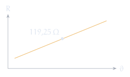
>>> soluzione
**Inversione.**  $\vartheta=(R/R_0-1)/\alpha$.

**Calcolo.**  $\vartheta=(1{,}1925-1)/(3{,}85\times10^{-3})=50{,}0\,{}^\circ\mathrm{C}$.
:::

::: esercizio Dilatazione di una rotaia [base]
Una rotaia dácciaio lunga $12{,}0\un{m}$ subisce un aumento di temperatura di $45\un{K}$. Con $\alpha=12\times10^{-6}\un{K^{-1}}$, stimare lállungamento.

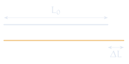
>>> soluzione
**Modello.**  $\Delta L=\alpha L_0\Delta T$.

**Calcolo.**  $\Delta L=(12\times10^{-6})(12{,}0)(45)=6{,}48\un{mm}$.
:::

::: esercizio Espansione volumica di un liquido [base]
Un serbatoio contiene $40{,}0\un{L}$ di un liquido con coefficiente volumico $\beta=9{,}5\times10^{-4}\un{K^{-1}}$. Se la temperatura aumenta di $30\un{K}$, quale incremento di volume prevede il modello lineare?

>>> soluzione
**Relazione.**  $\Delta V=\beta V_0\Delta T$.

**Calcolo.**  $\Delta V=(9{,}5\times10^{-4})(40{,}0)(30)=1{,}14\un{L}$.
:::

::: esercizio Termometro e perturbazione della misura [medio]
Un piccolo termometro a $20\,{}^\circ\mathrm{C}$ con capacità termica $12\un{J/K}$ viene immerso in $0{,}100\un{kg}$ dácqua a $60\,{}^\circ\mathrm{C}$. Trascurando dispersioni e usando $c_{\mathrm{acqua}}=4180\un{J/(kg\,K)}$, trovare la temperatura finale.

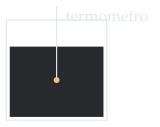
>>> soluzione
**Bilancio.**  $m c(60-T_f)=C_t(T_f-20)$.

**Calcolo.**  $T_f=[(0{,}100)(4180)(60)+12(20)]/[(0{,}100)(4180)+12]\approx58{,}9\,{}^\circ\mathrm{C}$. Il termometro modifica leggermente il sistema che misura.
:::

::: esercizio Quale coppia è in equilibrio termico? [base]
Tre corpi hanno temperature $T_A=300\un{K}$, $T_B=26{,}85\,{}^\circ\mathrm{C}$ e $T_C=310\un{K}$. Stabilire quali sono in equilibrio termico ideale.

>>> soluzione
**Conversione.**  $27\,{}^\circ\mathrm{C}=300{,}15\un{K}$.

**Confronto.**  $A$ e $B$ sono alla stessa temperatura entro l'arrotondamento dei dati; $C$ no.
:::

::: esercizio Ordine di grandezza di una dilatazione [medio]
Un ponte lungo $500\un{m}$ ha coefficiente medio $\alpha=11\times10^{-6}\un{K^{-1}}$ e può subire una variazione stagionale di $50\un{K}$. Stimare la variazione totale di lunghezza e spiegare perché servono giunti.

>>> soluzione
**Stima.**  $\Delta L=\alpha L\Delta T=(11\times10^{-6})(500)(50)=0{,}275\un{m}$.

**Interpretazione.**  Una variazione di circa $28\un{cm}$ non può essere impedita senza generare grandi tensioni; i giunti permettono il movimento relativo.
:::

### Teoria cinetica e statistica dei gas

::: esercizio Moli in un recipiente [base]
Un recipiente contiene un gas ideale a $p=1{,}20\times10^{5}\un{Pa}$, $V=0{,}0250\un{m^3}$ e $T=300\un{K}$. Determinare la quantità di sostanza.

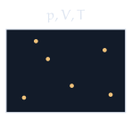
>>> soluzione
**Equazione di stato.**  $n=pV/(RT)$.

**Calcolo.**  $n=(1{,}20\times10^5)(0{,}0250)/[(8{,}314)(300)]\approx1{,}20\un{mol}$.
:::

::: esercizio Tre velocità caratteristiche dell'azoto [medio]
Per azoto molecolare a $T=300\un{K}$, con massa molare $M=0{,}0280\un{kg/mol}$, calcolare la velocità più probabile, la velocità media e la velocità quadratica media.

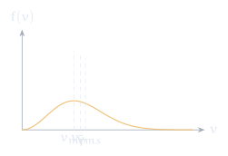
>>> soluzione
**Formule.**  $v_{mp}=\sqrt{2RT/M}$, $\bar v=\sqrt{8RT/(\pi M)}$, $v_{rms}=\sqrt{3RT/M}$.

**Calcolo.**  Si ottengono rispettivamente $422\un{m/s}$, $476\un{m/s}$ e $517\un{m/s}$. L'ordine $v_{mp}<\bar v<v_{rms}$ riflette l'asimmetria della distribuzione dei moduli.
:::

::: esercizio Rapporto di popolazione fra due livelli [avanzato]
Due stati molecolari non degeneri differiscono di $\Delta E=0{,}100\un{eV}$. Calcolare il rapporto $P_2/P_1$ a $T=300\un{K}$.

>>> soluzione
**Fattore di Boltzmann.**  $P_2/P_1=\exp[-\Delta E/(k_BT)]$.

**Conversione.**  $\Delta E=0{,}100(1{,}602\times10^{-19})\,\mathrm J$.

**Risultato.**  $P_2/P_1\approx2{,}09\times10^{-2}$. Il livello superiore è popolato circa nel $2{,}1\%$ rispetto a quello inferiore, a parità di degenerazione.
:::

::: esercizio Altezza di scala dell'atmosfera isoterma [medio]
Trattare l'aria come gas ideale di massa molare $M=0{,}0290\un{kg/mol}$ a temperatura uniforme $T=288\un{K}$. Calcolare l'altezza di scala $H$ e il rapporto $n(5{,}0\un{km})/n(0)$, usando $g=9{,}81\un{m/s^2}$.

>>> soluzione
**Altezza di scala.**  $H=RT/(Mg)$.

**Calcolo.**  $H\approx8{,}42\un{km}$.

**Rapporto.**  $n(z)/n(0)=e^{-z/H}=e^{-5{,}0/8{,}42}\approx0{,}552$. Il modello non include il gradiente termico atmosferico reale.
:::

::: esercizio Equipartizione in un gas biatomico [avanzato]
Una mole di gas biatomico ideale è a $300\un{K}$. Supponendo attivi i tre gradi traslazionali e i due rotazionali, ma non quelli vibrazionali, determinare $U$ e la capacità termica molare $C_{V,m}$.

>>> soluzione
**Equipartizione.**  Cinque termini quadratici forniscono $U=(5/2)nRT$.

**Calcolo.**  $U=(5/2)(8{,}314)(300)\approx6{,}24\un{kJ}$.

**Capacità termica molare.**  $C_{V,m}=(5/2)R\approx20{,}8\un{J/(mol\,K)}$. La risposta cambia quando si attivano i modi vibrazionali.
:::

::: esercizio Cammino libero medio dell'aria [avanzato]
Stimare il cammino libero medio a $T=300\un{K}$ e $p=1{,}013\times10^{5}\un{Pa}$, assumendo un diametro molecolare efficace $d=0{,}370\un{nm}$.

>>> soluzione
**Densità numerica.**  $n_N=p/(k_BT)\approx2{,}45\times10^{25}\un{m^{-3}}$.

**Formula.**  $\lambda=[\sqrt2\pi d^2n_N]^{-1}$.

**Risultato.**  $\lambda\approx6{,}72\times10^{-8}\un{m}=67{,}2\un{nm}$. È molto maggiore del diametro molecolare ma molto minore delle dimensioni ordinarie del recipiente.
:::

::: esercizio Quando il gas di elio è classico? [avanzato]
Per elio monoatomico a $T=300\un{K}$ e $p=1{,}013\times10^{5}\un{Pa}$, usare $m=6{,}65\times10^{-27}\un{kg}$ per stimare la lunghezza d'onda termica $\lambda_T$ e il parametro $n_N\lambda_T^3$.

>>> soluzione
**Lunghezza termica.**  $\lambda_T=h/\sqrt{2\pi mk_BT}\approx5{,}04\times10^{-11}\un{m}$.

**Densità.**  $n_N=p/(k_BT)\approx2{,}45\times10^{25}\un{m^{-3}}$.

**Parametro.**  $n_N\lambda_T^3\approx3{,}13\times10^{-6}\ll1$. Il gas è ben dentro il regime Maxwell–Boltzmann.
:::

::: esercizio Un modo del solido di Einstein [base]
Per un oscillatore con $\Theta_E=\hbar\omega/k_B=300\un{K}$ alla temperatura $T=300\un{K}$, calcolare il rapporto $P_1/P_0$ e l'energia media totale in unità di $k_BT$.

>>> soluzione
**Rapporto.**  Poiché $\beta\hbar\omega=\Theta_E/T=1$, $P_1/P_0=e^{-1}\approx0{,}368$.

**Energia media.**  $U/(k_BT)=\tfrac12+1/(e-1)\approx1{,}082$. Il termine $1/2$ è l'energia di punto zero.
:::

### Problemi di sintesi: termodinamica

::: esercizio Giunto termico per una rotaia [medio]
Una rotaia d'acciaio lunga $2{,}5\un{m}$ ha coefficiente lineare $\alpha=17\times10^{-6}\,\mathrm{K^{-1}}$. Calcolare l'allungamento per un aumento di $80\un{K}$.
>>> soluzione
**Legge lineare.**  $\Delta L=\alpha L\Delta T=0{,}00340\un{m}=3{,}40\un{mm}$.
:::

::: esercizio Pressione di un gas ideale [medio]
Due moli di gas ideale occupano $0{,}05\un{m^3}$ a $320\un{K}$. Calcolare la pressione.
>>> soluzione
**Equazione di stato.**  $p=nRT/V=1{,}06\times10^{5}\un{Pa}=106\un{kPa}$.
:::

::: esercizio Velocità quadratica media dell'ossigeno [avanzato]
Calcolare la velocità quadratica media di molecole di $\mathrm{O_2}$ a $300\un{K}$, con massa molare $0{,}032\un{kg/mol}$.
>>> soluzione
**Teoria cinetica.**

$$v_{rms}=\sqrt{\frac{3RT}{M}}=484\un{m/s}.$$
:::

::: esercizio Cammino libero medio in aria [avanzato]
Stimare il cammino libero medio a $300\un{K}$ e $101325\un{Pa}$ assumendo diametro molecolare $d=3{,}7\times10^{-10}\un{m}$.
>>> soluzione
**Modello di sfere rigide.**

$$\lambda=\frac{k_BT}{\sqrt2\pi d^2p}=6{,}72\times10^{-8}\un{m}=67{,}2\un{nm}.$$
:::

## Fonti {#fonti}

Il testo, le formule, i diagrammi e gli esercizi di questo capitolo provengono dalla *Dispensa di fisica* del corso (sezioni 6.1-6.3, 6.6 e materiali delle sezioni 6.12), consultabile nel lettore della galassia. Per la lettura sul sito sono cambiati l'impaginazione, i colori delle figure, la numerazione e la posizione di alcuni riquadri ed esercizi; la sezione iniziale è scritta per il pianeta di questa unità.

Opere citate nel testo:

1. J. Black, *Lectures on the Elements of Chemistry*, a cura di J. Robison, 2 voll., Edimburgo, 1803; lezioni tenute nella seconda metà del XVIII secolo.
2. S. Carnot, *Réflexions sur la puissance motrice du feu et sur les machines propres à développer cette puissance*, Bachelier, Parigi, 1824.
3. J. P. Joule, “On the Mechanical Equivalent of Heat”, *Philosophical Transactions of the Royal Society of London*, vol. 140, 1850, pp. 61–82.
4. R. Clausius, “Ueber verschiedene für die Anwendung bequeme Formen der Hauptgleichungen der mechanischen Wärmetheorie”, *Annalen der Physik und Chemie*, vol. 125, 1865, pp. 353–400.
5. W. Thomson, “On the Dynamical Theory of Heat”, *Transactions of the Royal Society of Edinburgh*, vol. 20, 1851, pp. 261–288.
6. L. Boltzmann, “Über die Beziehung zwischen dem zweiten Hauptsatze der mechanischen Wärmetheorie und der Wahrscheinlichkeitsrechnung”, *Wiener Berichte*, vol. 76, 1877, pp. 373–435.
