## Prima di cominciare {#apertura}

Due campioni ricevono la stessa energia e mostrano aumenti di temperatura diversi. La differenza dipende dalla massa e dal calore specifico dei materiali, e il sensore funziona correttamente. Il calore è energia trasferita, la temperatura è una variabile di stato.

Il capitolo tratta capacità termica, calore specifico e cambiamenti di fase, poi il legame fra oscillatori, microstati e proprietà termiche dei solidi, e infine i meccanismi di trasferimento dell'energia: conduzione, convezione e irraggiamento. Gli esercizi includono calorimetria, raffreddamento e flussi attraverso le pareti. Il capitolo presuppone i [gas ideali](unit:physics-18).

## Capacità termica, calore specifico e cambiamenti di fase {#s-6-4}

Quando un corpo non cambia fase e il calore specifico può essere considerato costante, l'energia trasferita termicamente è

::: legge Riscaldamento senza cambiamento di fase
$$Q=mc\Delta T,$$

dove $m$ è la massa e $c$ il calore specifico. La capacità termica del corpo è $C=mc$; il valore di $c$ dipende anche dai vincoli del riscaldamento, per esempio volume o pressione costanti.
:::

::: nota Capacità totale, molare e specifica
I simboli $C_V$ e $C_P$ indicano le capacità termiche dell'intero sistema, rispettivamente a volume e a pressione costanti, e hanno unità $\mathrm{J/K}$. Per una quantità di sostanza $n$ si definiscono le capacità molari

$$C_{V,m}=\frac{C_V}{n},\qquad C_{P,m}=\frac{C_P}{n},$$

in $\mathrm{J/(mol\,K)}$. Il calore specifico $c$ è invece riferito all'unità di massa e si misura in $\mathrm{J/(kg\,K)}$. Il pedice $m$ distingue sempre la grandezza molare da quella totale.
:::

Il segno di $Q$ dipende dalla convenzione. Adottiamo la convenzione $Q>0$ per l’energia trasferita al sistema e $Q<0$ per l’energia ceduta dal sistema. Per una miscela isolata idealmente,

$$\sum_i Q_i=0.$$

La relazione va applicata a tutti i corpi, al recipiente e alle eventuali trasformazioni di fase comprese nel modello.

Durante un cambiamento di fase a pressione fissata, la temperatura può restare quasi costante mentre cambia l'organizzazione microscopica. Nel modello elementare,

::: legge Calore latente
$$Q=mL,$$

dove $L$ è il calore latente specifico della trasformazione.
:::

::: nota Curve di riscaldamento
Una curva temperatura–energia presenta tratti inclinati nelle singole fasi e tratti quasi orizzontali durante fusione o ebollizione a pressione fissata. La forma reale dipende da purezza, pressione, dispersioni e capacità termica del recipiente. Il tratto orizzontale non significa assenza di trasferimento: l'energia modifica la fase invece della temperatura.
:::

::: approfondimento Caso di studio: Acqua, clima e inerzia termica
L'acqua possiede un calore specifico elevato rispetto a molti materiali comuni. Mari e laghi possono quindi assorbire o cedere grandi quantità di energia con variazioni di temperatura moderate. Questo contribuisce alla minore escursione termica delle zone costiere. Il clima reale coinvolge circolazione atmosferica, correnti, evaporazione e radiazione; il solo valore di $c$ non basta a descriverlo.
:::

## Oscillatori, microstati e proprietà termiche dei solidi {#s-6-5}

Il [capitolo «Oscillazioni armoniche»](unit:physics-16) ha mostrato che un sistema lineare di masse accoppiate può essere descritto come sovrapposizione di modi normali. In un cristallo gli atomi oscillano attorno a posizioni di equilibrio e le forze fra atomi vicini accoppiano i loro spostamenti. Per piccole ampiezze, l'espansione locale dell'energia potenziale è dominata dai termini quadratici: ogni modo si comporta quindi, in prima approssimazione, come un oscillatore armonico.

::: nota Dal reticolo ai modi normali

Un cristallo tridimensionale con $N$ atomi possiede circa $3N$ gradi di libertà vibrazionali. Tre di essi corrispondono, in un campione libero, a traslazioni globali; per un corpo macroscopico questa differenza è trascurabile nel conteggio termico.
:::

### Macrostati, microstati e molteplicità

Un **macrostato** è specificato da poche grandezze osservabili, per esempio $E$, $V$ e $N$. Un **microstato** specifica invece tutte le coordinate e quantità di moto compatibili con quel macrostato, oppure, in una descrizione quantistica, l'occupazione dei livelli disponibili. Molti microstati differenti possono produrre gli stessi valori macroscopici.

Per un sistema isolato in equilibrio, l'ipotesi microcanonica assegna la stessa probabilità ai microstati accessibili compatibili con i vincoli. Se il numero di tali configurazioni è $\Omega$, l'entropia di Boltzmann è

::: legge Entropia e molteplicità
$$S=k_{\mathrm B}\ln\Omega.$$
:::

La relazione non afferma che il sistema “cerca il disordine”. Dice che i macrostati di equilibrio occupano una porzione enormemente più vasta dello spazio dei microstati rispetto ai macrostati lontani dall'equilibrio. Per un sistema macroscopico, le fluttuazioni relative attorno al comportamento più probabile sono tipicamente dell'ordine di $N^{-1/2}$.

::: storia Maxwell, Boltzmann e Gibbs
Maxwell ricavò nel 1860 una distribuzione delle velocità molecolari, mostrando che un gas in equilibrio non possiede una singola velocità caratteristica  [1](#fonti). Boltzmann sviluppò la descrizione probabilistica degli urti e dell'equilibrio e collegò entropia e probabilità  [2, 3](#fonti). Gibbs organizzò queste idee mediante insiemi statistici e funzioni di partizione, fornendo una base generale per la termodinamica statistica  [4](#fonti).
:::

### Il fattore di Boltzmann e l'insieme canonico

Consideriamo un sistema piccolo in contatto termico con un ambiente molto più grande che mantiene la temperatura $T$. Il sistema può scambiare energia, mentre $V$ e $N$ restano fissati. La probabilità del microstato $i$, di energia $E_i$, è

::: legge Distribuzione canonica di Boltzmann
$$P_i=\frac{e^{-\beta E_i}}{Z},
\qquad
\beta=\frac{1}{k_{\mathrm B}T},
\qquad
Z(T,V,N)=\sum_i e^{-\beta E_i}.$$

$Z$ è la **funzione di partizione canonica**. Normalizza le probabilità e contiene l'informazione termodinamica del modello microscopico.
:::

La probabilità relativa di due stati dipende soltanto dalla differenza di energia:

$$\frac{P_j}{P_i}=e^{-\beta(E_j-E_i)}.$$

A bassa temperatura una differenza energetica fissata pesa molto; ad alta temperatura gli stati diventano più uniformemente popolati. La degenerazione conta: se un livello di energia $E_r$ possiede $g_r$ microstati, la sua probabilità complessiva è proporzionale a $g_r e^{-\beta E_r}$.

Dalla funzione di partizione si ricavano valori medi e fluttuazioni:

::: legge Energia media e fluttuazioni canoniche
$$U=\langle E\rangle=-\frac{\partial\ln Z}{\partial\beta},
\qquad
\operatorname{var}(E)=\langle E^2\rangle-\langle E\rangle^2=k_{\mathrm B}T^2C_V.$$
:::

La seconda relazione mostra che una capacità termica positiva corrisponde a fluttuazioni energetiche positive. Nei sistemi macroscopici $U\propto N$ e $\sigma_E\propto\sqrt N$, quindi $\sigma_E/U\propto N^{-1/2}$: l'energia appare praticamente deterministica su scala ordinaria.

::: errore Boltzmann non significa sempre Maxwell–Boltzmann
Il fattore $e^{-E/(k_{\mathrm B}T)}$ descrive il peso canonico di un microstato. La distribuzione di Maxwell–Boltzmann delle velocità è una conseguenza specifica per particelle classiche libere. A densità elevate o temperature sufficientemente basse, indistinguibilità e quantizzazione richiedono le statistiche di Bose–Einstein o Fermi–Dirac.
:::

### Solido armonico classico e legge di Dulong–Petit

Nel modello classico dell'equipartizione, ogni termine quadratico nell'energia contribuisce in media con $\tfrac12k_{\mathrm B}T$. Un modo armonico possiede un termine cinetico e uno potenziale, quindi immagazzina in media $k_{\mathrm B}T$. Per un solido monoatomico con $N$ atomi,

::: legge Solido armonico classico ad alta temperatura
$$U_{\mathrm{vib}}\simeq 3Nk_{\mathrm B}T=3nRT,
\qquad
C_V=\left(\frac{\partial U}{\partial T}\right)_V\simeq3Nk_{\mathrm B}=3nR.$$

Per una mole, $C_{V,m}\simeq3R\simeq24{,}9\un{J/(mol\,K)}$. Il risultato è un limite di alta temperatura, non una costante universale valida a ogni temperatura.
:::

Dulong e Petit osservarono nel 1819 che la capacità termica molare di molti elementi solidi assume valori prossimi a $3R$ a temperatura ordinaria. Il modello classico degli oscillatori ne fornisce una spiegazione naturale, ma fallisce per materiali con frequenze caratteristiche elevate e, in generale, quando la temperatura diventa sufficientemente bassa  [5](#fonti).

::: quotidiano Una stima rapida
Per due moli di un solido monoatomico nel regime di Dulong–Petit, la capacità termica a volume costante è circa

$$C_V\simeq 3nR\simeq49{,}9\un{J/K}.$$

Un aumento di temperatura di $50\un{K}$ richiede quindi, nel modello, $Q\simeq C_V\Delta T\simeq2{,}49\un{kJ}$. La stima trascura dilatazione, variazione della capacità termica, transizioni di fase e scambi con l'ambiente.
:::

### Oscillatore quantistico e modello di Einstein

Per un oscillatore quantistico di frequenza $\omega$, i livelli sono

$$E_n=\hbar\omega\left(n+\frac12\right),
\qquad n=0,1,2,\ldots$$

e la funzione di partizione vale

::: legge Oscillatore armonico quantistico
$$z_{\mathrm{osc}}=\frac{e^{-\beta\hbar\omega/2}}{1-e^{-\beta\hbar\omega}},$$

$$U_{\mathrm{osc}}=\frac{\hbar\omega}{2}+\frac{\hbar\omega}{e^{\beta\hbar\omega}-1},
\qquad
C_{V,\mathrm{osc}}=k_{\mathrm B}\frac{x^2e^x}{(e^x-1)^2},
\quad x=\frac{\hbar\omega}{k_{\mathrm B}T}.$$
:::

Il termine $\hbar\omega/2$ è l'energia di punto zero e non contribuisce a $C_V$ se $\omega$ è indipendente da $T$. Quando $x\ll1$, $U_{\mathrm{osc}}\simeq k_{\mathrm B}T$ e si recupera l'equipartizione. Quando $x\gg1$, l'eccitazione termica del modo è fortemente soppressa.

Einstein propose nel 1907 di trattare i $3N$ modi di un solido come oscillatori della stessa frequenza caratteristica. Introducendo $\Theta_E=\hbar\omega_E/k_{\mathrm B}$,

::: legge Capacità termica del solido di Einstein
$$C_V=3Nk_{\mathrm B}\left(\frac{\Theta_E}{T}\right)^2
\frac{e^{\Theta_E/T}}{\left(e^{\Theta_E/T}-1\right)^2}.$$
:::

### Modello di Debye, fononi e limite a bassa temperatura

Debye descrisse le vibrazioni come modi collettivi con una densità degli stati proporzionale a $\omega^2$ fino a una frequenza massima $\omega_D$. Definendo $\Theta_D=\hbar\omega_D/k_{\mathrm B}$,

::: legge Capacità termica di Debye
$$C_V=9Nk_{\mathrm B}\left(\frac{T}{\Theta_D}\right)^3
\int_0^{\Theta_D/T}\frac{x^4e^x}{(e^x-1)^2}\,\dd x.$$

Per $T\ll\Theta_D$,

$$C_V\simeq\frac{12\pi^4}{5}Nk_{\mathrm B}\left(\frac{T}{\Theta_D}\right)^3,$$

mentre per $T\gg\Theta_D$ si recupera il limite di Dulong–Petit.
:::

Il comportamento $T^3$ nasce dai numerosi modi acustici di bassa frequenza e dalla densità degli stati tridimensionale  [6](#fonti).

::: errore Un fonone non è un atomo che viaggia
Nel linguaggio quantistico, un fonone è un quanto di eccitazione di un modo collettivo del reticolo. Non identifica una singola particella materiale che attraversa il cristallo. Il termine è utile per descrivere capacità termica, propagazione e scattering delle vibrazioni, ma appartiene a un livello teorico successivo alla meccanica classica.
:::

### Dilatazione e conduzione richiedono qualcosa in più

Un potenziale perfettamente armonico è simmetrico attorno all'equilibrio. Aumentare l'ampiezza delle oscillazioni non sposta allora la posizione media: il modello armonico puro non produce dilatazione termica. Nei solidi reali il potenziale è anarmonico; la sua asimmetria fa aumentare la distanza media fra atomi al crescere della temperatura. La stessa anarmonicità permette inoltre interazioni fra modi e contribuisce alla resistenza al trasporto di energia.

Le vibrazioni del reticolo possono trasportare energia attraverso il solido. Difetti, bordi, impurità e interazioni fra modi ne limitano il cammino medio e quindi la conducibilità termica. Nei metalli contribuiscono anche gli elettroni di conduzione. La legge macroscopica di Fourier descrive il flusso risultante senza seguire ciascun meccanismo microscopico.

::: nota Che cosa spiega il modello degli oscillatori
Il modello armonico chiarisce l'origine dei modi vibrazionali e il limite classico della capacità termica. La quantizzazione spiega la diminuzione di $C_V$ alle basse temperature; l'anarmonicità è necessaria per dilatazione e interazione fra modi. Nessuno di questi ingredienti, da solo, determina tutte le proprietà di un materiale reale: struttura cristallina, difetti, elettroni e transizioni di fase possono essere essenziali.
:::

## Trasferimento di energia: conduzione, convezione e irraggiamento {#s-6-11}

La termodinamica stabilisce bilanci e limiti, ma non determina da sola la velocità con cui un processo avviene. Il trasferimento di energia richiede modelli aggiuntivi.

Per una parete piana omogenea, con proprietà costanti, flusso unidimensionale e regime stazionario, se $T_1>T_2$ la potenza trasferita dal lato 1 al lato 2 è

::: legge Conduzione attraverso una parete
$$\dot Q_{1\to2}=\frac{kA}{L}(T_1-T_2),$$

dove $k$ è la conducibilità termica, $A$ l'area e $L$ lo spessore.
:::

Per più strati in serie si introducono resistenze termiche

$$R_{\mathrm{th}}=\frac{L}{kA},
\qquad
\dot Q=\frac{\Delta T}{\sum_iR_{\mathrm{th},i}}.$$

La convezione coinvolge il movimento del fluido e dipende da geometria, velocità e proprietà del fluido. La relazione elementare

$$\dot Q_{s\to f}=hA(T_s-T_\infty)$$

usa un coefficiente $h$ empirico, valido soltanto per la configurazione e il regime di moto considerati.

Un corpo emette e assorbe radiazione elettromagnetica. Per una superficie grigia che scambia prevalentemente con un ambiente grande e quasi isoterma,

::: legge Scambio radiativo netto
$$P_{\mathrm{rad}}=\varepsilon\sigma A\left(T^4-T_{\mathrm{amb}}^4\right),$$

dove $0\leq\varepsilon\leq1$ è l'emissività e $\sigma$ la costante di Stefan–Boltzmann. Geometrie finite e superfici multiple richiedono fattori di vista.
:::

::: errore Isolamento e aria
Uno strato d'aria immobile può ridurre la conduzione, ma una cavità grande può attivare moti convettivi. Materiale, spessore, umidità, ponti termici e tenuta all'aria influenzano il comportamento reale. La sola conducibilità tabulata non determina la prestazione di un edificio.
:::

::: approfondimento Caso di studio: Bilancio energetico del corpo umano
Il corpo scambia energia mediante conduzione, convezione, irraggiamento, evaporazione e lavoro metabolico. La temperatura corporea quasi costante non implica assenza di produzione energetica: in condizioni stazionarie la potenza metabolica è bilanciata dai trasferimenti verso l'ambiente. Abbigliamento, umidità, vento e attività modificano i singoli contributi.
:::

::: approfondimento Caso di studio: Atmosfera e trasformazioni adiabatiche
Una massa d'aria che sale incontra pressioni minori, si espande e tende a raffreddarsi. Il modello adiabatico fornisce una prima interpretazione del gradiente termico atmosferico. Condensazione, umidità, mescolamento e radiazione richiedono modelli ulteriori; l'atmosfera non è un singolo gas ideale chiuso in equilibrio.
:::

## Casi di studio e attività sperimentali {#casi}

### Attività sperimentale: Calorimetria di miscela

**Obiettivo.**  stimare il calore specifico di un solido mediante equilibrio termico.

**Materiali o dati.**  campione metallico, acqua, recipiente isolante, bilancia, termometro e sorgente di acqua calda.

**Procedura.**

1. Misurare masse e temperature iniziali di acqua e campione.
2. Portare il campione a una temperatura nota, asciugarlo rapidamente e inserirlo nel calorimetro.
3. Mescolare con cautela e registrare la temperatura fino al massimo o al valore di equilibrio.
4. Applicare il bilancio includendo, se disponibile, la capacità termica del recipiente.

**Controllo e discussione.**  stimare l'effetto delle dispersioni e confrontare il risultato con valori tabulati senza usarli come dati esatti.

**Sicurezza.**  usare temperature moderate, pinze e protezione dagli schizzi; evitare recipienti chiusi durante il riscaldamento.

### Attività sperimentale: Raffreddamento di un liquido

**Obiettivo.**  studiare la dipendenza della velocità di raffreddamento dalla differenza di temperatura con l'ambiente.

**Materiali o dati.**  tazza, acqua calda a temperatura moderata, termometro o sensore, cronometro e coperchio opzionale.

**Procedura.**

1. Registrare temperatura del liquido e dell'ambiente a intervalli regolari.
2. Ripetere la misura con e senza coperchio mantenendo massa e recipiente comparabili.
3. Rappresentare $T-T_{\mathrm{amb}}$ e il suo logaritmo in funzione del tempo.
4. Individuare l'intervallo nel quale un decadimento esponenziale è una buona approssimazione.

**Controllo e discussione.**  discutere evaporazione, convezione, irraggiamento e variazione del coefficiente globale di scambio.

**Sicurezza.**  evitare liquidi vicini all'ebollizione e proteggere sensori e dispositivi elettronici dagli schizzi.

### Attività sperimentale: Conduzione attraverso materiali diversi

**Obiettivo.**  confrontare qualitativamente la resistenza termica di campioni con geometria controllata.

**Materiali o dati.**  campioni piani, due sensori di temperatura, sorgente termica a bassa potenza e isolamento laterale.

**Procedura.**

1. Inserire un campione fra una sorgente tiepida e un dissipatore alla stessa geometria.
2. Attendere un regime quasi stazionario e misurare le temperature ai due lati.
3. Ripetere con materiali o spessori differenti mantenendo comparabili area e potenza.
4. Interpretare i risultati mediante $R_{\mathrm{th}}=L/(kA)$ senza ricavare $k$ se le perdite laterali non sono note.

**Controllo e discussione.**  verificare il contatto termico, la stabilità della sorgente e l'effetto dell'isolamento laterale.

**Sicurezza.**  usare superfici soltanto tiepide, alimentatori a bassa tensione e materiali non infiammabili.

## Glossario {#glossario}

- **Modo normale**: Movimento collettivo di un sistema lineare accoppiato nel quale tutte le parti oscillano con la stessa frequenza e con rapporti di ampiezza costanti.
- **Fattore di Boltzmann**: Peso relativo $e^{-E/(k_BT)}$ assegnato a uno stato di energia $E$ nell'insieme canonico.
- **Funzione di partizione**: Somma $Z=\sum_i e^{-\beta E_i}$ che normalizza le probabilità canoniche e genera energia, entropia e potenziali termodinamici mediante derivate.
- **Macrostato**: Descrizione mediante poche variabili osservabili, come energia, volume, pressione e numero di particelle.
- **Microstato**: Configurazione microscopica completa compatibile con un macrostato, espressa mediante coordinate e quantità di moto o mediante occupazioni quantistiche.
- **Molteplicità**: Numero $\Omega$ di microstati compatibili con un macrostato; nel caso equiprobabile $S=k_B\ln\Omega$.
- **Anarmonicità**: Deviazione dell'energia potenziale dalla forma puramente quadratica. Nei solidi è essenziale, fra l'altro, per la dilatazione termica e per l'interazione fra modi vibrazionali.
- **Fonone**: Quanto di eccitazione di un modo vibrazionale collettivo del reticolo cristallino; non coincide con il moto di un singolo atomo.
- **Legge di Dulong–Petit**: Limite classico secondo cui la capacità termica molare a volume costante di molti solidi monoatomici tende a $3R$ ad alta temperatura.
- **Temperatura di Debye**: Scala caratteristica che separa qualitativamente il regime quantistico a bassa temperatura dal limite classico delle vibrazioni reticolari.
- **Capacità termica**: Rapporto infinitesimo fra calore trasferito e variazione di temperatura lungo un processo specificato. $C_V$ e $C_P$ indicano le capacità dell'intero sistema, a volume o pressione costanti, in $\mathrm{J/K}$; le capacità molari $C_{V,m}=C_V/n$ e $C_{P,m}=C_P/n$ si misurano in $\mathrm{J/(mol\,K)}$.

## Esercizi {#esercizi}

Gli esercizi riprendono quelli della dispensa. Ogni soluzione è nascosta finché non la apri: prova prima a impostare il problema da solo.

### Calorimetria e cambiamenti di fase

::: esercizio Riscaldare una massa d'acqua [base]
Quanta energia occorre per portare $1{,}50\un{kg}$ dácqua da $18\,{}^\circ\mathrm{C}$ a $75\,{}^\circ\mathrm{C}$? Usare $c=4180\un{J/(kg\,K)}$.

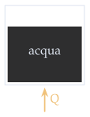
>>> soluzione
**Variazione.**  $\Delta T=75-18=57\un{K}$.

**Energia.**  $Q=mc\Delta T=(1{,}50)(4180)(57)\approx3{,}57\times10^{5}\un{J}$.
:::

::: esercizio Miscela di acqua calda e fredda [base]
Si mescolano $0{,}300\un{kg}$ dácqua a $80\,{}^\circ\mathrm{C}$ e $0{,}500\un{kg}$ a $20\,{}^\circ\mathrm{C}$. Trascurare il recipiente e trovare la temperatura finale.

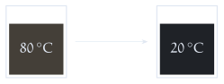
>>> soluzione
**Bilancio.**  Poiché il materiale è lo stesso, $m_h(80-T_f)=m_c(T_f-20)$.

**Calcolo.**  $T_f=[0{,}300(80)+0{,}500(20)]/0{,}800=42{,}5\,{}^\circ\mathrm{C}$.
:::

::: esercizio Calore specifico di un metallo [base]
Un blocco di massa $0{,}200\un{kg}$ a $150\,{}^\circ\mathrm{C}$ viene immerso in $0{,}400\un{kg}$ dácqua a $20\,{}^\circ\mathrm{C}$. La temperatura finale è $25{,}5\,{}^\circ\mathrm{C}$. Trascurando il calorimetro, ricavare il calore specifico del metallo.

>>> soluzione
**Bilancio.**  $m_mc_m(150-25{,}5)=m_wc_w(25{,}5-20)$.

**Calcolo.**  $c_m=0{,}400(4180)(5{,}5)/[0{,}200(124{,}5)]\approx369\un{J/(kg\,K)}$.
:::

::: esercizio Ghiaccio in acqua [avanzato]
Si introducono $0{,}050\un{kg}$ di ghiaccio a $0\,{}^\circ\mathrm{C}$ in $0{,}300\un{kg}$ dácqua a $30\,{}^\circ\mathrm{C}$. Usare $L_f=334\un{kJ/kg}$. Verificare se il ghiaccio fonde tutto e trovare la temperatura finale.

>>> soluzione
**Energia disponibile.**  L'acqua può cedere fino a $0{,}300(4180)(30)=37{,}6\un{kJ}$ raffreddandosi a $0\,{}^\circ\mathrm{C}$.

**Fusione.**  Servono $0{,}050(334)=16{,}7\un{kJ}$, quindi il ghiaccio fonde tutto.

**Temperatura finale.**  $0{,}300(4180)(30-T_f)=0{,}050L_f+0{,}050(4180)T_f$, da cui $T_f\approx14{,}3\,{}^\circ\mathrm{C}$.
:::

::: esercizio Vapore che condensa [avanzato]
Quale massa di vapore a $100\,{}^\circ\mathrm{C}$ deve condensare e raffreddarsi fino a $40\,{}^\circ\mathrm{C}$ per portare $0{,}500\un{kg}$ dácqua da $20\,{}^\circ\mathrm{C}$ a $40\,{}^\circ\mathrm{C}$? Usare $L_v=2{,}26\times10^{6}\un{J/kg}$.

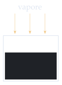
>>> soluzione
**Energia richiesta.**  $Q_w=0{,}500(4180)(20)=41{,}8\un{kJ}$.

**Energia per chilogrammo di vapore.**  $q=L_v+c(100-40)=2{,}26\times10^6+4180(60)=2{,}511\times10^{6}\un{J/kg}$.

**Massa.**  $m=Q_w/q\approx0{,}0166\un{kg}=16{,}6\un{g}$.
:::

::: esercizio Tempo di riscaldamento con potenza nota [medio]
Un riscaldatore da $900\un{W}$ porta $1{,}0\un{kg}$ dácqua da $20\,{}^\circ\mathrm{C}$ a $80\,{}^\circ\mathrm{C}$. Se il 75% della potenza raggiunge lácqua, stimare il tempo.

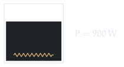
>>> soluzione
**Energia.**  $Q=1{,}0(4180)(60)=2{,}508\times10^{5}\un{J}$.

**Potenza utile.**  $P_u=0{,}75(900)=675\un{W}$.

**Tempo.**  $t=Q/P_u\approx372\un{s}=6{,}2\un{min}$.
:::

::: esercizio Capacità termica del calorimetro [medio]
In un calorimetro si mescolano $0{,}200\un{kg}$ dácqua a $70\,{}^\circ\mathrm{C}$ e $0{,}300\un{kg}$ a $20\,{}^\circ\mathrm{C}$. Il calorimetro era inizialmente a $20\,{}^\circ\mathrm{C}$ e la temperatura finale è $38{,}0\,{}^\circ\mathrm{C}$. Ricavare la capacità termica del calorimetro.

>>> soluzione
**Bilancio.**  $m_hc(70-38)=m_cc(38-20)+C_{cal}(38-20)$.

**Calcolo.**  $C_{cal}=[0{,}200(4180)(32)-0{,}300(4180)(18)]/18\approx232\un{J/K}$.
:::

::: esercizio Curva di riscaldamento completa [avanzato]
Quanta energia serve per trasformare $0{,}100\un{kg}$ di ghiaccio a $-10\,{}^\circ\mathrm{C}$ in acqua a $20\,{}^\circ\mathrm{C}$? Usare $c_{ghiaccio}=2100\un{J/(kg\,K)}$, $L_f=334\un{kJ/kg}$ e $c_{acqua}=4180\un{J/(kg\,K)}$.

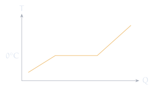
>>> soluzione
**Riscaldare il ghiaccio.**  $Q_1=0{,}100(2100)(10)=2{,}10\un{kJ}$.

**Fondere.**  $Q_2=0{,}100(334)=33{,}4\un{kJ}$.

**Riscaldare l'acqua.**  $Q_3=0{,}100(4180)(20)=8{,}36\un{kJ}$.

**Totale.**  $Q=43{,}9\un{kJ}$.
:::

### Trasferimento termico e sistemi reali

::: esercizio Conduzione attraverso una parete [base]
Una parete di area $12\un{m^2}$, spessore $0{,}20\un{m}$ e conducibilità $0{,}80\un{W/(m\,K)}$ separa ambienti con differenza di temperatura $18\un{K}$. Calcolare la potenza condotta nel modello stazionario unidimensionale.

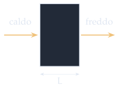
>>> soluzione
**Legge di conduzione.**  $\dot Q=kA\Delta T/L$.

**Calcolo.**  $\dot Q=0{,}80(12)(18)/0{,}20=864\un{W}$.
:::

::: esercizio Parete a due strati [medio]
Una parete ha area $10\un{m^2}$. Il primo strato ha $L_1=0{,}10\un{m}$, $k_1=0{,}50\un{W/(m\,K)}$; il secondo $L_2=0{,}08\un{m}$, $k_2=0{,}040\un{W/(m\,K)}$. Per $\Delta T=20\un{K}$, trovare la potenza condotta.

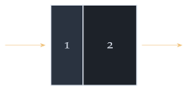
>>> soluzione
**Resistenze.**  $R_1=L_1/(k_1A)=0{,}10/(0{,}50\cdot10)=0{,}020\un{K/W}$; $R_2=0{,}08/(0{,}040\cdot10)=0{,}200\un{K/W}$.

**Potenza.**  $\dot Q=20/(0{,}220)\approx90{,}9\un{W}$.
:::

::: esercizio Convezione da una superficie [base]
Una superficie di area $1{,}5\un{m^2}$ è a $45\,{}^\circ\mathrm{C}$ in aria a $20\,{}^\circ\mathrm{C}$. Con $h=8\un{W/(m^2\,K)}$, stimare la potenza convettiva.

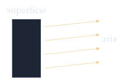
>>> soluzione
**Modello.**  $\dot Q=hA(T_s-T_\infty)$.

**Calcolo.**  $\dot Q=8(1{,}5)(25)=300\un{W}$.
:::

::: esercizio Irraggiamento netto [base]
Una superficie grigia di area $0{,}50\un{m^2}$ è a $500\un{K}$ in un ambiente radiativo a $300\un{K}$. Con $\varepsilon=0{,}90$, calcolare la potenza radiativa netta.

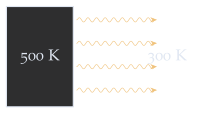
>>> soluzione
**Legge.**  $P=\varepsilon\sigma A(T^4-T_a^4)$.

**Calcolo.**  $P=0{,}90(5{,}670\times10^{-8})(0{,}50)(500^4-300^4)\approx1{,}39\un{kW}$.
:::

::: esercizio Legge di raffreddamento di Newton [base]
La differenza di temperatura di un corpo rispetto allámbiente segue $\Delta T(t)=\Delta T_0e^{-t/\tau}$ con $\tau=15\un{min}$. Quanto tempo occorre perché la differenza scenda dal 100% al 20%?

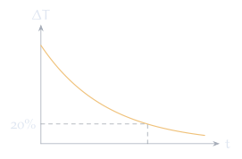
>>> soluzione
**Equazione.**  $0{,}20=e^{-t/\tau}$.

**Calcolo.**  $t=-\tau\ln0{,}20=(15)(1{,}609)\approx24{,}1\un{min}$.
:::

::: esercizio Bilancio termico del corpo umano [medio]
Una persona produce potenza metabolica $140\un{W}$ e compie lavoro meccanico esterno medio $25\un{W}$. In condizioni stazionarie, quale potenza deve essere ceduta allámbiente?

>>> soluzione
**Stato stazionario.**  L'energia interna media non cambia.

**Bilancio.**  $P_{amb}=P_{met}-P_{lavoro}=140-25=115\un{W}$. Questa potenza è ripartita fra convezione, irraggiamento, evaporazione e conduzione.
:::

::: esercizio Raffreddamento adiabatico di una massa d'aria [medio]
Un campione di aria ideale biatomica si espande adiabaticamente e reversibilmente fino a raddoppiare il volume. Se $T_i=300\un{K}$ e $\gamma=1{,}40$, trovare $T_f$.

>>> soluzione
**Relazione.**  $TV^{\gamma-1}$ è costante.

**Calcolo.**  $T_f=300(1/2)^{0{,}40}\approx227\un{K}$. Il valore descrive un modello ideale chiuso e reversibile, non l'intera atmosfera reale.
:::

### Problemi di sintesi: termodinamica

::: esercizio Mescolamento di acqua [avanzato]
Si mescolano $0{,}30\un{kg}$ d'acqua a $80\,{}^\circ\mathrm{C}$ con $0{,}50\un{kg}$ a $20\,{}^\circ\mathrm{C}$ in un contenitore isolato. Calcolare la temperatura finale.
>>> soluzione
**Bilancio termico.**  Poiché il calore specifico è lo stesso,

$$m_1(T_1-T_f)=m_2(T_f-T_2).$$

**Risultato.**  $T_f=42{,}5\,{}^\circ\mathrm{C}$.
:::

::: esercizio Ghiaccio portato ad acqua tiepida [avanzato]
Quanta energia serve per portare $0{,}12\un{kg}$ di ghiaccio da $-10\,{}^\circ\mathrm{C}$ ad acqua a $15\,{}^\circ\mathrm{C}$? Usare $c_i=2100\,\mathrm{J/(kg\,K)}$, $L_f=334\,\mathrm{kJ/kg}$.
>>> soluzione
**Tre contributi.**

$$Q=mc_i(10)+mL_f+mc_w(15)=5{,}01\times10^{4}\un{J}=50{,}1\un{kJ}.$$
:::

::: esercizio Flusso termico in una parete isolante [medio]
Una parete ha conducibilità $0{,}8\un{W/(m\,K)}$, area $0{,}6\un{m^2}$, spessore $0{,}12\un{m}$ e differenza di temperatura $25\un{K}$. Calcolare la potenza condotta in regime stazionario.
>>> soluzione
**Fourier.**

$$P=kA\frac{\Delta T}{L}=100\un{W}.$$
:::

::: esercizio Equilibrio radiativo di una superficie [avanzato]
Una superficie di area $0{,}8\un{m^2}$ ed emissività $\varepsilon=0{,}9$ assorbe $120\un{W}$ netti da una sorgente e scambia radiazione con ambiente a $295\un{K}$. Trascurando convezione, stimare la temperatura di equilibrio.
>>> soluzione
**Bilancio.**

$$P_{ass}=\varepsilon\sigma A(T^4-T_a^4).$$

**Temperatura.**  $T=[P_{ass}/(\varepsilon\sigma A)+T_a^4]^{1/4}=320\un{K}$.
:::

## Fonti {#fonti}

Il testo, le formule, i diagrammi e gli esercizi di questo capitolo provengono dalla *Dispensa di fisica* del corso (sezioni 6.4-6.5, 6.11 e materiali delle sezioni 6.12), consultabile nel lettore della galassia. Per la lettura sul sito sono cambiati l'impaginazione, i colori delle figure, la numerazione e la posizione di alcuni riquadri ed esercizi; la sezione iniziale è scritta per il pianeta di questa unità.

Opere citate nel testo:

1. J. C. Maxwell, “Illustrations of the Dynamical Theory of Gases”, *The London, Edinburgh, and Dublin Philosophical Magazine and Journal of Science*, 4a serie, vol. 19, 1860, pp. 19–32; vol. 20, 1860, pp. 21–37.
2. L. Boltzmann, “Weitere Studien über das Wärmegleichgewicht unter Gasmolekülen”, *Sitzungsberichte der Kaiserlichen Akademie der Wissenschaften in Wien*, parte II, vol. 66, 1872, pp. 275–370.
3. L. Boltzmann, “Über die Beziehung zwischen dem zweiten Hauptsatze der mechanischen Wärmetheorie und der Wahrscheinlichkeitsrechnung”, *Wiener Berichte*, vol. 76, 1877, pp. 373–435.
4. J. W. Gibbs, *Elementary Principles in Statistical Mechanics: Developed with Especial Reference to the Rational Foundation of Thermodynamics*, Charles Scribner's Sons, New York, 1902.
5. P.-L. Dulong e A.-T. Petit, “Recherches sur quelques points importants de la théorie de la chaleur”, *Annales de chimie et de physique*, vol. 10, 1819, pp. 395–413.
6. P. Debye, “Zur Theorie der spezifischen Wärmen”, *Annalen der Physik*, vol. 39, 1912, pp. 789–839.
