## Prima di cominciare {#apertura}

Una macchina ideale lavora fra una sorgente calda e una fredda, e la stazione vuole conoscere il rendimento massimo prima di discutere perdite e dettagli costruttivi. Il limite è fissato dalle sole temperature delle due sorgenti, e nessuna macchina reale che lavori fra le stesse temperature lo supera.

Il capitolo tratta il primo principio e il lavoro termodinamico, cicli, motori, frigoriferi e pompe di calore, il secondo principio e l'entropia nella sua lettura statistica, i potenziali termodinamici e le energie libere. Le sezioni finali raccolgono le attività sperimentali, la sintesi e il formulario della termodinamica. Il capitolo presuppone il [calore](unit:physics-19) e i [gas ideali](unit:physics-18).

## Primo principio e lavoro termodinamico {#s-6-7}

Per un sistema chiuso, il primo principio è il bilancio dell'energia totale. Con $W>0$ per il lavoro compiuto dal sistema sull'ambiente,

::: legge Primo principio per un sistema chiuso
$$\Delta E=Q-W,
\qquad
E=U+K+E_{\mathrm p}.$$

Se le variazioni dell'energia cinetica e potenziale macroscopica sono trascurabili, la relazione si riduce a

$$\Delta U=Q-W.$$
:::

La convenzione opposta, basata sul lavoro compiuto *sul* sistema, è ugualmente valida ma cambia il segno del termine di lavoro. La convenzione va dichiarata all'inizio e mantenuta fino al risultato.

Per un gas in un cilindro, il lavoro di frontiera associato allo spostamento del pistone è

::: legge Lavoro pressione–volume
$$W_{pV}=\int_{V_i}^{V_f}p_{\mathrm{ext}}\,\dd V.$$
:::

La pressione che determina il lavoro è quella esterna contro cui si muove il confine. Soltanto in una trasformazione quasi statica, vicina all'equilibrio meccanico, si può porre $p_{\mathrm{ext}}\approx p$ e interpretare il lavoro come area sotto la curva del sistema nel diagramma $p$–$V$. Attrito, lavoro elettrico o lavoro d'albero richiedono termini aggiuntivi.

::: errore Il lavoro dipende dal percorso
Due trasformazioni che collegano gli stessi stati possono avere lavori e calori differenti. La variazione di energia interna è la stessa, perché $U$ è funzione di stato; $Q$ e $W$ dipendono invece dal percorso seguito.
:::

### Trasformazioni elementari

Le relazioni seguenti riguardano una quantità fissata di gas ideale, con il solo lavoro pressione–volume; le capacità termiche sono considerate costanti nell'intervallo esaminato.

::: legge Trasformazione isocora
$$\Delta V=0,\qquad W_{pV}=0,\qquad Q=\Delta U.$$

L'ultima uguaglianza richiede che non siano presenti altre forme di lavoro.
:::

::: legge Trasformazione isobara
$$W_{pV}=p\Delta V=nR\Delta T,
\qquad Q=nC_{P,m}\Delta T.$$
:::

::: legge Trasformazione isoterma reversibile
$$\Delta U=0,
\qquad W_{pV}=Q=nRT\ln\!\frac{V_f}{V_i}.$$
:::

::: legge Trasformazione adiabatica reversibile
$$Q=0,
\qquad pV^\gamma=\text{costante},
\qquad TV^{\gamma-1}=\text{costante},$$

$$W_{pV}=\frac{p_iV_i-p_fV_f}{\gamma-1}=nC_{V,m}(T_i-T_f),
\qquad \gamma=\frac{C_{P,m}}{C_{V,m}}=\frac{C_P}{C_V}.$$
:::

Una trasformazione adiabatica non scambia energia mediante calore, ma può compiere lavoro e modificare la temperatura. “Adiabatica” non significa automaticamente “isoterma”, né “rapida” è una definizione: una trasformazione veloce può essere approssimativamente adiabatica se il tempo per lo scambio termico è molto più lungo.

::: approfondimento Caso di studio: Pompa da bicicletta e compressione rapida
Comprimendo rapidamente l'aria in una pompa, il lavoro compiuto sul gas ne aumenta l'energia interna e la temperatura. Una compressione lenta permette invece maggiore scambio con l'ambiente. Il fenomeno mostra che lo stesso stato finale del pistone non determina da solo la temperatura: conta il percorso e la rapidità rispetto ai tempi di trasferimento termico.
:::

### Quattro processi ideali letti sul piano $p$–$V$

Il diagramma $p$–$V$ non è soltanto una figura: visualizza il lavoro quasi statico come area orientata

$$W=\int_{V_i}^{V_f}p(V)\,\dd V.$$

La variazione di energia interna dipende dagli stati iniziale e finale, mentre lavoro e calore dipendono dal percorso. Per un gas ideale, quattro trasformazioni costituiscono riferimenti utili:

| Processo | Vincolo | Conseguenza principale |
|–|–|–|
| isocoro | $V=$ costante | $W=0$ |
| isobaro | $p=$ costante | $W=p\Delta V$ |
| isotermo | $T=$ costante | $\Delta U=0$ per gas ideale |
| adiabatico reversibile | $Q=0$ | $pV^\gamma=$ costante |

::: approfondimento Dimostrazione: Relazione adiabatica di un gas ideale
**Ipotesi.** Gas ideale, trasformazione quasi statica, nessuno scambio termico e capacità termiche costanti.

**Passaggi.** Dal primo principio con la convenzione $\Delta U=Q-W$,

$$nC_{V,m}\,\dd T=-p\,\dd V.$$

Usando $p=nRT/V$,

$$C_{V,m}\frac{\dd T}{T}=-R\frac{\dd V}{V}.$$

Poiché $R=C_{P,m}-C_{V,m}$ e $\gamma=C_{P,m}/C_{V,m}$,

$$\frac{\dd T}{T}=-(\gamma-1)\frac{\dd V}{V}.$$

Integrando,

$$TV^{\gamma-1}=\text{costante},
\qquad
pV^\gamma=\text{costante}.$$

**Significato fisico.** Durante un'espansione adiabatica il gas compie lavoro a spese dell'energia interna e quindi, nel modello ideale, si raffredda.

**Limiti di validità.** La relazione non vale per espansioni libere, processi fortemente irreversibili o gas non ideali fuori dal regime in cui $C_{P,m}$ e $C_{V,m}$ possono essere trattati come costanti.
:::

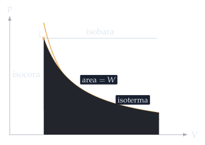

## Cicli, motori, frigoriferi e pompe di calore {#s-6-8}

Un dispositivo ciclico torna allo stato iniziale dopo ogni ciclo, quindi $\Delta U_{\mathrm{ciclo}}=0$. Dal primo principio,

$$W_{\mathrm{netto}}=Q_{\mathrm{netto}}.$$

Nel diagramma $p$–$V$, il lavoro netto è l'area orientata racchiusa dal ciclo: senso orario per lavoro netto positivo compiuto dal gas.

Poniamo $Q_H>0$ e $Q_C>0$ per le quantità di energia scambiate rispettivamente con la sorgente calda e con quella fredda. Un motore assorbe $Q_H$, compie lavoro $W$ e cede $Q_C$:

::: legge Rendimento di un motore
$$W=Q_H-Q_C,
\qquad
\eta=\frac{W}{Q_H}=1-\frac{Q_C}{Q_H},
\qquad 0\leq\eta<1.$$
:::

Un frigorifero usa lavoro per sottrarre la quantità $Q_C$ alla regione fredda:

::: legge Coefficienti di prestazione
$$\mathrm{COP}_{\mathrm{frigo}}=\frac{Q_C}{W},
\qquad
\mathrm{COP}_{\mathrm{pompa}}=\frac{Q_H}{W}=\mathrm{COP}_{\mathrm{frigo}}+1.$$
:::

Il coefficiente di prestazione può superare 1 perché non è un rendimento: confronta energia trasferita e lavoro fornito.

::: legge Limiti di Carnot
Per dispositivi reversibili fra temperature assolute $T_H>T_C$,

$$\eta_{\mathrm C}=1-\frac{T_C}{T_H},$$

$$\mathrm{COP}_{\mathrm{frigo,C}}=\frac{T_C}{T_H-T_C},
\qquad
\mathrm{COP}_{\mathrm{pompa,C}}=\frac{T_H}{T_H-T_C}.$$
:::

Le temperature devono essere espresse in kelvin. Il limite di Carnot dipende soltanto dalle temperature delle sorgenti e vale per qualunque dispositivo ciclico che operi fra esse; raggiungerlo richiederebbe un ciclo reversibile, percorso idealmente senza dissipazioni e con scambi termici attraverso differenze infinitesime di temperatura. Un motore reale resta al di sotto di tale limite per attrito, scambi con differenze finite di temperatura, combustione e fluidi non ideali, perdite e vincoli sui materiali.

::: quotidiano Pompa di calore e resistenza elettrica
Una resistenza elettrica converte quasi tutto il lavoro elettrico in energia interna nell'ambiente riscaldato, con rapporto vicino a 1 fra calore fornito e lavoro elettrico. Una pompa di calore trasferisce anche energia dall'esterno e può avere $\mathrm{COP}>1$. Il valore reale diminuisce quando la differenza fra temperatura interna ed esterna cresce e dipende dall'impianto completo.
:::

## Secondo principio ed entropia statistica {#s-6-9}

Il primo principio non vieta che l'energia trasferita da un corpo freddo passi spontaneamente a uno caldo, purché il bilancio energetico sia rispettato. L'esperienza mostra però una direzione privilegiata dei processi. Il secondo principio può essere formulato in modi equivalenti.

::: legge Formulazioni operative del secondo principio
- Nessun processo ciclico ha come unico effetto la completa conversione in lavoro dell'energia assorbita da una sola sorgente termica.
- L'energia non passa spontaneamente da un corpo più freddo a uno più caldo senza altri effetti.
:::

L'entropia è una funzione di stato. La sua variazione può essere calcolata lungo un qualunque percorso reversibile immaginario che colleghi gli stessi stati:

::: legge Variazione di entropia
$$\dd S=\frac{\delta Q_{\mathrm{rev}}}{T},
\qquad
\Delta S=\int_i^f\frac{\delta Q_{\mathrm{rev}}}{T}.$$
:::

Per un processo reale di un sistema chiuso è utile separare l'entropia trasferita da quella prodotta internamente:

$$\Delta S=\int_i^f\frac{\delta Q}{T_b}+S_{\mathrm{gen}},
\qquad S_{\mathrm{gen}}\geq0,$$

dove $T_b$ è la temperatura del confine nel punto in cui avviene lo scambio. Per un sistema isolato,

::: legge Principio di aumento dell'entropia
$$\Delta S_{\mathrm{isolato}}=S_{\mathrm{gen}}\geq0.$$

L'uguaglianza appartiene al limite reversibile; un processo irreversibile produce entropia.
:::

Per un gas ideale con capacità termica molare $C_{V,m}$ costante nell’intervallo di temperatura, la variazione di entropia fra due stati è

$$\Delta S=nC_{V,m}\ln\frac{T_f}{T_i}+nR\ln\frac{V_f}{V_i}.$$

Per un cambiamento di fase reversibile a temperatura $T$, $\Delta S=mL/T$.

::: nota Reversibile non significa semplicemente lento
Una trasformazione reversibile è un limite ideale formato da stati di equilibrio infinitamente vicini e privo di dissipazioni. Muovere lentamente un pistone con attrito non elimina la produzione di entropia. Una differenza finita di temperatura durante il trasferimento termico rende il processo irreversibile anche se dura a lungo.
:::

### Entropia di Gibbs e limite microcanonico

Per una distribuzione di probabilità discreta $\{P_i\}$,

::: legge Entropia statistica
$$S=-k_{\mathrm B}\sum_i P_i\ln P_i.$$
:::

### Entropia di mescolamento e indistinguibilità

### Produzione di entropia e qualità dell'energia

Per un processo reale,

$$\Delta S\geq\int\frac{\delta Q}{T_{\mathrm{confine}}},$$

con uguaglianza nel limite reversibile. La differenza

$$S_{\mathrm{gen}}=\Delta S-\int\frac{\delta Q}{T_{\mathrm{confine}}}\geq0$$

misura l'entropia prodotta internamente da attrito, viscosità, mescolamento, reazioni spontanee e trasferimenti attraverso differenze finite di temperatura.

::: esempio Scambio termico fra due corpi
Una quantità di calore $Q$ passa da un serbatoio caldo a temperatura $T_h$ a uno freddo a temperatura $T_c<T_h$.

**Bilancio entropico.**  Il calore perso dal serbatoio caldo è uguale a quello assorbito dal freddo; le due variazioni di entropia hanno denominatori diversi.

$$\Delta S_{\mathrm{tot}}=-\frac{Q}{T_h}+\frac{Q}{T_c}
=Q\left(\frac1{T_c}-\frac1{T_h}\right)>0.$$

**Segno e limite.**  Il segno positivo corrisponde a un processo spontaneo e irreversibile. Per $T_c\to T_h$ la produzione tende a zero, come in uno scambio reversibile infinitesimo.
:::

## Potenziali termodinamici ed energie libere {#s-6-10}

L'energia interna $U(S,V,N)$ è la funzione fondamentale naturale per un sistema isolato, ma in laboratorio è spesso più semplice controllare temperatura o pressione anziché entropia. I potenziali termodinamici sostituiscono alcune variabili mediante trasformazioni di Legendre, conservando la stessa informazione di equilibrio in una forma adatta ai vincoli sperimentali.

Per un sistema semplice comprimibile a un componente,

::: legge Relazione fondamentale
$$\dd U=T\,\dd S-p\,\dd V+\mu\,\dd N.$$
:::

### Energia libera di Helmholtz

Si definisce

::: legge Energia libera di Helmholtz
$$F=U-TS.$$

La sua differenziale è

$$\dd F=-S\,\dd T-p\,\dd V+\mu\,\dd N.$$
:::

Le variabili naturali sono $T$, $V$ e $N$. Di conseguenza,

::: legge Derivate della funzione di Helmholtz
$$S=-\left(\frac{\partial F}{\partial T}\right)_{V,N},
\qquad
p=-\left(\frac{\partial F}{\partial V}\right)_{T,N},
\qquad
\mu=\left(\frac{\partial F}{\partial N}\right)_{T,V}.$$
:::

Per un sistema chiuso mantenuto a temperatura e volume costanti, il secondo principio implica

::: legge Criterio di equilibrio a $T,V,N$ costanti
$$\Delta F\leq0.$$

Un processo spontaneo riduce $F$; l'equilibrio stabile corrisponde a un minimo locale compatibile con i vincoli. Nel limite reversibile, il massimo lavoro non di espansione ottenibile dal sistema è $-\Delta F$. A volume costante non vi è lavoro $p\,\dd V$, quindi tale quantità coincide con il massimo lavoro complessivo esportabile attraverso altri canali, per esempio elettrici.
:::

::: errore “Libera” non significa energia separata dentro il sistema
$F$ non è una porzione materiale dell'energia interna. È una funzione di stato che combina energia ed entropia per incorporare il costo termico imposto dal contatto con un termostato. Il valore assoluto dipende dalle convenzioni del modello; sono soprattutto differenze e derivate a determinare processi ed equilibrio.
:::

### Helmholtz dalla funzione di partizione

Nell'insieme canonico,

::: legge Energia libera e funzione di partizione
$$F=-k_{\mathrm B}T\ln Z.$$
:::

Infatti, usando $S=k_{\mathrm B}(\ln Z+\beta U)$,

$$U-TS=U-k_{\mathrm B}T\ln Z-U=-k_{\mathrm B}T\ln Z.$$

La funzione di partizione agisce quindi da funzione generatrice: le grandezze macroscopiche si ricavano dalle sue derivate.

::: approfondimento Calcolo: Fluttuazioni e curvatura di $F$
La capacità termica a volume costante può essere scritta come

$$C_V=-T\left(\frac{\partial^2F}{\partial T^2}\right)_{V,N}
=\frac{\operatorname{var}(E)}{k_{\mathrm B}T^2}\geq0$$

per un sistema canonico ordinario. La curvatura di $F(T,V,N)$ codifica quindi la risposta termica e le fluttuazioni energetiche.
:::

### Esempio: energia libera del gas ideale classico

Usando $Z_N=(V/\lambda_T^3)^N/N!$ e l'approssimazione di Stirling $\ln N!\simeq N\ln N-N$,

::: legge Helmholtz del gas ideale monoatomico
$$F=-Nk_{\mathrm B}T\left[\ln\!\left(\frac{V}{N\lambda_T^3}\right)+1\right].$$
:::

### Esempio: energia libera di un oscillatore e di un solido di Einstein

Per un oscillatore quantistico,

::: legge Helmholtz dell'oscillatore armonico
$$F_{\mathrm{osc}}=-k_{\mathrm B}T\ln z_{\mathrm{osc}}
=\frac12\hbar\omega+k_{\mathrm B}T\ln\!\left(1-e^{-\beta\hbar\omega}\right)
=k_{\mathrm B}T\ln\!\left[2\sinh\!\left(\frac{\beta\hbar\omega}{2}\right)\right].$$
:::

### Entalpia, Gibbs e scelta del potenziale

Si definiscono

::: legge Entalpia ed energia libera di Gibbs
$$H=U+pV,
\qquad
G=H-TS=F+pV,$$

$$\dd H=T\,\dd S+V\,\dd p+\mu\,\dd N,
\qquad
\dd G=-S\,\dd T+V\,\dd p+\mu\,\dd N.$$
:::

A temperatura, pressione e quantità di materia costanti, un processo spontaneo soddisfa $\Delta G\leq0$. Per sistemi a composizione variabile, il potenziale chimico $\mu$ controlla trasferimenti di particelle, reazioni ed equilibrio di fase. Due fasi in equilibrio alla stessa $T$ e $p$ hanno lo stesso potenziale chimico per ogni componente che può essere scambiato.

::: nota Quale potenziale usare?
| Vincoli controllati | Potenziale | Criterio di equilibrio |
|–|–|–|
| $S,V,N$ | $U$ | minimo di $U$ |
| $S,p,N$ | $H=U+pV$ | minimo di $H$ |
| $T,V,N$ | $F=U-TS$ | minimo di $F$ |
| $T,p,N$ | $G=U+pV-TS$ | minimo di $G$ |

Il potenziale non cambia la fisica: cambia la rappresentazione adatta alle grandezze mantenute fisse dall'ambiente.
:::

::: storia Da Gibbs e Helmholtz alle energie libere
Gibbs sviluppò negli anni Settanta dell'Ottocento il metodo geometrico e analitico dei potenziali per equilibrio e fasi. Helmholtz applicò la nozione di energia disponibile ai processi chimici a temperatura controllata. La terminologia moderna distingue $F=U-TS$, naturale a volume fissato, e $G=U+pV-TS$, naturale a pressione fissata  [1, 2](#fonti).
:::

## Sintesi e autoverifica {#sintesi}

::: metodo Come impostare un problema termodinamico
1. Definire sistema, ambiente e intervallo temporale; stabilire se attraversano il confine materia, lavoro o energia termica.
2. Elencare gli stati iniziale e finale con temperature assolute, pressioni assolute, volumi e quantità di sostanza.
3. Dichiarare la convenzione dei segni per $Q$ e $W$.
4. Scegliere il modello: calorimetria, gas ideale, trasformazione specifica, ciclo, entropia o trasferimento di calore.
5. Separare funzioni di stato da grandezze di percorso; non assegnare a $Q$ o $W$ un valore ricavato soltanto dagli estremi senza conoscere il processo.
6. Verificare unità, segni, limiti e compatibilità con il secondo principio.
7. Confrontare il risultato con prestazioni reali, dispersioni e intervallo di validità del modello.
:::

::: sintesi Autoverifica
1. Qual è la differenza fra temperatura, energia interna e calore?
2. Perché il principio zero rende possibile un termometro?
3. Che cosa rappresenta un tratto orizzontale in una curva di riscaldamento?
4. In quali condizioni il gas ideale è una buona approssimazione?
5. Perché $Q$ e $W$ dipendono dal percorso mentre $\Delta U$ no?
6. Come cambia la temperatura di un gas ideale in una compressione adiabatica reversibile?
7. Perché nessun motore fra due sorgenti può superare il rendimento di Carnot?
8. Perché il coefficiente di prestazione di una pompa di calore può superare 1?
9. Che cosa distingue un processo reversibile da un processo soltanto lento?
10. Perché il modello classico degli oscillatori conduce a $C_{V,m}\simeq3R$ per un solido monoatomico?
11. Perché un potenziale perfettamente armonico non basta a spiegare la dilatazione termica?
12. Che differenza esiste fra fattore di Boltzmann e distribuzione di Maxwell–Boltzmann?
13. In che modo la funzione di partizione determina energia ed entropia?
14. Perché $F$ è il potenziale appropriato a temperatura e volume costanti?
15. Come si riconosce il limite di validità classico mediante $n_N\lambda_T^3$?
16. Quali meccanismi contribuiscono alla dispersione termica di un edificio?
:::

::: sintesi Sintesi concettuale
La termodinamica comincia dalla scelta del sistema e del suo confine. Temperatura, pressione, volume, energia interna ed entropia descrivono lo stato; calore e lavoro descrivono invece trasferimenti durante un processo. La meccanica statistica collega macrostato e microstati: il fattore di Boltzmann assegna i pesi canonici, la funzione di partizione genera energia, entropia e fluttuazioni, mentre la distribuzione di Maxwell–Boltzmann descrive le velocità di un gas classico diluito. Nei solidi, i modi vibrazionali collegano gli oscillatori alla capacità termica: l'equipartizione conduce al limite di Dulong–Petit, la quantizzazione spiega il calo a bassa temperatura e l'anarmonicità rende possibile la dilatazione.

Il primo principio impone il bilancio dell'energia; il secondo stabilisce la direzione dei processi; i potenziali $F$ e $G$ forniscono criteri di equilibrio adatti ai vincoli imposti dall'ambiente. Gas ideali, solidi armonici e cicli sono modelli controllabili; materiali, atmosfera, corpo umano e macchine reali richiedono anche interazioni, tempi caratteristici e meccanismi di trasporto.
:::

::: approfondimento Materia, campi e trasporto
Nei materiali, capacità termica, conduzione, risposta dielettrica e assorbimento ottico dipendono sia dalla statistica dei portatori sia dai campi elettromagnetici. I modelli microscopici dei solidi devono quindi combinare struttura della materia, distribuzioni statistiche e dinamica dei campi.
:::

::: sintesi Verifica breve: calore, lavoro ed entropia
1. Un sistema chiuso assorbe $300\un{J}$ come calore e compie $120\un{J}$ di lavoro. Trascurando variazioni cinetiche e potenziali macroscopiche, calcolare $\Delta U$ e dichiarare la convenzione dei segni.
2. Una mole di gas ideale si espande liberamente nel vuoto dentro un contenitore isolato, raddoppiando il volume. Quali sono $Q$, $W$, $\Delta U$ e $\Delta T$? L'entropia del gas aumenta?
3. Un motore ciclico opera soltanto fra serbatoi a $600\un{K}$ e $300\un{K}$. Un rendimento del 60% è compatibile con il secondo principio?
4. Due moli di gas ideale monoatomico hanno capacità termica molare $C_{V,m}=3R/2$. Calcolare la capacità termica totale e l'energia necessaria per aumentare la temperatura di $10\un{K}$ a volume costante, in assenza di altre forme di lavoro.
:::

::: approfondimento Risposte essenziali: termodinamica
1. Con $Q>0$ entrante e $W>0$ uscente, $\Delta U=Q-W=180\un{J}$. Rivedere *Primo principio e lavoro termodinamico*.
2. $Q=W=\Delta U=0$; per il gas ideale anche $\Delta T=0$. L'entropia aumenta: $\Delta S=nR\ln2\simeq5{,}76\un{J/K}$. Rivedere *Secondo principio ed entropia statistica*.
3. No: $\eta\leq1-300/600=0{,}50$. Rivedere *Cicli, motori, frigoriferi e pompe di calore*.
4. $C_V=nC_{V,m}=n(3R/2)\simeq24{,}9\un{J/K}$ e $Q=C_V\Delta T\simeq249\un{J}$. Rivedere *Pressione molecolare ed equipartizione* e le trasformazioni isocore.
:::

## Formulario ragionato {#formulario}

::: legge Temperatura e calorimetria
$$T\,[\mathrm{K}]=\vartheta\,[\mathrm{°C}]+273{,}15,
\qquad Q=mc\Delta T,
\qquad Q=mL.$$

Per un sistema calorimetrico isolato idealmente, $\sum_iQ_i=0$.
:::

::: legge Solido armonico: limite classico
Per un solido monoatomico nel regime di alta temperatura,

$$U_{\mathrm{vib}}\simeq3nRT,
\qquad
C_{V,m}\simeq3R.$$

A bassa temperatura il modello di Debye prevede $C_V\propto T^3$. La dilatazione termica richiede anarmonicità del potenziale interatomico.
:::

::: legge Statistica canonica
$$P_i=\frac{e^{-\beta E_i}}{Z},
\qquad
Z=\sum_i e^{-\beta E_i},
\qquad
\beta=\frac{1}{k_{\mathrm B}T},$$

$$U=-\frac{\partial\ln Z}{\partial\beta},
\qquad
S=k_{\mathrm B}(\ln Z+\beta U),
\qquad
F=-k_{\mathrm B}T\ln Z.$$
:::

::: legge Gas ideale e Maxwell–Boltzmann
$$pV=nRT=Nk_{\mathrm B}T,
\qquad
p=\frac13\frac NVm\langle v^2\rangle,$$

$$f(v)=4\pi\left(\frac{m}{2\pi k_{\mathrm B}T}\right)^{3/2}v^2e^{-mv^2/(2k_{\mathrm B}T)},$$

$$v_{\mathrm{mp}}=\sqrt{\frac{2RT}{M}},
\quad
\overline v=\sqrt{\frac{8RT}{\pi M}},
\quad
v_{\mathrm{rms}}=\sqrt{\frac{3RT}{M}}.$$

Per un gas ideale monoatomico,

$$U=\frac32nRT,
\qquad C_{V,m}=\frac32R,
\qquad C_{P,m}=\frac52R.$$
:::

::: legge Potenziali termodinamici
$$H=U+pV,
\qquad F=U-TS,
\qquad G=U+pV-TS,$$

$$\dd F=-S\,\dd T-p\,\dd V+\mu\,\dd N,
\qquad
\dd G=-S\,\dd T+V\,\dd p+\mu\,\dd N.$$

A $T,V,N$ costanti, $\Delta F\leq0$; a $T,p,N$ costanti, $\Delta G\leq0$.
:::

::: legge Primo principio e lavoro
Con $W>0$ lavoro compiuto dal sistema,

$$\Delta E=Q-W,
\qquad
\Delta U=Q-W
\quad(\Delta K=\Delta E_{\mathrm p}=0),$$

$$W_{pV}=\int p_{\mathrm{ext}}\,\dd V.$$

$$W_{\mathrm{isobaro}}=p\Delta V,
\qquad
W_{\mathrm{isotermo}}=nRT\ln\frac{V_f}{V_i}.$$
:::

::: legge Trasformazione adiabatica reversibile di un gas ideale
$$pV^\gamma=\text{costante},
\qquad
TV^{\gamma-1}=\text{costante},$$

$$W=\frac{p_iV_i-p_fV_f}{\gamma-1}=nC_{V,m}(T_i-T_f).$$
:::

::: legge Macchine termiche
$$\eta=\frac{W}{Q_H}=1-\frac{Q_C}{Q_H},
\qquad
\eta_C=1-\frac{T_C}{T_H},$$

$$\mathrm{COP}_{\mathrm{frigo}}=\frac{Q_C}{W},
\qquad
\mathrm{COP}_{\mathrm{pompa}}=\frac{Q_H}{W}.$$
:::

::: legge Entropia
$$\Delta S=\int_i^f\frac{\delta Q_{\mathrm{rev}}}{T},
\qquad
\Delta S_{\mathrm{isolato}}\geq0,$$

$$\Delta S_{\mathrm{gas\ ideale}}=nC_{V,m}\ln\frac{T_f}{T_i}+nR\ln\frac{V_f}{V_i},
\qquad
\Delta S_{\mathrm{fase}}=\frac{mL}{T}.$$
:::

::: legge Trasferimento termico
$$\dot Q_{\mathrm{cond}}=\frac{kA}{L}\Delta T,
\qquad
R_{\mathrm{th}}=\frac{L}{kA},$$

$$\dot Q_{\mathrm{conv}}=hA(T_s-T_\infty),
\qquad
P_{\mathrm{rad}}=\varepsilon\sigma A(T^4-T_{\mathrm{amb}}^4).$$
:::

## Glossario {#glossario}

- **Energia libera di Gibbs**: Potenziale $G=U+pV-TS$ naturale per sistemi a temperatura, pressione e quantità di materia controllate; diminuisce nei processi spontanei sotto tali vincoli.
- **Energia libera di Helmholtz**: Potenziale $F=U-TS$ naturale per sistemi a temperatura, volume e quantità di materia controllate; nell'insieme canonico vale $F=-k_BT\ln Z$.
- **Entalpia**: Funzione di stato $H=U+pV$, utile quando la pressione esterna è una variabile controllata.
- **Potenziale chimico**: Variazione del potenziale termodinamico rispetto al numero di particelle; controlla scambio di materia, equilibrio di fase e reazioni.
- **Calore**: Energia trasferita attraverso il confine di un sistema a causa di una differenza di temperatura; non è una funzione di stato.
- **Entropia**: Funzione di stato che quantifica i limiti di conversione dell'energia e, nella descrizione statistica, il numero di microstati compatibili con un macrostato.
- **Primo principio della termodinamica**: Bilancio energetico $\Delta U=Q-W$ con la convenzione del volume; collega energia interna, calore e lavoro.
- **Secondo principio della termodinamica**: Insieme di formulazioni equivalenti che introduce la direzione dei processi spontanei e i limiti delle macchine termiche.
- **Trasformazione adiabatica**: Processo nel quale il sistema non scambia energia mediante calore con l'ambiente.
- **Trasformazione reversibile**: Limite ideale privo di dissipazione, percorribile in senso inverso senza variazioni nette nel sistema e nell'ambiente.

## Esercizi {#esercizi}

Gli esercizi riprendono quelli della dispensa. Ogni soluzione è nascosta finché non la apri: prova prima a impostare il problema da solo.

### Primo principio e trasformazioni dei gas

::: esercizio Riscaldamento isocoro di un gas monoatomico [medio]
Una mole di gas ideale monoatomico viene riscaldata a volume costante da $300\un{K}$ a $420\un{K}$. Calcolare $W$, $\Delta U$ e $Q$.

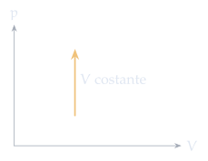
>>> soluzione
**Lavoro.**  $W=0$.

**Energia interna.**  $\Delta U=nC_{V,m}\Delta T=(1)(3R/2)(120)\approx1{,}50\un{kJ}$.

**Primo principio.**  $Q=\Delta U+W=1{,}50\un{kJ}$.
:::

::: esercizio Espansione isobara [base]
Due moli di gas ideale si espandono a pressione costante $150\un{kPa}$ da $0{,}020\un{m^3}$ a $0{,}035\un{m^3}$. Il gas riceve $7{,}0\un{kJ}$. Trovare lavoro e variazione di energia interna.

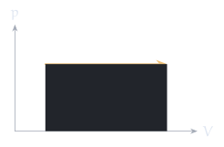
>>> soluzione
**Lavoro.**  $W=p\Delta V=(150\times10^3)(0{,}015)=2{,}25\un{kJ}$.

**Energia interna.**  $\Delta U=Q-W=7{,}0-2{,}25=4{,}75\un{kJ}$.
:::

::: esercizio Espansione isoterma reversibile [medio]
Una mole di gas ideale a $320\un{K}$ raddoppia il proprio volume in modo isotermo reversibile. Calcolare lavoro, calore e variazione di energia interna.

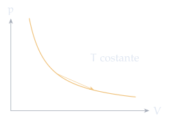
>>> soluzione
**Energia interna.**  Per un gas ideale isotermo, $\Delta U=0$.

**Lavoro.**  $W=nRT\ln2=(1)(8{,}314)(320)\ln2\approx1{,}84\un{kJ}$.

**Calore.**  $Q=W=1{,}84\un{kJ}$.
:::

::: esercizio Compressione adiabatica [base]
Una mole di gas ideale monoatomico viene compressa reversibilmente da $300\un{K}$ e volume $V_i$ a $V_f=V_i/2$. Usare $\gamma=5/3$ e trovare la temperatura finale.

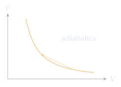
>>> soluzione
**Relazione.**  $TV^{\gamma-1}$ è costante.

**Calcolo.**  $T_f=T_i(V_i/V_f)^{\gamma-1}=300\,2^{2/3}\approx476\un{K}$.
:::

::: esercizio Percorsi diversi fra gli stessi stati [medio]
Un gas passa da $A:(V_0,p_0)$ a $C:(2V_0,2p_0)$. Percorso 1: prima isocoro, poi isobaro a $2p_0$. Percorso 2: prima isobaro a $p_0$, poi isocoro. Confrontare i lavori.

>>> soluzione
**Percorso 1.**  Solo il tratto isobaro compie lavoro: $W_1=(2p_0)(2V_0-V_0)=2p_0V_0$.

**Percorso 2.**  $W_2=p_0(2V_0-V_0)=p_0V_0$.

**Conclusione.**  Gli stati estremi sono uguali, ma il lavoro dipende dal percorso.
:::

::: esercizio Lavoro netto in un ciclo rettangolare [base]
Un ciclo rettangolare nel piano $p$–$V$ opera fra pressioni $100\un{kPa}$ e $300\un{kPa}$, e volumi $0{,}010\un{m^3}$ e $0{,}030\un{m^3}$. Il ciclo è percorso in senso orario. Calcolare il lavoro netto.

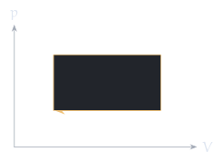
>>> soluzione
**Area orientata.**  $W_{net}=(p_H-p_L)(V_H-V_L)$.

**Calcolo.**  $W_{net}=(200\times10^3)(0{,}020)=4{,}0\un{kJ}$. Il segno è positivo perché il ciclo è orario.
:::

::: esercizio Espansione libera in un recipiente isolato [medio]
Un gas ideale si espande nel vuoto da metà di un recipiente rigido isolato fino a occupare tutto il volume. Determinare $Q$, $W$ e $\Delta U$; indicare che cosa accade alla temperatura nel modello ideale.

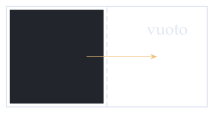
>>> soluzione
**Calore.**  Il recipiente è isolato: $Q=0$.

**Lavoro.**  Il gas si espande contro pressione esterna nulla: $W=0$.

**Primo principio.**  $\Delta U=0$. Per un gas ideale $U$ dipende soltanto da $T$, quindi $\Delta T=0$. Il processo è comunque irreversibile.
:::

::: esercizio Processo lineare nel piano $p$–$V$ [base]
La pressione varia linearmente da $300\un{kPa}$ a $100\un{kPa}$ mentre il volume passa da $0{,}010\un{m^3}$ a $0{,}040\un{m^3}$. Calcolare il lavoro del gas.

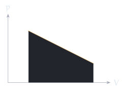
>>> soluzione
**Area del trapezio.**  $W=\bar p\Delta V=[(300+100)/2]\,\mathrm{kPa}\,(0{,}030\,\mathrm{m^3})$.

**Calcolo.**  $W=6{,}0\un{kJ}$.
:::

### Macchine termiche e refrigerazione

::: esercizio Rendimento di un motore [base]
Un motore assorbe $2{,}50\un{MJ}$ dalla sorgente calda e cede $1{,}70\un{MJ}$ alla sorgente fredda per ciclo. Calcolare lavoro e rendimento.

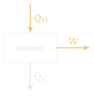
>>> soluzione
**Lavoro.**  $W=Q_H-Q_C=2{,}50-1{,}70=0{,}80\un{MJ}$.

**Rendimento.**  $\eta=W/Q_H=0{,}80/2{,}50=0{,}320=32{,}0\%$.
:::

::: esercizio Limite di Carnot [base]
Una macchina opera fra $600\un{K}$ e $300\un{K}$. Calcolare il massimo rendimento teorico e confrontarlo con un rendimento reale del 38%.

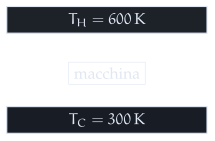
>>> soluzione
**Carnot.**  $\eta_C=1-T_C/T_H=1-300/600=0{,}50$.

**Confronto.**  Il 38% è inferiore al limite del 50% e non viola il secondo principio.
:::

::: esercizio Frigorifero domestico [base]
Un frigorifero sottrae $900\un{kJ}$ al vano freddo consumando $300\un{kJ}$ di lavoro elettrico. Calcolare il COP e lénergia ceduta alla cucina.

>>> soluzione
**COP.**  $\mathrm{COP}=Q_C/W=900/300=3{,}0$.

**Bilancio.**  $Q_H=Q_C+W=1{,}20\un{MJ}$.
:::

::: esercizio Pompa di calore [base]
Una pompa di calore ha $\mathrm{COP}_{pompa}=4{,}2$ e assorbe potenza elettrica $2{,}0\un{kW}$. Quale potenza termica fornisce allédificio e quanta ne preleva dallésterno?

>>> soluzione
**Calore fornito.**  $\dot Q_H=\mathrm{COP}\,P_e=4{,}2(2{,}0)=8{,}4\un{kW}$.

**Prelievo esterno.**  $\dot Q_C=\dot Q_H-P_e=6{,}4\un{kW}$.
:::

::: esercizio Una macchina impossibile [medio]
Un inventore dichiara un motore che assorbe $100\un{kJ}$ da una sorgente a $500\un{K}$, produce $60\un{kJ}$ di lavoro e cede il resto a $300\un{K}$. Valutare la dichiarazione.

>>> soluzione
**Rendimento dichiarato.**  $\eta=60/100=0{,}60$.

**Limite.**  $\eta_C=1-300/500=0{,}40$.

**Verdetto.**  Il rendimento dichiarato supera Carnot; il dispositivo non è compatibile con il secondo principio.
:::

::: esercizio Potenza meccanica di un motore [base]
Un motore assorbe energia termica con potenza $80\un{kW}$ e ha rendimento 28%. Calcolare potenza meccanica e potenza ceduta allámbiente.

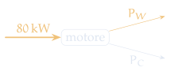
>>> soluzione
**Potenza utile.**  $P_W=\eta P_H=0{,}28(80)=22{,}4\un{kW}$.

**Scarto.**  $P_C=P_H-P_W=57{,}6\un{kW}$.
:::

::: esercizio COP di Carnot per un frigorifero [medio]
Un frigorifero ideale opera fra $270\un{K}$ e $300\un{K}$. Calcolare il massimo COP. Come cambia se la sorgente calda sale a $315\un{K}$?

>>> soluzione
**Prima situazione.**  $\mathrm{COP}_C=270/(300-270)=9{,}0$.

**Seconda situazione.**  $\mathrm{COP}_C=270/(315-270)=6{,}0$. Una maggiore differenza di temperatura riduce la prestazione massima.
:::

::: esercizio Energia annua di una pompa di calore [base]
Un edificio richiede in media $6{,}0\un{kW}$ termici per $1200\un{h}$ annue. Con COP medio 3.0, stimare lénergia elettrica consumata.

>>> soluzione
**Energia termica.**  $E_H=(6{,}0\,\mathrm{kW})(1200\,\mathrm{h})=7200\un{kW\,h}$.

**Elettricità.**  $E_e=E_H/\mathrm{COP}=2400\un{kW\,h}$.
:::

### Entropia, funzione di partizione ed energie libere

::: esercizio Entropia in un'espansione isoterma [base]
Una mole di gas ideale raddoppia il proprio volume in modo isotermo reversibile. Calcolare la variazione di entropia del gas.

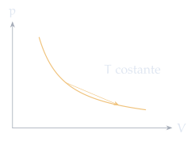
>>> soluzione
**Formula.**  $\Delta S=nR\ln(V_f/V_i)$.

**Calcolo.**  $\Delta S=(1)(8{,}314)\ln2\approx5{,}76\un{J/K}$.
:::

::: esercizio Entropia di mescolamento di due gas [avanzato]
Una mole di elio e una mole di neon, inizialmente separate, sono alla stessa temperatura e pressione. Rimossa la parete, occupano insieme il volume totale. Calcolare l'entropia di mescolamento ideale.

>>> soluzione
**Frazioni molari.**  $x_{He}=x_{Ne}=1/2$.

**Formula.**  $\Delta S_{mix}=-R\sum_i n_i\ln x_i=2R\ln2$.

**Risultato.**  $\Delta S_{mix}\approx11{,}53\un{J/K}$. Per due gas identici nelle stesse condizioni il risultato fisico sarebbe zero.
:::

::: esercizio Sistema canonico a due livelli [medio]
Un sistema ha livelli $E_0=0$ ed $E_1=\epsilon$, entrambi non degeneri. Alla temperatura considerata vale $\epsilon/(k_BT)=2$. Calcolare $Z$, la probabilità dello stato eccitato e $U/\epsilon$.

>>> soluzione
**Partizione.**  $Z=1+e^{-2}\approx1{,}1353$.

**Probabilità.**  $P_1=e^{-2}/Z=1/(e^2+1)\approx0{,}1192$.

**Energia.**  $U=P_1\epsilon$, quindi $U/\epsilon\approx0{,}1192$.
:::

::: esercizio Energia libera di Helmholtz di due livelli [medio]
Per il sistema dell'esercizio precedente calcolare $F/(k_BT)$.

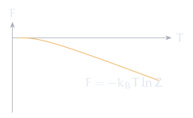
>>> soluzione
**Relazione.**  $F=-k_BT\ln Z$.

**Calcolo.**  $F/(k_BT)=-\ln(1+e^{-2})\approx-0{,}1269$. Il valore dipende dallo zero energetico scelto, mentre differenze e derivate hanno significato fisico diretto.
:::

::: esercizio Direzione spontanea e lavoro massimo [medio]
A temperatura e volume costanti, due configurazioni di un dispositivo hanno energie libere $F_A=1{,}20\un{kJ}$ e $F_B=0{,}70\un{kJ}$. Quale configurazione è favorita e qual è il massimo lavoro non di espansione ottenibile nella trasformazione reversibile $A\to B$?

>>> soluzione
**Criterio.**  A $T,V,N$ costanti è favorita la configurazione con $F$ minore: $B$.

**Lavoro massimo.**  $W_{max}=-\Delta F=F_A-F_B=0{,}50\un{kJ}$. Il limite è raggiunto soltanto nel processo reversibile.
:::

::: esercizio Pressione dalla funzione di Helmholtz [medio]
Un gas ideale monoatomico ha

$$F=-Nk_BT\left[\ln\left(\frac{V}{N\lambda_T^3}\right)+1\right].$$

Calcolare $-\left(\partial F/\partial V\right)_{T,N}$ e interpretare il risultato.

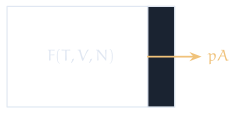
>>> soluzione
**Derivata.**  A $T,N$ costanti, $\partial F/\partial V=-Nk_BT/V$.

**Risultato.**  $p=-\partial F/\partial V=Nk_BT/V$. Si recupera l'equazione di stato del gas ideale: la pressione è la forza termodinamica coniugata al volume.
:::

::: esercizio Helmholtz di un oscillatore quantistico [medio]
Per un oscillatore con $\beta\hbar\omega=1$, determinare $F/(k_BT)$ e $U/(k_BT)$.

>>> soluzione
**Helmholtz.**  $F/(k_BT)=\tfrac12+\ln(1-e^{-1})\approx0{,}0413$.

**Energia.**  $U/(k_BT)=\tfrac12+1/(e-1)\approx1{,}082$. La piccola positività di $F$ include lo zero energetico fissato dall'energia di punto zero.
:::

::: esercizio Fluttuazioni energetiche macroscopiche [avanzato]
Un gas ideale monoatomico canonico contiene $N=10^{23}$ particelle. Stimare $\sigma_E/U$, sapendo che $U=(3/2)Nk_BT$ e $C_V=(3/2)Nk_B$.

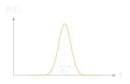
>>> soluzione
**Fluttuazione.**  $\sigma_E^2=k_BT^2C_V=(3/2)N(k_BT)^2$.

**Rapporto.**  $\sigma_E/U=\sqrt{2/(3N)}$.

**Calcolo.**  $\sigma_E/U\approx2{,}58\times10^{-12}$. Le fluttuazioni microscopiche sono reali, ma relativamente invisibili su scala macroscopica.
:::

### Problemi di sintesi: termodinamica

::: esercizio Espansione isobara di gas monoatomico [avanzato]
Una mole di gas ideale monoatomico si espande a pressione costante $200000{,}0\un{Pa}$ aumentando il volume di $0{,}012\un{m^3}$. Calcolare lavoro, variazione di temperatura e calore assorbito.
>>> soluzione
**Lavoro.**  $W=p\Delta V=2400\un{J}$.

**Stato.**  $nR\Delta T=p\Delta V$, quindi $\Delta T=289\un{K}$.

**Calore.**  $Q=nC_{P,m}\Delta T=(5/2)nR\Delta T=6000\un{J}$.
:::

::: esercizio Espansione isoterma [avanzato]
$1{,}5\un{mol}$ di gas ideale a $350\un{K}$ si espandono reversibilmente fino a triplicare il volume. Calcolare lavoro e calore.
>>> soluzione
**Energia interna.**  Per gas ideale isoterma, $\Delta U=0$.

**Lavoro.**

$$W=nRT\ln(V_f/V_i)=4796\un{J}.$$

**Primo principio.**  Con la convenzione $\Delta U=Q-W$, $Q=W$.
:::

::: esercizio Espansione adiabatica di un gas biatomico [avanzato]
Un gas biatomico ideale si espande reversibilmente da $0{,}01\un{m^3}$ a $0{,}025\un{m^3}$, partendo da $400\un{K}$. Assumere $\gamma=1{,}4$ e calcolare $T_f$.
>>> soluzione
**Adiabatica.**  $TV^{\gamma-1}=\mathrm{costante}$.

$$T_f=T_i(V_i/V_f)^{\gamma-1}=277\un{K}.$$
:::

::: esercizio Primo principio con segni [avanzato]
Un gas assorbe $1200\un{J}$ di calore e compie $450\un{J}$ di lavoro sull'ambiente. Calcolare la variazione di energia interna.
>>> soluzione
**Convenzione.**  $\Delta U=Q-W$.

$$\Delta U=1200-450=750\un{J}.$$

L'energia interna aumenta perché il calore assorbito supera il lavoro ceduto.
:::

::: esercizio Lavoro di un ciclo rettangolare [avanzato]
Un ciclo percorso in senso orario nel piano $p$–$V$ è un rettangolo fra 100 e $300\un{kPa}$ e fra 0.015 e $0{,}040\un{m^3}$. Calcolare il lavoro netto.
>>> soluzione
**Area orientata.**

$$W_{ciclo}=(p_H-p_L)(V_H-V_L)=5000\un{J}.$$

Il segno è positivo perché il ciclo è orario: il gas compie lavoro netto.
:::

::: esercizio Motore di Carnot [avanzato]
Un motore reversibile opera fra $600\un{K}$ e $300\un{K}$ e assorbe $8{,}0\un{kJ}$ per ciclo. Calcolare rendimento e lavoro.
>>> soluzione
**Rendimento.**  $\eta_C=1-T_c/T_h=0{,}500$.

**Lavoro.**  $W=\eta Q_h=4000\un{J}=4{,}00\un{kJ}$.
:::

::: esercizio Frigorifero reversibile [avanzato]
Un frigorifero ideale opera fra $270\un{K}$ e $300\un{K}$ e assorbe $500\un{J}$ di lavoro per ciclo. Calcolare COP e calore sottratto al serbatoio freddo.
>>> soluzione
**COP.**  $\mathrm{COP}_R=T_c/(T_h-T_c)=9{,}00$.

**Calore.**  $Q_c=\mathrm{COP}\,W=4500\un{J}$.
:::

::: esercizio Entropia nell'acqua riscaldata [avanzato]
$1{,}2\un{kg}$ d'acqua viene riscaldata reversibilmente da $290\un{K}$ a $330\un{K}$. Assumendo $c=4186\un{J/(kg\,K)}$, calcolare $\Delta S$.
>>> soluzione
**Integrale.**

$$\Delta S=mc\ln\frac{T_f}{T_i}=649\un{J/K}.$$
:::

::: esercizio Entropia in un'espansione libera [avanzato]
Due moli di gas ideale si espandono liberamente in un contenitore isolato fino a quadruplicare il volume. Calcolare $\Delta U$, $Q$, $W$ e $\Delta S$.
>>> soluzione
**Primo principio.**  Nell'espansione libera isolata $Q=0$ e $W=0$, quindi $\Delta U=0$ e, per gas ideale, $\Delta T=0$.

**Entropia.**  Calcolandola lungo un percorso reversibile equivalente,

$$\Delta S=nR\ln(V_f/V_i)=23{,}1\un{J/K}>0.$$
:::

## Fonti {#fonti}

Il testo, le formule, i diagrammi e gli esercizi di questo capitolo provengono dalla *Dispensa di fisica* del corso (sezioni 6.7-6.10 e materiali delle sezioni 6.12, 6.13, 6.14), consultabile nel lettore della galassia. Per la lettura sul sito sono cambiati l'impaginazione, i colori delle figure, la numerazione e la posizione di alcuni riquadri ed esercizi; la sezione iniziale è scritta per il pianeta di questa unità.

Opere citate nel testo:

1. H. von Helmholtz, “Die Thermodynamik chemischer Vorgänge”, *Sitzungsberichte der Königlich Preussischen Akademie der Wissenschaften zu Berlin*, 1882; traduzione inglese in *Physical Memoirs Selected and Translated from Foreign Sources*, Taylor and Francis, Londra, 1882.
2. J. W. Gibbs, *Elementary Principles in Statistical Mechanics: Developed with Especial Reference to the Rational Foundation of Thermodynamics*, Charles Scribner's Sons, New York, 1902.
