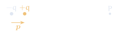
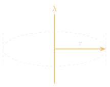
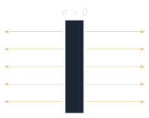
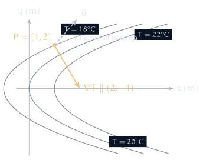
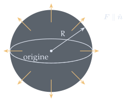

## Prima di cominciare {#apertura}

Una piccola carica di prova esplora lo spazio attorno a una sorgente positiva. La forza che riceve dipende anche dalla carica di prova, mentre il campo elettrico descrive lo spazio attorno alla sorgente e resta lo stesso cambiando la sonda.

Il capitolo spiega perché serve una teoria locale delle interazioni, poi tratta carica elettrica, legge di Coulomb, campo elettrico, linee di campo e flusso. Dalla parte matematica della dispensa arrivano derivate parziali, gradiente, divergenza e rotore, integrali di linea e teoremi integrali, che servono a scrivere le leggi del campo in forma compatta. Il [potenziale elettrico](unit:physics-22) è l'argomento successivo.

## Dalle forze al campo: perché serve una teoria locale {#s-7-1}

L'elettromagnetismo classico unifica fenomeni che, a prima vista, sembrano distinti: l'attrazione fra cariche, la corrente in un filo, la deviazione di una bussola, l'induzione in una bobina e la propagazione della luce. L'unità della teoria non consiste soltanto nel raccogliere quattro equazioni. Consiste nell'affermare che lo spazio possiede, in ogni punto e in ogni istante, due campi fisici, $\vect E$ e $\vect B$, capaci di trasportare energia e quantità di moto e di agire localmente sulla materia.

La legge di Coulomb descrive correttamente la forza elettrostatica, ma una legge di forza istantanea a distanza non può essere il fondamento di una teoria compatibile con una velocità finita di propagazione. Faraday sostituì l'immagine puramente geometrica dell'azione a distanza con quella delle linee di forza; Maxwell trasformò questa intuizione in una teoria dinamica e mostrò che le perturbazioni dei campi si propagano con velocità

$$c=\frac{1}{\sqrt{\mu_0\varepsilon_0}}.$$

Il valore coincide con la velocità della luce: la luce è quindi una soluzione delle equazioni elettromagnetiche, non un fenomeno aggiunto dall'esterno.

::: storia Una costruzione collettiva, non una scoperta isolata
Coulomb quantificò la forza elettrostatica; Ørsted scoprì l'azione magnetica della corrente; Ampère organizzò quantitativamente il legame fra correnti e magnetismo; Faraday scoprì l'induzione e costruì il linguaggio fisico delle linee di forza. Maxwell riconobbe l'incompatibilità della legge magnetostatica di Ampère con la conservazione della carica nei fenomeni variabili, introdusse la corrente di spostamento e ricavò una teoria ondulatoria della luce  [1](#fonti). Hertz verificò sperimentalmente l'esistenza delle onde elettromagnetiche. La forma vettoriale moderna delle equazioni fu sviluppata successivamente, soprattutto da Heaviside e Gibbs.
:::

::: nota Che cosa viene assunto
Tratteremo carica e corrente come densità continue e i campi come funzioni sufficientemente regolari. Questo modello è eccellente su scale molto maggiori di quelle atomiche. Dove sono presenti superfici cariche, fili ideali o interfacce brusche, le equazioni locali vanno interpretate per regioni regolari e integrate attraverso piccoli volumi o circuiti per ottenere le condizioni di salto.
:::

## Carica elettrica, forza e campo {#s-7-2}

La carica elettrica è una grandezza scalare additiva e conservata. La sua unità SI è il coulomb e la carica elementare ha valore esatto

$$e=1{,}602176634\times10^{-19}\un{C}.$$

Per due cariche puntiformi ferme, $q_1$ in $\vect r_1$ e $q_2$ in $\vect r_2$, poniamo

$$\vect R=\vect r_2-\vect r_1,\qquad R=|\vect R|,\qquad \vers R=\frac{\vect R}{R}.$$

La forza su $q_2$ è

::: legge Legge di Coulomb nel vuoto
$$\vect F_{1\to2}=\frac{1}{4\pi\varepsilon_0}\frac{q_1q_2}{R^2}\vers R
=\frac{1}{4\pi\varepsilon_0}\frac{q_1q_2}{R^3}\vect R.$$
:::

### Dal principio di sovrapposizione al campo

### Derivazione della legge di Gauss da Coulomb

Consideriamo una carica puntiforme $Q$ e un elemento di superficie $\dd A$ a distanza $r$.

Se $\theta$ è l'angolo fra la normale uscente e la direzione radiale, il flusso elementare è

$$\dd\Phi_E=\vect E\cdot\dd\vect A
=\frac{Q}{4\pi\varepsilon_0r^2}\cos\theta\,\dd A.$$

La quantità

$$\dd\Omega=\frac{\cos\theta\,\dd A}{r^2}$$

è l'angolo solido orientato sotteso dall'elemento visto dalla carica. Ne segue

$$\dd\Phi_E=\frac{Q}{4\pi\varepsilon_0}\dd\Omega.$$

Una superficie chiusa vista da un punto interno sottende l'angolo solido totale $4\pi$; se la carica è esterna, i contributi di ingresso e uscita si compensano. Pertanto

$$\oiint_{\partial V}\vect E\cdot\dd\vect A=
\begin{cases}
Q/\varepsilon_0,&Q\text{ interna},\\
0,&Q\text{ esterna}.
\end{cases}$$

Per sovrapposizione, il risultato si estende a qualunque distribuzione:

::: legge Legge di Gauss: forma integrale
$$\oiint_{\partial V}\vect E\cdot\dd\vect A=\frac{Q_{\mathrm{int}}}{\varepsilon_0}.$$
:::

La legge è sempre valida, ma è utile per calcolare il campo soltanto quando la simmetria consente di conoscere direzione e modulo di $\vect E$ sulla superficie scelta.

Applicando il teorema della divergenza,

$$\oiint_{\partial V}\vect E\cdot\dd\vect A
=\int_V\nabla\cdot\vect E\,\dd V,
\qquad
Q_{\mathrm{int}}=\int_V\rho\,\dd V.$$

Poiché l'uguaglianza vale per ogni volume arbitrario,

::: legge Legge di Gauss: forma locale
$$\nabla\cdot\vect E=\frac{\rho}{\varepsilon_0}.$$
:::

Il passaggio da una relazione integrale a una locale non è un semplice cambio di notazione: richiede regolarità sufficiente dei campi e afferma che la densità di carica è la sorgente puntuale della divergenza del campo.

::: approfondimento Caso di studio: Campo di una distribuzione sferica uniforme
Per una sfera di raggio $R$ e densità uniforme $\rho$, la simmetria impone $\vect E=E(r)\vers r$. Per $r<R$,

$$E(r)4\pi r^2=\frac{\rho(4\pi r^3/3)}{\varepsilon_0},
\qquad
E(r)=\frac{\rho r}{3\varepsilon_0}.$$

Per $r>R$,

$$E(r)=\frac{1}{4\pi\varepsilon_0}\frac{Q}{r^2}.$$

Il campo è continuo alla superficie se non è presente una carica superficiale ideale; la sua derivata cambia perché cambia la densità volumica.
:::

## Più variabili: derivate parziali, gradiente, divergenza e rotore {#s-0-31}

Una grandezza fisica può dipendere da più variabili. La temperatura in una stanza è un campo scalare $T(x,y,z,t)$; la pressione atmosferica dipende da posizione e tempo; l'energia interna può dipendere da volume, temperatura e numero di particelle.

La derivata parziale misura la variazione rispetto a una variabile mantenendo ferme le altre:

$$\frac{\partial f}{\partial x}
=\lim_{\Delta x\to0}\frac{f(x+\Delta x,y)-f(x,y)}{\Delta x}.$$

Per $f(x,y)=x^2y+3y$,

$$\frac{\partial f}{\partial x}=2xy,
\qquad
\frac{\partial f}{\partial y}=x^2+3.$$

Il **gradiente** di un campo scalare è il vettore

$$\nabla f=
\frac{\partial f}{\partial x}\vers i+
\frac{\partial f}{\partial y}\vers j+
\frac{\partial f}{\partial z}\vers k.$$

Esso punta nella direzione di crescita più rapida; il suo modulo è il massimo tasso di crescita per unità di distanza. La derivata direzionale lungo un versore $\vers u$ è

$$D_{\vers u}f=\nabla f\cdot\vers u.$$

Per un campo vettoriale $\vect F=(F_x,F_y,F_z)$, la **divergenza**

$$\nabla\cdot\vect F=
\frac{\partial F_x}{\partial x}+
\frac{\partial F_y}{\partial y}+
\frac{\partial F_z}{\partial z}$$

misura localmente la tendenza del campo a uscire da un piccolo volume. Il **rotore**

$$\nabla\times\vect F$$

misura la circolazione locale. In elettromagnetismo queste operazioni permettono di esprimere in forma locale le leggi di Gauss, Faraday e Ampère-Maxwell.

::: approfondimento Campi su una griglia
In una simulazione o in una mappa meteorologica, il campo è noto soltanto nei nodi di una griglia. Le derivate parziali vengono stimate confrontando celle vicine. Per esempio,

$$\frac{\partial T}{\partial x}(x_i,y_j)
\simeq\frac{T_{i+1,j}-T_{i-1,j}}{2\Delta x}.$$

Gradiente, divergenza e rotore possono quindi essere calcolati senza supporre che i dati siano disponibili in ogni punto.
:::

## Integrali di linea, flussi e teoremi integrali {#s-0-32}

Un integrale ordinario accumula una funzione lungo un intervallo. Nei campi vettoriali occorre specificare anche il percorso o la superficie su cui avviene l'accumulo. L'**integrale di linea** di un campo lungo una curva orientata $C$ è

$$\int_C \vect F\cdot\dd\vect r.$$

In meccanica rappresenta il lavoro di una forza lungo una traiettoria; in elettromagnetismo può rappresentare una circolazione. Il prodotto scalare seleziona, in ogni punto, la componente del campo tangente al percorso.

Il **flusso** attraverso una superficie orientata $S$ è

$$\iint_S \vect F\cdot\vers n\,\dd S,$$

dove $\vers n$ è il versore normale scelto. Il flusso misura quanto campo attraversa la superficie: è positivo dove il campo ha componente concorde con la normale e negativo dove la attraversa nel verso opposto.

Due teoremi collegano le descrizioni locali e globali. Il teorema della divergenza di Gauss afferma

$$\oiint_{\partial V}\vect F\cdot\vers n\,\dd S
=
\iiint_V \nabla\cdot\vect F\,\dd V.$$

Il flusso attraverso la superficie chiusa $\partial V$ coincide con la somma delle sorgenti locali contenute nel volume. Il teorema di Stokes afferma

$$\oint_{\partial S}\vect F\cdot\dd\vect r
=
\iint_S(\nabla\times\vect F)\cdot\vers n\,\dd S.$$

La circolazione lungo il bordo è quindi collegata alla rotazione locale distribuita sulla superficie. Questi risultati non sono semplici formule di calcolo: spiegano perché le forme integrali e differenziali delle leggi di Maxwell descrivono lo stesso contenuto fisico, purché il campo e la regione abbiano la regolarità richiesta.

::: approfondimento Flusso su una superficie suddivisa
Se una superficie è rappresentata da piccole celle di area $\Delta S_i$, il flusso si stima con

$$\Phi\simeq\sum_i \vect F_i\cdot\vers n_i\,\Delta S_i.$$

L’orientazione della cella determina il contributo: è piccolo quando la superficie è quasi parallela al campo e massimo in modulo quando è quasi perpendicolare.
:::

## Casi di studio e attività sperimentali {#casi}

### Attività sperimentale: Mappatura qualitativa di un campo elettrico

**Obiettivo.**  ricostruire linee equipotenziali e direzione del campo in una geometria bidimensionale.

**Materiali o dati.**  carta conduttiva o vaschetta elettrolitica didattica, alimentazione continua a bassa tensione, voltmetro e sonde isolate.

**Procedura.**

1. disporre due elettrodi e applicare una differenza di potenziale moderata;
2. misurare punti con lo stesso potenziale e tracciare le equipotenziali;
3. stimare la direzione di $\vect E$ come normale alle equipotenziali e il modulo dalla loro spaziatura;
4. confrontare geometrie piane, puntiformi e con schermo conduttore.

**Controllo e discussione.**  distinguere il campo tridimensionale reale dal modello bidimensionale; discutere resistenza del mezzo e perturbazione introdotta dalle sonde.

**Sicurezza.**  usare soltanto alimentatori didattici a bassissima tensione e non impiegare la rete elettrica.

## Glossario {#glossario}

- **Divergenza**: Operazione differenziale che misura il bilancio locale di uscita di un campo vettoriale da un piccolo volume.
- **Flusso**: Integrale della componente normale di un campo vettoriale attraverso una superficie orientata.
- **Gradiente**: Vettore delle derivate parziali di un campo scalare; indica la direzione di crescita più rapida.
- **Rotore**: Operazione differenziale che misura la circolazione locale di un campo vettoriale.
- **Campo elettrico**: Campo vettoriale che assegna la forza per unità di carica di prova positiva. In elettrostatica è il gradiente negativo del potenziale.
- **Flusso elettrico**: Integrale di superficie $\int\vect E\cdot\dd\vect A$; per una superficie chiusa è legato alla carica interna dalla legge di Gauss.

## Esercizi {#esercizi}

Gli esercizi riprendono quelli della dispensa. Ogni soluzione è nascosta finché non la apri: prova prima a impostare il problema da solo.

### Cariche, campo e legge di Gauss

::: esercizio Forza fra due cariche [base]
Due cariche $q_1=3{,}0\un{\mu C}$ e $q_2=-2{,}0\un{\mu C}$ distano $0{,}40\un{m}$. Calcolare modulo e verso della forza su $q_2$.

>>> soluzione
**Modulo.**  $F=k_e|q_1q_2|/r^2=(8{,}99\times10^9)(6{,}0\times10^{-12})/0{,}16\simeq0{,}337\un{N}$.

**Verso.**  Le cariche hanno segno opposto: la forza su $q_2$ è diretta verso $q_1$.
:::

::: esercizio Campo nel punto medio [base]
Due cariche uguali $q=4{,}0\un{nC}$ sono poste a $x=\pm0{,}15\un{m}$. Trovare il campo nel punto medio e il potenziale scegliendo $V(\infty)=0$.

>>> soluzione
**Campo.**  I due contributi hanno uguale modulo e verso opposto: $\vect E(O)=\vect0$.

**Potenziale.**  Il potenziale è scalare: $V=2k_eq/r=2(8{,}99\times10^9)(4{,}0\times10^{-9})/0{,}15\simeq479\un{V}$.
:::

::: esercizio Punto di campo nullo [base]
Due cariche positive $q_1=1{,}0\un{nC}$ e $q_2=4{,}0\un{nC}$ distano $d=0{,}60\un{m}$. Determinare il punto del segmento nel quale il campo è nullo.

>>> soluzione
**Uguaglianza dei moduli.**  $q_1/x^2=q_2/(d-x)^2$.

**Soluzione.**  $(d-x)/x=\sqrt{q_2/q_1}=2$, quindi $d=3x$ e $x=0{,}20\un{m}$ da $q_1$.
:::

::: esercizio Dipolo sull'asse [medio]
Un dipolo ha cariche $\pm q$ con $q=2{,}0\un{nC}$ separate da $d=4{,}0\un{mm}$. Stimare il campo sull'asse a distanza $r=0{,}30\un{m}$ dal centro usando l'approssimazione lontana.

>>> soluzione
**Momento di dipolo.**  $p=qd=(2{,}0\times10^{-9})(4{,}0\times10^{-3})=8{,}0\times10^{-12}\un{C\,m}$.

**Campo assiale lontano.**  $E\simeq(1/4\pi\varepsilon_0)2p/r^3=(8{,}99\times10^9)(1{,}6\times10^{-11})/0{,}027\simeq5{,}33\un{N/C}$, diretto come $\vect p$.
:::

::: esercizio Anello carico sull'asse [base]
Un anello di raggio $R=0{,}10\un{m}$ porta carica totale $Q=20\un{nC}$. Calcolare il campo sull'asse a $z=0{,}10\un{m}$ dal centro.

>>> soluzione
**Formula assiale.**  $E_z=k_eQz/(z^2+R^2)^{3/2}$.

**Calcolo.**  $E_z=(8{,}99\times10^9)(20\times10^{-9})(0{,}10)/(0{,}02)^{3/2}\simeq6{,}36\times10^{3}\un{N/C}$.
:::

::: esercizio Carica al centro di un cubo [medio]
Una carica $Q=6{,}0\un{nC}$ è al centro di un cubo. Trovare il flusso elettrico totale e il flusso attraverso una singola faccia.

>>> soluzione
**Gauss.**  $\Phi_{\mathrm tot}=Q/\varepsilon_0=(6{,}0\times10^{-9})/(8{,}854\times10^{-12})\simeq678\un{N\,m^2/C}$.

**Simmetria.**  Le sei facce sono equivalenti: $\Phi_{\mathrm faccia}=\Phi_{\mathrm tot}/6\simeq113\un{N\,m^2/C}$.
:::

::: esercizio Campo di un filo infinito [base]
Un filo rettilineo molto lungo ha densità lineare $\lambda=3{,}0\un{nC/m}$. Calcolare $E$ a distanza $r=5{,}0\un{cm}$.

>>> soluzione
**Superficie cilindrica.**  $E(2\pi rL)=\lambda L/\varepsilon_0$.

**Calcolo.**  $E=\lambda/(2\pi\varepsilon_0r)=(3{,}0\times10^{-9})/[2\pi(8{,}854\times10^{-12})(0{,}050)]\simeq1{,}08\times10^{3}\un{N/C}$.
:::

::: esercizio Campo di un piano infinito [medio]
Un grande foglio isolante porta densità superficiale uniforme $\sigma=8{,}0\un{nC/m^2}$. Stimare il campo lontano dai bordi.

>>> soluzione
**Pillbox gaussiano.**  Il flusso attraversa due facce: $2EA=\sigma A/\varepsilon_0$.

**Calcolo.**  $E=\sigma/(2\varepsilon_0)=8{,}0\times10^{-9}/[2(8{,}854\times10^{-12})]\simeq452\un{N/C}$ su ciascun lato, normale al piano.
:::

### Più variabili: derivate parziali, gradiente, divergenza e rotore

::: esercizio Direzione di crescita della temperatura [avanzato]
Su una piastra la temperatura è

$$T(x,y)=20\,{}^\circ\mathrm{C}
+\left(2\,{}^\circ\mathrm{C}\right)x
-\left(1\,{}^\circ\mathrm{C}\right)y^2,$$

con $x,y$ in metri. Calcolare il gradiente nel punto $P=(1,2)$, la direzione di crescita più rapida e il tasso di variazione lungo il versore $\vers u=(3/5,4/5)$.

>>> soluzione
**Derivate parziali.**

$$\frac{\partial T}{\partial x}=2\,{}^\circ\mathrm{C},
\qquad
\frac{\partial T}{\partial y}=-2\left(1\,{}^\circ\mathrm{C}\right)y.$$

**Gradiente in $P$.**

$$\nabla T(1,2)=(2,-4)\,\mathrm{°C}.$$

**Direzione di crescita più rapida.**  Il versore associato è

$$\vers n=\frac{(2,-4)}{\sqrt{20}}
=\left(\frac1{\sqrt5},-\frac2{\sqrt5}\right).$$

**Derivata direzionale.**

$$D_{\vers u}T=\nabla T\cdot\vers u
=2\frac35+(-4)\frac45
=-2{,}0\,\mathrm{°C}.$$

Lungo $\vers u$ la temperatura diminuisce di circa $2\,\mathrm{°C}$ per metro.
:::

::: esercizio Sorgente, pozzo o flusso incomprimibile? [avanzato]
Nel piano sono dati i campi

$$\vect F_1=(2x,2y),
\qquad
\vect F_2=(-y,x),
\qquad
\vect F_3=(x,-y).$$

Calcolare divergenza e componente $z$ del rotore di ciascun campo e descriverne qualitativamente il comportamento.

>>> soluzione
**Primo campo.**

$$\nabla\cdot\vect F_1=\frac{\partial(2x)}{\partial x}+\frac{\partial(2y)}{\partial y}=4,$$

$$(\nabla\times\vect F_1)_z=\frac{\partial(2y)}{\partial x}-\frac{\partial(2x)}{\partial y}=0.$$

È un campo sorgente, senza rotazione locale.

**Secondo campo.**

$$\nabla\cdot\vect F_2=0+0=0,
\qquad
(\nabla\times\vect F_2)_z=\frac{\partial x}{\partial x}-\frac{\partial(-y)}{\partial y}=2.$$

È un campo rotazionale con divergenza nulla.

**Terzo campo.**

$$\nabla\cdot\vect F_3=1-1=0,
\qquad
(\nabla\times\vect F_3)_z=0-0=0.$$

Il campo si espande lungo $x$ e si comprime lungo $y$, ma il bilancio locale netto e la rotazione sono nulli.
:::

### Integrali di linea, flussi e teoremi integrali

::: esercizio Flusso radiale e teorema di Gauss [avanzato]
Nel campo tridimensionale

$$\vect F(\vect r)=\alpha\vect r,$$

con $\alpha$ costante, calcolare il flusso uscente attraverso una sfera di raggio $R$ centrata nell'origine. Verificare il risultato sia direttamente sulla superficie sia mediante il teorema della divergenza. Se $\vect F$ rappresenta una grandezza fisica, $\alpha$ possiede l'unità del campo divisa per una lunghezza.

>>> soluzione
**Calcolo diretto sulla sfera.**  Sulla superficie $r=R$, il campo è

$$\vect F=\alpha R\vers n.$$

Pertanto $\vect F\cdot\vers n=\alpha R$, costante su tutta la sfera.

**Area della superficie.**

$$\Phi=\oiint_S\alpha R\,\dd S
=\alpha R(4\pi R^2)
=4\pi\alpha R^3.$$

**Divergenza del campo.**  In coordinate cartesiane, $\vect F=(\alpha x,\alpha y,\alpha z)$, quindi

$$\nabla\cdot\vect F=\alpha+\alpha+\alpha=3\alpha.$$

**Teorema di Gauss.**

$$\Phi=\iiint_V3\alpha\,\dd V
=3\alpha\left(\frac43\pi R^3\right)
=4\pi\alpha R^3.$$

I due procedimenti coincidono. Il risultato cresce come $R^3$ perché la sorgente volumica $\nabla\cdot\vect F$ è uniforme in tutta la sfera.
:::

### Problemi di sintesi: elettromagnetismo e ottica

::: esercizio Attrazione coulombiana fra cariche opposte [avanzato]
Due cariche $q_1=2{,}0\un{\mu C}$ e $q_2=-5{,}0\un{\mu C}$ distano $0{,}30\un{m}$. Calcolare modulo e natura della forza.
>>> soluzione
**Coulomb.**  $F=k|q_1q_2|/r^2=0{,}999\un{N}$.

**Verso.**  Le cariche hanno segno opposto, quindi la forza è attrattiva lungo la congiungente.
:::

::: esercizio Campo al punto medio [medio]
Due cariche positive $3{,}0\,\mu\mathrm{C}$ e $1{,}0\,\mu\mathrm{C}$ sono separate di $0{,}40\un{m}$. Calcolare il campo al punto medio.
>>> soluzione
**Direzioni.**  I due campi sono opposti. Il campo della carica maggiore prevale.

$$E=k\frac{(3{,}0-1{,}0)\times10^{-6}}{(0{,}20)^2}=4{,}49\times10^{5}\un{N/C}.$$

Il verso è dalla carica da $3\,\mu\mathrm{C}$ verso quella da $1\,\mu\mathrm{C}$.
:::

::: esercizio Campo esterno a una sfera carica [medio]
Una sfera conduttrice porta carica $8\times10^{-9}\un{C}$. Calcolare il campo a $0{,}12\un{m}$ dal centro, all'esterno.
>>> soluzione
**Gauss.**  Per simmetria $E(4\pi r^2)=Q/\varepsilon_0$.

**Risultato.**  $E=4993\un{N/C}$, radiale uscente.
:::

## Fonti {#fonti}

Il testo, le formule, i diagrammi e gli esercizi di questo capitolo provengono dalla *Dispensa di fisica* del corso (sezioni 0.31-0.32, 7.1-7.2 e materiali delle sezioni 7.11), consultabile nel lettore della galassia. Per la lettura sul sito sono cambiati l'impaginazione, i colori delle figure, la numerazione e la posizione di alcuni riquadri ed esercizi; la sezione iniziale è scritta per il pianeta di questa unità.

Opere citate nel testo:

1. J. C. Maxwell, “A Dynamical Theory of the Electromagnetic Field”, *Philosophical Transactions of the Royal Society of London*, vol. 155, 1865, pp. 459–512, doi: 10.1098/rstl.1865.0008.
