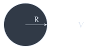
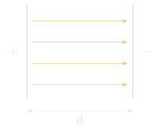
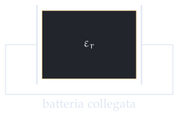
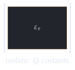
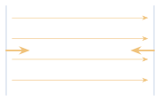

## Prima di cominciare {#apertura}

Un trasportatore sposta piccole cariche fra zone a potenziale diverso. La tensione fornisce l'energia trasferita per unità di carica; per calcolare l'energia trasferita serve anche il valore della carica, e il segno del risultato dipende dal segno della carica e dal verso dello spostamento.

Il capitolo tratta il potenziale elettrico e l'energia potenziale, i conduttori in equilibrio, la capacità, i condensatori e i dielettrici. Le sezioni aggiunte per il sito sviluppano il legame fra campo e potenziale, le superfici equipotenziali e l'energia immagazzinata in un condensatore. Il capitolo presuppone il [campo elettrico](unit:physics-21) e prepara i [circuiti](unit:physics-23).

## Potenziale, conduttori, capacità e dielettrici {#s-7-3}

In elettrostatica il lavoro del campo lungo un percorso chiuso è nullo. Per una carica puntiforme si verifica direttamente che

$$\int_A^B\vect E\cdot\dd\vect l$$

dipende soltanto dagli estremi; per sovrapposizione, lo stesso vale per distribuzioni statiche. In forma locale,

$$\nabla\times\vect E=\vect0.$$

In una regione semplicemente connessa, un campo irrotazionale può essere scritto come gradiente di uno scalare:

::: legge Definizione del potenziale
$$\vect E=-\nabla V,
\qquad
V(B)-V(A)=-\int_A^B\vect E\cdot\dd\vect l.$$
:::

Il segno meno esprime il fatto che il campo punta verso valori decrescenti del potenziale. L'energia potenziale di una carica $q$ è $U=qV$.

Sostituendo $\vect E=-\nabla V$ nella legge locale di Gauss si ottiene

$$-\nabla^2V=\frac{\rho}{\varepsilon_0},$$

cioè

::: legge Equazioni di Poisson e Laplace
$$\nabla^2V=-\frac{\rho}{\varepsilon_0},
\qquad
\nabla^2V=0\quad\text{se }\rho=0.$$
:::

### Conduttori in equilibrio elettrostatico

### Capacità ed energia: derivazione

Per caricare lentamente un condensatore, quando la carica già presente è $q$, il potenziale è $V(q)=q/C$. Il lavoro elementare fornito dall'agente esterno è

$$\dd W=V(q)\,\dd q=\frac{q}{C}\dd q.$$

Integrando da $0$ a $Q$,

$$U=\int_0^Q\frac{q}{C}\dd q=\frac{Q^2}{2C}
=\frac12QV=\frac12CV^2.$$

Per un condensatore piano ideale, $E=V/d$ e $C=\varepsilon_0A/d$; pertanto

$$U=\frac12\varepsilon_0E^2(Ad).$$

Il volume fra le armature è $Ad$, perciò la densità di energia è

::: legge Densità di energia elettrica nel vuoto
$$u_E=\frac12\varepsilon_0E^2.$$
:::

### Polarizzazione e campo di spostamento

La polarizzazione $\vect P$ è il momento di dipolo elettrico per unità di volume. Una polarizzazione non uniforme equivale a cariche legate

$$\rho_b=-\nabla\cdot\vect P,
\qquad
\sigma_b=\vect P\cdot\vers n.$$

La legge di Gauss per il campo totale è

$$\nabla\cdot\vect E=\frac{\rho_f+\rho_b}{\varepsilon_0}
=\frac{\rho_f-\nabla\cdot\vect P}{\varepsilon_0}.$$

Portando il termine di polarizzazione a sinistra si ottiene

$$\nabla\cdot(\varepsilon_0\vect E+\vect P)=\rho_f.$$

Definiamo quindi

::: legge Campo di spostamento elettrico
$$\vect D=\varepsilon_0\vect E+\vect P,
\qquad
\nabla\cdot\vect D=\rho_f,
\qquad
\oiint\vect D\cdot\dd\vect A=Q_{f,\mathrm{int}}.$$
:::

La relazione $\vect D=\varepsilon\vect E$ è costitutiva e vale soltanto per mezzi lineari, isotropi e locali. In generale $\vect D$ può dipendere dalla storia del campo, dalla frequenza e dalla direzione cristallografica.

## Lavoro del campo ed energia potenziale {#g-lavoro}

In un campo elettrico uniforme $\vect E$, una carica $q$ che si sposta di $d$ nel verso del campo riceve dal campo il lavoro $W=qEd$. Il lavoro della forza elettrostatica è indipendente dal percorso. La forza è quindi conservativa, come il peso nel campo gravitazionale uniforme, e ammette un'energia potenziale con $\Delta U=-W$. Il **potenziale** è l'energia potenziale per unità di carica, $V=U/q$, e la differenza di potenziale fra due punti è

$$\Delta V=V_B-V_A=-\int_A^B\vect E\cdot\dd\vect s,$$

che nel campo uniforme si riduce a $\Delta V=-Ed$ lungo le linee di campo. Una carica puntiforme $Q$ genera il potenziale $V(r)=kQ/r$, con riferimento nullo all'infinito; due cariche puntiformi a distanza $r$ hanno energia potenziale $U=kq_1q_2/r$, positiva se si respingono e negativa se si attraggono.

::: esempio Un elettrone accelerato
Un elettrone parte da fermo e attraversa una differenza di potenziale di $1{,}0\un{kV}$. Il campo compie il lavoro $W=e\Delta V=1{,}602\times10^{-19}\cdot1{,}0\times10^{3}\un{J}=1{,}6\times10^{-16}\un{J}$, che diventa energia cinetica:
$$v=\sqrt{\frac{2e\Delta V}{m_e}}=\sqrt{\frac{2\cdot1{,}602\times10^{-16}}{9{,}109\times10^{-31}}}\un{m/s}\simeq1{,}9\times10^{7}\un{m/s}.$$
La velocità è circa il $6\%$ di quella della luce, e la meccanica classica dà ancora una buona approssimazione.
:::

## Dal potenziale al campo {#g-gradiente}

Il potenziale si ottiene dal campo con un integrale; il campo si ottiene dal potenziale con una derivata. In una dimensione $E_x=-\dd V/\dd x$; nello spazio

$$\vect E=-\nabla V.$$

Il campo punta dove il potenziale diminuisce più rapidamente, e il suo modulo è tanto maggiore quanto più le superfici equipotenziali sono fitte. Su una superficie equipotenziale lo spostamento di una carica non richiede lavoro, quindi il campo è perpendicolare in ogni punto alla superficie. La superficie di un conduttore in equilibrio è equipotenziale: se non lo fosse, le cariche libere si muoverebbero.

::: figura equipotenziali
{"w":480,"h":350,"items":[{"t":"poly","pts":[[390.0,172.0],[389.4,185.1],[387.7,198.0],[384.9,210.8],[381.0,223.3],[375.9,235.4],[369.9,247.0],[362.9,258.0],[354.9,268.4],[346.1,278.1],[336.4,286.9],[326.0,294.9],[315.0,301.9],[303.4,307.9],[291.3,313.0],[278.8,316.9],[266.0,319.7],[253.1,321.4],[240.0,322.0],[226.9,321.4],[214.0,319.7],[201.2,316.9],[188.7,313.0],[176.6,307.9],[165.0,301.9],[154.0,294.9],[143.6,286.9],[133.9,278.1],[125.1,268.4],[117.1,258.0],[110.1,247.0],[104.1,235.4],[99.0,223.3],[95.1,210.8],[92.3,198.0],[90.6,185.1],[90.0,172.0],[90.6,158.9],[92.3,146.0],[95.1,133.2],[99.0,120.7],[104.1,108.6],[110.1,97.0],[117.1,86.0],[125.1,75.6],[133.9,65.9],[143.6,57.1],[154.0,49.1],[165.0,42.1],[176.6,36.1],[188.7,31.0],[201.2,27.1],[214.0,24.3],[226.9,22.6],[240.0,22.0],[253.1,22.6],[266.0,24.3],[278.8,27.1],[291.3,31.0],[303.4,36.1],[315.0,42.1],[326.0,49.1],[336.4,57.1],[346.1,65.9],[354.9,75.6],[362.9,86.0],[369.9,97.0],[375.9,108.6],[381.0,120.7],[384.9,133.2],[387.7,146.0],[389.4,158.9]],"close":true,"c":"muted","dash":true,"w":1.4},{"t":"poly","pts":[[315.0,172.0],[314.7,178.5],[313.9,185.0],[312.4,191.4],[310.5,197.7],[308.0,203.7],[305.0,209.5],[301.4,215.0],[297.5,220.2],[293.0,225.0],[288.2,229.5],[283.0,233.4],[277.5,237.0],[271.7,240.0],[265.7,242.5],[259.4,244.4],[253.0,245.9],[246.5,246.7],[240.0,247.0],[233.5,246.7],[227.0,245.9],[220.6,244.4],[214.3,242.5],[208.3,240.0],[202.5,237.0],[197.0,233.4],[191.8,229.5],[187.0,225.0],[182.5,220.2],[178.6,215.0],[175.0,209.5],[172.0,203.7],[169.5,197.7],[167.6,191.4],[166.1,185.0],[165.3,178.5],[165.0,172.0],[165.3,165.5],[166.1,159.0],[167.6,152.6],[169.5,146.3],[172.0,140.3],[175.0,134.5],[178.6,129.0],[182.5,123.8],[187.0,119.0],[191.8,114.5],[197.0,110.6],[202.5,107.0],[208.3,104.0],[214.3,101.5],[220.6,99.6],[227.0,98.1],[233.5,97.3],[240.0,97.0],[246.5,97.3],[253.0,98.1],[259.4,99.6],[265.7,101.5],[271.7,104.0],[277.5,107.0],[283.0,110.6],[288.2,114.5],[293.0,119.0],[297.5,123.8],[301.4,129.0],[305.0,134.5],[308.0,140.3],[310.5,146.3],[312.4,152.6],[313.9,159.0],[314.7,165.5]],"close":true,"c":"muted","dash":true,"w":1.4},{"t":"poly","pts":[[290.0,172.0],[289.8,176.4],[289.2,180.7],[288.3,184.9],[287.0,189.1],[285.3,193.1],[283.3,197.0],[281.0,200.7],[278.3,204.1],[275.4,207.4],[272.1,210.3],[268.7,213.0],[265.0,215.3],[261.1,217.3],[257.1,219.0],[252.9,220.3],[248.7,221.2],[244.4,221.8],[240.0,222.0],[235.6,221.8],[231.3,221.2],[227.1,220.3],[222.9,219.0],[218.9,217.3],[215.0,215.3],[211.3,213.0],[207.9,210.3],[204.6,207.4],[201.7,204.1],[199.0,200.7],[196.7,197.0],[194.7,193.1],[193.0,189.1],[191.7,184.9],[190.8,180.7],[190.2,176.4],[190.0,172.0],[190.2,167.6],[190.8,163.3],[191.7,159.1],[193.0,154.9],[194.7,150.9],[196.7,147.0],[199.0,143.3],[201.7,139.9],[204.6,136.6],[207.9,133.7],[211.3,131.0],[215.0,128.7],[218.9,126.7],[222.9,125.0],[227.1,123.7],[231.3,122.8],[235.6,122.2],[240.0,122.0],[244.4,122.2],[248.7,122.8],[252.9,123.7],[257.1,125.0],[261.1,126.7],[265.0,128.7],[268.7,131.0],[272.1,133.7],[275.4,136.6],[278.3,139.9],[281.0,143.3],[283.3,147.0],[285.3,150.9],[287.0,154.9],[288.3,159.1],[289.2,163.3],[289.8,167.6]],"close":true,"c":"muted","dash":true,"w":1.4},{"t":"text","p":[393.0,118.7],"s":"V","sub":"3","c":"muted","size":13,"i":true,"a":"start"},{"t":"text","p":[322.5,144.3],"s":"V","sub":"2","c":"muted","size":13,"i":true,"a":"start"},{"t":"text","p":[299.0,152.9],"s":"V","sub":"1","c":"muted","size":13,"i":true,"a":"start"},{"t":"arrow","p":[262.2,181.2,398.9,237.8],"c":"force","w":2},{"t":"arrow","p":[249.2,194.2,305.8,330.9],"c":"force","w":2},{"t":"arrow","p":[230.8,194.2,174.2,330.9],"c":"force","w":2},{"t":"arrow","p":[217.8,181.2,81.1,237.8],"c":"force","w":2},{"t":"arrow","p":[217.8,162.8,81.1,106.2],"c":"force","w":2},{"t":"arrow","p":[230.8,149.8,174.2,13.1],"c":"force","w":2},{"t":"arrow","p":[249.2,149.8,305.8,13.1],"c":"force","w":2},{"t":"arrow","p":[262.2,162.8,398.9,106.2],"c":"force","w":2},{"t":"circle","p":[240,172,15],"c":"force4","s":"+"},{"t":"text","p":[470,30],"s":"linee di campo","c":"force","size":13,"a":"end"},{"t":"text","p":[470,335],"s":"superfici equipotenziali","c":"muted","size":13,"a":"end"}]}
---
Carica puntiforme positiva: linee di campo radiali e tre superfici equipotenziali con $V_1-V_2=V_2-V_3$. Poiché $V\propto1/r$, a passi uguali di potenziale le superfici si diradano allontanandosi dalla carica, dove il campo è più debole.
:::

Per una carica puntiforme le superfici equipotenziali sono sfere concentriche. I raggi della figura stanno nel rapporto $1:1{,}5:3$, quindi i potenziali stanno nel rapporto $3:2:1$ e le differenze fra superfici consecutive sono uguali. Lo spazio fra le superfici cresce con la distanza perché il campo diminuisce come $1/r^2$.

## L'elettronvolt {#g-elettronvolt}

Nella fisica atomica e delle particelle si usa come unità di energia l'**elettronvolt**, l'energia acquistata da una carica elementare che attraversa una differenza di potenziale di un volt:

$$1\un{eV}=1{,}602\,176\,634\times10^{-19}\un{J}.$$

Il valore è esatto, perché dal 2019 la carica elementare ha un valore fissato per definizione nel Sistema Internazionale. Le energie di legame chimico valgono qualche elettronvolt; i fotoni della luce visibile, fra circa $380$ e $750\un{nm}$, trasportano fra circa $3{,}3$ e $1{,}7\un{eV}$; l'elettrone dell'esempio precedente ha un'energia cinetica di $1{,}0\un{keV}$.

## Energia immagazzinata in un condensatore {#g-energia}

Caricare un condensatore richiede lavoro, perché ogni nuova carica va portata contro la differenza di potenziale creata dalle cariche già presenti. Quando l'armatura contiene la carica $q$, la differenza di potenziale vale $q/C$ e il trasferimento di $\dd q$ costa $\dd W=(q/C)\dd q$. Sommando dal condensatore scarico fino alla carica finale $Q$:

$$U=\int_0^Q\frac{q}{C}\,\dd q=\frac{Q^2}{2C}=\frac12CV^2=\frac12QV.$$

Il fattore $1/2$ ricorda che durante la carica la differenza di potenziale cresce da zero al valore finale. Un condensatore da $100\un{\mu F}$ a $12\un{V}$ immagazzina $7{,}2\un{mJ}$; quello da $330\un{\mu F}$ del flash di una fotocamera, caricato a $300\un{V}$, circa $15\un{J}$, che vengono liberati in un tempo molto breve.

L'energia si può attribuire al campo elettrico stesso. Nel condensatore piano $C=\varepsilon_0A/d$ e $V=Ed$, quindi $U=\tfrac12\varepsilon_0E^2\,(Ad)$: l'energia per unità di volume del campo vale

$$u=\tfrac12\varepsilon_0E^2.$$

Con $E=3\times10^{6}\un{V/m}$, il campo oltre il quale l'aria secca diventa conduttrice in condizioni ordinarie, si ottengono circa $40\un{J/m^3}$.

::: esercizio Differenza di potenziale fra due piastre [base]
Fra due piastre parallele distanti $5{,}0\un{mm}$ c'è un campo uniforme di $2{,}4\times10^{4}\un{V/m}$. Calcolare la differenza di potenziale e il lavoro compiuto dal campo su un protone che va dalla piastra positiva a quella negativa.
>>> soluzione
$\Delta V=Ed=2{,}4\times10^{4}\cdot5{,}0\times10^{-3}\un{V}=120\un{V}$. Il protone si muove nel verso del campo e riceve il lavoro $W=e\Delta V=1{,}602\times10^{-19}\cdot120\un{J}\simeq1{,}9\times10^{-17}\un{J}$, cioè $120\un{eV}$.
:::

::: esercizio Energia di due cariche [medio]
Due cariche di $+2{,}0\un{\mu C}$ e $-3{,}0\un{\mu C}$ si trovano a $0{,}30\un{m}$. Calcolare l'energia potenziale del sistema e il lavoro necessario per allontanarle fino a distanza infinita.
>>> soluzione
$U=kq_1q_2/r=8{,}99\times10^{9}\cdot(2{,}0\times10^{-6})(-3{,}0\times10^{-6})/0{,}30\un{J}\simeq-0{,}18\un{J}$. Per separarle occorre fornire un lavoro esterno pari a $0{,}18\un{J}$, perché l'energia finale è nulla.
:::

::: esercizio Condensatore e batteria [medio]
Un condensatore da $47\un{\mu F}$ viene caricato a $9{,}0\un{V}$. Calcolare carica ed energia immagazzinata. Se la tensione raddoppia, come cambiano?
>>> soluzione
$Q=CV=47\times10^{-6}\cdot9{,}0\un{C}\simeq4{,}2\times10^{-4}\un{C}$; $U=\tfrac12CV^2=\tfrac12\cdot47\times10^{-6}\cdot81\un{J}\simeq1{,}9\un{mJ}$. Raddoppiando la tensione la carica raddoppia e l'energia quadruplica.
:::

## Glossario {#glossario}

- **Potenziale elettrico**: Energia potenziale per unità di carica; in elettrostatica soddisfa $\vect E=-\nabla V$.

## Esercizi {#esercizi}

Gli esercizi riprendono quelli della dispensa. Ogni soluzione è nascosta finché non la apri: prova prima a impostare il problema da solo.

### Potenziale, conduttori e dielettrici

::: esercizio Potenziale di tre cariche [base]
Tre cariche sono poste ai vertici di un triangolo equilatero di lato $a=0{,}20\un{m}$: $q_1=q_2=2{,}0\un{nC}$ e $q_3=-1{,}0\un{nC}$. Trovare il potenziale nel centro, distante $a/\sqrt3$ da ogni vertice.

>>> soluzione
**Somma scalare.**  $V=k_e(q_1+q_2+q_3)/(a/\sqrt3)$.

**Calcolo.**  $V=(8{,}99\times10^9)(3{,}0\times10^{-9})/(0{,}20/\sqrt3)\simeq234\un{V}$.
:::

::: esercizio Lavoro per spostare una carica [medio]
Una carica $q=5{,}0\un{nC}$ viene spostata lentamente da un punto a $V_A=120\un{V}$ a un punto a $V_B=-40\un{V}$. Calcolare la variazione di energia potenziale e il lavoro dell'agente esterno.

>>> soluzione
**Energia.**  $\Delta U=q(V_B-V_A)=5{,}0\times10^{-9}(-160)=-8{,}0\times10^{-7}\un{J}$.

**Processo lento.**  Senza variazione di energia cinetica, $W_{\mathrm ext}=\Delta U=-0{,}80\un{\mu J}$. Il campo compie lavoro positivo opposto.
:::

::: esercizio Capacità di una sfera isolata [base]
Una sfera conduttrice isolata di raggio $R=8{,}0\un{cm}$ è nel vuoto. Trovare la capacità e la carica necessaria per portarla a $V=15\un{kV}$.

>>> soluzione
**Capacità.**  $C=4\pi\varepsilon_0R=4\pi(8{,}854\times10^{-12})(0{,}080)\simeq8{,}90\un{pF}$.

**Carica.**  $Q=CV\simeq(8{,}90\times10^{-12})(1{,}5\times10^4)=1{,}34\times10^{-7}\un{C}$.
:::

::: esercizio Condensatore piano [avanzato]
Due armature di area $A=0{,}020\un{m^2}$ sono separate da $d=1{,}0\un{mm}$ nel vuoto e collegate a $V=200\un{V}$. Calcolare capacità, carica ed energia.

>>> soluzione
**Capacità.**  $C=\varepsilon_0A/d=(8{,}854\times10^{-12})(0{,}020)/(10^{-3})=177\un{pF}$.

**Carica.**  $Q=CV=35{,}4\un{nC}$.

**Energia.**  $U=\tfrac12CV^2\simeq3{,}54\un{\mu J}$.
:::

::: esercizio Condensatori in serie [medio]
Due condensatori $C_1=3{,}0\un{\mu F}$ e $C_2=6{,}0\un{\mu F}$ sono in serie a una batteria da $12\un{V}$. Trovare capacità equivalente, carica e tensioni.

>>> soluzione
**Equivalente.**  $C_{eq}=C_1C_2/(C_1+C_2)=2{,}0\un{\mu F}$.

**Carica comune.**  $Q=C_{eq}V=24\un{\mu C}$.

**Tensioni.**  $V_1=Q/C_1=8{,}0\un{V}$ e $V_2=Q/C_2=4{,}0\un{V}$.
:::

::: esercizio Dielettrico con batteria collegata [base]
Un condensatore piano resta collegato a una batteria ideale mentre viene riempito con un dielettrico di costante relativa $\varepsilon_r=4$. Come cambiano $C$, $Q$, $V$ e $U$?

>>> soluzione
**Vincolo.**  La batteria mantiene $V$ costante.

**Variazioni.**  $C'=4C$, $Q'=C'V=4Q$ e $U'=\tfrac12C'V^2=4U$. L'energia aggiuntiva proviene dal generatore durante il trasferimento di carica.
:::

::: esercizio Dielettrico in un condensatore isolato [base]
Ripetere il problema precedente dopo aver scollegato il condensatore dalla batteria prima di inserire il dielettrico.

>>> soluzione
**Vincolo.**  La carica libera sulle armature resta $Q$.

**Variazioni.**  $C'=4C$, $V'=Q/C'=V/4$ e $U'=Q^2/(2C')=U/4$. La diminuzione di energia corrisponde al lavoro meccanico compiuto dal campo che attira il dielettrico.
:::

::: esercizio Pressione elettrostatica [medio]
Tra due grandi armature nel vuoto il campo è $E=2{,}0\times10^{6}\un{V/m}$. Stimare densità di energia e pressione attrattiva.

>>> soluzione
**Densità.**  $u_E=\tfrac12\varepsilon_0E^2=0{,}5(8{,}854\times10^{-12})(4{,}0\times10^{12})\simeq17{,}7\un{J/m^3}$.

**Pressione.**  Per armature ideali la pressione ha lo stesso valore numerico: $p\simeq17{,}7\un{Pa}$.
:::

### Problemi di sintesi: elettromagnetismo e ottica

::: esercizio Potenziale di una carica puntiforme [medio]
Calcolare il potenziale a $0{,}08\un{m}$ da una carica $q=4\times10^{-9}\un{C}$, con zero all'infinito.
>>> soluzione
**Potenziale.**  $V=kq/r=449\un{V}$. Il potenziale è scalare; non richiede una direzione.
:::

::: esercizio Condensatore a facce piane [avanzato]
Un condensatore nel vuoto ha area $0{,}02\un{m^2}$, distanza $0{,}001\un{m}$ e tensione $120\un{V}$. Calcolare capacità ed energia.
>>> soluzione
**Capacità.**  $C=\varepsilon_0A/d=1{,}77\times10^{-10}\un{F}$.

**Energia.**  $U=\tfrac12CV^2=1{,}28\times10^{-6}\un{J}$.
:::

::: esercizio Dielettrico in condensatore isolato [avanzato]
Un condensatore isolato di capacità $2\times10^{-9}\un{F}$ porta carica $6\times10^{-9}\un{C}$. Si inserisce un dielettrico con $\kappa=4$. Calcolare energia prima e dopo.
>>> soluzione
**Carica costante.**  $C'=\kappa C$.

$$U_i=\frac{Q^2}{2C}=9{,}00\times10^{-9}\un{J},\qquad
U_f=\frac{Q^2}{2\kappa C}=2{,}25\times10^{-9}\un{J}.$$

La diminuzione corrisponde al lavoro meccanico compiuto dalle forze elettriche sul dielettrico.
:::

## Fonti {#fonti}

Il testo, le formule, i diagrammi e gli esercizi di questo capitolo provengono dalla *Dispensa di fisica* del corso (sezione 7.3 e materiali delle sezioni 7.11), consultabile nel lettore della galassia. Per la lettura sul sito sono cambiati l'impaginazione, i colori delle figure, la numerazione e la posizione di alcuni riquadri ed esercizi; la sezione iniziale è scritta per il pianeta di questa unità.
