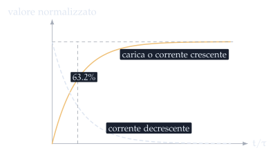
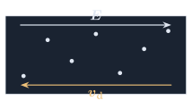
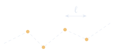
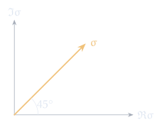
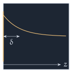
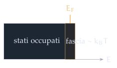
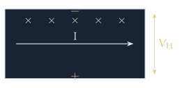

## Prima di cominciare {#apertura}

Un resistore viene collegato a tensioni diverse e il controllo vuole sapere se la corrente cresce in proporzione. Per un resistore ohmico a temperatura costante il rapporto fra tensione e corrente resta lo stesso, e quel rapporto è la resistenza.

Il capitolo tratta la corrente e la conservazione locale della carica, i circuiti in regime stazionario e transitorio, la risposta elettromagnetica dei solidi con i modelli di Drude e di Sommerfeld. Le sezioni aggiunte per il sito sviluppano resistori in serie e in parallelo, le leggi di Kirchhoff, potenza ed effetto Joule. Il capitolo presuppone il [potenziale](unit:physics-22) e prepara l'[induzione](unit:physics-24).

## Corrente e conservazione locale della carica {#s-7-4}

Se portatori di densità numerica $n$, carica $q$ e velocità media di deriva $\vect v_d$ attraversano un materiale, la densità di corrente è

$$\vect J=nq\vect v_d.$$

La corrente attraverso una superficie orientata è

$$I=\int_S\vect J\cdot\dd\vect A.$$

Per derivare la legge locale di conservazione, consideriamo la carica contenuta in un volume fisso:

$$Q_V(t)=\int_V\rho(\vect r,t)\dd V.$$

La sua variazione è l'opposto della corrente netta uscente:

$$\frac{\dd Q_V}{\dd t}=-\oiint_{\partial V}\vect J\cdot\dd\vect A.$$

Usando il teorema della divergenza,

$$\int_V\frac{\partial\rho}{\partial t}\dd V
=-\int_V\nabla\cdot\vect J\dd V.$$

Poiché il volume è arbitrario,

::: legge Equazione di continuità
$$\frac{\partial\rho}{\partial t}+\nabla\cdot\vect J=0.$$
:::

Questa equazione è un vincolo fondamentale: qualunque teoria del campo compatibile con la carica elettrica deve rispettarla.

In un mezzo ohmico lineare e isotropo,

$$\vect J=\sigma\vect E.$$

Per un filo uniforme di lunghezza $L$ e area $A$, con campo quasi uniforme $E=V/L$,

$$I=JA=\sigma\frac{V}{L}A,
\qquad
V=IR,
\qquad
R=\frac{L}{\sigma A}=\varrho\frac{L}{A}.$$

La potenza trasferita dal campo alla materia per unità di volume è

$$p=\vect J\cdot\vect E.$$

Per un resistore ohmico si recuperano $P=VI=I^2R=V^2/R$. La legge di Ohm non è una legge universale del campo: è una relazione materiale, valida in un opportuno intervallo di temperatura, frequenza e intensità.

::: nota Quando il circuito concentrato è legittimo
Il modello di circuito assume che il tempo di propagazione lungo il dispositivo sia trascurabile rispetto ai tempi di variazione del segnale. Se la dimensione $L$ non è molto minore della lunghezza d'onda $\lambda$, tensione e corrente non sono più grandezze uniformi lungo il collegamento: occorre una descrizione a parametri distribuiti o direttamente mediante Maxwell.
:::

### Transitori RC e RL: la scala temporale del circuito

Le leggi di Kirchhoff producono equazioni differenziali quando condensatori e induttori immagazzinano energia. In un circuito RC in carica,

$$V-R\frac{\dd q}{\dd t}-\frac{q}{C}=0.$$

La soluzione con condensatore inizialmente scarico è

$$q(t)=CV\left(1-e^{-t/RC}\right),
\qquad
i(t)=\frac{V}{R}e^{-t/RC}.$$

La costante di tempo $\tau=RC$ non è il tempo di carica completa, che nel modello esponenziale è infinito: dopo $\tau$ il condensatore ha raggiunto circa il $63{,}2\%$ del valore finale.

Per un circuito RL,

$$L\frac{\dd i}{\dd t}+Ri=V,
\qquad
i(t)=\frac{V}{R}\left(1-e^{-tR/L}\right),$$

con $\tau=L/R$.

::: approfondimento Dimostrazione: Perché la tensione del condensatore non può saltare
**Ipotesi.** Condensatore ideale di capacità finita $C$ e corrente finita.

**Passaggi.** Poiché $i=\dd q/\dd t$ e $V_C=q/C$,

$$\Delta V_C=\frac1C\int_{t^-}^{t^+}i(t)\,\dd t.$$

Su un intervallo temporale che tende a zero, l'integrale tende a zero se la corrente resta finita.

**Significato fisico.** La tensione del condensatore è continua. Analogamente, la corrente in un induttore ideale è continua perché un salto richiederebbe una tensione impulsiva infinita.

**Limiti di validità.** Interruttori reali, capacità e induttanze parassite e archi elettrici possono produrre transitori molto rapidi, ma non eliminano il principio energetico alla base della continuità.
:::

### RLC serie, impedenza e risonanza

## Risposta elettromagnetica dei solidi: Drude e Sommerfeld {#s-7-10}

### Drude in corrente continua

Il modello di Drude considera elettroni quasi liberi di densità $n$ e massa efficace $m^*$, accelerati dal campo e soggetti a collisioni che rilassano la velocità media in un tempo $\tau$. L'equazione media è

$$m^*\frac{\dd\vect v}{\dd t}=-e\vect E-\frac{m^*}{\tau}\vect v.$$

In regime stazionario continuo, $\dd\vect v/\dd t=0$, quindi

$$\vect v_d=-\frac{e\tau}{m^*}\vect E.$$

La densità di corrente elettronica è $\vect J=-ne\vect v_d$:

::: legge Conducibilità di Drude in continua
$$\vect J=\sigma_0\vect E,
\qquad
\sigma_0=\frac{ne^2\tau}{m^*}.$$
:::

### Risposta armonica e conducibilità complessa

Per un campo $\vect E(t)=\Re\{\vect E_0e^{-i\omega t}\}$ cerchiamo $\vect v(t)=\Re\{\vect v_0e^{-i\omega t}\}$. L'equazione del moto fornisce

$$(-i\omega m^*+m^*/\tau)\vect v_0=-e\vect E_0.$$

Pertanto

$$\vect J_0=-ne\vect v_0
=\frac{ne^2\tau/m^*}{1-i\omega\tau}\vect E_0.$$

::: legge Conducibilità complessa di Drude
$$\sigma(\omega)=\frac{\sigma_0}{1-i\omega\tau}.$$
:::

### Funzione dielettrica e frequenza di plasma

La corrente di conduzione può essere incorporata in una permittività complessa. In frequenza,

$$\vect J=\sigma(\omega)\vect E=-i\omega\vect P_{\mathrm{cond}}.$$

Quindi

$$\vect D=\varepsilon_0\varepsilon_\infty\vect E+\vect P_{\mathrm{cond}}
=\varepsilon_0\varepsilon(\omega)\vect E,$$

con

::: legge Funzione dielettrica di Drude
$$\varepsilon(\omega)=\varepsilon_\infty-
\frac{\omega_p^2}{\omega^2+i\gamma\omega},
\qquad
\gamma=\frac1\tau,
\qquad
\omega_p=\sqrt{\frac{ne^2}{\varepsilon_0m^*}}.$$
:::

### Profondità di pelle

In un buon conduttore a frequenza non troppo alta, $\sigma\gg\omega\varepsilon$. Dalla relazione di dispersione

$$k^2=\mu\varepsilon\omega^2+i\mu\sigma\omega$$

segue approssimativamente

$$k\simeq(1+i)\sqrt{\frac{\mu\sigma\omega}{2}}.$$

Il campo varia come $e^{ikz}=e^{-z/\delta}e^{iz/\delta}$, con

::: legge Profondità di pelle
$$\delta=\sqrt{\frac{2}{\mu\sigma\omega}}.$$
:::

### Effetto Hall

### Sommerfeld: il gas di Fermi

### Limiti dei modelli quasi liberi

Drude e Sommerfeld non descrivono automaticamente bande proibite, semiconduttori, isolanti, transizioni interbanda, localizzazione, forti correlazioni o effetti topologici. In un cristallo, il potenziale periodico produce bande $E_n(\vect k)$; velocità e massa efficace derivano dalla curvatura della banda. La frequenza di plasma e la risposta ottica diventano tensori o funzioni complesse con contributi multipli. I modelli semplici restano preziosi perché isolano i meccanismi dominanti e forniscono ordini di grandezza controllabili.

## Resistenza e resistività {#g-resistivita}

La resistenza di un conduttore dipende dal materiale e dalla geometria. Per un filo di lunghezza $L$ e sezione $A$ uniformi,

$$R=\rho\,\frac{L}{A},$$

dove la **resistività** $\rho$ caratterizza il materiale. Il rame a $20\,{}^\circ\mathrm{C}$ ha $\rho\simeq1{,}68\times10^{-8}\un{\Omega\,m}$: un filo lungo $10\un{m}$ con sezione di $1{,}5\un{mm^2}$, una misura comune negli impianti domestici, ha resistenza $1{,}68\times10^{-8}\cdot10/1{,}5\times10^{-6}\un{\Omega}\simeq0{,}11\un{\Omega}$.

Nei metalli la resistività cresce con la temperatura; in un intervallo moderato vale l'approssimazione lineare $\rho(T)\simeq\rho_0[1+\alpha(T-T_0)]$, con $\alpha\simeq0{,}0039\un{K^{-1}}$ per il rame. La legge di Ohm $V=RI$ con $R$ costante descrive bene un resistore metallico a temperatura costante. Altri componenti hanno un comportamento diverso: la resistenza del filamento di una lampadina cresce molto mentre si scalda, e un diodo conduce in un verso e quasi per niente nell'altro.

## Resistori in serie e in parallelo {#g-serie-parallelo}

Due resistori sono **in serie** se la stessa corrente li attraversa uno dopo l'altro. Le differenze di potenziale si sommano, $V=R_1I+R_2I=(R_1+R_2)I$, quindi la resistenza equivalente è la somma:

$$R_s=R_1+R_2+\dots$$

Due resistori sono **in parallelo** se sono collegati agli stessi due nodi e hanno la stessa differenza di potenziale. Per la conservazione della carica la corrente che entra nel nodo si divide, $I=I_1+I_2=V/R_1+V/R_2$, quindi

$$\frac1{R_p}=\frac1{R_1}+\frac1{R_2}+\dots$$

Con $R_1=100\un{\Omega}$ e $R_2=300\un{\Omega}$ si ottiene $R_s=400\un{\Omega}$ e $R_p=75\un{\Omega}$. La resistenza di un parallelo è sempre minore della minore resistenza presente: aggiungere un ramo offre alla corrente un percorso in più.

Due resistori in serie formano un **partitore di tensione**: la tensione si divide in proporzione alle resistenze, $V_1=V\,R_1/(R_1+R_2)$. È il principio dei potenziometri e di molti circuiti di misura.

## Le leggi di Kirchhoff {#g-kirchhoff}

I circuiti con più maglie si risolvono con due leggi, conseguenze dirette di due principi di conservazione.

::: legge Leggi di Kirchhoff
**Legge dei nodi.** In ogni nodo la somma delle correnti entranti è uguale alla somma delle correnti uscenti, per la conservazione della carica.

**Legge delle maglie.** Lungo un percorso chiuso la somma algebrica delle differenze di potenziale è nulla, perché il campo elettrostatico è conservativo.
:::

Un generatore reale ha una resistenza interna $r$. Una batteria con forza elettromotrice $12\un{V}$ e $r=0{,}50\un{\Omega}$, collegata a un carico di $5{,}5\un{\Omega}$, eroga $I=12/(5{,}5+0{,}50)\un{A}=2{,}0\un{A}$, e ai suoi morsetti si misurano $12-2{,}0\cdot0{,}50=11\un{V}$.

::: figura due-maglie
{"w":560,"h":300,"items":[
{"t":"line","p":[60,60,110,60],"c":"ax","w":2},{"t":"rect","p":[110,48,70,24],"c":"body","s":"R₁"},{"t":"line","p":[180,60,340,60],"c":"ax","w":2},
{"t":"rect","p":[340,48,70,24],"c":"body","s":"R₂"},{"t":"line","p":[410,60,460,60],"c":"ax","w":2},
{"t":"line","p":[60,60,60,163],"c":"ax","w":2},{"t":"line","p":[38,163,82,163],"c":"force","w":3},{"t":"line","p":[48,177,72,177],"c":"force","w":3},{"t":"line","p":[60,177,60,240],"c":"ax","w":2},
{"t":"text","p":[30,174],"s":"E","sub":"1","c":"force","size":15,"a":"end","i":true},{"t":"text","p":[92,160],"s":"+","c":"force","size":14},
{"t":"line","p":[460,60,460,163],"c":"ax","w":2},{"t":"line","p":[438,163,482,163],"c":"force","w":3},{"t":"line","p":[448,177,472,177],"c":"force","w":3},{"t":"line","p":[460,177,460,240],"c":"ax","w":2},
{"t":"text","p":[492,174],"s":"E","sub":"2","c":"force","size":15,"a":"start","i":true},{"t":"text","p":[428,160],"s":"+","c":"force","size":14},
{"t":"line","p":[260,60,260,115],"c":"ax","w":2},{"t":"rect","p":[248,115,24,70],"c":"body"},{"t":"text","p":[284,156],"s":"R₃","c":"ax","size":14,"a":"start","i":true},{"t":"line","p":[260,185,260,240],"c":"ax","w":2},
{"t":"line","p":[60,240,460,240],"c":"ax","w":2},
{"t":"circle","p":[260,60,5],"c":"ax"},{"t":"circle","p":[260,240,5],"c":"ax"},
{"t":"text","p":[260,40],"s":"A","c":"ax","size":15,"i":true},{"t":"text","p":[260,268],"s":"B","c":"ax","size":15,"i":true},
{"t":"arrow","p":[195,80,240,80],"c":"force3","w":2,"s":"I","sub":"1","off":[-22,22]},
{"t":"arrow","p":[325,80,280,80],"c":"force3","w":2,"s":"I","sub":"2","off":[22,22]},
{"t":"arrow","p":[290,195,290,235],"c":"force3","w":2,"s":"I","sub":"3","off":[18,-10]}
]}
---
Circuito a due maglie: $\mathcal E_1=12\un{V}$, $\mathcal E_2=6{,}0\un{V}$, $R_1=4{,}0\un{\Omega}$, $R_2=2{,}0\un{\Omega}$, $R_3=6{,}0\un{\Omega}$. Le frecce indicano i versi scelti per le correnti; il segno delle soluzioni dice se il verso reale coincide.
:::

::: esempio Un circuito a due maglie
Per il circuito della figura si prende come riferimento il potenziale del nodo $B$ e si chiama $V$ il potenziale del nodo $A$. Le correnti nei tre rami valgono
$$I_1=\frac{\mathcal E_1-V}{R_1},\qquad I_2=\frac{\mathcal E_2-V}{R_2},\qquad I_3=\frac{V}{R_3}.$$
La legge dei nodi in $A$, $I_1+I_2=I_3$, diventa
$$\frac{12-V}{4{,}0}+\frac{6{,}0-V}{2{,}0}=\frac{V}{6{,}0}\qquad\Longrightarrow\qquad V=\frac{72}{11}\un{V}\simeq6{,}55\un{V}.$$
Ne seguono $I_1\simeq1{,}36\un{A}$, $I_2\simeq-0{,}27\un{A}$ e $I_3\simeq1{,}09\un{A}$. Il segno negativo di $I_2$ indica che la corrente nel ramo destro scorre in verso opposto a quello scelto: il generatore più forte carica quello più debole. Controllo: $1{,}36-0{,}27=1{,}09$.
:::

## Potenza ed effetto Joule {#g-joule}

Una carica $\dd q$ che attraversa un componente con differenza di potenziale $V$ cede l'energia $V\,\dd q$; dividendo per il tempo si ottiene la potenza

$$P=VI.$$

In un resistore l'energia ceduta diventa energia interna e calore, per l'effetto Joule; con la legge di Ohm $P=RI^2=V^2/R$. Un bollitore da $2000\un{W}$ alimentato a $230\un{V}$ assorbe $I=2000/230\un{A}\simeq8{,}7\un{A}$ e ha una resistenza di circa $26\un{\Omega}$. In tre minuti consuma $2000\cdot180\un{J}=3{,}6\times10^{5}\un{J}$, cioè $0{,}10\un{kWh}$.

Nei cavi l'effetto Joule è una perdita: a parità di potenza trasmessa la corrente è inversamente proporzionale alla tensione, e la potenza dissipata nei cavi cresce come il quadrato della corrente. Per questo l'energia elettrica viaggia sulle lunghe distanze ad alta tensione. Fusibili e interruttori magnetotermici proteggono gli impianti interrompendo il circuito quando la corrente supera il valore per cui i cavi sono dimensionati.

::: esercizio Prolunga [base]
Una prolunga ha due conduttori di rame lunghi $15\un{m}$ ciascuno, con sezione $1{,}0\un{mm^2}$. Calcolare la resistenza complessiva dei due conduttori e la potenza dissipata quando alimenta una stufa che assorbe $8{,}0\un{A}$.
>>> soluzione
La corrente percorre $30\un{m}$ di rame: $R=1{,}68\times10^{-8}\cdot30/1{,}0\times10^{-6}\un{\Omega}\simeq0{,}50\un{\Omega}$. La potenza dissipata nei cavi è $RI^2=0{,}50\cdot64\un{W}\simeq32\un{W}$.
:::

::: esercizio Serie e parallelo [base]
Tre resistori da $60\un{\Omega}$, $30\un{\Omega}$ e $20\un{\Omega}$ sono collegati in parallelo a una batteria ideale da $12\un{V}$. Calcolare la resistenza equivalente, la corrente totale e la corrente in ciascun resistore.
>>> soluzione
$1/R_p=1/60+1/30+1/20=6/60$, quindi $R_p=10\un{\Omega}$ e $I=1{,}2\un{A}$. Ogni resistore ha $12\un{V}$ ai capi: le correnti sono $0{,}20$, $0{,}40$ e $0{,}60\un{A}$, la cui somma è $1{,}2\un{A}$.
:::

::: esercizio Batteria con resistenza interna [medio]
Ai morsetti di una batteria si misurano $9{,}0\un{V}$ a circuito aperto e $8{,}4\un{V}$ quando eroga $1{,}5\un{A}$. Calcolare la resistenza interna e la resistenza del carico.
>>> soluzione
A circuito aperto la tensione misurata coincide con la forza elettromotrice, $9{,}0\un{V}$. Sotto carico la caduta interna è $0{,}6\un{V}$, quindi $r=0{,}6/1{,}5\un{\Omega}=0{,}40\un{\Omega}$. Il carico ha $R=8{,}4/1{,}5\un{\Omega}=5{,}6\un{\Omega}$.
:::

## Casi di studio e attività sperimentali {#casi}

### Attività sperimentale: Riflettanza di materiali e frequenza di plasma

**Obiettivo.**  confrontare qualitativamente la risposta ottica di metalli, vetri e semiconduttori senza dedurre parametri microscopici non supportati dai dati.

**Materiali o dati.**  spettro di riflettanza fornito dal docente oppure spettrometro didattico, campioni e sorgente controllata.

**Procedura.**

1. normalizzare il segnale rispetto a un riferimento;
2. individuare regioni di alta riflettanza e bordi spettrali;
3. confrontare il comportamento con la forma qualitativa di $\varepsilon_r(\omega)$ di Drude;
4. discutere perché transizioni interbanda e rugosità impediscono di identificare automaticamente il bordo con $\omega_p$.

**Controllo e discussione.**  distinguere frequenza di plasma non schermata, frequenza efficace e minimo di riflettanza.

**Sicurezza.**  usare sorgenti ottiche e strumenti secondo le specifiche del laboratorio; non esporre campioni o persone a radiazione ultravioletta non schermata.

## Glossario {#glossario}

- **Frequenza di plasma**: Pulsazione collettiva $\omega_p=\sqrt{n_e e^2/(\varepsilon_0m^*)}$ del gas elettronico libero nel modello di Drude.
- **Modello di Drude**: Modello classico dei portatori nei metalli con accelerazione elettrica e rilassamento caratterizzato da un tempo medio $\tau$.
- **Modello di Sommerfeld**: Estensione quantistica del modello degli elettroni quasi liberi basata sulla statistica di Fermi–Dirac e sulla superficie di Fermi.
- **Profondità di pelle**: Scala di decadimento dei campi elettromagnetici all'interno di un buon conduttore in regime armonico.

## Esercizi {#esercizi}

Gli esercizi riprendono quelli della dispensa. Ogni soluzione è nascosta finché non la apri: prova prima a impostare il problema da solo.

### Drude, Sommerfeld e risposta ottica dei solidi

::: esercizio Conducibilità di Drude [base]
Un metallo ha densità elettronica $n_e=8{,}5\times10^{28}\un{m^{-3}}$ e tempo di rilassamento $\tau=2{,}5\times10^{-14}\un{s}$. Assumendo $m^*=m_e$, calcolare la conducibilità continua.

>>> soluzione
**Drude.**  $\sigma_0=n_ee^2\tau/m_e$.

**Calcolo.**  $\sigma_0\simeq8{,}5\times10^{28}(1{,}602\times10^{-19})^2(2{,}5\times10^{-14})/(9{,}109\times10^{-31})\simeq5{,}99\times10^{7}\un{S/m}$.
:::

::: esercizio Mobilità e cammino libero [base]
Per lo stesso metallo, calcolare la mobilità $\mu_e=e\tau/m_e$ e il cammino libero medio assumendo $v_F=1{,}6\times10^{6}\un{m/s}$.

>>> soluzione
**Mobilità.**  $\mu_e=e\tau/m_e\simeq4{,}40\times10^{-3}\un{m^2/(V\,s)}$.

**Cammino libero.**  $\ell\simeq v_F\tau=(1{,}6\times10^6)(2{,}5\times10^{-14})=40\un{nm}$.
:::

::: esercizio Frequenza di plasma [avanzato]
Per $n_e=5{,}9\times10^{28}\un{m^{-3}}$ e $m^*=m_e$, calcolare $\omega_p$, la frequenza ordinaria $f_p$ e la lunghezza d'onda nel vuoto associata.

>>> soluzione
**Pulsazione.**  $\omega_p=\sqrt{n_ee^2/(\varepsilon_0m_e)}\simeq1{,}37\times10^{16}\un{rad/s}$.

**Frequenza.**  $f_p=\omega_p/(2\pi)\simeq2{,}18\times10^{15}\un{Hz}$.

**Scala ottica.**  $\lambda_p=2\pi c/\omega_p\simeq137\un{nm}$. Il bordo ottico reale può essere spostato da $\varepsilon_\infty$, perdite e transizioni interbanda.
:::

::: esercizio Conducibilità complessa a $\omega\tau=1$ [medio]
Nel modello di Drude, esprimere parte reale, parte immaginaria, modulo e fase di $\sigma(\omega)$ quando $\omega\tau=1$ e si usa la convenzione $e^{-i\omega t}$.

>>> soluzione
**Algebra.**  $\sigma=\sigma_0/(1-i)=\sigma_0(1+i)/2$.

**Componenti.**  $\Re\sigma=\Im\sigma=\sigma_0/2$.

**Modulo e fase.**  $|\sigma|=\sigma_0/\sqrt2$ e la fase è $+45^\circ$ nella convenzione scelta.
:::

::: esercizio Profondità di pelle nel rame [base]
Per rame con $\sigma=5{,}8\times10^{7}\un{S/m}$ a $f=1{,}0\un{MHz}$, stimare la profondità di pelle assumendo $\mu=\mu_0$.

>>> soluzione
**Buon conduttore.**  $\delta=\sqrt{2/(\mu_0\sigma\omega)}$ con $\omega=2\pi f$.

**Calcolo.**  $\delta\simeq\sqrt{2/[4\pi\times10^{-7}(5{,}8\times10^7)(2\pi\times10^6)]}\simeq66\un{\mu m}$.
:::

::: esercizio Energia e temperatura di Fermi [medio]
Per $n_e=8{,}5\times10^{28}\un{m^{-3}}$ e $m^*=m_e$, calcolare $E_F$ e $T_F=E_F/k_{\mathrm B}$. Confrontare $k_{\mathrm B}T$ con $E_F$ a $300\un{K}$.

>>> soluzione
**Fermi.**  $E_F=\hbar^2(3\pi^2n_e)^{2/3}/(2m_e)\simeq7{,}05\un{eV}$.

**Temperatura.**  $T_F=E_F/k_B\simeq8{,}18\times10^{4}\un{K}$.

**Confronto.**  A $300\un{K}$, $k_BT/E_F\simeq3{,}67\times10^{-3}$: soltanto una piccola frazione degli elettroni vicini alla superficie di Fermi può cambiare occupazione termica.
:::

::: esercizio Tensione di Hall [medio]
Una lamina metallica di spessore $t=1{,}0\un{mm}$ porta corrente $I=5{,}0\un{A}$ in un campo $B=0{,}80\un{T}$. Con $n_e=8{,}5\times10^{28}\un{m^{-3}}$ e portatori elettronici, stimare la tensione Hall in modulo e indicarne il segno convenzionale.

>>> soluzione
**Modulo.**  $|V_H|=IB/(n_ee t)=5{,}0(0{,}80)/[8{,}5\times10^{28}(1{,}602\times10^{-19})(10^{-3})]\simeq0{,}294\un{\mu V}$.

**Segno.**  $R_H=1/(nq)$ è negativo per elettroni. Il lato che accumula carica negativa dipende dall'orientazione di $\vect I$ e $\vect B$ mostrata.
:::

### Problemi di sintesi: elettromagnetismo e ottica

::: esercizio Tempo di carica RC [avanzato]
Un circuito ha $R=1{,}0\times10^{6}\un{\Omega}$ e $C=4{,}7\un{\mu F}$. Calcolare la costante di tempo e il tempo per raggiungere il 95% della tensione finale.
>>> soluzione
**Costante.**  $\tau=RC=4{,}70\un{s}$.

**95%.**  $1-e^{-t/\tau}=0{,}95$, quindi $t=-\tau\ln0{,}05=14{,}1\un{s}$.
:::

::: esercizio Due resistori in parallelo [avanzato]
Due resistori da $6\un{\Omega}$ e $4\un{\Omega}$ sono collegati in parallelo a $12\un{V}$. Calcolare correnti, corrente totale e resistenza equivalente.
>>> soluzione
**Rami.**  $I_1=V/R_1=2{,}00\un{A}$, $I_2=3{,}00\un{A}$.

**Totale.**  $I=5{,}00\un{A}$ e $R_{eq}=V/I=2{,}40\un{\Omega}$.
:::

## Fonti {#fonti}

Il testo, le formule, i diagrammi e gli esercizi di questo capitolo provengono dalla *Dispensa di fisica* del corso (sezioni 7.4, 7.10 e materiali delle sezioni 7.11), consultabile nel lettore della galassia. Per la lettura sul sito sono cambiati l'impaginazione, i colori delle figure, la numerazione e la posizione di alcuni riquadri ed esercizi; la sezione iniziale è scritta per il pianeta di questa unità.
