## Prima di cominciare {#apertura}

Il flusso magnetico attraverso una spira cambia periodicamente, e il voltmetro collegato alla spira segna il massimo quando il flusso passa per zero. La forza elettromotrice indotta dipende dalla rapidità con cui il flusso varia, e il suo segno segue la legge di Lenz.

Il capitolo parte dal magnetismo e dalla forza di Lorentz, arriva all'induzione e alle equazioni di Maxwell, poi tratta le onde elettromagnetiche con energia e quantità di moto, l'ottica geometrica con il principio di Fermat e l'ottica fisica con interferenza, coerenza e diffrazione. Le sezioni finali raccolgono le attività sperimentali, la sintesi e il formulario. Il capitolo presuppone i [circuiti](unit:physics-23).

## Magnetismo, forza di Lorentz e sorgenti del campo {#s-7-5}

L'esperienza mostra che una carica in moto subisce, oltre alla forza elettrica, una forza dipendente dalla velocità. La legge fenomenologica completa è

::: legge Forza di Lorentz
$$\vect F=q(\vect E+\vect v\times\vect B).$$
:::

### Dalla legge di Ampère alla forma locale

In magnetostatica,

::: legge Legge circuitale di Ampère
$$\oint_C\vect B\cdot\dd\vect l=\mu_0I_{\mathrm{attraverso}}.$$
:::

Con il teorema di Stokes,

$$\oint_C\vect B\cdot\dd\vect l
=\int_S(\nabla\times\vect B)\cdot\dd\vect A,
\qquad
I=\int_S\vect J\cdot\dd\vect A.$$

Per superfici arbitrarie,

$$\nabla\times\vect B=\mu_0\vect J$$

ma soltanto in regime stazionario. Infatti, prendendo la divergenza,

$$0=\nabla\cdot(\nabla\times\vect B)=\mu_0\nabla\cdot\vect J,$$

che impone $\nabla\cdot\vect J=0$. Per correnti variabili questa condizione contraddice la continuità se $\partial_t\rho\neq0$. Sarà proprio questa incompatibilità a richiedere la correzione di Maxwell.

L'assenza di monopoli magnetici classici è espressa da

::: legge Gauss per il magnetismo
$$\oiint_{\partial V}\vect B\cdot\dd\vect A=0,
\qquad
\nabla\cdot\vect B=0.$$
:::

### Magnetizzazione e campo magnetico ausiliario

La magnetizzazione $\vect M$ è il momento di dipolo magnetico per unità di volume. Essa genera correnti legate equivalenti

$$\vect J_b=\nabla\times\vect M,
\qquad
\vect K_b=\vect M\times\vers n.$$

Definendo

$$\vect H=\frac{\vect B}{\mu_0}-\vect M,$$

la legge di Ampère nei materiali può essere espressa in termini delle sole correnti libere. Nei mezzi lineari isotropi $\vect M=\chi_m\vect H$ e $\vect B=\mu\vect H$; nei ferromagneti la risposta è non lineare, dipende dalla storia e presenta isteresi.

## Induzione ed equazioni di Maxwell {#s-7-6}

::: storia Da Πrsted a Maxwell: mezzo secolo decisivo
Nell'aprile del 1820 Œ rsted mostrò che una corrente devia un ago magnetico: elettricità e magnetismo non erano fenomeni separati. Il 29 agosto 1831 Faraday osservò che una corrente variabile in un avvolgimento ne induce una in un secondo avvolgimento sullo stesso anello di ferro, e nelle settimane successive ottenne correnti muovendo un magnete: nasceva l'induzione elettromagnetica. Nel 1865 Maxwell riorganizzò questi risultati in un sistema di equazioni di campo e ne dedusse onde elettromagnetiche con la velocità della luce, identificando la luce stessa come fenomeno elettromagnetico.
:::

### Faraday: un campo elettrico non conservativo

Per un circuito chiuso $C$ fisso nel riferimento scelto, la variazione del flusso magnetico attraverso una superficie fissa $S$ con bordo $C$ produce una forza elettromotrice. Il verso di percorrenza di $C$ e la normale a $S$ sono collegati dalla regola della mano destra.

::: legge Legge di Faraday–Neumann–Lenz: circuito fisso
$$\mathcal E=\oint_C\vect E\cdot\dd\vect l
=-\frac{\dd}{\dd t}\int_S\vect B\cdot\dd\vect A.$$
:::

Il segno meno è la legge di Lenz: la corrente indotta si oppone alla variazione del flusso, non al flusso stesso. Per un circuito fisso, portando la derivata sotto l'integrale e applicando Stokes,

$$\int_S(\nabla\times\vect E)\cdot\dd\vect A
=-\int_S\frac{\partial\vect B}{\partial t}\cdot\dd\vect A.$$

Per ogni superficie,

::: legge Faraday: forma locale
$$\nabla\times\vect E=-\frac{\partial\vect B}{\partial t}.$$
:::

Il campo elettrico indotto non è in generale il gradiente di un potenziale scalare globale: le sue linee possono essere chiuse.

::: nota Circuito mobile e forza elettromotrice di movimento
Per un circuito materiale chiuso che si muove senza cambiare connessioni, la forza per unità di carica comprende anche il contributo magnetico. Nel regime non relativistico,

$$\mathcal E=\oint_{C(t)}(\vect E+\vect u\times\vect B)\cdot\dd\vect l
=-\frac{\dd}{\dd t}\int_{S(t)}\vect B\cdot\dd\vect A,$$

dove $\vect u$ è la velocità locale del tratto di circuito. Il flusso può variare anche in un campo magnetico stazionario, perché cambiano area o orientazione del circuito. La sola circuitazione di $\vect E$ non comprende questo contributo di movimento; una spira che ruota in un campo uniforme ne è un esempio.
:::

### La corrente di spostamento non è un'aggiunta arbitraria

Consideriamo un condensatore in carica. Un circuito chiuso che circonda il filo può essere bordato da una superficie che taglia il filo, attraversata dalla corrente $I$, oppure da una superficie che passa fra le armature, dove non transitano cariche libere. La legge magnetostatica di Ampère darebbe due risultati diversi per lo stesso circuito: è incompleta.

La legge di Gauss fornisce, fra le armature,

$$\Phi_E=\frac{Q}{\varepsilon_0}.$$

Derivando,

$$\varepsilon_0\frac{\dd\Phi_E}{\dd t}=\frac{\dd Q}{\dd t}=I.$$

Maxwell introdusse quindi il termine

$$I_d=\varepsilon_0\frac{\dd\Phi_E}{\dd t},$$

che rende indipendente la circuitazione dalla superficie scelta:

::: legge Legge di Ampère–Maxwell
$$\oint_C\vect B\cdot\dd\vect l
=\mu_0I+\mu_0\varepsilon_0\frac{\dd}{\dd t}
\int_S\vect E\cdot\dd\vect A.$$
:::

### Le quattro equazioni: forme globale e locale

Nel vuoto, con cariche e correnti libere esplicite e con superfici e contorni fissi nel riferimento scelto,

::: legge Equazioni di Maxwell in forma integrale
$$\oiint_{\partial V}\vect E\cdot\dd\vect A=\frac{Q_{\mathrm{int}}}{\varepsilon_0},
\qquad
\oiint_{\partial V}\vect B\cdot\dd\vect A=0,$$

$$\oint_{\partial S}\vect E\cdot\dd\vect l
=-\frac{\dd}{\dd t}\int_S\vect B\cdot\dd\vect A,$$

$$\oint_{\partial S}\vect B\cdot\dd\vect l
=\mu_0I_{\mathrm{int}}+
\mu_0\varepsilon_0\frac{\dd}{\dd t}\int_S\vect E\cdot\dd\vect A.$$
:::

Le corrispondenti forme locali sono

::: legge Equazioni di Maxwell in forma differenziale
$$\nabla\cdot\vect E=\frac{\rho}{\varepsilon_0},
\qquad
\nabla\cdot\vect B=0,$$

$$\nabla\times\vect E=-\frac{\partial\vect B}{\partial t},
\qquad
\nabla\times\vect B=\mu_0\vect J+
\mu_0\varepsilon_0\frac{\partial\vect E}{\partial t}.$$
:::

### Condizioni al contorno derivate dalle forme integrali

### Potenziali, gauge e causalità

Poiché $\nabla\cdot\vect B=0$, localmente esiste un potenziale vettore $\vect A$ tale che

$$\vect B=\nabla\times\vect A.$$

Sostituendo in Faraday,

$$\nabla\times\left(\vect E+\frac{\partial\vect A}{\partial t}\right)=0,$$

quindi

$$\vect E=-\nabla\phi-\frac{\partial\vect A}{\partial t}.$$

I potenziali non sono unici. La trasformazione

$$\vect A' =\vect A+\nabla\chi,
\qquad
\phi'=\phi-\frac{\partial\chi}{\partial t}$$

lascia invariati $\vect E$ e $\vect B$. Questa libertà è detta gauge.

Imponendo la gauge di Lorenz,

$$\nabla\cdot\vect A+\frac{1}{c^2}\frac{\partial\phi}{\partial t}=0,$$

le equazioni per i potenziali diventano

$$\nabla^2\phi-\frac{1}{c^2}\partial_t^2\phi=-\frac{\rho}{\varepsilon_0},
\qquad
\nabla^2\vect A-\frac{1}{c^2}\partial_t^2\vect A=-\mu_0\vect J.$$

Le soluzioni causali dipendono dalle sorgenti al tempo ritardato $t_r=t-R/c$:

$$\phi(\vect r,t)=\frac{1}{4\pi\varepsilon_0}
\int\frac{\rho(\vect r',t-R/c)}{R}\dd^3r',$$

$$\vect A(\vect r,t)=\frac{\mu_0}{4\pi}
\int\frac{\vect J(\vect r',t-R/c)}{R}\dd^3r'.$$

La propagazione ritardata sostituisce l'idea di un'azione istantanea a distanza.

## Onde elettromagnetiche, energia e quantità di moto {#s-7-7}

### Derivazione dell'equazione delle onde

In una regione priva di cariche e correnti,

$$\nabla\cdot\vect E=0,
\qquad
\nabla\cdot\vect B=0,
\qquad
\nabla\times\vect E=-\partial_t\vect B,
\qquad
\nabla\times\vect B=\mu_0\varepsilon_0\partial_t\vect E.$$

Prendiamo il rotore di Faraday:

$$\nabla\times(\nabla\times\vect E)
=-\frac{\partial}{\partial t}(\nabla\times\vect B)
=-\mu_0\varepsilon_0\partial_t^2\vect E.$$

Usiamo l'identità vettoriale

$$\nabla\times(\nabla\times\vect E)
=\nabla(\nabla\cdot\vect E)-\nabla^2\vect E.$$

Poiché $\nabla\cdot\vect E=0$,

$$\nabla^2\vect E-\mu_0\varepsilon_0\partial_t^2\vect E=0.$$

Analogamente,

$$\nabla^2\vect B-\mu_0\varepsilon_0\partial_t^2\vect B=0.$$

Confrontando con l'equazione generale $\nabla^2\psi-v^{-2}\partial_t^2\psi=0$,

::: legge Velocità delle onde nel vuoto
$$c=\frac{1}{\sqrt{\mu_0\varepsilon_0}}.$$
:::

### Onda piana, trasversalità e relazione fra i campi

### Teorema di Poynting: derivazione

Partiamo da Ampère–Maxwell e facciamo il prodotto scalare con $\vect E$:

$$\vect E\cdot(\nabla\times\vect B)
=\mu_0\vect J\cdot\vect E+
\mu_0\varepsilon_0\vect E\cdot\partial_t\vect E.$$

Moltiplichiamo Faraday scalarmente per $\vect B$:

$$\vect B\cdot(\nabla\times\vect E)
=-\vect B\cdot\partial_t\vect B.$$

Usando l'identità

$$\nabla\cdot(\vect E\times\vect B)
=\vect B\cdot(\nabla\times\vect E)
-\vect E\cdot(\nabla\times\vect B),$$

si ottiene

$$\nabla\cdot\left(\frac{1}{\mu_0}\vect E\times\vect B\right)
+\frac{\partial}{\partial t}
\left(\frac12\varepsilon_0E^2+\frac{B^2}{2\mu_0}\right)
=-\vect J\cdot\vect E.$$

Definiamo

::: legge Densità di energia e vettore di Poynting
$$u=\frac12\varepsilon_0E^2+\frac{B^2}{2\mu_0},
\qquad
\vect S=\frac{1}{\mu_0}\vect E\times\vect B.$$

$$\frac{\partial u}{\partial t}+\nabla\cdot\vect S=-\vect J\cdot\vect E.$$
:::

### Polarizzazione, dispersione e velocità di gruppo

### Radiazione di dipolo

Una carica con velocità costante non irradia nel vuoto; una carica accelerata produce campi radiativi che decadono come $1/r$. Per un dipolo armonico $\vect p(t)=p_0\cos\omega t\,\vers z$, nel campo lontano

$$E_\theta\propto\frac{\omega^2p_0}{4\pi\varepsilon_0c^2r}
\sin\theta\cos(kr-\omega t),
\qquad
B_\phi=\frac{E_\theta}{c}.$$

La potenza irradiata per angolo solido è proporzionale a $\sin^2\theta$: è nulla lungo l'asse del dipolo e massima nel piano equatoriale. Una piccola antenna lineare è una realizzazione approssimata di questo sistema.

## Ottica geometrica: fase, eiconale e principio di Fermat {#s-7-8}

L'ottica geometrica non è una teoria separata: è il limite ad alta frequenza dell'equazione delle onde. Consideriamo, per semplicità, un campo scalare monocromatico $\psi$ in un mezzo isotropo non assorbente:

$$\nabla^2\psi+k_0^2n^2(\vect r)\psi=0,
\qquad k_0=\frac{\omega}{c}.$$

Poniamo

$$\psi(\vect r)=A(\vect r)e^{ik_0\mathcal S(\vect r)}.$$

Calcolando il laplaciano,

$$\nabla^2\psi=e^{ik_0\mathcal S}
\left[\nabla^2A+2ik_0\nabla A\cdot\nabla\mathcal S
+ik_0A\nabla^2\mathcal S-k_0^2A|\nabla\mathcal S|^2\right].$$

Sostituendo nell'equazione di Helmholtz e ordinando per potenze di $k_0$, il termine dominante $k_0^2$ fornisce

::: legge Equazione dell'eiconale
$$|\nabla\mathcal S|^2=n^2(\vect r).$$
:::

### Principio stazionario e legge di Snell

Il cammino ottico di una curva $\Gamma$ è

$$\mathcal L[\Gamma]=\int_\Gamma n(\vect r)\dd s.$$

Le traiettorie fisiche rendono stazionario, non necessariamente minimo, questo funzionale:

::: legge Principio di Fermat
$$\delta\int_A^Bn\,\dd s=0.$$
:::

Per un'interfaccia piana fra indici $n_1$ e $n_2$, scegliamo come variabile il punto di attraversamento $x$. Il cammino ottico è

$$\mathcal L(x)=n_1\sqrt{h_1^2+(x-x_A)^2}
+n_2\sqrt{h_2^2+(x_B-x)^2}.$$

Imponendo $\dd\mathcal L/\dd x=0$,

$$n_1\frac{x-x_A}{\sqrt{h_1^2+(x-x_A)^2}}
=n_2\frac{x_B-x}{\sqrt{h_2^2+(x_B-x)^2}},$$

cioè

::: legge Legge di Snell
$$n_1\sin\theta_1=n_2\sin\theta_2.$$
:::

### Lenti sottili: derivazione paraassiale

## Ottica fisica: interferenza, coerenza e diffrazione {#s-7-9}

### Interferenza derivata dalla sovrapposizione

Siano

$$E_1=E_{01}\cos(\omega t+\phi_1),
\qquad
E_2=E_{02}\cos(\omega t+\phi_2).$$

L'intensità è proporzionale alla media temporale del quadrato del campo totale:

$$I\propto\langle(E_1+E_2)^2\rangle.$$

Poiché $\langle\cos^2\rangle=1/2$ e

$$\langle\cos(\omega t+\phi_1)\cos(\omega t+\phi_2)\rangle
=\frac12\cos(\phi_1-\phi_2),$$

si ottiene

::: legge Interferenza di due onde coerenti
$$I=I_1+I_2+2\sqrt{I_1I_2}\cos\Delta\phi.$$
:::

### Doppia fenditura

### Diffrazione di Fraunhofer da una fenditura

Secondo Huygens–Fresnel, ogni punto dell'apertura contribuisce con una fase dipendente dalla posizione. Per una fenditura uniforme $-a/2<x<a/2$, l'ampiezza lontana è proporzionale a

$$\mathcal E(\theta)\propto
\int_{-a/2}^{a/2}e^{ikx\sin\theta}\dd x.$$

L'integrale vale

$$\mathcal E(\theta)\propto
\frac{2\sin(ka\sin\theta/2)}{k\sin\theta}.$$

Definendo

$$\beta=\frac{\pi a\sin\theta}{\lambda},$$

si ottiene

::: legge Fenditura singola
$$I(\theta)=I(0)\left(\frac{\sin\beta}{\beta}\right)^2.$$
:::

### Fresnel a incidenza normale e angolo di Brewster

### Ottica di Fourier

Nel regime di Fraunhofer, l'ampiezza nel piano angolare è, a fattori di fase e scala vicino, la trasformata di Fourier della funzione di apertura. Una lente sottile realizza tale trasformazione nel proprio piano focale posteriore. Questa osservazione unifica diffrazione, filtraggio spaziale, formazione dell'immagine e limite di risoluzione: un sistema ottico trasmette soltanto un intervallo finito di frequenze spaziali.

### Polarizzazione: dalla traiettoria del campo ai parametri di Stokes

Due componenti ortogonali del campo elettrico,

$$E_x=A_x\cos(\omega t-kz),\qquad
E_y=A_y\cos(\omega t-kz+\delta),$$

descrivono in generale un'ellisse nel piano trasverso. La polarizzazione lineare e quella circolare sono casi particolari. Ampiezze e fase relativa fissano forma e orientazione dell'ellisse.

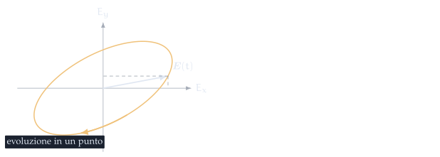

::: approfondimento Misurare la polarizzazione con Stokes
I parametri di Stokes descrivono anche luce parzialmente polarizzata. Si misurano intensità con analizzatori ideali, tutti con la stessa taratura: $I_x,I_y$ lungo gli assi; $I_{45},I_{135}$ lungo direzioni inclinate di $45^\circ$ e $135^\circ$; $I_+,I_-$ nelle due polarizzazioni circolari ortogonali. Le ultime richiedono, per esempio, una lamina a quarto d'onda seguita da un polarizzatore.

$$S_0=I_x+I_y,\qquad S_1=I_x-I_y,$$

$$S_2=I_{45}-I_{135},\qquad S_3=I_+-I_-.$$

Il segno di $S_3$ dipende dalla convenzione circolare. Qui, scrivendo il campo come parte reale di $\boldsymbol{\mathcal E}e^{i(\omega t-kz)}$, gli analizzatori $+$ e $-$ selezionano rispettivamente le basi $(\vers x+i\vers y)/\sqrt2$ e $(\vers x-i\vers y)/\sqrt2$. Questa definizione evita l'ambiguità dei nomi “destra” e “sinistra” legati al verso di osservazione.

Per $S_0>0$, il grado di polarizzazione è

$$P=\frac{\sqrt{S_1^2+S_2^2+S_3^2}}{S_0},\qquad 0\leq P\leq1.$$

$P=1$ descrive luce completamente polarizzata; $P=0$ luce non polarizzata; i valori intermedi indicano polarizzazione parziale. Tutti gli $S_i$ hanno unità di intensità, mentre $P$ è adimensionale.
:::

### Risoluzione: perché l'ingrandimento non crea dettaglio

Un'apertura circolare ideale produce una figura di diffrazione di Airy. Per due sorgenti puntiformi incoerenti di uguale intensità, il criterio di Rayleigh pone la separazione limite quando il massimo centrale di una coincide con il primo minimo dell'altra:

$$\theta_{\mathrm R}\simeq1{,}22\frac{\lambda}{D}.$$

La formula vale per piccoli angoli e osservazione limitata dalla diffrazione. Non è una soglia universale indipendente da rumore, contrasto, aberrazioni e metodo di rivelazione. Aumentare $D$ o diminuire $\lambda$ restringe la figura; l'ingrandimento geometrico da solo non recupera il dettaglio perso.

## Casi di studio e attività sperimentali {#casi}

### Attività sperimentale: Induzione in una bobina

**Obiettivo.**  verificare qualitativamente la dipendenza della forza elettromotrice dalla rapidità di variazione del flusso.

**Materiali o dati.**  bobina, magnete permanente, sensore di tensione o oscilloscopio didattico.

**Procedura.**

1. muovere il magnete con velocità diverse lungo l'asse della bobina;
2. confrontare segno e ampiezza dell'impulso in ingresso e in uscita;
3. ripetere con numero di spire o orientazione differenti;
4. integrare numericamente la tensione nel tempo e confrontare con la variazione di flusso.

**Controllo e discussione.**  separare ampiezza di picco, durata e area dell'impulso; discutere resistenza della bobina e banda del sensore.

**Sicurezza.**  evitare magneti molto potenti vicino a dispositivi medici, carte magnetiche e oggetti ferromagnetici liberi.

### Attività sperimentale: Diffrazione e misura della lunghezza d'onda

**Obiettivo.**  stimare la lunghezza d'onda di un laser mediante fenditura o reticolo.

**Materiali o dati.**  laser didattico a bassa potenza, reticolo con passo noto o fenditura, schermo, metro.

**Procedura.**

1. allineare sorgente, elemento diffrattivo e schermo;
2. misurare distanza $L$ e posizione dei massimi o minimi;
3. ricavare l'angolo senza assumere automaticamente $\sin\theta\simeq\tan\theta$;
4. stimare $\lambda$ e la sua incertezza.

**Controllo e discussione.**  confrontare più ordini e verificare l'influenza della larghezza del fascio e dell'allineamento.

**Sicurezza.**  non dirigere mai il fascio verso occhi, specchi, superfici lucide o finestre; usare soltanto laser didattici conformi alle norme locali.

## Sintesi e autoverifica {#sintesi}

::: metodo Come impostare un problema elettromagnetico
1. definire sorgenti, regione di osservazione, geometria, simmetrie e regime temporale;
2. scegliere fra descrizione mediante forza, campo, potenziale, flusso o circuito;
3. dichiarare se il mezzo è vuoto, lineare, isotropo, dispersivo, assorbente o conduttore;
4. scegliere la forma integrale quando la simmetria controlla flussi e circuitazioni, la forma locale quando serve una relazione punto per punto;
5. controllare orientazioni, versi, segni e condizioni al contorno;
6. per le onde, distinguere ampiezza, fase, intensità, polarizzazione e spettro;
7. per l'ottica, confrontare lunghezza d'onda con dimensioni e variazioni dell'indice prima di usare raggi o diffrazione;
8. nei solidi, esplicitare il modello dei portatori e non confondere parametri efficaci con costanti universali;
9. verificare dimensioni, limiti, conservazione dell'energia e compatibilità con Maxwell.
:::

::: sintesi Autoverifica
1. Perché la legge di Gauss è sempre valida ma non sempre utile per calcolare $\vect E$?
2. Qual è la differenza fra potenziale elettrico ed energia potenziale?
3. Perché il campo è nullo all'interno di un conduttore in equilibrio elettrostatico?
4. Che cosa distingue $\vect D$ da $\varepsilon_0\vect E$?
5. Come esprime la continuità locale la conservazione della carica?
6. Perché la forza magnetica su una particella non compie lavoro?
7. Quale incoerenza viene risolta dalla corrente di spostamento?
8. Come si passa dalle forme integrali alle forme locali di Maxwell?
9. Perché una onda elettromagnetica nel vuoto è trasversa?
10. Che cosa misura il vettore di Poynting?
11. In quale senso il cammino ottico è stazionario?
12. Qual è il dominio di validità dell'equazione dell'eiconale?
13. Che differenza c'è fra interferenza e diffrazione?
14. Come si collega il potere risolutivo alla dimensione dell'apertura?
15. Perché la funzione dielettrica di Drude può avere parte reale negativa?
16. Che cosa corregge Sommerfeld rispetto a Drude?
:::

::: sintesi Sintesi concettuale
Le cariche sono sorgenti del campo elettrico, mentre correnti e campi elettrici variabili generano campo magnetico. Faraday e Ampère–Maxwell mostrano che campi elettrici e magnetici variabili si sostengono reciprocamente e propagano energia e quantità di moto. Le forme integrali di Maxwell collegano flussi e circuitazioni a sorgenti globali; le forme locali descrivono divergenze e rotori punto per punto.

L'ottica geometrica emerge quando la fase varia rapidamente rispetto all'ampiezza: l'eiconale determina i fronti, il principio di Fermat i raggi. L'ottica fisica conserva la fase e rende visibili interferenza, diffrazione, coerenza e polarizzazione. Nei solidi, la risposta macroscopica dipende dalla dinamica e dalla statistica dei portatori: Drude descrive rilassamento e frequenza di plasma, Sommerfeld introduce la superficie di Fermi e corregge le proprietà termiche ed elettroniche.
:::

::: sintesi Verifica breve: campi e trasferimenti di energia
1. Un campo elettrico uniforme punta verso destra. In quale verso agisce la forza su una carica negativa? In quale verso diminuisce il potenziale?
2. Il flusso elettrico totale attraverso una superficie chiusa è nullo. Si può concludere che il campo sia nullo in ogni punto della superficie? Fornire un controesempio.
3. Un condensatore ideale di capacità costante viene portato dalla differenza di potenziale $V$ a $2V$. Come cambiano carica ed energia immagazzinata?
4. Una sbarra conduttrice lunga $0{,}20\un{m}$ si muove a $3{,}0\un{m/s}$ in un campo uniforme di $0{,}50\un{T}$. Sbarra, velocità e campo sono mutuamente perpendicolari. Calcolare il modulo della forza elettromotrice di movimento e indicare quale termine della forza di Lorentz separa le cariche.
:::

::: approfondimento Risposte essenziali: elettromagnetismo
1. La forza punta verso sinistra perché $q<0$; il potenziale diminuisce verso destra perché $\vect E=-\nabla V$. Rivedere *Carica elettrica, forza e campo* e *Potenziale*.
2. No. Un campo uniforme non nullo attraversa un volume con flussi entranti e uscenti che si compensano. Rivedere la legge di Gauss.
3. $Q=CV$ raddoppia, mentre $U=CV^2/2$ quadruplica. Rivedere *Capacità ed energia*.
4. $|\mathcal E|=Blv=0{,}30\un{V}$. La separazione è dovuta al termine $q\vect v\times\vect B$. Rivedere *Magnetismo, forza di Lorentz* e *Induzione ed equazioni di Maxwell*.
:::

## Formulario ragionato {#formulario}

::: legge Elettrostatica
$$\vect F=\frac{1}{4\pi\varepsilon_0}\frac{q_1q_2}{r^2}\vers r,
\quad
\vect E=\frac{\vect F}{q},
\quad
\oiint\vect E\cdot\dd\vect A=\frac{Q_{\mathrm int}}{\varepsilon_0},
\quad
\vect E=-\nabla V.$$

Usare Gauss per il calcolo soltanto quando la simmetria controlla il campo sulla superficie scelta.
:::

::: legge Conduttori e dielettrici
$$C=\frac{Q}{\Delta V},
\quad
U=\frac12CV^2,
\quad
\vect D=\varepsilon_0\vect E+\vect P,
\quad
\nabla\cdot\vect D=\rho_f.$$

Le relazioni $\vect D=\varepsilon\vect E$ e $\vect P=\varepsilon_0\chi_e\vect E$ richiedono un mezzo lineare isotropo.
:::

::: legge Correnti e magnetismo
$$I=\int\vect J\cdot\dd\vect A,
\quad
\partial_t\rho+\nabla\cdot\vect J=0,
\quad
\vect F=q(\vect E+\vect v\times\vect B),
\quad
\dd\vect B=\frac{\mu_0}{4\pi}\frac{I\dd\vect l\times\vers r}{r^2}.$$
:::

::: legge Equazioni di Maxwell nel vuoto
$$\nabla\cdot\vect E=\frac{\rho}{\varepsilon_0},
\quad
\nabla\cdot\vect B=0,
\quad
\nabla\times\vect E=-\partial_t\vect B,
\quad
\nabla\times\vect B=\mu_0\vect J+\mu_0\varepsilon_0\partial_t\vect E.$$

Le corrispondenti forme integrali si ottengono mediante i teoremi di Gauss e Stokes.
:::

::: legge Onde elettromagnetiche
$$\nabla^2\vect E-\frac1{c^2}\partial_t^2\vect E=0,
\quad
B_0=\frac{E_0}{c},
\quad
\vect S=\vect E\times\vect H,
\quad
I=\frac12c\varepsilon_0E_0^2.$$

Nel mezzo non dispersivo $v=1/\sqrt{\mu\varepsilon}$; nei mezzi reali usare parametri dipendenti dalla frequenza.
:::

::: legge Ottica geometrica
$$|\nabla\mathcal S|^2=n^2,
\quad
\delta\int n\dd s=0,
\quad
n_1\sin\theta_1=n_2\sin\theta_2,
\quad
\frac1f=\frac1p+\frac1q.$$

Il limite geometrico richiede $\lambda$ piccola rispetto alle scale del sistema.
:::

::: legge Interferenza e diffrazione
$$I=I_1+I_2+2\sqrt{I_1I_2}\cos\Delta\phi,
\quad
I_{\mathrm fend}=I_0\left(\frac{\sin\beta}{\beta}\right)^2,
\quad
\beta=\frac{\pi a\sin\theta}{\lambda},$$

$$d\sin\theta_m=m\lambda,
\qquad
\theta_{\mathrm Airy}\simeq1{,}22\frac{\lambda}{D}.$$
:::

::: legge Drude e Sommerfeld
$$\sigma_0=\frac{n_ee^2\tau}{m^*},
\quad
\sigma(\omega)=\frac{\sigma_0}{1-i\omega\tau},
\quad
\omega_p=\sqrt{\frac{n_ee^2}{\varepsilon_0m^*}},$$

$$E_F=\frac{\hbar^2}{2m^*}(3\pi^2n_e)^{2/3},
\quad
v_F=\sqrt{\frac{2E_F}{m^*}},
\quad
\ell\sim v_F\tau.$$

Il modello quasi libero non include automaticamente bande, transizioni interbanda o correlazioni forti.
:::

## Glossario {#glossario}

- **Campo**: Grandezza scalare o vettoriale assegnata a ogni punto di una regione dello spazio e, eventualmente, del tempo.
- **Continuità**: Proprietà di una funzione il cui limite in un punto coincide con il valore della funzione nello stesso punto.
- **Campo magnetico**: Campo vettoriale $\vect B$ che entra nella forza di Lorentz e descrive l'azione magnetica su cariche in moto, correnti e dipoli.
- **Corrente di spostamento**: Termine $\partial\vect D/\partial t$ introdotto da Maxwell nella legge di Ampère per rendere compatibili campo magnetico e conservazione della carica.
- **Eiconale**: Funzione di fase spaziale $\mathcal S$ che nel limite geometrico soddisfa $|\nabla\mathcal S|^2=n^2$; i suoi livelli sono fronti d'onda.
- **Equazioni di Maxwell**: Quattro equazioni che collegano sorgenti, divergenze e rotori dei campi elettrico e magnetico. Possono essere scritte in forma integrale o differenziale.
- **Diffrazione**: Redistribuzione del campo dovuta alla propagazione attraverso aperture o attorno a ostacoli di dimensione confrontabile con la lunghezza d'onda.
- **Principio di Fermat**: Principio variazionale secondo cui il cammino ottico della luce è stazionario rispetto a variazioni ammissibili del percorso.
- **Vettore di Poynting**: Vettore $\vect S=\vect E\times\vect H$ che descrive il flusso di energia elettromagnetica.

## Esercizi {#esercizi}

Gli esercizi riprendono quelli della dispensa. Ogni soluzione è nascosta finché non la apri: prova prima a impostare il problema da solo.

### Correnti, forza di Lorentz e magnetostatica

::: esercizio Resistenza e potenza di un filo [medio]
Un filo di rame ha resistività $\varrho=1{,}68\times10^{-8}\un{\Omega\,m}$, lunghezza $20\un{m}$ e sezione $1{,}5\un{mm^2}$. Se è attraversato da $8{,}0\un{A}$, trovare resistenza e potenza Joule.

>>> soluzione
**Resistenza.**  $R=\varrho L/A=(1{,}68\times10^{-8})(20)/(1{,}5\times10^{-6})\simeq0{,}224\un{\Omega}$.

**Potenza.**  $P=I^2R=64(0{,}224)\simeq14{,}3\un{W}$.
:::

::: esercizio Velocità di deriva [base]
Un filo di area $A=1{,}0\un{mm^2}$ porta corrente $I=5{,}0\un{A}$. Assumendo densità elettronica $n_e=8{,}5\times10^{28}\un{m^{-3}}$, stimare il modulo della velocità di deriva.

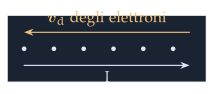
>>> soluzione
**Relazione.**  $I=n_e e A v_d$.

**Calcolo.**  $v_d=5/[8{,}5\times10^{28}(1{,}602\times10^{-19})(10^{-6})]\simeq3{,}67\times10^{-4}\un{m/s}$.
:::

::: esercizio Carica di un circuito RC [base]
Un condensatore $C=10\un{\mu F}$ si carica attraverso $R=100\un{k\Omega}$ con una batteria da $12\un{V}$. Trovare la costante di tempo e la tensione dopo $2{,}0\un{s}$.

>>> soluzione
**Tempo caratteristico.**  $\tau=RC=(10^5)(10^{-5})=1{,}0\un{s}$.

**Carica.**  $V_C(t)=V_0(1-e^{-t/\tau})=12(1-e^{-2})\simeq10{,}4\un{V}$.
:::

::: esercizio Moto circolare in un campo magnetico [medio]
Un protone con velocità $2{,}0\times10^{6}\un{m/s}$ entra perpendicolarmente in un campo $B=0{,}50\un{T}$. Calcolare raggio e periodo dell'orbita non relativistica.

>>> soluzione
**Raggio.**  $r=mv/(qB)=(1{,}673\times10^{-27})(2{,}0\times10^6)/[(1{,}602\times10^{-19})(0{,}50)]\simeq4{,}18\un{cm}$.

**Periodo.**  $T=2\pi m/(qB)\simeq1{,}31\times10^{-7}\un{s}$, indipendente dal modulo di $v$ nel regime non relativistico.
:::

::: esercizio Selettore di velocità [base]
Campi uniformi perpendicolari hanno moduli $E=3{,}0\times10^{4}\un{V/m}$ e $B=0{,}20\un{T}$. Quale velocità attraversa la regione senza deviazione?

>>> soluzione
**Bilancio trasversale.**  $qE=qvB$.

**Velocità.**  $v=E/B=(3{,}0\times10^4)/0{,}20=1{,}5\times10^{5}\un{m/s}$.
:::

::: esercizio Campo di un filo rettilineo [base]
Un filo molto lungo porta corrente $I=12\un{A}$. Trovare il campo a distanza $r=4{,}0\un{cm}$.

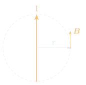
>>> soluzione
**Ampère.**  $B(2\pi r)=\mu_0I$.

**Calcolo.**  $B=\mu_0I/(2\pi r)=4\pi\times10^{-7}(12)/[2\pi(0{,}040)]=60\un{\mu T}$.
:::

::: esercizio Campo di un solenoide [base]
Un solenoide lungo ha $n=1200\un{m^{-1}}$ spire per unità di lunghezza ed è attraversato da $I=0{,}80\un{A}$. Stimare il campo interno nel vuoto.

>>> soluzione
**Modello.**  $B\simeq\mu_0nI$ lontano dalle estremità.

**Calcolo.**  $B=(4\pi\times10^{-7})(1200)(0{,}80)\simeq1{,}21\un{mT}$.
:::

::: esercizio Forza fra fili paralleli [avanzato]
Due fili paralleli distano $d=5{,}0\un{cm}$ e portano correnti concordi $I_1=10\un{A}$, $I_2=6{,}0\un{A}$. Calcolare la forza per unità di lunghezza.

>>> soluzione
**Formula.**  $F/L=\mu_0I_1I_2/(2\pi d)$.

**Calcolo.**  $(F/L)=4\pi\times10^{-7}(60)/[2\pi(0{,}050)]=2{,}4\times10^{-4}\un{N/m}$.

**Verso.**  Correnti concordi si attraggono.
:::

### Induzione e equazioni di Maxwell

::: esercizio Sbarra mobile in un campo magnetico [medio]
Una sbarra conduttrice lunga $L=0{,}40\un{m}$ scorre a $v=3{,}0\un{m/s}$ su guide in un campo uniforme $B=0{,}80\un{T}$ perpendicolare al piano. Calcolare la fem indotta.

>>> soluzione
**Fem di moto.**  $\mathcal E=BLv$ quando $\vect v$, la sbarra e $\vect B$ sono mutuamente perpendicolari.

**Calcolo.**  $\mathcal E=(0{,}80)(0{,}40)(3{,}0)=0{,}96\un{V}$.
:::

::: esercizio Generatore a spira rotante [medio]
Una spira di area $A=0{,}020\un{m^2}$ ruota con $\omega=100\un{rad/s}$ in $B=0{,}50\un{T}$. Per $N=200$ spire, trovare l'ampiezza della fem.

>>> soluzione
**Flusso.**  $\Phi=NBA\cos\omega t$.

**Fem.**  $\mathcal E=NBA\omega\sin\omega t$, quindi $\mathcal E_0=NBA\omega=200(0{,}50)(0{,}020)(100)=200\un{V}$.
:::

::: esercizio Energia in un induttore [base]
Un induttore ideale di induttanza $L=50\un{mH}$ è percorso da $I=4{,}0\un{A}$. Calcolare l'energia magnetica.

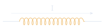
>>> soluzione
**Energia.**  $U_B=\tfrac12LI^2$.

**Calcolo.**  $U_B=0{,}5(0{,}050)(16)=0{,}40\un{J}$.
:::

::: esercizio Transitorio RL [medio]
Un circuito serie ha $R=20\un{\Omega}$, $L=0{,}40\un{H}$ e batteria $V=10\un{V}$. Calcolare la costante di tempo e la corrente dopo $30\un{ms}$ dalla chiusura.

>>> soluzione
**Tempo caratteristico.**  $\tau=L/R=0{,}40/20=20\un{ms}$.

**Corrente.**  $I(t)=(V/R)(1-e^{-t/\tau})=0{,}50(1-e^{-1{,}5})\simeq0{,}388\un{A}$.
:::

::: esercizio Trasformatore ideale [medio]
Un trasformatore ha $N_1=1200$ spire e $N_2=120$. Se $V_1=230\un{V}$ e il secondario eroga $I_2=2{,}0\un{A}$, trovare $V_2$ e $I_1$ nel modello ideale.

>>> soluzione
**Tensioni.**  $V_2/V_1=N_2/N_1=0{,}10$, quindi $V_2=23\un{V}$.

**Potenza ideale.**  $V_1I_1=V_2I_2$, perciò $I_1=(23\cdot2{,}0)/230=0{,}20\un{A}$.
:::

::: esercizio Corrente di spostamento [medio]
Un condensatore piano circolare di raggio $R=5{,}0\un{cm}$ ha campo uniforme che cresce a $\dd E/\dd t=2{,}0\times10^{8}\un{V/(m\,s)}$. Calcolare la corrente di spostamento fra le armature.

>>> soluzione
**Definizione.**  $I_d=\varepsilon_0\dd\Phi_E/\dd t=\varepsilon_0A\dd E/\dd t$.

**Calcolo.**  $A=\pi(0{,}050)^2$, quindi $I_d=(8{,}854\times10^{-12})\pi(0{,}050)^2(2{,}0\times10^8)\simeq13{,}9\un{\mu A}$.
:::

::: esercizio Scarica locale e continuità [medio]
In una piccola regione omogenea la densità di carica decade come $\rho(t)=\rho_0e^{-t/\tau}$. Se non vi sono flussi laterali, quale divergenza deve avere $\vect J$?

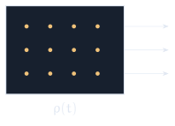
>>> soluzione
**Continuità.**  $\partial_t\rho+\nabla\cdot\vect J=0$.

**Derivata.**  $\partial_t\rho=-\rho/\tau$, dunque $\nabla\cdot\vect J=\rho/\tau>0$: la corrente ha flusso netto uscente dalla regione.
:::

::: esercizio Discontinuità normale di $\vect D$ [medio]
All'interfaccia fra due dielettrici la componente normale è $D_{1n}=2{,}0\un{\mu C/m^2}$ e $D_{2n}=5{,}0\un{\mu C/m^2}$, con normale da 1 verso 2. Trovare la densità di carica libera superficiale.

>>> soluzione
**Condizione al contorno.**  $(\vect D_2-\vect D_1)\cdot\vers n=\sigma_f$.

**Calcolo.**  $\sigma_f=D_{2n}-D_{1n}=3{,}0\un{\mu C/m^2}$.
:::

### Onde, energia e polarizzazione

::: esercizio Lunghezza d'onda radio [base]
Una trasmissione ha frequenza $f=100\un{MHz}$. Calcolare la lunghezza d'onda nel vuoto.

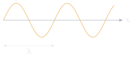
>>> soluzione
**Relazione.**  $\lambda=c/f$.

**Calcolo.**  $\lambda=(2{,}998\times10^8)/(1{,}00\times10^8)\simeq3{,}00\un{m}$.
:::

::: esercizio Campi da una intensità nota [medio]
Una onda piana nel vuoto ha intensità media $I=1{,}0\un{kW/m^2}$. Trovare le ampiezze $E_0$ e $B_0$.

>>> soluzione
**Campo elettrico.**  $E_0=\sqrt{2I/(c\varepsilon_0)}\simeq\sqrt{2000/[2{,}998\times10^8(8{,}854\times10^{-12})]}\simeq868\un{V/m}$.

**Campo magnetico.**  $B_0=E_0/c\simeq2{,}90\un{\mu T}$.
:::

::: esercizio Energia di un impulso [base]
Un fascio uniforme ha intensità $500\un{W/m^2}$, sezione $1{,}0\times10^{-2}\un{m^2}$ e durata $2{,}0\un{ms}$. Calcolare l'energia trasportata.

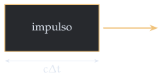
>>> soluzione
**Potenza.**  $P=IA=(500)(0{,}010)=5{,}0\un{W}$.

**Energia.**  $U=P\Delta t=5{,}0(2{,}0\times10^{-3})=1{,}0\times10^{-2}\un{J}$.
:::

::: esercizio Pressione della luce solare [base]
Una superficie perfettamente riflettente riceve normalmente intensità $I=1360\un{W/m^2}$. Stimare la pressione di radiazione.

>>> soluzione
**Riflessione ideale.**  $p_{rad}=2I/c$.

**Calcolo.**  $p=2720/(2{,}998\times10^8)\simeq9{,}07\un{\mu Pa}$.
:::

::: esercizio Legge di Malus [base]
Luce linearmente polarizzata di intensità $I_0=80\un{W/m^2}$ attraversa un analizzatore ruotato di $30^\circ$ rispetto alla polarizzazione. Trovare l'intensità trasmessa.

>>> soluzione
**Malus.**  $I=I_0\cos^2\theta$.

**Calcolo.**  $I=80(\cos30^\circ)^2=80(0{,}75)=60\un{W/m^2}$.
:::

::: esercizio Polarizzazione circolare [avanzato]
Le componenti di un campo sono $E_x=E_c\cos\omega t$ ed $E_y=E_c\sin\omega t$, con $E_c=100\un{V/m}$. Descrivere la polarizzazione e calcolare l'intensità media nel vuoto.

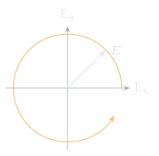
>>> soluzione
**Stato.**  Le componenti hanno uguale ampiezza e sfasamento $\pi/2$: la punta di $\vect E$ descrive un cerchio.

**Intensità.**  Poiché $E^2=E_c^2$ è costante, $I=c\varepsilon_0E_c^2=(2{,}998\times10^8)(8{,}854\times10^{-12})(10^4)\simeq26{,}5\un{W/m^2}$.
:::

::: esercizio Velocità di fase e di gruppo [medio]
Una relazione di dispersione è $\omega=ak^2$ con $a=2{,}0\un{m^2/s}$. Calcolare $v_\phi$ e $v_g$ per $k=4{,}0\un{m^{-1}}$.

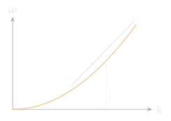
>>> soluzione
**Fase.**  $v_\phi=\omega/k=ak=(2{,}0)(4{,}0)=8{,}0\un{m/s}$.

**Gruppo.**  $v_g=\dd\omega/\dd k=2ak=16\un{m/s}$. Le due velocità differiscono perché il mezzo è dispersivo.
:::

::: esercizio Onda in un dielettrico [avanzato]
Un mezzo non magnetico ha $\varepsilon_r=2{,}25$. Per una luce nel vuoto con $\lambda_0=600\un{nm}$, calcolare indice, velocità e lunghezza d'onda nel mezzo, trascurando dispersione.

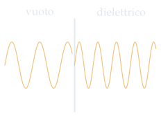
>>> soluzione
**Indice.**  $n\simeq\sqrt{\varepsilon_r}=1{,}50$.

**Velocità.**  $v=c/n\simeq2{,}00\times10^{8}\un{m/s}$.

**Lunghezza d'onda.**  $\lambda=\lambda_0/n=400\un{nm}$; la frequenza non cambia all'interfaccia.
:::

### Eiconale, raggi e ottica fisica

::: esercizio Rifrazione aria–vetro [base]
Un raggio passa dall'aria $(n_1=1{,}00)$ al vetro $(n_2=1{,}50)$ con angolo d'incidenza $40^\circ$. Calcolare l'angolo rifratto.

>>> soluzione
**Snell.**  $n_1\sin\theta_1=n_2\sin\theta_2$.

**Calcolo.**  $\sin\theta_2=(1/1{,}5)\sin40^\circ=0{,}4285$, quindi $\theta_2\simeq25{,}4^\circ$.
:::

::: esercizio Angolo critico per riflessione totale [medio]
Luce in vetro con $n_1=1{,}52$ incontra aria con $n_2=1{,}00$. Calcolare l'angolo critico e stabilire che cosa accade per incidenza di $50^\circ$.

>>> soluzione
**Critico.**  $\sin\theta_c=n_2/n_1=1/1{,}52$, dunque $\theta_c\simeq41{,}1^\circ$.

**Confronto.**  Poiché $50^\circ>\theta_c$, si ha riflessione totale interna; nel secondo mezzo resta un campo evanescente.
:::

::: esercizio Percorso stazionario su uno specchio [medio]
Nel piano $xy$, un punto $A=(-2,1)$ e un punto $B=(3,2)$ sono sopra lo specchio $y=0$. Determinare l'ascissa del punto di riflessione usando il metodo dell'immagine.

>>> soluzione
**Immagine.**  Riflettere $B$ in $B'=(3,-2)$ trasforma il percorso spezzato in una retta.

**Intersezione.**  La retta da $A$ a $B'$ raggiunge $y=0$ a un terzo del percorso verticale: $x=-2+(3-(-2))/3=-1/3$. Il punto è $(-0{,}333,0)$ e soddisfa $\theta_i=\theta_r$.
:::

::: esercizio Lente sottile convergente [medio]
Una lente convergente ha $f=20\un{cm}$. Un oggetto è posto a $p=60\un{cm}$. Trovare posizione e ingrandimento dell'immagine.

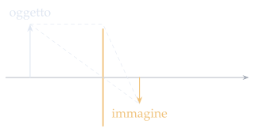
>>> soluzione
**Equazione.**  $1/q=1/f-1/p=1/20-1/60=1/30$, quindi $q=30\un{cm}$.

**Ingrandimento.**  $m=-q/p=-0{,}50$: immagine reale, capovolta e dimezzata.
:::

::: esercizio Interferenza da doppia fenditura [base]
Due fenditure distano $d=0{,}50\un{mm}$ e sono illuminate con $\lambda=600\un{nm}$. Su uno schermo a $L=2{,}0\un{m}$, stimare la distanza fra massimi vicini.

>>> soluzione
**Piccoli angoli.**  $\Delta y=\lambda L/d$.

**Calcolo.**  $\Delta y=(600\times10^{-9})(2{,}0)/(0{,}50\times10^{-3})=2{,}4\un{mm}$.
:::

::: esercizio Larghezza di una fenditura [base]
Il primo minimo di diffrazione per luce $\lambda=500\un{nm}$ compare a $\theta=0{,}50^\circ$. Calcolare la larghezza della fenditura.

>>> soluzione
**Primo minimo.**  $a\sin\theta=\lambda$.

**Calcolo.**  $a=500\times10^{-9}/\sin0{,}50^\circ\simeq57{,}3\un{\mu m}$.
:::

::: esercizio Reticolo e ordine di diffrazione [avanzato]
Un reticolo ha 600 linee per millimetro ed è illuminato con $\lambda=500\un{nm}$. Calcolare l'angolo del primo ordine e il massimo ordine possibile.

>>> soluzione
**Passo.**  $d=1/(600\,\mathrm{mm^{-1}})=1{,}667\un{\mu m}$.

**Primo ordine.**  $\sin\theta_1=\lambda/d=0{,}300$, quindi $\theta_1\simeq17{,}5^\circ$.

**Ordine massimo.**  $m\le d/\lambda=3{,}33$, dunque $m_{max}=3$.
:::

::: esercizio Limite di risoluzione di un telescopio [base]
Un telescopio ha apertura $D=0{,}20\un{m}$ e osserva a $\lambda=550\un{nm}$. Stimare la separazione angolare di Rayleigh.

>>> soluzione
**Rayleigh.**  $\theta_R=1{,}22\lambda/D$.

**Calcolo.**  $\theta_R=1{,}22(550\times10^{-9})/0{,}20=3{,}36\times10^{-6}\un{rad}$, circa $0{,}69$ secondi d'arco.
:::

### Problemi di sintesi: elettromagnetismo e ottica

::: esercizio Forza magnetica su una particella [avanzato]
Una particella con carica elementare si muove a $3{,}0\times10^{6}\un{m/s}$ in un campo $0{,}2\un{T}$, formando $40^\circ$. Calcolare il modulo della forza magnetica.
>>> soluzione
**Lorentz.**

$$F=|q|vB\sin\theta=6{,}17\times10^{-14}\un{N}.$$

La forza è perpendicolare sia a $\vect v$ sia a $\vect B$ e non compie lavoro.
:::

::: esercizio Frequenza ciclotronica del protone [avanzato]
Calcolare la frequenza ciclotronica non relativistica di un protone in un campo $0{,}5\un{T}$.
>>> soluzione
**Pulsazione.**  $\omega_c=qB/m$.

**Frequenza.**  $f_c=qB/(2\pi m)=7{,}62\times10^{6}\un{Hz}=7{,}62\un{MHz}$.
:::

::: esercizio Campo magnetico attorno a un cavo [avanzato]
Un filo lungo porta corrente $15\un{A}$. Calcolare il campo magnetico a $0{,}08\un{m}$.
>>> soluzione
**Ampère.**

$$B=\frac{\mu_0I}{2\pi r}=3{,}75\times10^{-5}\un{T}=37{,}5\un{\mu T}.$$
:::

::: esercizio Fem indotta in una bobina [avanzato]
Una bobina di $N=200$ spire e area $0{,}01\un{m^2}$ è perpendicolare a un campo che varia di $0{,}3\un{T}$ in $0{,}05\un{s}$. Calcolare il modulo della fem media.
>>> soluzione
**Faraday.**

$$|\mathcal E|=N\frac{A|\Delta B|}{\Delta t}=12{,}0\un{V}.$$

Il verso è dato dalla legge di Lenz.
:::

::: esercizio Crescita della corrente in un RL [avanzato]
Un circuito RL ha $L=0{,}8\un{H}$ e $R=20\un{\Omega}$. Calcolare la costante di tempo e il tempo per raggiungere il 90% della corrente finale.
>>> soluzione
**Costante.**  $\tau=L/R=0{,}0400\un{s}$.

**90%.**  $1-e^{-t/\tau}=0{,}90$, quindi $t=-\tau\ln0{,}10=0{,}0921\un{s}$.
:::

::: esercizio Risonanza RLC [avanzato]
Un circuito RLC serie ha $L=0{,}05\un{H}$ e $C=2\times10^{-6}\un{F}$. Calcolare la frequenza di risonanza ideale.
>>> soluzione
**Risonanza.**

$$f_0=\frac1{2\pi\sqrt{LC}}=503\un{Hz}.$$
:::

::: esercizio Intensità di un'onda elettromagnetica [avanzato]
Un'onda piana nel vuoto ha ampiezza del campo elettrico $120\un{V/m}$. Calcolare il campo magnetico massimo e l'intensità media.
>>> soluzione
**Campi.**  $B_0=E_0/c=4{,}00\times10^{-7}\un{T}$.

**Poynting.**  $\langle S\rangle=\tfrac12c\varepsilon_0E_0^2=19{,}1\un{W/m^2}$.
:::

::: esercizio Immagine con lente convergente [avanzato]
Una lente sottile convergente ha focale $0{,}2\un{m}$. Un oggetto è posto a $0{,}6\un{m}$. Calcolare distanza dell'immagine e ingrandimento.
>>> soluzione
**Lente.**  $1/f=1/d_o+1/d_i$, quindi $d_i=0{,}300\un{m}$.

**Ingrandimento.**  $m=-d_i/d_o=-0{,}500$: immagine reale, capovolta e ridotta.
:::

::: esercizio Interferenza e diffrazione su uno schermo [avanzato]
Luce di $600\un{nm}$ attraversa due fenditure separate di $0{,}50\un{mm}$; lo schermo è a $2{,}0\un{m}$. Calcolare la distanza fra frange. Se ciascuna fenditura è larga $0{,}10\un{mm}$, calcolare la posizione del primo minimo dell'inviluppo.
>>> soluzione
**Frange.**  $\Delta y=\lambda L/d=0{,}00240\un{m}=2{,}40\un{mm}$.

**Inviluppo.**  $y_1\simeq\lambda L/a=0{,}0120\un{m}=12{,}0\un{mm}$.
:::

## Fonti {#fonti}

Il testo, le formule, i diagrammi e gli esercizi di questo capitolo provengono dalla *Dispensa di fisica* del corso (sezioni 7.5-7.9 e materiali delle sezioni 7.11, 7.12, 7.13), consultabile nel lettore della galassia. Per la lettura sul sito sono cambiati l'impaginazione, i colori delle figure, la numerazione e la posizione di alcuni riquadri ed esercizi; la sezione iniziale è scritta per il pianeta di questa unità.
