## Prima di cominciare {#apertura}

Due sorgenti emettono luce di colore diverso. A parità di numero di fotoni le energie totali differiscono, perché ogni fotone trasporta un'energia proporzionale alla frequenza. Per confrontare le sorgenti bisogna distinguere l'energia del singolo fotone dall'intensità complessiva del fascio.

Il capitolo ripercorre la crisi della fisica classica e la nascita dei quanti, l'atomo di Bohr e le onde di materia, la funzione d'onda e l'equazione di Schrödinger, particelle libere, gradini e barriere, confinamento e oscillatore armonico, momento angolare e atomi, molecole e solidi, e infine relatività ristretta e fisica nucleare. È il capitolo più lungo del volume e conviene leggerlo a tappe. Il capitolo presuppone le [onde elettromagnetiche](unit:physics-24).

## La crisi della fisica classica e la nascita dei quanti {#s-8-1}

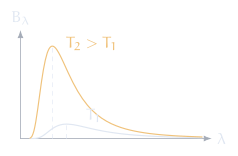

Alla fine del XIX secolo la meccanica newtoniana, la termodinamica e l'elettromagnetismo di Maxwell formavano una costruzione teorica di straordinaria efficacia. Non si trattava però di una teoria conclusa. Alcuni problemi non erano semplici dettagli sperimentali: mettevano in discussione il modo classico di descrivere energia, radiazione e materia.

Fra i segnali principali vi erano lo spettro della radiazione termica, la dipendenza dell'effetto fotoelettrico dalla frequenza, gli spettri a righe degli atomi, la stabilità degli atomi e, poco dopo, la diffusione Compton dei raggi X. La risposta non fu una singola idea improvvisa, ma una trasformazione durata decenni, nella quale concetti classici furono prima corretti, poi riorganizzati in una nuova struttura matematica.

::: storia Dal 1900 al 1927: una cronologia essenziale
Nel 1900 Planck introdusse elementi di energia discreti per riprodurre lo spettro del corpo nero  [1](#fonti). Nel 1905 Einstein interpretò la radiazione come composta, in certi processi, da quanti di energia $h\nu$ e spiegò l'effetto fotoelettrico  [2](#fonti). Rutherford mise in evidenza il nucleo atomico; Bohr propose nel 1913 orbite stazionarie quantizzate per l'idrogeno  [3](#fonti). Nel 1923 Compton osservò un cambiamento di lunghezza d'onda interpretabile come urto fra fotone ed elettrone  [4](#fonti). De Broglie estese la dualità alla materia, associando $\lambda=h/p$ alle particelle  [5](#fonti). Nel 1925 Heisenberg costruì la meccanica delle matrici e Pauli formulò il principio di esclusione. Nel 1926 Schrödinger formulò la meccanica ondulatoria  [6](#fonti) e Born propose l'interpretazione probabilistica  [7](#fonti). Nel 1927 Davisson e Germer osservarono la diffrazione elettronica  [8](#fonti), mentre Heisenberg formulò le relazioni di indeterminazione  [9](#fonti).
:::

::: nota Rivoluzione non significa cancellazione
La meccanica quantistica non rende falsa la meccanica classica nel suo dominio. Per azioni molto maggiori di $\hbar$, pacchetti localizzati e interazioni con molti gradi di libertà, le previsioni quantistiche tendono a quelle classiche. Una nuova teoria deve riprodurre i risultati affidabili della precedente nei limiti appropriati: questo requisito è il principio di corrispondenza.
:::

### Radiazione termica e corpo nero

Un **corpo nero** ideale assorbe tutta la radiazione incidente e, in equilibrio termico, emette uno spettro che dipende soltanto dalla temperatura. Una cavità con un piccolo foro realizza una buona approssimazione: la radiazione che entra subisce molte riflessioni e ha bassa probabilità di uscire senza essere assorbita.

La teoria classica dei modi elettromagnetici della cavità, combinata con l'equipartizione, conduce alla legge di Rayleigh–Jeans

$$u_\nu^{\mathrm{RJ}}(T)=\frac{8\pi\nu^2}{c^3}k_{\mathrm B}T,$$

che cresce senza limite alle alte frequenze. L'integrale su tutte le frequenze diverge: è la cosiddetta *catastrofe ultravioletta*. Il problema non è un valore numerico sbagliato, ma l'uso dell'equipartizione classica per ogni modo del campo.

Planck ottenne lo spettro corretto assumendo che gli scambi energetici degli oscillatori materiali avvenissero in multipli di $h\nu$. La densità spettrale di energia per unità di frequenza è

::: legge Legge di Planck
$$u_\nu(T)=\frac{8\pi h\nu^3}{c^3}\frac{1}{e^{h\nu/(k_{\mathrm B}T)}-1}.$$

La corrispondente radianza spettrale per unità di lunghezza d'onda è

$$B_\lambda(T)=\frac{2hc^2}{\lambda^5}\frac{1}{e^{hc/(\lambda k_{\mathrm B}T)}-1}.$$
:::

Densità di energia e radianza sono legate, per radiazione isotropa in equilibrio, da $u_\nu=4\pi B_\nu/c$ e $u_\lambda=4\pi B_\lambda/c$. Il passaggio fra descrizioni per unità di frequenza e per unità di lunghezza d'onda richiede inoltre il Jacobiano:

$$u_\nu\,|\dd\nu|=u_\lambda\,|\dd\lambda|,
\qquad
B_\nu\,|\dd\nu|=B_\lambda\,|\dd\lambda|.$$

Non basta quindi sostituire formalmente $\nu=c/\lambda$ nella formula.

Dalla legge di Planck seguono due risultati macroscopici:

::: legge Leggi di Wien e Stefan–Boltzmann
$$\lambda_{\max}T=b,\qquad b\simeq2{,}898\times10^{-3}\un{m\,K},$$

$$j^\star=\sigma T^4,
\qquad \sigma\simeq5{,}670374419\times10^{-8}\un{W/(m^2\,K^4)}.$$
:::

La prima localizza il massimo di $B_\lambda$; la seconda fornisce la potenza emessa per unità di area da una superficie nera.

::: errore Massimo in frequenza e massimo in lunghezza d'onda
Il massimo di $B_\nu$ e quello di $B_\lambda$ non rappresentano lo stesso insieme di fotoni espresso con due etichette diverse. Le densità sono riferite a intervalli differenti; perciò $\lambda_{\max}$ non è uguale a $c/\nu_{\max}$.
:::

### Effetto fotoelettrico: energia discreta della radiazione

Quando una superficie viene illuminata, può emettere elettroni. Gli aspetti decisivi sono tre: esiste una frequenza di soglia; l'energia cinetica massima cresce con la frequenza; aumentando l'intensità, a frequenza fissata sopra soglia, cresce soprattutto il numero di elettroni emessi, non la loro energia massima.

Einstein interpretò l'interazione come assorbimento di un quanto di energia $E_\gamma=h\nu$. Una parte dell'energia serve a vincere il lavoro di estrazione $\Phi$; il resto diventa energia cinetica:

::: legge Equazione fotoelettrica di Einstein
$$K_{\max}=h\nu-\Phi=eV_s,
\qquad \nu_0=\frac{\Phi}{h}.$$
:::

### Effetto Compton: quantità di moto del fotone

Nella diffusione di raggi X su elettroni quasi liberi, la radiazione diffusa presenta una lunghezza d'onda maggiore di quella incidente. Trattando l'evento come un urto relativistico fra un fotone con

$$E_\gamma=h\nu=\frac{hc}{\lambda},\qquad p_\gamma=\frac{E_\gamma}{c}=\frac{h}{\lambda}$$

e un elettrone inizialmente fermo, la conservazione di energia e quantità di moto conduce a

::: legge Spostamento Compton
$$\Delta\lambda=\lambda'-\lambda=\frac{h}{m_ec}(1-\cos\theta)
=\lambda_C(1-\cos\theta),$$

$$\lambda_C=\frac{h}{m_ec}\simeq2{,}426\un{pm}.$$
:::

L'effetto mostra che il fotone trasporta quantità di moto. Il trattamento completo è relativistico; la formula non si ricava dalla sola meccanica newtoniana.

## Dall'atomo di Bohr alle onde di materia {#s-8-2}

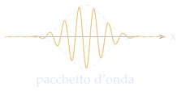

### Spettri atomici e quantizzazione empirica

Gli atomi isolati emettono e assorbono frequenze discrete. Per l'idrogeno reale, le righe osservate possono essere organizzate dalla formula di Rydberg

$$\frac{1}{\lambda}=R_H\left(\frac{1}{n_1^2}-\frac{1}{n_2^2}\right),
\qquad n_2>n_1,$$

dove $R_H=R_\infty\mu/m_e$ include la correzione dovuta alla massa finita del protone; $R_\infty$ è il valore nel limite di nucleo infinitamente pesante.
Il modello planetario classico è instabile: una carica accelerata irradia, perde energia e dovrebbe precipitare verso il nucleo. Bohr impose orbite stazionarie con momento angolare $L=n\hbar$ e transizioni radiative fra energie discrete. Per l'idrogeno ottenne

$$E_n=-\frac{13{,}6\ \mathrm{eV}}{n^2},$$

spiegando la formula di Rydberg. Il modello fu storicamente decisivo ma non è la teoria moderna: non descrive correttamente atomi generali, intensità delle righe o natura tridimensionale degli stati.

::: storia Un modello di transizione
Il modello di Bohr mescolava dinamica classica e regole quantistiche aggiunte. La sua efficacia per l'idrogeno indicava che la quantizzazione era reale, ma anche che serviva un principio più generale dal quale le energie discrete emergessero senza imporre orbite privilegiate.
:::

### Relazioni di de Broglie

De Broglie propose di associare a una particella di quantità di moto $p$ una lunghezza d'onda

::: legge Relazioni onda-particella
$$\lambda=\frac{h}{p},\qquad k=\frac{p}{\hbar},\qquad \omega=\frac{E}{\hbar}.$$
:::

### Onde piane, pacchetti e velocità di gruppo

### Indeterminazione come proprietà delle trasformate

Una funzione molto localizzata richiede molte componenti di Fourier. Poiché $p=\hbar k$, la larghezza spaziale e quella in quantità di moto soddisfano

::: legge Relazione di indeterminazione posizione–quantità di moto
$$\Delta x\,\Delta p_x\geq\frac{\hbar}{2}.$$
:::

Non si tratta soltanto di un disturbo strumentale: è una proprietà degli stati quantistici. Uno stato gaussiano può raggiungere l'uguaglianza. Relazioni analoghe valgono per coppie di osservabili non compatibili.

::: approfondimento Calcolo: Il caso gaussiano, calcolato
Per un pacchetto $\psi(x)\propto e^{-x^2/(4\sigma^2)}$, la densità $|\psi|^2\propto e^{-x^2/(2\sigma^2)}$ ha scarto quadratico $\Delta x=\sigma$. La trasformata di Fourier di una gaussiana è una gaussiana,

$$\widetilde\psi(k)\propto\int e^{-x^2/(4\sigma^2)}\,e^{-ikx}\,\dd x\propto e^{-\sigma^2k^2},$$

quindi $|\widetilde\psi|^2\propto e^{-2\sigma^2k^2}$ ha scarto $\Delta k=1/(2\sigma)$. Il prodotto è

$$\Delta x\,\Delta k=\frac12
\quad\Longrightarrow\quad
\Delta x\,\Delta p=\frac{\hbar}{2}.$$

Stringere la gaussiana nello spazio la allarga in proporzione esattamente inversa nelle componenti: le due larghezze non sono indipendenti, sono la stessa informazione guardata da due basi. Ogni altra forma d'onda fa peggio della gaussiana, e la disuguaglianza generale segue dalle proprietà delle trasformate.
:::

La relazione energia–tempo richiede più cautela, perché nella meccanica quantistica ordinaria il tempo è un parametro e non un operatore come la posizione. Formule del tipo $\Delta E\,\Delta t\gtrsim\hbar/2$ dipendono dal significato operativo attribuito a $\Delta t$, per esempio durata di un processo o tempo di evoluzione apprezzabile.

## La funzione d'onda e l'equazione di Schrödinger {#s-8-3}

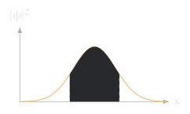

### Una e due fenditure: dalle onde luminose alle ampiezze di probabilità

Nel [capitolo «Induzione elettromagnetica»](unit:physics-24), nella sezione dedicata a interferenza, coerenza e diffrazione, la luce che attraversa una singola fenditura di larghezza $a$ produce la figura di diffrazione $I(\theta)=I(0)(\sin\beta/\beta)^2$, mentre due fenditure distanti $d$ producono frange con massimi in $d\sin\theta=m\lambda$, modulate dall'inviluppo della singola fenditura. Quei risultati furono ottenuti sommando le *ampiezze* del campo con le loro fasi e calcolando poi l'intensità come modulo quadrato della somma.

Lo stesso esperimento può essere eseguito con elettroni, inviati anche uno alla volta. Ogni elettrone produce sullo schermo un singolo punto localizzato: nessuna frazione di elettrone viene mai rivelata. Accumulando molti punti, la distribuzione statistica riproduce però la stessa figura di frange dell'ottica, con la lunghezza d'onda di de Broglie $\lambda=h/p$ al posto di quella luminosa. La figura non nasce da un'interazione fra elettroni diversi: emerge anche quando nel dispositivo è presente al più una particella per volta.


Gli ordini di grandezza spiegano perché l'esperimento sia arrivato così tardi. Per elettroni accelerati da $600\un{V}$ la lunghezza d'onda di de Broglie è di circa $50\un{pm}$; con fenditure separate di un micrometro e schermo a un metro, l'interfrangia $\lambda D/d$ vale circa $50\un{\mu m}$: frange invisibili a occhio nudo, ottenute con fenditure larghe frazioni di micrometro e osservate con ingrandimenti elettronici. Nel modello scalare dell'interferenza la struttura matematica è la stessa discussa nel [capitolo «Induzione elettromagnetica»](unit:physics-24), mentre cambia la scala fissata da $\lambda=h/p$; il significato fisico dell'ampiezza quantistica resta però diverso da quello del campo elettromagnetico.

::: storia L'esperimento “più bello” della fisica
La diffrazione elettronica su cristalli era nota dal 1927, ma la doppia fenditura vera e propria con elettroni fu realizzata da Claus Jönsson nel 1961 mediante fenditure ricavate in un film metallico  [10](#fonti). Nel 1976 Merli, Missiroli e Pozzi, con un biprisma elettronico, registrarono la formazione della figura punto per punto con elettroni singoli  [11](#fonti); un esperimento analogo fu pubblicato da Tonomura e collaboratori nel 1989  [12](#fonti). In un sondaggio fra i lettori di *Physics World* del 2002, l'interferenza di elettroni singoli fu votata come il più bell'esperimento della fisica. Feynman ne fece il punto di partenza della propria esposizione della meccanica quantistica, osservando che contiene “il solo mistero” della teoria  [13](#fonti).
:::

La lettura quantitativa usa il linguaggio del capitolo. A ciascun cammino verso il punto $x$ dello schermo è associata un'ampiezza complessa, $\psi_1(x)$ e $\psi_2(x)$. Quando il dispositivo non distingue da quale fenditura l'elettrone sia passato, le ampiezze si sommano prima di calcolare la probabilità:

::: legge Regola delle ampiezze alla doppia fenditura
$$P(x)\propto|\psi_1(x)+\psi_2(x)|^2
=|\psi_1|^2+|\psi_2|^2+2\operatorname{Re}\!\left[\psi_1^*\psi_2\right].$$
:::

Il termine incrociato, controllato dalla differenza di fase fra le due ampiezze, produce le frange. Una statistica di particelle classiche fornirebbe soltanto $|\psi_1|^2+|\psi_2|^2$: due macchie senza oscillazioni. Per la singola fenditura la logica è identica: l'ampiezza totale è l'integrale dei contributi dei punti dell'apertura, la stessa matematica di Huygens–Fresnel del [capitolo «Induzione elettromagnetica»](unit:physics-24) con l'ampiezza di probabilità al posto del campo elettrico.

Se invece un apparato determina la fenditura attraversata, i due esiti diventano alternative distinguibili: si sommano le *probabilità*, non le ampiezze, e il termine di interferenza scompare. Non serve un osservatore cosciente: è sufficiente che l'informazione sul cammino resti registrata in un qualunque grado di libertà. Questo comportamento sarà ripreso più avanti parlando di decoerenza.

::: errore L'elettrone non passa “mezzo di qua e mezzo di là”
La somma riguarda le ampiezze, non la particella. Ogni rivelazione è intera e localizzata; la figura di interferenza è una proprietà statistica dell'insieme delle rivelazioni. Chiedere “da quale fenditura è passato davvero” presuppone una traiettoria definita che il formalismo non assegna: se l'esperimento rende la domanda rispondibile, le frange spariscono.
:::

### Stato, ampiezza e probabilità

Nella formulazione ondulatoria, lo stato puro di una particella non relativistica senza spin è rappresentato da una funzione complessa $\psi(\vect r,t)$. La regola di Born associa al modulo quadrato una densità di probabilità:

::: legge Interpretazione di Born e normalizzazione
$$\rho(\vect r,t)=|\psi(\vect r,t)|^2,
\qquad
\int_{\mathbb R^3}|\psi|^2\,\dd^3r=1.$$

La probabilità di trovare la particella in $V$ è

$$P(V,t)=\int_V|\psi(\vect r,t)|^2\,\dd^3r.$$
:::

### Evoluzione temporale

Per una particella di massa $m$ in un potenziale reale $V(\vect r,t)$, l'equazione di Schrödinger dipendente dal tempo è

::: legge Equazione di Schrödinger dipendente dal tempo
$$i\hbar\frac{\partial\psi}{\partial t}
=\widehat H\psi,
\qquad
\widehat H=-\frac{\hbar^2}{2m}\nabla^2+V(\vect r,t).$$
:::

È lineare e del primo ordine nel tempo: assegnata $\psi$ a un istante, l'evoluzione è determinata. Il carattere probabilistico riguarda gli esiti delle misure, non una casualità inserita nell'equazione di evoluzione di un sistema isolato.

::: nota Dominio di validità
L'equazione di Schrödinger è non relativistica e conserva il numero di particelle. È adatta quando le velocità sono molto minori di $c$ e non avvengono creazione o annichilazione. Spin, relatività e fotoni richiedono estensioni: equazioni di Pauli e Dirac o, in generale, teoria quantistica dei campi. Nei processi elementari i fotoni sono trattati come quanti della radiazione, senza attribuire loro una funzione d'onda scalare di Schrödinger.
:::

### Stati stazionari

Se $V$ non dipende dal tempo, si cercano soluzioni separabili

$$\psi(\vect r,t)=\phi(\vect r)e^{-iEt/\hbar}.$$

La parte spaziale soddisfa

::: legge Equazione di Schrödinger stazionaria
$$\widehat H\phi=E\phi,
\qquad
-\frac{\hbar^2}{2m}\nabla^2\phi+V\phi=E\phi.$$
:::

### Osservabili, operatori e valori medi

### Conservazione della probabilità

Dall'equazione di Schrödinger e dalla sua complessa coniugata si ricava

::: legge Equazione di continuità quantistica
$$\frac{\partial\rho}{\partial t}+\nabla\cdot\vect j=0,
\qquad
\vect j=\frac{\hbar}{m}\operatorname{Im}(\psi^*\nabla\psi).$$
:::

La struttura è analoga alla continuità di massa o carica: la probabilità non scompare, ma fluisce attraverso le superfici.

::: approfondimento Calcolo: La derivazione in tre righe
Con $\rho=\psi^*\psi$ e l'equazione $i\hbar\,\partial_t\psi=-\tfrac{\hbar^2}{2m}\partial_x^2\psi+V\psi$ in una dimensione, con $V$ reale,

$$\partial_t\rho=\psi^*\partial_t\psi+\psi\,\partial_t\psi^*
=\frac{i\hbar}{2m}\left(\psi^*\partial_x^2\psi-\psi\,\partial_x^2\psi^*\right),$$

perché i termini con $V$ si cancellano esattamente. La parentesi è una derivata totale,

$$\psi^*\partial_x^2\psi-\psi\,\partial_x^2\psi^*
=\partial_x\!\left(\psi^*\partial_x\psi-\psi\,\partial_x\psi^*\right),$$

e raccogliendo si ottiene $\partial_t\rho+\partial_x j=0$ con $j=(\hbar/m)\operatorname{Im}(\psi^*\partial_x\psi)$. La cancellazione dei termini di potenziale è il punto della dimostrazione: la probabilità si conserva perché $V$ è reale, cioè perché l'hamiltoniana è autoaggiunta.
:::

### Misura e sovrapposizione

### La notazione di Dirac

Le regole appena viste non dipendono dalla scelta di descrivere lo stato con una funzione della posizione. Dirac introdusse una notazione che rende esplicita questa indipendenza  [14](#fonti). Uno stato è un vettore $\ket\psi$, detto **ket**, in uno spazio vettoriale complesso dotato di prodotto scalare, lo spazio di Hilbert del sistema. A ogni ket corrisponde un **bra** $\bra\phi$; la scrittura accoppiata

$$\braket{\phi}{\psi}$$

è il prodotto scalare, lineare nel secondo argomento, con $\braket{\phi}{\psi}=\braket{\psi}{\phi}^*$. La normalizzazione si scrive $\braket{\psi}{\psi}=1$.

La funzione d'onda è la rappresentazione dello stato nella base della posizione:

$$\psi(x)=\braket{x}{\psi}.$$

Analogamente, i coefficienti dello sviluppo in una base ortonormale $\{\phi_n\}$ sono $c_n=\braket{\phi_n}{\psi}$ e il valore medio di un'osservabile si scrive

$$\langle A\rangle=\bra\psi\widehat A\ket\psi,$$

che nella rappresentazione di posizione riproduce l'integrale $\int\psi^*\widehat A\psi\,\dd x$ già usato. Il vantaggio non è tipografico: la stessa relazione vale in qualunque base, di posizione, di quantità di moto o di energia, e anche per gradi di libertà interni, come lo spin, che richiedono funzioni d'onda a più componenti e non sono descritti da una funzione scalare della sola posizione.

::: approfondimento Calcolo: Il valor medio segue dalla regola di Born
Sviluppando $\ket\psi=\sum_n c_n\ket{\phi_n}$ sulla base degli autostati di $\widehat A$, con $\widehat A\ket{\phi_n}=a_n\ket{\phi_n}$ e $\braket{\phi_m}{\phi_n}=\delta_{mn}$,

$$\bra\psi\widehat A\ket\psi
=\sum_{m,n}c_m^*c_n\,a_n\braket{\phi_m}{\phi_n}
=\sum_n a_n\,|c_n|^2.$$

Assunta la regola di Born, il valor medio è la media degli autovalori pesata con $P(a_n)=|c_n|^2$, e la formula operatoriale segue immediatamente. Le due formulazioni sono coerenti, ma questo calcolo non costituisce da solo una derivazione inversa della regola di Born, che richiede ipotesi ulteriori sulla struttura delle probabilità. La stessa espansione con $\widehat A=\mathbb1$ dà $\sum_n|c_n|^2=1$: la normalizzazione dello stato è la certezza di ottenere qualche esito.
:::

### I postulati della meccanica quantistica

Gli ingredienti incontrati finora possono essere organizzati in un elenco esplicito di postulati. Questa è la struttura assiomatica minima della teoria, consolidata fra il libro di Dirac e la sistemazione matematica di von Neumann  [14, 15](#fonti).

::: legge I postulati della meccanica quantistica
1. **Stato.** A ogni sistema è associato uno spazio di Hilbert $\mathcal H$. Uno stato puro è rappresentato da un vettore normalizzato $\ket\psi\in\mathcal H$, definito a meno di una fase globale.
2. **Osservabili.** Ogni grandezza misurabile è rappresentata da un operatore autoaggiunto $\widehat A$ su $\mathcal H$. Gli esiti possibili di una misura sono gli autovalori di $\widehat A$.
3. **Probabilità (regola di Born).** Se $\widehat A\ket{\phi_n}=a_n\ket{\phi_n}$ con spettro discreto non degenere, la probabilità di ottenere $a_n$ nello stato $\ket\psi$ è $\displaystyle P(a_n)=\left|\braket{\phi_n}{\psi}\right|^2.$
4. **Stato dopo la misura.** In una misura ideale selettiva con esito $a_n$, lo stato immediatamente successivo è la proiezione normalizzata di $\ket\psi$ sull'autospazio di $a_n$.
5. **Evoluzione temporale.** Fra le misure, lo stato evolve in modo deterministico e lineare secondo l'equazione di Schrödinger $\displaystyle i\hbar\frac{\dd}{\dd t}\ket{\psi(t)}=\widehat H\ket{\psi(t)}.$
6. **Sistemi composti.** Lo spazio degli stati di due sottosistemi è il prodotto tensoriale $\mathcal H_A\otimes\mathcal H_B$. Per particelle identiche gli stati fisici sono simmetrici per scambio (bosoni) oppure antisimmetrici (fermioni).
:::

Per autovalori degeneri la regola di Born somma i contributi di una base ortonormale dell'autospazio; per spettri continui, come la posizione, fornisce densità di probabilità, ed è la lettura già data di $|\psi(x)|^2$. Il sesto postulato conduce al principio di Pauli e all'entanglement nei sistemi composti.

I postulati rendono precisa anche la regola usata per la doppia fenditura: finché le alternative sono indistinguibili appartengono allo stesso vettore di stato e le loro ampiezze si sommano (postulato 1 e linearità dell'evoluzione); quando un apparato le distingue, la composizione con l'apparato (postulato 6) e la regola di Born trasferiscono la somma sulle probabilità.

::: nota Che cosa dicono e che cosa non dicono i postulati
L'elenco è un nucleo operativo: dato uno stato preparato, prescrive le distribuzioni degli esiti di qualunque misura. Non spiega da solo perché una singola misura abbia un esito determinato né dove finisca l'apparato e cominci il sistema: il quarto postulato descrive un aggiornamento idealizzato, la cui relazione con l'evoluzione unitaria e con la decoerenza è discussa nella sezione dedicata ai sistemi aperti. La meccanica ondulatoria usata in queste pagine è la rappresentazione di posizione dei postulati, non una teoria diversa.
:::

## Particelle libere, gradini e barriere {#s-8-4}


### L'analogia ottico-meccanica: un parallelo strutturale con l'ottica

I modelli unidimensionali di questa sezione e della successiva non sono esercizi isolati: nel regime scalare, stazionario e lineare ammettono un parallelo preciso con fenomeni ottici del [capitolo «Induzione elettromagnetica»](unit:physics-24). La ragione è strutturale. L'equazione di Schrödinger stazionaria può essere riscritta come

::: legge Schrödinger stazionaria come equazione di Helmholtz
$$\nabla^2\phi+k^2(\vect r)\,\phi=0,
\qquad
k(\vect r)=\frac{p(\vect r)}{\hbar}=\frac{\sqrt{2m\left[E-V(\vect r)\right]}}{\hbar},$$

la stessa forma dell'equazione di Helmholtz $\nabla^2\psi+k_0^2n^2(\vect r)\psi=0$ dell'ottica, con la corrispondenza $k_0n(\vect r)\leftrightarrow p(\vect r)/\hbar$.
:::

Nel dizionario matematico appena introdotto, la quantità $\sqrt{E-V}$ svolge un ruolo analogo a quello dell'indice di rifrazione: una regione a potenziale più basso corrisponde a un “mezzo più denso”, dove la lunghezza d'onda di de Broglie si accorcia. Dove $E<V$, $k$ diventa immaginario e l'ampiezza è evanescente, come la luce oltre una superficie in riflessione totale. L'analogia non identifica però il campo elettromagnetico con la funzione d'onda e non trasferisce automaticamente polarizzazione, spin, regola di Born o dinamica temporale generale.

Il [capitolo «Induzione elettromagnetica»](unit:physics-24) ha percorso una scala precisa: dalle equazioni di Maxwell all'equazione di Helmholtz per le onde monocromatiche, da questa all'eiconale quando l'indice varia lentamente, e dall'eiconale ai raggi con il principio di Fermat. La meccanica ondulatoria presenta una sequenza parallela: dall'equazione di Schrödinger a quella stazionaria, da questa a Hamilton–Jacobi nel regime WKB, quando la lunghezza d'onda locale varia lentamente e l'azione caratteristica è grande rispetto a $\hbar$, e infine alle traiettorie con il principio di Maupertuis. Le due costruzioni condividono quindi una struttura matematica entro ipotesi definite; la tabella seguente ne affianca gli elementi.

L'analogia è quantitativa. Un elettrone di energia $E=10\un{eV}$ che entra in una regione dove il potenziale scende di $5\un{eV}$ vede il numero d'onda crescere del fattore $\sqrt{15/10}\simeq1{,}22$: per la sua onda quella regione è un vetro di indice $1{,}22$, e la lunghezza d'onda vi si accorcia dello stesso fattore. È ciò che accade agli elettroni che entrano in un cristallo: il potenziale medio interno, dell'ordine della decina di electronvolt, rifrange i fasci diffratti, un effetto già presente nell'analisi di Davisson e Germer.

::: nota Dizionario ottico-meccanico
| Ottica (Cap. 7) | Meccanica |
|–|–|
| indice $n(\vect r)$ | $\sqrt{2m(E-V)}$, a meno di costanti |
| fase $k_0\mathcal S$ (eiconale) | azione ridotta $W/\hbar$ |
| Fermat: $\delta\!\int n\,\dd s=0$ | Maupertuis: $\delta\!\int p\,\dd s=0$ |
| raggi (ottica geometrica) | traiettorie (meccanica classica) |
| ottica fisica | meccanica ondulatoria |
| limite eiconale: $\lambda\ll L_n$ | limite WKB: $/k'/\ll k^2$ |

Entro le condizioni semiclassiche indicate, la meccanica classica sta alla meccanica ondulatoria come l'ottica geometrica sta all'ottica fisica: la fase varia rapidamente rispetto alle scale macroscopiche, mentre ampiezza e numero d'onda locale cambiano lentamente, e i contributi si concentrano attorno alle traiettorie classiche.
:::

::: storia Da Hamilton a Schrödinger
Negli anni Trenta dell'Ottocento Hamilton mostrò che ottica geometrica e meccanica del punto ammettono formulazioni variazionali strettamente parallele: il principio di Fermat e quello di Maupertuis hanno strutture matematiche corrispondenti  [16](#fonti). Per quasi un secolo l'analogia restò una curiosità formale, perché mancava il termine mancante: quale teoria ondulatoria potesse avere la meccanica classica come limite.

Schrödinger prese sul serio questo parallelo nel 1926: cercò una teoria ondulatoria il cui limite semiclassico riproducesse Hamilton–Jacobi e ottenne, per gli stati stazionari non relativistici, un'equazione di forma analoga a Helmholtz con $\sqrt{2m(E-V)}$ nel ruolo del numero d'onda locale  [6](#fonti). I problemi che seguono mostrano la corrispondenza all'opera caso per caso, entro le ipotesi dichiarate.
:::

### Particella libera e propagazione

### Gradino di potenziale

Consideriamo

$$V(x)=\begin{cases}0,&x<0,\\ V_0,&x\geq0.\end{cases}$$

Per $E>V_0$ esistono onde propaganti in entrambe le regioni, ma una parte viene riflessa anche se classicamente la particella supererebbe sempre il gradino. Per masse uguali e potenziale reale,

$$R=\left|\frac{k_1-k_2}{k_1+k_2}\right|^2,
\qquad
T=\frac{k_2}{k_1}\left|\frac{2k_1}{k_1+k_2}\right|^2,
\qquad R+T=1.$$

I coefficienti si definiscono tramite il rapporto fra correnti, non soltanto fra moduli delle ampiezze.

::: approfondimento Calcolo: Da dove vengono $R$ e $T$: il raccordo delle soluzioni
**Soluzioni nelle due regioni.**  A sinistra convivono onda incidente e onda riflessa; a destra c'è soltanto l'onda trasmessa, perché nessuna sorgente rimanda nulla indietro da $x=+\infty$:

$$\phi(x)=e^{ik_1x}+r\,e^{-ik_1x}\quad(x<0),
\qquad
\phi(x)=t\,e^{ik_2x}\quad(x>0).$$

**Condizioni di raccordo.**  Per un potenziale finito $\phi”$ resta finita, quindi $\phi$ e $\phi'$ sono continue in $x=0$:

$$1+r=t,\qquad ik_1(1-r)=ik_2\,t.$$

**Soluzione del sistema.**  Dalla seconda, $1-r=(k_2/k_1)\,t$; sommandola alla prima si elimina $r$ e poi si ricava

$$t=\frac{2k_1}{k_1+k_2},
\qquad
r=t-1=\frac{k_1-k_2}{k_1+k_2}.$$

**Dai coefficienti alle probabilità.**  Per un'onda piana la corrente è densità per velocità, $j=(\hbar k/m)|A|^2$: dividendo le correnti per quella incidente,

$$R=|r|^2,
\qquad
T=\frac{k_2}{k_1}\,|t|^2=\frac{4k_1k_2}{(k_1+k_2)^2}.$$

Il fattore $k_2/k_1$ compare perché l'onda trasmessa viaggia a velocità diversa. L'identità $(k_1-k_2)^2+4k_1k_2=(k_1+k_2)^2$ garantisce $R+T=1$: nessuna probabilità si perde nel raccordo.
:::

I numeri rendono l'effetto concreto. Per un elettrone con $E=10\un{eV}$ su un gradino $V_0=6\un{eV}$ si ha $k_2/k_1=\sqrt{4/10}\simeq0{,}63$ e quindi $R\simeq5\,\%$: un elettrone su venti torna indietro pur avendo energia sufficiente a passare. È la stessa scala della luce su un vetro comune, che a incidenza normale ne riflette il $4\,\%$: due fenomeni che il senso comune tiene separati e che, nel modello scalare unidimensionale considerato, sono descritti da strutture matematiche analoghe.

::: approfondimento Il gradino è un'interfaccia fra due mezzi
Con il dizionario $n\leftrightarrow k$, la formula appena ricavata coincide, nel modello scalare a incidenza normale, con il coefficiente di Fresnel del [capitolo «Induzione elettromagnetica»](unit:physics-24), $R=[(n_1-n_2)/(n_1+n_2)]^2$: la riflessione parziale sopra il gradino è l'analogo della luce che si riflette in parte su un vetro pur potendovi entrare. La sola legge geometrica dei raggi non determina le ampiezze riflesse e trasmesse; nei modelli ottici a raggi tali effetti possono essere inclusi mediante i coefficienti di Fresnel, che derivano dalla teoria ondulatoria elettromagnetica.

L'analogo classico esiste ed è la rifrazione. Per una particella che attraversa obliquamente il gradino, la componente tangenziale della quantità di moto si conserva:

$$p_1\sin\theta_1=p_2\sin\theta_2,$$

formalmente la legge di Snell con $p$ al posto di $n$. È la derivazione corpuscolare della rifrazione data da Newton, che prevedeva luce più veloce nel mezzo più denso  [17](#fonti); la misura di Foucault del 1850 mostrò il contrario e decise a favore delle onde  [18](#fonti). Nella meccanica ondulatoria i due rivali ottocenteschi diventano i due limiti di una stessa teoria.
:::

### Barriera finita e tunneling

Per una barriera di altezza $V_0$ e larghezza $a$, una componente evanescente attraversa la regione vietata e genera una corrente oltre la barriera. Per $E<V_0$, il coefficiente esatto è

$$T=\left[1+\frac{V_0^2\sinh^2(\kappa a)}{4E(V_0-E)}\right]^{-1}.$$

Nel limite di barriera spessa, $\kappa a\gg1$,

::: legge Stima esponenziale del tunneling
$$T\propto e^{-2\kappa a},
\qquad
\kappa=\frac{\sqrt{2m(V_0-E)}}{\hbar}.$$
:::

La dipendenza esponenziale rende il fenomeno estremamente sensibile a massa, larghezza e differenza energetica.

::: approfondimento Calcolo: Da dove viene l'esponenziale
**Struttura della soluzione.**  Nelle tre regioni la soluzione è: onda incidente più riflessa a sinistra; combinazione evanescente $Ae^{-\kappa x}+Be^{\kappa x}$ dentro la barriera; onda trasmessa a destra. Il raccordo di $\phi$ e $\phi'$ sulle due pareti fornisce quattro equazioni lineari, dalle quali segue il coefficiente esatto con $\sinh^2(\kappa a)$.

**Limite di barriera spessa.**  Per $\kappa a\gg1$ domina l'esponenziale crescente del seno iperbolico,

$$\sinh(\kappa a)=\tfrac12\left(e^{\kappa a}-e^{-\kappa a}\right)\simeq\tfrac12\,e^{\kappa a},$$

e sostituendo nel coefficiente esatto, dove ormai l'$1$ è trascurabile,

$$T\simeq\frac{16\,E\,(V_0-E)}{V_0^2}\;e^{-2\kappa a}.$$

**Lettura.**  Il prefattore vale al più $4$, raggiunto per $E=V_0/2$, ma tende a zero quando $E$ si avvicina a $0$ o a $V_0$; lontano da questi estremi è spesso di ordine unitario. Nel regime $\kappa a\gg1$ la dipendenza dominante dallo spessore è comunque esponenziale: l'ampiezza si riduce come $e^{-\kappa a}$ nell'attraversamento e la probabilità, che è il modulo quadro, come $e^{-2\kappa a}$. Ecco perché nel riquadro compare proprio $e^{-2\kappa a}$.
:::

Un caso numerico mostra quanto. Per un elettrone con $V_0-E=4\un{eV}$ la costante di decadimento vale $\kappa\simeq1{,}0\times10^{10}\un{m^{-1}}$: un fattore $e$ di attenuazione ogni decimo di nanometro. Su una barriera larga $0{,}5\un{nm}$ la trasmissione è $T\sim e^{-10}\approx4\times10^{-5}$; allargarla di un solo decimo di nanometro la riduce di quasi un ordine di grandezza. Questa sensibilità estrema, rovinosa per un dispositivo mal controllato, è la risorsa che permette al microscopio a effetto tunnel di distinguere singoli atomi sulla superficie.

::: approfondimento Il tunneling è la riflessione totale frustrata delle onde di materia
L'ottica offre un analogo diretto, nel modello scalare. In riflessione totale, oltre la superficie sopravvive un campo evanescente; se un secondo prisma viene avvicinato entro una frazione di lunghezza d'onda, parte della luce attraversa l'intercapedine d'aria e riappare nel secondo mezzo, con intensità che decade esponenzialmente nello spessore del gas: è la riflessione totale frustrata, osservata già da Newton premendo una lente contro un prisma  [17](#fonti) e facilmente dimostrabile con le microonde.

La barriera di potenziale è l'intercapedine: una regione a “indice” immaginario fra due mezzi propaganti, con la stessa legge $e^{-2\kappa a}$. La novità quantistica non è la matematica, già nota all'ottica: è che la legge si applichi a oggetti che rivelati appaiono come particelle intere.
:::

::: quotidiano Dove compare il tunneling
Il tunneling interviene nel decadimento alfa, nella fusione stellare, nei diodi tunnel, nelle giunzioni Josephson, nella microscopia a effetto tunnel e in molti processi chimici. Non significa che la particella “prenda in prestito energia”: l'energia dello stato stazionario resta definita; cambia la forma spaziale dell'ampiezza.
:::

### Condizioni al contorno e metodo generale

Per potenziali finiti a tratti, $\psi$ e $\partial_x\psi$ sono continue. Se il potenziale contiene singolarità ideali, come una delta di Dirac, la derivata può avere un salto determinato integrando l'equazione attraverso la singolarità. Il metodo operativo è:

1. scrivere la soluzione generale in ogni regione;
2. eliminare i termini divergenti o incompatibili con le condizioni fisiche;
3. imporre continuità e condizioni di salto;
4. ricavare ampiezze, autovalori o coefficienti di corrente;
5. controllare normalizzazione, dimensioni e limiti.

## Confinamento e oscillatore armonico {#s-8-5}

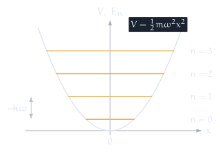

### Buca infinita unidimensionale

Per una particella confinata fra $x=0$ e $x=L$ con pareti impenetrabili,

$$V(x)=0\quad(0<x<L),\qquad V=+\infty\quad\text{altrove},$$

la funzione d'onda deve annullarsi alle pareti. Le soluzioni normalizzate sono

::: legge Spettro della buca infinita
$$\phi_n(x)=\sqrt{\frac{2}{L}}\sin\frac{n\pi x}{L},
\qquad
E_n=\frac{n^2\pi^2\hbar^2}{2mL^2},
\qquad n=1,2,3,\ldots$$
:::

Non esiste uno stato con $n=0$: sarebbe identicamente nullo. L'energia fondamentale è positiva, coerentemente con l'impossibilità di avere contemporaneamente posizione confinata e quantità di moto esattamente nulla.

::: approfondimento Calcolo: Perché proprio questi livelli
**Equazione nella buca.**  Dove $V=0$ l'equazione stazionaria diventa $\phi”=-k^2\phi$ con $k=\sqrt{2mE}/\hbar$: la soluzione generale è $\phi(x)=A\sin kx+B\cos kx$.

**Prima parete.**  Fuori dalla buca $\phi\equiv0$; la continuità in $x=0$ impone $\phi(0)=0$, cioè $B=0$.

**Seconda parete.**  $\phi(L)=A\sin kL=0$ con $A\neq0$ richiede $kL=n\pi$, $n=1,2,\ldots$: la quantizzazione è un puro fatto di condizioni al contorno, non un postulato aggiuntivo. Da $E=\hbar^2k^2/(2m)$ segue lo spettro del riquadro.

**Normalizzazione.**  Il valor medio di $\sin^2$ su un numero intero di semiperiodi vale $1/2$, quindi

$$\int_0^L A^2\sin^2\!\frac{n\pi x}{L}\,\dd x=A^2\,\frac{L}{2}=1
\ \Longrightarrow\
A=\sqrt{\frac{2}{L}}.$$
:::

Le autofunzioni hanno $n-1$ nodi interni. Gli stati formano una base: un pacchetto iniziale nella buca può essere sviluppato come $\psi(x,0)=\sum_n c_n\phi_n(x)$ e ogni componente evolve con fase $e^{-iE_nt/\hbar}$.

::: nota Lo spettro come condizione di onda stazionaria
Le $\phi_n$ sono gli stessi profili $\sin(n\pi x/L)$ dei modi di una corda fissata agli estremi ([capitolo «Oscillazioni armoniche»](unit:physics-16)) e dei modi di una cavità ([capitolo «Induzione elettromagnetica»](unit:physics-24)). Lo spettro segue infatti dalla condizione di onda stazionaria: le lunghezze d'onda ammesse sono $\lambda_n=2L/n$, perciò

$$k_n=\frac{2\pi}{\lambda_n}=\frac{n\pi}{L},
\qquad
E_n=\frac{\hbar^2k_n^2}{2m}=\frac{n^2h^2}{8mL^2}=\frac{n^2\pi^2\hbar^2}{2mL^2}.$$

Lo stato $\sin(k_nx)$ non è però un autostato di $\widehat p$: è una sovrapposizione di due componenti d'onda piana con quantità di moto opposte $+\hbar k_n$ e $-\hbar k_n$. Il valore $\hbar k_n=nh/(2L)$ è quindi il modulo associato a ciascuna componente, non una quantità di moto definita dello stato stazionario. La quantizzazione nasce dalla selezione dei modi compatibili con il confinamento; ciò che cambia rispetto a corda e cavità è il significato dell'ampiezza.
:::

### Buca finita

Una buca di profondità finita possiede un numero finito di stati legati. Le funzioni oscillano nella regione permessa e decadono esponenzialmente all'esterno. L'energia e le funzioni si ottengono da equazioni trascendenti; non tutte le energie sono ammesse. Il confinamento è meno rigido della buca infinita e l'ampiezza “fuoriesce” dalle pareti.

Il [capitolo «Induzione elettromagnetica»](unit:physics-24) ha mostrato che la luce può restare intrappolata in una lastra o in un filo di vetro per riflessione totale interna: è il principio della fibra ottica. La descrizione per raggi, però, non dice quali configurazioni del campo siano compatibili con il confinamento; la risposta viene dalla teoria ondulatoria, che seleziona un insieme discreto di modi guidati. Nel modello scalare stazionario, la buca finita pone un problema matematico analogo per le onde di materia, pur con significato fisico e condizioni al contorno propri.

::: approfondimento La buca finita è una guida d'onda
Nel dizionario ottico, la buca è il nucleo di una guida dielettrica: una regione di indice maggiore, dove $E-V$ è più grande, circondata da un mantello di indice minore. I modi guidati di una fibra ottica sono discreti, oscillano nel nucleo e possiedono code evanescenti nel mantello: nel modello scalare soddisfano equazioni trascendenti analoghe a quelle degli stati legati della buca. Nelle guide elettromagnetiche reali entrano anche polarizzazione e condizioni al contorno vettoriali. Anche il numero finito di modi guidati ha un analogo nel numero finito di stati legati.

Le code evanescenti non sono un difetto del modello: sono il meccanismo dell'accoppiamento fra due guide affiancate, l'analogo ottico del tunneling fra due buche vicine, usato nei divisori di fascio integrati.
:::

### Oscillatore armonico quantistico

Per

$$V(x)=\frac12m\omega^2x^2,$$

lo spettro è

::: legge Livelli dell'oscillatore armonico
$$E_n=\hbar\omega\left(n+\frac12\right),
\qquad n=0,1,2,\ldots$$
:::

Non esiste uno stato dell'oscillatore con posizione e quantità di moto simultaneamente determinate e nulle: rispetto al minimo classico del potenziale, lo stato fondamentale possiede energia $\hbar\omega/2$. Lo stato fondamentale è gaussiano,

$$\phi_0(x)=\left(\frac{m\omega}{\pi\hbar}\right)^{1/4}
e^{-m\omega x^2/(2\hbar)}.$$

La scala spaziale naturale è $x_0=\sqrt{\hbar/(m\omega)}$.

Il formalismo degli operatori di creazione e distruzione,

$$\widehat a=\sqrt{\frac{m\omega}{2\hbar}}\left(\widehat x+\frac{i}{m\omega}\widehat p\right),
\qquad
\widehat a^\dagger=\sqrt{\frac{m\omega}{2\hbar}}\left(\widehat x-\frac{i}{m\omega}\widehat p\right),$$

permette di costruire gli stati senza risolvere ogni volta un'equazione differenziale. Il modello descrive piccole oscillazioni di molecole, vibrazioni reticolari, modi del campo e approssimazioni locali attorno a minimi di potenziale.

::: approfondimento Calcolo: Perché $E_0=\hbar\omega/2$ e perché $\phi_0$ è gaussiana
**L'hamiltoniana si fattorizza.**  Da $[\widehat x,\widehat p]=i\hbar$ segue $[\widehat a,\widehat a^\dagger]=1$ e, sviluppando il prodotto $\widehat a^\dagger\widehat a$,

$$\widehat H=\hbar\omega\left(\widehat a^\dagger\widehat a+\tfrac12\right).$$

**Un limite inferiore esatto.**  Per qualunque stato normalizzato,

$$\bra\psi\,\widehat a^\dagger\widehat a\,\ket\psi=\big\|\widehat a\ket\psi\big\|^2\geq0,$$

quindi, per l'hamiltoniana con zero fissato nel minimo del potenziale, $E\geq\hbar\omega/2$, con uguaglianza solo per lo stato annichilato da $\widehat a$. Il limite inferiore segue dalla positività di $\widehat a^\dagger\widehat a$; sottrarre una costante all'hamiltoniana sposterebbe tutte le energie senza cambiare la dinamica non gravitazionale dell'oscillatore isolato.

**Lo stato fondamentale in due righe.**  La condizione $\widehat a\,\phi_0=0$ è un'equazione del *primo* ordine,

$$\left(m\omega x+\hbar\frac{\dd}{\dd x}\right)\phi_0=0
\ \Longrightarrow\
\frac{\phi_0'}{\phi_0}=-\frac{m\omega x}{\hbar}
\ \Longrightarrow\
\phi_0\propto e^{-m\omega x^2/(2\hbar)}.$$

La gaussiana del testo non è indovinata: è l'unica soluzione. Applicando $\widehat a^\dagger$ si sale poi di un gradino alla volta, $E_{n+1}=E_n+\hbar\omega$, e lo spettro a pioli è costruito senza mai risolvere un'equazione del secondo ordine.
:::

### Corrispondenza con il moto classico

Per grandi numeri quantici, la densità presenta oscillazioni rapide; mediata su scale sperimentali finite, tende a concentrarsi dove la particella classica trascorre più tempo. Negli stati coerenti dell'oscillatore, i valori medi di posizione e quantità di moto seguono esattamente le equazioni classiche, mentre la distribuzione conserva una larghezza minima.

::: approfondimento L'oscillatore ottico: fibre a gradiente d'indice e modi laser
Nel dizionario ottico, il potenziale parabolico corrisponde a un mezzo il cui indice diminuisce quadraticamente allontanandosi dall'asse. In una fibra a gradiente d'indice con questo profilo, i raggi parassiali oscillano sinusoidalmente attorno all'asse: è il limite geometrico, cioè il moto armonico classico del [capitolo «Oscillazioni armoniche»](unit:physics-16), disegnato dalla luce.

Il livello ondulatorio esiste anch'esso: i modi trasversi di tale fibra, come i modi di Hermite–Gauss di un risonatore laser, obbediscono alla stessa equazione delle $\phi_n$ dell'oscillatore. Il modo fondamentale gaussiano di un fascio laser è il ritratto ottico dello stato $\phi_0$, e gli ordini superiori riproducono nodi e simmetrie degli stati eccitati. L'oscillatore quantistico non è quindi un oggetto senza paralleli: la sua matematica è visibile in ogni laboratorio di ottica.
:::

## Tre dimensioni, momento angolare e atomi {#s-8-6}

### Separazione in coordinate sferiche

Per un potenziale centrale $V(r)$, l'equazione di Schrödinger si separa in parte radiale e angolare. Gli autostati del momento angolare orbitale sono armoniche sferiche $Y_\ell^m(\theta,\varphi)$, con

::: legge Quantizzazione del momento angolare orbitale
$$\widehat L^2Y_\ell^m=\hbar^2\ell(\ell+1)Y_\ell^m,
\qquad
\widehat L_zY_\ell^m=\hbar mY_\ell^m,$$

$$\ell=0,1,2,\ldots,
\qquad m=-\ell,-\ell+1,\ldots,\ell.$$
:::

### Atomo di idrogeno

Nel limite di nucleo infinitamente pesante,

$$V(r)=-\frac{e^2}{4\pi\varepsilon_0r}.$$

Usando più accuratamente la massa ridotta $\mu=m_em_p/(m_e+m_p)$, gli stati sono identificati dai numeri quantici $n,\ell,m$. Le energie non relativistiche dipendono soltanto da $n$:

::: legge Livelli dell'idrogeno
$$E_n=-\frac{\mu e^4}{2(4\pi\varepsilon_0)^2\hbar^2}\frac{1}{n^2}
\simeq-\frac{13{,}6\ \mathrm{eV}}{n^2}.$$
:::

### Transizioni e regole di selezione

### Spin e principio di esclusione

Lo spin è un momento angolare intrinseco, non la rotazione classica di una sfera carica. Per l'elettrone $s=1/2$ e, scelta una direzione di quantizzazione, la componente $S_z$ può assumere i valori $m_s\hbar$, con $m_s=\pm1/2$. L'esperimento di Stern–Gerlach rende visibile la quantizzazione delle componenti del momento magnetico.

Gli elettroni sono fermioni e lo stato totale di particelle identiche deve essere antisimmetrico per scambio. Ne segue il principio di Pauli: due elettroni in un atomo non possono condividere tutti i numeri quantici. La struttura periodica degli elementi nasce dalla combinazione di potenziale coulombiano, interazioni fra elettroni, spin e principio di esclusione.

::: errore Orbita e orbitale
Un'orbita è una traiettoria classica $\vect r(t)$. Un orbitale è una funzione d'onda monoelettronica o un'approssimazione di essa. Disegnare una superficie a probabilità costante non significa ricostruire il percorso dell'elettrone.
:::

## Molecole, solidi, tecnologie e limite classico {#s-8-7}

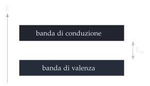

### Legami molecolari come interferenza di ampiezze

### Dagli atomi alle bande nei solidi

### Applicazioni della meccanica ondulatoria

### Entanglement e sistemi composti

### Decoerenza e apparenza classica

La doppia fenditura ha già mostrato il meccanismo in miniatura: quando un apparato si correla con alternative di cammino distinguibili, le frange si attenuano o scompaiono. La decoerenza applica lo stesso meccanismo ai sistemi aperti mediante l'evoluzione unitaria dello stato composto. Nessun sistema macroscopico è perfettamente isolato: molecole d'aria, fotoni termici e vibrazioni del supporto interagiscono di continuo con esso. Producono decoerenza rispetto a una data sovrapposizione soltanto nella misura in cui gli stati ambientali finali conservano informazione distinguibile sulle alternative considerate; non ogni urto ha lo stesso effetto.

La notazione di Dirac permette di scrivere il meccanismo in una riga. Se il sistema è nella sovrapposizione $\psi_1+\psi_2$ e l'interazione correla l'ambiente, inizialmente in $\ket{E_0}$, con le due alternative,

$$(\psi_1+\psi_2)\,\ket{E_0}\;\longrightarrow\;\psi_1\ket{E_1}+\psi_2\ket{E_2},$$

le probabilità misurabili sul solo sistema diventano

::: legge Soppressione dell'interferenza
$$P(x)=|\psi_1|^2+|\psi_2|^2
+2\operatorname{Re}\!\left[\psi_1^*(x)\,\psi_2(x)\,\braket{E_1}{E_2}\right].$$
:::

Per stati ambientali normalizzati, $|\braket{E_1}{E_2}|=1$ significa che i due stati differiscono al più per una fase: l'ambiente non distingue i cammini. Il contrasto delle frange resta quello del sistema coerente, ma la fase del prodotto interno può spostarle. Se gli stati ambientali sono ortogonali, $\braket{E_1}{E_2}=0$ e il termine incrociato svanisce. Per valori intermedi, il modulo del prodotto interno attenua l'interferenza; con due contributi di uguale intensità coincide con la visibilità delle frange.

::: approfondimento Calcolo: Il conto in una riga
La probabilità di trovare la particella in $x$, qualunque cosa faccia l'ambiente, è la norma quadra del ket totale valutato in $x$:

$$P(x)=\big\|\psi_1(x)\ket{E_1}+\psi_2(x)\ket{E_2}\big\|^2,$$

con $\braket{E_1}{E_1}=\braket{E_2}{E_2}=1$. I termini incrociati sono

$$\psi_1^*\psi_2\braket{E_1}{E_2}
+\psi_2^*\psi_1\braket{E_2}{E_1}.$$

Il secondo è il complesso coniugato del primo: la loro somma è quindi $2\operatorname{Re}[\psi_1^*\psi_2\braket{E_1}{E_2}]$. L'ordine degli stati nel prodotto interno deve essere coerente con quello delle ampiezze coniugate. La formula segue dalla regola di Born applicata allo stato composto.
:::

Per oggetti macroscopici e separazioni spaziali ordinarie, i modelli di diffusione da fotoni o molecole prevedono spesso un crollo estremamente rapido del modulo $|\braket{E_1}{E_2}|$; il tempo preciso dipende però da massa, dimensioni, distanza fra le alternative e condizioni ambientali  [19, 20](#fonti). Le fasi non vengono distrutte: vengono disperse in un numero enorme di gradi di libertà, e recuperarle richiederebbe il controllo simultaneo di tutti. È la stessa irreversibilità pratica del [capitolo «Termodinamica e rendimento»](unit:physics-20): come rimescolare indietro l'inchiostro nell'acqua, possibile in linea di principio, negato di fatto.

L'ambiente non sopprime tutte le sovrapposizioni allo stesso modo: sopprime quelle fra stati che esso distingue. La base robusta, detta base degli stati puntatore, dipende dalla forma dell'interazione sistema–ambiente. Poiché molte interazioni ambientali ordinarie monitorano soprattutto la posizione, in questi casi gli stati robusti sono approssimativamente pacchetti localizzati. In altri modelli la base puntatore può essere diversa. Una sedia non è osservata in una sovrapposizione spaziale macroscopica perché, nelle condizioni ordinarie, l'ambiente rende l'interferenza inaccessibile molto prima che uno strumento possa rilevarla.

::: storia Dal gatto di Schrödinger ai fullereni
Nel 1935 Schrödinger immaginò un gatto legato a un decadimento radioattivo per mostrare che la linearità, presa alla lettera, estende la sovrapposizione al macroscopico  [21](#fonti). Per decenni il confine fra quantistico e classico rimase una questione di principio.

Oggi è un parametro sperimentale. Nel 1999 fu osservata l'interferenza di fullereni $\mathrm{C_{60}}$, molecole di sessanta atomi  [22](#fonti); negli stessi apparati la decoerenza si accende gradualmente aumentando la pressione del gas residuo o la temperatura interna delle molecole, e le frange sbiadiscono al diminuire del modulo $|\braket{E_1}{E_2}|$.
:::

### Limite classico e principio di Ehrenfest

Il recupero approssimato del comportamento classico combina condizioni diverse. Nel regime semiclassico, quando il numero d'onda locale varia lentamente e il pacchetto resta sufficientemente concentrato, il suo centro può seguire approssimativamente una traiettoria classica. La decoerenza, quando l'interazione sistema–ambiente distingue alternative rilevanti, sopprime praticamente i termini d'interferenza nella base robusta determinata dall'interazione, spesso ma non sempre vicina a pacchetti localizzati. Nessuno dei due meccanismi, preso isolatamente, garantisce in generale l'intera fenomenologia classica né seleziona un singolo esito.

La prima gamba si rende precisa con il teorema di Ehrenfest. Per un potenziale sufficientemente regolare,

$$\frac{\dd\langle x\rangle}{\dd t}=\frac{\langle p\rangle}{m},
\qquad
\frac{\dd\langle p\rangle}{\dd t}=-\left\langle\frac{\partial V}{\partial x}\right\rangle.$$

Se il pacchetto è stretto su una scala in cui il potenziale varia lentamente,

$$\left\langle\frac{\partial V}{\partial x}\right\rangle
\simeq \frac{\partial V}{\partial x}(\langle x\rangle),$$

e il centro del pacchetto segue approssimativamente Newton. Il limite classico richiede dunque non soltanto masse grandi, ma anche stati e ambienti appropriati.

::: approfondimento Calcolo: Da dove viene il teorema di Ehrenfest
**Una formula generale.**  Per un'osservabile $\widehat A$ senza dipendenza esplicita dal tempo, derivando $\langle A\rangle=\bra\psi\widehat A\ket\psi$ e usando $i\hbar\,\dd\ket\psi/\dd t=\widehat H\ket\psi$ con la sua coniugata,

$$\frac{\dd\langle A\rangle}{\dd t}
=\frac{i}{\hbar}\,\bra\psi\,[\widehat H,\widehat A]\,\ket\psi.$$

L'evoluzione di ogni valore medio è governata dal commutatore con l'hamiltoniana.

**I due commutatori.**  Con $\widehat H=\widehat p^{\,2}/(2m)+V(\widehat x)$ e $[\widehat p,\widehat x]=-i\hbar$,

$$[\widehat H,\widehat x]=\frac{1}{2m}\,[\widehat p^{\,2},\widehat x]=-\frac{i\hbar}{m}\,\widehat p,
\qquad
[\widehat H,\widehat p]=[V(\widehat x),\widehat p]=i\hbar\,\frac{\partial V}{\partial x}.$$

**Le equazioni di Ehrenfest.**  Sostituendo nella formula generale si ottengono esattamente le due equazioni del testo. I valori medi obbediscono a relazioni di forma newtoniana, ma con la forza *media* $-\langle\partial V/\partial x\rangle$ al posto della forza valutata nel punto medio. Le due coincidono approssimativamente quando il pacchetto resta sufficientemente stretto e il potenziale varia lentamente sulla sua estensione; dispersione, interferenza, correlazioni e momenti superiori possono invece rendere importante la differenza.
:::

Le due gambe si incontrano qui, ma entro condizioni precise. Le equazioni di Ehrenfest forniscono una condizione locale e temporanea per un moto approssimativamente newtoniano; la decoerenza spiega perché, per molte interazioni ordinarie, certe sovrapposizioni fra pacchetti localizzati diventino inosservabili. Il proiettile del [capitolo «Traiettorie e lanci»](unit:physics-05) è quindi ben descritto classicamente quando il suo pacchetto resta stretto, il potenziale è regolare sulla sua estensione e l'ambiente sopprime rapidamente le interferenze rilevanti. Insieme al coarse graining, questi meccanismi spiegano una parte importante del limite classico, ma non costituiscono un teorema generale che elimini ogni differenza fra dinamica quantistica e classica, né risolvono da soli il problema del singolo esito.

::: nota Una gerarchia di teorie
La meccanica ondulatoria non relativistica è una parte della fisica quantistica. Per elettroni relativistici serve l'equazione di Dirac; per campi e processi con numero di particelle variabile serve la teoria quantistica dei campi; per nuclei e materia fortemente correlata occorrono modelli e metodi specifici. Il valore del formalismo introdotto qui sta nel fornire il linguaggio di base: stati, ampiezze, operatori, sovrapposizione e condizioni al contorno.
:::

## Scale e parametri che scelgono il modello {#s-8-8}

Una formula diventa affidabile soltanto dopo avere identificato il regime fisico. I parametri adimensionali confrontano scale diverse e aiutano a scegliere il modello prima di iniziare i calcoli.

::: legge Quattro controlli di regime
$$\beta=\frac{v}{c},
\qquad
\frac{\lambda_{\mathrm{dB}}}{L}=\frac{h}{pL},
\qquad
n\lambda_{\mathrm{th}}^3,
\qquad
2\kappa a=\frac{2a\sqrt{2m(V_0-E)}}{\hbar}.$$
:::

- Se $\beta\ll1$, la cinematica non relativistica è in genere adeguata; quando $\beta$ non è piccola, energia e quantità di moto devono essere trattate relativisticamente.
- Se $\lambda_{\mathrm{dB}}/L\ll1$, le variazioni quantistiche avvengono su scale molto più piccole dell'apparato e un'approssimazione semiclassica può essere efficace. Se il rapporto è dell'ordine dell'unità, diffrazione e confinamento non sono trascurabili.
- Il parametro $n\lambda_{\mathrm{th}}^3$, con $n=N/V$ e $\lambda_{\mathrm{th}}=h/\sqrt{2\pi mk_{\mathrm B}T}$, misura la sovrapposizione delle onde di materia in un gas. Valori molto minori di uno indicano il regime classico diluito; valori non piccoli richiedono statistiche quantistiche.
- Per una barriera rettangolare con $E<V_0$, il prodotto $2\kappa a$ controlla l'attenuazione. Se è grande, la trasmissione è esponenzialmente piccola; se non lo è, il solo esponenziale non basta e occorre la formula completa.

::: esempio Quando un elettrone richiede una correzione relativistica?
Un elettrone con energia cinetica $K=100\un{keV}$ non soddisfa bene $K=mv^2/2$, perché $K/(m_ec^2)\approx100/511\approx0{,}196$. Dalla relazione relativistica

$$\gamma=1+\frac{K}{m_ec^2},
\qquad
\beta=\sqrt{1-\frac{1}{\gamma^2}},$$

si ottiene $\beta\approx0{,}55$. Una velocità pari a circa il 55% di $c$ non appartiene al regime $v\ll c$: la lunghezza d'onda va calcolata con la quantità di moto relativistica.
:::

::: errore Un unico numero non decide tutto
I controlli precedenti sono indicatori, non interruttori universali. Precisione richiesta, forma del potenziale, coerenza, interazioni e durata dell'esperimento possono rendere rilevanti correzioni anche quando un rapporto appare moderatamente piccolo.
:::

## Relatività ristretta: eventi, intervallo ed energia {#s-8-9}

La meccanica non relativistica è un'approssimazione valida quando le velocità sono piccole rispetto a $c$. In due riferimenti inerziali in moto relativo lungo $x$,

$$x'=\gamma(x-vt),\qquad
t'=\gamma\left(t-\frac{vx}{c^2}\right),
\qquad
\gamma=\frac1{\sqrt{1-v^2/c^2}}.$$

Lo spazio e il tempo non sono invarianti separatamente. È invariato invece l'intervallo

$$\Delta s^2=c^2\Delta t^2-\Delta x^2-\Delta y^2-\Delta z^2.$$

::: approfondimento Dimostrazione: Dilatazione del tempo da un orologio proprio
**Ipotesi.** Due eventi avvengono nello stesso punto del riferimento solidale con l'orologio, quindi $\Delta x'=0$.

**Passaggi.** Dall'invarianza dell'intervallo,

$$c^2\Delta\tau^2=c^2\Delta t^2-\Delta x^2.$$

Nel riferimento in cui l'orologio si muove, $\Delta x=v\Delta t$; dunque

$$\Delta\tau^2=\Delta t^2\left(1-\frac{v^2}{c^2}\right),
\qquad
\Delta t=\gamma\Delta\tau.$$

**Significato fisico.** Il tempo proprio $\Delta\tau$ è misurato da un singolo orologio presente in entrambi gli eventi. Ogni osservatore inerziale ottiene lo stesso intervallo spazio-temporale.

**Limiti di validità.** La relazione $\Delta t=\gamma\Delta\tau$ con un unico $\gamma$ presuppone modulo della velocità costante. La relatività ristretta descrive anche orologi accelerati: in un riferimento inerziale dello spazio-tempo piatto si integra

$$\Delta\tau=\int_{t_i}^{t_f}\sqrt{1-\frac{v^2(t)}{c^2}}\,\dd t.$$

La presenza di curvatura gravitazionale richiede invece la relatività generale.
:::

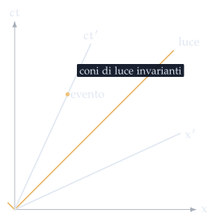

## Nuclei, radioattività ed energia di legame {#s-8-10}

La massa di un nucleo legato è inferiore alla somma delle masse dei protoni e neutroni separati. Il difetto di massa corrisponde all'energia di legame

$$B=\Delta m\,c^2.$$

L'energia di legame per nucleone cresce rapidamente per nuclei leggeri, raggiunge un massimo nella regione del ferro e diminuisce lentamente per nuclei molto pesanti. Questa forma rende possibili sia la fusione di nuclei leggeri sia la fissione di nuclei pesanti.

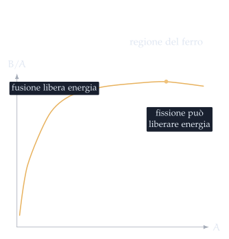

Per una popolazione di nuclei instabili,

$$\frac{\dd N}{\dd t}=-\lambda N,
\qquad
N(t)=N_0e^{-\lambda t},
\qquad
T_{1/2}=\frac{\ln2}{\lambda}.$$

L'attività è $A(t)=\lambda N(t)$. La legge è statistica: non assegna al singolo nucleo un istante prevedibile di decadimento.

::: approfondimento Dimostrazione: Legge esponenziale del decadimento
**Ipotesi.** Ogni nucleo ha probabilità di decadimento per unità di tempo costante e indipendente dall'età del campione.

**Passaggi.** In un intervallo $\dd t$ il numero medio di decadimenti è $\lambda N\dd t$, quindi $\dd N=-\lambda N\dd t$. Separando le variabili e integrando,

$$\int_{N_0}^{N(t)}\frac{\dd N}{N}=-\lambda\int_0^t\dd t,$$

si ottiene $N(t)=N_0e^{-\lambda t}$.

**Significato fisico.** La costanza della probabilità per unità di tempo produce una distribuzione senza memoria. La vita media è $\tau=1/\lambda$.

**Limiti di validità.** La legge presuppone nuclei indipendenti e un tasso costante. Catene di decadimento e produzioni simultanee richiedono sistemi di equazioni accoppiate.
:::

## Matrici, trasformazioni e autovalori {#s-0-35}

::: storia Da tabelle di coefficienti a trasformazioni
Sistemi di equazioni e determinanti precedono di molto il concetto astratto di matrice. Nel XIX secolo Sylvester introdusse il termine “matrix” e Cayley trattò le matrici come oggetti algebrici capaci di rappresentare e comporre trasformazioni lineari. Autovalori e direzioni proprie emersero anche dallo studio delle forme quadratiche, della stabilità e delle vibrazioni. In fisica questa storia spiega perché una matrice non sia soltanto una tabella: è una regola che trasforma vettori e può rivelare direzioni o modi privilegiati.  [23, 24](#fonti)
:::

Una matrice organizza numeri in righe e colonne. Può rappresentare un sistema di equazioni, una trasformazione geometrica, un insieme di dati o un operatore fisico. Per una matrice $2\times2$,

$$A=\begin{pmatrix}a&b\\c&d\end{pmatrix},
\qquad
\vect x=\begin{pmatrix}x\\y\end{pmatrix},$$

il prodotto

$$A\vect x=
\begin{pmatrix}ax+by\\cx+dy\end{pmatrix}$$

produce un nuovo vettore.

La matrice identità lascia ogni vettore invariato. La matrice di rotazione nel piano è

$$R(\theta)=
\begin{pmatrix}
\cos\theta&-\sin\theta\\
\sin\theta&\cos\theta
\end{pmatrix}.$$

Il determinante di $A$,

$$\det A=ad-bc,$$

misura il fattore orientato con cui la trasformazione modifica le aree. Se $\det A=0$, la trasformazione schiaccia il piano su una retta o su un punto e la matrice non è invertibile.

Un autovettore $\vect v\ne0$ soddisfa

$$A\vect v=\lambda\vect v.$$

Se $\lambda>0$, la trasformazione conserva il verso della retta generata da $\vect v$; se $\lambda<0$, lo inverte; se $\lambda=0$, manda l'autovettore nel vettore nullo, che non possiede direzione. In tutti i casi la retta propria resta invariata come sottospazio. Per matrici reali non simmetriche possono inoltre comparire autovalori e autovettori complessi, quindi il contesto reale o complesso deve essere dichiarato. Autovalori e autovettori descrivono assi principali, modi normali di vibrazione e stabilità di sistemi dinamici. Nella formulazione quantistica finito-dimensionale, un'osservabile è rappresentata da una matrice hermitiana e i suoi autovalori sono i possibili esiti discreti della misura. Più in generale si usano operatori autoaggiunti: gli esiti appartengono al loro spettro, che può comprendere anche una parte continua.

Per trovare gli autovalori si risolve

$$\det(A-\lambda I)=0.$$

Per matrici reali simmetriche e per matrici complesse hermitiane, gli autovalori sono reali e gli autovettori associati ad autovalori distinti possono essere scelti ortogonali. In spazi infinito-dimensionali l'analogo corretto richiede operatori autoaggiunti e attenzione al dominio dell'operatore. Questa struttura è centrale nella meccanica quantistica e nell'analisi dei modi normali.

## Casi di studio e attività sperimentali {#casi}

### Attività sperimentale: Stima della costante di Planck con LED

**Obiettivo.**  stimare l'ordine di grandezza di $h$ confrontando tensione di accensione e frequenza di emissione di LED diversi.

**Materiali o dati.**  LED di colori diversi, alimentatore didattico a bassa tensione, resistenze limitatrici, multimetro e spettro o lunghezza d'onda nominale dei LED.

**Procedura.**

1. misurare una tensione di accensione con un criterio dichiarato e uguale per tutti i LED;
2. associare a ogni LED una frequenza centrale $\nu=c/\lambda$;
3. rappresentare $eV$ in funzione di $\nu$ e stimare la pendenza con un fit lineare;
4. confrontare la pendenza con la costante di Planck e discutere l'intercetta.

**Controllo e discussione.**  tensione di soglia, gap, resistenza serie, temperatura e larghezza spettrale rendono $eV=h\nu$ un modello approssimato; riportare incertezze e sensibilità al criterio di accensione.

**Sicurezza.**  usare soltanto basse tensioni, resistenze limitatrici e polarità corrette; non osservare LED molto intensi a distanza ravvicinata.

### Attività sperimentale: Spettri a righe con un reticolo

**Obiettivo.**  misurare lunghezze d'onda di righe atomiche e distinguere uno spettro discreto da uno quasi continuo.

**Materiali o dati.**  spettroscopio o reticolo di passo noto, lampada a scarica didattica, sorgente termica schermata e scala angolare.

**Procedura.**

1. allineare sorgente, fenditura e reticolo;
2. misurare gli angoli delle righe in ordini simmetrici;
3. usare $d\sin\theta=m\lambda$ e stimare l'incertezza;
4. confrontare le righe della lampada a scarica con lo spettro della sorgente termica.

**Controllo e discussione.**  verificare la simmetria degli ordini, distinguere risoluzione strumentale e larghezza fisica delle righe, e non attribuire ogni massimo a una nuova transizione.

**Sicurezza.**  non osservare direttamente sorgenti intense o ultraviolette; usare solo lampade e alimentatori didattici certificati e schermati.

### Attività sperimentale: Diffrazione come analogia per le onde di materia

**Obiettivo.**  riconoscere la struttura matematica comune fra diffrazione ottica ed elettronica senza confondere i due sistemi fisici.

**Materiali o dati.**  laser didattico a bassa potenza, fenditura o reticolo, schermo e dati pubblicati di un esperimento di diffrazione elettronica.

**Procedura.**

1. misurare il profilo di diffrazione ottico e ricavare una lunghezza d'onda o un passo;
2. riscrivere la condizione dei massimi in termini di fase e differenza di cammino;
3. confrontare la stessa relazione con dati di diffrazione elettronica e $\lambda=h/p$;
4. elencare grandezze analoghe e grandezze fisicamente differenti.

**Controllo e discussione.**  l'analogia riguarda la somma di ampiezze e le condizioni di fase; un campo elettromagnetico classico e un elettrone non sono la stessa entità.

**Sicurezza.**  non dirigere il laser verso occhi o superfici riflettenti e non tentare esperimenti con fasci elettronici o alte tensioni fuori da apparati certificati.

### Caso di studio: Microscopia elettronica e risoluzione

Calcolare la lunghezza d'onda relativistica di elettroni accelerati e confrontarla con le dimensioni atomiche. Spiegare perché la risoluzione reale è molto peggiore della sola lunghezza d'onda: lenti elettromagnetiche, aberrazioni, stabilità, dose, preparazione e diffusione nel campione sono parte del sistema di misura.

### Caso di studio: Tunneling e decadimento alfa

Il nucleo confina una particella alfa mediante una barriera coulombiana. La probabilità di fuga dipende esponenzialmente dall'integrale di $\kappa(r)$ nella regione vietata. Piccole variazioni dell'energia producono grandi variazioni della vita media, spiegando qualitativamente la legge di Geiger–Nuttall.

## Sintesi e autoverifica {#sintesi}

::: metodo Come affrontare un problema di meccanica ondulatoria
1. Identificare sistema, coordinate, potenziale e regime non relativistico.
2. Decidere se il problema riguarda evoluzione temporale, autostati o scattering.
3. Scrivere l'equazione e le soluzioni ammissibili in ogni regione.
4. Imporre normalizzazione, continuità, simmetrie e condizioni al contorno.
5. Calcolare probabilità, correnti o valori medi, non interpretare direttamente $\psi$ come densità materiale.
6. Verificare dimensioni, conservazione della probabilità e limiti classici.
:::

::: sintesi Relazioni tra i concetti
La quantizzazione della radiazione risolve corpo nero, fotoelettrico e Compton. Le onde di materia estendono la struttura di fase alle particelle massive. L'equazione di Schrödinger evolve ampiezze complesse; il modulo quadrato fornisce probabilità; i postulati organizzano stati, osservabili, misura ed evoluzione in un unico quadro. Quantizzazione e tunneling emergono dalle condizioni al contorno. In tre dimensioni compaiono momento angolare, orbitali e spin; nei sistemi composti emergono Pauli ed entanglement. Molecole e solidi sono applicazioni dello stesso principio di sovrapposizione in potenziali più complessi. Il comportamento classico viene recuperato soltanto in regimi appropriati: dinamica semiclassica di pacchetti sufficientemente localizzati e soppressione pratica dell'interferenza, in una base stabile, dovuta alla decoerenza ambientale.
:::

::: sintesi Autoverifica di fine capitolo
1. Perché la legge di Rayleigh–Jeans fallisce alle alte frequenze?
2. Quale differenza sperimentale separa intensità e frequenza nell'effetto fotoelettrico?
3. Perché un'onda piana non descrive una particella localizzata?
4. Che cosa rappresentano $|\psi|^2$ e la corrente $\vect j$?
5. Perché nella doppia fenditura con elettroni le frange scompaiono se un apparato determina il cammino?
6. Quali sono i postulati della meccanica quantistica e quale ruolo vi svolge la regola di Born?
7. Perché le energie della buca infinita sono discrete?
8. In che senso il tunneling conserva l'energia?
9. Quale ruolo svolge $\sqrt{E-V}$ nell'analogia fra meccanica ondulatoria e ottica?
10. Di quale fenomeno ottico il tunneling è l'analogo diretto?
11. Qual è la differenza fra orbitale e orbita?
12. Perché il principio di Pauli è essenziale per la tavola periodica?
13. Come nascono le bande energetiche in un cristallo?
14. Quali ipotesi consentono il recupero approssimato della dinamica classica?
15. Attraverso quale fattore la decoerenza sopprime il termine di interferenza e quali stati seleziona?
16. Quali sono le due componenti del limite classico e perché nessuna basta da sola?
:::

::: sintesi Verifica breve: energia e probabilità quantistiche
1. Nel modello fotoelettrico a un fotone, la frequenza della luce è inferiore alla soglia del metallo. Aumentarne l'intensità permette l'emissione? Distinguere energia del fotone e numero di fotoni incidenti.
2. Una funzione d'onda normalizzata ha densità costante $|\psi(x)|^2=1/L$ nell'intervallo $0<x<L$ e nulla fuori. Calcolare la probabilità di trovare la particella fra $L/4$ e $3L/4$.
3. Per una particella nella buca infinita unidimensionale, come cambia l'energia fondamentale se la larghezza raddoppia, a massa invariata?
4. Una particella attraversa per tunneling una barriera statica con $E<V_0$. L'energia della particella trasmessa è maggiore di $E$? Spiegare che cosa cambia nella regione della barriera.
:::

::: approfondimento Risposte essenziali: fisica moderna
1. No, entro il modello a un fotone: l'energia $h\nu$ resta inferiore al lavoro di estrazione. Aumenta il flusso di fotoni. Rivedere *Effetto fotoelettrico*.
2. La probabilità è l'area sotto la densità: $(L/2)/L=1/2$. Rivedere *Stato, ampiezza e probabilità*.
3. Da $E_1\propto L^{-2}$ segue $E'_1=E_1/4$. Rivedere *Buca infinita unidimensionale*.
4. L'energia resta $E$, perché il potenziale è indipendente dal tempo. Nella barriera la soluzione è evanescente; non occorre un aumento temporaneo dell'energia. Rivedere *Barriera finita e tunneling*.
:::

## Formulario ragionato {#formulario}

::: legge Radiazione termica
$$u_\nu=\frac{8\pi h\nu^3}{c^3}\frac{1}{e^{h\nu/(k_BT)}-1},
\qquad
\lambda_{\max}T=b,
\qquad
j^\star=\sigma T^4.$$

Usare la forma spettrale coerente con la variabile e con l'intervallo di integrazione.
:::

::: legge Fotoni e urti
$$E_\gamma=h\nu=\frac{hc}{\lambda},
\qquad p_\gamma=\frac{h}{\lambda},
\qquad K_{\max}=h\nu-\Phi,$$

$$\Delta\lambda=\frac{h}{m_ec}(1-\cos\theta).$$

L'effetto Compton richiede conservazione relativistica di energia e quantità di moto.
:::

::: legge Onde di materia e pacchetti
$$\lambda=\frac{h}{p},
\qquad k=\frac{p}{\hbar},
\qquad \omega=\frac{E}{\hbar},
\qquad v_g=\frac{\dd\omega}{\dd k},
\qquad \Delta x\Delta p\geq\frac{\hbar}{2}.$$
:::

::: legge Equazione di Schrödinger
$$i\hbar\partial_t\psi=\left[-\frac{\hbar^2}{2m}\nabla^2+V\right]\psi,
\qquad
\widehat H\phi=E\phi.$$

$$\rho=|\psi|^2,
\qquad
\vect j=\frac{\hbar}{m}\operatorname{Im}(\psi^*\nabla\psi),
\qquad
\partial_t\rho+\nabla\cdot\vect j=0.$$
:::

::: legge Operatori e valori medi
$$\widehat p_x=-i\hbar\partial_x,
\qquad
\langle A\rangle=\int\psi^*\widehat A\psi\,\dd x,
\qquad
(\Delta A)^2=\langle A^2\rangle-\langle A\rangle^2.$$
:::

::: legge Notazione di Dirac e postulati
$$\psi(x)=\braket{x}{\psi},
\qquad
c_n=\braket{\phi_n}{\psi},
\qquad
\langle A\rangle=\bra\psi\widehat A\ket\psi,$$

$$P(a_n)=\left|\braket{\phi_n}{\psi}\right|^2,
\qquad
i\hbar\frac{\dd}{\dd t}\ket{\psi(t)}=\widehat H\ket{\psi(t)}.$$

Stati: vettori normalizzati a meno di fase globale; osservabili: operatori autoaggiunti; sistemi composti: prodotto tensoriale, con simmetrizzazione per particelle identiche.
:::

::: legge Buca e oscillatore
$$E_n^{\mathrm{buca}}=\frac{n^2\pi^2\hbar^2}{2mL^2},
\qquad
\phi_n=\sqrt{\frac2L}\sin\frac{n\pi x}{L},$$

$$E_n^{\mathrm{osc}}=\hbar\omega\left(n+\frac12\right),
\qquad
x_0=\sqrt{\frac{\hbar}{m\omega}}.$$
:::

::: legge Barriere e tunneling
$$\kappa=\frac{\sqrt{2m(V_0-E)}}{\hbar},
\qquad
T\sim e^{-2\kappa a}\quad(\kappa a\gg1).$$

Usare i rapporti di corrente per definire riflessione e trasmissione.
:::

::: legge Analogia ottico-meccanica
$$\nabla^2\phi+k^2(\vect r)\phi=0,
\qquad
k(\vect r)=\frac{\sqrt{2m(E-V)}}{\hbar}
\;\leftrightarrow\;
k_0\,n(\vect r),$$

$$\delta\!\int p\,\dd s=0
\;\leftrightarrow\;
\delta\!\int n\,\dd s=0.$$

Gradino $\leftrightarrow$ interfaccia (Fresnel); barriera $\leftrightarrow$ riflessione totale frustrata; buca $\leftrightarrow$ guida d'onda; potenziale parabolico $\leftrightarrow$ mezzo a gradiente d'indice.
:::

::: legge Momento angolare e idrogeno
$$L^2=\hbar^2\ell(\ell+1),
\qquad L_z=\hbar m,
\qquad
E_n=-\frac{13{,}6\ \mathrm{eV}}{n^2},$$

$$\ell=0,\ldots,n-1,
\qquad m=-\ell,\ldots,\ell,
\qquad m_s=\pm\frac12.$$
:::

## Glossario {#glossario}

- **Autovalore**: Fattore $\lambda$ per cui una trasformazione lineare soddisfa $A\vect v=\lambda\vect v$ su una direzione propria non nulla.
- **Matrice**: Tabella rettangolare di numeri che può rappresentare sistemi di equazioni, dati o trasformazioni lineari.
- **Operatore autoaggiunto**: Operatore che coincide con il proprio aggiunto sul dominio appropriato. In meccanica quantistica rappresenta un'osservabile; i possibili esiti appartengono al suo spettro. In dimensione finita è rappresentato da una matrice hermitiana, con autovalori reali.
- **Indice di rifrazione**: Rapporto $n=c/v_\phi$ in un mezzo trasparente; in generale dipende dalla frequenza ed è collegato alla risposta elettromagnetica del materiale.
- **Ottica geometrica**: Limite di lunghezza d'onda piccola nel quale la propagazione è descritta da fronti d'onda e raggi.
- **Ottica fisica**: Descrizione ondulatoria della luce necessaria per trattare fase, coerenza, interferenza, diffrazione e polarizzazione.
- **Corpo nero**: Sistema ideale che assorbe tutta la radiazione incidente e, in equilibrio, emette uno spettro determinato soltanto dalla temperatura.
- **Decoerenza**: Perdita osservabile delle fasi relative di un sottosistema dovuta all'entanglement con gradi di libertà ambientali non controllati.
- **Effetto Compton**: Diffusione inelastica di radiazione su particelle cariche, con spostamento di lunghezza d'onda interpretabile mediante energia e quantità di moto del fotone.
- **Effetto fotoelettrico**: Emissione di elettroni da un materiale illuminato; nel regime elementare soddisfa $K_{\max}=h\nu-\Phi$.
- **Entanglement**: Proprietà di uno stato composto non fattorizzabile in stati separati dei sottosistemi, associata a correlazioni quantistiche.
- **Equazione di Schrödinger**: Equazione di evoluzione lineare della funzione d'onda non relativistica, $i\hbar\partial_t\psi=\widehat H\psi$.
- **Fotone**: Quanto del campo elettromagnetico con energia $h\nu$ e quantità di moto $h/\lambda$; non è descritto in generale da una funzione d'onda scalare di Schrödinger.
- **Funzione d'onda**: Ampiezza complessa che rappresenta uno stato quantistico; il suo modulo quadrato fornisce una densità di probabilità nella rappresentazione di posizione.
- **Indeterminazione**: Limite intrinseco alle dispersioni di osservabili non compatibili; per posizione e quantità di moto vale $\Delta x\Delta p\geq\hbar/2$.
- **Meccanica ondulatoria**: Formulazione della meccanica quantistica basata su funzioni d'onda, sovrapposizione ed equazioni differenziali agli autovalori.
- **Principio di Pauli**: Regola per cui lo stato totale di fermioni identici è antisimmetrico e due elettroni atomici non possono condividere tutti i numeri quantici.
- **Quantizzazione**: Comparsa di valori discreti di un'osservabile, spesso prodotta da condizioni al contorno e normalizzabilità degli autostati.
- **Spin**: Momento angolare intrinseco quantistico, privo di interpretazione come rotazione rigida classica della particella.
- **Tunneling**: Trasmissione non nulla attraverso una barriera classicamente vietata dovuta alla penetrazione della funzione d'onda.

## Esercizi {#esercizi}

Gli esercizi riprendono quelli della dispensa. Ogni soluzione è nascosta finché non la apri: prova prima a impostare il problema da solo.

### Corpo nero, fotoni e urti Compton

::: esercizio Massimo di emissione del Sole [base]
Approssimare la fotosfera solare come corpo nero a $T=5778\un{K}$. Calcolare la lunghezza d'onda del massimo di $B_\lambda$ e indicare la regione spettrale.

>>> soluzione
**Legge di Wien.**  $\lambda_{\max}=b/T$.

**Calcolo.**  $\lambda_{\max}=2{,}898\times10^{-3}/5778\simeq5{,}02\times10^{-7}\un{m}=502\un{nm}$, nel visibile verde-ciano. Il colore apparente del Sole non coincide con il solo massimo spettrale, perché conta l'intero spettro e la risposta dell'occhio.
:::

::: esercizio Potenza emessa da una superficie nera [medio]
Una superficie nera di area $A=1{,}0\times10^{-2}\un{m^2}$ è a $T=1000\un{K}$. Calcolare la potenza totale emessa, trascurando la radiazione assorbita dall'ambiente.

>>> soluzione
**Stefan–Boltzmann.**  $P=A\sigma T^4$.

**Calcolo.**  $P=(10^{-2})(5{,}6704\times10^{-8})(1000)^4\simeq567\un{W}$.

**Modello.**  In un ambiente a temperatura $T_a$ la potenza netta sarebbe $A\sigma(T^4-T_a^4)$ per una superficie nera.
:::

::: esercizio Energia e quantità di moto di un fotone verde [base]
Calcolare energia in joule e in elettronvolt e quantità di moto di un fotone con $\lambda=500\un{nm}$.

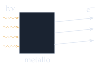
>>> soluzione
**Energia.**  $E=hc/\lambda\simeq3{,}97\times10^{-19}\un{J}\simeq2{,}48\un{eV}$.

**Quantità di moto.**  $p=h/\lambda\simeq1{,}33\times10^{-27}\un{kg\,m/s}$.
:::

::: esercizio Soglia fotoelettrica e potenziale di arresto [medio]
Un metallo ha lavoro di estrazione $\Phi=2{,}20\un{eV}$. Determinare la lunghezza d'onda di soglia e il potenziale di arresto quando è illuminato con luce a $\lambda=400\un{nm}$.

>>> soluzione
**Soglia.**  $\lambda_0=hc/\Phi\simeq564\un{nm}$.

**Energia disponibile.**  $K_{\max}=hc/\lambda-\Phi\simeq(3{,}10-2{,}20)\,\mathrm{eV}=0{,}900\un{eV}$.

**Arresto.**  Poiché $eV_s=K_{\max}$, $V_s\simeq0{,}900\un{V}$.
:::

::: esercizio Stima di $h$ da una retta fotoelettrica [medio]
Per uno stesso catodo si misurano $V_s=0{,}50\un{V}$ a $\nu=6{,}0\times10^{14}\un{Hz}$ e $V_s=1{,}33\un{V}$ a $\nu=8{,}0\times10^{14}\un{Hz}$. Stimare $h$ e il lavoro di estrazione.

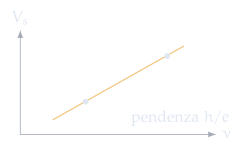
>>> soluzione
**Pendenza.**  Dalla relazione $V_s=(h/e)\nu-\Phi/e$,

$$h=e\frac{\Delta V_s}{\Delta\nu}
=(1{,}602\times10^{-19})\frac{0{,}83}{2{,}0\times10^{14}}
\simeq6{,}65\times10^{-34}\un{J\,s}.$$

**Intercetta.**  $\Phi/e=(h/e)\nu-V_s$. Usando il primo punto si ottiene $\Phi\simeq1{,}99\un{eV}$.
:::

::: esercizio Che cosa cambia raddoppiando l'intensità? [avanzato]
Luce monocromatica sopra soglia illumina un catodo. Si raddoppia l'intensità senza cambiare la frequenza. Indicare che cosa accade idealmente a corrente di saturazione, energia cinetica massima e potenziale di arresto.

>>> soluzione
**Numero di eventi.**  A frequenza fissata, raddoppia il flusso di fotoni; in regime lineare raddoppia circa la corrente di saturazione.

**Energia.**  $K_{\max}=h\nu-\Phi$ non cambia, quindi non cambia neppure $V_s$.

**Limiti.**  Il risultato presuppone assenza di saturazioni, riscaldamento o processi multifotonici.
:::

::: esercizio Spostamento Compton a $90^\circ$ [base]
Calcolare lo spostamento di lunghezza d'onda per un fotone diffuso da un elettrone libero a $\theta=90^\circ$.

>>> soluzione
**Formula.**  $\Delta\lambda=\lambda_C(1-\cos90^\circ)=\lambda_C$.

**Risultato.**  $\Delta\lambda\simeq2{,}426\un{pm}$.
:::

::: esercizio Energia trasferita nell'urto Compton [avanzato]
Un fotone di raggi X con $\lambda=0{,}0710\un{nm}$ è diffuso a $90^\circ$. Calcolare la nuova lunghezza d'onda e l'energia cinetica acquistata dall'elettrone, trascurando l'energia di legame.

>>> soluzione
**Lunghezza d'onda.**  $\lambda'=\lambda+\lambda_C=0{,}07343\un{nm}$.

**Energie dei fotoni.**  $E_\gamma=hc/\lambda\simeq17{,}46\un{keV}$ e $E_\gamma'\simeq16{,}89\un{keV}$.

**Bilancio.**  $K_e=E_\gamma-E_\gamma'\simeq0{,}577\un{keV}$.
:::

### Onde di materia e pacchetti

::: esercizio Lunghezza d'onda di un elettrone accelerato [base]
Un elettrone parte quasi da fermo e attraversa $V=150\un{V}$. Calcolare la lunghezza d'onda di de Broglie nel limite non relativistico.

>>> soluzione
**Energia.**  $eV=p^2/(2m_e)$.

**De Broglie.**  $\lambda=h/\sqrt{2m_eeV}\simeq1{,}00\times10^{-10}\un{m}=100\un{pm}$.
:::

::: esercizio Neutrone termico [base]
Stimare la lunghezza d'onda di un neutrone con energia cinetica $K=0{,}025\un{eV}$. Confrontarla con distanze interatomiche dell'ordine di $0{,}2\un{nm}$.

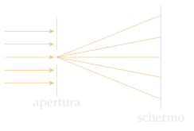
>>> soluzione
**Calcolo.**  $\lambda=h/\sqrt{2m_nK}\simeq1{,}81\times10^{-10}\un{m}=0{,}181\un{nm}$.

**Interpretazione.**  La scala è confrontabile con i passi cristallini; per questo i neutroni termici sono utili nella diffrazione della materia condensata.
:::

::: esercizio Diffrazione di Davisson–Germer [base]
Un massimo di primo ordine si osserva per $\theta=50^\circ$ su piani con distanza $d=0{,}091\un{nm}$. Usando $2d\sin\theta=\lambda$, trovare $\lambda$ e l'energia cinetica non relativistica dell'elettrone.

>>> soluzione
**Bragg.**  $\lambda=2d\sin\theta\simeq0{,}139\un{nm}$.

**Energia.**  $K=h^2/(2m_e\lambda^2)\simeq77{,}4\un{eV}$.
:::

::: esercizio Localizzazione e scala energetica [avanzato]
Un elettrone è preparato con $\Delta x=0{,}10\un{nm}$. Calcolare il minimo $\Delta p_x$, la corrispondente $\Delta v_x$ e la scala $\Delta p_x^2/(2m_e)$.

>>> soluzione
**Indeterminazione.**  $\Delta p_x\geq\hbar/(2\Delta x)\simeq5{,}27\times10^{-25}\un{kg\,m/s}$.

**Velocità.**  $\Delta v_x\geq\Delta p_x/m_e\simeq5{,}79\times10^{5}\un{m/s}$.

**Energia.**  $\Delta p_x^2/(2m_e)\simeq0{,}952\un{eV}$. È una stima di scala, non necessariamente il valore medio dell'energia.
:::

::: esercizio Velocità del pacchetto e della fase [avanzato]
Per un elettrone libero non relativistico con $\lambda=0{,}200\un{nm}$, calcolare $v_g$ e $v_\phi$.

>>> soluzione
**Numero d'onda.**  $k=2\pi/\lambda$ e $p=\hbar k$.

**Gruppo.**  $v_g=p/m_e\simeq3{,}64\times10^{6}\un{m/s}$.

**Fase.**  Con la scelta dello zero dell'energia implicita in $E=p^2/(2m_e)$, $v_\phi=\omega/k=E/p=v_g/2\simeq1{,}82\times10^{6}\un{m/s}$. Questa velocità di fase non descrive trasporto di particella o informazione e dipende dalla convenzione scelta per lo zero dell'energia.
:::

::: esercizio Angolo di diffrazione elettronica [base]
Elettroni accelerati da $150\un{V}$ incidono su un reticolo unidimensionale di passo $d=0{,}200\un{nm}$. Stimare l'angolo del primo ordine con $d\sin\theta=\lambda$.

>>> soluzione
**Lunghezza d'onda.**  Dal primo esercizio $\lambda\simeq0{,}100\un{nm}$.

**Angolo.**  $\sin\theta=\lambda/d\simeq0{,}500$, quindi $\theta\simeq30{,}0^\circ$.
:::

::: esercizio Riga Lyman-$\alpha$ [base]
Usando $E_n=-13{,}6\,\mathrm{eV}/n^2$, calcolare energia e lunghezza d'onda del fotone emesso nella transizione $n=2\to n=1$ dell'idrogeno.

>>> soluzione
**Differenza energetica.**  $\Delta E=13{,}6(1-1/4)=10{,}2\un{eV}$.

**Lunghezza d'onda.**  $\lambda=hc/\Delta E\simeq121{,}6\un{nm}$, nell'ultravioletto.
:::

::: esercizio Correzione relativistica a $100\un{kV}$ [medio]
Calcolare la lunghezza d'onda di un elettrone accelerato da $100\un{kV}$ prima con la formula non relativistica e poi con

$$pc=\sqrt{K^2+2Km_ec^2},\qquad K=eV.$$

>>> soluzione
**Non relativistica.**  $\lambda_{\mathrm{nr}}\simeq3{,}88\un{pm}$.

**Relativistica.**  $\lambda=h/p\simeq3{,}70\un{pm}$.

**Confronto.**  La differenza è circa il $4{,}6\%$: a $100\un{kV}$ la correzione non è più trascurabile.
:::

### Funzione d'onda, operatori e probabilità

::: esercizio Normalizzazione di un'esponenziale simmetrica [base]
In una dimensione $\psi(x)=A e^{-a|x|}$, con $a=2{,}0\un{nm^{-1}}$. Determinare $A$ reale positivo e la probabilità di trovare la particella in $|x|<0{,}50\un{nm}$.

>>> soluzione
**Normalizzazione.**  $1=2A^2\int_0^\infty e^{-2ax}\dd x=A^2/a$, dunque $A=\sqrt a$.

**Probabilità.**  $P=1-e^{-2ab}=1-e^{-2}\simeq0{,}865$.
:::

::: esercizio Gaussiana e deviazione standard [avanzato]
Sia

$$\psi(x)=\frac{1}{(2\pi\sigma^2)^{1/4}}e^{-x^2/(4\sigma^2)}.$$

Mostrare che è normalizzata e che $\langle x\rangle=0$, $\Delta x=\sigma$.

>>> soluzione
**Densità.**  $|\psi|^2=(\sqrt{2\pi}\sigma)^{-1}e^{-x^2/(2\sigma^2)}$, cioè una gaussiana normalizzata.

**Simmetria.**  L'integrando di $\langle x\rangle$ è dispari, quindi il valore medio è zero.

**Varianza.**  L'integrale gaussiano standard dà $\langle x^2\rangle=\sigma^2$, dunque $\Delta x=\sigma$.
:::

::: esercizio Probabilità nel terzo centrale di una buca [base]
Una particella nella buca $0<x<L$ è nello stato fondamentale $\phi_1=\sqrt{2/L}\sin(\pi x/L)$. Calcolare $P(L/3<x<2L/3)$.

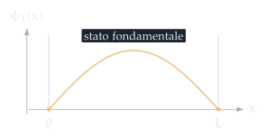
>>> soluzione
**Integrale.**  $P=\int_{L/3}^{2L/3}(2/L)\sin^2(\pi x/L)\dd x$.

**Risultato.**  $P=\frac13+\frac{\sqrt3}{2\pi}\simeq0{,}609$.
:::

::: esercizio Valori medi per uno stato reale pari [base]
Una funzione d'onda normalizzata $\psi(x)$ è reale, pari e tende a zero all'infinito. Determinare $\langle x\rangle$ e $\langle p_x\rangle$.

>>> soluzione
**Posizione.**  $x|\psi|^2$ è dispari, quindi $\langle x\rangle=0$.

**Quantità di moto.**  $\langle p_x\rangle=-i\hbar\int\psi\psi'\dd x=-i\hbar[\psi^2/2]_{-\infty}^{\infty}=0$.
:::

::: esercizio Corrente di probabilità di un'onda piana [base]
Per un elettrone in una dimensione, $\psi=Ae^{ikx}$ con $\lambda=0{,}500\un{nm}$ e $|A|^2=2{,}0\times10^{6}\un{m^{-1}}$. Calcolare la corrente di probabilità.

>>> soluzione
**Formula.**  $j=(\hbar k/m_e)|A|^2$.

**Calcolo.**  Con $k=2\pi/\lambda$, $j\simeq2{,}91\times10^{12}\un{s^{-1}}$. In una descrizione monodimensionale $j$ è una probabilità per unità di tempo che attraversa un punto.
:::

::: esercizio Sovrapposizione di due autostati energetici [medio]
In una buca larga $1{,}0\un{nm}$,

$$\psi=\frac35\phi_1+\frac45\phi_2.$$

Trovare le probabilità dei due esiti energetici e l'energia media.

>>> soluzione
**Probabilità.**  $P_1=9/25=0{,}36$ e $P_2=16/25=0{,}64$.

**Livelli.**  $E_1\simeq0{,}376\un{eV}$, $E_2=4E_1\simeq1{,}504\un{eV}$.

**Media.**  $\langle E\rangle=P_1E_1+P_2E_2\simeq1{,}10\un{eV}$.
:::

::: esercizio Fase relativa e battimento [avanzato]
Per la sovrapposizione dell'esercizio precedente, determinare il periodo con cui la fase relativa fra $\phi_1$ e $\phi_2$ ritorna al valore iniziale. Spiegare che cosa resta costante.

>>> soluzione
**Fase.**  La differenza evolve come $e^{-i(E_2-E_1)t/\hbar}$.

**Periodo.**  $T=2\pi\hbar/(E_2-E_1)=h/(E_2-E_1)\simeq3{,}67\un{fs}$.

**Osservabili.**  La densità può oscillare per interferenza; le probabilità $|c_1|^2$, $|c_2|^2$ e la distribuzione dell'energia restano costanti.
:::

::: esercizio Commutatore fondamentale [medio]
Applicare $[\widehat x,\widehat p_x]$ a una funzione regolare $f(x)$ e mostrare che il risultato è $i\hbar f(x)$.

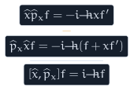
>>> soluzione
**Primo ordine.**  $\widehat x\widehat p f=-i\hbar x f'$.

**Ordine inverso.**  $\widehat p\widehat x f=-i\hbar(xf)'=-i\hbar(f+xf')$.

**Differenza.**  $[\widehat x,\widehat p]f=i\hbar f$, quindi $[\widehat x,\widehat p]=i\hbar$.
:::

### Scattering e tunneling

::: esercizio Riflessione su un gradino sopra soglia [medio]
Un elettrone con $E=5{,}0\un{eV}$ incontra un gradino $V_0=2{,}0\un{eV}$. Calcolare $R$ e $T$.

>>> soluzione
**Numeri d'onda.**  I fattori comuni si cancellano: $k_1\propto\sqrt5$, $k_2\propto\sqrt3$.

**Coefficienti.**  $R=[(k_1-k_2)/(k_1+k_2)]^2\simeq0{,}0161$ e $T=4k_1k_2/(k_1+k_2)^2\simeq0{,}9839$.

**Controllo.**  $R+T=1$.
:::

::: esercizio Profondità di penetrazione in un gradino [base]
Un elettrone con $E=1{,}0\un{eV}$ incontra un gradino di altezza $V_0=2{,}0\un{eV}$. Calcolare la lunghezza $1/\kappa$.

>>> soluzione
**Costante di decadimento.**  $\kappa=\sqrt{2m_e(V_0-E)}/\hbar$.

**Risultato.**  $1/\kappa\simeq0{,}195\un{nm}$. La densità $|\psi|^2$ decade su una scala $1/(2\kappa)$ nell'esponente.
:::

::: esercizio Trasmissione esatta attraverso una barriera [medio]
Per un elettrone con $E=1{,}0\un{eV}$, barriera $V_0=3{,}0\un{eV}$ e larghezza $a=0{,}400\un{nm}$, calcolare $T$ con la formula esatta riportata nel testo.

>>> soluzione
**Parametro.**  $\kappa a\simeq2{,}90$.

**Trasmissione.**

$$T=\left[1+\frac{V_0^2\sinh^2(\kappa a)}{4E(V_0-E)}\right]^{-1}\simeq1{,}08\times10^{-2}.$$

L'approssimazione puramente esponenziale fornisce l'ordine di grandezza ma non il prefattore.
:::

::: esercizio Stima di barriera spessa [medio]
Un elettrone ha energia inferiore alla barriera di $2{,}0\un{eV}$ e deve attraversare $a=0{,}500\un{nm}$. Stimare il fattore $e^{-2\kappa a}$.

>>> soluzione
**Costante.**  $\kappa\simeq7{,}25\times10^{9}\un{m^{-1}}$.

**Esponente.**  $2\kappa a\simeq7{,}25$.

**Stima.**  $e^{-2\kappa a}\simeq7{,}14\times10^{-4}$.
:::

::: esercizio Sensibilità di un microscopio a effetto tunnel [medio]
Assumere una barriera efficace di $4{,}0\un{eV}$ e $I\propto e^{-2\kappa a}$. Di quale fattore cambia la corrente se la distanza aumenta di $0{,}100\un{nm}$?

>>> soluzione
**Decadimento.**  $\kappa=\sqrt{2m_e\Phi}/\hbar\simeq1{,}02\times10^{10}\un{m^{-1}}$.

**Rapporto.**  $I(a+\Delta a)/I(a)=e^{-2\kappa\Delta a}\simeq0{,}129$.

**Interpretazione.**  Un aumento di un solo ångström riduce la corrente di circa un fattore $7{,}8$.
:::

::: esercizio Effetto della massa sul tunneling [avanzato]
Confrontare il fattore esponenziale dell'esercizio 4 per un elettrone e per un protone, a parità di $V_0-E$ e $a$.

>>> soluzione
**Scalatura.**  L'esponente è proporzionale a $\sqrt m$.

**Elettrone.**  $T_e$ ha fattore esponenziale $\simeq7{,}14\times10^{-4}$.

**Protone.**  L'esponente diventa $7{,}25\sqrt{m_p/m_e}\simeq310$, quindi $e^{-310}\simeq1{,}5\times10^{-135}$.

**Conclusione.**  Il tunneling di particelle pesanti è molto più soppresso, salvo barriere molto più strette o basse.
:::

::: esercizio Stato legato di una delta attrattiva [base]
Per $V(x)=-g\delta(x)$, con $g>0$, lo stato legato ha

$$E=-\frac{mg^2}{2\hbar^2},\qquad \kappa=\frac{mg}{\hbar^2}.$$

Calcolare $|E|$ e $1/\kappa$ per un elettrone e $g=0{,}20\un{eV\,nm}$.

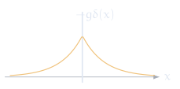
>>> soluzione
**Energia.**  $|E|=m_eg^2/(2\hbar^2)\simeq0{,}262\un{eV}$.

**Estensione.**  $1/\kappa=\hbar^2/(m_eg)\simeq0{,}381\un{nm}$.
:::

::: esercizio Perché si usano le correnti? [medio]
Un'onda incidente ha ampiezza $A$, quella trasmessa ampiezza $C$, ma i numeri d'onda sono $k_1\neq k_2$. Mostrare che $T$ non è in generale $|C/A|^2$.

>>> soluzione
**Correnti.**  Per un'onda piana $j=(\hbar k/m)|A|^2$.

**Rapporto.**  $T=j_t/j_i=(k_2/k_1)|C/A|^2$ per la stessa massa.

**Significato.**  L'ampiezza da sola non misura il flusso: una componente con velocità diversa attraversa la superficie a un ritmo diverso.
:::

### Confinamento e oscillatore

::: esercizio Livelli di un elettrone in una buca nanometrica [base]
Calcolare $E_1$, $E_2$ ed $E_3$ per un elettrone in una buca infinita larga $L=1{,}00\un{nm}$.

>>> soluzione
**Fondamentale.**  $E_1=\pi^2\hbar^2/(2m_eL^2)\simeq0{,}376\un{eV}$.

**Scalatura.**  $E_n=n^2E_1$, quindi $E_2\simeq1{,}50\un{eV}$ ed $E_3\simeq3{,}38\un{eV}$.
:::

::: esercizio Fotone emesso nella transizione $2\to1$ [base]
Per la buca dell'esercizio precedente, calcolare la lunghezza d'onda del fotone associato a $E_2-E_1$.

>>> soluzione
**Differenza.**  $\Delta E=3E_1\simeq1{,}128\un{eV}$.

**Lunghezza d'onda.**  $\lambda=hc/\Delta E\simeq1{,}10\un{\mu m}$, nel vicino infrarosso.
:::

::: esercizio Stessa buca, particella più pesante [medio]
Sostituire l'elettrone con un protone nella stessa buca da $1{,}00\un{nm}$. Calcolare $E_1$ e confrontare.

>>> soluzione
**Scalatura con la massa.**  $E_1\propto1/m$.

**Protone.**  $E_{1,p}=E_{1,e}(m_e/m_p)\simeq2{,}05\times10^{-4}\un{eV}$.

**Confronto.**  La quantizzazione energetica è circa $1836$ volte più fitta.
:::

::: esercizio Probabilità e nodi nello stato fondamentale [base]
Calcolare la probabilità di trovare la particella nel terzo centrale della buca nello stato $n=1$ e indicare il numero di nodi interni.

>>> soluzione
**Probabilità.**  $P=1/3+\sqrt3/(2\pi)\simeq0{,}609$.

**Nodi.**  Lo stato $n=1$ non ha nodi interni; gli zeri alle pareti sono condizioni al contorno.
:::

::: esercizio Energia di una sovrapposizione [medio]
Nella buca da $1{,}00\un{nm}$, lo stato è $(\phi_1+\phi_3)/\sqrt2$. Trovare le probabilità energetiche, $\langle E\rangle$ e $\Delta E$.

>>> soluzione
**Esiti.**  $P_1=P_3=1/2$.

**Media.**  $\langle E\rangle=(E_1+E_3)/2=5E_1\simeq1{,}88\un{eV}$.

**Dispersione.**  Per due valori equiprobabili, $\Delta E=(E_3-E_1)/2=4E_1\simeq1{,}50\un{eV}$.
:::

::: esercizio Tempo di ricostruzione di una sovrapposizione [medio]
Per $(\phi_1+\phi_2)/\sqrt2$ nella buca da $1{,}00\un{nm}$, calcolare il periodo della fase relativa.

>>> soluzione
**Formula.**  $T=h/(E_2-E_1)$.

**Risultato.**  $T\simeq3{,}67\un{fs}$.

**Nota.**  Il ritorno della densità può avere simmetrie con periodi più brevi, ma la fase relativa completa torna dopo $T$.
:::

::: esercizio Energia di punto zero di un modo vibrazionale [base]
Un modo armonico ha frequenza $f=1{,}00\times10^{13}\un{Hz}$. Calcolare la distanza fra livelli e l'energia fondamentale.

>>> soluzione
**Spaziatura.**  $\Delta E=\hbar\omega=hf\simeq0{,}04136\un{eV}$.

**Punto zero.**  $E_0=hf/2\simeq0{,}02068\un{eV}$.
:::

::: esercizio Indeterminazioni nello stato fondamentale [avanzato]
Per un elettrone in un oscillatore con $f=1{,}00\times10^{13}\un{Hz}$, calcolare $\Delta x$ e $\Delta p$ nello stato fondamentale.

>>> soluzione
**Formule.**  $\Delta x=\sqrt{\hbar/(2m_e\omega)}$ e $\Delta p=\sqrt{m_e\hbar\omega/2}$.

**Valori.**  $\Delta x\simeq0{,}960\un{nm}$ e $\Delta p\simeq5{,}49\times10^{-26}\un{kg\,m/s}$.

**Prodotto.**  $\Delta x\Delta p=\hbar/2$: lo stato fondamentale è a indeterminazione minima.
:::

### Atomi, momento angolare e spin

::: esercizio Riga di Balmer $H\alpha$ [base]
Calcolare energia e lunghezza d'onda del fotone emesso nella transizione $n=3\to n=2$ dell'idrogeno.

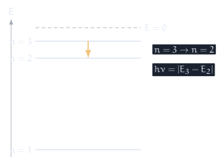
>>> soluzione
**Energia.**  $\Delta E=13{,}6(1/2^2-1/3^2)\simeq1{,}889\un{eV}$.

**Lunghezza d'onda.**  $\lambda=hc/\Delta E\simeq656{,}4\un{nm}$, nel rosso.
:::

::: esercizio Soglia di ionizzazione dell'idrogeno [base]
Qual è la massima lunghezza d'onda capace di ionizzare un atomo di idrogeno nello stato fondamentale?

>>> soluzione
**Energia minima.**  $E_\gamma=13{,}6\un{eV}$.

**Soglia.**  $\lambda_{\max}=hc/E_\gamma\simeq91{,}2\un{nm}$.
:::

::: esercizio Quanti stati nel guscio $n=3$? [medio]
Elencare i valori ammessi di $\ell$ per $n=3$, contare gli orbitali spaziali e poi gli stati monoelettronici includendo lo spin.

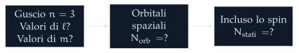
>>> soluzione
**Orbitali.**  $\ell=0,1,2$ e per ogni $\ell$ vi sono $2\ell+1$ valori di $m$.

**Conteggio.**  $1+3+5=9$ orbitali spaziali.

**Spin.**  Ogni orbitale ammette due proiezioni di spin: $18$ stati monoelettronici.

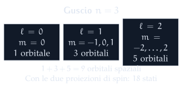
:::

::: esercizio Modulo e proiezione del momento angolare [medio]
Per uno stato con $\ell=2$ e $m=-1$, calcolare $|\vect L|$ e $L_z$.

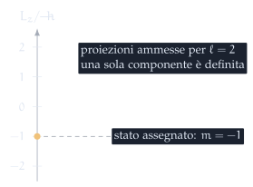
>>> soluzione
**Modulo.**  $|\vect L|=\hbar\sqrt{\ell(\ell+1)}=\sqrt6\,\hbar$.

**Proiezione.**  $L_z=m\hbar=-\hbar$.

**Interpretazione.**  Il modulo è maggiore del valore assoluto di ogni proiezione consentita.
:::

::: esercizio Probabilità radiale nello stato $1s$ [medio]
Per l'idrogeno $P(r<a_0)=\int_0^{a_0}4r^2a_0^{-3}e^{-2r/a_0}\dd r$. Calcolare il valore e distinguere densità volumica da probabilità radiale.

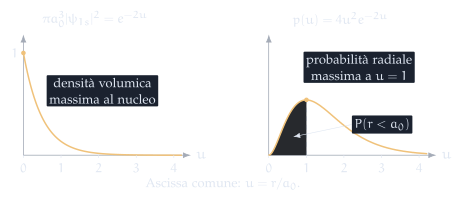
>>> soluzione
**Integrale.**  Ponendo $u=r/a_0$, $P=\int_0^1 4u^2e^{-2u}\dd u=1-5e^{-2}$.

**Risultato.**  $P\simeq0{,}323$.

**Distinzione.**  $|\psi|^2$ è massimo a $r=0$, mentre $4\pi r^2|\psi|^2$ è massimo a $r=a_0$.
:::

::: esercizio Scissione Zeeman orbitale [medio]
Nel modello Zeeman normale, livelli adiacenti in $m$ differiscono di $\Delta E=\mu_BB$. Calcolare la separazione in eV e la frequenza per $B=2{,}0\un{T}$.

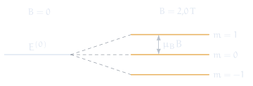
>>> soluzione
**Energia.**  $\Delta E=\mu_BB\simeq1{,}16\times10^{-4}\un{eV}$.

**Frequenza.**  $\nu=\Delta E/h\simeq28{,}0\un{GHz}$.

**Limite.**  La struttura reale include spin, accoppiamento spin–orbita e fattori di Landé.
:::

::: esercizio Forza in Stern–Gerlach [medio]
Un momento magnetico di modulo $\mu_B$ attraversa un gradiente $\partial B/\partial z=10\un{T/m}$. Stimare forza e accelerazione per un atomo d'argento di massa $108\,u$.

>>> soluzione
**Forza.**  $F_z\simeq\mu_B\,\partial_zB\simeq9{,}27\times10^{-23}\un{N}$.

**Massa.**  $m\simeq108(1{,}6605\times10^{-27})\simeq1{,}79\times10^{-25}\un{kg}$.

**Accelerazione.**  $a\simeq5{,}17\times10^{2}\un{m/s^2}$. La deviazione osservata dipende anche dal tempo di volo.
:::

::: esercizio Pauli e nodi di un orbitale $3p$ [base]
Quanti elettroni possono occupare un singolo orbitale $3p$? Quanti nodi radiali e angolari possiede un orbitale con $n=3$, $\ell=1$?

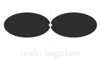
>>> soluzione
**Pauli.**  Un singolo orbitale spaziale può contenere al massimo due elettroni con spin opposti.

**Nodi.**  I nodi radiali sono $n-\ell-1=1$; quelli angolari sono $\ell=1$. Il totale è $n-1=2$.
:::

### Molecole, solidi e sistemi composti

::: esercizio Combinazioni legante e antilegante [avanzato]
In una base $\{\phi_A,\phi_B\}$ ortonormale, $H_{AA}=H_{BB}=-10{,}0\un{eV}$ e $H_{AB}=H_{BA}=-1{,}50\un{eV}$. Trovare energie e autostati normalizzati.

>>> soluzione
**Autostati.**  $\psi_+=(\phi_A+\phi_B)/\sqrt2$ e $\psi_-=(\phi_A-\phi_B)/\sqrt2$.

**Energie.**  $E_+=H_{AA}+H_{AB}=-11{,}5\un{eV}$ e $E_-=H_{AA}-H_{AB}=-8{,}50\un{eV}$.

**Scissione.**  La separazione è $3{,}00\un{eV}$; lo stato simmetrico è legante in questo modello.
:::

::: esercizio Prima riga rotazionale [base]
Una molecola lineare ha momento d'inerzia $I=1{,}46\times10^{-46}\un{kg\,m^2}$. Calcolare energia e frequenza della transizione $J=0\to1$ del rotore rigido.

>>> soluzione
**Livelli.**  $E_J=\hbar^2J(J+1)/(2I)$, quindi $\Delta E=\hbar^2/I$.

**Risultati.**  $\Delta E\simeq0{,}475\un{meV}$ e $\nu=\Delta E/h\simeq115\un{GHz}$.
:::

::: esercizio Soglia ottica di un semiconduttore [base]
Un semiconduttore ha gap diretto $E_g=1{,}10\un{eV}$. Calcolare la massima lunghezza d'onda capace di promuovere un elettrone attraverso il gap, trascurando fononi ed eccitoni.

>>> soluzione
**Soglia.**  $\lambda_g=hc/E_g\simeq1{,}13\un{\mu m}$.

**Interpretazione.**  Fotoni con lunghezza d'onda maggiore hanno energia insufficiente nel modello ideale.
:::

::: esercizio Transizione in un pozzo quantico [base]
Due sottobande di un pozzo quantico sono separate da $\Delta E=0{,}200\un{eV}$. Calcolare frequenza e lunghezza d'onda della radiazione risonante.

>>> soluzione
**Frequenza.**  $\nu=\Delta E/h\simeq4{,}84\times10^{13}\un{Hz}$.

**Lunghezza d'onda.**  $\lambda=c/\nu=hc/\Delta E\simeq6{,}20\un{\mu m}$, nel medio infrarosso.
:::

::: esercizio Bordo della prima zona di Brillouin [medio]
Per una catena con passo $a=0{,}500\un{nm}$, calcolare $k_B=\pi/a$ e la lunghezza d'onda $2\pi/k_B$.

>>> soluzione
**Vettore d'onda.**  $k_B=\pi/a\simeq6{,}28\times10^{9}\un{m^{-1}}$.

**Lunghezza d'onda.**  $\lambda_B=2\pi/k_B=2a=1{,}00\un{nm}$.

**Significato.**  Al bordo di zona l'onda soddisfa una condizione di Bragg e l'accoppiamento col reticolo può aprire un gap.
:::

::: esercizio Probabilità in uno stato di Bell [medio]
Due qubit sono nello stato $|\Phi^+\rangle=(|00\rangle+|11\rangle)/\sqrt2$. Trovare le probabilità dei risultati nella base $\{|0\rangle,|1\rangle\}$ e le probabilità marginali del primo qubit.

>>> soluzione
**Congiunte.**  $P(00)=P(11)=1/2$ e $P(01)=P(10)=0$.

**Marginale.**  $P_A(0)=P_A(1)=1/2$.

**Interpretazione.**  Ogni risultato locale è casuale, ma i due risultati sono perfettamente correlati nella base scelta.
:::

::: esercizio Decadimento della coerenza [base]
In un modello fenomenologico, un elemento fuori diagonale della matrice densità decade come $\rho_{01}(t)=\rho_{01}(0)e^{-t/\tau}$ con $\tau=1{,}0\un{\mu s}$. Quale frazione resta dopo $3{,}0\un{\mu s}$? Che cosa non conclude, da solo, questo calcolo?

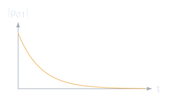
>>> soluzione
**Frazione.**  $e^{-3}\simeq0{,}0498$: resta circa il $5{,}0\%$ della coerenza iniziale.

**Cautela.**  La decoerenza sopprime localmente l'interferenza, ma non seleziona automaticamente un singolo esito in ogni interpretazione della misura.
:::

### Matrici, trasformazioni e autovalori

::: esercizio Ruotare un vettore con una matrice [avanzato]
Applicare la matrice $R(60^\circ)$ al vettore $\vect v=(2,0)$. Verificare che il modulo resti invariato e che il determinante della matrice valga uno.

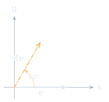
>>> soluzione
**Matrice.**

$$R(60^\circ)=
\begin{pmatrix}
1/2&-\sqrt3/2\\
\sqrt3/2&1/2
\end{pmatrix}.$$

**Prodotto.**

$$R\vect v=
\begin{pmatrix}
1/2&-\sqrt3/2\\
\sqrt3/2&1/2
\end{pmatrix}
\begin{pmatrix}2\\0\end{pmatrix}
=
\begin{pmatrix}1\\[2pt]\sqrt{3}\end{pmatrix}.$$

**Modulo.**

$$|R\vect v|=\sqrt{1^2+(\sqrt3)^2}=2=|\vect v|.$$

**Determinante.**

$$\det R=\frac14-\left(-\frac34\right)=1.$$

La rotazione conserva lunghezze, angoli e aree orientate.
:::

::: esercizio Modi propri di due oscillatori accoppiati [avanzato]
Due masse uguali $m$ sono collegate da tre molle uguali di costante $k$. Le piccole oscillazioni possono essere scritte come

$$\ddot{\vect x}+\frac{k}{m}A\vect x=0,
\qquad
A=\begin{pmatrix}2&-1\\-1&2\end{pmatrix}.$$

La matrice $A$ è quindi una matrice dinamica adimensionale normalizzata; i suoi autovalori $\lambda$ determinano $\omega^2=(k/m)\lambda$. Calcolare autovalori e autovettori e interpretare le direzioni proprie come movimenti concordi e discordi delle due masse.

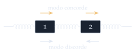
>>> soluzione
**Equazione caratteristica.**

$$\det(A-\lambda I)=
\begin{vmatrix}2-\lambda&-1\\-1&2-\lambda\end{vmatrix}
=(2-\lambda)^2-1=0.$$

**Autovalori.**

$$2-\lambda=\pm1
\quad\Rightarrow\quad
\lambda_1=1,\qquad\lambda_2=3.$$

**Autovettore per $\lambda_1=1$.**

$$(A-I)\vect v=0
\quad\Rightarrow\quad x-y=0.$$

Si può scegliere $\vect v_1=(1,1)$: le coordinate si muovono nello stesso verso.

**Autovettore per $\lambda_2=3$.**

$$(A-3I)\vect v=0
\quad\Rightarrow\quad x+y=0.$$

Si può scegliere $\vect v_2=(1,-1)$: le coordinate si muovono in versi opposti. Gli autovettori sono ortogonali. Poiché $\omega^2=(k/m)\lambda$, le frequenze angolari sono $\omega_1=\sqrt{k/m}$ e $\omega_2=\sqrt{3k/m}$: gli autovalori sono proporzionali ai quadrati delle frequenze, non alle frequenze stesse.
:::

### Problemi di sintesi: fisica moderna

::: esercizio Massimo di Wien di una stella [medio]
Approssimare una stella come corpo nero a $4500\un{K}$. Calcolare la lunghezza d'onda del massimo di $B_\lambda$.
>>> soluzione
**Wien.**  $\lambda_{max}=b/T=6{,}44\times10^{-7}\un{m}=644\un{nm}$.
:::

::: esercizio Fotoelettroni da luce ultravioletta [avanzato]
Un metallo ha lavoro di estrazione $2{,}4\un{eV}$ ed è illuminato con $350\un{nm}$. Calcolare energia cinetica massima e potenziale di arresto.
>>> soluzione
**Fotone.**  $E_\gamma=hc/\lambda=3{,}54\un{eV}$.

**Einstein.**  $K_{max}=E_\gamma-\Phi=1{,}14\un{eV}$.

**Arresto.**  $V_s=K_{max}/e=1{,}14\,\mathrm{V}$ quando $K$ è espresso in eV.
:::

::: esercizio Massimo spostamento Compton [avanzato]
Calcolare il massimo spostamento di lunghezza d'onda Compton per diffusione da un elettrone libero.
>>> soluzione
**Angolo.**  $\Delta\lambda=\lambda_C(1-\cos\theta)$ è massimo a $\theta=180^\circ$.

**Risultato.**  $\Delta\lambda_{max}=2\lambda_C=4{,}85\times10^{-12}\un{m}=4{,}85\un{pm}$.
:::

::: esercizio Lunghezza d'onda di un elettrone [avanzato]
Calcolare la lunghezza d'onda di de Broglie di un elettrone con energia cinetica $150\un{eV}$, usando il limite non relativistico.
>>> soluzione
**Quantità di moto.**  $p=\sqrt{2mK}$.

**De Broglie.**  $\lambda=h/p=1{,}00\times10^{-10}\un{m}=100\un{pm}$.
:::

::: esercizio Indeterminazione confinando un elettrone [avanzato]
Un elettrone è localizzato con $\Delta x=0{,}10\un{nm}$. Stimare il limite minimo su $\Delta p$ e la corrispondente $\Delta v$ non relativistica.
>>> soluzione
**Heisenberg.**  $\Delta p\geq\hbar/(2\Delta x)=5{,}27\times10^{-25}\un{kg\,m/s}$.

**Velocità.**  $\Delta v\gtrsim\Delta p/m_e=5{,}79\times10^{5}\un{m/s}$.
:::

::: esercizio Secondo livello in una buca infinita [medio]
Un elettrone è confinato in una buca infinita larga $1{,}0\un{nm}$. Calcolare l'energia del livello $n=2$.
>>> soluzione
**Spettro.**

$$E_n=\frac{n^2h^2}{8mL^2}=1{,}50\un{eV}.$$
:::

::: esercizio Stima esponenziale del tunneling [avanzato]
Un elettrone di energia $2\un{eV}$ incontra una barriera di $5\un{eV}$ larga $0{,}5\un{nm}$. Stimare $T\sim e^{-2\kappa a}$.
>>> soluzione
**Costante evanescente.**  $\kappa=\sqrt{2m(V_0-E)}/\hbar=8{,}87\times10^{9}\un{m^{-1}}$.

**Trasmissione.**  $T\sim e^{-2\kappa a}=1{,}40\times10^{-4}$. Il prefattore può modificare il valore, ma l'esponenziale domina per barriera spessa.
:::

::: esercizio Energia di punto zero di un oscillatore [avanzato]
Un oscillatore quantistico ha frequenza $5{,}0\times10^{13}\un{Hz}$. Calcolare energia di punto zero e separazione fra livelli.
>>> soluzione
**Livelli.**  $E_n=(n+\tfrac12)h f$.

**Punto zero.**  $E_0=\tfrac12hf=0{,}103\un{eV}$.

**Spaziatura.**  $\Delta E=hf=0{,}207\un{eV}$.
:::

::: esercizio Transizione di Balmer $3\to2$ [avanzato]
Calcolare energia e lunghezza d'onda del fotone emesso nella transizione dell'idrogeno $n=3\to n=2$, usando $E_n=-13{,}6\,\mathrm{eV}/n^2$.
>>> soluzione
**Differenza.**  $E_\gamma=13{,}6(1/2^2-1/3^2)=1{,}89\un{eV}$.

**Lunghezza d'onda.**  $\lambda=hc/E_\gamma=6{,}56\times10^{-7}\un{m}=656\un{nm}$.
:::

::: esercizio Misura di spin lungo un asse inclinato [avanzato]
Uno spin $1/2$ è preparato “su” lungo $z$. Si misura lungo un asse $\vect n$ inclinato di $60^\circ$ rispetto a $z$. Calcolare le probabilità dei due risultati applicando la regola di Born. Si fornisce la decomposizione dello stato iniziale nella base di misura, per una scelta coerente delle fasi:

$$\ket{+z}=\cos\frac{\theta}{2}\,\ket{+n}-\sin\frac{\theta}{2}\,\ket{-n}.$$

Qui $\theta=60^\circ$; gli stati $\ket{+n}$ e $\ket{-n}$ sono ortonormali e corrispondono agli esiti $+\hbar/2$ e $-\hbar/2$.
>>> soluzione
**Ampiezze.**  $P_+=\cos^2(\theta/2)=0{,}750$ e $P_-=\sin^2(\theta/2)=0{,}250$.

**Controllo.**  Le probabilità sommano a 1.
:::

::: esercizio Dilatazione temporale a $0{,}8c$ [avanzato]
Un processo dura $5{,}0\un{\mu s}$ nel proprio riferimento. Quanto dura in un laboratorio in cui il sistema si muove a $0{,}80c$?
>>> soluzione
**Fattore.**  $\gamma=1/\sqrt{1-0{,}80^2}=1{,}67$.

**Tempo di laboratorio.**  $\Delta t=\gamma\Delta\tau=8{,}33\un{\mu s}$.
:::

::: esercizio Contrazione di una nave relativistica [medio]
Una nave ha lunghezza propria $120\un{m}$ e viaggia a $0{,}60c$. Quale lunghezza misura il laboratorio?
>>> soluzione
**Contrazione.**  $L=L_0/\gamma=L_0\sqrt{1-v^2/c^2}=96{,}0\un{m}$. La misura richiede posizioni simultanee nel laboratorio.
:::

::: esercizio Energia cinetica relativistica di un elettrone [avanzato]
Calcolare l'energia cinetica di un elettrone a $0{,}90c$ in $\mathrm{MeV}$.
>>> soluzione
**Relativistica.**  $K=(\gamma-1)m_ec^2$ con $\gamma=2{,}29$.

**Risultato.**  $K=0{,}661\un{MeV}$. Il valore classico sarebbe inadeguato a questa velocità.
:::

::: esercizio Attività dopo più emivite [avanzato]
Un radionuclide ha emivita $8\un{d}$. Quale frazione di nuclei e di attività resta dopo $30\un{d}$?
>>> soluzione
**Decadimento.**  $N/N_0=2^{-t/T_{1/2}}=2^{-30/8}=0{,}0743$.

**Attività.**  Poiché $A=\lambda N$, resta la stessa frazione dell'attività iniziale.
:::

::: esercizio Energia di legame della particella alfa [avanzato]
Usando masse nucleari in unità atomiche $m_p=1{,}0072765\,u$, $m_n=1{,}0086649\,u$, $m_\alpha=4{,}0015062\,u$, calcolare l'energia di legame totale con $1u c^2=931{,}494\,\mathrm{MeV}$.
>>> soluzione
**Difetto di massa.**  $\Delta m=2m_p+2m_n-m_\alpha=0{,}030377\,u$.

**Energia.**  $B=\Delta m c^2=28{,}3\un{MeV}$, circa $7{,}07\un{MeV}$ per nucleone.
:::

::: esercizio Lunghezza d'onda di un LED [medio]
Un semiconduttore emette fotoni approssimativamente uguali al gap $E_g=1{,}9\un{eV}$. Stimare la lunghezza d'onda.
>>> soluzione
**Fotone.**  $\lambda=hc/E_g=6{,}53\times10^{-7}\un{m}=653\un{nm}$, nella regione rossa dello spettro visibile.
:::

::: esercizio Quando la lunghezza d'onda è trascurabile [avanzato]
Calcolare la lunghezza d'onda di de Broglie di una palla da baseball di $0{,}145\un{kg}$ a $40\un{m/s}$ e confrontarla con una scala millimetrica.
>>> soluzione
**De Broglie.**  $\lambda=h/(mv)=1{,}14\times10^{-34}\un{m}$.

**Confronto.**  $\lambda/(1\,\mathrm{mm})=1{,}14\times10^{-31}$: gli effetti di diffrazione sono completamente irrilevanti su scale ordinarie, pur restando valida formalmente la relazione quantistica.
:::

## Fonti {#fonti}

Il testo, le formule, i diagrammi e gli esercizi di questo capitolo provengono dalla *Dispensa di fisica* del corso (sezioni 0.35, 8.1-8.10 e materiali delle sezioni 8.11, 8.12, 8.13), consultabile nel lettore della galassia. Per la lettura sul sito sono cambiati l'impaginazione, i colori delle figure, la numerazione e la posizione di alcuni riquadri ed esercizi; la sezione iniziale è scritta per il pianeta di questa unità.

Opere citate nel testo:

1. M. Planck, “Ueber das Gesetz der Energieverteilung im Normalspectrum”, *Annalen der Physik*, vol. 309, n. 3, 1901, pp. 553–563; comunicazione originale del 1900.
2. A. Einstein, “Über einen die Erzeugung und Verwandlung des Lichtes betreffenden heuristischen Gesichtspunkt”, *Annalen der Physik*, vol. 322, n. 6, 1905, pp. 132–148.
3. N. Bohr, “On the Constitution of Atoms and Molecules”, *Philosophical Magazine*, 6a serie, vol. 26, 1913, pp. 1–25, 476–502, 857–875.
4. A. H. Compton, “A Quantum Theory of the Scattering of X-rays by Light Elements”, *Physical Review*, vol. 21, 1923, pp. 483–502.
5. L. de Broglie, *Recherches sur la théorie des quanta*, tesi di dottorato, Université de Paris, 1924.
6. E. Schrödinger, “Quantisierung als Eigenwertproblem”, parti I–IV, *Annalen der Physik*, vol. 384–385, 1926.
7. M. Born, “Zur Quantenmechanik der Stoßvorgänge”, *Zeitschrift für Physik*, vol. 37, 1926, pp. 863–867.
8. C. Davisson e L. H. Germer, “Diffraction of Electrons by a Crystal of Nickel”, *Physical Review*, vol. 30, 1927, pp. 705–740.
9. W. Heisenberg, “Über den anschaulichen Inhalt der quantentheoretischen Kinematik und Mechanik”, *Zeitschrift für Physik*, vol. 43, 1927, pp. 172–198.
10. C. Jönsson, “Elektroneninterferenzen an mehreren künstlich hergestellten Feinspalten”, *Zeitschrift für Physik*, vol. 161, 1961, pp. 454–474.
11. P. G. Merli, G. F. Missiroli e G. Pozzi, “On the statistical aspect of electron interference phenomena”, *American Journal of Physics*, vol. 44, 1976, pp. 306–307.
12. A. Tonomura, J. Endo, T. Matsuda, T. Kawasaki e H. Ezawa, “Demonstration of single-electron buildup of an interference pattern”, *American Journal of Physics*, vol. 57, 1989, pp. 117–120.
13. R. P. Feynman, R. B. Leighton e M. Sands, *The Feynman Lectures on Physics*, vol. III, New Millennium Edition, Basic Books, New York, 2011, ISBN 978-0-465-02501-5.
14. P. A. M. Dirac, *The Principles of Quantum Mechanics*, Clarendon Press, Oxford, 1930.
15. J. von Neumann, *Mathematische Grundlagen der Quantenmechanik*, Springer, Berlino, 1932.
16. W. R. Hamilton, “On a General Method in Dynamics”, *Philosophical Transactions of the Royal Society*, vol. 124, 1834, pp. 247–308.
17. I. Newton, *Opticks: or, A Treatise of the Reflexions, Refractions, Inflexions and Colours of Light*, Smith e Walford, Londra, 1704.
18. L. Foucault, “Méthode générale pour mesurer la vitesse de la lumière dans l'air et les milieux transparents”, *Comptes Rendus de l'Académie des Sciences*, vol. 30, 1850, pp. 551–560.
19. E. Joos e H. D. Zeh, “The emergence of classical properties through interaction with the environment”, *Zeitschrift für Physik B*, vol. 59, 1985, pp. 223–243.
20. W. H. Zurek, “Decoherence and the transition from quantum to classical”, *Physics Today*, vol. 44, n. 10, 1991, pp. 36–44.
21. E. Schrödinger, “Die gegenwärtige Situation in der Quantenmechanik”, *Die Naturwissenschaften*, vol. 23, 1935, pp. 807–812, 823–828, 844–849.
22. M. Arndt, O. Nairz, J. Vos-Andreae, C. Keller, G. van der Zouw e A. Zeilinger, “Wave–particle duality of C$_{60}$ molecules”, *Nature*, vol. 401, 1999, pp. 680–682.
23. A. Cayley, “A Memoir on the Theory of Matrices”, *Philosophical Transactions of the Royal Society of London*, vol. 148, 1858, pp. 17–37.
24. T. Hawkins, “Cauchy and the spectral theory of matrices”, *Historia Mathematica*, vol. 2, n. 1, 1975, pp. 1–29.
